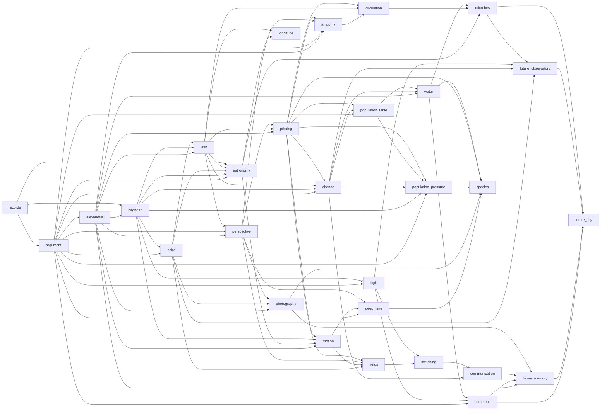

# Executable dependency graph

Each row is an actual cross-chapter ingredient use. Earlier raw supplies and merely present inventory are excluded. `pedagogical_reuse` does not assert historical influence; `speculative_synthesis` does not assert existing capability.

| Created in | Used in | Created artifact | Recipe output | Relationship |
|---|---|---|---|---|
| records | argument | Dated sky record | Stated premises | pedagogical_reuse |
| records | argument | Watching calendar | Rival prediction | pedagogical_reuse |
| records | argument | Record and interpretation | Distinct claims | pedagogical_reuse |
| argument | alexandria | Valid argument | Geometrical proof | pedagogical_reuse |
| argument | alexandria | Counterexample | Proof conditions | pedagogical_reuse |
| alexandria | baghdad | Proof roll | Compared witness | documented_tradition_or_application |
| records | baghdad | Reckoning table | Decimal procedure | pedagogical_reuse |
| baghdad | cairo | Arabic proof | Ray diagram | documented_tradition_or_application |
| argument | cairo | Open question | Optical question | pedagogical_reuse |
| baghdad | latin | Decimal procedure | Latin arithmetic | documented_tradition_or_application |
| baghdad | latin | Algebra method | Merchant manual | documented_tradition_or_application |
| cairo | latin | Optical model | Compared optical copy | documented_tradition_or_application |
| alexandria | latin | Critical text | Annotated optics | pedagogical_reuse |
| latin | perspective | Circulating optical book | Visual pyramid | pedagogical_reuse |
| alexandria | perspective | Geometrical proof | Constructed grid | pedagogical_reuse |
| argument | perspective | Open question | Situated image | pedagogical_reuse |
| latin | printing | Circulating arithmetic book | Set arithmetic page | documented_tradition_or_application |
| perspective | printing | Illustration method | Diagram block | pedagogical_reuse |
| alexandria | printing | Critical text | Corrected proof | documented_tradition_or_application |
| alexandria | printing | Proof roll | Checked edition | documented_tradition_or_application |
| argument | anatomy | Counterexample | Bounded correction | pedagogical_reuse |
| perspective | anatomy | Illustration method | Anatomical drawing | pedagogical_reuse |
| printing | anatomy | Checked edition | Printed anatomy | documented_tradition_or_application |
| alexandria | anatomy | Critical text | Anatomical commentary | pedagogical_reuse |
| latin | astronomy | Circulating optical book | Refracted rays | documented_tradition_or_application |
| cairo | astronomy | Ray diagram | Interpreted shadows | pedagogical_reuse |
| argument | astronomy | Unsettled cause | Bounded sky claim | pedagogical_reuse |
| baghdad | astronomy | Algebra method | Orbital comparison table | pedagogical_reuse |
| records | astronomy | Cycle table | Predictive sky record | pedagogical_reuse |
| latin | circulation | Merchant manual | Per-beat account | pedagogical_reuse |
| anatomy | circulation | Anatomical commentary | Directed-vessel record | documented_tradition_or_application |
| anatomy | circulation | Bounded correction | Circulation limits | documented_tradition_or_application |
| printing | circulation | Checked edition | Circulation book | pedagogical_reuse |
| baghdad | chance | Decimal procedure | Outcome count | pedagogical_reuse |
| latin | chance | Merchant manual | Backward value | pedagogical_reuse |
| argument | chance | Valid argument | Probability model | pedagogical_reuse |
| printing | chance | Printed quire | Probability table | pedagogical_reuse |
| printing | population-table | Checked edition | Comparable bills | pedagogical_reuse |
| chance | population-table | Probability table | Variation account | pedagogical_reuse |
| argument | population-table | Counterexample | Population caveat | pedagogical_reuse |
| baghdad | motion | Algebra method | Motion differences | pedagogical_reuse |
| astronomy | motion | Orbital comparison table | Orbital geometry | documented_tradition_or_application |
| alexandria | motion | Geometrical proof | Orbital geometry | pedagogical_reuse |
| astronomy | motion | Bounded sky claim | Scope of law | documented_tradition_or_application |
| printing | motion | Checked edition | Mathematical treatise | pedagogical_reuse |
| latin | longitude | Merchant manual | Clock longitude | pedagogical_reuse |
| astronomy | longitude | Predictive sky record | Checked sky angle | pedagogical_reuse |
| perspective | deep-time | Illustration method | Lower-layer section | pedagogical_reuse |
| motion | deep-time | Mathematical treatise | Timescale question | pedagogical_reuse |
| argument | deep-time | Counterexample | Qualified deep-time argument | pedagogical_reuse |
| baghdad | population-pressure | Decimal procedure | Growth table | pedagogical_reuse |
| population-table | population-pressure | Demographic record | Model–record comparison | pedagogical_reuse |
| chance | population-pressure | Model condition | Conditional pressure | pedagogical_reuse |
| argument | population-pressure | Valid argument | Policy premises | pedagogical_reuse |
| printing | population-pressure | Printed quire | Population pamphlet | pedagogical_reuse |
| perspective | fields | Illustration method | Field map | pedagogical_reuse |
| cairo | fields | Comparison record | Switch comparison | pedagogical_reuse |
| motion | fields | Mathematical treatise | Field question | pedagogical_reuse |
| printing | fields | Checked edition | Electromagnetic record | pedagogical_reuse |
| cairo | photography | Camera obscura | Camera exposure | documented_tradition_or_application |
| perspective | photography | Situated image | Framed photograph | pedagogical_reuse |
| alexandria | photography | Critical text | Visual source note | pedagogical_reuse |
| argument | logic | Valid argument | Symbolic propositions | pedagogical_reuse |
| baghdad | logic | Algebra method | Symbolic propositions | pedagogical_reuse |
| argument | logic | Counterexample | Checked logical specification | pedagogical_reuse |
| population-table | water | Population rates | Supplier comparison design | pedagogical_reuse |
| chance | water | Model condition | Bounded water claim | pedagogical_reuse |
| population-table | water | Demographic record | Water evidence report | pedagogical_reuse |
| alexandria | water | Critical text | Auditable investigation | pedagogical_reuse |
| deep-time | species | Geological record | Extended geological time | documented_tradition_or_application |
| photography | species | Photographic archive | Documented variation | pedagogical_reuse |
| population-pressure | species | Population pamphlet | Population constraint | documented_tradition_or_application |
| water | species | Bounded water claim | Bounded evolutionary argument | pedagogical_reuse |
| printing | species | Checked edition | Descent book | pedagogical_reuse |
| astronomy | microbes | Instrument check | Microscope check | pedagogical_reuse |
| water | microbes | Auditable investigation | Documented process case | pedagogical_reuse |
| circulation | microbes | Circulation limits | Mechanism with limits | pedagogical_reuse |
| fields | switching | Electromagnetic record | Binary switch | documented_tradition_or_application |
| logic | switching | Checked logical specification | Specified relay network | documented_tradition_or_application |
| chance | communication | Probability table | A5 B2 C2 D1 | pedagogical_reuse |
| switching | communication | Equivalent circuit | Receiver design | pedagogical_reuse |
| water | commons | Auditable investigation | Monitoring record | pedagogical_reuse |
| logic | commons | Checked logical specification | Explicit allocation rule | pedagogical_reuse |
| argument | commons | Open question | Commons atlas | pedagogical_reuse |
| microbes | future-observatory | Mechanism with limits | Competing growth predictions | speculative_synthesis |
| logic | future-observatory | Checked logical specification | Experiment lattice | speculative_synthesis |
| cairo | future-observatory | Optical model | Living-light imager | speculative_synthesis |
| chance | future-observatory | Probability table | A better next question | speculative_synthesis |
| photography | future-memory | Photographic archive | Revisitable courtyard | speculative_synthesis |
| alexandria | future-memory | Variant table | Branching recollection | speculative_synthesis |
| communication | future-memory | Communication account | Shareable perspective | speculative_synthesis |
| commons | future-memory | Commons atlas | Plural identity | speculative_synthesis |
| microbes | future-city | Microbial account | Metabolic partnership | speculative_synthesis |
| future-observatory | future-city | Learning observatory | Adaptive resource cycle | speculative_synthesis |
| future-memory | future-city | Choral memory | Inhabited city model | speculative_synthesis |
| commons | future-city | Revisable agreement | Seasonal city rule | speculative_synthesis |

## Compact chapter graph

