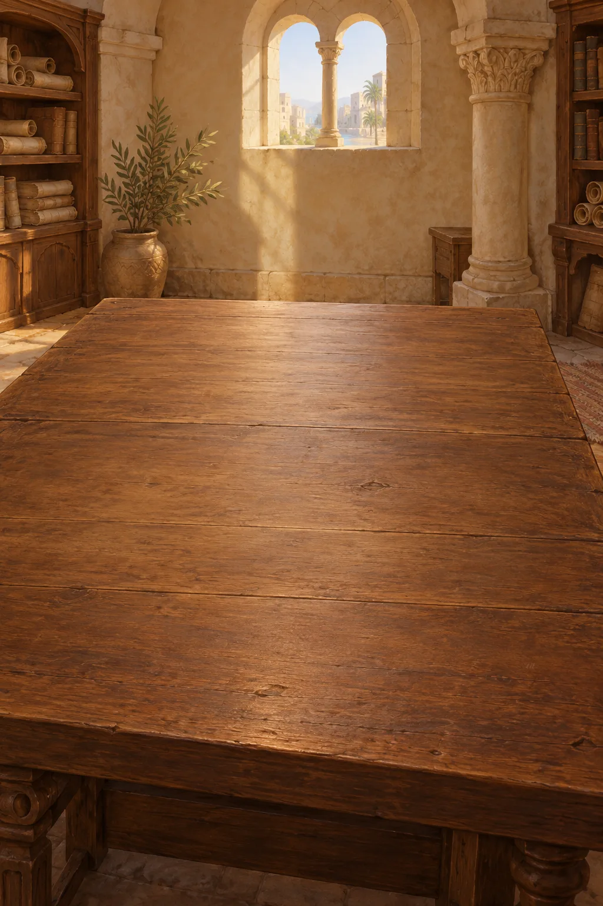
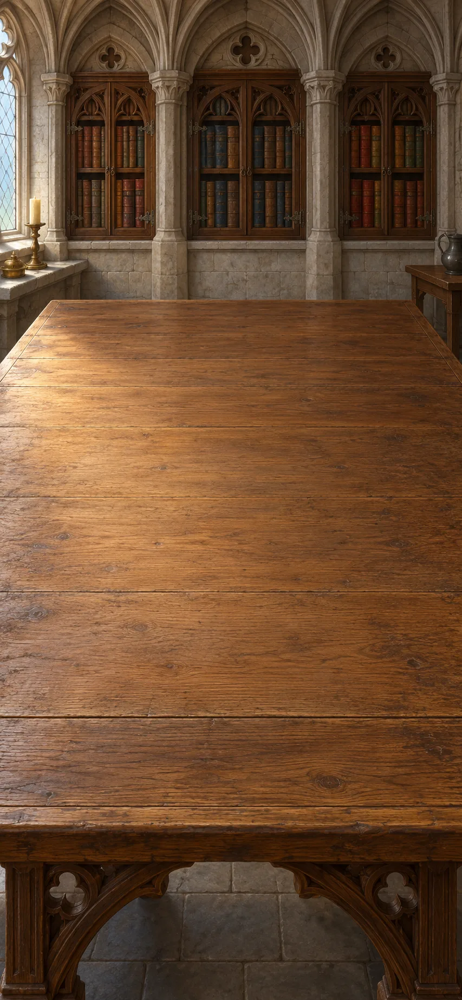
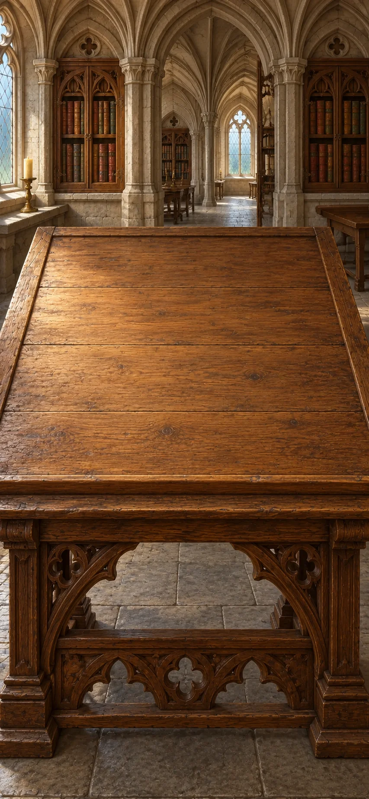
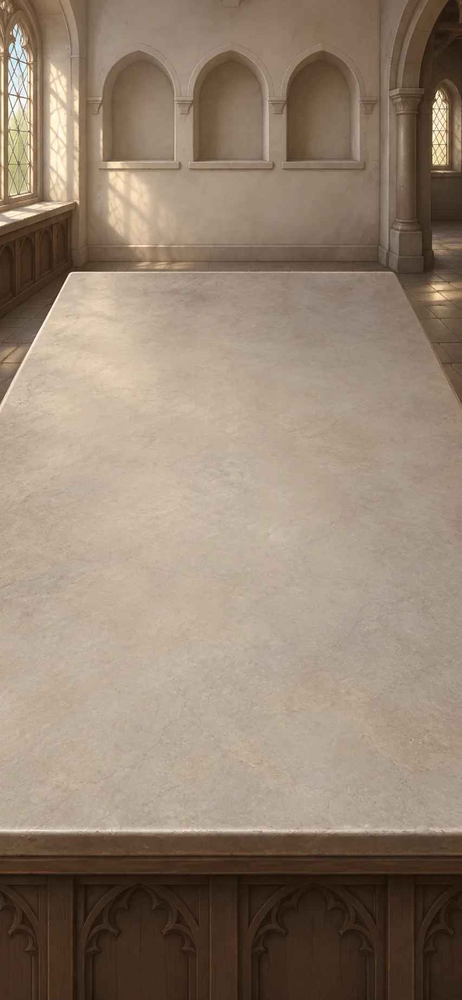

# Divinity: Disputed Questions

A manuscript desk, not a test of faith. Follow a wound, a failed promise, bread, a hungry household and a request for prayer through changing arguments. Build what each writer is claiming, test it against a case, and leave real disagreements open. New chapters reuse distinctions you have made. Each item has a short explanation you can revisit.

> NOTE: Converted from `divinity-final-reading-scenes-v7`, the composed current scenario at source commit `1c95988a4e3771abcf2be28183ce009d38645d2c`. This is authoring text for the proposed Markdown language; it has not been run by a Markdown game runtime. All combinations are global. Completed goals remain satisfied.

> NOTE: Reconstructing an attributed religious argument is not endorsement, demonstration of a miracle, or authentication of an object. These desks compare texts; they do not claim that the writers met. The Book of Two Principles and the Lyon ritual are distinct witnesses, not a single creed for everyone called Cathar. Invented cases remain labelled as cases.

> NOTE: The thirty-seven source creation explanations remain item wonders. Thirty-nine other crafted arguments retain their explicitly authored reading text as unified wonders: those explanations now also open on first creation. The eighty-two primitive source leaves keep their authored explanations for deliberate reading. No ordinary description has been promoted.

## A wound and a stolen meal

*Augustine’s study, North Africa, c. 421*

Augustine explains evil as damage to, or loss of, something good. Compare a wound with stealing a meal: suffering harm is not the same as choosing to harm someone.

> NOTE: Source context: Augustine’s handbook · North Africa, c. 421.

**Goals**
- Is being hurt the same as doing wrong? -- Being hurt is not the same as doing wrong
- What is the nature of evil? -- `augustine-loss`

**Items**
- Case: a cut body has lost its health

  Imagine an injured person. The body remains, but it is not as sound as it should be. Nothing here says that the injured person deserves the injury.

- `healed-body` Case: the wound heals; no evil thing escapes

  The injury disappears as the body heals. This is Augustine’s kind of example: the loss is repaired, rather than a second material being removed.

- Case: I take the meal my neighbour needs

  Imagine taking another person’s share for your own comfort, knowing whose share it is. This is a deliberate action, unlike merely suffering a wound.

- `fair-share` Comfort is good; my neighbour is still owed food

  Enjoying food is good, but the neighbour is still owed their share. The wrong is taking that food, not enjoying a meal.

- Genesis: creation was “very good”

  Augustine accepts the goodness of creation as a religious starting point. The wound example does not establish that starting point.

- `health-lost` A wound is missing health, not an extra substance

  The body is still there, but its health has been damaged. Calling the wound a loss does not make its pain unreal.

- The wrong is taking what another is owed

  Eating and enjoying comfort can be good. Taking the meal a neighbour needs is wrong because it puts personal comfort above what the neighbour is owed. The fault is in the choice, not in food itself.

  > NOTE: Earlier separate reading, superseded here by the unified explanation above: Enjoying food and being able to choose are not themselves wrong. The wrong choice is taking food that another person is owed.

- Being hurt is not the same as doing wrong

  A wound is harm suffered; stealing the meal is a wrong deliberately chosen. Comparing them as losses must not turn suffering into evidence of guilt.

- `augustine-loss` evil is good damaged or missing, not separate stuff (or from chapter "Who made a world that harms?", Augustine: evil is good damaged or missing, not separate stuff)

  Augustine thinks evil is damage to, or loss of, something good rather than a separate evil material. A wound illustrates the idea: the body remains, but health is missing. His belief in a good creation is a starting point, not something the example proves.

**Combinations**
- Case: a cut body has lost its health [transform] + `healed-body` [preserve] -> `health-lost`
- Case: I take the meal my neighbour needs [transform] + `fair-share` [preserve] -> The wrong is taking what another is owed
- `health-lost` + The wrong is taking what another is owed [preserve] -> Being hurt is not the same as doing wrong
- `health-lost` + Genesis: creation was “very good” [preserve] -> `augustine-loss`

> NOTE: Source completion text, retained for author reference rather than an additional completion popup: An injury is harm suffered; stealing a meal is harm chosen. Augustine treats both as losses of goodness, but distinguishes suffering from wrongdoing.

> NOTE: Source `aug-evil`: [Augustine, Enchiridion §§9–15, 23–27, 42–52](https://www.newadvent.org/fathers/1302.htm). Created goodness, evil as privation, and the fallen will.

> NOTE: Source `genesis`: [Genesis 1:31, King James Version](https://www.biblegateway.com/passage/?search=Genesis%201%3A31&version=KJV). Brief excerpt from the creation account; not an independent demonstration of the theological claim.

## Why can’t I simply do better?

It is evening. The desk has been cleared for a new study session about God's grace: help that is given rather than earned. Augustine asks why knowing what is right may not lead to doing it. Compare his answer with his separate claim about infants and inherited sin; illness is not evidence of a child's wrongdoing.

> NOTE: Source context: Augustine’s grace controversy · early fifth century texts.

**Goals**
- Why do we fail to do what we know is right? -- `aided-choice`
- Why would an infant need forgiveness? -- `condition-not-act`

**Items**
- Case: I know I should return the stolen meal

  The person understands the duty. More information about who owns the meal would not address every part of the problem.

- `failed-promise` Case: I promise fairness, then choose comfort again

  The person knows they should return the food and promises to do so, then chooses comfort again. Understanding and promising have not yet produced the right action.

- Paul: “The good that I would I do not”

  Here “would” means “want to”. Augustine reads the passage as a challenge to accounts of help that stop at ability or teaching.

- `love-help` God can stir love, not merely teach (or from chapter "Who made a world that harms?", Augustine: God can stir love, not merely teach)

  Augustine distinguishes knowing what is right from wanting and choosing it. He calls God's inward help with that choice grace.

- Case: this infant has chosen no wrongful act

  The case deliberately removes personal acts. If the infant still needs forgiveness, the explanation must concern something besides an act the infant chose.

- Augustine’s church baptizes infants for forgiveness

  Augustine's church baptizes infants for forgiveness. Because an infant has chosen no wrongful act, Augustine asks what this forgiveness addresses.

- `adam-condition` we inherit a sinful condition from the first human, Adam (or from chapter "Who made a world that harms?", Augustine: we inherit a sinful condition from the first human, Adam)

  Adam is the first human in the biblical story. Augustine says Adam's disobedience leaves later humans needing forgiveness even before choosing a wrong act. For him, an infant's illness does not show that the child has behaved badly.

- `knowing-doing-gap` I know what is right, but still choose otherwise

  Knowing what is right has not been enough to make the person do it. Augustine argues that God's help must address willing and acting as well as ignorance.

- `aided-choice` God helps the person want and act (or from chapter "Who made a world that harms?", Augustine: God helps the person want and act)

  Augustine says God can help a person want and do what is right. The person still chooses and acts; help does not make the human actor disappear.

- Why forgive an infant who has not chosen wrong?

  The infant has chosen no wrong act, yet Augustine's church baptizes infants for forgiveness. This creates a question about what needs forgiving; the practice alone does not prove his answer.

- `inherited-sin` inherited sin, not an infant’s chosen act (or from chapter "Who made a world that harms?", Augustine: inherited sin, not an infant’s chosen act)

  Augustine says infants inherit a condition needing forgiveness through Adam, before choosing any wrong act themselves. Christians have disputed this teaching and its implications.

- `condition-not-act` both infants inherit sin; illness does not decide it (or from chapter "Who made a world that harms?", Augustine: both infants inherit sin; illness does not decide it)

  In Augustine's account, both the ill infant and the healthy infant inherit Adam's sinful condition. Neither has chosen a wrong act. Their health is not what determines their need for forgiveness.

- `two-infants` Case: one infant ill, one well; neither chose wrong

  One infant is ill and the other is well. Neither has chosen a wrongful act. Does either child's health determine a need for forgiveness?

- `health-not-moral-test` The sick infant has not chosen wrong; neither has the healthy infant

  Neither infant has chosen a wrong act. Illness in one child is not evidence that the child deliberately did wrong.

**Combinations**
- Case: I know I should return the stolen meal [transform] + `failed-promise` -> `knowing-doing-gap`
- Paul: “The good that I would I do not” [preserve] + `failed-promise` -> `knowing-doing-gap`
- `knowing-doing-gap` [preserve] + `love-help` [preserve] -> `aided-choice`
- Case: this infant has chosen no wrongful act [preserve] + Augustine’s church baptizes infants for forgiveness [preserve] -> Why forgive an infant who has not chosen wrong?
- Why forgive an infant who has not chosen wrong? [preserve] + `adam-condition` [preserve] -> `inherited-sin`
- Being hurt is not the same as doing wrong [preserve] + `two-infants` [preserve] -> `health-not-moral-test`
- `inherited-sin` [preserve] + `health-not-moral-test` [preserve] -> `condition-not-act`

> NOTE: Source completion text, retained for author reference rather than an additional completion popup: Augustine says an adult may need God's help to do what they know is right. He separately says infants need forgiveness because of Adam's sin, whether they are healthy or ill.

> NOTE: Source `aug-grace`: [Augustine, On the Grace of Christ I](https://www.newadvent.org/fathers/15061.htm). Grace as inward help for willing and acting, beyond nature and instruction alone.

> NOTE: Source `romans`: [Romans 7:19, King James Version](https://www.biblegateway.com/passage/?search=Romans%207%3A19&version=KJV). Short excerpt about willing and doing. Augustine’s reading is an interpretation, not the only reading of Romans.

## Who made a world that harms?

*Northern Italy, thirteenth century*

The Book of Two Principles argues that good and evil have opposed sources. Reconstruct its reasoning and compare it with Augustine's account. Its central claim conflicts with Augustine’s explanation of evil.

[If skipped] Augustine describes evil as damage within a good creation. The Book of Two Principles gives evil an opposed source. The creator's responsibility remains in question.

> NOTE: Source context: Book of Two Principles · northern Italy, thirteenth century.

**Goals**
- Does foreseeing harm make you responsible? -- A knowing maker is not merely a knowing spectator
- Does evil have a source of its own? -- `origins-dispute`

**Items**
- Matthew: “A good tree cannot bring forth evil fruit”

  The verse concerns trees and fruit in a warning about false prophets. The medieval writer extends it into an argument about the sources of good and evil.

- Two Principles: no evil can come from a wholly good cause

  The Book of Two Principles claims that a wholly good source cannot produce evil. That rule is an extra premise in its argument, not something proved merely by noticing suffering.

- Case: the same world feeds people and destroys them

  Imagine fertile land and a destructive storm. The case asks what a good creator could be responsible for. It is not offered as evidence that any one disaster punishes its victims.

- Two Principles: a maker knowingly chose this harmful world

  The text presses a responsibility question: if the maker knew the result and made its conditions, why treat that maker as only an observer?

- An observer can foresee harm without making its cause

  Foreknowledge alone need not cause an event. This is the kind of reply examined in the text. A creator’s additional role still needs attention.

- The writer turns the tree saying into a rule about causes

  The writer reads the tree-and-fruit saying as a rule about the sources of good and evil. Accepting the verse does not require accepting that particular interpretation.

- Two Principles: good and evil must have opposed sources

  The writer of the Book of Two Principles sees both good and harm in the world. Because the writer holds that a wholly good source cannot cause evil, the argument requires opposed sources. This conflicts with Augustine's account of evil as damaged goodness.

- A knowing maker is not merely a knowing spectator

  Knowing that harm will happen is different from making the conditions that cause it. A reply about a passive observer does not fully answer the question about a knowing creator.

- `origins-dispute` Is evil damaged goodness, or does it have its own source?

  Augustine says evil is damage within a good creation. The writer of the Book of Two Principles argues that a wholly good source cannot cause evil, so evil must have an opposed source. The two accounts give different answers to the same problem of suffering and wrongdoing.

**Combinations**
- Matthew: “A good tree cannot bring forth evil fruit” [preserve] + Two Principles: no evil can come from a wholly good cause -> The writer turns the tree saying into a rule about causes
- The writer turns the tree saying into a rule about causes [preserve] + Case: the same world feeds people and destroys them -> Two Principles: good and evil must have opposed sources
- Two Principles: a maker knowingly chose this harmful world [preserve] + An observer can foresee harm without making its cause [preserve] -> A knowing maker is not merely a knowing spectator
- Two Principles: good and evil must have opposed sources + `augustine-loss` [preserve] -> `origins-dispute`
- Two Principles: no evil can come from a wholly good cause + Case: the same world feeds people and destroys them -> Two Principles: good and evil must have opposed sources

> NOTE: Source completion text, retained for author reference rather than an additional completion popup: Augustine describes evil as damage within a good creation. The Book of Two Principles gives evil an opposed source. The accounts disagree about where evil comes from.

> NOTE: Source `two-principles`: [Book of Two Principles, translated selections](https://www.cuhk.edu.hk/crs/tobias/primary_docs_ch11.html). A surviving radical-dualist argument from thirteenth-century Italy; use the translated primary text, not the page’s unqualified proposed Manichaean genealogy.

> NOTE: Source `matthew-tree`: [Matthew 7:18, King James Version](https://www.biblegateway.com/passage/?search=Matthew%207%3A18&version=KJV). Public-domain translation supplies the visible biblical quotation; the medieval treatise’s interpretation is separately attributed.

> NOTE: Source `two-principles-full`: [Book of Two Principles I.8–10, III.1–2 and V.1–6, translated primary text](https://gnosis.org/library/cathar-two-principles.htm). Online transcription based on Wakefield and Evans, with editor changes; primary text located through the search index because direct fetch failed. Use the actual argument, not the archive’s triumphalist introduction. I.9 gives the watcher analogy and I.10 its reply; V exposes disagreement among dualist groups.

## What has the fire example answered?

The next morning, the study desk is ready for a comparison with Aquinas. Compare Aquinas's fire example with the argument you just made. Fire can function as fire while harming something else. Consider what that challenges and which questions about suffering remain unanswered.

> NOTE: Source context: Aquinas · thirteenth century; an editorial comparison of texts.

**Goals**
- Whose fault is fire? -- `limited-answer`
- What can reason tell us about God? -- Explaining a belief is not the same as proving it

**Items**
- Aquinas: fire does what fire does—it heats and burns

  For Aquinas, fire functions well as fire when it heats and burns. That does not make it morally good or mean that every effect is good for everything nearby.

- `water-lost` Aquinas’s example: the fire works, but destroys the water

  Aquinas imagines fire working according to its nature while destroying water. His medieval account concerns the loss of what makes it water, not a modern chemistry explanation.

- Aquinas: the world can give reasons to believe in its cause

  Aquinas thinks reasoning from effects can establish some things about their cause. “Creatures” in his text means created things, not only animals. He does not think such reasoning establishes every Christian belief.

- `faith-beyond` Aquinas: the world cannot prove Father, Son and Spirit are one God

  The Trinity is the belief that Father, Son and Holy Spirit are one God, not three gods. Aquinas says observation of created things cannot prove this belief.

- Fire can work well as fire while harming something else

  Fire can function well as fire while harming something else. This challenges a rule that treats good functioning and harmless effects as the same thing.

- Aquinas: harmful effects do not require a separate evil source

  Aquinas's example offers a way for harmful effects to come from something functioning well. It challenges the need for a separate evil source without answering every question about suffering.

- Explaining a belief is not the same as proving it

  Aquinas thinks natural reasoning can establish some things about the cause of the world, but not the Trinity. He can therefore explain the belief in one God as Father, Son and Spirit without claiming that ordinary observations prove it.

  > NOTE: Earlier separate reading, superseded here by the unified explanation above: Aquinas distinguishes explaining a belief from proving it. He allows reasoning about the Trinity while denying that observations of created things can establish it.

- `limited-answer` The fire example challenges two sources, but leaves the maker’s responsibility open

  Aquinas argues that fire can work well as fire by heating and burning while harming something else. This challenges the claim that every harmful effect needs a wholly evil source. It still leaves the question of why a knowing creator would make such a world.

  > NOTE: Earlier separate reading, superseded here by the unified explanation above: The fire example challenges the claim that every harmful effect needs a wholly evil source. It still leaves the question of why a knowing creator would make a world in which such harm occurs.

**Combinations**
- Aquinas: fire does what fire does—it heats and burns [preserve] + `water-lost` [preserve] -> Fire can work well as fire while harming something else
- Fire can work well as fire while harming something else [preserve] + Two Principles: good and evil must have opposed sources -> Aquinas: harmful effects do not require a separate evil source
- Aquinas: the world can give reasons to believe in its cause [preserve] + `faith-beyond` [preserve] -> Explaining a belief is not the same as proving it
- Aquinas: harmful effects do not require a separate evil source [preserve] + A knowing maker is not merely a knowing spectator [preserve] -> `limited-answer`

> NOTE: Source completion text, retained for author reference rather than an additional completion popup: Aquinas says fire can function well as fire while harming something else. That challenges the claim that harm must come from a wholly evil source, but leaves the creator's responsibility in question.

> NOTE: Source `summa-evil`: [Aquinas, Summa I q.49 aa.1–3](https://www.newadvent.org/summa/1049.htm). Actual objections, Augustine citations, two principles, good nature and defective agency. No evidence here that Aquinas was answering this surviving Italian treatise.

> NOTE: Source `aquinas-reason-limit`: [Aquinas, Summa I q.32 a.1](https://www.newadvent.org/summa/1032.htm). Natural reason does not demonstrate the Trinity; an explanation of a received belief is not its proof.

## Three—and not three gods?

It is evening. We clear the desk to consider what Christians mean by the Trinity. Augustine's earlier text is now compared with Aquinas's limits on proof. Clarify the Christian claim of one God as Father, Son and Holy Spirit without treating human examples as proof of that belief.

[If skipped] Augustine distinguishes Father, Son and Holy Spirit while affirming one God. Aquinas says observation of created things cannot prove this belief.

> NOTE: Source context: Aquinas reopens Augustine · a medieval reading of an earlier text.

**Goals**
- Does being Son mean being less divine? -- Augustine: the name Son does not mean a lesser God
- How can three be one God? -- `trinity-bounded`

**Items**
- `teacher-pupil` Teacher and pupil have different roles; both are human

  A teacher and pupil have different roles while both remaining human. A difference in relationship does not automatically mean a difference in the kind of being they are.

- `father-word` Augustine: Father and Son name a relationship, not two kinds of God

  Being someone's father describes a relationship; it does not make the father a different kind of being from the child. Augustine uses this distinction to explain the names Father and Son while holding that both are divine.

- Does being Son mean being a lesser kind of God?

  This is a question about an inference from the titles. Being related differently does not, just by itself, decide whether two are unequal in nature.

- `three-humans` Case: three humans share a kind, but remain three beings

  Calling three people “human” does not turn them into a single human being. This comparison exposes a tempting but misleading way to explain divine unity.

- `one-divine-being` Augustine: Father, Son and Spirit are one divine being

  Augustine says Father, Son and Holy Spirit are one divine being. He also distinguishes them: the names do not all refer to the same relationship.

- Jesus: “Father … glorify thy Son”

  The Son addresses the Father. Augustine must explain how this real relationship belongs within his belief in one God.

- Different relationships need not mean different kinds of being

  Teacher and pupil have different roles while both being human. Augustine similarly treats Father and Son as names of a relationship, not names for greater and lesser kinds of God.

- Augustine: the name Son does not mean a lesser God

  Augustine says Son names a relationship to the Father, not an inferior kind of God. On his account, Father and Son share the same divine nature.

- Augustine: one God—not three gods sharing a kind

  Three humans share a kind but remain three separate beings. Augustine's claim is different: Father, Son and Spirit are one divine being with real distinctions, not three similar gods.

- `not-masks` Augustine: Father and Son are distinct, not one actor changing masks

  In Augustine's account, Father and Son are genuinely distinct: the Son addresses the Father. They are not one actor successively wearing different costumes.

- `trinity-bounded` Trinity: one God as Father, Son and Holy Spirit

  The doctrine of the Trinity names Father, Son and Holy Spirit as one God. They are not separate gods or one person taking turns in different roles. Aquinas says observation of created things cannot prove this doctrine.

**Combinations**
- `teacher-pupil` [preserve] + `father-word` [preserve] -> Different relationships need not mean different kinds of being
- Different relationships need not mean different kinds of being [preserve] + Does being Son mean being a lesser kind of God? [transform] -> Augustine: the name Son does not mean a lesser God
- `three-humans` [preserve] + `one-divine-being` [preserve] -> Augustine: one God—not three gods sharing a kind
- Jesus: “Father … glorify thy Son” [preserve] + Augustine: one God—not three gods sharing a kind [preserve] -> `not-masks`
- `not-masks` [preserve] + Explaining a belief is not the same as proving it -> `trinity-bounded`

> NOTE: Source completion text, retained for author reference rather than an additional completion popup: Augustine distinguishes Father, Son and Holy Spirit while affirming one God. Aquinas says observation of created things cannot prove this belief.

> NOTE: Source `aug-trinity`: [Augustine, On the Trinity V.1,5–9](https://www.newadvent.org/fathers/130105.htm). Primary text, public-domain translation. Relative names, one divine being, and limits of creaturely comparison.

> NOTE: Source `aquinas-trinity`: [Aquinas, Summa I q.28 aa.1–3](https://www.newadvent.org/summa/1028.htm). Relations and divine unity. Explicitly reopens Augustine; not three members of a species.

> NOTE: Source `john17-kjv`: [John 17:1, King James Version](https://www.biblegateway.com/passage/?search=John%2017%3A1&version=KJV). Brief public-domain quotation. Its Trinitarian interpretation is separately attributed.

## Can a spiritual rite be bodily?

The Lyon ritual is a separate medieval text. Its ceremony uses hands and a Gospel book while claiming a spiritual gift. Examine what those physical actions do, and what they cannot establish about the community's beliefs about creation.

> NOTE: Source context: The Lyon ritual · a separate medieval manuscript witness.

**Goals**
- What does this bodily rite tell us about creation? -- Using bodies in a rite does not prove belief in one good creator
- Does rejecting worldly desires mean rejecting people? -- `renounce-not-abandon`

**Items**
- Lyon ritual: a Gospel book and hands touch the candidate

  A Gospel is an account of Jesus’s life and teaching. The ritual places the book and hands on the candidate. These are physical actions, even though the ceremony claims an inward gift.

- Lyon ritual: laying on hands gives forgiveness and God’s Spirit

  The Lyon rite promises forgiveness and the Holy Spirit, understood as God dwelling with the believer. It calls the laying on of hands spiritual baptism rather than washing with water.

- Acts: Jesus’s first followers lay on hands to give the Spirit

  Acts is the biblical account of the early Christian community. The ritual cites its report that Peter and John lay hands on believers who receive the Holy Spirit. The appeal claims authority; it is not independent verification of this later rite.

- Lyon candidate promises to turn from worldly desires

  The candidate promises to turn away from “worldly desires”. This concerns how the person should live; it does not state a complete explanation of who created matter.

- Jesus: “Love your enemies”

  Loving enemies is one of the candidate's obligations. Turning away from worldly desires therefore cannot mean abandoning concern for other people.

- `apostolic-claim` Lyon ritual claims to continue the first followers’ laying on of hands

  The Lyon ritual appeals to the laying on of hands described among Jesus's first followers. Its ministers claim authority by continuing that practice.

- The rite claims a spiritual gift through hands and a book

  The ritual uses a person's body, ministers' hands and a Gospel book while claiming a spiritual gift. Physical action and a claimed inward effect are not simple opposites.

- Using bodies in a rite does not prove belief in one good creator

  In the Lyon ritual, ministers lay hands and a Gospel book on a believer while promising forgiveness and God’s Spirit. Using physical objects does not tell us whether this community believed in one good creator or opposed sources of good and evil. The Book of Two Principles argues for opposed sources; the ritual does not state that account.

- `renounce-not-abandon` Rejecting worldly desires does not cancel the duty to love enemies

  The candidate promises to reject worldly desires and to love enemies. Giving up those desires does not remove duties toward other people.

**Combinations**
- Lyon ritual: laying on hands gives forgiveness and God’s Spirit + Acts: Jesus’s first followers lay on hands to give the Spirit [preserve] -> `apostolic-claim`
- Lyon ritual: a Gospel book and hands touch the candidate + `apostolic-claim` [preserve] -> The rite claims a spiritual gift through hands and a book
- The rite claims a spiritual gift through hands and a book + `origins-dispute` [preserve] -> Using bodies in a rite does not prove belief in one good creator
- Lyon candidate promises to turn from worldly desires [preserve] + Jesus: “Love your enemies” [preserve] -> `renounce-not-abandon`
- Lyon ritual: a Gospel book and hands touch the candidate + Lyon ritual: laying on hands gives forgiveness and God’s Spirit -> The rite claims a spiritual gift through hands and a book

> NOTE: Source completion text, retained for author reference rather than an additional completion popup: The Lyon rite uses hands and a Gospel book while promising a spiritual gift. The candidate also promises to reject worldly desires and love enemies. These commitments do not tell us everything the community believed about creation.

> NOTE: Source `ritual`: [Occitan ritual, Lyon PA 36, Marvyn Roy Harris critical edition (Rialto)](https://www.rialto.unina.it/archivio/prorel/CatharRitual/CathRit.txt.htm). Critical text IV.15–18 cites Acts 8:14–17 (not Acts 19). III.22–31 and IV.49–53 support indwelling Spirit, forgiveness and bodily enactment. Distinct witness from Two Principles.

> NOTE: Source `matthew-enemies-kjv`: [Matthew 5:44, King James Version](https://www.biblegateway.com/passage/?search=Matthew%205%3A44&version=KJV). Public-domain English enemy-love fragment. The ritual includes enemy-love and prayer/blessing for persecutors in IV.32; do not imply the manuscript used KJV.

## Can water do more than wash?

The next morning, the desk is ready for a new comparison. Aquinas compares a religious rite with a tool through which someone acts. Use the axe example to clarify his account of baptism, while keeping separate his belief that God appointed this particular rite.

> NOTE: Source context: Back to Aquinas · Summa III q.62.

**Goals**
- How could water give an inward gift? -- `instrumental-baptism`
- next: Are these two rites saying the same thing? -- `rites-different`
- Can we really act when God helps us? -- God’s help need not stop a person from really choosing

**Items**
- Aquinas’s example: the axe cuts the wood

  The edge explains the tool’s ordinary cutting. It does not explain by itself why a particular piece of furniture takes shape.

- The craftsperson uses the axe to make a bed

  The craftsperson and the tool act in different, connected ways. Calling the axe effective does not install a second independent designer.

- Baptism uses water to wash the body

  Water has an ordinary bodily action. Aquinas cites Augustine’s distinction between touching the body and cleansing the heart.

- Aquinas: only God gives grace—new life within the soul

  For Aquinas, grace is God’s gift of a new share in divine life, changing the soul from within. God alone is its ultimate source.

  His question is whether a bodily rite can truly help bring about that gift without becoming a second, independent source of divine power.

- `instituted-baptism` Aquinas: God appointed baptism with water to give grace—new life within the soul

  Aquinas says God chose baptism as a way to give grace: a new life within the soul. That is why its water has a role beyond ordinary washing.

  A sacrament is such a God-appointed bodily sign or rite. The axe comparison cannot prove that God appointed any particular rite.

- `nature-perfected-line` Aquinas: “grace does not destroy nature, but perfects it”

  God's gift of help develops human powers such as reasoning and willing rather than erasing them. Aquinas describes reason serving faith and willing guided by love. This does not mean a person becomes incapable of error, and questions about free choice remain.

- `dependent-tool` The axe cuts; the craftsperson works through it

  The axe cuts the wood, while the craftsperson makes the bed through it. Both act, but the axe is not a second independent maker. Aquinas uses this pattern to explain how God could act through a rite.

- `dependent-grace` Aquinas: a rite can be God’s tool, not a second god

  Aquinas argues that God can act through a rite as a craftsperson acts through a tool. This explains how the rite need not rival God, but does not prove that God appointed any particular ceremony.

- `baptism-appointed` Aquinas: God chose baptism with water to give inward grace, not just wash the body

  Aquinas believes God chose baptism with water to give inward grace. The water acts through God's choice; it does not gain independent divine power.

- `instrumental-baptism` Aquinas: in baptism, God works through water to give inward grace

  For Aquinas, baptism washes the body while God works through the water to give grace: a new life within the soul. The water is a tool, not a second god. This depends on his belief that God chose baptism to give that gift.

- God’s help need not stop a person from really choosing

  Augustine says a person still chooses when helped by God. Aquinas says grace develops human powers rather than erasing them. In both accounts, receiving help need not remove a person's real action.

  > NOTE: Original source milestone, revised above to explain the actual two inputs without requiring the separate axe branch: Augustine says a person still chooses when helped by God. Aquinas says an axe really cuts while a craftsperson works through it. The limited comparison shows that dependent action can be real; it does not reduce people to tools.

  > NOTE: Earlier separate reading, superseded here by the unified explanation above: Augustine's helped person still chooses, and Aquinas's tool still acts. The comparison shows that dependent action can be real; it does not mean people are merely tools.

- `rites-different` Both rites use bodies; they disagree about what God appointed

  The Lyon rite uses hands and a Gospel book; Aquinas discusses baptism with water. Both claim an inward gift through physical actions, but disagree about the authorized rite and how it gives that gift.

**Combinations**
- Aquinas’s example: the axe cuts the wood [preserve] + The craftsperson uses the axe to make a bed [preserve] -> `dependent-tool`
- Baptism uses water to wash the body [preserve] + `instituted-baptism` -> `baptism-appointed`
- `dependent-tool` [preserve] + Aquinas: only God gives grace—new life within the soul [preserve] -> `dependent-grace`
- `dependent-grace` + `baptism-appointed` [preserve] -> `instrumental-baptism`
- `aided-choice` + `nature-perfected-line` [preserve] -> God’s help need not stop a person from really choosing
- `instrumental-baptism` + The rite claims a spiritual gift through hands and a book -> `rites-different`
- `dependent-grace` + `instituted-baptism` -> `instrumental-baptism`

> NOTE: Source completion text, retained for author reference rather than an additional completion popup: For Aquinas, God can act through baptism as a craftsperson acts through a tool. He also holds that God appointed this rite; ordinary water is not automatically a sacrament.

> NOTE: Source `summa-doctrine`: [Aquinas, Summa I q.1 aa.1,8](https://www.newadvent.org/summa/1001.htm). Reason and revelation; grace perfects nature. Augustine is an explicit authority in this question.

> NOTE: Source `summa-sign`: [Aquinas, Summa III q.60 aa.3,6](https://www.newadvent.org/summa/4060.htm). Sensible signs and words; explicitly cites Augustine on the word and element.

> NOTE: Source `summa-grace`: [Aquinas, Summa III q.62 a.1](https://www.newadvent.org/summa/4062.htm). God as principal cause and the sacrament as instrument; no independent magic in matter.

## What changed if it still tastes like bread?

It is evening. We return to the cleared study desk. Aquinas says Communion's bread becomes Christ's body while keeping its appearance and taste. How does he distinguish what a thing is from how it appears?

[If skipped] Aquinas distinguishes what the bread is from how it appears. He says the first changes while the second remains.

> NOTE: Source context: Aquinas · the Eucharistic argument.

**Goals**
- What can tasting the bread establish? -- `not-sensory-proof`
- Do water and bread have the same religious role? -- `two-material-roles`

**Items**
- `bread-taste` Case: after the church’s blessing, it still looks and tastes like bread

  After the blessing, the bread looks and tastes the same. Aquinas's account must explain why he still says that what it is has changed.

- Jesus: “This is my body”

  Christians dispute what these supper words mean. Aquinas reads them as affirming the real presence of Christ’s body, not only a reminder.

- Aquinas: what was bread becomes Christ’s body

  Aquinas says the bread becomes Christ’s body, although its taste, colour and shape remain. He is not saying that it starts to look or taste like flesh.

  This claim is called transubstantiation: a change in what the thing is, while its appearances remain. Other Christians dispute the claim.

- Aquinas: what a thing is can differ from how it looks and tastes

  Aquinas distinguishes what something is from its appearance. In Communion, he says the bread's substance—what it is—changes, while qualities such as taste and colour remain. He calls those remaining qualities accidents.

- Aquinas reads Christ’s words as changing bread into his body

  Aquinas reads Christ's supper words as saying that bread becomes Christ's body. This is a particular interpretation, not the only possible reading established by the words alone.

- `same-appearances` For Aquinas, unchanged taste does not mean unchanged reality

  Aquinas says the appearance stays the same while what the thing is changes. Unchanged taste therefore does not contradict his account, but it does not verify it either.

- `eucharist-account` Aquinas: it becomes Christ’s body but keeps bread’s look and taste

  Aquinas says the bread becomes Christ's body while keeping the look and taste of bread. This is called transubstantiation. Explaining the claim about Communion does not establish that the change occurred.

- `not-sensory-proof` This explains Aquinas’s claim; tasting the bread does not prove it

  Aquinas says the bread becomes Christ’s body while its taste remains. Tasting it therefore cannot prove the change he claims. His account rests on faith in divine authority, not a change detected by the senses.

- `two-material-roles` Aquinas: baptism’s water is God’s tool; Communion’s bread becomes Christ’s body

  For Aquinas, baptism's water is a tool through which God acts. In Communion, what was bread becomes Christ's body while appearances remain. These give physical things different roles.

**Combinations**
- Jesus: “This is my body” [preserve] + Aquinas: what was bread becomes Christ’s body [preserve] -> Aquinas reads Christ’s words as changing bread into his body
- `bread-taste` [preserve] + Aquinas: what a thing is can differ from how it looks and tastes [preserve] -> `same-appearances`
- Aquinas reads Christ’s words as changing bread into his body [preserve] + `same-appearances` [preserve] -> `eucharist-account`
- `eucharist-account` + Explaining a belief is not the same as proving it -> `not-sensory-proof`
- `eucharist-account` + `instrumental-baptism` -> `two-material-roles`

> NOTE: Source completion text, retained for author reference rather than an additional completion popup: Aquinas says the bread becomes Christ's body while its appearance and taste remain. A change in appearance would therefore not be the test of his claim.

> NOTE: Source `summa-eucharist`: [Aquinas, Summa III q.75 aa.2,4,5](https://www.newadvent.org/summa/4075.htm). Change of substance with sensible appearances remaining.

> NOTE: Source `luke22-kjv`: [Luke 22:19, King James Version](https://www.biblegateway.com/passage/?search=Luke%2022%3A19&version=KJV). Brief public-domain quotation; rival readings do not become the words of the verse.

## One coin: a letter or supper?

*Wittenberg, 1517*

A household has one coin and no supper. Compare Luther's priority for helping people with the seller's promise that payment can release a dead soul from punishment. The seller's claim is not the same as official teaching.

> NOTE: Source context: Luther · Wittenberg, 1517.

**Goals**
- What should the household's coin pay for? -- `feed-before-letter`
- Does serving God mean controlling God's gifts? -- Working for God does not mean controlling God’s gifts
- Can a payment replace repentance? -- Luther: a paid guarantee cannot replace a changed life

**Items**
- Case: the household has one coin and no supper

  The household has one coin and no supper. Spending it on an indulgence would leave the family's immediate need for food unmet.

- Seller’s claim reported by Luther: a coin frees a dead soul

  Luther reports sellers promising that payment releases a dead person from punishment. He attacks the claim that a coin can guarantee that result.

  The punishment in question is purgatory: purification after death for people ultimately saved, not hell. A reported sales pitch is not the same as official doctrine.

- `letter-penalties` An indulgence concerns penalties remaining after sins are forgiven

  In this debate, being forgiven can still leave penalties to be dealt with. An indulgence concerns those penalties; it is not supposed to buy forgiveness itself.

  Luther questions what the pope can release. The seller’s promised release of a dead soul is a disputed sales claim, not an official definition of Catholic teaching.

- Luther: household necessities and poor neighbours come first

  Luther gives care a positive priority, rather than treating the purchase as the only religious use for money.

- `declare-forgiveness` Luther: the pope announces forgiveness; God is the one who forgives

  In 1517 Luther still allows a ministerial role. Declaring God’s forgiveness is not an independent power to make God forgive on receipt of money.

- Luther: repentance means a lifetime of turning away from wrong

  Repentance is turning from wrong, not a transaction completed once and forgotten. This claim helps explain why a guarantee based on payment troubles Luther.

- `coin-not-control` For Luther, a seller cannot guarantee God’s mercy for a coin

  Luther rejects a seller's guarantee that a payment will release a dead soul. A limited church role does not give the seller control over God's mercy.

- `feed-before-letter` Luther: buy the hungry household supper before an indulgence letter

  Luther says a household with one coin and no supper should buy food before an indulgence letter—a grant of relief from penalties for sins already forgiven. Feeding the family and helping poor neighbours come first.

- Working for God does not mean controlling God’s gifts

  Luther says church ministers can announce God’s forgiveness but cannot make God forgive for money. Aquinas says baptism’s water acts through God’s power, not its own. Both distinguish serving God from independently controlling God’s gifts, although they address different practices.

- Luther: a paid guarantee cannot replace a changed life

  Luther describes repentance as a lifetime of turning away from wrong. A seller's promise that a coin guarantees release for a dead soul cannot replace that changed life or give the seller control over God's mercy. His criticism does not declare every church rite or payment fraudulent.

  > NOTE: Earlier separate reading, superseded here by the unified explanation above: For Luther, a guarantee based on payment cannot replace repentance and a changed life. This criticism is not a blanket claim that every church rite or payment is fraudulent.

- `papal-penalty-limit` Luther: the pope can lift church penalties, not control God’s mercy

  In 1517 Luther limits the pope's own power to penalties imposed by church authority. He distinguishes declaring God's forgiveness from controlling it. The limits he proposes are disputed.

- `letter-limited` Luther: an indulgence letter cannot command God to free a dead soul

  An indulgence concerns penalties remaining after forgiveness. Luther further limits church authority: a papal letter cannot by its own power command God to release a dead soul.

**Combinations**
- Case: the household has one coin and no supper [transform] + Luther: household necessities and poor neighbours come first [preserve] -> `feed-before-letter`
- `declare-forgiveness` [preserve] + `instrumental-baptism` -> Working for God does not mean controlling God’s gifts
- `coin-not-control` [preserve] + Luther: repentance means a lifetime of turning away from wrong [preserve] -> Luther: a paid guarantee cannot replace a changed life
- `letter-penalties` [preserve] + `papal-penalty-limit` [preserve] -> `letter-limited`
- Seller’s claim reported by Luther: a coin frees a dead soul [preserve] + `letter-limited` [preserve] -> `coin-not-control`

> NOTE: Source completion text, retained for author reference rather than an additional completion popup: Luther gives food for the household priority over an indulgence. A seller's promise cannot guarantee release for a dead soul or give the seller control over God's mercy.

> NOTE: Source `theses`: [Luther, Ninety-Five Theses (1517), Taylor edition](https://editions.mml.ox.ac.uk/editions/luther-95-theses/luther-95-theses-eng.shtml). Especially theses 1, 27–28, 36, 43 and 62; indulgences concern penalties, not a legitimate purchase of guilt’s forgiveness.

## If it is a gift, why do anything?

*Wittenberg, 1520*

Luther says that good deeds do not earn acceptance by God. At this desk, consider why he still calls people to serve their neighbours and practise bodily discipline.

[If skipped] For Luther, caring for a neighbour serves a real need without earning God's acceptance. The later role of good deeds remains disputed.

> NOTE: Source context: Luther · Christian Liberty, 1520.

**Goals**
- Why help if help does not earn salvation? -- `care-not-purchase`
- Are these writers asking the same question about grace? -- `two-grace-questions`
- What is bodily discipline for? -- `practice-not-price`

**Items**
- `gift-acceptance` Luther: faith (trust in Christ), not good deeds, makes us right with God

  Luther says faith, or trust in Christ and his promise, makes a person right with God. This is called justification. Helping a neighbour meets a real need, but does not earn God's acceptance.

- `why-help` Case: if God accepts me without payment, why feed anyone?

  A reader takes Luther's rejection of earning God's acceptance as a reason to do nothing. But a neighbour still needs help. What should good deeds accomplish?

- Case: the neighbour’s hunger has not vanished

  Freedom from buying God’s acceptance does not itself supply the neighbour’s food. The case asks who a good work is for.

- `christ-serves` Luther: Christ served me freely; I can freely serve my neighbour

  Luther says Christians should serve their neighbours freely, as Christ served them. They help because the neighbour needs it, not to earn God's acceptance.

- `body-practice` Luther: train the body to serve, not to earn God’s acceptance

  The text does not discard bodily life. Work and discipline remain, but their role must be distinguished from earning acceptance.

- `no-wages` Not earning God’s acceptance does not make helping others pointless

  Feeding someone can help them even if it does not earn acceptance by God. Luther gives service a purpose in the neighbour's need rather than treating it as a payment for salvation.

- `free-service` Luther: feed the neighbour because they need food, not to earn salvation

  Luther calls for service because the neighbour needs help, following Christ's freely given service. The deed is not a price paid to earn God's acceptance.

- `care-not-purchase` Feeding the household helps people; it does not buy acceptance by God

  The household still needs supper. For Luther, feeding them serves that need without buying acceptance by God. A good deed can matter to other people without becoming payment for salvation.

- `two-grace-questions` Augustine: what helps me act? Luther: what makes me right with God?

  Augustine asks how God helps a person want and do what is right. Luther asks what makes a person right with God. Both concern God's gift, but answering one question does not fully answer the other.

- `practice-not-price` Luther: bodily discipline trains me; it does not buy God’s acceptance

  For Luther, bodily work and discipline can train a person for service. Effort matters without becoming the price of God's acceptance.

**Combinations**
- `gift-acceptance` + `why-help` [transform] -> `no-wages`
- Case: the neighbour’s hunger has not vanished [preserve] + `christ-serves` [preserve] -> `free-service`
- `free-service` [preserve] + `feed-before-letter` [preserve] -> `care-not-purchase`
- `gift-acceptance` + `aided-choice` -> `two-grace-questions`
- `body-practice` + `no-wages` [preserve] -> `practice-not-price`
- `body-practice` + `gift-acceptance` -> `practice-not-price`

> NOTE: Source completion text, retained for author reference rather than an additional completion popup: For Luther, helping neighbours and practising self-discipline matter. They serve people and train conduct, but do not buy acceptance by God.

> NOTE: Source `liberty-public-domain`: [Luther, Concerning Christian Liberty (1520), Project Gutenberg primary text](https://www.gutenberg.org/cache/epub/1911/pg1911-images.html). Public-domain English text checked for gift, faith, service and bodily discipline. The discipline discussion excludes works as righteousness before God; the bishop comparison denies their making the Christian more holy. Original paraphrases, not quotations from the separate modern Hanover translation.

## What can these opponents sign together?

*Marburg, 1529*

Compare texts from the years before Marburg with its signed articles. The writers agree on some beliefs while disagreeing about Christ's bodily presence in Communion.

> NOTE: Source context: Marburg · 1526–1529 texts beside the signed articles.

**Goals**
- What is received in Communion? -- `three-supper-accounts`
- Does receiving the gift guarantee its benefit? -- `received-not-benefited`
- What can these opponents agree on? -- Shared belief in the Trinity leaves their Communion dispute open

**Items**
- Zwingli: a ring recalls a beloved without containing their body

  A ring can bring a loved person to mind without containing their body. Zwingli uses this example to explain how Communion's bread can point to Christ without containing his body.

- Zwingli: Christ’s human body is in heaven

  Zwingli argues that Christ's human body is in heaven after the Ascension. He therefore reads the Communion bread as a sign of that body, not a place where the body is located.

- Luther: Christ’s words give his body with the bread

  In the 1529 catechism, the sacrament depends on Christ’s words, not the participant’s ability to create it by believing. This is not Aquinas’s account of changed bread.

- `unbelieving-guest` Case: a Communion guest eats the bread without trusting Christ’s promise

  The guest tests two questions: what is received, and whether receiving it brings the promised benefit. The two need not have the same answer in Luther’s account.

- `faith-benefit` Luther: Communion’s promised forgiveness is received only through faith—trust in Christ’s promise

  For Luther, the promised forgiveness in Communion is received through faith: trusting Christ's promise that the gift is for you. Merely eating does not supply that trust. He distinguishes receiving Christ's body from receiving the forgiveness that also strengthens faith.

- Marburg’s signers affirm one God in three persons

  The jointly signed first article affirms the Trinity. Agreement on this matter does not remove their dispute about the supper.

- `signed-supper` Marburg: Christ is received through faith; his bodily presence stays disputed

  The signers affirm receiving Christ through faith and the supper's strengthening of faith. They still disagree about Christ's bodily presence in bread and wine; they do not share one account of how that presence works.

- `zwingli-reading` Zwingli: bread points to Christ’s body; it does not contain it

  Zwingli's ring recalls someone without containing their body. Together with his belief that Christ's human body is in heaven, this supports his reading of Communion bread as a sign. Aquinas and Luther give different accounts of the same supper words.

- `two-presence-accounts` Aquinas: bread becomes Christ’s body. Luther: Christ’s body comes with bread

  Both affirm bodily presence, but the material accounts differ. Aquinas describes a change in what was bread; Luther’s catechism calls it bread with Christ’s body.

- `three-supper-accounts` Aquinas: bread becomes the body. Luther: body with bread. Zwingli: bread signifies body

  Aquinas: the bread becomes Christ’s body while appearances remain. Luther: Christ’s body is given with the bread. Zwingli: the bread signifies the body, which is in heaven.

  These are three different accounts of Communion. Shared words about Christ do not make their claims about bread and body identical.

- `guest-not-maker` Luther: even an unbelieving Communion guest receives Christ’s body with the bread

  In Luther’s account of Communion, even the guest who does not believe receives Christ’s body with the bread. Christ’s words establish what is given; the guest’s disbelief does not undo it.

  This answers what is received. Whether receiving it brings the promised forgiveness is a separate question.

- `received-not-benefited` Luther: the unbelieving Communion guest receives Christ’s body, not the promised forgiveness

  Luther says an unbelieving Communion guest still receives Christ's body with the bread, because Christ's words establish the gift. Without trusting the promise, the guest does not receive its promised forgiveness. What is given and its benefit to the receiver are separate questions.

- `shared-trinity` They agree about one God in three persons—not every claim about Communion

  The writers can share belief in one God as Father, Son and Spirit while disagreeing about Communion. Real agreement does not require agreement on every question.

- Shared belief in the Trinity leaves their Communion dispute open

  At Marburg, the signers affirm one God as Father, Son and Spirit and receiving Christ through faith. They still disagree about his bodily presence in bread and wine. A shared signature records real agreement without erasing its limit.

  > NOTE: Earlier separate reading, superseded here by the unified explanation above: At Marburg, the signers could affirm one God in three persons and receiving Christ through faith. They still disagreed about Christ’s body being present in the bread and wine.
  >
  > A shared signature does not erase the disagreement. The 1529 articles record both the agreement and its limit.

- `luther-zwingli-contrast` Luther: Christ’s body comes with bread. Zwingli: bread points to the body

  These two accounts differ about bodily presence. That does not yet locate Aquinas: his earlier changed-bread account is a third position to compare.

**Combinations**
- Zwingli: a ring recalls a beloved without containing their body [preserve] + Zwingli: Christ’s human body is in heaven [preserve] -> `zwingli-reading`
- `eucharist-account` + Luther: Christ’s words give his body with the bread -> `two-presence-accounts`
- `two-presence-accounts` [preserve] + `zwingli-reading` -> `three-supper-accounts`
- `unbelieving-guest` [transform] + Luther: Christ’s words give his body with the bread -> `guest-not-maker`
- `guest-not-maker` [preserve] + `faith-benefit` [preserve] -> `received-not-benefited`
- Marburg’s signers affirm one God in three persons + `trinity-bounded` [preserve] -> `shared-trinity`
- `shared-trinity` [preserve] + `signed-supper` -> Shared belief in the Trinity leaves their Communion dispute open
- `zwingli-reading` + Luther: Christ’s words give his body with the bread -> `luther-zwingli-contrast`
- `luther-zwingli-contrast` [preserve] + `eucharist-account` -> `three-supper-accounts`
- Marburg’s signers affirm one God in three persons + `signed-supper` -> Shared belief in the Trinity leaves their Communion dispute open

> NOTE: Source completion text, retained for author reference rather than an additional completion popup: The Marburg signers agree on some beliefs and still disagree about Christ's bodily presence in bread and wine.

> NOTE: Source `later-zwingli-1526`: [Zwingli, On the Lord’s Supper (1526), Second and Third Articles](https://www.uecf.net/books/zwingli-and-bullinger/chapter5.html). Primary text after THE TEXT; G. W. Bromiley, Zwingli and Bullinger (1953), pp.185–238. Original paraphrases only; the editorial introduction is not Zwingli. Ring at Third Article; ascension at Second Article. The brief supper quotation is separately attributed to KJV Luke 22:19.

> NOTE: Source `later-luther-1529`: [Luther, Large Catechism V, The Sacrament of the Altar (1529)](https://bookofconcord.org/large-catechism/sacrament-of-the-altar/). Large Catechism V §§8–18 identity; §§20–29 forgiveness and nourishment of faith; §§33–37 benefit through faith. No later Formula of Concord labels substituted.

> NOTE: Source `later-marburg-1529`: [The Marburg Articles, 3 October 1529, Articles 1, 5–8 and 15](https://germanhistorydocs.org/en/from-the-reformations-to-the-thirty-years-war-1500-1648/ghdi:document-4311). Primary joint statement, translated by Ellen Yutzy Glebe; original paraphrases only. Article 15 affirms spiritual reception, records corporal-presence disagreement, and qualifies mutual love by conscience. A signature is not doctrinal convergence.

## Does accepting a gift make it wages?

*Trent, 1547*

The council distinguishes God's first help, an adult's response and later growth in righteousness. Compare these with Luther's claims without saying that either side teaches people to buy God's acceptance.

> NOTE: Source context: Council of Trent · Catholic bishops, 1547; earlier texts reopened.

**Goals**
- Does accepting a gift mean earning it? -- `response-not-price`
- Where do Luther and Trent agree? -- `gift-common-ground`
- What do later good deeds change? -- `works-dispute`

**Items**
- `trent-first-help` Council of Trent: God helps first, before an adult responds

  Trent begins with God's help, which the person has not earned. Its account does not say that people start by saving themselves.

- Council of Trent: an adult can accept God’s help or refuse it

  Trent says an adult can accept or refuse help that God gives first. The person's response is real, while the first gift remains unearned.

- `trent-no-price` Council of Trent: being made right with God for the first time is not earned by faith or deeds

  The Council of Trent says that nothing before our first being made right with God—neither faith nor deeds—earns that gift. It begins with God’s help.

  This is initial justification. Keeping that limit visible prevents the false contrast “Luther teaches a gift; Trent teaches buying it”.

- `trent-growth` Trent council: later deeds, helped by God, deepen received righteousness—our renewed inner life with God

  For Trent, righteousness includes God renewing the person within, not merely a change in reputation. After the initial gift, good deeds made possible by God’s help increase this received righteousness.

  This is the council’s account of growth in justification. It is not just the observation that repeated practice can improve someone’s outward behaviour, and it does not say people begin by earning salvation.

- `luther-fruit` Luther: deeds can train us, but do not make a Christian more holy before God

  In Christian Liberty, Luther gives deeds a role in training the body and serving others, but denies that those deeds make an already-Christian person more holy before God.

  His bishop comparison makes the distinction: doing the bishop’s work does not make the bishop more consecrated. The text allows growth of faith and love, so this is not a denial of all growth or better conduct.

- `assisted-response` Trent: God helps us respond; we do not start by saving ourselves

  In Trent's account, God's help comes first and a person really responds. Receiving help does not mean there is no human action.

- `assisted-consent` Trent: God helps first, but the adult really accepts or refuses

  Trent says the adult can accept or refuse God's prior help. Having a real choice does not mean the response earns the gift.

- `response-not-price` Trent council: an adult’s response does not earn being made right with God for the first time

  Trent describes an adult responding to God's help without earning the initial gift of being made right with God. This addresses initial justification, not every later role of good deeds.

- `gift-common-ground` Luther and Trent: feeding someone does not earn our first acceptance by God

  Luther and the Council of Trent both deny, in this household comparison, that feeding someone buys the initial gift of being made right with God. This limited agreement does not make their accounts of faith, inward renewal or later good deeds the same.

  > NOTE: Earlier separate reading, superseded here by the unified explanation above: In this household case, both accounts deny that feeding someone buys the initial gift of being made right with God. That limited agreement does not make their accounts of faith, inner renewal and later deeds identical.

- `works-dispute` Trent and Luther dispute how deeds affect holiness before God—not whether conduct can improve

  Trent says deeds made possible by God's help increase the righteousness already received, including inward renewal. Luther's text denies that deeds make an already-Christian person more holy before God, while valuing training and service. The disagreement is about the role of deeds before God, not merely whether behaviour improves.

**Combinations**
- `trent-first-help` + `aided-choice` -> `assisted-response`
- `assisted-response` [preserve] + Council of Trent: an adult can accept God’s help or refuse it -> `assisted-consent`
- `assisted-consent` [preserve] + `trent-no-price` -> `response-not-price`
- `trent-growth` [preserve] + `luther-fruit` [preserve] -> `works-dispute`
- `trent-no-price` + `care-not-purchase` [preserve] -> `gift-common-ground`
- `trent-first-help` + Council of Trent: an adult can accept God’s help or refuse it -> `assisted-consent`

> NOTE: Source completion text, retained for author reference rather than an additional completion popup: Trent says God's help comes first and an adult can accept or refuse it. Luther and Trent still disagree about inward renewal and the later role of good deeds.

> NOTE: Source `later-trent-1547`: [Council of Trent, Session VI, Decree on Justification, 13 January 1547](https://history.hanover.edu/texts/trent/ct06.html). Session VI V–VIII: prior help, consent, unearned initial gift and inward renewal; X and canon24: growth in received justice. Compare Luther’s explicit more-sacred-person exclusion, not only temporal order.

## May I ask a saint as I ask a friend?

Calvin's writings from 1543–1559 raise objections about prayer, images and relics. Compare asking a living friend to pray, asking a departed saint and honouring a religious picture or relic. Calvin objects to particular practices and claims; the cases must be considered separately.

> NOTE: Source context: Calvin · Institutes, 1559; his 1543 relic treatise reopened.

**Goals**
- Can a friend pray for us? -- Calvin: asking a living friend to pray does not replace Christ
- May we ask a departed saint to pray? -- `agency-not-permission`
- What is wrong with honouring this picture? -- `calvin-panel-answer`
- Whose bone is this? -- The name on the bone does not establish whose bone it is

**Items**
- `friend-request` Case: “Please pray for my child,” to a living friend

  The request asks another person to pray to God. It does not ask the friend to replace God or to supply divine power.

- Calvin allows living believers to pray for one another

  Calvin allows Christians to ask a living neighbour to pray. He does not think this replaces Christ's unique role between people and God.

- `saint-request` Case: to a dead saint, “Stephen, pray for my child”

  Someone asks a departed saint to pray to God on their behalf. They are asking for prayer, not a second saviour. Calvin and Trent disagree about whether people should make this request.

- `calvin-hearing` Calvin: asking dead saints for prayer lacks biblical permission and obscures Christ’s unique role before God

  Calvin asks what biblical authority permits addressing saints who have died, and how they would know particular requests. He also thinks the practice draws attention away from Christ’s unique work for us.

  That work is called mediation: Christ’s role between people and God. Saying that the saint is only a helper does not answer Calvin’s objections.

- `stephen-panel` Case: a painting of Stephen, proposed for prayerful honour in a chapel

  The proposed chapel painting shows Stephen remaining faithful. The question is whether people should direct religious honour through it, not whether all paintings should be forbidden.

- `calvin-pictures` Calvin allows some pictures, but not honouring them in worship

  Calvin is not simply against all art. His distinction concerns the use made of pictures in worship, including whether honour can safely be directed through them.

- `stephen-fragment` Case: a bone labelled “Stephen”; nobody has supplied its history

  The bone is labelled Stephen, but there is no record of where it was found or who kept it. The label alone does not establish whose bone it is.

- `label-not-proof` A label records a claim; it does not prove identity

  A name on a label states whose bone someone claims this is. It does not prove the identity. Even a tradition that permits relics still needs evidence about this particular object.

- `calvin-even-genuine` Calvin: even a real saint’s bone should not receive religious honour

  Calvin objects both to doubtful relic claims and to giving relics religious honour. Establishing a bone's identity would not answer his objection to the practice.

- Calvin: asking a living friend to pray does not replace Christ

  Calvin permits asking a living friend to pray while relying on Christ. This answers the living-friend case, not every proposed request for help.

- `saint-warrant-question` Calvin: asking dead saints for prayer lacks biblical permission and obscures Christ’s unique work of speaking for us before God

  Calvin argues that Scripture does not authorize asking departed saints for prayer and that doing so obscures Christ's unique work for people before God. Calling the saint a helper does not answer these objections.

- `agency-not-permission` God can use helpers; Calvin still says asking dead saints for prayer lacks biblical permission and sidelines Christ

  Aquinas says God can work through baptism’s water. But water is not a person being asked to pray, so this example does not decide whether people should address saints who have died. Calvin rejects those requests: he says they lack biblical permission and obscure Christ’s unique work of bringing people before God.

- `calvin-panel-answer` Calvin rejects honouring this painting in worship, not all paintings

  Calvin rejects giving this painting a role in religious honour. His objection concerns its use in worship, not the existence of every painted picture.

- The name on the bone does not establish whose bone it is

  The fragment's label is not enough to establish whose bone it is. The honest result is uncertainty, not an authenticated relic.

- `authenticity-not-permission` Even if it is Stephen’s bone, Calvin still rejects honouring it

  The bone's identity remains unresolved, but Calvin's objection to honouring it does not depend on that uncertainty. A genuine object can still be disputed as a religious practice.

**Combinations**
- `friend-request` [preserve] + Calvin allows living believers to pray for one another [preserve] -> Calvin: asking a living friend to pray does not replace Christ
- `saint-request` [preserve] + `calvin-hearing` [preserve] -> `saint-warrant-question`
- `saint-warrant-question` [preserve] + `instrumental-baptism` -> `agency-not-permission`
- `stephen-panel` + `calvin-pictures` [preserve] -> `calvin-panel-answer`
- `stephen-fragment` [preserve] + `label-not-proof` [preserve] -> The name on the bone does not establish whose bone it is
- The name on the bone does not establish whose bone it is + `calvin-even-genuine` -> `authenticity-not-permission`

> NOTE: Source completion text, retained for author reference rather than an additional completion popup: Calvin rejects asking departed saints for prayer and giving religious honour to images or relics. Whether the bone belongs to the named person is a separate question that still lacks evidence.

> NOTE: Source `images-calvin-1559`: [Calvin, Institutes I.11 §§9–13 (1559), Beveridge translation](https://www.ccel.org/ccel/calvin/institutes.iii.xii.html). Painting and sculpture, devotional honour, and instituted signs. Calvin’s polemical historical allegations are not independent findings. Especially §§12–13.

> NOTE: Source `images-calvin-relics-1543`: [Calvin, Treatise on Relics (1543), Krasinski translation, second edition 1870](https://www.gutenberg.org/cache/epub/32136/pg32136-images.html). Calvin begins at printed p.217; the preceding dissertation and numbered translator notes are not his text. Catalogue pp.254–256; admission concerning commissioners pp.276–277; genuine-or-false distinction p.278. Reports are attributed, not authenticated.

> NOTE: Source `calvin-prayer`: [Calvin, Institutes III.20 §§19–27](https://www.ccel.org/ccel/calvin/institutes.v.xxi.html). Primary text, Beveridge translation. Distinguishes mutual prayer among the living from invoking departed saints; challenges scriptural warrant and knowledge of particular prayers.

## What would new evidence actually change?

*Trent, 1563*

The next day, we open the later replies at a cleared desk. Trent's replies disagree with Calvin about saints, images and relics. A new record also helps investigate the bone fragment. Decide which identity question it helps and which religious disagreements it leaves unchanged.

*Fictional archivist; newly recovered record in the invented fragment case.*

The archivist has sent a newly found record of who kept the bone.

[If skipped] The record improves our knowledge of the bone's history. It does not settle whose bone it is, obtain a bishop's recognition or resolve the disagreement about honouring relics.

> NOTE: Source context: Council of Trent · Catholic bishops, 1563; Calvin’s objections retained.

**Goals**
- Does asking saints put Christ aside? -- `prayer-disagreement`
- Who receives the honour given to a picture? -- `panel-still-disputed`
- Would proving the bone's identity settle the dispute? -- A better history for the bone would not remove Calvin’s objection

**Items**
- Trent: saints with Christ pray for people on earth

  Trent teaches that saints with Christ continue to pray for people on Earth. The council therefore recommends asking for their help.

- `trent-christ-alone` Trent: Christ alone saves; saints are not other saviours

  The council does not present saints as competing saviours. It nevertheless disagrees with Calvin about the legitimacy of requesting their aid.

- `trent-image-honour` Trent: honour the person shown in the picture, not the paint

  The council denies that divinity or power resides in an image as such. It gives images a role in remembrance, instruction and honour directed to their subjects.

- `trent-body-honour` Trent: saints’ bodies deserve honour because they belong to Christ

  The decree treats holy bodies as connected with Christ and with resurrection. This is a reason within its teaching, not an automatic identification of any labelled fragment.

- `trent-new-relic` Trent: newly claimed relics need examination and a bishop’s approval

  The decree restricts recognition of new relics and approval of unusual images. A permissible category is not a licence for every particular object.

- Case update: a record of who has kept this bone

  A new record identifies some of the people who kept the bone. It strengthens the investigation, but gaps in its history remain and a bishop has not recognized it as a relic.

- `saints-not-saviours` Trent: ask saints to pray through Christ, not to replace him

  Trent says saints with Christ pray for people on earth. Asking for their prayers therefore means asking for help through Christ, not replacing him. Calvin still rejects the practice because he finds no biblical permission for it and thinks it obscures Christ's unique role.

- `prayer-disagreement` Trent: saints pray through Christ. Calvin: no biblical permission; Christ is sidelined

  Trent says saints pray through Christ rather than replacing him. Calvin rejects asking them, arguing that it lacks biblical permission and obscures Christ's unique role. They disagree about whether people should make these requests, not simply about what to call the saints.

- Trent allows honour directed through the painting to Stephen

  Trent allows honour to pass through a painting to the person shown. The proposed Stephen painting fits that kind of use; the paint itself is not treated as divine.

- `panel-still-disputed` Trent permits this honour through a picture; Calvin rejects it

  Trent says honour can pass through the picture to Stephen. Calvin rejects that devotional use. Both have now considered the same proposed painting.

  Redirecting the honour away from the paint explains Trent’s position; it does not make Calvin accept it.

- Honouring saints’ bones requires knowing this bone is a saint’s

  A reason to honour genuine relics does not establish that this fragment is genuine. The object's identity still needs evidence.

- This bone still needs examination and a bishop’s recognition

  The claim about this bone still needs examination and a bishop's recognition. A name on its label and a partial history are not enough.

- `record-not-ruling` A record of the bone’s past helps; it is not a bishop’s approval

  The new record helps trace who kept the bone. It does not verify every link in its history or amount to a bishop's approval.

- A better history for the bone would not remove Calvin’s objection

  A new record may help establish whose bone the fragment is. Calvin would still reject giving it religious honour even if its identity were proved, while Trent allows honour to genuine relics. Better identity evidence does not settle that religious disagreement.

  > NOTE: Earlier separate reading, superseded here by the unified explanation above: A better history could support the bone's claimed identity, but Calvin would still reject religious honour to it. Whose bone it is and whether it should be venerated are different questions.

- `record-adds-evidence` The record helps trace the bone; it does not yet prove its identity

  The record adds evidence about the fragment's past. Its incomplete history does not yet establish the bone's identity or supply a bishop's approval.

**Combinations**
- Trent: saints with Christ pray for people on earth [preserve] + `trent-christ-alone` [preserve] -> `saints-not-saviours`
- `saints-not-saviours` [preserve] + `agency-not-permission` [preserve] -> `prayer-disagreement`
- `stephen-panel` + `trent-image-honour` [preserve] -> Trent allows honour directed through the painting to Stephen
- Trent allows honour directed through the painting to Stephen [preserve] + `calvin-panel-answer` [preserve] -> `panel-still-disputed`
- The name on the bone does not establish whose bone it is + `trent-body-honour` [preserve] -> Honouring saints’ bones requires knowing this bone is a saint’s
- Honouring saints’ bones requires knowing this bone is a saint’s [preserve] + `trent-new-relic` -> This bone still needs examination and a bishop’s recognition
- This bone still needs examination and a bishop’s recognition [preserve] + Case update: a record of who has kept this bone -> `record-not-ruling`
- `record-not-ruling` + `calvin-even-genuine` -> A better history for the bone would not remove Calvin’s objection
- The name on the bone does not establish whose bone it is + Case update: a record of who has kept this bone -> `record-adds-evidence`
- `record-adds-evidence` [preserve] + `trent-new-relic` -> `record-not-ruling`
- `record-not-ruling` + `authenticity-not-permission` [preserve] -> A better history for the bone would not remove Calvin’s objection

> NOTE: Source completion text, retained for author reference rather than an additional completion popup: The new record tells us more about who kept the bone, but gaps remain. Even a confirmed identity would not settle Calvin and Trent's disagreement about honouring relics.

> NOTE: Source `images-trent-1563`: [Council of Trent, Session XXV (3–4 December 1563), Waterworth 1848, pp.233–236](https://history.hanover.edu/texts/trent/ct25.html). Decree on invocation, relics and images. Distinguish image-honour, holy bodies, new-relic recognition and episcopal approval of unusual images. The fictional case receives no invented real ruling.

## The End

The new record tells us more about who kept the bone, but gaps remain. Even a confirmed identity would not settle Calvin and Trent's disagreement about honouring relics.
