# History of ideas

Work through the history of ideas. You're the philosopher now.

> NOTE: Complete author-source conversion of `atlas-focused-sessions-v6`, composed from `ui/current-scenarios.ts` at source commit `1c95988a4e3771abcf2be28183ce009d38645d2c`. The 85 work sessions, 151 objectives and 283 recipes are retained. Item explanations reflect the individual promotion review in conversion issue 19. This Markdown has not run in a production parser.

> NOTE: Item statements are authored paraphrases or teaching reconstructions, not historical quotations. Combining them reconstructs an argument, comparison, model or object; it does not certify its truth. Chronology belongs to each dated reading desk. Teaching comparisons do not assert direct historical influence. The final observatory and common workshop are speculative proposals, not forecasts.

> NOTE: Recipes are global. Items lists provide the sources and optional constructions relevant to that session; a listed construction must still be made. All single-condition goals use the inline form and latch when satisfied. Separate evening and next-morning sessions remain separate chapters even when their picture is reused. The new format brings needed work forward and does not reopen an earlier board.

> NOTE: Reviewed milestone text supplies 269 creation explanations. Of nine other crafted readings initially promoted to wonders, four routine explanations have been removed and five are retained for their explanatory value. The 252 primitive items retain their authored readings, available on deliberate reading because those sources arrive pre-existing. No generic description was separately promoted. The source’s telescope preservation metadata is intentionally absent: this ordinary construction wraps up its internal details.

## Calendar table

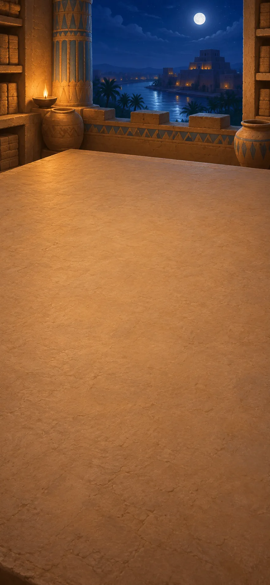

*Mesopotamia, c. 700–500 BCE*

Observers record eclipses and use a shared calendar to compare dates. Find patterns in the records and connect the seasons with farming and festivals.

**Goals**
- When do eclipses recur? -- "Recurring eclipse seasons"
- How can we share a calendar? -- "A publicly shared year"

**Items**
- "Dated reports of seen eclipses"

  Observers have recorded eclipses and their dates over several generations. Compare their reports to look for recurring patterns.

- "Clouded nights and unattended watches"

  Nobody saw the sky on these nights. That does not tell us whether an eclipse happened.

- "A calendar of lunar months"

  A calendar based on the Moon gives observers a shared way to date what they see.

- "Floods and harvests return seasonally"

  Flooding and harvests tend to return at certain times of year. Knowing their seasons helps people prepare food and stores.

- "Festivals need shared dates"

  People need agreed dates to celebrate festivals together. The same calendar can also organize work and observations.

- "A sky archive with its gaps"

  The archive records what people saw and marks the nights when they could not observe. Missing evidence is not treated as evidence that nothing happened.

- "Recurring eclipse seasons"

  Eclipses recur in patterns. Those patterns help predict when to watch, but not every eclipse is visible from every place.

- "A watch, not a promised eclipse"

  The records suggest when an eclipse may occur. Plan a watch, but clouds or your location may prevent you from seeing one.

- "A calendar for fields and stores"

  A calendar connects the seasons with farming and food storage. It helps people prepare before the next flood or harvest.

- "A publicly shared year"

  Agreed dates let a community organize work and festivals together. People can share a calendar without agreeing about the nature of the universe.

**Combinations**
- "Dated reports of seen eclipses" [preserve] + "Clouded nights and unattended watches" -> "A sky archive with its gaps"
- "A sky archive with its gaps" + "A calendar of lunar months" -> "Recurring eclipse seasons"
- "Recurring eclipse seasons" + "Clouded nights and unattended watches" -> "A watch, not a promised eclipse"
- "A calendar of lunar months" + "Floods and harvests return seasonally" [preserve] -> "A calendar for fields and stores"
- "A calendar for fields and stores" [preserve] + "Festivals need shared dates" [preserve] -> "A publicly shared year"

> NOTE: Sources for this session: babylon, cuneiform, salt. Source IDs identify bibliography entries recorded at their first relevant session; precise item and recipe attribution is retained in the conversion report.

> NOTE: Source `babylon`: [Francesca Rochberg, Science and Ancient Mesopotamia, Cambridge History of Science](https://www.cambridge.org/core/books/cambridge-history-of-science/science-and-ancient-mesopotamia/C48D6E70188ED938863F479B692D465B).

> NOTE: Source `cuneiform`: [Eleanor Robson: Digital Corpus of Cuneiform Mathematical Texts](https://oracc.museum.upenn.edu/dccmt/). Scribal arithmetic and numerical records; game quantities are invented, not translated tablets.

> NOTE: Source `salt`: [Science History Institute: Salt of the Earth](https://www.sciencehistory.org/stories/magazine/salt-of-the-earth/).

## Departure table

It is evening. The worktable is cleared for a new session. Plan a sky watch and prepare travel food. Compare what the eclipse pattern predicts with the meaning the king's omen text gives it.

**Goals**
- When should we watch the sky? -- "A watch, not a promised eclipse"
- What does an eclipse mean? -- "Prediction alongside portent"
- What food will last the journey? -- "Provisions for a longer journey"

**Items**
- "An eclipse may threaten the king"

  Some ancient interpreters treated an eclipse as a warning about the king. This is a belief about its meaning, not an explanation of what makes the Moon dark.

- "Salt"

  Salt helps preserve food so that it can be stored longer.

- "Fresh fish"

  Fresh fish spoils quickly unless it is eaten or preserved.

- "Grain set aside for a journey"

  Stored grain provides food for a journey.

- "Prediction alongside portent"

  People can predict an eclipse and still give it a religious or political meaning. Prediction does not automatically replace those beliefs.

- "Salt-preserved fish"

- "Provisions for a longer journey"

**Combinations**
- "Recurring eclipse seasons" + "An eclipse may threaten the king" [preserve] -> "Prediction alongside portent"
- "Salt" [preserve] + "Fresh fish" [transform] -> "Salt-preserved fish"
- "Salt-preserved fish" [preserve] + "Grain set aside for a journey" [transform] -> "Provisions for a longer journey"

> NOTE: Sources for this session: babylon, cuneiform, salt. Source IDs identify bibliography entries recorded at their first relevant session; precise item and recipe attribution is retained in the conversion report.

## Eclipse arguments

*Greek world, c. 500–380 BCE*

Earth's shadow offers a physical explanation of a lunar eclipse. Compare that cause with the different meanings a community can give the event.

**Goals**
- When does this cause apply? -- "An explanation tied to conditions"
- Does a cause settle an event's meaning? -- "Cause need not erase meaning"

**Items**
- "Earth stands between Sun and Moon"

  During a lunar eclipse, Earth blocks sunlight from reaching the Moon. The Moon darkens as it passes through Earth's shadow.

- "The same arrangement can happen again"

  The same arrangement of Earth, Sun and Moon can happen again. That makes it possible to connect a recurring eclipse with a physical cause.

- "An eclipse has a natural cause"

  Earth's shadow explains why the Moon darkens during a lunar eclipse. This connects a repeated observation with a physical cause.

- "An explanation tied to conditions"

  An explanation should say when it applies. A lunar eclipse requires Earth to block the sunlight that would otherwise reach the Moon.

- "Cause need not erase meaning"

  Explaining how an eclipse happens does not settle what it means to a community. This comparison separates a physical cause from a religious or social interpretation.

**Combinations**
- "Recurring eclipse seasons" + "Earth stands between Sun and Moon" [preserve] -> "An eclipse has a natural cause"
- "An eclipse has a natural cause" + "The same arrangement can happen again" [preserve] -> "An explanation tied to conditions"
- "An eclipse has a natural cause" + "Prediction alongside portent" [preserve] -> "Cause need not erase meaning"

> NOTE: Sources for this session: aristotle-eclipse, plato-republic, plato. Source IDs identify bibliography entries recorded at their first relevant session; precise item and recipe attribution is retained in the conversion report.

> NOTE: Source `aristotle-eclipse`: [Aristotle, Posterior Analytics II.2 and II.8](https://classics.mit.edu/Aristotle/posterior.2.ii.html). Primary text distinguishes the observed eclipse from inquiry into its cause, including Earth screening, rotation or extinction. The game dialogue and identical predictions are invented.

> NOTE: Source `plato-republic`: [Plato, Republic I and VII, translated primary text](https://classics.mit.edu/Plato/republic.html).

> NOTE: Source `plato`: [Stanford Encyclopedia of Philosophy: Plato](https://plato.stanford.edu/entries/plato/).

## Definition cases

It is evening. The worktable is cleared for a new session. A dangerous request for a borrowed weapon tests a rule about justice. Examine the rule rather than accepting it because it sounds reasonable.

**Goals**
- How should we live? -- "The examined life"
- How can a claim be challenged? -- "Claims answerable to objections"

**Items**
- "Justice means returning what is owed"

  One proposed definition of justice is to return whatever you owe. The question is whether that rule works in every case.

- "A deranged friend asks for his weapon back"

  A friend asks for a weapon back when he may harm himself or others. This tests whether returning what you owe is always just.

- "What do all just actions have in common?"

  A definition of justice should explain what just actions have in common. Difficult examples can show where a proposed definition fails.

- "Prestige does not settle how to live"

  Being admired or following custom does not prove that someone lives well. Their choices can still be questioned.

- "Repayment can do harm"

  A proposed rule says justice means returning what you owe. But returning a weapon to someone who may harm others would cause harm. This example shows why repayment alone cannot define justice.

- "A definition still under examination"

  The rule that justice means repaying debts fails when returning a weapon could cause harm. Finding that problem gives a reason to keep questioning the definition; it does not yet supply a complete new one.

- "The examined life"

  An examined life means questioning how you live and why. The aim is to judge your choices, not simply accept praise or custom.

- "Claims answerable to objections"

  A claim should be open to questions and difficult examples. The standing of the person making it is not enough to settle whether it is right.

**Combinations**
- "Justice means returning what is owed" [preserve] + "A deranged friend asks for his weapon back" [preserve] -> "Repayment can do harm"
- "Repayment can do harm" [preserve] + "What do all just actions have in common?" [preserve] -> "A definition still under examination"
- "A definition still under examination" + "Prestige does not settle how to live" [preserve] -> "The examined life"
- "An explanation tied to conditions" + "A definition still under examination" -> "Claims answerable to objections"

> NOTE: Sources for this session: aristotle-eclipse, plato-republic, plato. Source IDs identify bibliography entries recorded at their first relevant session; precise item and recipe attribution is retained in the conversion report.

## Forms and appearances

*Athens, c. 380–320 BCE*

Plato and Aristotle disagree about what changing things have in common. Compare their accounts and Plato's view of how education changes understanding.

**Goals**
- Where does a thing's form belong? -- "Aristotle: form in the particular"
- What does education change? -- "Education as a turning of attention"

**Items**
- "Beautiful things change and disagree"

  Beautiful things can change, and people disagree about them. Plato asks whether beauty itself can be understood apart from these changing examples.

- "Aristotle: form belongs to this living thing"

  For Aristotle, a living thing's form belongs to that thing. It is not a separate perfect model existing elsewhere.

- "A freed prisoner turns from shadows toward their sources"

  In Plato's cave story, a prisoner learns that the shadows he knew are not the whole world. Learning requires him to reconsider what he took for reality.

- "Plato: stable Forms"

  Plato proposes unchanging Forms, such as Beauty itself, to explain what changing examples share. The beautiful things we encounter are imperfect and changeable, unlike the Form he describes.

- "Aristotle: form in the particular"

  Aristotle places form in the particular thing: what makes this living thing the kind of thing it is. This differs from Plato's separate Forms.

- "Education as a turning of attention"

  In Plato's cave story, a prisoner learns that familiar shadows are not the whole world. Education means reconsidering what he takes for reality, not simply receiving more facts about the shadows.

**Combinations**
- "A definition still under examination" + "Beautiful things change and disagree" [preserve] -> "Plato: stable Forms"
- "Plato: stable Forms" + "Aristotle: form belongs to this living thing" [preserve] -> "Aristotle: form in the particular"
- "Plato: stable Forms" + "A freed prisoner turns from shadows toward their sources" [preserve] -> "Education as a turning of attention"

> NOTE: Sources for this session: plato, plato-republic, aristotle-biology, aristotle-causes, aristotle, aristotle-ethics. Source IDs identify bibliography entries recorded at their first relevant session; precise item and recipe attribution is retained in the conversion report.

> NOTE: Source `aristotle-biology`: [Stanford Encyclopedia of Philosophy: Aristotle’s Biology](https://plato.stanford.edu/entries/aristotle-biology/).

> NOTE: Source `aristotle-causes`: [Stanford Encyclopedia of Philosophy: Aristotle on Causality](https://plato.stanford.edu/entries/aristotle-causality/).

> NOTE: Source `aristotle`: [Aristotle: Prior Analytics, translated primary text](https://classics.mit.edu/Aristotle/prior.html). Ancient syllogistic; modern symbolic notation and toy examples are explanatory reconstructions.

> NOTE: Source `aristotle-ethics`: [Aristotle, Nicomachean Ethics, translated primary text](https://classics.mit.edu/Aristotle/nicomachaen.html).

## Classification bench

It is evening. The worktable is cleared for a new session. Compare animals' parts and activities, then the material, shape, maker and purpose of a statue. These answer different kinds of question about why something is as it is.

**Goals**
- How many ways can we explain a thing? -- "Different questions about why"

**Items**
- "Animals share some parts, differ in others"

  Animals share some body parts and differ in others. Comparing those features helps us ask how animals are related and how they live.

- `parts-work` Wings serve flight; fins serve swimming

  Animal parts can be compared by what they do. Fins help with swimming, while many, but not all, wings serve flight.

- "A statue has bronze, shape, maker and purpose"

  A statue can be explained through its material, shape, maker and purpose. These answer different questions about the same object.

- "Animals compared by structures and activities"

  Comparing animals' parts and activities gives a basis for grouping them. One shared feature alone may not be enough to establish a group.

- "An organ understood through the whole animal"

  Aristotle understands an animal's parts through the organization of the whole animal. An organ is not explained only by listing its material: its role in that living animal also matters.

- "Different questions about why"

  Aristotle distinguishes four kinds of explanation: what something is made of, its form, what produces it, and its purpose. One answer need not replace the others.

**Combinations**
- "Animals share some parts, differ in others" [preserve] + `parts-work` [preserve] -> "Animals compared by structures and activities"
- "Animals compared by structures and activities" + "Aristotle: form in the particular" -> "An organ understood through the whole animal"
- "An organ understood through the whole animal" + "A statue has bronze, shape, maker and purpose" [preserve] -> "Different questions about why"

> NOTE: Sources for this session: plato, plato-republic, aristotle-biology, aristotle-causes, aristotle, aristotle-ethics. Source IDs identify bibliography entries recorded at their first relevant session; precise item and recipe attribution is retained in the conversion report.

## Logic and conduct

The next morning, we return to a cleared worktable. Distinguish valid reasoning from true starting claims. Then compare knowing a rule with developing the habits and judgment needed to act well.

**Goals**
- Can good reasoning start from a false claim? -- "Validity is not truth"
- How do we learn to act well? -- "Virtue as cultivated judgment"

**Items**
- `mortal-premises` All humans are mortal; Socrates is human

  If all humans are mortal and Socrates is human, then Socrates is mortal. The conclusion follows from the two starting claims.

- "An orderly argument can start from falsehood"

  Correct reasoning cannot make a false starting claim true. An argument's structure and the truth of its claims need separate checks.

- "Courage is practised between rashness and fear"

  For Aristotle, courage is learned through practice and judgment. It avoids both reckless action and giving way to fear; it is not a numerical halfway point.

- "A conclusion follows from premises"

  A valid argument has a conclusion that must follow if its starting claims are true. It still matters whether those claims are actually true.

- "Validity is not truth"

  An argument can follow the rules of logic and still start from a false claim. Check both the reasoning and its starting claims.

- "Virtue as cultivated judgment"

  For Aristotle, living well requires habits and practical judgment developed through action. Knowing a rule is not the same as being able to act well.

**Combinations**
- "Claims answerable to objections" + `mortal-premises` [preserve] -> "A conclusion follows from premises"
- "A conclusion follows from premises" + "An orderly argument can start from falsehood" [preserve] -> "Validity is not truth"
- "The examined life" + "Courage is practised between rashness and fear" [preserve] -> "Virtue as cultivated judgment"

> NOTE: Sources for this session: plato, plato-republic, aristotle-biology, aristotle-causes, aristotle, aristotle-ethics. Source IDs identify bibliography entries recorded at their first relevant session; precise item and recipe attribution is retained in the conversion report.

## Purposes of rule

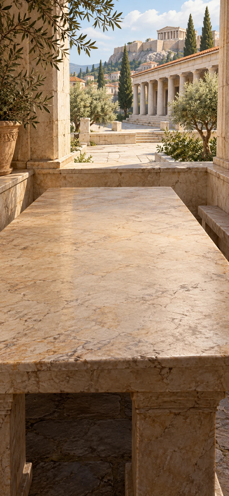

These accounts ask what a political community is for. Compare a common good with Plato's argument that ruling requires knowledge.

[If skipped] The political accounts disagree about knowledge, participation and whose interests rule should serve.

**Goals**
- What is a city for? -- "Political life judged by a common good"
- What makes someone fit to rule? -- "Plato: ruling needs knowledge, not applause"

**Items**
- "A city shares courts, offices and a way of life"

  For Aristotle, a city supports a shared way of life through courts and public offices. Its purpose is more than preventing people from injuring one another.

- "Plato: quarrelling sailors ignore the skilled navigator"

  In Plato's ship comparison, sailors fight for command while ignoring the person who knows how to navigate. The example links ruling with knowledge rather than popularity.

- "Political life judged by a common good"

  Political life can be judged by what it enables people to share and achieve. Asking about a common good also raises the question of who is included.

- "Plato: ruling needs knowledge, not applause"

  Plato argues that ruling requires knowledge of what is good, not simply winning support. The claim does not settle who should be allowed a political voice.

**Combinations**
- "Virtue as cultivated judgment" + "A city shares courts, offices and a way of life" [preserve] -> "Political life judged by a common good"
- "Plato: stable Forms" + "Plato: quarrelling sailors ignore the skilled navigator" [preserve] -> "Plato: ruling needs knowledge, not applause"

> NOTE: Sources for this session: civ-aristotle, civ-plato. Source IDs identify bibliography entries recorded at their first relevant session; precise item and recipe attribution is retained in the conversion report.

> NOTE: Source `civ-aristotle`: [Aristotle, Politics III.1, III.6–9](https://classics.mit.edu/Aristotle/politics.3.three.html). Primary text, Jowett translation. Citizenship, common advantage and constitutional distinctions; not modern universal citizenship.

> NOTE: Source `civ-plato`: [Plato, Republic VI, ship analogy (488a–489a)](https://classics.mit.edu/Plato/republic.7.vi.html). Primary text. The skilled navigator is an argument about knowledge and rule, not an empirical proof of philosopher government.

## Citizenship cases

It is evening. The worktable is cleared for a new session. Compare who can participate in government with whose interests the rulers serve. A city can claim a common good while excluding many of its inhabitants.

**Goals**
- Who belongs in the common good? -- "Who is included in the common good?"
- Whose interests do rulers serve? -- "Judge rulers by whose interests they serve"

**Items**
- "One, few or many may rule for themselves"

  One person, a few people or many people may rule for their own advantage. Aristotle asks whose interests the government serves.

- "Aristotle: citizens share judgment and office"

  Aristotle defines citizenship through participation in judgment and office. This did not include every person living in the city.

- "Women, enslaved people and resident foreigners lack Athens’s vote"

  Women, enslaved people and resident foreigners were excluded from Athens's citizen assembly. Other Greek cities had different arrangements, but ancient citizenship was not universal.

- "Judge rulers by whose interests they serve"

  A government is judged by whose interests it serves, not only by how many people rule. A ruler's benefit can differ from the community's.

- "Living in a city does not grant a political voice"

  Living in a city does not necessarily give a person a political voice. Ancient citizenship excluded many people on whom the city depended.

- "Who is included in the common good?"

  A city can claim to serve a common good while denying many inhabitants a political voice. Whose good is included, and whose interests are left out?

**Combinations**
- "Political life judged by a common good" + "One, few or many may rule for themselves" [preserve] -> "Judge rulers by whose interests they serve"
- "Aristotle: citizens share judgment and office" [preserve] + "Women, enslaved people and resident foreigners lack Athens’s vote" [preserve] -> "Living in a city does not grant a political voice"
- "Political life judged by a common good" + "Living in a city does not grant a political voice" -> "Who is included in the common good?"

> NOTE: Sources for this session: civ-aristotle. Source IDs identify bibliography entries recorded at their first relevant session; precise item and recipe attribution is retained in the conversion report.

## Public life and self-command

*Greek and Roman world, c. 330 BCE–180 CE*

Compare ways to live with fewer wants, question custom and respond to events beyond your control. Concern for other people remains part of the discussion.

**Goals**
- How much do we need? -- "Freedom by needing less"
- Does custom tell us how to live? -- "Local respectability does not settle a good life"
- Who deserves our concern? -- "Fellowship beyond one city"

**Items**
- "Diogenes practises needing very little"

  Later stories describe Diogenes as trying to need very little. His independence challenges the idea that wealth and powerful friends are necessary for a good life.

- "A ruler offers wealth and favour"

  A ruler offers wealth and support. Accepting can also make a person dependent on the ruler's wishes.

- "Respectability changes from city to city"

  What counts as respectable differs between cities. Cynic philosophers ask whether a local custom is truly necessary for a good life.

- `judgment-response` Events are not wholly ours; responses can be

  Stoic thinkers distinguish events outside our control from the judgments and responses we can work on. This does not make misfortune harmless.

- "Other people also share in reason"

  Stoic thinkers see reason as something people share. That can support concern for people beyond one's own city.

- "Freedom by needing less"

  Stories about Diogenes contrast his few wants with a ruler's offer of wealth. Needing less can make it harder for a powerful patron to buy someone's loyalty. This ideal does not mean that forced poverty is harmless.

- "Local respectability does not settle a good life"

  Cities disagree about what counts as respectable. A custom's local popularity therefore cannot, by itself, settle whether it is a good way to live.

- "Care for the judgment that is yours"

  Stoic practice focuses effort on judgments and responses rather than things we cannot control. It does not deny the pain of loss or injustice.

- "Fellowship beyond one city"

  Stoic thinkers connect care for one's own judgments with concern for other people who share in reason. Their idea of fellowship can extend beyond the boundaries of a single city.

**Combinations**
- "Diogenes practises needing very little" [preserve] + "A ruler offers wealth and favour" [preserve] -> "Freedom by needing less"
- "The examined life" + "Respectability changes from city to city" [preserve] -> "Local respectability does not settle a good life"
- "Virtue as cultivated judgment" + `judgment-response` [preserve] -> "Care for the judgment that is yours"
- "Care for the judgment that is yours" [preserve] + "Other people also share in reason" [preserve] -> "Fellowship beyond one city"

> NOTE: Sources for this session: cynics, stoics, epicurus, skeptics. Source IDs identify bibliography entries recorded at their first relevant session; precise item and recipe attribution is retained in the conversion report.

> NOTE: Source `cynics`: [Internet Encyclopedia of Philosophy: Cynics](https://iep.utm.edu/cynics/).

> NOTE: Source `stoics`: [Stanford Encyclopedia of Philosophy: Stoicism](https://plato.stanford.edu/entries/stoicism/).

> NOTE: Source `epicurus`: [Epicurus, Letter to Menoeceus, translated primary text](https://classics.mit.edu/Epicurus/menoec.html).

> NOTE: Source `skeptics`: [Stanford Encyclopedia of Philosophy: Ancient Skepticism](https://plato.stanford.edu/entries/skepticism-ancient/).

## Garden and skeptical texts

It is evening. The worktable is cleared for a new session. Compare an argument against fearing death, pleasure in friendship and a case for leaving judgment open. These are different answers, not one combined philosophy.

**Goals**
- What pleasures are enough? -- "Pleasure in friendship and sufficiency"
- Must we reach a verdict? -- "A judgment left suspended"

**Items**
- "Epicurus: mind and body are made of dispersible atoms"

  Epicurus describes mind and body as made of atoms that disperse at death. This ancient view differs from modern atomic physics and forms part of his argument against fearing death.

- "Death is not an experience of suffering"

  Epicurus argues that suffering requires sensation, while death ends sensation. His argument addresses fear of being dead, not the grief of losing someone.

- "Friendship and a simple meal can suffice"

  Epicurus values friendship, security and simple pleasures. A good life need not depend on expensive possessions or constant indulgence.

- "Competing appearances resist a verdict"

  The available accounts conflict, and neither has settled the question. This is a reason to withhold a verdict, not proof that nothing can ever be known.

- "Freedom from the terror of death"

  Epicurus argues that there is no suffering after death because there is no remaining sensation. The argument offers relief from fear without denying grief or ending disagreement.

- "Pleasure in friendship and sufficiency"

  Epicurus places friendship, security and simple enjoyment at the centre of a good life. Seeking pleasure in this account does not mean endlessly increasing wealth or indulgence.

- "A judgment left suspended"

  When the available accounts conflict and neither settles the question, a skeptic can withhold agreement. Leaving judgment open is different from proving that both sides are false or that knowledge is impossible.

**Combinations**
- "Epicurus: mind and body are made of dispersible atoms" [preserve] + "Death is not an experience of suffering" [preserve] -> "Freedom from the terror of death"
- "Freedom from the terror of death" [preserve] + "Friendship and a simple meal can suffice" [preserve] -> "Pleasure in friendship and sufficiency"
- "Claims answerable to objections" + "Competing appearances resist a verdict" [preserve] -> "A judgment left suspended"

> NOTE: Sources for this session: cynics, stoics, epicurus, skeptics, epicurus-herodotus. Source IDs identify bibliography entries recorded at their first relevant session; precise item and recipe attribution is retained in the conversion report.

> NOTE: Source `epicurus-herodotus`: [Epicurus, Letter to Herodotus §§63–66, primary text excerpt](https://www.contrib.andrew.cmu.edu/~kk3n/80-300/epicurus-to-herodotus.htm).

## Geometry desk

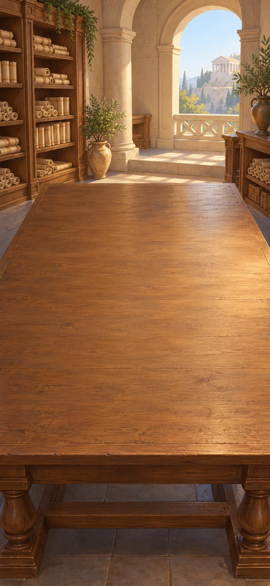

*Hellenistic and Roman world, c. 300 BCE–200 CE*

Geometry and observations make Earth's shape and size things people can investigate. Connect local views with a model of the whole Earth.

**Goals**
- Can Earth's size be known? -- "An Earth whose size can be investigated"

**Items**
- "A few stated geometric starting points"

  Euclid builds geometry from stated definitions and starting assumptions. Later claims must be supported by proofs.

- "Different stars and shadows at different places"

  Different places have different views of stars and different shadows. These observations support the idea of a curved Earth.

- "A known journey connects two observing places"

  Knowing the distance between two observing places helps connect their different observations with the size of Earth.

- "A connected geometric proof"

  A geometric proof connects a conclusion to stated starting points through logical steps. It explains why the conclusion follows.

- "A spherical Earth"

  A spherical Earth helps explain why observers in different places see different stars and shadows. It joins local observations into one model.

- "An Earth whose size can be investigated"

  Different stars and shadows at different places support a curved Earth. Adding the measured distance between observing places makes it possible to investigate the size of that whole Earth.

**Combinations**
- "A conclusion follows from premises" + "A few stated geometric starting points" [preserve] -> "A connected geometric proof"
- "A connected geometric proof" + "Different stars and shadows at different places" [preserve] -> "A spherical Earth"
- "A spherical Earth" [preserve] + "A known journey connects two observing places" [preserve] -> "An Earth whose size can be investigated"

> NOTE: Sources for this session: euclid, alexandria, antikythera, aristotle-eclipse. Source IDs identify bibliography entries recorded at their first relevant session; precise item and recipe attribution is retained in the conversion report.

> NOTE: Source `euclid`: [Euclid: Elements, David Joyce edition](https://mathcs.clarku.edu/~djoyce/elements/). Greek mathematical text in a modern explanatory edition. Diagram alone is not proof.

> NOTE: Source `alexandria`: [Francesca Schironi: Textual Scholarship in Alexandria and Beyond](https://sites.lsa.umich.edu/schironi/wp-content/uploads/sites/259/2024/10/43_Textual-Scholarship-in-Alexandria-.pdf). Scholar-authored research on textual practices. Modern apparatus and translation terms in this game are not all ancient Alexandrian inventions.

> NOTE: Source `antikythera`: [National Archaeological Museum: Antikythera mechanism](https://antikythera-mechanism.namuseum.gr/en/what-is-the-mechanism-and-what-does-it-consist-of/).

## Planetary models

It is evening. The worktable is cleared for a new session. At the model bench, compare records of planetary motion with a predictive model and a gear mechanism. Representing or predicting the sky does not explain every cause of its motion.

**Goals**
- Does a forecast explain its cause? -- "A forecast is not its physical cause"
- Can gears represent the sky? -- "A sky represented in gears"

**Items**
- "Planets wander against the stars"

  Planets change position against the background stars. Records made over time allow astronomers to compare their movements.

- "Ptolemy combines circles around an Earth-centred frame"

  Ptolemy combines circular motions in a mathematical model centered on Earth. The model aims to predict the positions of celestial bodies.

- "A planetary model predicts where to look"

  A model can predict where a planet will appear without proving every claim it makes about how the heavens work.

- "Gears can turn at linked rates"

  Linked gears turn at related rates. They can represent repeating cycles in a mechanism.

- "An archive of planetary motion"

  Records collected over generations let astronomers compare planetary movements. Greek astronomy also drew on earlier Babylonian observations.

- "Ptolemy’s predictive heavens"

  Ptolemy's Earth-centered model predicts celestial positions using combined circular motions. Its historical value includes what it could predict, not just what later accounts changed.

- "A forecast is not its physical cause"

  A model of planetary motion may accurately predict where a planet appears. That success does not, by itself, establish every physical cause or assumption in the model.

- "A sky represented in gears"

  Gears can represent repeating movements in the sky. A physical model makes those cycles visible without explaining every cause of them.

**Combinations**
- "A sky archive with its gaps" + "Planets wander against the stars" [preserve] -> "An archive of planetary motion"
- "An archive of planetary motion" + "Ptolemy combines circles around an Earth-centred frame" [preserve] -> "Ptolemy’s predictive heavens"
- "Ptolemy’s predictive heavens" + "A planetary model predicts where to look" [preserve] -> "A forecast is not its physical cause"
- "Recurring eclipse seasons" + "Gears can turn at linked rates" [preserve] -> "A sky represented in gears"

> NOTE: Sources for this session: euclid, alexandria, antikythera, aristotle-eclipse. Source IDs identify bibliography entries recorded at their first relevant session; precise item and recipe attribution is retained in the conversion report.

## Manuscript comparison

The next morning, we return to a cleared worktable. The manuscripts include manuscript copies with different words. Compare their readings and make the editor's uncertainties visible.

**Goals**
- Which words should an edition keep? -- "An edition that shows its doubts"

**Items**
- "Two copies of a poem disagree"

  Two copies of the same poem have different words. Comparing them can reveal changes made during copying.

- "Mark a doubtful reading instead of hiding it"

  An editor marks doubtful words instead of silently choosing one version. Readers can then see where the text is uncertain.

- "A text with visible alternatives"

  Different versions of a text are kept visible for comparison. Their differences become evidence about how the work was copied and changed.

- "An edition that shows its doubts"

  An editor compares manuscripts and shows uncertain readings. Readers can judge the choices instead of receiving an unexplained final version.

**Combinations**
- "Two copies of a poem disagree" [preserve] + "Mark a doubtful reading instead of hiding it" [preserve] -> "A text with visible alternatives"
- "A text with visible alternatives" [preserve] + "Claims answerable to objections" -> "An edition that shows its doubts"

> NOTE: Sources for this session: euclid, alexandria, antikythera, aristotle-eclipse. Source IDs identify bibliography entries recorded at their first relevant session; precise item and recipe attribution is retained in the conversion report.

## Law-copying desk

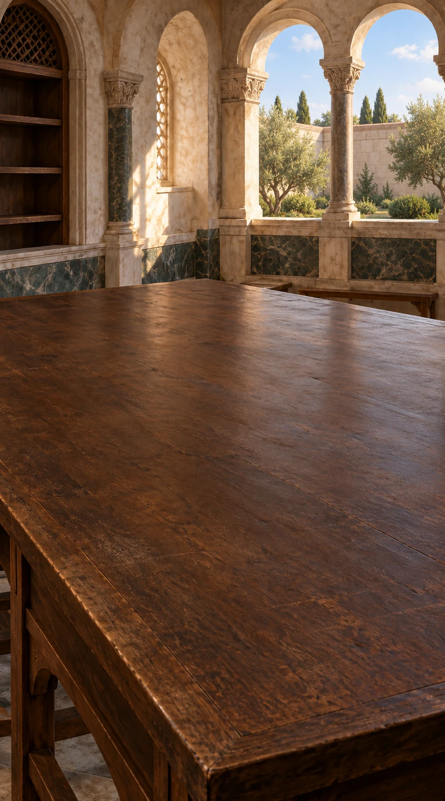

*Eastern Roman Empire, 529–534 CE*

The law collection calls slavery contrary to nature while still regulating it. Distinguish freeing an individual from ending slavery, and examine how the emperor gives an edited lawbook authority.

[If skipped] The legal collection calls slavery contrary to nature while still regulating it. Freeing one person does not abolish the institution.

**Goals**
- What does legal status decide? -- "A different legal order still divides people by status"
- Does freeing one person end slavery? -- "An individual route to freedom is not abolition"
- Who decides which law has authority? -- "Older law edited under imperial authority"

**Items**
- "Roman law distinguishes freeborn, freed and enslaved"

  Roman law distinguishes freeborn, freed and enslaved people. Those legal statuses are not the same as citizenship or participation in government.

- "The Institutes call slavery contrary to nature"

  Justinian's Institutes describe slavery as contrary to nature while also regulating it. The statement does not abolish the institution.

- "A legally recognised act frees an enslaved person"

  Manumission legally frees an individual enslaved person. It changes that person's status within a system that still permits slavery.

- `civ-imperial-compilation` Justinian orders older law edited into an authoritative collection

  Justinian orders older law selected and edited into an authoritative collection. The result decides what has legal force rather than preserving every disagreement neutrally.

- "A different legal order still divides people by status"

  Roman law distinguishes freeborn, freed and enslaved people. Those legal statuses give people different rights and are not the same as citizenship or participation in government in a Greek city.

- "Law upholds what it calls contrary to nature"

  Justinian's legal collection describes slavery as contrary to nature while continuing to regulate it. A stated principle therefore conflicts with the institution that the same law upholds.

- "An enslaved person becomes a freed person"

  Roman manumission legally changes an individual from enslaved to freed status. The institution of slavery can remain in place even though this person's status changes.

- "An individual route to freedom is not abolition"

  A route for freeing individuals leaves slavery as an institution in place. Relief within a system differs from ending the system.

- "Older law edited under imperial authority"

  The emperor's collection selects which older law is authoritative. Unlike an edition that displays variants, it also determines which text has legal force.

**Combinations**
- "Living in a city does not grant a political voice" + "Roman law distinguishes freeborn, freed and enslaved" -> "A different legal order still divides people by status"
- "The Institutes call slavery contrary to nature" [preserve] + "Roman law distinguishes freeborn, freed and enslaved" -> "Law upholds what it calls contrary to nature"
- "A legally recognised act frees an enslaved person" [preserve] + "Roman law distinguishes freeborn, freed and enslaved" -> "An enslaved person becomes a freed person"
- "An enslaved person becomes a freed person" [preserve] + "Law upholds what it calls contrary to nature" [preserve] -> "An individual route to freedom is not abolition"
- "An edition that shows its doubts" + `civ-imperial-compilation` [preserve] -> "Older law edited under imperial authority"

> NOTE: Sources for this session: civ-institutes. Source IDs identify bibliography entries recorded at their first relevant session; precise item and recipe attribution is retained in the conversion report.

> NOTE: Source `civ-institutes`: [Justinian, Institutes I.2–5 and proem](https://droitromain.univ-grenoble-alpes.fr/Anglica/just1_Moyle.htm). Primary text, Moyle translation. Natural freedom, slavery, manumission and legal statuses belong to one sixth-century legal compilation.

## Translation desk

*Arabic-language scholarship, c. 800–1100 CE*

Translators carry arguments about logic and nature into Arabic. Their choices must preserve meanings, not simply replace one set of words with another.

**Goals**
- Can an argument cross languages? -- "Logic in a new scholarly language"
- How does an account of nature travel? -- "Natural philosophy in Arabic"

**Items**
- "Greek and Syriac manuscripts meet Arabic readers"

  Greek and Syriac manuscripts reach Arabic-speaking scholars through several languages and communities. Translation is shared scholarly work.

- "New Arabic terms for form, substance and cause"

  Translators need Arabic words that preserve distinctions such as form, substance and cause. Translation requires understanding the argument, not just replacing words.

- "Logic in a new scholarly language"

  Translators carry logical arguments into Arabic while developing terms for their distinctions. The texts become available for new teaching and debate.

- "Natural philosophy in Arabic"

  Arabic-speaking scholars use, criticize and develop inherited accounts of nature. Translation supports new inquiry rather than simply storing old knowledge.

**Combinations**
- "A conclusion follows from premises" + "Greek and Syriac manuscripts meet Arabic readers" [preserve] -> "Logic in a new scholarly language"
- "Different questions about why" + "New Arabic terms for form, substance and cause" [preserve] -> "Natural philosophy in Arabic"

> NOTE: Sources for this session: greek-arabic, arabic-latin, algebra, avicenna. Source IDs identify bibliography entries recorded at their first relevant session; precise item and recipe attribution is retained in the conversion report.

> NOTE: Source `greek-arabic`: [Greek Sources in Arabic and Islamic Philosophy, Stanford Encyclopedia of Philosophy](https://plato.stanford.edu/entries/arabic-islamic-greek/).

> NOTE: Source `arabic-latin`: [Influence of Arabic and Islamic Philosophy on the Latin West, Stanford Encyclopedia of Philosophy](https://plato.stanford.edu/entries/arabic-islamic-influence/).

> NOTE: Source `algebra`: [Oxford History of Science Museum: mathematics in Islamic cultures](https://www.mhs.ox.ac.uk/scienceislam/mathematics.html). Practical problems, inherited mathematics and original contributions cross languages and regions. No exclusive origin claim.

> NOTE: Source `avicenna`: [Stanford Encyclopedia of Philosophy: Ibn Sina’s Metaphysics](https://plato.stanford.edu/entries/ibn-sina-metaphysics/).

## Commentary desk

It is evening. The worktable is cleared for a new session. Commentaries develop and criticize older arguments. Reconstruct Avicenna's distinction between things that depend on others to exist and a proposed necessary source.

**Goals**
- Why does anything exist? -- "Avicenna: a necessary source of existence"
- Can a commentary change an argument? -- "A commentary that changes the question"

**Items**
- "What a thing is differs from whether it exists"

  Avicenna distinguishes what something is from whether it exists. Describing a thing does not by itself show that it exists.

- "A contingent thing depends on another"

  Avicenna asks why things exist when they could have failed to exist. His argument seeks an explanation for their dependence.

- "A commentary asks where an argument succeeds"

  A commentary can test an argument, find problems and propose changes. It need not merely repeat an older author.

- "Avicenna: contingent existence"

  Avicenna distinguishes what a thing is from whether it exists. A thing that could exist or fail to exist still needs an explanation for why it exists at all.

- "Avicenna: a necessary source of existence"

  Avicenna argues that things whose existence depends on something else require a source that does not depend on another. His proposed necessary being answers why dependent things exist at all.

- "A commentary that changes the question"

  A commentary becomes new inquiry when it tests and develops the older argument. Receiving a tradition can also change it.

**Combinations**
- "Natural philosophy in Arabic" + "What a thing is differs from whether it exists" [preserve] -> "Avicenna: contingent existence"
- "Avicenna: contingent existence" [preserve] + "A contingent thing depends on another" [preserve] -> "Avicenna: a necessary source of existence"
- "Logic in a new scholarly language" + "A commentary asks where an argument succeeds" [preserve] -> "A commentary that changes the question"

> NOTE: Sources for this session: greek-arabic, arabic-latin, algebra, avicenna. Source IDs identify bibliography entries recorded at their first relevant session; precise item and recipe attribution is retained in the conversion report.

## Calculation and observation

The next morning, we return to a cleared worktable. Compare revised sky observations with new ways to express numbers and unknown quantities. Scholars extend inherited knowledge in more than one way.

**Goals**
- Where does the old sky model fail? -- "Ptolemy read critically"
- How can we reason about an unknown share? -- "Reasoning about an unknown share"

**Items**
- "Fresh observations trouble inherited sky models"

  New observations reveal difficulties in inherited astronomical models. Scholars can study older works while also challenging them.

- "Indian place-value numerals"

  Indian place-value notation lets a digit's position help express its value. It became important in Arabic-language calculation.

- "Merchants need consistent accounts"

  Merchants need consistent ways to record quantities and exchanges. Reliable notation helps them compare accounts.

- "Unknown shares can be related to known shares"

  An unknown share can be described through its relation to known shares. This provides a practical setting for reasoning with unknown quantities.

- "Ptolemy read critically"

  Arabic-speaking astronomers use new observations to criticize difficulties in Ptolemy's inherited sky model. Learning from an older work can lead to revision rather than unquestioning acceptance.

- "Place-value reckoning"

  Place-value notation gives a practical way to record and work with quantities. This mathematical tradition did not come from a single Greek source.

- "Reasoning about an unknown share"

  Relations between known and unknown quantities can be studied before the unknown value is found. This makes a problem easier to state and reason about.

**Combinations**
- "Ptolemy’s predictive heavens" + "Fresh observations trouble inherited sky models" [preserve] -> "Ptolemy read critically"
- "Indian place-value numerals" [preserve] + "Merchants need consistent accounts" [preserve] -> "Place-value reckoning"
- "Place-value reckoning" [preserve] + "Unknown shares can be related to known shares" [preserve] -> "Reasoning about an unknown share"

> NOTE: Sources for this session: greek-arabic, arabic-latin, algebra, avicenna. Source IDs identify bibliography entries recorded at their first relevant session; precise item and recipe attribution is retained in the conversion report.

## Vision arguments

These records cover c. 1000–1300 CE. Compare theories in which sight leaves the eye with Ibn al-Haytham's account of incoming light. Consider what observation can test and what errors of judgment can remain.

**Goals**
- How does light travel? -- "Light paths as a geometric account"
- Is seeing the same as understanding? -- "Seeing includes interpretation"

**Items**
- "Do rays leave the eye to make sight?"

  Some ancient theories explained sight through rays leaving the eye. The question is whether light instead enters the eye.

- "Bright light affects the eye"

  Bright light affects the eye, giving a reason to study incoming light. Never look directly at the Sun to test this.

- "Light follows straight paths in a uniform medium"

  In a uniform material, light travels in straight paths. Geometry can help explain where it goes.

- "Distant things can mislead our judgment of size"

  A distant object can look smaller than it is. What reaches the eye and what we judge about it are not the same thing.

- "Rival accounts of sight"

  Some theories say sight works through rays leaving the eye, while another account studies light entering it. Comparing the claims turns familiar seeing into a question that observations can test.

- "Sight depends on light entering the eye"

  Ibn al-Haytham explains sight through light entering the eye. This directs inquiry toward light sources, paths and viewing conditions.

- "Light paths as a geometric account"

  Drawing light paths helps explain images and sight. Geometry connects the arrangement of objects with where their light arrives.

- "Seeing includes interpretation"

  Light entering the eye does not explain every judgment we make about what we see. Distance, size and other features can still be misread.

**Combinations**
- "Natural philosophy in Arabic" + "Do rays leave the eye to make sight?" [preserve] -> "Rival accounts of sight"
- "Rival accounts of sight" [preserve] + "Bright light affects the eye" [preserve] -> "Sight depends on light entering the eye"
- "Sight depends on light entering the eye" + "Light follows straight paths in a uniform medium" [preserve] -> "Light paths as a geometric account"
- "Sight depends on light entering the eye" + "Distant things can mislead our judgment of size" [preserve] -> "Seeing includes interpretation"

> NOTE: Sources for this session: optics, optics-lamps-primary, optics-manuscript, lensmaking. Source IDs identify bibliography entries recorded at their first relevant session; precise item and recipe attribution is retained in the conversion report.

> NOTE: Source `optics`: [A. I. Sabra and Jan Hogendijk, The Optics of Ibn al-Haytham Books IV–V, Warburg Institute / University of Chicago Press](https://press.uchicago.edu/ucp/books/book/distributed/O/bo156866715.html).

> NOTE: Source `optics-lamps-primary`: [Ibn al-Haytham, Optics I.6 §§85–87; A. I. Sabra translation (1989), pp.90–91](https://resources.warburg.sas.ac.uk/pdf/ffh360b2205460.pdf#page=50). Primary multiple-lamp aperture and selective-screening case: the corresponding patch disappears and returns; crossing does not make the contributions inseparable. H/L labels, equal distances and unit offsets are an authored two-lamp adaptation. This case alone does not establish a complete account of eye sensing.

> NOTE: Source `optics-manuscript`: [Cambridge Peterhouse MS209: Alhacen De Aspectibus](https://medieval.lib.cam.ac.uk/catalogue/Peterhouse/MS-PETERHOUSE-00209). A manuscript witness to the circulation of Ibn al-Haytham’s optical work. Optical recipes are modern demonstrations, not a transcription of this manuscript.

> NOTE: Source `lensmaking`: [Museo Galileo: Lens-making](https://catalogue.museogalileo.it/multimedia/LensmakingBis.html).

## Optical bench

It is evening. The worktable is cleared for a new session. At the optical bench, use straight light paths to understand an upside-down projected image and a magnified view. The instruments make different effects visible.

**Goals**
- How does light form an image? -- "An inverted image on the screen"
- How can a small thing look larger? -- "A magnified close-up view"

**Hotspots**
- "Dark room"

**Items**
- "A closed box, small opening and receiving screen"

  A dark box with a small opening and a screen can receive an image formed by incoming light.

- "A clear glass blank"

  This clear piece of glass can be shaped into a lens.

- "Curved surfaces can bend light"

  Shaping a glass surface changes how it bends light. This craft makes lenses possible.

- "A prepared dark-room image box"

- "An inverted image on the screen"

  Light passing through the small opening forms an upside-down image on the screen. The dark box makes the faint image easier to see.

- "A convex magnifying lens"

  The glass has been shaped into a convex lens. Held at a suitable distance, it can make a nearby object appear larger.

- "A magnified close-up view"

  The lens bends light so that a nearby object appears larger. The view depends on how the lens and object are positioned.

**Combinations**
- "Light paths as a geometric account" + "A closed box, small opening and receiving screen" [transform] -> "A prepared dark-room image box"
- "A prepared dark-room image box" @ "Dark room" -> "An inverted image on the screen"
- "A clear glass blank" [transform] + "Curved surfaces can bend light" [preserve] -> "A convex magnifying lens"
- "A convex magnifying lens" + "Light paths as a geometric account" -> "A magnified close-up view"

> NOTE: Sources for this session: optics, optics-lamps-primary, optics-manuscript, lensmaking. Source IDs identify bibliography entries recorded at their first relevant session; precise item and recipe attribution is retained in the conversion report.

> NOTE: Hotspot context — Dark room: A setting where the faint aperture image can be distinguished.

## Disputation desk

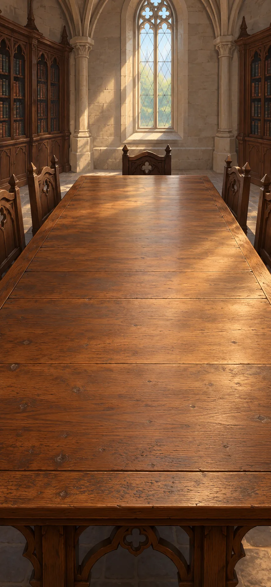

*Latin universities, c. 1150–1350 CE*

Latin readers compare translated works with rival commentaries. State an objection clearly and consider whether the reply answers it.

**Goals**
- What answer does an objection need? -- "An objection and an accountable reply"

**Items**
- "Translators work from Arabic and Greek into Latin"

  Texts reach Latin readers through translations from both Arabic and Greek. There is more than one route of transmission.

- "Set out an objection before answering it"

  A formal debate states an objection before attempting to answer it. The reply must address the difficulty rather than ignore it.

- "Aristotle in Latin"

  Latin translations make Aristotle's works available in new schools and debates. Readers also encounter different interpretations of those works.

- "The commentators disagree"

  Commentators disagree about what an older argument means and whether it succeeds. There is no single uncontested reading.

- "An objection and an accountable reply"

  An objection receives a reasoned reply in an organized debate. The format makes disagreement explicit; it does not guarantee agreement.

**Combinations**
- "Logic in a new scholarly language" + "Translators work from Arabic and Greek into Latin" [preserve] -> "Aristotle in Latin"
- "Aristotle in Latin" + "A commentary that changes the question" -> "The commentators disagree"
- "The commentators disagree" [preserve] + "Set out an objection before answering it" [preserve] -> "An objection and an accountable reply"

> NOTE: Sources for this session: arabic-latin, aquinas, ockham, plato. Source IDs identify bibliography entries recorded at their first relevant session; precise item and recipe attribution is retained in the conversion report.

> NOTE: Source `aquinas`: [Stanford Encyclopedia of Philosophy: Thomas Aquinas](https://plato.stanford.edu/entries/aquinas/).

> NOTE: Source `ockham`: [Stanford Encyclopedia of Philosophy: William of Ockham](https://plato.stanford.edu/entries/ockham/).

## Universals desk

It is evening. The worktable is cleared for a new session. This comparison asks whether similar things share a real common nature or are grouped by names and concepts. Keep those answers distinct and avoid adding explanations that do no work.

**Goals**
- What do things of one kind share? -- "One shared name, rival accounts"
- Does this extra explanation help? -- "Do not multiply idle explanations"

**Items**
- "One name applies to many distinct things"

  One word can apply to many separate things. Philosophers disagree about whether those things share a real common nature or only a name and concept.

- "An explanation adds an entity it never uses"

  This explanation introduces something that does no explanatory work. Removing it may make the account clearer without losing anything it explains.

- "A shared nature beyond this instance"

  A realist account says that separate things share a real common nature. Medieval versions differ from Plato's theory of separately existing Forms.

- "Common concepts, not a shared thing outside the mind"

  A nominalist account uses common names and concepts for separate things without positing a shared universal thing outside the mind. This is more than rejecting Plato's separate Forms.

- "One shared name, rival accounts"

  A realist account says separate things share a real common nature. A nominalist account groups individuals through names and concepts without such a shared thing outside the mind.

- "Do not multiply idle explanations"

  Do not add things to an explanation when they do no work. A shorter explanation is not automatically true; it must still account for the evidence.

**Combinations**
- "Plato: stable Forms" + "One name applies to many distinct things" -> "A shared nature beyond this instance"
- "Aristotle: form in the particular" + "One name applies to many distinct things" -> "Common concepts, not a shared thing outside the mind"
- "A shared nature beyond this instance" [preserve] + "Common concepts, not a shared thing outside the mind" -> "One shared name, rival accounts"
- "Different questions about why" + "An explanation adds an entity it never uses" [preserve] -> "Do not multiply idle explanations"

> NOTE: Sources for this session: arabic-latin, aquinas, ockham, plato. Source IDs identify bibliography entries recorded at their first relevant session; precise item and recipe attribution is retained in the conversion report.

## Faith, nature and law

The next morning, we return to a cleared worktable. Compare Aquinas's views of reasoning, revelation and natural causes. Then examine how medieval commentary changes the use of an older lawbook.

**Goals**
- Can a created world have natural causes? -- "Aquinas: nature has its own intelligibility"
- Does old law keep the same meaning? -- "Inherited Roman law gains a medieval commentary"

**Items**
- "Revelation makes claims reason must interpret"

  A religious tradition may accept claims as revealed by God. The question here is how those claims relate to reasoning and interpretation.

- "A created world can have intelligible natural causes"

  For Aquinas, a world created by God can still have natural causes that people can study. Natural explanation and creation are not automatically rivals.

- "Bologna readers annotate Justinian’s law between the lines"

  Medieval readers at Bologna write explanations around and between the lines of Justinian's law. The inherited text becomes surrounded by new interpretation.

- "Reason and faith: distinct questions"

  Aquinas distinguishes truths investigated by natural reason from truths accepted through revelation. The distinction does not make the two inquiries identical.

- "Aquinas: nature has its own intelligibility"

  For Aquinas, studying natural causes can help people understand a created world. Religious belief need not make every event an unexplained miracle.

- "Inherited Roman law gains a medieval commentary"

  Medieval scholars at Bologna annotate Justinian's older law. Their commentary gives it new uses and meanings rather than simply continuing the sixth-century empire unchanged.

**Combinations**
- "Avicenna: a necessary source of existence" [preserve] + "Revelation makes claims reason must interpret" [preserve] -> "Reason and faith: distinct questions"
- "Reason and faith: distinct questions" [preserve] + "A created world can have intelligible natural causes" [preserve] -> "Aquinas: nature has its own intelligibility"
- "Older law edited under imperial authority" [preserve] + "Bologna readers annotate Justinian’s law between the lines" [preserve] -> "Inherited Roman law gains a medieval commentary"

> NOTE: Sources for this session: arabic-latin, aquinas, ockham, plato, civ-gloss. Source IDs identify bibliography entries recorded at their first relevant session; precise item and recipe attribution is retained in the conversion report.

> NOTE: Source `civ-gloss`: [UC Berkeley, The Medieval Law School: manuscripts of Justinian with glosses](https://www.law.berkeley.edu/research/the-robbins-collection/exhibitions/medieval-law-school/). Collection evidence for Bologna study, marginal interpretation and later circulation of the sixth-century compilation.

## Printing table

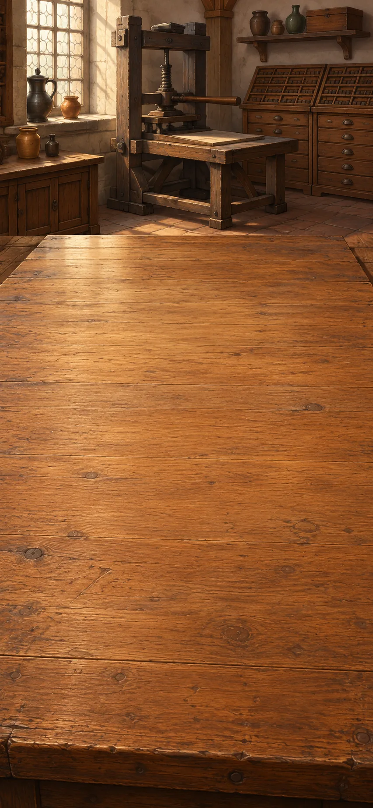

*European printing and scholarship, c. 1450–1614 CE*

Printing lets many people compare copies of a text or proof. Repeated pages spread a reading without making every editorial choice correct.

**Goals**
- How can the same page reach more readers? -- "A reproducible printed page"
- What does reusable type make possible? -- "An edition made with reusable type"
- next: How can readers compare the same proof? -- "A geometric proof that many readers can compare"

**Items**
- "Paper sheets"

  Paper provides a surface for writing and printing. Its history began outside Europe.

- "Printing from a prepared block"

  A carved or prepared block can print the same text repeatedly. Asian printing traditions existed before Gutenberg's European press.

- "Reusable metal type in a European press"

  Reusable metal letters can be arranged to print a page. This European printing system was important, but it was not the world's first printing.

- "A reproducible printed page"

  Printing makes repeated copies of a prepared page possible. Different cultures developed different ways to use that possibility.

- "An edition made with reusable type"

  Reusable type allows an edition to be printed in many copies. It expands circulation without removing the need for editing.

- "Printed copies with inspectable variants"

  Printed copies let more readers compare the same text. The editor's uncertain choices still need to be visible.

- "A geometric proof that many readers can compare"

  A printed geometric proof can reach many readers in comparable copies. They can examine the same reasoning and challenge its steps.

**Combinations**
- "Paper sheets" + "Printing from a prepared block" [preserve] -> "A reproducible printed page"
- "Paper sheets" + "Reusable metal type in a European press" [preserve] -> "An edition made with reusable type"
- "An edition that shows its doubts" + "An edition made with reusable type" -> "Printed copies with inspectable variants"
- "Printed copies with inspectable variants" + "A connected geometric proof" -> "A geometric proof that many readers can compare"

> NOTE: Sources for this session: printing, ratdolt, alexandria, hermetic, arabic-latin. Source IDs identify bibliography entries recorded at their first relevant session; precise item and recipe attribution is retained in the conversion report.

> NOTE: Source `printing`: [Library of Congress: printing in Asia](https://blogs.loc.gov/international-collections/2021/06/the-history-of-printing-in-asia-according-to-library-of-congress-asian-collections-part-1/). Collection-based context for coexisting block/type technologies. Our workshop orders and cost comparisons are fictional teaching cases, not historical data.

> NOTE: Source `ratdolt`: [Smithsonian Libraries: 1482 printed Latin Euclid](https://library.si.edu/digital-library/book/preclarissimusl00eucl). A specific printed geometric text and its Arabic–Latin lineage; no universal sole-transmission claim.

> NOTE: Source `hermetic`: [Stanford Encyclopedia of Philosophy: Marsilio Ficino](https://plato.stanford.edu/entries/ficino/).

## Translation and permission

It is evening. The worktable is cleared for a new session. Compare translations and the authorities that can limit their publication. Wider circulation does not remove interpretation or censorship.

**Goals**
- What choices does a translation make? -- "A translation’s choices made visible"
- Who can control a printed argument? -- "Printed knowledge under contention"

**Items**
- "A Greek manuscript brought by Byzantine scholars"

  Byzantine scholars bring Greek manuscripts to new readers. This is another route of learning alongside Arabic-to-Latin transmission.

- "Two translators choose different meanings"

  Two translators choose different meanings for the same passage. The difference may come from interpretation rather than a damaged original.

- "Authorities can license, ban or seize an edition"

  Authorities can control printing by licensing, banning or seizing editions. More copies do not automatically mean freedom to publish.

- "Greek and Latin versions side by side"

  Greek and Latin versions can be read side by side. Comparing them helps readers question earlier translation choices.

- "A translation’s choices made visible"

  A translation involves choices about meaning. Showing those choices lets readers see where another interpretation may be possible.

- "Printed knowledge under contention"

  Printing brings knowledge to more readers while also creating new struggles over censorship and authority. Wider circulation is not the same as unrestricted speech.

**Combinations**
- "Aristotle in Latin" + "A Greek manuscript brought by Byzantine scholars" [preserve] -> "Greek and Latin versions side by side"
- "Greek and Latin versions side by side" [preserve] + "Two translators choose different meanings" [preserve] -> "A translation’s choices made visible"
- "A reproducible printed page" [preserve] + "Authorities can license, ban or seize an edition" -> "Printed knowledge under contention"
- "An edition made with reusable type" + "Authorities can license, ban or seize an edition" -> "Printed knowledge under contention"

> NOTE: Sources for this session: printing, ratdolt, alexandria, hermetic, arabic-latin. Source IDs identify bibliography entries recorded at their first relevant session; precise item and recipe attribution is retained in the conversion report.

## Dating desk

The next morning, we return to a cleared worktable. The adjoining desk tests a text's claim to great antiquity against evidence in its language. A later date changes that claim without automatically refuting every idea in the text.

**Goals**
- How ancient is this text? -- "Hermetic wisdom, later than claimed"

**Items**
- "Dialogues attributed to ancient Hermes"

  Renaissance readers often believed these dialogues preserved wisdom from a very ancient figure called Hermes. That claimed age gave the texts authority.

- "The supposedly ancient text uses later Greek"

  The language contains features from a later period than the text's claimed origin. Such evidence can help challenge its date.

- "A claim to a primordial wisdom"

  Some Renaissance readers connected Plato with writings attributed to Hermes because they believed both offered ancient wisdom. The claimed great age of the Hermetic texts helped give them authority.

- "Hermetic wisdom, later than claimed"

  Renaissance readers had treated the writings attributed to Hermes as extremely ancient. Evidence from their language places them later. This weakens the appeal to antiquity without automatically refuting every idea they contain.

**Combinations**
- "Plato: stable Forms" + "Dialogues attributed to ancient Hermes" -> "A claim to a primordial wisdom"
- "A claim to a primordial wisdom" [preserve] + "The supposedly ancient text uses later Greek" -> "Hermetic wisdom, later than claimed"
- "Dialogues attributed to ancient Hermes" + "The supposedly ancient text uses later Greek" -> "Hermetic wisdom, later than claimed"

> NOTE: Sources for this session: printing, ratdolt, alexandria, hermetic, arabic-latin. Source IDs identify bibliography entries recorded at their first relevant session; precise item and recipe attribution is retained in the conversion report.

## Drawing desk

*European workshops and chart rooms, c. 1480–1600 CE*

A perspective picture represents a scene from one eye position. Compare it with the real view and examine what that viewpoint hides.

**Goals**
- What does one viewpoint hide? -- "A fixed view leaves other surfaces hidden"
- Does the picture match its intended view? -- "A painted view checked from its viewing point"

**Items**
- "From the side, previously hidden surfaces appear"

  Moving to the side reveals surfaces that were hidden before. A picture from one viewpoint cannot show every view at once.

- "Compare the painted view with the actual view"

  Compare the painted scene with the real view from the intended position. This checks whether the picture matches that viewpoint.

- "Draw a street through a flat frame from one fixed eye"

  Imagine drawing a street as seen through a flat frame from one fixed eye position. That setup determines what the picture includes.

- "A single-viewpoint perspective"

  Perspective represents a scene from one fixed eye position. It can make a convincing view without showing the whole place.

- "A fixed view leaves other surfaces hidden"

  A fixed viewpoint hides some surfaces behind others. What a picture leaves out can change when the viewer moves.

- "A painted view checked from its viewing point"

  The picture has been compared with the actual scene from its intended viewpoint. Matching that view does not make it a complete record of the place.

**Combinations**
- "Light paths as a geometric account" + "Draw a street through a flat frame from one fixed eye" [preserve] -> "A single-viewpoint perspective"
- "A single-viewpoint perspective" + "From the side, previously hidden surfaces appear" [preserve] -> "A fixed view leaves other surfaces hidden"
- "A single-viewpoint perspective" + "Compare the painted view with the actual view" [preserve] -> "A painted view checked from its viewing point"

> NOTE: Sources for this session: perspective, perspective-alberti-rays-primary, perspective-alberti-veil-primary, ratdolt. Source IDs identify bibliography entries recorded at their first relevant session; precise item and recipe attribution is retained in the conversion report.

> NOTE: Source `perspective`: [National Gallery: perspective](https://www.nationalgallery.org.uk/paintings/glossary/perspective). Linear perspective is one historically specific representational practice, not the culmination of all painting.

> NOTE: Source `perspective-alberti-rays-primary`: [Leon Battista Alberti, On Painting, Book I: visual pyramid and its section](https://www.noteaccess.com/Texts/Alberti/1.htm). Primary text in John R. Spencer’s translation (Yale University Press, 1970; first printed 1956), pp.46–53. The historical text explains a picture as a section at a definite viewing position and discusses proportional triangles. The courtyard, coordinates and numerical comparisons are invented teaching reconstruction, not Alberti’s recorded experiment.

> NOTE: Source `perspective-alberti-veil-primary`: [Leon Battista Alberti, On Painting, Book II: veil and changed viewpoint](https://www.noteaccess.com/Texts/Alberti/2.htm). Primary text in John R. Spencer’s translation (Yale University Press, 1970; first printed 1956), pp.67–68. The veil passage links a stable view with the position and distance of its centre. The authored shifted-eye alignment is a geometric application, not a quoted historical trial.

## Chart desk

It is evening. The worktable is cleared for a new session. At the chart desk, compare Earth's curved surface with a flat map designed for compass directions. A map can serve navigation while distorting relative areas.

**Goals**
- What does this map distort? -- "Useful bearings, distorted areas"

**Items**
- "Locations named by a common coordinate grid"

  A shared grid gives places comparable positions. It helps join separate observations into a map.

- "Polar regions grow greatly on this chart"

  On this chart, areas near the poles appear much larger relative to other regions. The map's useful direction lines come with distortion.

- "A flat chart designed for constant compass bearings"

  This flat chart is designed to make constant compass directions easy to follow. That choice changes how it represents areas.

- "An Earth with comparable positions"

  A shared system of positions connects individual places across Earth. It lets observations from different places be compared.

- "A chart made for compass bearings"

  The chart helps a navigator follow compass directions. It does not preserve every area's size and shape.

- "Useful bearings, distorted areas"

  Flattening Earth involves choices. This chart makes compass directions useful while greatly enlarging areas near the poles.

**Combinations**
- "An Earth whose size can be investigated" [preserve] + "Locations named by a common coordinate grid" [preserve] -> "An Earth with comparable positions"
- "An Earth with comparable positions" + "A flat chart designed for constant compass bearings" [preserve] -> "A chart made for compass bearings"
- "A chart made for compass bearings" + "Polar regions grow greatly on this chart" [preserve] -> "Useful bearings, distorted areas"

> NOTE: Sources for this session: civ-nga-coordinates, civ-usgs-projection-use. Source IDs identify bibliography entries recorded at their first relevant session; precise item and recipe attribution is retained in the conversion report.

> NOTE: Source `civ-nga-coordinates`: [NGA Office of Geomatics: Coordinate Systems, grids and geographic references](https://earth-info.nga.mil/?action=coordsys&dir=coordsys). Authoritative explanation of locating places by latitude and longitude. Supports the geographic reference concept, not the date or origin of historical coordinate systems.

> NOTE: Source `civ-usgs-projection-use`: [USGS: How are different map projections used?](https://www.usgs.gov/faqs/how-are-different-map-projections-used). Authoritative support for navigation-oriented projections and Mercator high-latitude area distortion. This reference supports cartographic properties, not a claimed historical transmission from Renaissance painting.

## Telescope records

*European astronomy, c. 1543–1619 CE*

The telescope reveals details of the Moon, Jupiter and Venus. Record what is observed before deciding which model of the sky it supports.

**Goals**
- Is the Moon's surface smooth? -- "An earthly-looking Moon"
- Must everything circle Earth? -- "A system of moons around Jupiter"
- How does Venus's appearance change? -- "The full range of Venus’s phases"

**Items**
- "A tube with a second lens"

  A tube holds lenses in an arrangement that can make distant objects appear larger.

- "Moon shadows change like shadows on rough ground"

  The Moon's changing shadows resemble those cast by rough ground. They give a reason to question whether its surface is perfectly smooth.

- "Points beside Jupiter change places but stay near it"

  Small points near Jupiter change position over several observations but remain nearby. The sequence matters more than any single sighting.

- "Venus shows both crescent and nearly full phases"

  Venus appears as a crescent at some times and nearly full at others. A model of its motion must explain this range of phases.

- "A telescope"

  The telescope makes distant objects appear larger. It opens new observations, but interpreting them still requires argument and comparison.

- "An earthly-looking Moon"

  The Moon's shadows suggest a rough surface. This challenges a strict contrast between perfect heavens and an imperfect Earth.

- "A system of moons around Jupiter"

  The moving points are understood as moons orbiting Jupiter. They show that not everything circles Earth directly, but do not alone prove that Earth moves.

- "The full range of Venus’s phases"

  Repeated observations reveal Venus's full range of phases. Any successful model must account for both its crescent and nearly full appearances.

**Combinations**
- "A convex magnifying lens" [consume] + "A tube with a second lens" [transform] -> "A telescope"
- "A telescope" + "Moon shadows change like shadows on rough ground" [preserve] -> "An earthly-looking Moon"
- "A telescope" + "Points beside Jupiter change places but stay near it" [preserve] -> "A system of moons around Jupiter"
- "A telescope" + "Venus shows both crescent and nearly full phases" [preserve] -> "The full range of Venus’s phases"

> NOTE: Sources for this session: copernicus, galileo, kepler, newton-moon-test-primary. Source IDs identify bibliography entries recorded at their first relevant session; precise item and recipe attribution is retained in the conversion report.

> NOTE: Source `copernicus`: [Stanford Encyclopedia of Philosophy: Nicolaus Copernicus](https://plato.stanford.edu/entries/copernicus/).

> NOTE: Source `galileo`: [Stanford Encyclopedia of Philosophy: Galileo Galilei](https://plato.stanford.edu/entries/galileo/).

> NOTE: Source `kepler`: [Museo Galileo: Kepler, Ad Vitellionem paralipomena](https://brunelleschi.imss.fi.it/genscheda.asp?appl=MAM&chiave=900026&lingua=ENG&xsl=sezione). Kepler revises inherited optics; telescope observation alone did not uniquely prove heliocentrism.

> NOTE: Source `newton-moon-test-primary`: [Isaac Newton, Principia, Book III, Proposition IV and scholium (primary text; printed pp. 391–393)](https://sites.pitt.edu/~jdnorton/teaching/2682_confirmation/2010/Principia_fragments/Principia_Bk3_to_Prop_15.pdf#page=9). The historical Moon test supplies the comparison structure. This chapter’s rounded modern-unit figures, one-second normalization and circular short-time calculation are authored teaching adaptations, not quoted historical measurements.

## Rival sky models

It is evening. The worktable is cleared for a new session. Compare rival models with Venus's phases. The evidence challenges the standard Ptolemaic arrangement but does not by itself rule out Tycho's stationary Earth.

**Goals**
- What if Earth moves? -- "Earth as a moving planet"
- Do Venus's phases prove Earth moves? -- "A stationary-Earth alternative remains live"

**Items**
- "Copernicus puts Earth among the planets"

  Copernicus places Earth among the planets moving around the Sun. The model changes how their observed motions are explained.

- "Tycho keeps Earth still while planets circle the Sun"

  Tycho keeps Earth stationary, with the Sun circling Earth and the other planets circling the Sun. This offers an alternative to a moving Earth.

- "Earth as a moving planet"

  In Copernicus's model, Earth and the other planets orbit the Sun. Earth is a moving planet, not the stationary centre of the heavens.

- "Strict Ptolemaic Venus is challenged"

  Ptolemy's standard model keeps Venus on Earth's side of the Sun, so it cannot show nearly full phases. Observing those phases rules out that arrangement, but not every model in which Earth stays still.

- "A stationary-Earth alternative remains live"

  Venus's phases can fit Tycho's model, in which the Sun circles a stationary Earth and the other planets circle the Sun. Those observations alone therefore do not prove that Earth moves.

**Combinations**
- "Ptolemy’s predictive heavens" + "Copernicus puts Earth among the planets" [preserve] -> "Earth as a moving planet"
- "The full range of Venus’s phases" [preserve] + "Ptolemy’s predictive heavens" -> "Strict Ptolemaic Venus is challenged"
- "Strict Ptolemaic Venus is challenged" [preserve] + "Tycho keeps Earth still while planets circle the Sun" [preserve] -> "A stationary-Earth alternative remains live"

> NOTE: Sources for this session: copernicus, galileo, kepler, newton-moon-test-primary. Source IDs identify bibliography entries recorded at their first relevant session; precise item and recipe attribution is retained in the conversion report.

## Orbit calculations

The next morning, we return to a cleared worktable. Explain apparent backward motion and compare Mars's recorded path with a circular orbit. Kepler's search for order must fit the observations.

**Goals**
- Why does a planet seem to move backward? -- "Apparent reversal from relative motion"
- Must an orderly orbit be a circle? -- "A lawful sky without perfect circles"

**Items**
- "A moving observer can see another body seem to reverse"

  An observer's own motion can make another moving body appear to reverse direction. An apparent reversal need not be a real reversal.

- "Tycho’s Mars observations resist a perfect-circle fit"

  Tycho's observations of Mars do not fit a perfect-circle model closely enough. The mismatch gives Kepler a reason to change the orbit's shape.

- "The heavens should form a harmonious order"

  The idea that the heavens have an orderly design motivates investigation. It is not evidence that any particular orbit must be correct.

- "Apparent reversal from relative motion"

  A planet can appear to move backward because Earth and that planet are both moving. Relative motion explains the appearance without requiring an actual reversal.

- "An elliptical path for Mars"

  Kepler uses an ellipse rather than a perfect circle to describe Mars's orbit. A different shape fits the inherited observations better.

- "A lawful sky without perfect circles"

  Kepler replaces the perfect circle with an ellipse for Mars's orbit. Astronomy can still seek lawful order while changing what that order looks like to fit the observations.

**Combinations**
- "Earth as a moving planet" + "A moving observer can see another body seem to reverse" [preserve] -> "Apparent reversal from relative motion"
- "Earth as a moving planet" + "Tycho’s Mars observations resist a perfect-circle fit" [preserve] -> "An elliptical path for Mars"
- "An elliptical path for Mars" + "The heavens should form a harmonious order" [preserve] -> "A lawful sky without perfect circles"

> NOTE: Sources for this session: copernicus, galileo, kepler, newton-moon-test-primary. Source IDs identify bibliography entries recorded at their first relevant session; precise item and recipe attribution is retained in the conversion report.

## Cases and observers

*Early-modern inquiry, c. 1600–1665 CE*

These writers use workshop records and question how preferred beliefs shape observation. Burton's account of melancholy also combines medical writing, literature and experience.

**Goals**
- Which evidence are we overlooking? -- "An inquiry that looks for unwelcome cases"
- What can explain melancholy? -- "Melancholy across bodies, books and experience"

**Items**
- "Furnace, garden and workshop records"

  Records from furnaces, gardens and workshops show what happens when people make or change things. They can contribute evidence, not just examples for an existing theory.

- "We notice evidence favouring our belief"

  People often notice evidence that agrees with what they already believe. Bacon warns that inquiry must also look for cases that do not fit.

- "Burton: Galen, poetry and lived melancholy"

  Burton brings older medical theories, poetry and personal experience into his account of melancholy. Those medical theories belong to his time and are no longer accepted explanations.

- "Natural history includes what crafts can do"

  Bacon includes workshop practices in the study of nature. Changing materials can reveal things that passive observation misses.

- "An inquiry that looks for unwelcome cases"

  An inquiry deliberately looks for evidence that could challenge its preferred answer. This reduces one source of error without making the investigator free of bias.

- "Melancholy across bodies, books and experience"

  Burton studies melancholy through medical traditions, literature and experience. His account combines different kinds of knowledge rather than reducing the subject to one cause.

**Combinations**
- "An explanation tied to conditions" + "Furnace, garden and workshop records" [preserve] -> "Natural history includes what crafts can do"
- "Natural history includes what crafts can do" [preserve] + "We notice evidence favouring our belief" [preserve] -> "An inquiry that looks for unwelcome cases"
- "A commentary that changes the question" + "Burton: Galen, poetry and lived melancholy" [preserve] -> "Melancholy across bodies, books and experience"

> NOTE: Sources for this session: bacon, natural-magic, burton. Source IDs identify bibliography entries recorded at their first relevant session; precise item and recipe attribution is retained in the conversion report.

> NOTE: Source `bacon`: [Stanford Encyclopedia of Philosophy: Francis Bacon](https://plato.stanford.edu/entries/francis-bacon/).

> NOTE: Source `natural-magic`: [University of Oklahoma primary-book exhibit: Natural Magick](https://galileo.ou.edu/exhibits/natural-magick-1658.html).

> NOTE: Source `burton`: [Wellcome Collection: The Anatomy of Melancholy](https://wellcomecollection.org/works/ztn635y7).

## Heat trials

It is evening. The worktable is cleared for a new session. At the heat table, compare warm and bright objects with cases that do not fit a simple heat–light link. Describe a method that another workshop can repeat.

**Goals**
- Does heat always need light? -- "Heat must be sought beyond luminous bodies"
- Can someone else repeat the test? -- "A trial another workshop can repeat"

**Items**
- "Sunlight warms exposed things"

  Objects exposed to sunlight become warm. This gives one example to consider when asking what heat is.

- "Flame: light and warmth"

  A flame gives both light and warmth. Together with sunlight, it may suggest that heat depends on light.

- "Bright moonlight, little warmth"

  Bright moonlight produces little noticeable warmth. This challenges a simple link between visible brightness and felt heat; it does not mean moonlight transfers no energy.

- "Rubbing warms without flame"

  Rubbing can warm an object without producing a flame. An account of heat must explain this case too.

- "Instructions let others repeat the trial"

  Clear instructions let another workshop repeat a trial. Repetition provides a chance to check the result, not a guarantee that it is reliable.

- "Heat seems tied to light"

  Sunlight and flame suggest that heat may be connected with light. Two supporting examples are a starting proposal, not a general proof.

- "Brightness need not bring comparable felt warmth"

  A flame gives light and warmth, but bright moonlight gives little noticeable warmth. This comparison challenges a simple link between visible brightness and felt heat; it does not show that moonlight transfers no energy.

- "Heat must be sought beyond luminous bodies"

  Rubbing can produce warmth without a glowing source. An account that ties heat only to shining objects therefore misses an ordinary case and must be reconsidered.

- "A trial another workshop can repeat"

  Another workshop can inspect the method and repeat the trial. Sharing the procedure makes checking possible, though disputes about trust can remain.

**Combinations**
- "Sunlight warms exposed things" [preserve] + "Flame: light and warmth" [preserve] -> "Heat seems tied to light"
- "Heat seems tied to light" [preserve] + "Bright moonlight, little warmth" [preserve] -> "Brightness need not bring comparable felt warmth"
- "Brightness need not bring comparable felt warmth" [preserve] + "Rubbing warms without flame" [preserve] -> "Heat must be sought beyond luminous bodies"
- "Printed knowledge under contention" + "Instructions let others repeat the trial" [preserve] -> "A trial another workshop can repeat"

> NOTE: Sources for this session: bacon, natural-magic, burton. Source IDs identify bibliography entries recorded at their first relevant session; precise item and recipe attribution is retained in the conversion report.

## Repeatable work

The next morning, we return to a cleared worktable. Compare rubbed wood with an untouched sample. Then make the setup of a surprising optical effect available for others to inspect and repeat.

**Goals**
- How is this surprising effect produced? -- "An optical wonder with an inspectable arrangement"
- Will another workshop find the same result? -- "The heat comparison crosses workshops"

**Items**
- `matched-wood` Matched wood: rubbed warms; untouched stays cool

  One piece of wood is rubbed while a comparable piece is left alone. Only the rubbed piece becomes noticeably warmer.

- `natural-magic-secrets` Optical wonder; repeatable arrangement

  A surprising optical effect comes from an arrangement that others can inspect and repeat. Wonder and investigation can exist together.

- "Rubbing changes the warming in this comparison"

  The rubbed wood warms while the untouched comparison does not. Changing one condition helps test whether rubbing causes the difference.

- "An optical wonder with an inspectable arrangement"

  Light passing through a small opening forms an upside-down image inside a dark box. Other people can inspect and repeat the setup to check whether it produces the same image.

- "The heat comparison crosses workshops"

  The wood-rubbing comparison can now be repeated elsewhere. A result becomes more open to criticism when other people can test the procedure.

**Combinations**
- "Heat must be sought beyond luminous bodies" [preserve] + `matched-wood` [preserve] -> "Rubbing changes the warming in this comparison"
- "A prepared dark-room image box" + `natural-magic-secrets` [preserve] -> "An optical wonder with an inspectable arrangement"
- "Rubbing changes the warming in this comparison" [preserve] + "A trial another workshop can repeat" -> "The heat comparison crosses workshops"

> NOTE: Sources for this session: bacon, natural-magic, burton. Source IDs identify bibliography entries recorded at their first relevant session; precise item and recipe attribution is retained in the conversion report.

## Mechanical explanations

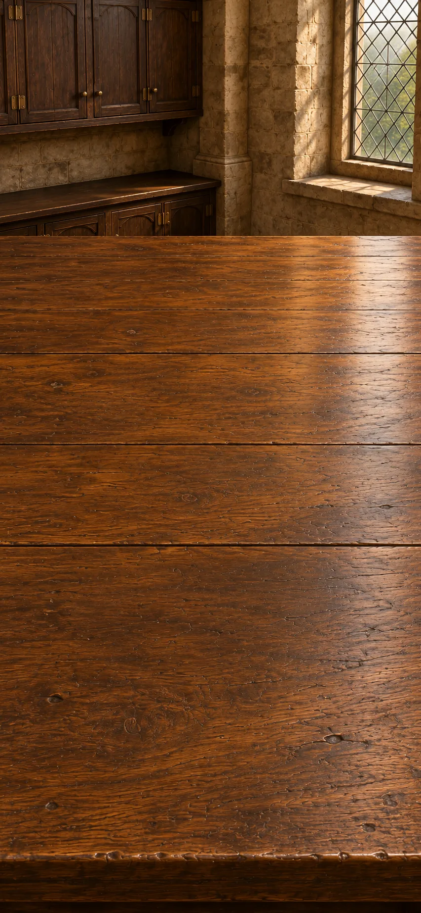

*European natural philosophy, c. 1620–1687 CE*

Try an explanation through matter and motion. Compare the mechanical figure's movement with what living animals also do, such as feeding and growing.

**Goals**
- Can matter and motion explain nature? -- "Nature investigated through matter and motion"
- Does moving like an animal make it alive? -- "Imitated motion does not establish a living animal"

**Items**
- "Bodies explained by matter and motion"

  A mechanical account tries to explain nature through matter and movement. It changes which causes an investigator looks for.

- "Jointed figure parts and gears"

  Joints and gears can be assembled to move this mechanical figure.

- "Animals feed, grow and repair themselves"

  Living animals feed, grow and repair themselves. A moving mechanical figure must be compared with more than an animal's outward motion.

- "Nature investigated through matter and motion"

  Nature is investigated through the movement and arrangement of matter. This approach asks whether physical mechanisms can explain familiar effects.

- "A figure moved by a copied gear linkage"

  The mechanical figure uses linked gears to move. The sky model shows how a linkage can coordinate movement, while the figure provides a new use for that idea.

- "Imitated motion does not establish a living animal"

  A gear-driven figure can copy an animal's movement. That alone does not show feeding, growth, repair or sensation. Mechanical imitation and a complete explanation of life are different achievements.

**Combinations**
- "Different questions about why" + "Bodies explained by matter and motion" [preserve] -> "Nature investigated through matter and motion"
- "A sky represented in gears" [preserve] + "Jointed figure parts and gears" [transform] -> "A figure moved by a copied gear linkage"
- "A figure moved by a copied gear linkage" [preserve] + "Animals feed, grow and repair themselves" [preserve] -> "Imitated motion does not establish a living animal"

> NOTE: Sources for this session: descartes, automata, harvey-primary, newton-moon-test-primary, newton-light. Source IDs identify bibliography entries recorded at their first relevant session; precise item and recipe attribution is retained in the conversion report.

> NOTE: Source `descartes`: [Stanford Encyclopedia of Philosophy: Descartes’ Physics](https://plato.stanford.edu/entries/descartes-physics/).

> NOTE: Source `automata`: [Metropolitan Museum: Art in Motion](https://www.metmuseum.org/exhibitions/listings/2019/making-marvels-science-splendor/art-in-motion).

> NOTE: Source `harvey-primary`: [Harvey, chapters IX and XIV, translated primary excerpts](https://bertie.ccsu.edu/naturesci/evolution/unit10background/HarveyNine.html). Quantity, insufficient replacement and venous return belong together. Numerical dossier is invented.

> NOTE: Source `newton-light`: [Newton Project: New Theory about Light and Colors](https://www.newtonproject.ox.ac.uk/view/texts/normalized/NATP00006).

## Light and circulation

It is evening. The worktable is cleared for a new session. Prism observations test what white light contains. Vein valves and the pumping heart provide separate evidence about the circulation of blood.

**Goals**
- What is in white light? -- "White light contains differently refracted colours"
- Where does the blood go? -- "Out through arteries, back through veins"

**Items**
- `prism-spectrum` Prism colours persist; reunite as white

  A selected colour remains that colour through a second prism, while reunited colours produce white light. These observations test whether prisms create colours or separate them.

- "Vein valves direct flow toward the heart"

  Valves in veins direct blood toward the heart. This gives evidence about the direction of its return.

- "Heart pumps blood through arteries"

  The heart pumps blood out through arteries. This outward flow must be considered alongside blood returning through veins.

- "White light contains differently refracted colours"

  A selected colour stays the same through a second prism, while reunited colours make white light. Newton uses these comparisons to show that glass separates components of white light rather than simply manufacturing new colours.

- "Venous valves direct blood back to the heart"

  Valves in veins direct blood toward the heart. Their operation supplies evidence for the return part of a circulation account rather than merely assuming that blood circulates.

- "Out through arteries, back through veins"

  The heart pumps blood out through arteries, and vein valves direct blood back toward the heart. Harvey joins these directions into a circulation account, though he cannot yet see the tiny connections through tissues.

**Combinations**
- "Light paths as a geometric account" + `prism-spectrum` [preserve] -> "White light contains differently refracted colours"
- "An organ understood through the whole animal" + "Vein valves direct flow toward the heart" [preserve] -> "Venous valves direct blood back to the heart"
- "Venous valves direct blood back to the heart" [preserve] + "Heart pumps blood through arteries" [preserve] -> "Out through arteries, back through veins"

> NOTE: Sources for this session: descartes, automata, harvey-primary, newton-moon-test-primary, newton-light. Source IDs identify bibliography entries recorded at their first relevant session; precise item and recipe attribution is retained in the conversion report.

## Motion and gravity

The next morning, we return to a cleared worktable. Connect falling near Earth with the Moon's orbit and planetary patterns. Reconstruct Newton's common account of their motion.

**Goals**
- Can one account explain Earth and sky? -- "Universal mechanics in absolute space and time"

**Items**
- "A stone falls toward Earth"

  A stone falls toward Earth. Newton compares such falling with the motion of bodies in the sky.

- "Newton: one common absolute time"

  Newton's framework uses one absolute time for the universe. Later physical theories will question that assumption.

- "An orbit considered as continual falling"

  An orbit can be understood as continual falling around Earth. This connects motion in the sky with falling near the ground.

- "Newton proposes one attraction for Earth and sky"

  Newton proposes that the same attraction accounts for falling bodies and planetary motion. The proposal connects observations of Earth and sky, rather than proving itself from a wish for harmony.

- "Universal mechanics in absolute space and time"

  Newton describes motion on Earth and in the sky in one system. He assumes space exists independently of the objects in it, and time passes alike everywhere. Later theories must explain both the system's successes and its limits.

**Combinations**
- "An elliptical path for Mars" + "A stone falls toward Earth" [preserve] -> "An orbit considered as continual falling"
- "An orbit considered as continual falling" [preserve] + "A lawful sky without perfect circles" [preserve] -> "Newton proposes one attraction for Earth and sky"
- "Newton proposes one attraction for Earth and sky" + "Newton: one common absolute time" [preserve] -> "Universal mechanics in absolute space and time"

> NOTE: Sources for this session: descartes, automata, harvey-primary, newton-moon-test-primary, newton-light. Source IDs identify bibliography entries recorded at their first relevant session; precise item and recipe attribution is retained in the conversion report.

## Protection and authority

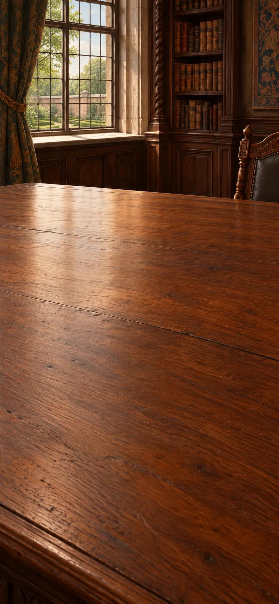

*England, 1651–1690*

Hobbes makes protection a central purpose of common political power. Follow his argument and examine what happens to obedience when protection fails.

[If skipped] Hobbes and Locke offer different limits on authority, protection and resistance.

**Goals**
- How can people secure peace? -- "Hobbes: authorized sovereign power secures peace"
- next: What if a ruler cannot protect us? -- "Hobbes: lost protection can end obedience"

**Items**
- "Hobbes: rival private powers cannot secure peace"

  Hobbes argues that rival private powers cannot reliably secure peace. He uses an agreement to authorize common power as an explanation of political authority.

- "People authorize one ruler or assembly to act for them"

  In Hobbes's account, people agree with one another to authorize a ruler or assembly. The sovereign is not simply another party bound by the same agreement.

- "The sovereign can no longer protect a subject"

  Hobbes connects obedience with the sovereign's power to protect. Losing protection matters differently from merely disliking a decision.

- "Hobbes makes protection a purpose of common power"

  Hobbes makes protection a central purpose of political authority. This answers the question of political benefit differently from the ancient accounts.

- "Hobbes: authorized sovereign power secures peace"

  Hobbes argues that authorized sovereign power can secure peace. The argument does not prove that concentrated power always succeeds.

- "Hobbes: lost protection can end obedience"

  Hobbes grounds political obedience in the sovereign's power to protect. If that protection is lost, the subject's duty can end. Merely disliking a decision is not the same condition.

**Combinations**
- "Judge rulers by whose interests they serve" [preserve] + "Hobbes: rival private powers cannot secure peace" [preserve] -> "Hobbes makes protection a purpose of common power"
- "Hobbes makes protection a purpose of common power" [preserve] + "People authorize one ruler or assembly to act for them" [preserve] -> "Hobbes: authorized sovereign power secures peace"
- "Hobbes: authorized sovereign power secures peace" + "The sovereign can no longer protect a subject" [preserve] -> "Hobbes: lost protection can end obedience"

> NOTE: Sources for this session: civ-hobbes. Source IDs identify bibliography entries recorded at their first relevant session; precise item and recipe attribution is retained in the conversion report.

> NOTE: Source `civ-hobbes`: [Thomas Hobbes, Leviathan XVII–XVIII and XXI (1651)](https://www.gutenberg.org/files/3207/3207-h/3207-h.htm). Primary text. Authorization is a covenant among subjects, not a contract signed by the sovereign; the sovereign may be a person or assembly.

## Consent and resistance

It is evening. The worktable is cleared for a new session. Compare Locke's consent and right of resistance with Hobbes's account. Their limits on authority are not identical.

**Goals**
- When may people resist a government? -- "Protection and resistance yield rival accounts of authority"

**Items**
- "Locke: political society requires people’s consent"

  Locke argues that legitimate political society requires consent. That can authorize majority decisions, while the account's practical reach remains open to criticism.

- "Rulers seize lives, liberties or possessions arbitrarily"

  Rulers act arbitrarily against lives, liberties or possessions. Locke treats this as violating the trust for which government was established.

- "Locke: legitimate government rests on consent"

  Locke grounds legitimate government in consent. Sharing humanity is not itself the same as consenting to a particular political authority.

- "Locke: breach of trust can justify resistance"

  Locke argues that a government's breach of trust can justify resistance. This does not guarantee success or imply that everyone then had an equal vote.

- "Protection and resistance yield rival accounts of authority"

  Hobbes emphasizes authorized power and protection; Locke emphasizes consent, trust and resistance to its breach. They offer different limits on authority, not one agreed social-contract doctrine.

**Combinations**
- "Fellowship beyond one city" + "Locke: political society requires people’s consent" [preserve] -> "Locke: legitimate government rests on consent"
- "Locke: legitimate government rests on consent" + "Rulers seize lives, liberties or possessions arbitrarily" [preserve] -> "Locke: breach of trust can justify resistance"
- "Hobbes: authorized sovereign power secures peace" + "Locke: breach of trust can justify resistance" [preserve] -> "Protection and resistance yield rival accounts of authority"

> NOTE: Sources for this session: civ-locke, civ-hobbes. Source IDs identify bibliography entries recorded at their first relevant session; precise item and recipe attribution is retained in the conversion report.

> NOTE: Source `civ-locke`: [John Locke, Second Treatise §§95–99, 119–122, 221–222 (1689/90)](https://www.gutenberg.org/files/7370/7370-h/7370-h.htm). Primary text. Consent, majority action, tacit consent and breach of trust are disputed arguments, not a history in which everybody actually consented.

## Time and lunar records

These records cover c. 1714–1770 CE. Compare using a reference clock with using observations of the Moon to find longitude. Read the sea-trial record: a clock's workshop performance is not enough to show that it works on a voyage.

**Goals**
- Can the Moon help locate a ship? -- "A lunar route to longitude"
- Can a clock keep reference time at sea? -- "Sea-tested reference time"

**Hotspots**
- "H4 sea-trial report"

**Items**
- "Local noon follows the Sun at this place"

  Local noon is determined by the Sun at this place. It need not occur at the same moment as noon at the clock's reference place.

- "The Moon’s changing sky position can mark reference time"

  The Moon's changing position can be compared with tables to find a reference time. This gives an alternative to carrying an accurate clock.

- "A calibrated portable clock set to a reference meridian"

  This calibrated clock is set to a reference place's time. It still needs testing to show that it keeps time accurately during a voyage.

- "Reference time read from the Moon"

  The Moon changes position against the stars as time passes. A navigator can compare its measured position with prepared tables to find the time at a known place.

- "A lunar route to longitude"

  A navigator compares the Moon’s measured position with prepared tables to find the time at a known place. Comparing that time with local time gives the east–west position. This is an alternative to carrying a sea clock, but needs a clear view of the sky.

- "A clock carrying another place’s time"

  The clock carries the time of a reference place. Comparing it with local noon explains how to find an east–west difference. This describes the method; a separate voyage report provides evidence about performance at sea.

- "Longitude from two kinds of time"

  A difference between local time and reference time gives an east–west position difference. The method depends on a reliable reference.

- "Sea-tested reference time"

  The report describes how Harrison's H4 clock kept the time of a known place during a sea voyage. Comparing that reference time with local noon gives longitude: how far east or west the observer is from that place. The successful trial supports the method, but does not certify every clock. Further testing and the reward remained disputed.

**Combinations**
- "An archive of planetary motion" + "The Moon’s changing sky position can mark reference time" [preserve] -> "Reference time read from the Moon"
- "Reference time read from the Moon" [preserve] + "Local noon follows the Sun at this place" -> "A lunar route to longitude"
- "A publicly shared year" [preserve] + "A calibrated portable clock set to a reference meridian" [preserve] -> "A clock carrying another place’s time"
- "A clock carrying another place’s time" + "Local noon follows the Sun at this place" -> "Longitude from two kinds of time"
- "Sea-tested reference time" [preserve] + "Local noon follows the Sun at this place" -> "Longitude from two kinds of time"
- "A clock carrying another place’s time" @ "H4 sea-trial report" -> "Sea-tested reference time"

> NOTE: Sources for this session: longitude, longitude-lunar-si, almanac-history, jaipur, longitude-harrison-trial-record, longitude-h4-trial-history. Source IDs identify bibliography entries recorded at their first relevant session; precise item and recipe attribution is retained in the conversion report.

> NOTE: Source `longitude`: [Royal Museums Greenwich: Harrison and longitude](https://www.rmg.co.uk/stories/time/harrisons-clocks-longitude-problem). Chronometers and lunar distances coexisted. Sea trials, cost and reproducibility matter alongside invention.

> NOTE: Source `longitude-lunar-si`: [Smithsonian: Observing the skies — lunar distances](https://timeandnavigation.si.edu/navigating-at-sea/longitude-problem/observing-the-skies). Lunar angle establishes reference time; longitude also requires local time.

> NOTE: Source `almanac-history`: [US Naval Observatory: History of the Nautical Almanac](https://aa.usno.navy.mil/publications/na_history). First data for 1767; mean-time change in 1834. Fictional rows are not copied ephemerides.

> NOTE: Source `jaipur`: [UNESCO: The Jantar Mantar, Jaipur](https://whc.unesco.org/en/list/1338).

> NOTE: Source `longitude-harrison-trial-record`: [Royal Museums Greenwich: Harrison’s 1765 account, BGN/14](https://www.rmg.co.uk/collections/objects/rmgc-object-478825). Museum catalogue identifies a surviving contemporary pamphlet advocating Harrison’s reward after H4 trials. The game paraphrases a documented report; it does not invent a voyage performed at this desk.

> NOTE: Source `longitude-h4-trial-history`: [Royal Museums Greenwich: Harrison’s timekeepers and trials](https://www.rmg.co.uk/stories/time/harrisons-clocks-longitude-problem). Confirms the 1764 Barbados trial, the result considered in 1765, and continued dispute/testing. A successful trial is not a guarantee for every clock or final closure of the controversy.

> NOTE: Hotspot context — H4 sea-trial report: A reading place for Harrison’s published account of H4’s voyage trial, including the Barbados result. Compare its evidence with the reference-time method. This is a report on the desk, not a moving ship.

## Observatory and route charts

It is evening. The worktable is cleared for a new session. Compare astronomical work at Jaipur with the methods used for a voyage. Add longitude to the route and provide food for the journey.

**Goals**
- What makes an observatory useful? -- "Plan for a masonry observatory"
- What keeps a long voyage going? -- "A voyage sustained beyond the fresh-food window"

**Items**
- "Indian and Persian astronomical tables in comparison"

  These astronomical tables preserve Indian and Persian traditions. Jai Singh's project compares traditions to improve observations and calculations.

- "Large masonry instruments fix precise lines of sight"

  Large fixed masonry instruments provide stable lines for observing the sky. They are a different design choice from a telescope.

- "Astronomical traditions compared at Jaipur"

  At Jaipur, different astronomical traditions are compared with observations. Inherited tables become material for active revision rather than unquestioned authority.

- "Plan for a masonry observatory"

  Large fixed instruments are designed for measuring the sky and checking astronomical tables. Their scale and stable sightlines serve that work.

- "A sea route marked with longitude"

  Longitude adds an east–west position to the charted route. Latitude is still needed to specify a complete position.

- "A voyage sustained beyond the fresh-food window"

**Combinations**
- "Ptolemy read critically" [preserve] + "Indian and Persian astronomical tables in comparison" [preserve] -> "Astronomical traditions compared at Jaipur"
- "Astronomical traditions compared at Jaipur" [preserve] + "Large masonry instruments fix precise lines of sight" [preserve] -> "Plan for a masonry observatory"
- "A chart made for compass bearings" + "Longitude from two kinds of time" [preserve] -> "A sea route marked with longitude"
- "A chart made for compass bearings" + "A lunar route to longitude" [preserve] -> "A sea route marked with longitude"
- "A sea route marked with longitude" [preserve] + "Provisions for a longer journey" [preserve] -> "A voyage sustained beyond the fresh-food window"

> NOTE: Sources for this session: longitude, longitude-lunar-si, almanac-history, jaipur. Source IDs identify bibliography entries recorded at their first relevant session; precise item and recipe attribution is retained in the conversion report.

## Public knowledge table

*Enlightenment debates, c. 1750–1792 CE*

Craft illustrations and linked articles make practical knowledge more widely available. Consider who can read and challenge these public arguments.

**Goals**
- How are different kinds of knowledge connected? -- "Knowledge joined by cross-reference"
- Who can challenge a public argument? -- "An argument answerable to a wider public"

**Items**
- "Engravings explain crafts"

  These illustrations explain how crafts are practised. They make practical skill part of a public account of knowledge.

- "Articles link branches of knowledge"

  Links between articles let readers follow connections across subjects. Knowledge need not be presented as one fixed hierarchy.

- "Readers outside universities can answer back"

  Readers beyond universities can question published arguments. A wider audience does not automatically give everyone equal power to speak.

- "Craft enters the public account of knowledge"

  Craft knowledge is included in a widely shared reference work. Practical making becomes part of learned knowledge despite censorship and disagreement.

- "Knowledge joined by cross-reference"

  Cross-references let readers connect different subjects and practices. The structure supports more than one route through knowledge.

- "An argument answerable to a wider public"

  Arguments are opened to criticism from a wider public. Broader discussion can challenge authority without guaranteeing equal participation.

**Combinations**
- "Printed knowledge under contention" + "Engravings explain crafts" [preserve] -> "Craft enters the public account of knowledge"
- "Craft enters the public account of knowledge" [preserve] + "Articles link branches of knowledge" [preserve] -> "Knowledge joined by cross-reference"
- "An objection and an accountable reply" [preserve] + "Readers outside universities can answer back" [preserve] -> "An argument answerable to a wider public"

> NOTE: Sources for this session: encyclopedie, hume, kant, wollstonecraft, stoics. Source IDs identify bibliography entries recorded at their first relevant session; precise item and recipe attribution is retained in the conversion report.

> NOTE: Source `encyclopedie`: [University of Chicago ARTFL Encyclopédie](https://encyclopedie.uchicago.edu/).

> NOTE: Source `hume`: [Stanford Encyclopedia of Philosophy: David Hume](https://plato.stanford.edu/entries/hume/).

> NOTE: Source `kant`: [Stanford Encyclopedia of Philosophy: Immanuel Kant](https://plato.stanford.edu/entries/kant/).

> NOTE: Source `wollstonecraft`: [Mary Wollstonecraft, A Vindication of the Rights of Woman](https://www.gutenberg.org/ebooks/3420).

## Experience and sufficiency

It is evening. The worktable is cleared for a new session. Hume questions why a past pattern should hold in the next case, and Kant offers a response about experience. A separate comparison asks whether status and luxury make a good life.

**Goals**
- What makes experience possible? -- "Kant: the mind helps structure experience"
- Is having enough the same as having status? -- "Enough is not the same as higher status"

**Items**
- "Repeated sequence does not show necessity"

  Hume asks why repeatedly seeing one event follow another should prove that the connection is necessary. The repeated sequence is visible; necessity is not.

- "Kant: what makes experience possible?"

  Kant asks what the mind must contribute for experience to be possible. His response addresses a philosophical problem rather than disproving Hume with one experiment.

- "Prestige demands more possessions"

  Social standing can seem to require ever more possessions. This puts pressure on the older idea that a good life may need relatively little.

- "Past success does not guarantee the next case"

  A pattern that held in past observations is not logically guaranteed to hold in the next case. Hume asks what justifies making that further prediction.

- "Kant: the mind helps structure experience"

  Hume questions what justifies extending observed patterns beyond the cases already seen. Kant responds by asking what the mind contributes to make experience possible. His account is a philosophical response, not one experiment that settles the dispute.

- "Enough is not the same as higher status"

  Social standing can demand more and more possessions. The older ideal of friendship and having enough challenges that demand: a higher status is not the same thing as a better life.

**Combinations**
- "The heat comparison crosses workshops" + "Repeated sequence does not show necessity" [preserve] -> "Past success does not guarantee the next case"
- "Past success does not guarantee the next case" [preserve] + "Kant: what makes experience possible?" [preserve] -> "Kant: the mind helps structure experience"
- "Freedom by needing less" [preserve] + "Prestige demands more possessions" [preserve] -> "Enough is not the same as higher status"

> NOTE: Sources for this session: encyclopedie, hume, kant, wollstonecraft, stoics. Source IDs identify bibliography entries recorded at their first relevant session; precise item and recipe attribution is retained in the conversion report.

## Rights declarations

The next morning, we return to a cleared worktable. Compare a claim of universal rights with women's exclusion and enslaved people's testimony. Test whom the promise includes in practice.

**Goals**
- Do universal rights include women? -- "Universal reason must include women"
- Can universal liberty coexist with slavery? -- "Universal liberty confronts enslavement"

**Items**
- "Rights proclaimed universal"

  The declaration claims rights for everyone. Its claim must be compared with who actually receives those rights.

- "Women denied the education invoked for equality"

  Women are denied education while reason is used to justify equality. Wollstonecraft challenges that exclusion from the principle.

- "Enslaved people describe their denied freedom"

  Enslaved people describe the freedom denied to them and act against their enslavement. Their experience and agency challenge claims that liberty already belongs to everyone.

- "A claim to rights beyond inherited rank"

  Rights are claimed for people beyond inherited rank or privilege. Whether the claim is truly universal depends on whom law and practice include.

- "Universal reason must include women"

  A declaration may invoke universal reason while women are denied the education used to develop it. Wollstonecraft turns that stated principle against the exclusion and unequal treatment of women.

- "Universal liberty confronts enslavement"

  A claim of universal liberty conflicts with enslavement. The testimony and actions of enslaved people expose that conflict, rather than leaving it as an abstract puzzle.

**Combinations**
- "Fellowship beyond one city" + "Rights proclaimed universal" -> "A claim to rights beyond inherited rank"
- "Locke: legitimate government rests on consent" + "Rights proclaimed universal" -> "A claim to rights beyond inherited rank"
- "A claim to rights beyond inherited rank" + "Women denied the education invoked for equality" [preserve] -> "Universal reason must include women"
- "A claim to rights beyond inherited rank" + "Enslaved people describe their denied freedom" [preserve] -> "Universal liberty confronts enslavement"

> NOTE: Sources for this session: encyclopedie, hume, kant, wollstonecraft, stoics, civ-locke. Source IDs identify bibliography entries recorded at their first relevant session; precise item and recipe attribution is retained in the conversion report.

## Luxury and well-being

This comparison covers c. 1705–1800 CE. These economic accounts distinguish greater trade and wealth from living well. Compare Mandeville's claim about private motives with the older ideal of having enough.

**Goals**
- Does more wealth make a better life? -- "Prosperity and a good life can diverge"

**Items**
- "Luxury demand keeps trades busy"

  Demand for luxuries creates work in many trades. Mandeville uses this claim in a controversial argument about motives and prosperity.

- "Mandeville: prosperous hive depends on vice"

  Mandeville's fable argues that a prosperous society may depend on motives condemned as vices. It puts public wealth in tension with familiar standards of personal virtue.

- "Mandeville: private vice, public benefit"

  Mandeville argues that private motives condemned as vices can support public prosperity. The uncomfortable question is whether wealth created by such motives makes a society good.

- "Prosperity and a good life can diverge"

  More trade and wealth do not automatically provide friendship, security or worthwhile activity. Comparing economic prosperity with the older ideal of a sufficient life keeps those different measures of success visible.

**Combinations**
- "Luxury demand keeps trades busy" [preserve] + "Mandeville: prosperous hive depends on vice" [preserve] -> "Mandeville: private vice, public benefit"
- "Mandeville: private vice, public benefit" [preserve] + "Pleasure in friendship and sufficiency" [preserve] -> "Prosperity and a good life can diverge"

> NOTE: Sources for this session: mandeville, smith, malthus, morris. Source IDs identify bibliography entries recorded at their first relevant session; precise item and recipe attribution is retained in the conversion report.

> NOTE: Source `mandeville`: [Stanford Encyclopedia of Philosophy: Bernard Mandeville](https://plato.stanford.edu/entries/mandeville/).

> NOTE: Source `smith`: [Adam Smith, The Wealth of Nations](https://www.gutenberg.org/ebooks/3300).

> NOTE: Source `malthus`: [Thomas Malthus: Essay on the Principle of Population, 1798](https://www.econlib.org/library/Malthus/malPop.html). The ratios are Malthus’s argumentative model, not a universal empirical law or moral instruction.

> NOTE: Source `morris`: [William Morris Archive: Useful Work versus Useless Toil](https://morrisarchive.lib.uiowa.edu/items/show/1872).

## Workshop accounts

It is evening. The worktable is cleared for a new session. Compare the output gained by specialized tasks with their effects on workers. Producing more does not answer every question about a person's life.

**Goals**
- What does work do to the worker? -- "The maker is more than the output"

**Items**
- "Pin-making account: repeated tasks"

  Pin-making is divided into repeated tasks. Smith uses this example to explain how specialization can raise output.

- "Specialists trade what they make"

  Specialists exchange what they make for things made by others. Trade connects their separate tasks.

- "Repeating one task can narrow a worker’s powers"

  Repeating one narrow task can limit the worker's skills and opportunities. Smith recognizes costs as well as gains from specialization.

- "Production divided into specialized tasks"

  Work is divided into specialized tasks, allowing more to be produced. Organization, not only machinery, can change a workshop's output.

- "More output can narrow the maker’s life"

  Specialized work may increase output while narrowing the worker's abilities and daily life. Greater efficiency is not the same as greater well-being.

- "The maker is more than the output"

  Workers are people whose abilities and lives matter, not only sources of output. A productive arrangement can still fail them.

**Combinations**
- "Pin-making account: repeated tasks" [preserve] + "Specialists trade what they make" [preserve] -> "Production divided into specialized tasks"
- "Production divided into specialized tasks" + "Repeating one task can narrow a worker’s powers" [preserve] -> "More output can narrow the maker’s life"
- "More output can narrow the maker’s life" [preserve] + "Virtue as cultivated judgment" -> "The maker is more than the output"

> NOTE: Sources for this session: mandeville, smith, malthus, morris. Source IDs identify bibliography entries recorded at their first relevant session; precise item and recipe attribution is retained in the conversion report.

## Trade and scarcity

The next morning, we return to a cleared worktable. Compare long voyages and traded goods with the forced labour used to produce them. When resources are scarce, who bears the cost?

**Goals**
- Who should bear a shortage? -- "Scarcity does not settle who should bear it"
- How free is this trade? -- "Exchange entangled with coercion"

**Items**
- "Population may outgrow subsistence"

  Malthus argues that population can grow faster than its food supply. This proposed pressure is not an identical, unavoidable fate for every society.

- "Food and access can become limiting"

  People can lack food because too little is produced or because they cannot obtain it. These are different problems.

- "Regions exchange unlike goods"

  Regions exchange different goods. Trade expands access while also raising questions about who controls the routes and production.

- "Some traded goods come from coerced labour"

  Some traded goods are produced by people forced to work. Their coercion is part of the trade's history, not merely a production cost.

- "More offspring than available subsistence"

  Malthus argues that potential population growth can exceed growth in food supplies. This can create pressure, but it does not decide which response is fair.

- "Scarcity does not settle who should bear it"

  A shortage describes a problem; it does not decide who should bear its costs. A policy still needs a separate justification.

- "An enlarged world of exchange"

  Navigation and preserved food allow exchange over longer distances. Goods can travel farther because voyages can be located and sustained.

- "Exchange entangled with coercion"

  Long-distance exchange can depend on forced labour and political power. Technical improvements alone do not explain who benefits or who suffers.

**Combinations**
- "Population may outgrow subsistence" [preserve] + "Food and access can become limiting" [preserve] -> "More offspring than available subsistence"
- "More offspring than available subsistence" + "A claim to rights beyond inherited rank" -> "Scarcity does not settle who should bear it"
- "A voyage sustained beyond the fresh-food window" [preserve] + "Regions exchange unlike goods" [preserve] -> "An enlarged world of exchange"
- "An enlarged world of exchange" [preserve] + "Some traded goods come from coerced labour" [preserve] -> "Exchange entangled with coercion"

> NOTE: Sources for this session: mandeville, smith, malthus, morris. Source IDs identify bibliography entries recorded at their first relevant session; precise item and recipe attribution is retained in the conversion report.

## Emancipation records

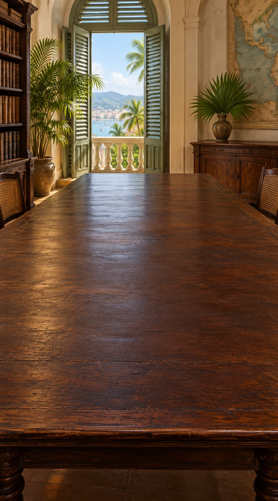

*Saint-Domingue and Haiti, 1791–1804*

Follow the uprising of enslaved people and the abolition measures that follow. Their political action changes the situation; freedom is not simply granted by a distant declaration.

[If skipped] Emancipation, freedom at work and political independence are distinct achievements.

**Goals**
- How does freedom become law? -- "Emancipation becomes law amid revolution"

**Items**
- "1791: enslaved people rise against plantation slavery"

  In 1791, enslaved people rise against plantation slavery in Saint-Domingue. Their action changes the political situation; emancipation is not merely an idea sent from Europe.

- "1793–1794: colonial and French decrees abolish slavery"

  Decrees in 1793–1794 abolish slavery amid uprising, war and political pressure. A legal change does not mean immediate, uniform enforcement.

- "Insurgents make freedom a political demand"

  Enslaved insurgents make freedom an active political demand. They are agents of change, not passive recipients of European ideas.

- "Emancipation becomes law amid revolution"

  During the revolution in Saint-Domingue, uprising, war and political pressure lead to abolition decrees. Emancipation becomes law, while enforcement and freedom in daily life remain further questions.

**Combinations**
- "Universal liberty confronts enslavement" [preserve] + "1791: enslaved people rise against plantation slavery" [preserve] -> "Insurgents make freedom a political demand"
- "Insurgents make freedom a political demand" [preserve] + "1793–1794: colonial and French decrees abolish slavery" [preserve] -> "Emancipation becomes law amid revolution"

> NOTE: Sources for this session: civ-abolition-chronology, civ-haiti-archive, civ-haiti-context. Source IDs identify bibliography entries recorded at their first relevant session; precise item and recipe attribution is retained in the conversion report.

> NOTE: Source `civ-abolition-chronology`: [Mémorial de l’abolition de l’esclavage, chronology of abolition](https://memorial.nantes.fr/chronologie-des-abolitions/). Institutional chronology: 1791 uprising, local abolition in 1793, national extension in February 1794. Precise local sequences were not collapsed to one decree.

> NOTE: Source `civ-haiti-archive`: [Library of Congress / Bibliothèque Haïtienne des Pères du Saint-Esprit: Laws of Saint-Domingue (1801)](https://www.loc.gov/resource/gdcwdl.wdl_14719/?st=gallery). Primary printed law collection and archival catalogue; agency and institutions are not reduced to European pamphlets.

> NOTE: Source `civ-haiti-context`: [BnF, Haiti’s independence debt: archival context, 1794–1922](https://heritage.bnf.fr/france-ameriques/en/haitis-independence-debt-slave-unit-account-1794-1922). Institutional historical account. Independence in 1804; recognition and coercive indemnity came later, not automatic equal standing.

## Constitution and work

It is evening. The worktable is cleared for a new session. Compare abolition with compulsory plantation work and Haiti's later independence. Ending slavery does not immediately settle every question about power and work.

**Goals**
- Does abolition mean freedom to choose work? -- "Abolition coexists with coercive labour"
- Is emancipation the same as independence? -- "An independent state defends emancipation"

**Items**
- "1801: abolition, but still a French colony"

  The 1801 constitution rejects slavery while keeping Saint-Domingue connected to France. Abolition and independence are not yet the same achievement.

- "1801: plantation cultivation must not stop"

  The 1801 constitution keeps a compulsory plantation system. Ending slavery does not automatically give workers freedom to choose their work.

- "1804: after defeating reconquest, Haiti declares independence"

  After defeating French reconquest, Haiti declares independence in 1804. Independence was fought for and did not immediately create equal power for everyone.

- "Abolition is claimed inside the French empire"

  The 1801 constitution rejects slavery but retains Saint-Domingue's connection with France. Abolition and independence are therefore distinct political achievements.

- "Compulsory cultivation challenges consent"

  Compulsory plantation work prevents people from freely choosing their work. It puts the ideal of consent in conflict with the actual working arrangement.

- "Abolition coexists with coercive labour"

  Saint-Domingue's 1801 constitution rejects slavery while maintaining compulsory plantation work. This exposes a limit on freedom at work without erasing the achievement of emancipation.

- "An independent state defends emancipation"

  Haiti's independence breaks France's claim to rule and defends emancipation. It does not remove every form of coercion or secure immediate international recognition.

**Combinations**
- "Emancipation becomes law amid revolution" + "1801: abolition, but still a French colony" [preserve] -> "Abolition is claimed inside the French empire"
- "Locke: legitimate government rests on consent" + "1801: plantation cultivation must not stop" [preserve] -> "Compulsory cultivation challenges consent"
- "Abolition is claimed inside the French empire" [preserve] + "Compulsory cultivation challenges consent" [preserve] -> "Abolition coexists with coercive labour"
- "Emancipation becomes law amid revolution" + "1804: after defeating reconquest, Haiti declares independence" [preserve] -> "An independent state defends emancipation"

> NOTE: Sources for this session: civ-haiti-1801, civ-haiti-declaration, civ-haiti-context, civ-locke. Source IDs identify bibliography entries recorded at their first relevant session; precise item and recipe attribution is retained in the conversion report.

> NOTE: Source `civ-haiti-1801`: [Constitution of Saint-Domingue, 1801, arts.1–5, 14–16, 28](https://www.marxists.org/history/haiti/1801/constitution.htm). Primary document in translation. Abolition, French sovereignty, compulsory agricultural continuity and life governorship coexist.

> NOTE: Source `civ-haiti-declaration`: [Haitian Declaration of Independence (1804), Dubois/Garrigus translation](https://declarationproject.org/?p=210). Primary declaration; permanent separation from France is not a promise of equal power or an end to coercive labour.

## Fossil and strata desk

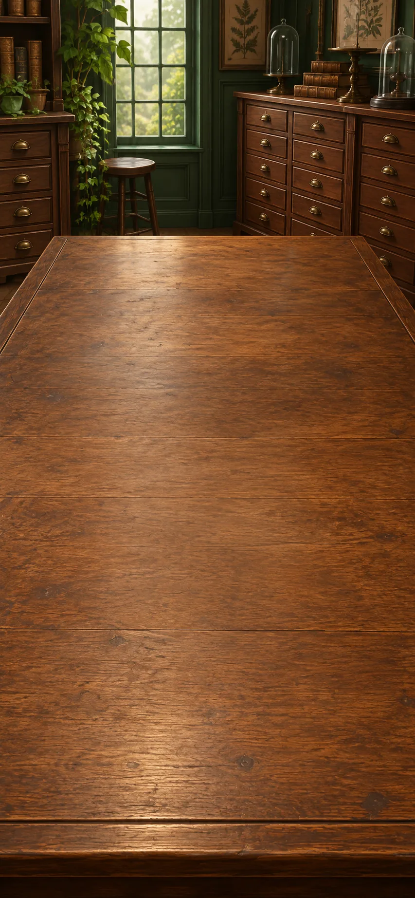

These records cover c. 1669–1833. Fossils and the order of rock layers preserve evidence of an earlier Earth. Compare extinct animals and matching layers at separate sites.

**Goals**
- Can distant rock layers share a history? -- "Separated beds, a comparable succession"
- Can a whole kind of animal disappear? -- "Whole forms of life have disappeared"

**Items**
- "A fossil shell enclosed in rock"

  The shell is enclosed in the rock. It is evidence of an organism in the rock's past, not a loose modern shell on its surface.

- "Undisturbed layers: lower before upper"

  In an undisturbed sequence, lower deposited layers usually came before upper ones. Folding, overturning and later intrusions need separate attention.

- "Similar fossil successions in distant beds"

  Similar sequences of fossils in separated layers can help connect their histories. The comparison extends beyond one site.

- "Fossil animals unlike any living species"

  Some fossil animals differ from every known living species. Comparing their anatomy gives evidence that whole kinds of animals disappeared.

- "A fossil is a trace of former life"

  The object is understood as a trace of former life. Comparing it with living organisms turns it into evidence about the past.

- "Rock layers in order"

  Rock layers can be placed in order from earlier to later. This establishes a sequence without yet giving ages in years.

- "Separated beds, a comparable succession"

  Matching fossil sequences connects separated rock layers. A history can be reconstructed across more than one exposed cliff.

- "Whole forms of life have disappeared"

  Some kinds of animals no longer exist. A catalogue of life must therefore include a past that differs from the present.

**Combinations**
- "Animals compared by structures and activities" + "A fossil shell enclosed in rock" [preserve] -> "A fossil is a trace of former life"
- "A fossil is a trace of former life" + "Undisturbed layers: lower before upper" [preserve] -> "Rock layers in order"
- "Rock layers in order" [preserve] + "Similar fossil successions in distant beds" [preserve] -> "Separated beds, a comparable succession"
- "A fossil is a trace of former life" + "Fossil animals unlike any living species" [preserve] -> "Whole forms of life have disappeared"

> NOTE: Sources for this session: hutton, deep-time, lyell-darwin, geologic-age-modern. Source IDs identify bibliography entries recorded at their first relevant session; precise item and recipe attribution is retained in the conversion report.

> NOTE: Source `hutton`: [Siccar Point: geological evidence and Hutton](https://iugs-geoheritage.org/geoheritage_sites/siccar-point/). Hutton used an unconformity to support an existing account of repeated geological processes; one scene does not establish every feature of his theory.

> NOTE: Source `deep-time`: [US Geological Survey: Geologic Time](https://pubs.usgs.gov/gip/geotime/).

> NOTE: Source `lyell-darwin`: [Darwin Correspondence Project: Charles Lyell](https://darwin-editorial.darwinproject.ac.uk/charles-lyell). Documented geological influence with continuing disagreement, not blanket acceptance.

> NOTE: Source `geologic-age-modern`: [USGS: Geologic Time, Then and Now](https://www.usgs.gov/news/powell-expedition-geologic-time-then-and-now).

## Rock histories

It is evening. The worktable is cleared for a new session. Use erosion, tilted layers and abrupt events to reconstruct the landscape's history. A long sequence is not yet an age measured in years.

**Goals**
- Must Earth's changes happen at one pace? -- "Long processes and abrupt events"
- Does knowing the order tell us the age? -- "Sequence is not duration"

**Items**
- "Streams wear down rock and lay sediment"

  Streams wear material away and deposit it elsewhere. Processes visible today can help explain older traces in rock.

- "Tilted beds below younger level beds"

  Tilted layers lie beneath younger level layers. The arrangement requires several events: deposition, tilting, erosion and new deposition.

- "Some strata record abrupt disruption"

  Some rock layers record abrupt events. A long history can contain both gradual change and sudden disruption.

- "Present processes can explain ancient traces"

  Streams erode rock and deposit sediment today. Those observed processes help explain similar traces preserved in ancient rock.

- "More than one making of the landscape"

  Tilted rock layers beneath younger level layers require several episodes: deposition, tilting, erosion and new deposition. The landscape records repeated change rather than one unchanged act of formation.

- "A landscape needs a deep past"

  Many layers and repeated changes require a long history. The evidence establishes an extended past without yet measuring exactly how many years it lasted.

- "Long processes and abrupt events"

  Earth's history includes long-running processes and abrupt events. It need not be reduced to either constant slow change or one worldwide catastrophe.

- "Sequence is not duration"

  Knowing which events came first does not tell us how many years separated them. Rock order and numerical age are different questions.

**Combinations**
- "An explanation tied to conditions" + "Streams wear down rock and lay sediment" [preserve] -> "Present processes can explain ancient traces"
- "Present processes can explain ancient traces" [preserve] + "Tilted beds below younger level beds" [preserve] -> "More than one making of the landscape"
- "More than one making of the landscape" [preserve] + "Separated beds, a comparable succession" -> "A landscape needs a deep past"
- "A landscape needs a deep past" + "Some strata record abrupt disruption" [preserve] -> "Long processes and abrupt events"
- "Separated beds, a comparable succession" + "A landscape needs a deep past" -> "Sequence is not duration"

> NOTE: Sources for this session: hutton, deep-time, lyell-darwin, geologic-age-modern. Source IDs identify bibliography entries recorded at their first relevant session; precise item and recipe attribution is retained in the conversion report.

## Naturalists’ notebooks

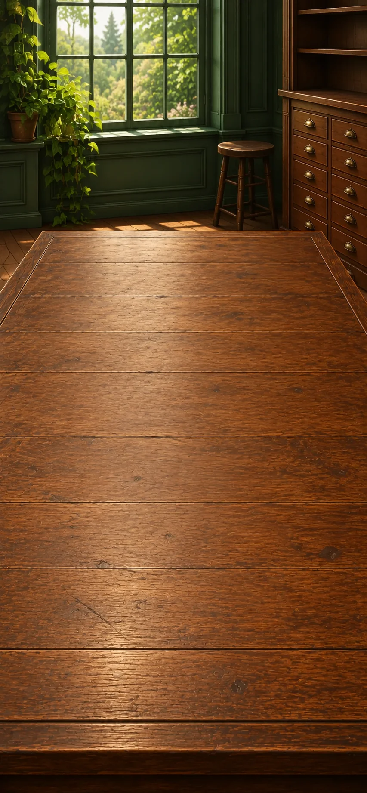

These records cover c. 1735–1859. Shared species names and geographical observations make living things easier to compare. Consider Lamarck's proposal that species can change over time.

**Goals**
- Why do different places have different life? -- "Life patterned by place and conditions"
- Can species change? -- "Species can have changing histories"

**Items**
- "Linnaeus gives each species a two-part name"

  Linnaeus's two-part species names make comparisons easier. Useful naming does not make every part of his classification, including his racial hierarchy, true or acceptable.

- "Plant communities change with height and climate"

  Plant communities vary with altitude and climate. Humboldt compares living things with the physical conditions around them.

- "Lamarck: changed habits can change descendants"

  Lamarck proposes that use, disuse and inherited acquired changes help transform living kinds. This is a historical explanation, not the same mechanism as natural selection.

- "Comparable names for living kinds"

  Shared two-part names make records of species easier to compare. The names help investigation without making the groups beyond revision.

- "Life patterned by place and conditions"

  Living things vary with place, climate and altitude. Comparing these patterns connects classification with the conditions of life.

- "Species can have changing histories"

  Lamarck argues that use and disuse change an organism's body, and those changes can pass to its offspring. This differs from natural selection, which acts on inherited differences already present.

**Combinations**
- "Animals compared by structures and activities" + "Linnaeus gives each species a two-part name" [preserve] -> "Comparable names for living kinds"
- "Comparable names for living kinds" + "Plant communities change with height and climate" [preserve] -> "Life patterned by place and conditions"
- "Comparable names for living kinds" + "Lamarck: changed habits can change descendants" [preserve] -> "Species can have changing histories"

> NOTE: Sources for this session: aristotle-biology, linnaeus, humboldt, darwin-selection, darwin-malthus, darwin-origin-wolves-primary, wallace-varieties-primary, lyell-darwin. Source IDs identify bibliography entries recorded at their first relevant session; precise item and recipe attribution is retained in the conversion report.

> NOTE: Source `linnaeus`: [The Linnean Society: Linnaeus and race](https://www.linnean.org/learning/who-was-linnaeus/linnaeus-and-race).

> NOTE: Source `humboldt`: [Nature Ecology & Evolution: Humboldt’s legacy](https://www.nature.com/articles/s41559-019-0980-5).

> NOTE: Source `darwin-selection`: [Darwin Correspondence Project: Natural selection](https://darwin-editorial.darwinproject.ac.uk/commentary/evolution/natural-selection).

> NOTE: Source `darwin-malthus`: [A. R. Wallace to Darwin, 9 July 1881, Darwin Correspondence Project](https://www.darwinproject.ac.uk/view/letters/DCP-LETT-13238).

> NOTE: Source `darwin-origin-wolves-primary`: [Darwin, On the Origin of Species (1859), IV, pp.90–91 and 95–96: imaginary wolf/prey example and accumulation over time](https://darwin-online.org.uk/converted/published/1859_Origin_F373/1859_Origin_F373.html). Primary text. Darwin explicitly labels the wolf/prey illustration imaginary and requires retention of other needed abilities. Our 20-adult/40-pup/20-recruit counts, exact inheritance, pair grouping and non-overlapping cohorts are authored simplifications, not Darwin’s data.

> NOTE: Source `wallace-varieties-primary`: [Wallace, On the Tendency of Varieties to depart indefinitely from the Original Type (1858), pp.53–62, in the joint Darwin–Wallace publication](https://darwin-online.org.uk/converted/published/1858_species_F350.html). Primary text: opening challenge to inferred permanent natural bounds (pp.53–54), domestic/wild contrast and conclusion (pp.60–62); introductory letter records independent work. No numerical wolf data taken from this source; its caricature of Lamarck is not adopted.

## Selection comparisons

It is evening. The worktable is cleared for a new session. Compare inherited differences, selective breeding and limited resources. You still need evidence about which differences leave more descendants; scarcity alone does not establish selection.

**Goals**
- Can small inherited differences add up? -- "Small inherited differences can accumulate"
- Why do some differences spread? -- "Unequal reproduction changes a population"

**Items**
- "Offspring differ, and some differences are inherited"

  Offspring differ, and some differences pass from parents to offspring. Selection depends on this, even before the mechanism of inheritance is understood.

- "Breeders keep offspring with desired traits"

  Breeders repeatedly choose offspring with desired traits. Their choices show how inherited differences can accumulate over generations.

- "Some inherited differences leave more descendants"

  Some inherited differences lead to more surviving descendants than others. Reproductive success, not simply physical strength, matters in this comparison.

- "Small inherited differences can accumulate"

  Breeding shows how small inherited differences can accumulate. Natural selection uses the comparison without requiring a breeder who plans nature's changes.

- "Heritably varied offspring face limited resources"

  Offspring have inherited differences and face limited resources. These facts alone do not show which differences will leave more descendants; reproductive outcomes must also be compared.

- "Unequal reproduction changes a population"

  Inherited differences that affect reproduction can become more or less common over generations. Natural selection describes this population change, not a rule that the strongest always win.

**Combinations**
- "Offspring differ, and some differences are inherited" + "Breeders keep offspring with desired traits" [preserve] -> "Small inherited differences can accumulate"
- "More offspring than available subsistence" + "Offspring differ, and some differences are inherited" -> "Heritably varied offspring face limited resources"
- "Heritably varied offspring face limited resources" [preserve] + "Some inherited differences leave more descendants" [preserve] -> "Unequal reproduction changes a population"

> NOTE: Sources for this session: aristotle-biology, linnaeus, humboldt, darwin-selection, darwin-malthus, darwin-origin-wolves-primary, wallace-varieties-primary, lyell-darwin. Source IDs identify bibliography entries recorded at their first relevant session; precise item and recipe attribution is retained in the conversion report.

## Descent and inheritance

The next morning, we return to a cleared worktable. Connect selection with deep time and geographical relationships. Keep the unresolved question of how differences are inherited visible.

**Goals**
- How might species change over time? -- "Changing species, different accounts of how"
- How do inherited differences persist? -- "Cumulative evolution with heredity still unresolved"

**Items**
- "Island species resemble nearby mainland species"

  Island species often resemble species on nearby mainlands. Their geographical relationships need an explanation as well as names.

- "How are differences transmitted without blending away?"

  How do inherited differences persist rather than blend away each generation? This remained a serious problem for nineteenth-century evolutionary accounts.

- "Selection can reshape life across deep time"

  Small inherited changes can accumulate across many generations. Deep geological time gives that process a scale far beyond a human lifetime.

- "Resemblance can record shared descent"

  Similarities among living things can reflect shared ancestry. Their history branches rather than forming a ladder with humans as its required top.

- "Changing species, different accounts of how"

  Lamarck explains species change through bodily changes acquired during life and passed to offspring. Darwin and Wallace's account of natural selection instead concerns inherited differences that affect survival and reproduction. They agree that species change, but differ about how.

- "Cumulative evolution with heredity still unresolved"

  Evolutionary change requires inherited differences to persist across generations. How that happened remained unresolved in these nineteenth-century arguments.

**Combinations**
- "Unequal reproduction changes a population" + "A landscape needs a deep past" -> "Selection can reshape life across deep time"
- "Selection can reshape life across deep time" + "Island species resemble nearby mainland species" [preserve] -> "Resemblance can record shared descent"
- "Resemblance can record shared descent" + "Species can have changing histories" [preserve] -> "Changing species, different accounts of how"
- "Selection can reshape life across deep time" + "How are differences transmitted without blending away?" [preserve] -> "Cumulative evolution with heredity still unresolved"

> NOTE: Sources for this session: aristotle-biology, linnaeus, humboldt, darwin-selection, darwin-malthus, darwin-origin-wolves-primary, wallace-varieties-primary, lyell-darwin. Source IDs identify bibliography entries recorded at their first relevant session; precise item and recipe attribution is retained in the conversion report.

## Industry and competition

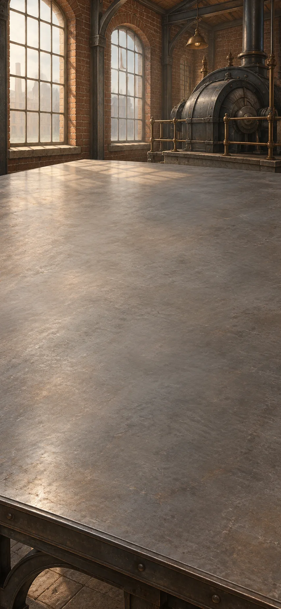

This comparison covers c. 1810–1902. Factories combine specialized work with fuel-powered machinery. Compare their material needs with an account of nature that includes cooperation as well as competition.

**Goals**
- What does industrial power depend on? -- "Industrial power has a material appetite"
- Is nature only competition? -- "Nature is not a competition-only morality tale"

**Items**
- "Heat drives a factory engine"

  Heat powers an engine that can drive factory machinery. This changes how much work can be done and how production is organized.

- "The engine needs a continuing fuel supply"

  The engine needs a continuing supply of fuel. Its power depends on material extraction and delivery.

- "Animals and people also survive by cooperation"

  Animals and people can survive through cooperation as well as competition. Kropotkin challenges accounts that tell only the competitive side.

- "Specialized labour at machine scale"

  Powered machinery and specialized tasks increase the scale of production. The factory combines a technology with a way of organizing people.

- "Industrial power has a material appetite"

  Industrial output depends on a continuing fuel supply. Its apparent power has material costs and consequences.

- "Mutual aid belongs inside the question of survival"

  Cooperation can help organisms survive and reproduce. Recognizing its importance does not refute natural selection.

- "Nature is not a competition-only morality tale"

  Nature includes cooperation as well as competition. Neither fact by itself tells people how a society ought to be governed.

**Combinations**
- "Production divided into specialized tasks" + "Heat drives a factory engine" [preserve] -> "Specialized labour at machine scale"
- "Specialized labour at machine scale" [preserve] + "The engine needs a continuing fuel supply" [preserve] -> "Industrial power has a material appetite"
- "Unequal reproduction changes a population" + "Animals and people also survive by cooperation" [preserve] -> "Mutual aid belongs inside the question of survival"
- "Mutual aid belongs inside the question of survival" + "Scarcity does not settle who should bear it" [preserve] -> "Nature is not a competition-only morality tale"

> NOTE: Sources for this session: morris, marx, kropotkin, smith, darwin-selection. Source IDs identify bibliography entries recorded at their first relevant session; precise item and recipe attribution is retained in the conversion report.

> NOTE: Source `marx`: [Stanford Encyclopedia of Philosophy: Karl Marx](https://plato.stanford.edu/entries/marx/).

> NOTE: Source `kropotkin`: [Peter Kropotkin, Mutual Aid: A Factor of Evolution](https://www.gutenberg.org/cache/epub/4341/pg4341.html).

## Work and control

It is evening. The worktable is cleared for a new session. Compare who controls work and sets its pace with the possibility of pleasure in making useful things. Labour-saving machinery does not automatically give workers more control.

**Goals**
- Can useful work also be enjoyable? -- "Useful work need not erase the maker"
- Who controls the pace of work? -- "Mechanized effort can deepen lost control"

**Items**
- `wage-owner` Workers sell labour; owners control the product

  Workers sell their labour while owners control what is produced. The question concerns power over work, not merely personal satisfaction.

- "Morris: pleasure in making matters"

  Morris argues that useful work should also offer pleasure in making. His criticism does not simply reject every machine.

- "A labour-saving machine dictates the worker’s pace"

  A machine can save effort while setting the worker's pace. Less physical work does not necessarily mean more control.

- "The maker can lose control of the work"

  In Marx's critique, workers can lose control over their activity and its products. The problem is a relationship of ownership and power, not simply disliking a task.

- "Useful work need not erase the maker"

  Morris proposes work that produces useful things while giving the maker worthwhile activity. It is an alternative to assess, not a completed solution to economic organization.

- "Mechanized effort can deepen lost control"

  A labour-saving machine may still leave workers with less say over their pace and decisions. Reduced effort and greater control are separate gains.

**Combinations**
- "The maker is more than the output" [preserve] + `wage-owner` [preserve] -> "The maker can lose control of the work"
- "The maker can lose control of the work" + "Morris: pleasure in making matters" [preserve] -> "Useful work need not erase the maker"
- "The maker can lose control of the work" + "A labour-saving machine dictates the worker’s pace" [preserve] -> "Mechanized effort can deepen lost control"

> NOTE: Sources for this session: morris, marx, kropotkin, smith, darwin-selection. Source IDs identify bibliography entries recorded at their first relevant session; precise item and recipe attribution is retained in the conversion report.

## Water and disease records

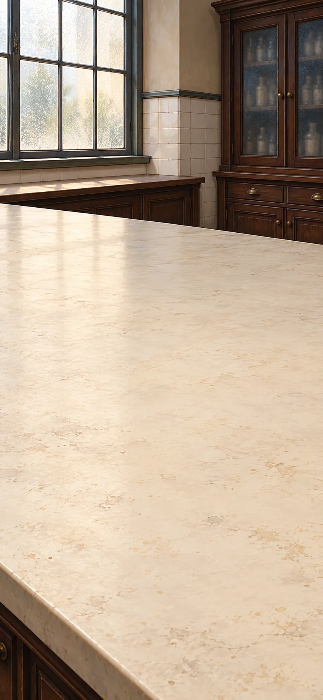

This comparison covers c. 1665–1897. Compare cholera deaths among households with different water supplies. Consider what this supports about prevention and how it challenges the rival account based on bad air.

**Goals**
- Can we prevent illness before fully explaining it? -- "A useful intervention before full agreement"
- Does foul air or water explain these cases? -- "Foul air or a waterborne cause?"

**Items**
- "More cholera in intermixed homes using sewage-polluted water"

  Households in the same districts had different cholera death rates depending on their water supply. The more sewage-polluted supply was associated with more deaths; households were not randomly assigned.

- "Exposure falls when contaminated water is avoided"

  Avoiding contaminated water reduces exposure. Useful prevention can begin before everyone agrees on the full explanation of disease.

- "Miasma: foul surroundings produce disease"

  The miasma theory blamed disease on foul air from unhealthy surroundings. Some sanitation measures could help even when this explanation was mistaken.

- "Cholera mortality tracks a water-supply difference"

  Cholera deaths differ between comparable households using different water supplies. This supports investigating water as a cause while still checking other differences and the quality of records.

- "A useful intervention before full agreement"

  The cholera comparison points toward contaminated water as a preventable route of disease. Avoiding that water can be justified before everyone agrees about the complete microscopic cause.

- "Foul air or a waterborne cause?"

  One account blames cholera on foul air; another connects it with contaminated water. Comparing the water-supply evidence challenges the rival explanations without pretending they have equal support.

**Combinations**
- "A trial another workshop can repeat" + "More cholera in intermixed homes using sewage-polluted water" [preserve] -> "Cholera mortality tracks a water-supply difference"
- "Cholera mortality tracks a water-supply difference" + "Exposure falls when contaminated water is avoided" [preserve] -> "A useful intervention before full agreement"
- "Cholera mortality tracks a water-supply difference" + "Miasma: foul surroundings produce disease" [preserve] -> "Foul air or a waterborne cause?"

> NOTE: Sources for this session: lensmaking, snow, snow-myth, fermentation, buchner. Source IDs identify bibliography entries recorded at their first relevant session; precise item and recipe attribution is retained in the conversion report.

> NOTE: Source `snow`: [UCLA: Snow’s grand experiment](https://epi-snow.ph.ucla.edu/Stream3_GrandExperiment_d.html). Compare water companies and denominators, not merely dots on a map. Observational comparisons have limitations.

> NOTE: Source `snow-myth`: [UCLA: Broad Street outbreak context](https://epi-snow.ph.ucla.edu/Stream2_BSPoutbreak_f.html). Do not claim a map alone revealed the cause, or pump-handle removal alone ended an already declining outbreak.

> NOTE: Source `fermentation`: [From DNA to Beer, US National Library of Medicine](https://www.nlm.nih.gov/exhibition/from-dna-to-beer/index.html).

> NOTE: Source `buchner`: [Eduard Buchner, Alcoholic Fermentation Without Yeast Cells (1897), translated primary text](https://web.lemoyne.edu/~giunta/buchner.html).

## Microscope and culture bench

It is evening. The worktable is cleared for a new session. Use magnification and controlled comparisons to study microorganisms and fermentation. A later cell-free extract tests the claim that fermentation always needs intact living cells.

**Goals**
- Does fermentation need a whole living cell? -- "Living activity includes separable chemistry"

**Items**
- "Thin specimens beneath a stronger lens"

  Thin specimens and a stronger lens reveal details that ordinary sight misses. Seeing a microorganism does not show that it causes disease.

- `sterile-broth` Air reaches both broths; only dust-exposed broth grows

  Air reaches both broths, but dust reaches only one. Organisms grow in the dust-exposed broth while the protected broth stays clear.

- "Different living cultures accompany different fermentations"

  Different living cultures accompany different fermentations. This links microorganisms with changes in materials.

- "Yeast extract ferments without intact cells"

  Yeast extract can ferment without intact yeast cells. Buchner's later result shows that the process does not always require a whole living cell.

- "A previously unseen living world"

  The microscope reveals living things too small for unaided sight. Discovering them expands knowledge without automatically explaining which ones cause illness.

- "Broth growth tracks incoming microorganisms"

  Air reaches both broths, but dust reaches only one, and only that broth develops growth. The comparison supports microorganisms arriving with dust rather than air alone producing life.

- "Organisms participate in chemical change"

  Living cultures participate in changes such as fermentation. Biological activity becomes part of the explanation of material transformation.

- "Living activity includes separable chemistry"

  Yeast extract ferments even without intact yeast cells. Buchner's later result shows that some of the chemistry can operate outside a whole living cell, revising the earlier claim without erasing microorganisms' role.

**Combinations**
- "A magnified close-up view" [preserve] + "Thin specimens beneath a stronger lens" [preserve] -> "A previously unseen living world"
- "A previously unseen living world" [preserve] + `sterile-broth` [preserve] -> "Broth growth tracks incoming microorganisms"
- "Broth growth tracks incoming microorganisms" [preserve] + "Different living cultures accompany different fermentations" [preserve] -> "Organisms participate in chemical change"
- "Organisms participate in chemical change" [preserve] + "Yeast extract ferments without intact cells" [preserve] -> "Living activity includes separable chemistry"

> NOTE: Sources for this session: lensmaking, snow, snow-myth, fermentation, buchner. Source IDs identify bibliography entries recorded at their first relevant session; precise item and recipe attribution is retained in the conversion report.

## Electromagnetic bench

These records cover c. 1820–1895. Experiments link electricity and magnetism. Compare those results with a field account that describes influence through space and connects it with light.

**Goals**
- How does influence act across space? -- "The surrounding space becomes part of the account"
- Could light be electromagnetic? -- "Light belongs to the electromagnetic field"

**Items**
- "A current deflects a nearby compass"

  An electrical current changes the direction of a nearby compass needle. This links electricity with magnetism.

- "Changing magnetism induces a current"

  Changing magnetism produces an electrical current. Faraday's result connects magnetic change with electrical action.

- "Faraday describes influence throughout space"

  Faraday describes influence spread through space around objects. A field is not just an unseen wire joining two points.

- "Maxwell unifies electrical and magnetic relations"

  Maxwell's equations connect electrical and magnetic behaviour in one account. Their consequences can be compared with observations.

- "The predicted wave speed matches that of light"

  The predicted speed of electromagnetic waves matches the measured speed of light. This supports identifying light as electromagnetic.

- "Electricity acts magnetically"

  An electric current makes a nearby compass needle turn. This shows that electricity can have a magnetic effect without a visible mechanical push.

- "A changing field can produce a current"

  Changing a magnetic field can produce a current. The effect provides a way to generate electrical action.

- "The surrounding space becomes part of the account"

  A field describes how physical influence varies throughout space. The surroundings become part of the explanation, not just empty distance between objects.

- "Light belongs to the electromagnetic field"

  The linked electrical and magnetic account predicts waves travelling at light's speed. Light becomes part of the same physical theory.

**Combinations**
- "Nature investigated through matter and motion" [preserve] + "A current deflects a nearby compass" [preserve] -> "Electricity acts magnetically"
- "Electricity acts magnetically" [preserve] + "Changing magnetism induces a current" [preserve] -> "A changing field can produce a current"
- "A changing field can produce a current" [preserve] + "Faraday describes influence throughout space" [preserve] -> "The surrounding space becomes part of the account"
- "Maxwell unifies electrical and magnetic relations" [preserve] + "The predicted wave speed matches that of light" [preserve] -> "Light belongs to the electromagnetic field"

> NOTE: Sources for this session: field-oersted-observation, field-ring-object, maxwell, photo, photo-niepce, benjamin. Source IDs identify bibliography entries recorded at their first relevant session; precise item and recipe attribution is retained in the conversion report.

> NOTE: Source `field-oersted-observation`: [Oersted’s experiment — Institute of Physics](https://spark.iop.org/oersteds-experiment). Supports opposite compass directions above and below a current-carrying wire. Construction and power-supply instructions deliberately excluded.

> NOTE: Source `field-ring-object`: [Michael Faraday’s ring-coil apparatus — Royal Institution](https://www.rigb.org/explore-science/explore/collection/michael-faradays-ring-coil-apparatus). August 1831 apparatus and brief induced current in the other coil; object evidence anchors the reconstruction.

> NOTE: Source `maxwell`: [Royal Society: Maxwell’s dynamical theory of the electromagnetic field](https://royalsocietypublishing.org/doi/10.1098/rstl.1865.0008).

> NOTE: Source `photo`: [Metropolitan Museum: Talbot and photography](https://www.metmuseum.org/pt/essays/william-henry-fox-talbot-1800-1877-and-the-invention-of-photography). Several processes and contributors; a reproducible negative differs from a unique direct-positive image. No chemical procedure is taught.

> NOTE: Source `photo-niepce`: [Harry Ransom Center: The Niépce Heliograph](https://www.hrc.utexas.edu/niepce-heliograph/).

> NOTE: Source `benjamin`: [Stanford Encyclopedia of Philosophy: Walter Benjamin](https://plato.stanford.edu/entries/benjamin/).

## Time-network desk

It is evening. The worktable is cleared for a new session. Electrical signals carry a reference time to distant clocks. Railway timetables show why separate local noons are not enough for coordination.

**Goals**
- How can distant clocks agree? -- "A shared railway time"

**Items**
- "Electrical signals carry a coded message"

  Electrical signals carry a coded message along a wire. The physical signal and the meaning of the message are different things.

- "Distant stations must coordinate their clocks"

  Distant stations need clocks that agree well enough to run a timetable. Their separate local noons do not supply one shared time.

- "Clock coordination travels over a network"

  A reference time can be sent by electrical signals to distant clocks. People no longer have to rely only on carrying a clock between places.

- "A shared railway time"

  Railway stations adopt a shared time so that timetables agree. That practical standard differs from each place's own solar time.

**Combinations**
- "A clock carrying another place’s time" + "Electrical signals carry a coded message" [preserve] -> "Clock coordination travels over a network"
- "Clock coordination travels over a network" + "Distant stations must coordinate their clocks" [preserve] -> "A shared railway time"

> NOTE: Sources for this session: field-oersted-observation, field-ring-object, maxwell, photo, photo-niepce, benjamin. Source IDs identify bibliography entries recorded at their first relevant session; precise item and recipe attribution is retained in the conversion report.

## Photographic bench

The next morning, we return to a cleared worktable. A light-sensitive surface records an image. Compare the chosen frame with the changes made possible by producing many copies.

**Goals**
- What does a photograph leave out? -- "A photograph records from a selected viewpoint"
- What changes when an image has many copies? -- "The image can circulate in many copies"

**Items**
- "A prepared surface changes when exposed to light"

  This prepared surface changes when light reaches it. It can record an image rather than merely display one briefly.

- "One negative can yield many prints"

  A photographic negative can produce many positive prints. This differs from a process that makes only one unique image.

- "Light leaves a lasting image"

  Light produces a lasting image on a prepared surface. The image records an exposure, but still requires choices about the setup and interpretation.

- "A photograph records from a selected viewpoint"

  A photograph records the view chosen by the photographer. Its physical connection to the scene does not make everything outside the frame visible.

- "The image can circulate in many copies"

  Many prints can be made from one negative. Wider circulation changes who can see the image without making its framing neutral.

**Combinations**
- "A prepared dark-room image box" + "A prepared surface changes when exposed to light" [transform] -> "Light leaves a lasting image"
- "Light leaves a lasting image" + "A fixed view leaves other surfaces hidden" [preserve] -> "A photograph records from a selected viewpoint"
- "Light leaves a lasting image" + "One negative can yield many prints" [preserve] -> "The image can circulate in many copies"

> NOTE: Sources for this session: field-oersted-observation, field-ring-object, maxwell, photo, photo-niepce, benjamin. Source IDs identify bibliography entries recorded at their first relevant session; precise item and recipe attribution is retained in the conversion report.

## Time and experience

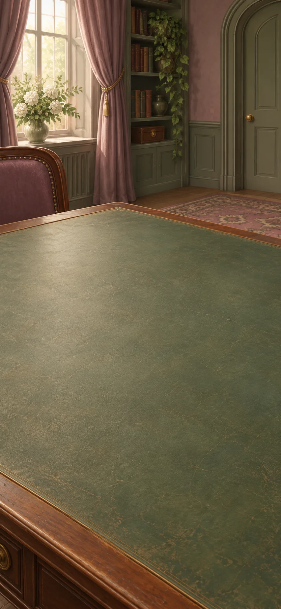

This comparison covers c. 1890–1930. Compare clock time with the continuing experience of thought and remembered music. Measuring time does not describe every quality of living through it.

**Goals**
- How does one thought lead to another? -- "Experience has a moving continuity"
- next: Does a clock describe all of time? -- "Measured coordination and lived duration"

**Items**
- "James: experience flows rather than arriving as isolated atoms"

  William James describes experience as a continuing flow of thought. Attention changes without each moment being entirely separate from the last.

- "Earlier notes remain present in hearing a melody"

  Hearing a melody involves remembering earlier notes while new ones arrive. Bergson uses such experience to question whether lived time is like separate identical units.

- "Experience has a moving continuity"

  William James describes experience as a changing but connected flow. Attention shifts while earlier thoughts continue to shape the next moment.

- "Lived time is not a row of clock units"

  An experience has qualities and continuity that a sequence of clock readings does not describe. This does not make clocks useless or inaccurate.

- "Measured coordination and lived duration"

  Railway clocks coordinate public events, while descriptions of lived time address memory and experience. These answer different questions; a remembered melody does not refute a working clock.

**Combinations**
- "Melancholy across bodies, books and experience" [preserve] + "James: experience flows rather than arriving as isolated atoms" [preserve] -> "Experience has a moving continuity"
- "A shared railway time" [preserve] + "Earlier notes remain present in hearing a melody" [preserve] -> "Lived time is not a row of clock units"
- "Lived time is not a row of clock units" [preserve] + "Experience has a moving continuity" -> "Measured coordination and lived duration"

> NOTE: Sources for this session: bergson, freud, james, surrealism, burton. Source IDs identify bibliography entries recorded at their first relevant session; precise item and recipe attribution is retained in the conversion report.

> NOTE: Source `bergson`: [Stanford Encyclopedia of Philosophy: Henri Bergson](https://plato.stanford.edu/entries/bergson/).

> NOTE: Source `freud`: [Library of Congress: Sigmund Freud, Conflict and Culture](https://www.loc.gov/exhibits/freud/).

> NOTE: Source `james`: [William James, The Principles of Psychology](https://www.gutenberg.org/ebooks/57628).

> NOTE: Source `surrealism`: [Metropolitan Museum: Surrealism](https://www.metmuseum.org/essays/surrealism).

## Dream and art texts

It is evening. The worktable is cleared for a new session. Compare Freud's dream interpretation with artistic uses of automatic writing and unexpected combinations. Their purposes differ, and an artwork is not a verified diagnosis.

**Goals**
- What happens when writing is less planned? -- "Writing without the usual planned control"
- Can art change how we see ordinary life? -- "An artwork can challenge ordinary life"

**Items**
- "Freud interprets dreams through wishes and conflicts"

  Freud interprets dreams as expressions of wishes and conflicts. His theory does not establish that every dream has such an explanation.

- "Words follow associations rather than a planned outline"

  Words are followed through their associations rather than a planned outline. Therapy and art can use related practices for different purposes.

- "Unrelated everyday objects meet unexpectedly"

  Unexpectedly placing ordinary objects together can interrupt familiar ways of seeing them. Artists use the surprise to invite new associations.

- "Artists want more than a new decorative style"

  Surrealist artists wanted to change more than decoration. Their ambitions included everyday life and society, though they did not share one uniform doctrine.

- "A dream can be read for concealed conflict"

  Freud's approach reads a dream for hidden wishes and conflicts. It is an interpretive proposal, not the same kind of result as a physical measurement.

- "Writing without the usual planned control"

  The writer loosens ordinary planning to follow words and associations. Surrealists use this as an artistic experiment, not a verified diagnosis.

- "The familiar becomes strangely connected"

  An unexpected combination makes familiar things seem strange. The artwork asks the viewer to reconsider ordinary associations and expectations.

- "An artwork can challenge ordinary life"

  An artwork can raise questions about ordinary life and society. It need not merely illustrate an already finished theory.

**Combinations**
- "Experience has a moving continuity" + "Freud interprets dreams through wishes and conflicts" [preserve] -> "A dream can be read for concealed conflict"
- "A dream can be read for concealed conflict" [preserve] + "Words follow associations rather than a planned outline" [preserve] -> "Writing without the usual planned control"
- "A photograph records from a selected viewpoint" + "Unrelated everyday objects meet unexpectedly" [preserve] -> "The familiar becomes strangely connected"
- "The familiar becomes strangely connected" [preserve] + "Artists want more than a new decorative style" [preserve] -> "An artwork can challenge ordinary life"

> NOTE: Sources for this session: bergson, freud, james, surrealism, burton. Source IDs identify bibliography entries recorded at their first relevant session; precise item and recipe attribution is retained in the conversion report.

## Moving-clock comparisons

These records cover 1905–1919. The train example distinguishes when flashes arrive from when they were emitted. Use the stated distances and speed of light before comparing simultaneity in different frames.

**Goals**
- Is one shared time always enough? -- "Newton’s shared time is a useful limit, not universal"

**Items**
- `light-invariance` Equal train-midpoint distances; same light speed in every inertial frame

  In the train's frame, the light travels equal distances to its midpoint at the same speed. Different arrival times therefore imply different emission times in that frame.

- "The same physical laws hold in inertial laboratories"

  The same physical laws apply in laboratories moving steadily relative to one another. This is a claim about physics, not that every opinion is equally true.

- `platform-flashes` Train-end flashes: platform midpoint together; moving train midpoint apart

  Flashes are simultaneous according to synchronized platform clocks. They reach the platform midpoint together, but reach the moving train's midpoint at different times. Reception order alone does not yet establish emission order.

- `unequal-passenger-reception` The moving midpoint receives platform-simultaneous flashes separately

  Two flashes occur at a train's ends at the same time according to platform clocks. A passenger at the moving train's midpoint travels toward one flash and away from the other, so their light reaches the passenger at different times. These arrival times alone do not yet show when the flashes happened for the passenger.

- "Different frames need not agree on distant simultaneity"

  Two flashes happen at a moving train's ends at the same time according to platform clocks, but their light reaches a passenger at the train's midpoint at different times. For the passenger, light travels equal distances from the two ends at the same speed. The passenger therefore concludes that the flashes happened at different times.

- "No universal time for distant events"

  Observers moving steadily past one another use the same physical laws and measure the same speed of light. They can still disagree about whether far-apart events happened at the same time. Newton's mechanics remains a useful approximation at everyday speeds.

- "Newton’s shared time is a useful limit, not universal"

  Newton treats time as passing the same way for everyone. Relativity says moving observers can disagree about whether distant events happen at the same time. Newton's account still works well at everyday speeds.

**Combinations**
- "Clock coordination travels over a network" + `platform-flashes` [preserve] -> `unequal-passenger-reception`
- `unequal-passenger-reception` [preserve] + `light-invariance` [preserve] -> "Different frames need not agree on distant simultaneity"
- "Different frames need not agree on distant simultaneity" [preserve] + "The same physical laws hold in inertial laboratories" [preserve] -> "No universal time for distant events"
- "No universal time for distant events" [preserve] + "Universal mechanics in absolute space and time" [preserve] -> "Newton’s shared time is a useful limit, not universal"

> NOTE: Sources for this session: einstein-time, einstein-spacetime, civ-einstein-train. Source IDs identify bibliography entries recorded at their first relevant session; precise item and recipe attribution is retained in the conversion report.

> NOTE: Source `einstein-time`: [Einstein Online, Max Planck Institute: relativity of space and time](https://www.einstein-online.info/en/relativity_space_time/).

> NOTE: Source `einstein-spacetime`: [Einstein Online: spacetime](https://www.einstein-online.info/en/spacetime/).

> NOTE: Source `civ-einstein-train`: [Einstein, Relativity: The Special and General Theory, §§8–9](https://www.gutenberg.org/files/5001/5001-h/5001-h.htm). Primary teaching thought experiment. Reception order alone does not establish relative simultaneity; equal midpoint distances and invariant light speed remain required.

## Gravity comparisons

It is evening. The worktable is cleared for a new session. Compare a freely falling room with Einstein's geometric account of gravity. The deflection of starlight provides a test with measurements that must be assessed.

**Goals**
- Does gravity bend light? -- "A new geometry meets a light observation"

**Items**
- "A freely falling room removes the local sensation of weight"

  A freely falling room can remove the local feeling of weight. This does not mean gravity or differences in its effect disappear everywhere.

- "Einstein models gravity through spacetime geometry"

  Einstein describes gravity through the geometry of space and time. The theory makes predictions that observations can test.

- "Starlight near the Sun is deflected"

  Starlight passing near the Sun appears deflected. The 1919 observations supplied evidence with measurement uncertainties, not an unquestionable or unique test.

- "Free fall connects gravity and acceleration"

  A person in a freely falling room can locally feel weightless. Einstein uses the relation between gravity and acceleration to motivate a new account; this does not make gravitational differences vanish everywhere.

- "Gravity changes the geometry of paths"

  In Einstein's account, matter and the geometry of space and time affect the paths bodies follow. Gravity is no longer described only as a force acting across fixed space.

- "A new geometry meets a light observation"

  Einstein's gravitational theory predicts a change in the path of light near the Sun. Eclipse observations test that consequence, with measurement uncertainty and interpretation still part of the evidence.

**Combinations**
- "Newton proposes one attraction for Earth and sky" + "A freely falling room removes the local sensation of weight" [preserve] -> "Free fall connects gravity and acceleration"
- "Free fall connects gravity and acceleration" [preserve] + "Einstein models gravity through spacetime geometry" [preserve] -> "Gravity changes the geometry of paths"
- "Gravity changes the geometry of paths" [preserve] + "Starlight near the Sun is deflected" [preserve] -> "A new geometry meets a light observation"

> NOTE: Sources for this session: einstein-time, einstein-spacetime. Source IDs identify bibliography entries recorded at their first relevant session; precise item and recipe attribution is retained in the conversion report.

## Continental comparisons

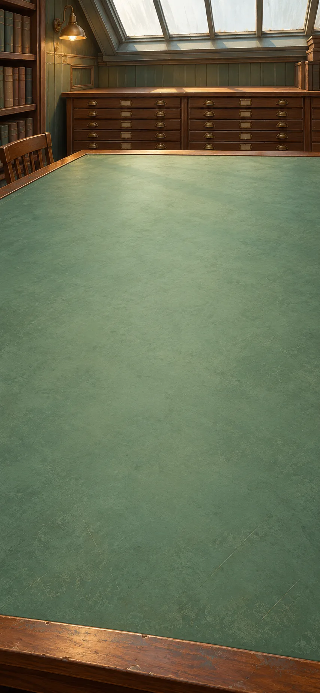

These records cover 1912–1968. Matching continents, fossils and rock formations support a common past. Compare this evidence with the weakness of Wegener's proposed driving forces.

**Goals**
- What could move the continents? -- "A strong pattern, an unresolved driving account"

**Items**
- "Opposite Atlantic margins have a suggestive fit"

  The margins of opposite Atlantic continents appear to fit. This suggests a question, but a resemblance alone is not enough to establish their history.

- "Matching fossils and rock belts cross today’s oceans"

  Matching fossils and rock formations appear on lands now separated by oceans. Their past connection needs an explanation.

- "Wegener’s proposed driving forces are inadequate"

  Wegener's proposed forces were not adequate to move continents as he suggested. This is a serious problem for the mechanism, not a reason to ignore the matching evidence.

- "Continents can be compared in an earlier arrangement"

  Continents can be placed in a proposed earlier arrangement and compared. The reconstruction must fit evidence, not just look like a puzzle.

- "Separated lands share a geological past"

  Matching fossils and rock formations strengthen the case that separated continents share a past. Several kinds of evidence matter more than an outline resemblance alone.

- "A strong pattern, an unresolved driving account"

  Matching fossils and rocks suggest that continents once joined have moved apart, but Wegener did not have a convincing account of the force moving them. Evidence that they moved can be stronger than the current explanation of how.

**Combinations**
- "An Earth with comparable positions" + "Opposite Atlantic margins have a suggestive fit" [preserve] -> "Continents can be compared in an earlier arrangement"
- "Continents can be compared in an earlier arrangement" [preserve] + "Matching fossils and rock belts cross today’s oceans" [preserve] -> "Separated lands share a geological past"
- "Separated lands share a geological past" [preserve] + "Wegener’s proposed driving forces are inadequate" [preserve] -> "A strong pattern, an unresolved driving account"

> NOTE: Sources for this session: tectonics, plate-evidence, seafloor, radiometric-clock, geologic-age-modern, earth-age. Source IDs identify bibliography entries recorded at their first relevant session; precise item and recipe attribution is retained in the conversion report.

> NOTE: Source `tectonics`: [US Geological Survey: This Dynamic Earth](https://pubs.usgs.gov/gip/dynamic/dynamic.html).

> NOTE: Source `plate-evidence`: [USGS: Plate-tectonic map explanation](https://pubs.usgs.gov/cp/41/report.pdf).

> NOTE: Source `seafloor`: [Alfred Wegener Institute: Seafloor spreading](https://www.awi.de/en/ueber-uns/organisation/alfred-wegener/artikel/seafloor-spreading.html).

> NOTE: Source `radiometric-clock`: [NIST: How do you know the age of fossils and other old things?](https://www.nist.gov/how-do-you-measure-it/how-do-you-know-age-fossils-and-other-old-things).

> NOTE: Source `earth-age`: [US Geological Survey: Age of the Earth](https://pubs.usgs.gov/gip/geotime/age.html).

## Isotope measurements

It is evening. The worktable is cleared for a new session. Radioactive decay gives a way to measure ages in years. Compare mineral clocks with the meteorite evidence used to estimate Earth's formation age.

**Goals**
- How old is Earth? -- "Earth is about 4.54 billion years old"

**Items**
- "Unstable isotopes change at measurable rates"

  Unstable isotopes change at measurable rates. They can measure elapsed time if the material's later history is understood.

- "Parent and daughter isotopes survive in minerals"

  Minerals contain radioactive parent isotopes and their decay products. Their proportions can help estimate when the mineral clock began or was reset.

- "Lead measurements link ancient meteorites and Earth"

  Lead measurements in meteorites help estimate Earth's formation age by treating them as products of the early solar system. The method is not simply a search for Earth's oldest surviving rock.

- "A rock can contain a measurable clock"

  Radioactive decay can turn a mineral into a measure of elapsed time. Interpreting it requires checking whether later events changed the material.

- "The sequence can acquire durations"

  Rock layers give an order of events, but radioactive decay supplies a measure of elapsed time. Mineral evidence can now address how many years passed, provided its later history is understood.

- "Earth is about 4.54 billion years old"

  Earth formed about 4.54 billion years ago. The estimate draws on radioactive dating and evidence from the early solar system, not the order of rock layers alone.

**Combinations**
- "Unstable isotopes change at measurable rates" [preserve] + "Parent and daughter isotopes survive in minerals" [preserve] -> "A rock can contain a measurable clock"
- "Sequence is not duration" + "A rock can contain a measurable clock" [preserve] -> "The sequence can acquire durations"
- "The sequence can acquire durations" [preserve] + "Lead measurements link ancient meteorites and Earth" [preserve] -> "Earth is about 4.54 billion years old"

> NOTE: Sources for this session: tectonics, plate-evidence, seafloor, radiometric-clock, geologic-age-modern, earth-age. Source IDs identify bibliography entries recorded at their first relevant session; precise item and recipe attribution is retained in the conversion report.

## Ocean-floor records

The next morning, we return to a cleared worktable. Ocean-floor patterns support moving plates and the recycling of crust. Reconsider the distribution of living things on this changing surface.

**Goals**
- What happens to life when land moves? -- "Life’s changing map includes moving land"

**Items**
- "A global ridge system marks newly made ocean floor"

  A worldwide system of ocean ridges marks places where new seafloor forms. It supplies evidence unavailable from coastlines alone.

- "Matching magnetic stripes lie on either side of ridges"

  Matching magnetic patterns lie on opposite sides of ridges. Their order and dates support seafloor forming and moving outward.

- "Deep earthquakes and trenches mark descending slabs"

  Deep earthquakes and trenches mark places where plates descend. Old oceanic material can be recycled instead of making Earth continually expand.

- "Ocean floor is made and moves away from ridges"

  New ocean floor forms at ridges and spreads out on both sides. As its rock cools, it records Earth's magnetic direction. Matching bands on opposite sides of a ridge show that the floor has moved outward.

- "Continents move with plates of rigid outer Earth"

  Continents move as parts of rigid plates made of crust and the uppermost mantle. Plate tectonics is not simply Wegener's original mechanism declared correct.

- "Plates form, move and descend"

  Plates form, move and descend at different boundaries. These processes fit together without requiring Earth to grow steadily larger.

- "Life’s changing map includes moving land"

  Continents move as parts of plates, changing the locations and connections of habitats. Patterns of living things must therefore be explained on a changing surface rather than a fixed map.

**Combinations**
- "A global ridge system marks newly made ocean floor" [preserve] + "Matching magnetic stripes lie on either side of ridges" [preserve] -> "Ocean floor is made and moves away from ridges"
- "A strong pattern, an unresolved driving account" [preserve] + "Ocean floor is made and moves away from ridges" [preserve] -> "Continents move with plates of rigid outer Earth"
- "Continents move with plates of rigid outer Earth" [preserve] + "Deep earthquakes and trenches mark descending slabs" [preserve] -> "Plates form, move and descend"
- "Plates form, move and descend" [preserve] + "Life patterned by place and conditions" [preserve] -> "Life’s changing map includes moving land"

> NOTE: Sources for this session: tectonics, plate-evidence, seafloor, radiometric-clock, geologic-age-modern, earth-age. Source IDs identify bibliography entries recorded at their first relevant session; precise item and recipe attribution is retained in the conversion report.

## Logic and switching

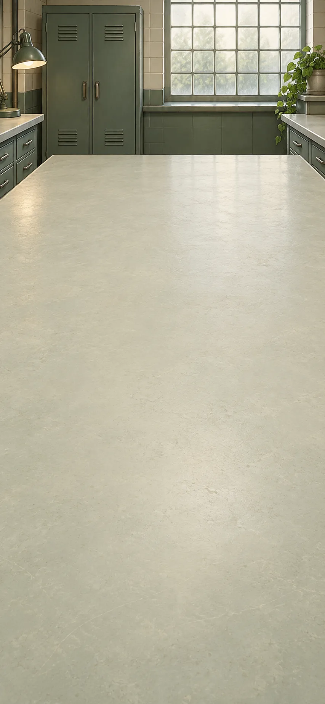

This comparison covers c. 1847–1950. Logical relationships can be represented by symbols, switches and explicit instructions. Compare an abstract procedure with a machine that carries it out.

**Goals**
- What can explicit rules make a machine do? -- "A rule-governed symbol machine"

**Items**
- "Boole represents logical relations algebraically"

  Boole expresses logical relationships with symbols and operations. Reasoning can be studied as a formal system.

- "A circuit can implement on/off combinations"

  Electrical switches can carry out on/off combinations corresponding to logical operations. This connects abstract logic with circuit design.

- "A finite rule describes each step of a procedure"

  A procedure specifies what to do at each step. Turing's model describes reading, writing and moving symbols, not a complete explanation of human understanding.

- "Inference becomes a manipulable symbolic system"

  Logical relationships can be represented and manipulated with symbols. The form of an argument becomes something that can be worked on systematically.

- "Logical operations become switching actions"

  A circuit carries out logical operations through switching. Correct operation does not prove that the information supplied to it is true.

- "A rule-governed symbol machine"

  A symbol machine follows explicit rules for reading, writing and moving through its work. The procedure can be described separately from the particular machine that carries it out.

**Combinations**
- "A conclusion follows from premises" + "Boole represents logical relations algebraically" [preserve] -> "Inference becomes a manipulable symbolic system"
- "Inference becomes a manipulable symbolic system" [preserve] + "A circuit can implement on/off combinations" [preserve] -> "Logical operations become switching actions"
- "Logical operations become switching actions" [preserve] + "A finite rule describes each step of a procedure" [preserve] -> "A rule-governed symbol machine"

> NOTE: Sources for this session: boole, turing, shannon, shannon1948. Source IDs identify bibliography entries recorded at their first relevant session; precise item and recipe attribution is retained in the conversion report.

> NOTE: Source `boole`: [George Boole: An Investigation of the Laws of Thought (1854)](https://www.gutenberg.org/ebooks/15114). Primary historical text; binary gate notation is a modern teaching representation.

> NOTE: Source `turing`: [Alan Turing, On Computable Numbers, original paper](https://www.cs.virginia.edu/~robins/Turing_Paper_1936.pdf).

> NOTE: Source `shannon`: [Claude Shannon, A Symbolic Analysis of Relay and Switching Circuits (1938), MIT-hosted copy](https://tubes.mit.edu/6S917/_static/2025/resources/shannon38.pdf).

> NOTE: Source `shannon1948`: [Shannon: A Mathematical Theory of Communication](https://people.math.harvard.edu/~ctm/home/text/others/shannon/entropy/entropy.pdf). Information-theoretic quantities do not measure truth, significance or wisdom.

## Programs and limits

It is evening. The worktable is cleared for a new session. A general-purpose machine faces a demand no procedure can always satisfy. Then compare computation with a feedback loop that adjusts action toward a target.

**Goals**
- Can a program always tell whether another will stop? -- "No procedure solves every halting case"
- How can a machine correct its actions? -- "A machine responds to its measured effects"

**Items**
- "A procedure itself can be encoded as data"

  A procedure can itself be written as data. A machine that reads such descriptions can carry out different procedures.

- "Decide whether any given procedure will ever stop"

  The demand is for one method that decides whether any supplied program will eventually stop. This is stronger than solving one particular case.

- "A controller compares a measured result with a target"

  A controller measures a result, compares it with a target and adjusts its action. Someone still has to choose the target.

- "One machine can follow many encoded procedures"

  One machine can follow many procedures when their instructions are encoded as data. It is not limited to one permanently built-in task.

- "No procedure solves every halting case"

  No program can always work out whether any other program will eventually stop or run forever. This limits one universal test, not the usefulness of programs in general.

- "A machine responds to its measured effects"

  The machine uses measurements of its effects to adjust what it does. Responding to feedback does not by itself establish understanding or unlimited authority.

**Combinations**
- "A rule-governed symbol machine" + "A procedure itself can be encoded as data" [preserve] -> "One machine can follow many encoded procedures"
- "One machine can follow many encoded procedures" [preserve] + "Decide whether any given procedure will ever stop" [preserve] -> "No procedure solves every halting case"
- "A rule-governed symbol machine" + "A controller compares a measured result with a target" [preserve] -> "A machine responds to its measured effects"

> NOTE: Sources for this session: boole, turing, shannon, shannon1948. Source IDs identify bibliography entries recorded at their first relevant session; precise item and recipe attribution is retained in the conversion report.

## Communication records

The next morning, we return to a cleared worktable. Investigate how noise can damage a transmitted message. Structured extra information can correct specified errors without proving the message true.

**Goals**
- Can a damaged message be recovered? -- "A message designed to recover from specified errors"

**Items**
- "A signal can be corrupted in transmission"

  Transmission can change a signal and make the original message hard to recover. Whether the message is true is a separate question.

- `redundant-code` Structured redundancy can locate and correct the stipulated errors

  Extra, carefully organized information can distinguish and correct specified errors. Repeating a message or detecting an error alone does not guarantee recovery.

- "A transmitted message can lose distinctions"

  A transmitted signal can lose distinctions needed to recover the message. Communication design must protect those distinctions, not just send something detectable.

- "A message designed to recover from specified errors"

  The message includes enough structured extra information to recover from the specified error patterns. It cannot repair every possible corruption or prove that the message is true.

**Combinations**
- "Clock coordination travels over a network" + "A signal can be corrupted in transmission" [preserve] -> "A transmitted message can lose distinctions"
- "A transmitted message can lose distinctions" [preserve] + `redundant-code` [preserve] -> "A message designed to recover from specified errors"

> NOTE: Sources for this session: boole, turing, shannon, shannon1948. Source IDs identify bibliography entries recorded at their first relevant session; precise item and recipe attribution is retained in the conversion report.

## Authorship and archives

These records cover c. 1930–1960. In Borges's fictional example, the same words are written in a different historical setting. Compare their changed interpretation with a literary archive that invents its sources.

**Goals**
- Can the same words become a different work? -- "The same words can become another work"
- Does a scholarly-looking source have to be real? -- "The apparatus of scholarship becomes fiction"

**Items**
- "Menard’s imagined page repeats Cervantes exactly"

  In Borges's fictional case, a later writer produces exactly the same words as Cervantes. The changed historical situation is part of the imagined reading problem.

- `new-authorship` Same words; a later author’s life and purpose

  The words stay the same, but the imagined writer's life and purpose differ. The reader must consider whether that changes the work's meaning.

- "Scholarly citation of an invented book"

  Borges uses references to invented books as a literary device. A convincing scholarly appearance is not proof that a source exists.

- "The collation finds the same words"

  In Borges's imagined case, comparing the later page with Cervantes confirms that every word matches. That settles the wording while leaving questions about authorship and interpretation open.

- "The same words can become another work"

  In Borges's imagined case, identical words acquire a different meaning through a later author and context. This does not mean every interpretation is equally well supported.

- "The apparatus of scholarship becomes fiction"

  A work of fiction can imitate editions, notes and references. Scholarly appearance alone is not enough to authenticate a claim.

**Combinations**
- "An edition that shows its doubts" + "Menard’s imagined page repeats Cervantes exactly" [preserve] -> "The collation finds the same words"
- "The collation finds the same words" [preserve] + `new-authorship` [preserve] -> "The same words can become another work"
- "Printed copies with inspectable variants" + "Scholarly citation of an invented book" [preserve] -> "The apparatus of scholarship becomes fiction"

> NOTE: Sources for this session: borges, benjamin, postmodern. Source IDs identify bibliography entries recorded at their first relevant session; precise item and recipe attribution is retained in the conversion report.

> NOTE: Source `borges`: [Poetry Foundation: Jorge Luis Borges](https://www.poetryfoundation.org/poets/jorge-luis-borges).

> NOTE: Source `postmodern`: [Stanford Encyclopedia of Philosophy: Postmodernism](https://plato.stanford.edu/entries/postmodernism/).

## Maps, branches and copies

It is evening. The worktable is cleared for a new session. Compare an unusably complete map, a branching story and copied artwork. Each asks what a representation selects or changes rather than merely duplicates.

**Goals**
- Can a map contain too much detail? -- "More detail can destroy a map’s usefulness"
- Must a story choose one path? -- "A narrative can keep incompatible paths open"
- Who gains power when art is copied? -- "Reproduction changes art’s political reach"

**Items**
- "A map matches every detail of its territory"

  This fictional map reproduces every detail at full size. The example asks whether a representation can become too complete to be useful.

- "A story explores incompatible continuations"

  The story follows incompatible possible continuations. Narrative alternatives do not establish a physical theory of multiple universes.

- "An artwork’s particular place and history"

  Benjamin asks how an artwork's particular place and history shape the experience of it. His idea of aura is not simply a rule that every copy is bad.

- "Mass copies change who encounters and uses art"

  Mass copies change who can encounter and use art. Wider access can bring both political opportunities and dangers.

- "More detail can destroy a map’s usefulness"

  A map that reproduces everything at full size loses the usefulness of selection. More detail is not always a better guide.

- "A narrative can keep incompatible paths open"

  A story can keep incompatible paths open instead of selecting one ending. Its branching resembles a diagram of ancestry without being the same kind of explanation.

- "A copy changes the encounter with a work"

  A copy changes how and where a work is encountered. Reproduction raises questions about presence, tradition and access beyond the technical ability to make copies.

- "Reproduction changes art’s political reach"

  Reproduction can extend art's audience and alter its political uses. Those changes cannot all be reduced to either liberation or decline.

**Combinations**
- "Useful bearings, distorted areas" [preserve] + "A map matches every detail of its territory" [preserve] -> "More detail can destroy a map’s usefulness"
- "Resemblance can record shared descent" + "A story explores incompatible continuations" [preserve] -> "A narrative can keep incompatible paths open"
- "The image can circulate in many copies" [preserve] + "An artwork’s particular place and history" [preserve] -> "A copy changes the encounter with a work"
- "A copy changes the encounter with a work" [preserve] + "Mass copies change who encounters and uses art" [preserve] -> "Reproduction changes art’s political reach"

> NOTE: Sources for this session: borges, benjamin, postmodern. Source IDs identify bibliography entries recorded at their first relevant session; precise item and recipe attribution is retained in the conversion report.

## Values and exclusion

This comparison covers c. 1887–1990. These accounts examine how moral values and supposedly universal classifications gain authority. Look at particular histories and exclusions rather than rejecting every claim at once.

**Goals**
- How did these values gain authority? -- "A moral vocabulary has a contested history"
- Who is left out of a universal claim? -- "A universal promise can coexist with exclusion"

**Items**
- "Nietzsche: how did moral values gain authority?"

  Nietzsche asks how moral values acquired authority and what they do. A history of a value's origin does not by itself prove the value false.

- "“Universal” taxonomy ranks people as inferior"

  A supposedly universal classification ranks some people as naturally inferior. This is a harmful claim, not a neutral result of naming differences.

- "A moral vocabulary has a contested history"

  Moral language has a history shaped by conflict and power. Investigating that history raises questions without automatically deciding whether a value is justified.

- "A classification can naturalize domination"

  Racial classifications can present domination as a natural order. Exposing that error does not make all biological naming and comparison useless.

- "A universal promise can coexist with exclusion"

  An account can claim to include all people while excluding women or ranking racial groups as inferior. Comparing these cases exposes a gap between universal claims and practice without treating their histories as interchangeable.

**Combinations**
- "A claim to rights beyond inherited rank" + "Nietzsche: how did moral values gain authority?" [preserve] -> "A moral vocabulary has a contested history"
- "Comparable names for living kinds" + "“Universal” taxonomy ranks people as inferior" [preserve] -> "A classification can naturalize domination"
- "Universal reason must include women" [preserve] + "A classification can naturalize domination" [preserve] -> "A universal promise can coexist with exclusion"

> NOTE: Sources for this session: nietzsche, levi-strauss, foucault, postmodern, linnaeus. Source IDs identify bibliography entries recorded at their first relevant session; precise item and recipe attribution is retained in the conversion report.

> NOTE: Source `nietzsche`: [Stanford Encyclopedia of Philosophy: Nietzsche’s Moral and Political Philosophy](https://plato.stanford.edu/entries/nietzsche-moral-political/).

> NOTE: Source `levi-strauss`: [Collège de France: Claude Lévi-Strauss, Social Anthropology](https://www.college-de-france.fr/en/chair/claude-levi-strauss-social-anthropology-statutory-chair).

> NOTE: Source `foucault`: [Stanford Encyclopedia of Philosophy: Michel Foucault](https://plato.stanford.edu/entries/foucault/).

## Relations and institutions

It is evening. The worktable is cleared for a new session. Compare categories defined by relationships with classifications used in institutions. Consider how those practices shape conduct.

**Goals**
- What gives a category its meaning? -- "A category gets meaning from a pattern of relations"
- How do classifications shape people's lives? -- "A classification can help organize conduct"

**Items**
- "Kinship terms get roles through relations"

  Lévi-Strauss studies how kinship terms gain meaning through their relationships. A custom is examined within a system rather than as an isolated curiosity.

- "Schools, clinics, prisons classify and train"

  Schools, clinics and prisons classify people and shape conduct in different ways. Foucault investigates the historical connections between knowledge, norms and power.

- "A category gets meaning from a pattern of relations"

  A category gains meaning through its relations to other categories. A shared name alone does not explain its role in a social system.

- "A classification can help organize conduct"

  Classifications can be used to guide, train or control people. The effect depends on specific institutions and practices, not knowledge in the abstract.

**Combinations**
- "Common concepts, not a shared thing outside the mind" + "Kinship terms get roles through relations" [preserve] -> "A category gets meaning from a pattern of relations"
- "Knowledge joined by cross-reference" [preserve] + "Schools, clinics, prisons classify and train" [preserve] -> "A classification can help organize conduct"

> NOTE: Sources for this session: nietzsche, levi-strauss, foucault, postmodern, linnaeus. Source IDs identify bibliography entries recorded at their first relevant session; precise item and recipe attribution is retained in the conversion report.

## Text and standpoint

The next morning, we return to a cleared worktable. Examine a critic's conflicting claims about originals and copies. Then compare the limits of an observer's viewpoint with the possibility of independent checks.

**Goals**
- Does this argument contradict its own example? -- "The original/copy hierarchy unsettles its own case"
- Can limited viewpoints still be checked? -- "Partial perspectives can still answer to evidence"

**Items**
- `textual-tension` Copies called passive; identical later page praised as new

  An essay denies creativity to copies but praises an identical later page as new. Its own example puts pressure on its distinction between original and copy.

- "An observer’s position shapes available evidence"

  An observer's position affects what evidence is available. This does not make every observation equally accurate.

- "Others can test the same constrained claim"

  Other people can test the same claim using further evidence. A limited viewpoint does not prevent correction or shared criticism.

- "The original/copy hierarchy unsettles its own case"

  An imagined critic says only originals create meaning, yet praises a word-identical later page as new. The critic's own example grants a copy the creative role the argument denies it. This identifies a particular tension, not a flaw in every text.

- "A view can be partial without being arbitrary"

  Evidence comes from particular positions and practices, so every view has limits. A limited view can still be constrained by what is actually there.

- "Partial perspectives can still answer to evidence"

  Different viewpoints can be compared with evidence and corrected. Recognizing partial knowledge does not require treating all claims as equally good.

**Combinations**
- "The same words can become another work" [preserve] + `textual-tension` [preserve] -> "The original/copy hierarchy unsettles its own case"
- "A photograph records from a selected viewpoint" + "An observer’s position shapes available evidence" [preserve] -> "A view can be partial without being arbitrary"
- "A view can be partial without being arbitrary" [preserve] + "Others can test the same constrained claim" [preserve] -> "Partial perspectives can still answer to evidence"

> NOTE: Sources for this session: nietzsche, levi-strauss, foucault, postmodern, linnaeus. Source IDs identify bibliography entries recorded at their first relevant session; precise item and recipe attribution is retained in the conversion report.

## Inheritance bench

This comparison covers c. 1900–2020. Distinct inherited factors and DNA address the earlier problem of heredity. Development and environment still matter; genes are not a complete prediction of an organism's life.

**Goals**
- Do genes determine a whole life? -- "Inherited information acts in a developing world"

**Items**
- "Mendel’s experiments preserve distinct inherited factors"

  Mendel's experiments suggest inherited factors that remain distinct rather than blending away. Not every trait follows a simple one-gene pattern.

- "DNA carries heritable sequence information"

  DNA carries inherited sequence information. It helps explain transmission without determining every detail of an organism's future.

- "Development also depends on conditions and interactions"

  Organisms develop through interactions between inheritance and their surroundings. Genes do not act in a context-free world.

- "Inheritance need not blend differences away"

  Distinct inherited factors can persist across generations rather than blending away. This gives an answer to the older difficulty of how variation can survive long enough for selection to act.

- "The inherited difference has a molecular carrier"

  DNA provides a physical carrier for inherited differences. A molecular mechanism adds detail without explaining every trait on its own.

- "Inherited information acts in a developing world"

  Inherited information works through development and environmental conditions. Understanding an organism requires more than reading its genes alone.

**Combinations**
- "Cumulative evolution with heredity still unresolved" [preserve] + "Mendel’s experiments preserve distinct inherited factors" [preserve] -> "Inheritance need not blend differences away"
- "Inheritance need not blend differences away" [preserve] + "DNA carries heritable sequence information" [preserve] -> "The inherited difference has a molecular carrier"
- "The inherited difference has a molecular carrier" [preserve] + "Development also depends on conditions and interactions" [preserve] -> "Inherited information acts in a developing world"

> NOTE: Sources for this session: genetics, mendel, climate, patterson-lead, radiometric-clock. Source IDs identify bibliography entries recorded at their first relevant session; precise item and recipe attribution is retained in the conversion report.

> NOTE: Source `genetics`: [National Human Genome Research Institute: Talking Glossary](https://www.genome.gov/genetics-glossary).

> NOTE: Source `mendel`: [NHGRI: Mendelian Inheritance](https://www.genome.gov/genetics-glossary/Mendelian-Inheritance).

> NOTE: Source `climate`: [NASA: Evidence for Climate Change](https://science.nasa.gov/climate-change/evidence/).

> NOTE: Source `patterson-lead`: [Caltech: Getting the Lead Out](https://www.caltech.edu/about/news/getting-lead-out-47935).

## Climate desk

It is evening. The worktable is cleared for a new session. Connect fossil-fuel emissions with the way greenhouse gases affect heat loss. Compare that explanation with records of global warming.

**Goals**
- How does industry change the climate? -- "Human activity drives the recent warming"

**Items**
- "Burning fossil fuels adds long-stored carbon to the air"

  Burning fossil fuels releases carbon that was stored underground into the atmosphere. Energy use changes the amount of carbon in the air.

- "Carbon dioxide absorbs outgoing infrared radiation"

  Carbon dioxide absorbs some infrared radiation leaving Earth. This affects how the planet loses heat.

- "Instrumental records show a warming planet"

  Instrument records show long-term global warming. This finding depends on many observations, not a single hot day.

- "Industrial power changes the atmospheric store"

  Fossil-fuel energy transfers long-stored carbon into the atmosphere. Industrial power therefore changes a planetary store of material.

- "Added greenhouse gas changes Earth’s heat loss"

  Earth's surface gives off heat as infrared radiation. Greenhouse gases absorb and re-emit some of it, reducing the heat escaping directly to space. The surface and lower atmosphere warm until outgoing heat again balances incoming sunlight.

- "The energy system creates a warming pressure"

  Fossil-fuel emissions and greenhouse physics together explain a warming influence. The explanation is more than a correlation between two rising records.

- "Human activity drives the recent warming"

  Human activity drives recent global warming through greenhouse emissions and other influences. Uncertainty about some details does not erase the physical mechanism or the wider evidence.

**Combinations**
- "Industrial power has a material appetite" [preserve] + "Burning fossil fuels adds long-stored carbon to the air" [preserve] -> "Industrial power changes the atmospheric store"
- "Light belongs to the electromagnetic field" [preserve] + "Carbon dioxide absorbs outgoing infrared radiation" [preserve] -> "Added greenhouse gas changes Earth’s heat loss"
- "Industrial power changes the atmospheric store" [preserve] + "Added greenhouse gas changes Earth’s heat loss" [preserve] -> "The energy system creates a warming pressure"
- "The energy system creates a warming pressure" [preserve] + "Instrumental records show a warming planet" [preserve] -> "Human activity drives the recent warming"

> NOTE: Sources for this session: genetics, mendel, climate, patterson-lead, radiometric-clock. Source IDs identify bibliography entries recorded at their first relevant session; precise item and recipe attribution is retained in the conversion report.

## Air and trace samples

The next morning, we return to a cleared worktable. Old air bubbles preserve atmospheric history. Lead contamination in dating work also becomes evidence about modern pollution; these records answer different questions.

**Goals**
- What can old air tell us? -- "The air has a readable history"
- Where did the extra lead come from? -- "An analytical nuisance exposes industrial pollution"

**Items**
- "Ancient bubbles preserve samples of former air"

  Bubbles in old ice preserve samples of past air. They can be compared with other evidence about earlier climates.

- "Lead appears in blank tests with no sample"

  Lead appears even in tests without an ancient sample. Equipment or surroundings may be adding contamination.

- `old-new-lead` Modern environments carry more industrial lead than older baselines

  Measurements find more industrial lead in modern environments than in older comparisons. The difference points beyond the laboratory to widespread pollution.

- "The air has a readable history"

  Bubbles in dated ice preserve samples of past air. Comparing them over time gives a history of atmospheric composition, unlike a sample whose age is unknown.

- "The laboratory can contaminate an ancient clock"

  Modern lead contamination can distort measurements intended to date ancient material. The sample's own lead must be separated from what the laboratory adds.

- "An analytical nuisance exposes industrial pollution"

  Lead appears even in laboratory tests without an ancient sample, revealing contamination that interferes with dating. Comparing older and modern environments turns that measurement problem into evidence of industrial lead pollution.

**Combinations**
- "Sequence is not duration" + "Ancient bubbles preserve samples of former air" [preserve] -> "The air has a readable history"
- "Earth is about 4.54 billion years old" [preserve] + "Lead appears in blank tests with no sample" [preserve] -> "The laboratory can contaminate an ancient clock"
- "The laboratory can contaminate an ancient clock" [preserve] + `old-new-lead` [preserve] -> "An analytical nuisance exposes industrial pollution"

> NOTE: Sources for this session: genetics, mendel, climate, patterson-lead, radiometric-clock. Source IDs identify bibliography entries recorded at their first relevant session; precise item and recipe attribution is retained in the conversion report.

## Ecological histories

Later that day, the worktable is ready for another session. Connect organisms through food webs and revisit the history of forced labour in trade. Geography and ecology affect human choices without determining them.

**Goals**
- Does geography decide history? -- "Geography constrains history without writing it alone"

**Items**
- "Organisms feed, compete and cooperate in connected systems"

  Organisms are connected by feeding, competition and cooperation. These relationships do not guarantee that an ecosystem always stays in balance.

- "A habitat is a network of living relations"

  A habitat is a network of interacting organisms. Where they live matters together with how they feed, compete and cooperate.

- "Geography constrains history without writing it alone"

  Geography and ecology affect what societies can do, but do not determine every event. Institutions, forced labour, individual choices and unexpected events also shape history.

**Combinations**
- "Life’s changing map includes moving land" [preserve] + "Organisms feed, compete and cooperate in connected systems" [preserve] -> "A habitat is a network of living relations"
- "Exchange entangled with coercion" [preserve] + "A habitat is a network of living relations" [preserve] -> "Geography constrains history without writing it alone"

> NOTE: Sources for this session: genetics, mendel, climate, patterson-lead, radiometric-clock. Source IDs identify bibliography entries recorded at their first relevant session; precise item and recipe attribution is retained in the conversion report.

## Model and trial desk

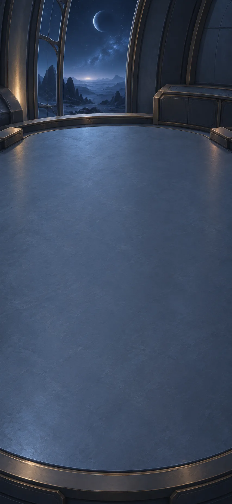

Imagine a remote observatory. Compare a model's predictions with a proposed trial, an unfamiliar case and readings from separate instruments.

[If skipped] Imagine an observatory far from Earth. It needs ways to check its findings and decide what it may do before a reply arrives.

**Goals**
- What if the model meets an unfamiliar case? -- "A prediction keeps its unfamiliar case visible"
- What would make this finding more convincing? -- "A candidate survives distinct checks"

**Items**
- "A model learns patterns from a large archive"

  In this imagined future, a model learns patterns from an archive. A useful prediction does not automatically explain a cause or guarantee a new case.

- "The model proposes changing one condition in a new trial"

  The model proposes changing one condition in a test. The proposal must be checked against outcomes, not accepted because it sounds convincing.

- "The next observation differs from the training archive"

  The new observation differs from the examples used to train the model. Its prediction needs extra caution and testing.

- "Separate instruments detect the same event"

  Two differently designed instruments detect the same candidate event and pass local checks. Shared errors or disturbances are still possible.

- "A powerful predictor, not a universal oracle"

  The imagined model is useful at finding patterns but is not an all-purpose source of truth. Its errors and limits remain part of the design.

- "A model proposes an experiment that people can inspect"

  The model proposes a test with a method people can inspect. A useful suggestion must expose what changes, what is measured and how it can be checked.

- "A prediction keeps its unfamiliar case visible"

  In the imagined observatory, a new case differs from the examples used to train the model. The prediction keeps that unfamiliarity visible instead of hiding it behind confident language.

- "A candidate survives distinct checks"

  Differently designed instruments detect the same candidate event and pass local checks. Their agreement strengthens the finding, but shared errors or disturbances may still explain it.

**Combinations**
- "No procedure solves every halting case" [preserve] + "A model learns patterns from a large archive" [preserve] -> "A powerful predictor, not a universal oracle"
- "The heat comparison crosses workshops" + "The model proposes changing one condition in a new trial" [preserve] -> "A model proposes an experiment that people can inspect"
- "A powerful predictor, not a universal oracle" [preserve] + "The next observation differs from the training archive" [preserve] -> "A prediction keeps its unfamiliar case visible"
- "A model proposes an experiment that people can inspect" [preserve] + "Separate instruments detect the same event" [preserve] -> "A candidate survives distinct checks"

> NOTE: Sources for this session: speculation, aegis, nist, turing. Source IDs identify bibliography entries recorded at their first relevant session; precise item and recipe attribution is retained in the conversion report.

> NOTE: Source `speculation`: [Authored speculative constructions; background: Ostrom Nobel lecture](https://www.nobelprize.org/prizes/economic-sciences/2009/ostrom/lecture/).

> NOTE: Source `aegis`: [NASA/JPL: AEGIS autonomous science targeting](https://ai.jpl.nasa.gov/public/projects/aegis/). Actual bounded target-selection autonomy. It is not evidence that the fictional self-questioning laboratory exists.

> NOTE: Source `nist`: [NIST AI RMF Core](https://airc.nist.gov/airmf-resources/airmf/5-sec-core/). Model validation, generalization limits and ongoing evaluation. A checklist is not a guarantee of trustworthiness.

## Remote-observation desk

It is evening. The worktable is cleared for a new session. The remote observatory needs authority limits while Earth is out of contact. Keep records of how findings were made and protect their transmission, while keeping their limits visible.

**Goals**
- Can others check the distant finding? -- "A distant finding remains inspectable and correctable"
- When should the local system stop and ask? -- "Useful local action with a defined stopping boundary"

**Items**
- `verified-source-records` Each observation keeps its instrument, context and revision history

  Each observation records its instrument, circumstances and revisions. This helps people check the evidence without guaranteeing that every entry is correct.

- "The observatory cannot wait for an immediate reply from Earth"

  Messages from Earth arrive too late for every local decision. The observatory needs limited authority to act while waiting.

- `mission-boundary` The local system may observe, but irreversible interventions need review

  The local system may make observations, but irreversible interventions require review. Its authority has a defined limit.

- "A record whose making can be examined"

  The observatory keeps records of how each finding was made. Inspectable evidence matters more than a polished appearance of authority.

- "A local observer can act while Earth is silent"

  The observatory can adjust its observations while waiting for Earth. Feedback supports a limited local role, not unlimited machine authority.

- "Useful local action with a defined stopping boundary"

  The system can act locally within an agreed boundary and stop for review beyond it. Responsiveness and oversight are both built into its role.

- "A distant finding remains inspectable and correctable"

  A distant finding keeps a traceable record and a message that can recover from specified transmission errors. These address different problems, and neither guarantees truth.

**Combinations**
- "The apparatus of scholarship becomes fiction" [preserve] + `verified-source-records` [preserve] -> "A record whose making can be examined"
- "A machine responds to its measured effects" [preserve] + "The observatory cannot wait for an immediate reply from Earth" [preserve] -> "A local observer can act while Earth is silent"
- "A local observer can act while Earth is silent" [preserve] + `mission-boundary` [preserve] -> "Useful local action with a defined stopping boundary"
- "A record whose making can be examined" [preserve] + "A message designed to recover from specified errors" [preserve] -> "A distant finding remains inspectable and correctable"

> NOTE: Sources for this session: speculation, aegis, nist, turing. Source IDs identify bibliography entries recorded at their first relevant session; precise item and recipe attribution is retained in the conversion report.

## Workshop proposals

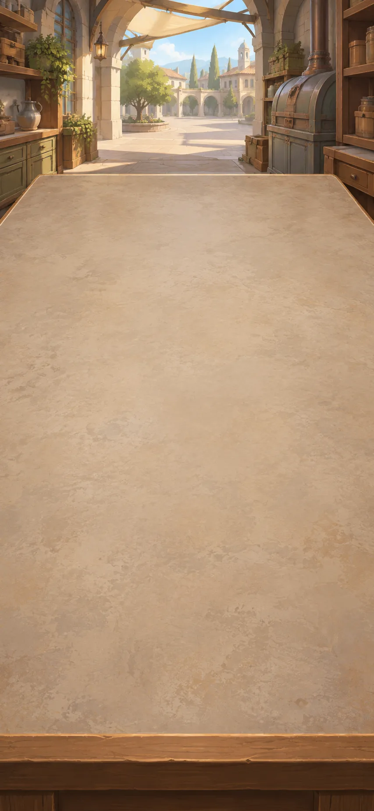

These imagined workshops apply earlier arguments about useful work and control. Machinery can save effort while care and other demanding work still need to be shared.

**Goals**
- Who will do the necessary care? -- "Pleasurable making does not eliminate care burdens"
- Must everyone want the same good life? -- "A prosperous city need not prescribe one good life"

**Items**
- "A community workshop lets makers set tasks and pause machines"

  This imagined community workshop gives makers rights to choose tasks, revise arrangements and pause unsafe machines. Institutions still have to make those rights effective.

- "People can choose some work for skill and pleasure"

  Some work can be chosen for skill and pleasure. The community must still provide necessities and share demanding essential work.

- "Some useful work remains demanding and unevenly shared"

  Care and maintenance remain necessary and can be tiring or unevenly shared. Enjoyable production does not remove those responsibilities.

- "A workshop design reserves decisions for its makers"

  The workshop combines machinery with specific rights to choose tasks and stop unsafe work. Community ownership alone would not guarantee those powers.

- "A workshop can value skill as well as output"

  The workshop values skill and the maker's experience as well as output. Its design does not promise that every necessary task becomes enjoyable.

- "Pleasurable making does not eliminate care burdens"

  The imagined workshop offers skill and pleasure in making, but care and maintenance remain demanding. A good-life proposal still has to decide how necessary work is supported and shared.

- "A prosperous city need not prescribe one good life"

  A prosperous city need not require everyone to pursue the same life. Wealth is one consideration, not a complete definition of living well.

**Combinations**
- "Mechanized effort can deepen lost control" [preserve] + "A community workshop lets makers set tasks and pause machines" [preserve] -> "A workshop design reserves decisions for its makers"
- "Useful work need not erase the maker" [preserve] + "People can choose some work for skill and pleasure" [preserve] -> "A workshop can value skill as well as output"
- "A workshop can value skill as well as output" [preserve] + "Some useful work remains demanding and unevenly shared" [preserve] -> "Pleasurable making does not eliminate care burdens"
- "Prosperity and a good life can diverge" [preserve] + "A workshop design reserves decisions for its makers" [preserve] -> "A prosperous city need not prescribe one good life"

> NOTE: Sources for this session: speculation, ostrom-lecture-primary, morris, kropotkin, nist. Source IDs identify bibliography entries recorded at their first relevant session; precise item and recipe attribution is retained in the conversion report.

> NOTE: Source `ostrom-lecture-primary`: [Ostrom, Beyond Markets and States (2009), Nobel Prize lecture, pp.417, 419, 422, 429](https://www.nobelprize.org/uploads/2018/06/ostrom_lecture.pdf). Primary Nobel lecture; PDF pages 10, 12 and 15 distinguish governed resources from open access and discuss contextual rules, affected-user revision and accountable monitoring; page 22 cautions that groups can fail. Paraphrased, not quoted. Alder/Birch numbers and institutional arrangements are invented, not empirical results from this text.

## City proposals

It is evening. The worktable is cleared for a new session. A city's quick response meets residents' conflicting priorities. Provide a way to inspect and challenge decisions while acknowledging the cost of delay.

**Goals**
- Who can challenge a rapid decision? -- "Rapid action has an inspectable appeal path"

**Items**
- "A city controller can respond quickly to a looming hazard"

  A city controller can react quickly to danger. Its choices may affect people who did not agree with its priorities.

- "Residents disagree about the acceptable risks and costs"

  Residents disagree about which risks and costs are acceptable. More information may help, but it does not automatically remove the conflict.

- "Residents can challenge a decision and inspect its reasons"

  Residents can inspect reasons and challenge a decision. Appeals require time and people, and may come too late to prevent some harm.

- "A city can respond locally to urgent signals"

  The imagined city uses local signals to respond to urgent problems. Unlike a remote observatory, its choices directly involve conflicting human priorities.

- "Faster response can reduce time to challenge it"

  An imagined city controller can react quickly to danger, but affected residents may disagree with its priorities. Faster action leaves less time for challenge before the consequences occur.

- "Rapid action has an inspectable appeal path"

  The imagined city gives residents a way to inspect and appeal rapid decisions. This adds accountability, but cannot undo every harm or recover the time lost before an appeal is heard.

**Combinations**
- "Useful local action with a defined stopping boundary" [preserve] + "A city controller can respond quickly to a looming hazard" [preserve] -> "A city can respond locally to urgent signals"
- "A city can respond locally to urgent signals" [preserve] + "Residents disagree about the acceptable risks and costs" [preserve] -> "Faster response can reduce time to challenge it"
- "Faster response can reduce time to challenge it" [preserve] + "Residents can challenge a decision and inspect its reasons" [preserve] -> "Rapid action has an inspectable appeal path"

> NOTE: Sources for this session: speculation, ostrom-lecture-primary, morris, kropotkin, nist. Source IDs identify bibliography entries recorded at their first relevant session; precise item and recipe attribution is retained in the conversion report.

## Common-rule proposals

The next morning, we return to a cleared worktable. How can people affected by shared resources challenge and revise the rules? Care, fair work and disagreement still need attention.

**Goals**
- How can we keep shared rules open to change? -- "A shared world with obligations still disputed"

**Items**
- "People affected by a shared resource can revise its rules"

  People affected by a shared resource can revise its rules. This is a proposed way to govern it, not a guarantee that every shared system succeeds.

- "Cooperation receives rules people can revise"

  Cooperation is supported by rules that affected people can change. Willingness to cooperate alone does not design a workable institution.

- "A commons must let people challenge coercive rules"

  Saint-Domingue's abolition did not automatically end compulsory work. The imagined shared-resource institution therefore needs a way for people to challenge coercive rules, not just a formal promise of freedom.

- "A shared world with obligations still disputed"

  People can challenge and revise the community's shared rules. They still disagree about how to divide work, provide care and prevent people from being forced into decisions.

**Combinations**
- "Mutual aid belongs inside the question of survival" + "People affected by a shared resource can revise its rules" [preserve] -> "Cooperation receives rules people can revise"
- "Cooperation receives rules people can revise" [preserve] + "Abolition coexists with coercive labour" [preserve] -> "A commons must let people challenge coercive rules"
- "A commons must let people challenge coercive rules" [preserve] + "Pleasurable making does not eliminate care burdens" [preserve] -> "A shared world with obligations still disputed"

> NOTE: Sources for this session: speculation, ostrom-lecture-primary, morris, kropotkin, nist, civ-haiti-1801. Source IDs identify bibliography entries recorded at their first relevant session; precise item and recipe attribution is retained in the conversion report.

## The End

People can challenge and revise the community's shared rules. They still need to organize care, divide work fairly and make room for different ways of living.
