# Mars: A Light That Answers

A damaged landing strands a small expedition. Recovery becomes a rescue, then a return journey carrying people and evidence. This is an engineering story with recovered qualified systems, not real survival instructions.

> NOTE: Complete Markdown adaptation of `mars-purposeful-fieldwork-v8`, exported from the composed current scenario at source commit `1c95988a4e3771abcf2be28183ce009d38645d2c`. The first six chapters follow the reviewed Markdown example. All combinations are global; goal satisfaction latches. Later visits are new chapter surfaces. This manuscript now runs in the shared Markdown engine. The 30 October 2026 authenticity pass clarifies recovered equipment and evidence roles; legal replays are developer diagnostics, not proof of physical reproducibility or player enjoyment.

## Contact Ridge

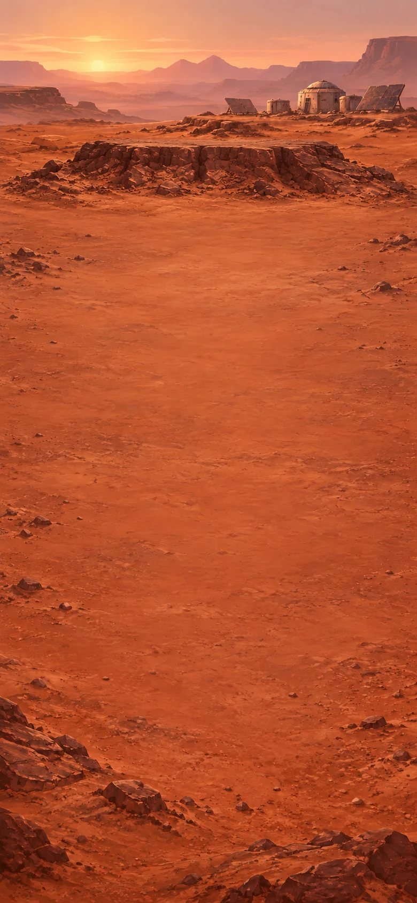

I have landed on Mars, but the radio is damaged. I need to contact the orbiter from the ridge, where a powered radio or a steady light signal can reach it. Wreckage lies below, with the surviving habitat and cargo sled visible in the distance.

[If skipped] The light above the ridge has been answered. Someone knows we are still here.

**Goals**
- Repair radio -- Radio
- next: Place powered radio / beacon
  - either: Solar radio @ Contact ridge
  - or: Signal beacon @ Contact ridge

**Hotspots**
- Contact ridge (at 50%, 17.5%)
  - icon: 
  > NOTE: Mars artwork target: Flat top and connected face of the raised contact ridge. Centre 50%, 17.5%; transparent hit area 240 × 80px at the 390 × 844 reference viewport.

**Items**
- Contact ridge
- Broken radio
  - icon: 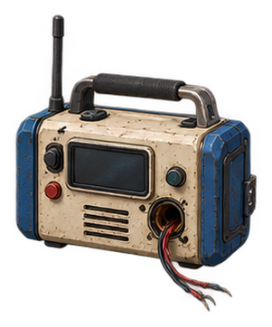
- Cable
  - icon: 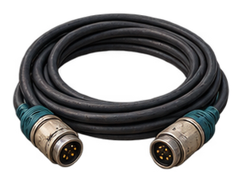
- Solar panel
  - icon: 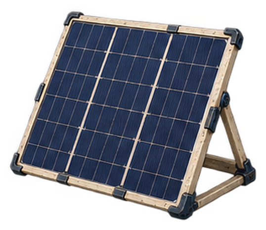
- Battery
  - icon: 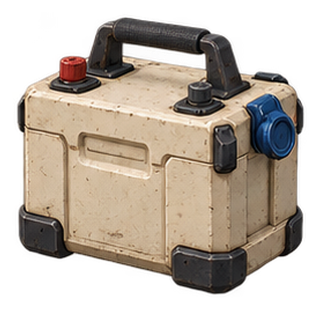
- Lamp
  - icon: 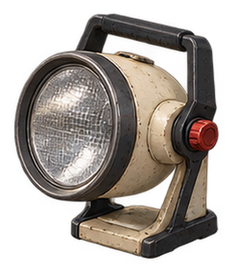
- Reflective foil
  - icon: 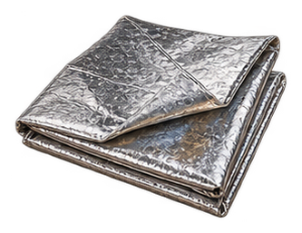
- Support frame
  - icon: 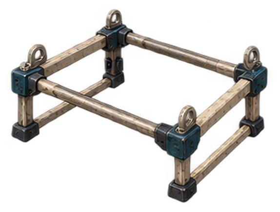
- Tripod
  - icon: 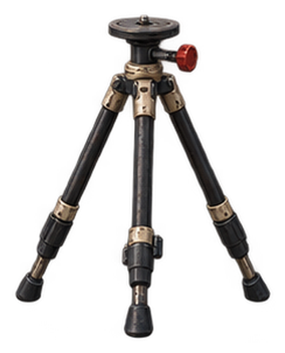
- Toolkit
  - icon: 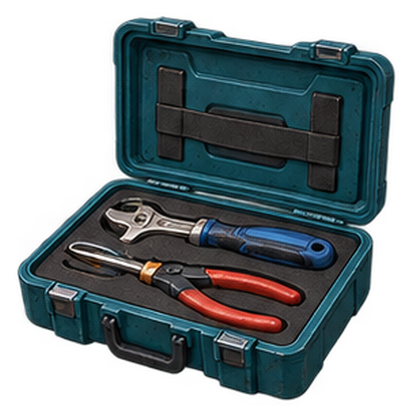
- Radio
  - icon: 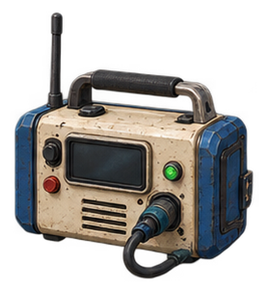
- Solar radio
  - icon: 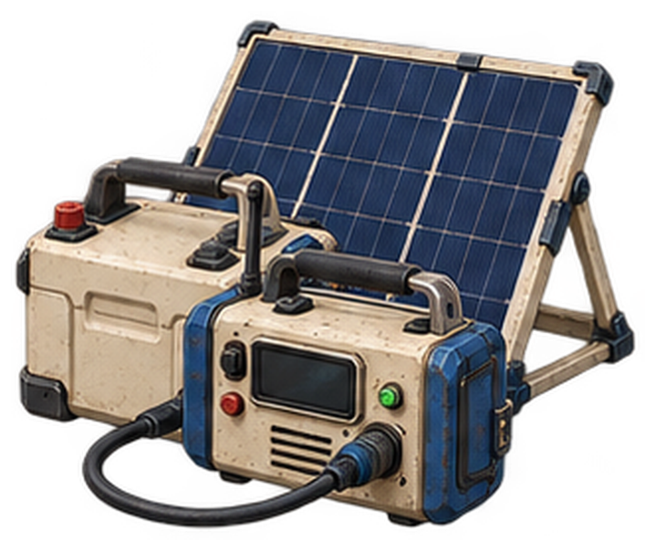
- Solar lamp
  - icon: 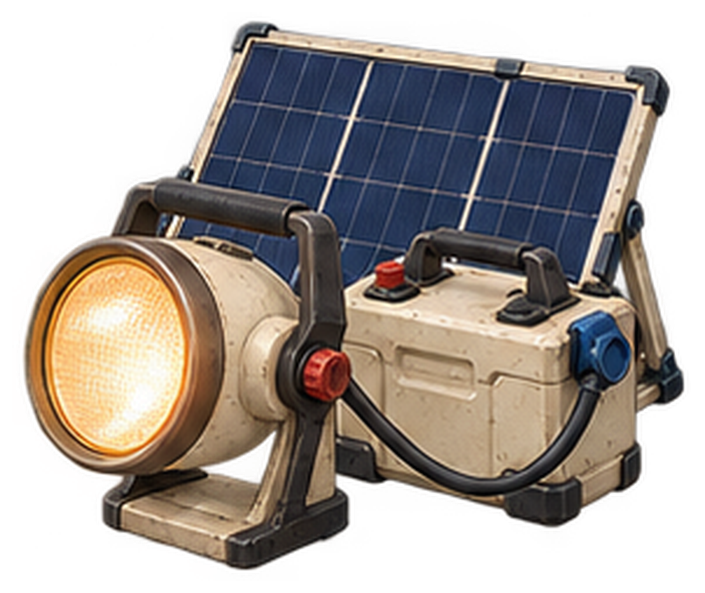
- Reflector
  - icon: 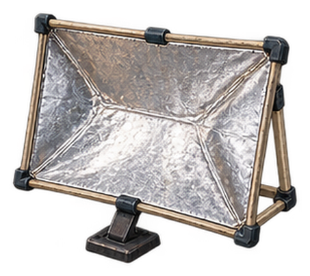
- Lantern
  - icon: 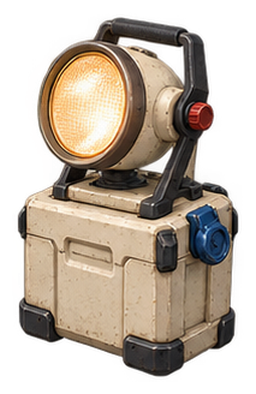
- Signal lamp
  - icon: 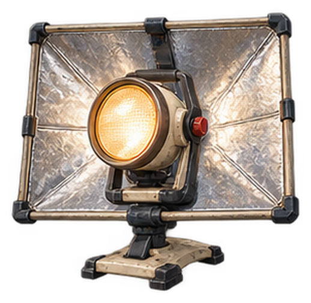
- Signal beacon
  - icon: 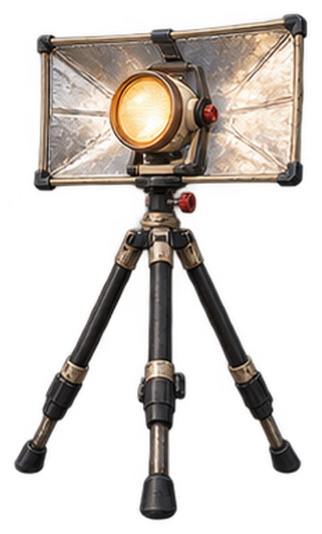

**Combinations**
- Cable [consume] + Broken radio [transform] -> Radio (tutorial)
- Solar panel [transform] + Battery [consume] -> Solar charger
- Radio [transform] + Solar charger -> Solar radio
- Lamp [transform] + Solar charger -> Solar lamp
- Reflective foil [consume] + Support frame [transform] -> Reflector
- Lamp [transform] + Battery [consume] -> Lantern
- Lantern [transform] + Reflector [consume] -> Signal lamp
- Signal lamp [transform] + Tripod [consume] -> Signal beacon

## Habitat entrance

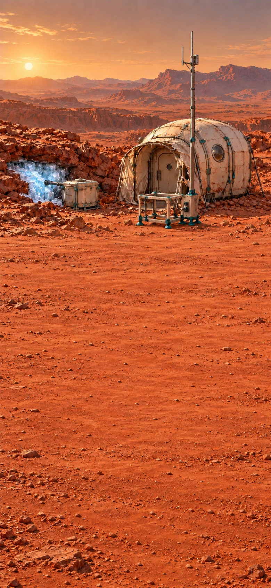

The orbiter has answered. The inner cabin survived, but its outer entrance is torn. Outside, I need to collect water from the ice, secure and insulate the entrance, and leave a signal the missing crew can find. The exterior repair locker holds the heater, patching materials, hatch frame, tie downs and insulating blanket.

The intact signal mast has a clear orbiter sightline. Our signal here will mark the refuge rather than only the crash site. Beside it, a fixed electric melt head collects water inside a sealed vessel. The solar charger can power it; a surviving cabin service lead can instead power the portable heater through the vessel's matching connection.

**Goals**
- (three goals are a lot but okay here because water, shelter, and rescue signalling are separate immediate refuge needs; the reviewed signal affordance problem was not resolved by hiding a goal)
- Collect water -- Dirty water
- Secure and insulate vestibule -- Insulated vestibule
- Mark refuge for rescue
  - either: Solar radio @ Refuge signal mast
  - or: Signal beacon @ Refuge signal mast

**Hotspots**
- Refuge signal mast (at 63%, 35.5%)
  - icon: 
  > NOTE: Mars artwork target: The empty signal platform and its directly attached antenna mast foundation in front of the habitat. Centre 63%, 35.5%; transparent hit area 110 × 74px at the 390 × 844 reference viewport.
- Ice melt station (at 29%, 32.5%)
  - icon: 
  > NOTE: Mars artwork target: The sealed melt vessel and fixed melt-head connection into the ice. Centre 29%, 32.5%; transparent hit area 100 × 90px at the 390 × 844 reference viewport.

**Items**
- Refuge signal mast
- Ice melt station
- Solar charger
  - icon: 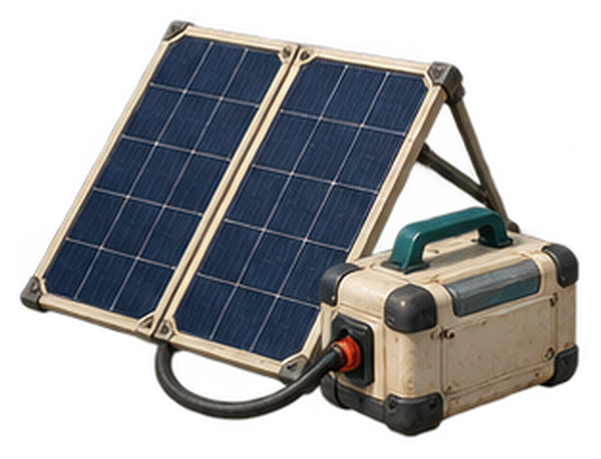
- Heater
  - icon: 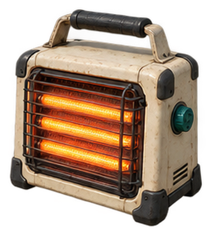
- Habitat fabric
  - icon: 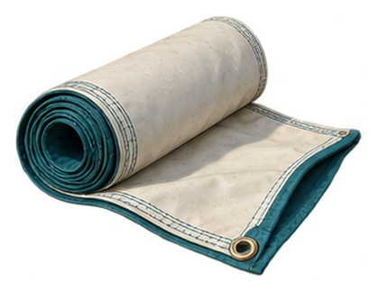
- Sealant
  - icon: 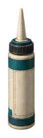
- Seam roller
  - icon: 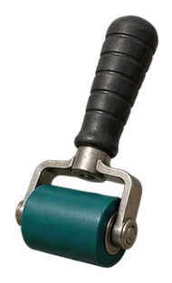
- Tie downs
  - icon: 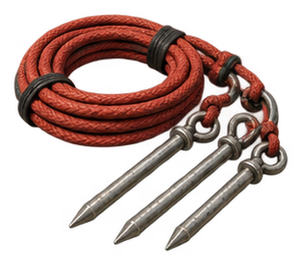
- Hatch frame
  - icon: 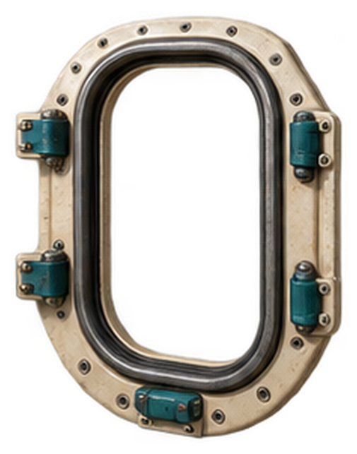
- Insulating blanket
  - icon: 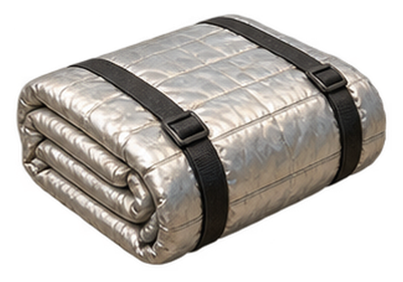
- Patch supplies
  - icon: 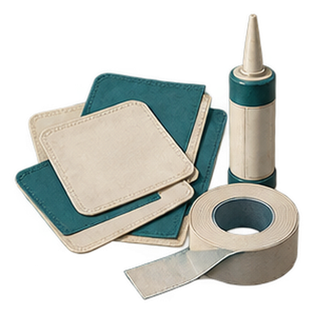
- Sealed panel
  - icon: 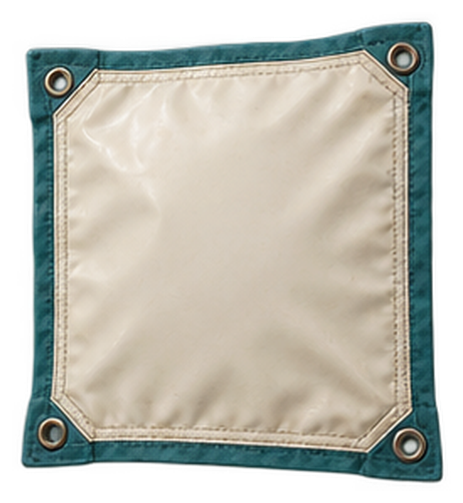
- Vestibule
  - icon: 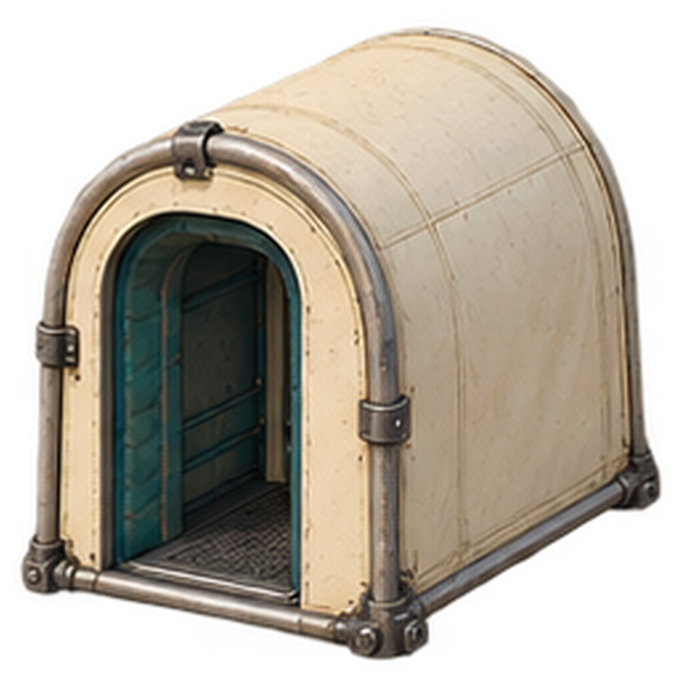
- Secured vestibule
  - icon: 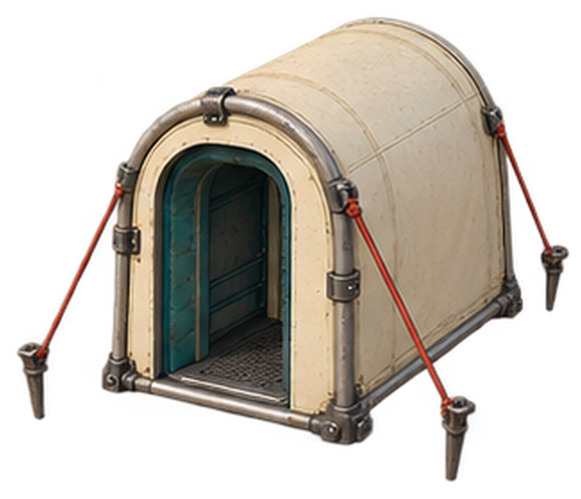
- Insulated vestibule
  - icon: 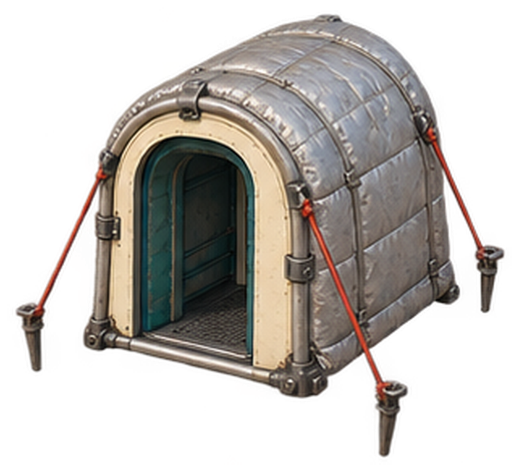
- Wrapped vestibule
  - icon: 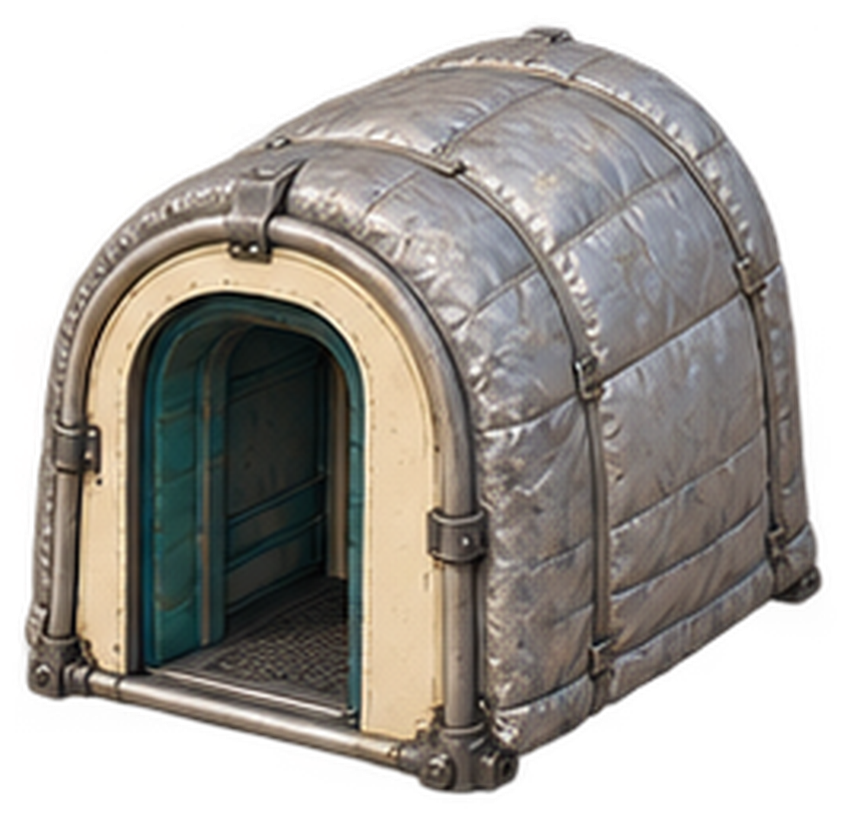

**Combinations**
- Solar charger @ Ice melt station -> Dirty water
- Heater @ Ice melt station -> Dirty water
- Habitat fabric [consume] + Sealant [consume] -> Patch supplies
- Patch supplies [transform] + Seam roller [preserve] -> Sealed panel
- Sealed panel [transform] + Hatch frame [consume] -> Vestibule
- Vestibule [transform] + Tie downs [consume] -> Secured vestibule (exclusive with Wrapped vestibule)
- Secured vestibule [transform] + Insulating blanket [consume] -> Insulated vestibule
- Vestibule [transform] + Insulating blanket [consume] -> Wrapped vestibule (exclusive with Secured vestibule)
- Wrapped vestibule [transform] + Tie downs [consume] -> Insulated vestibule

## Habitat cabin

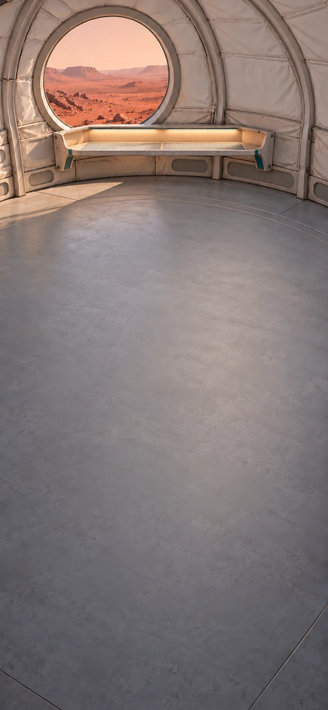

The entrance is secure and insulated, and our signal marks the refuge. Inside, the cabin is still warm and pressurized. I can filter the water collected outside and plant the seeds in their prepared tray. The cabin stores hold the filter, seeds, planting tray and clear cover.

The mission filter is made for this enclosed water source. Once the growing material is moist, the warm habitat will let the seeds germinate. This part of our work takes time in the sheltered cabin.

**Goals**
- Filter water -- Water
- next: Protect the seedlings -- Propagator

**Hotspots**
- Warm habitat (at 50%, 20.5%)
  - icon: 
  > NOTE: Mars artwork target: The illuminated fixed germination shelf beneath the cabin window. Centre 50%, 20.5%; transparent hit area 230 × 70px at the 390 × 844 reference viewport.

**Items**
- Warm habitat
- Dirty water
  - icon: 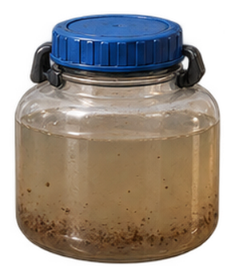
- Water filter
  - icon: 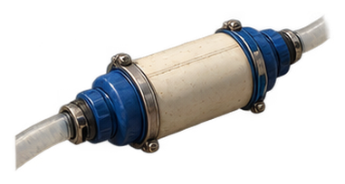
- Seeds
  - icon: 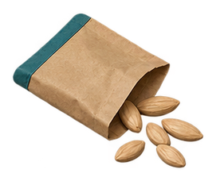
- Planting tray
  - icon: 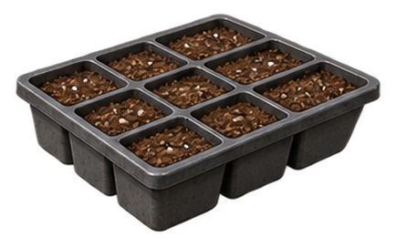
- Clear cover
  - icon: 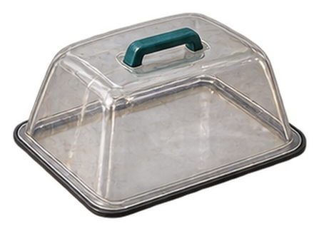
- Water
  - icon: 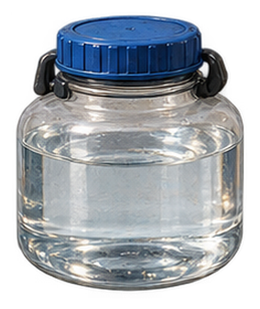
- Seed tray
  - icon: 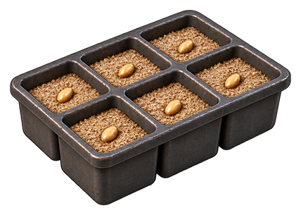
- Wet seeds
  - icon: 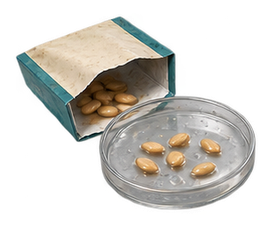
- Watered seed tray
  - icon: 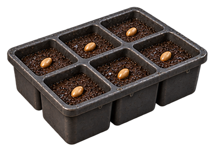
- Covered seed tray
  - icon: 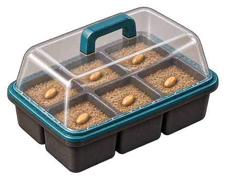
- Watered covered tray
  - icon: 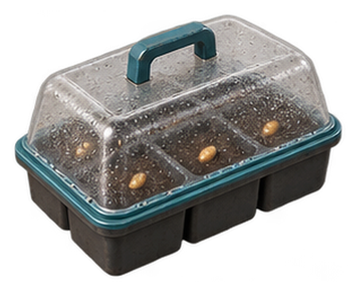
- Sprouted tray
  - icon: 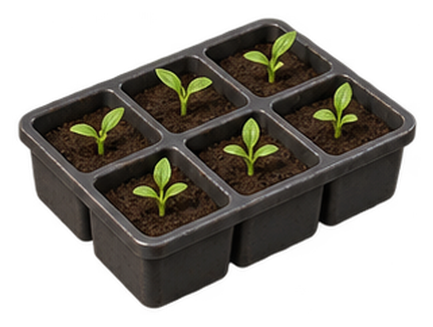
- Propagator
  - icon: 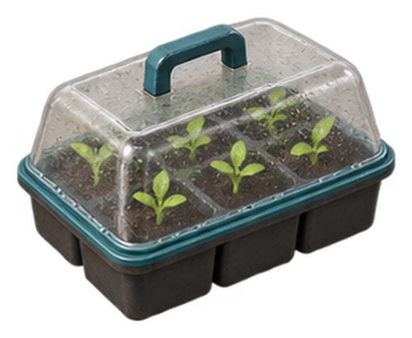

**Combinations**
- Dirty water [transform] + Water filter [preserve] -> Water
- Seeds [consume] + Planting tray [transform] -> Seed tray (exclusive with Wet seeds)
- Water + Seeds [transform] -> Wet seeds (exclusive with Seed tray)
- Wet seeds [consume] + Planting tray [transform] -> Watered seed tray
- Seed tray [transform] + Water -> Watered seed tray (exclusive with Covered seed tray)
- Seed tray [transform] + Clear cover [consume] -> Covered seed tray (exclusive with Watered seed tray)
- Covered seed tray [transform] + Water -> Watered covered tray (exclusive with Sprouted tray)
- Watered seed tray [transform] + Clear cover [consume] -> Watered covered tray
- Watered seed tray [transform] @ Warm habitat -> Sprouted tray (exclusive with Watered covered tray)

  After time in the warm cabin, the seeds have sprouted in their moist tray.

- Sprouted tray [transform] + Clear cover [consume] -> Propagator
- Watered covered tray [transform] @ Warm habitat -> Propagator

  After time in the warm cabin, the seeds have sprouted. The clear cover shelters the young plants while they establish.

## Cargo-sled assembly area

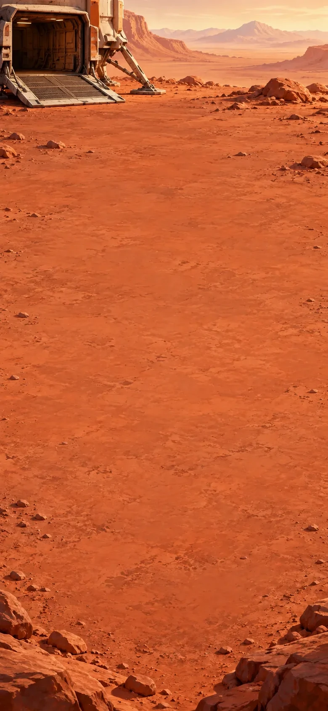

The water is filtered and the seedlings have a warm, sheltered home. To reach the missing crew, we need the relay beyond the ice outcrop. The regional map shows these stations, and the landed sled holds the rover parts, camera and viewing equipment. I can match the visible landmarks to the map and prepare the rover to follow the approach.

From the route overlook beside the sled, the outcrop and nearby landmarks are visible. A supported photograph can be compared with the expedition's existing regional map.

**Goals**
- (three goals are a lot but okay here because solar drive, a fitted harness, and an outcrop route express the vehicle and navigation preparations together; the reviewed drive-to-harness staging showed no established benefit)
- Make Rover drive under solar power -- Rover[Drive unit, Solar charger]
- Fit rover harness -- Rover[Drive unit, Solar charger, Seat harness]
- Find route to the outcrop -- Outcrop navchip

**Hotspots**
- Route overlook (at 70%, 13.5%)
  - icon: 
  > NOTE: Mars artwork target: The exposed rocky viewing shoulder beside the cargo lander, looking across the route. Centre 70%, 13.5%; transparent hit area 140 × 90px at the 390 × 844 reference viewport.

**Items**
- Route overlook
- Support frame
- Wheels
  - icon: 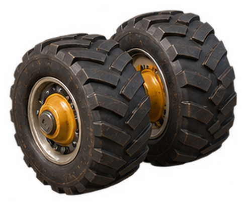
- Drive motor
  - icon: 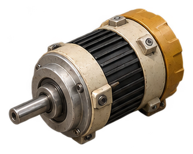
- Motor controller
  - icon: 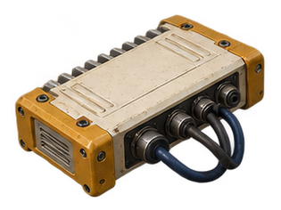
- Solar charger
- Seat harness
  - icon: 
- Dish antenna
  - icon: 
- Long range radio
  - icon: 
- Camera
  - icon: 
- Regional map navchip
  - icon: 
- Lens
  - icon: 
- Optical tube
  - icon: 
- Rover (compound)
  - icon: 
  - slot: drive, accepts Drive unit, icon: 
  - slot: traction power, accepts Solar charger, icon: 
  - unnamed slot: accepts Long range radio, icon: 
  - unnamed slot: accepts Seat harness, icon: 
  - unnamed slot: accepts Tow line, icon: 
  - unnamed slot: accepts Crew navchip, icon: 

  [Drive unit, Solar charger] The rover now has the drive and solar-power equipment it needs to travel. It can carry the expedition beyond the landing area.
- Drive unit
  - icon: 
- Field camera
  - icon: 
- Outcrop approach view
  - icon: 
- Telescope
  - icon: 
- Field telescope
  - icon: 
- Telescope camera
  - icon: 

**Combinations**
- Support frame [transform] + Wheels [consume] -> Rover
- Drive motor [transform] + Motor controller [consume] -> Drive unit
- Solar radio [transform] + Dish antenna [consume] -> Long range radio
- Camera + Tripod [transform] -> Field camera
- Field camera @ Route overlook -> Outcrop approach view
- Telescope camera @ Route overlook -> Outcrop approach view
- Outcrop approach view [preserve] + Regional map navchip [transform] -> Outcrop navchip
- Lens [consume] + Optical tube [transform] -> Telescope
- Telescope [transform] + Tripod [consume] -> Field telescope
- Field telescope [transform] + Camera -> Telescope camera

## Ice-outcrop field station

The rover is ready, and our navchip holds the approach to the outcrop. The route passes exposed ice and a layered cliff. I will label and photograph the samples so that each observation stays connected with the place it came from.

The expedition sampling case holds a scoop, a transparent jar, a core tube and labels, along with a windowed handling enclosure and sealed glove ports. The cliff viewpoint faces the layers across the route; the recovered optics can help record distant details.

**Goals**
- Label the ice sample -- Catalogued ice sample
- next: Photograph the sample -- Ice photograph
- Photograph core layers -- Core layer photograph

**Hotspots**
- Lookout ice (at 30%, 12%)
  - icon: 
  > NOTE: Mars artwork target: The accessible blue-white ice exposure. Centre 30%, 12%; transparent hit area 160 × 95px at the 390 × 844 reference viewport.
- Cliff viewpoint (at 73%, 7.5%)
  - icon: 
  > NOTE: Mars artwork target: The layered rock face above and beyond the ice. Centre 73%, 7.5%; transparent hit area 100 × 80px at the 390 × 844 reference viewport.

**Items**
- Lookout ice
- Cliff viewpoint
- Rover[Drive unit, Solar charger, Seat harness]
- Outcrop navchip
  - icon: 
- Cliff photograph
  - icon: 
- Illuminated glovebox
  - icon: 
- Sample scoop
  - icon: 
- Transparent jar
  - icon: 
- Core tube
  - icon: 
- Sample labels
  - icon: 
- Windowed box
  - icon: 
- Glove ports
  - icon: 
- Ice sample
  - icon: 
- Sealed ice sample
  - icon: 
- Catalogued ice sample
  - icon: 
- Ice photograph
  - icon: 
- Ice core
  - icon: 
- Core layer photograph
  - icon: 
- Glovebox
  - icon: 

**Combinations**
- Sample scoop @ Lookout ice -> Ice sample
- Ice sample [consume] + Transparent jar [transform] -> Sealed ice sample
- Sealed ice sample [transform] + Sample labels [consume] -> Catalogued ice sample
- Catalogued ice sample + Camera -> Ice photograph
- Catalogued ice sample + Field camera -> Ice photograph
- Core tube [preserve] @ Lookout ice -> Ice core
- Ice core + Camera -> Core layer photograph
- Ice core + Field camera -> Core layer photograph
- Camera @ Cliff viewpoint -> Cliff photograph
- Field camera @ Cliff viewpoint -> Cliff photograph
- Telescope camera @ Cliff viewpoint -> Cliff photograph
- Windowed box [transform] + Glove ports [consume] -> Glovebox
- Glovebox [transform] + Lamp -> Illuminated glovebox

## Weather-station apron

The ice sample is labelled, and the photographs record the specimen and the core's layers. These observations do not yet establish how old the layers are or how they formed. Dust is moving across the route. I can repair this old weather station and use its observations to decide when to travel.

The mothballed station was stored sensibly: its calibrated sensor mast, detached vane and complete logger are here together. A service enclosure and filter material can protect our spare controller. At the open weather site, the restored station can record changing conditions over a period of observation.

**Goals**
- Find a clear interval -- Weather record
- Make protected controller -- Protected controller

**Hotspots**
- Open weather site (at 39%, 19%)
  - icon: 
  > NOTE: Mars artwork target: The empty instrument plinth and mounting socket, with conduit back to the shelter. Centre 39%, 19%; transparent hit area 130 × 76px at the 390 × 844 reference viewport.

**Items**
- Open weather site
- Rover[Drive unit, Solar charger, Seat harness]
- Solar charger
- Motor controller
- Sensor mast
  - icon: 
- Wind vane
  - icon: 
- Sensor logger
  - icon: 
- Filter mesh
  - icon: 
- Vented enclosure
  - icon: 
- Weather station (compound)
  - icon: 
  - slot: recorder, accepts Sensor logger, icon: 
  - slot: power, accepts Solar charger, icon: 
- Weather record
  - icon: 
- Dust screen
  - icon: 
- Protected controller
  - icon: 

**Combinations**
- Sensor mast [transform] + Wind vane [consume] -> Weather station
- Weather station[Sensor logger, Solar charger] @ Open weather site -> Weather record
- Filter mesh [consume] + Vented enclosure [transform] -> Dust screen
- Dust screen [consume] + Motor controller [transform] -> Protected controller
## Relay knoll

The relay mast reaches beyond the ridge. I need to contact the missing crew, locate their reported landmark and program a navchip to guide the rover to them.

The relay itself is still here, with its complete antenna and charged powerpack stored beside it. Its service pouch holds a matched fuse; the fault indicator points to the old one.

[If skipped] The missing crew have answered. Their cabin is intact; its drive has failed. We know where they are.

**Goals**
- Set rover course to the crew -- Rover[Drive unit, Solar charger, Crew navchip]

**Hotspots**
- Relay knoll (at 66%, 20%)
  - icon: 
  > NOTE: Mars artwork target: The raised rocky approach immediately below the fixed relay infrastructure. Centre 66%, 20%; transparent hit area 170 × 90px at the 390 × 844 reference viewport.

**Items**
- Relay knoll
- Relay transceiver
  - icon: 
- Spare fuse
  - icon: 
- Directional antenna
  - icon: 
- Relay powerpack
  - icon: 
- Relay (compound)
  - icon: 
  - slot: antenna, accepts Directional antenna, icon: 
  - slot: power, accepts Relay powerpack, icon: 
- Distress recording
  - icon: 
- Crew navchip
  - icon: 

**Combinations**
- Relay transceiver [transform] + Spare fuse [consume] -> Relay
- Relay[Directional antenna, Relay powerpack] @ Relay knoll -> Distress recording
- Distress recording [preserve] + Outcrop navchip [transform] -> Crew navchip

## Stranded crawler

The crew answers: their cabin is intact, but the crawler's drive has failed. I can repair the drive or tow the crawler with our rover to help them reach the nearby refuge.

The crew wait in the intact crawler cabin. Its service compartment holds the spare drive and towing equipment.

> NOTE: Crawler names describe equipment only. The crew remain people in the story, never a second item hidden inside a vehicle label. Repairing or towing produces one vehicle; sheltering them later changes only the refuge.

**Goals**
- Bring the crawler to the service refuge
  - either: Crawler
  - or: Recovered crawler

**Items**
- Recovery rope
  - icon: 
- Tow eye
  - icon: 
- Spare drive
  - icon: 
- Drive coupling
  - icon: 
- Disabled crawler
  - icon: 
- Toolkit
- Rover
- Serviced drive
  - icon: 
- Replacement drive
  - icon: 
- Tow line
  - icon: 
- Recovered crawler
  - icon: 

**Combinations**
- Spare drive [transform] + Toolkit -> Serviced drive
- Serviced drive [transform] + Drive coupling [consume] -> Replacement drive
- Replacement drive [consume] + Disabled crawler [transform] -> Crawler
- Recovery rope [transform] + Tow eye [consume] -> Tow line
- Rover[Drive unit, Solar charger, Tow line] + Disabled crawler [transform] -> Recovered crawler

## Service refuge

The crew have reached the nearby service refuge. Its shelter and bedding stores are here; first I need to make it warm and welcoming.

The service refuge has bedding, a folding bed, soup and an insulated flask. The shelter needs preparation before the recovered crew can settle inside.

[If skipped] Everyone is sheltered and fed. With the recovered crew beside us, we can prepare together for the scheduled return window.

**Goals**
- Bring crew to shelter -- Occupied refuge
- next: Feed sheltered crew -- Provisioned refuge

**Items**
- Service shelter · torn seam
  - icon: 
- Bedding
  - icon: 
- Soup pouch
  - icon: 
- Insulated flask
  - icon: 
- Folding bed
  - icon: 
- Sealed refuge
  - icon: 
- Warm refuge
  - icon: 
- Prepared bed
  - icon: 
- Prepared refuge
  - icon: 
- Warm soup
  - icon: 
- Hot meal flask
  - icon: 
- Occupied refuge
  - icon: 
- Provisioned refuge
  - icon: 

**Combinations**
- Service shelter · torn seam [transform] + Patch supplies -> Sealed refuge
- Sealed refuge [transform] + Heater -> Warm refuge
- Folding bed [transform] + Bedding [consume] -> Prepared bed
- Prepared bed [consume] + Warm refuge [transform] -> Prepared refuge
- Soup pouch [transform] + Heater -> Warm soup
- Warm soup [consume] + Insulated flask [transform] -> Hot meal flask
- Crawler + Prepared refuge [transform] -> Occupied refuge
- Recovered crawler + Prepared refuge [transform] -> Occupied refuge
- Occupied refuge [transform] + Hot meal flask -> Provisioned refuge

## Sheltered workcourt

The crew is sheltered and fed. In the refuge's workcourt, I can prepare a lit workbench and contact our families.

The camp stores hold a worktop with its folded legs beneath it, a movable lamp bracket, and the crew’s message camera and antenna stand. Our recovered lamp and solar charger can light the bench.

**Goals**
- Make shared lit workbench -- Lit workbench
- Send crew message home -- Message home

**Items**
- Bench legs
  - icon: 
- Worktop
  - icon: 
- Lamp bracket
  - icon: 
- Message camera
  - icon: 
- Antenna stand
  - icon: 
- Long range radio (compound)
  - unnamed slot: accepts Antenna stand, icon: 
- Workbench
  - icon: 
- Bench lamp
  - icon: 
- Crew message
  - icon: 
- Message home
  - icon: 

**Combinations**
- Worktop [transform] + Bench legs [consume] -> Workbench
- Solar lamp [transform] + Lamp bracket [consume] -> Bench lamp
- Workbench [transform] + Bench lamp [consume] -> Lit workbench
- Message camera + Provisioned refuge -> Crew message
- Crew message [preserve] + Long range radio[Antenna stand] -> Message home
- Lantern [consume] + Lamp bracket [transform] -> Bench lamp
- Signal lamp [consume] + Lamp bracket [transform] -> Bench lamp
- Workbench [transform] + Signal beacon [consume] -> Lit workbench

## Furniture-sled path

The crew's furniture sled is a short walk from camp. I will bring back their table and take a photograph of everyone together.

The furniture sled’s belongings locker contains protective padding and the crew’s picture roll.

**Goals**
- Take crew supper portrait -- Crew portrait

**Hotspots**
- Cargo shoulder (at 74%, 15.5%)
  - icon: 
  > NOTE: Mars artwork target: The grounded freight sled and cloth-wrapped mess crate on the path shoulder. Centre 74%, 15.5%; transparent hit area 110 × 80px at the 390 × 844 reference viewport.

**Items**
- Cargo shoulder
- Sled padding
  - icon: 
- Picture roll
  - icon: 
- Padded sling
  - icon: 
- Recovered mess crate
  - icon: 
- Mess table
  - icon: 
- Personal table
  - icon: 
- Shared supper
  - icon: 
- Crew portrait
  - icon: 

**Combinations**
- Recovery rope + Sled padding [transform] -> Padded sling
- Padded sling [preserve] @ Cargo shoulder -> Recovered mess crate
- Recovered mess crate [transform] + Toolkit -> Mess table
- Picture roll [consume] + Mess table [transform] -> Personal table
- Personal table [transform] + Hot meal flask [consume] -> Shared supper
- Message camera + Shared supper [preserve] -> Crew portrait

## Thermal test bay

The refuge loses heat at night. In the thermal test bay, I can compare coverings before fitting a screen to its exposed service wall.

The separate camp thermal bay holds its wall sample, measured template and removable screen kit beside the fixed thermal chamber.

The chamber runs matched 20-minute tests. Both samples start at 20°C, with the same sample dimensions and logger position. Its invented example readings compare this covering under these conditions; they do not predict the whole refuge’s temperature.

> NOTE: The thermal readings are fictional comparisons, not measurements taken from NASA or a material qualification.

**Goals**
- Compare wall cooling -- Wrapping slows cooling
- next: Insulate our refuge -- Insulated refuge

**Hotspots**
- Thermal chamber (at 63%, 13%)
  - icon: 
  > NOTE: Mars artwork target: The open insulated test recess and empty specimen shelf. Centre 63%, 13%; transparent hit area 120 × 110px at the 390 × 844 reference viewport.

**Items**
- Thermal chamber
- Wall sample
  - icon: 
- Temperature logger
  - icon: 
- Thermal blanket
  - icon: 
- Clip frame
  - icon: 
- Measured wall template
  - icon: 
- Insulation swatch
  - icon: 
- Bare: 20 → 8°C
  - icon: 
- Insulated wall sample
  - icon: 
- Wrapped: 20 → 16°C
  - icon: 
- Wrapping slows cooling
  - icon: 
- Fitted blanket
  - icon: 
- Thermal screen
  - icon: 
- Insulated refuge
  - icon: 

**Combinations**
- Temperature logger + Wall sample @ Thermal chamber -> Bare: 20 → 8°C
- Wall sample [transform] + Insulation swatch [consume] -> Insulated wall sample
- Temperature logger + Insulated wall sample [preserve] @ Thermal chamber -> Wrapped: 20 → 16°C
- Bare: 20 → 8°C [preserve] + Wrapped: 20 → 16°C [preserve] -> Wrapping slows cooling
- Measured wall template [preserve] + Thermal blanket [transform] -> Fitted blanket
- Fitted blanket [transform] + Clip frame [consume] -> Thermal screen
- Thermal screen [consume] + Provisioned refuge [transform] -> Insulated refuge

## Enclosed ice works

Beyond camp is an enclosed ice-processing system with a drained pump loop. The water I saved may let me restart it and supply the camp's growing system.

This is an existing ice-processing pilot site. Its enclosed melter, treatment skid, monitored tank and circulation pump were stored as working appliances. The disconnected return hose is still here.

The exposed service wall is now covered. The test showed that the wrapped sample cooled less than the bare one; the bed and crew remain in the same refuge while we work at the ice system.

**Goals**
- Make camp water system -- Camp water system

**Hotspots**
- Ice works (at 55%, 14.5%)
  - icon: 
  > NOTE: Mars artwork target: The central service panels beneath the enclosed pipe run. Centre 55%, 14.5%; transparent hit area 180 × 100px at the 390 × 844 reference viewport.

**Items**
- Ice works
- Return hose
  - icon: 
- Ice melter
  - icon: 
- Treatment skid
  - icon: 
- Monitored tank
  - icon: 
- Circulation pump
  - icon: 
- Camp water system
  - icon: 

  The protected tank and working pump loop now supply the camp’s enclosed growing system. This process water is for the equipment and growing beds, not drinking.
- Heated melter
  - icon: 
- Collected water
  - icon: 
- Water reserve
  - icon: 
- Process water
  - icon: 
- Dry water loop
  - icon: 
- Primed water loop
  - icon: 

**Combinations**
- Ice melter [transform] + Heater -> Heated melter
- Heated melter [preserve] @ Ice works -> Collected water
- Monitored tank [transform] + Process water [preserve] -> Water reserve
- Primed water loop [transform] + Water reserve [preserve] -> Camp water system
- Collected water [transform] + Treatment skid [preserve] -> Process water
- Circulation pump [transform] + Return hose [consume] -> Dry water loop
- Water + Dry water loop [transform] -> Primed water loop

## Greenhouse growing bed

Our mission stores cover the months until the return flight. In the greenhouse, there is time to grow food and prepare the beds for the crews who follow.

The camp greenhouse is mostly intact. Its growing tray, fan, light, brought substrate and seed potatoes were stored here for a later planting. A damaged seam needs the existing patch kit.

The growing beds use the camp’s process-water system. Growing the crop takes several weeks inside the enclosed greenhouse; the mission stores support us while we wait.

[If skipped] After several weeks of growth, the greenhouse has produced a crop. We can share a meal from the potatoes we grew.

**Goals**
- Grow potatoes; share meal -- Warm potatoes

**Items**
- Greenhouse with torn seam
  - icon: 
- Prepared substrate
  - icon: 
- Drip line
  - icon: 
- Circulation fan
  - icon: 
- Grow light
  - icon: 
- Seed potato
  - icon: 
- Harvest basket
  - icon: 
- Growing bed
  - icon: 
- Greenhouse (compound)
  - icon: 
  - slot: bed, accepts Watered potatoes, icon: 
  - slot: light, accepts Powered grow light, icon: 
  - slot: air, accepts Circulation fan, icon: 
  - unnamed slot: accepts Positioned diffuser, icon: 
- Connected drip line
  - icon: 
- Watered potatoes
  - icon: 
- Powered grow light
  - icon: 
- Warm potatoes
  - icon: 
- Planting bed
  - icon: 
- Planted potatoes
  - icon: 
- Potato harvest
  - icon: 

**Combinations**
- Drip line [transform] + Camp water system [preserve] -> Connected drip line
- Planted potatoes [transform] + Connected drip line [preserve] -> Watered potatoes
- Grow light [transform] + Solar charger -> Powered grow light
- Potato harvest [transform] + Heater -> Warm potatoes
- Growing bed [transform] + Prepared substrate [consume] -> Planting bed
- Planting bed [transform] + Seed potato [consume] -> Planted potatoes
- Greenhouse with torn seam [transform] + Patch supplies -> Greenhouse
- Greenhouse[Watered potatoes, Powered grow light, Circulation fan] + Harvest basket [preserve] -> Potato harvest

## Propagation bench

The greenhouse has produced potatoes, and the small tray from landing is still growing. At the nursery bench, I can prepare a lasting place for its seedlings.

A single greenhouse cultivation kit holds the printed grid, original diffuser fitting, soft support lattice and labels. We reuse the landing’s living tray rather than granting another crop.

The growing bed and its fitted equipment remain in the greenhouse. The propagation bench is another working surface in that same structure.

**Goals**
- Camp nursery -- Camp nursery

**Hotspots**
- Nursery test shelf (at 50%, 23.5%)
  - icon: 
  > NOTE: Mars artwork target: The fixed raised nursery shelf crossed by daylight and structural shadows. Centre 50%, 23.5%; transparent hit area 270 × 66px at the 390 × 844 reference viewport.

**Items**
- Nursery test shelf
- Nursery grid
  - icon: 
- Diffuser sheet
  - icon: 
- Diffuser frame
  - icon: 
- Seedling support
  - icon: 
- Nursery labels
  - icon: 
- Shelf shadow view
  - icon: 
- Shadow layout
  - icon: 
- Framed diffuser
  - icon: 
- Positioned diffuser
  - icon: 
- Identified seedlings
  - icon: 
- Supported seedlings
  - icon: 
- Camp nursery
  - icon: 

**Combinations**
- Field camera @ Nursery test shelf -> Shelf shadow view
- Shelf shadow view [preserve] + Nursery grid [transform] -> Shadow layout
- Diffuser sheet [consume] + Diffuser frame [transform] -> Framed diffuser
- Framed diffuser [transform] + Shadow layout [preserve] -> Positioned diffuser
- Propagator [transform] + Nursery labels [consume] -> Identified seedlings
- Identified seedlings [transform] + Seedling support [consume] -> Supported seedlings
- Supported seedlings [transform] + Greenhouse[Watered potatoes, Powered grow light, Circulation fan, Positioned diffuser] -> Camp nursery

## Camp machine shop

The crawler needs a replacement wheel and a carrier for the samples. The enclosed machine shop has equipment for making and fitting them.

The camp machine-shop cabinet holds the guarded bench-top machine, stock, carrier parts and replacement wheel. Its captive base clamps match the rails on the shared workbench we assembled earlier.

> NOTE: The original crawler also declares radar and suspension slots, but no active recipe installs either component and neither part is stocked. Those unused legacy slots are omitted.

**Goals**
- Fit crawler sample carrier -- Crawler[Bracketed sample carrier]
- Fit replacement wheel -- Crawler[Wheel module]

**Items**
- Machining stock
  - icon: 
- Carrier shell
  - icon: 
- Shock foam
  - icon: 
- Latch
  - icon: 
- Blank bracket
  - icon: 
- Guarded bench-top machine
  - icon: 
- Replacement wheel
  - icon: 
- Crawler (compound)
  - icon: 
  - unnamed slot: accepts Wheel module, icon: 
  - unnamed slot: accepts Bracketed sample carrier, icon: 
  - unnamed slot: accepts Marked traverse, icon: 
- Lit workbench (compound)
  - icon: 
  - unnamed slot: accepts Guarded bench-top machine, icon: 
- Machined axle
  - icon: 
- Wheel module
  - icon: 
- Padded carrier
  - icon: 
- Sample carrier
  - icon: 
- Mounting bracket
  - icon: 
- Bracketed sample carrier
  - icon: 

**Combinations**
- Lit workbench[Guarded bench-top machine] + Machining stock [transform] -> Machined axle
- Replacement wheel [transform] + Machined axle [consume] -> Wheel module
- Carrier shell [transform] + Shock foam [consume] -> Padded carrier
- Padded carrier [transform] + Latch [consume] -> Sample carrier
- Blank bracket [transform] + Lit workbench[Guarded bench-top machine] -> Mounting bracket
- Sample carrier [transform] + Mounting bracket [consume] -> Bracketed sample carrier
- Replacement drive [consume] + Recovered crawler [transform] -> Crawler

## Lava-rim scout station

The ascent depot lies beyond rough lava. At this scout station, I can use aerial observations to plan the crawler's route.

The geology depot holds a stored Mars scout. Its delicate rotor assembly and battery were packed separately; its flight electronics, camera and legs are already fitted. A route tablet and hazard marker are also here.

**Goals**
- Fit crawler traverse -- Crawler[Marked traverse]

**Hotspots**
- Lava overlook (at 64%, 16%)
  - icon: 
  > NOTE: Mars artwork target: The black volcanic rim and open viewing edge beyond the scout clearing. Centre 64%, 16%; transparent hit area 180 × 95px at the 390 × 844 reference viewport.

**Items**
- Lava overlook
- Scout airframe
  - icon: 
- Counter rotating rotors
  - icon: 
- Scout battery
  - icon: 
- Route tablet
  - icon: 
- Hazard marker
  - icon: 
- Scout (compound)
  - icon: 
  - slot: battery, accepts Scout battery, icon: 
- Scout panorama
  - icon: 
- Terrain model
  - icon: 
- Traverse map
  - icon: 
- Marked traverse
  - icon: 

**Combinations**
- Scout airframe [transform] + Counter rotating rotors [consume] -> Scout
- Scout[Scout battery] @ Lava overlook -> Scout panorama
- Scout panorama [preserve] + Route tablet [preserve] -> Terrain model
- Terrain model + Outcrop navchip [transform] -> Traverse map
- Traverse map [transform] + Hazard marker [consume] -> Marked traverse

## Channel survey station

The aerial view suggested a possible crossing. Here at the channel, I need ground measurements before bringing the crawler onto the approach.

At the channel survey station, the opened field case holds the ground probe, map overlay and crossing marker.

**Goals**
- Mark surveyed channel -- Marked crossing
- Place crawler at channel -- Crawler[Wheel module] @ Channel approach

**Hotspots**
- Channel approach (at 50%, 22%)
  - icon: 
  > NOTE: Mars artwork target: The clear broad approach between the channel banks. Centre 50%, 22%; transparent hit area 220 × 110px at the 390 × 844 reference viewport.

**Items**
- Channel approach
- Ground probe
  - icon: 
- Route overlay
  - icon: 
- Crossing marker
  - icon: 
- Ground profile
  - icon: 
- Firm-ground route
  - icon: 
- Crossing map
  - icon: 
- Marked crossing
  - icon: 

**Combinations**
- Ground probe [preserve] @ Channel approach -> Ground profile
- Ground profile [preserve] + Terrain model -> Firm-ground route
- Firm-ground route [preserve] + Route overlay [transform] -> Crossing map
- Crossing map [preserve] + Crossing marker [transform] -> Marked crossing

## Basin coring station

Time to collect a core from this basin, and record its findings against the terrain.

The field laboratory unpacked at the basin core site contains the coring, handling and observation instruments, with its specimen log.

**Goals**
- Store sediment sample -- Retained sediment
- next: Record the basin findings -- Basin field record

**Hotspots**
- Layered basin (at 50%, 23.5%)
  - icon: 
  > NOTE: Mars artwork target: The accessible low stratified bank in front of the basin walls. Centre 50%, 23.5%; transparent hit area 220 × 90px at the 390 × 844 reference viewport.

**Items**
- Layered basin
- Sterile liner
  - icon: 
- Core cradle
  - icon: 
- Spectrometer
  - icon: 
- Calibration target
  - icon: 
- Sample vial
  - icon: 
- Specimen log
  - icon: 
- Core drill
  - icon: 
- Illuminated microscope
  - icon: 
- Lined core drill
  - icon: 
- Sediment core
  - icon: 
- Supported core
  - icon: 
- Grain images
  - icon: 
- Calibrated spectrometer
  - icon: 
- Retained sediment
  - icon: 
- Mineral spectrum
  - icon: 
- Basin field record
  - icon: 

- `sediment-comparison` "Fine–coarse–fine; spectrum inconclusive"
  - icon: 

**Combinations**
- Core drill [transform] + Sterile liner [consume] -> Lined core drill
- Lined core drill [preserve] @ Layered basin -> Sediment core
- Sediment core + Core cradle [transform] -> Supported core
- Supported core [preserve] + Illuminated microscope [preserve] -> Grain images
- Spectrometer [transform] + Calibration target [preserve] -> Calibrated spectrometer
- Sediment core + Sample vial [transform] -> Retained sediment
- Retained sediment + Calibrated spectrometer [preserve] -> Mineral spectrum
- Grain images [preserve] + Mineral spectrum [preserve] -> `sediment-comparison` "Fine–coarse–fine; spectrum inconclusive"
- `sediment-comparison` [transform] + Terrain model -> Basin field record

## Ripple and gravel edge

The rippled surface and nearby gravel are different sources of evidence. I will mark both photographed sites on the terrain model, compare them with the basin record, and keep the specimens and records separate.

The comparison case is opened at the ripple-and-gravel edge. A loose chip must still be collected visibly from the gravel ledge.

The earlier core has a band of larger grains between two finer layers. Its mineral scan is inconclusive. The record preserves the specimen’s context and the order of its layers, but neither dates them nor tells us what moved the grains. The nearby outcrops give us a chance to investigate that question.

> NOTE: The field observations are fictional expedition notes, not real mission measurements. The photographs are compared without invented calibrated dimensions or evidence of life.

**Goals**
- Compare basin photographs -- Paired terrain photographs
- next: Save basin comparison -- Sleeved comparison
- Keep specimens separate -- Two-cell comparison case[Ripple impression, Logged gravel chip]

**Hotspots**
- Ripple window (at 23%, 24.5%)
  - icon: 
  > NOTE: Mars artwork target: The left low outcrop with visible parallel ripple ridges. Centre 23%, 24.5%; transparent hit area 105 × 80px at the 390 × 844 reference viewport.
- Gravel window (at 77%, 24.5%)
  - icon: 
  > NOTE: Mars artwork target: The right conglomerate ledge with rounded embedded pebbles and loose fragments. Centre 77%, 24.5%; transparent hit area 105 × 80px at the 390 × 844 reference viewport.

**Items**
- Ripple window
- Gravel window
- Context board
  - icon: 
- Two-cell comparison case (compound)
  - icon: 
  - slot: ripple, accepts Ripple impression, icon: 
  - slot: gravel, accepts Logged gravel chip, icon: 
- Ripple impression sheet
  - icon: 
- Comparison sleeve
  - icon: 
- Ripple photograph
  - icon: 
- Gravel photograph
  - icon: 
- Paired terrain photographs
  - icon: 
- Mapped ripple and gravel sites
  - icon: 
- Qualified basin story
  - icon: 
- Ripple impression
  - icon: 
- Logged gravel chip
  - icon: 
- Comparison board
  - icon: 
- Sleeved comparison
  - icon: 
- Loose gravel chip
  - icon: 

**Combinations**
- Field camera @ Ripple window -> Ripple photograph
- Field camera @ Gravel window -> Gravel photograph
- Ripple photograph [preserve] + Gravel photograph [preserve] -> Paired terrain photographs
- Paired terrain photographs [preserve] + Terrain model -> Mapped ripple and gravel sites
- Mapped ripple and gravel sites [preserve] + Basin field record -> Qualified basin story
- Ripple impression sheet [transform] @ Ripple window -> Ripple impression
- Loose gravel chip [transform] + Specimen log [preserve] -> Logged gravel chip
- Qualified basin story [preserve] + Context board [transform] -> Comparison board
- Comparison board [transform] + Comparison sleeve [consume] -> Sleeved comparison
- Sample scoop @ Gravel window -> Loose gravel chip

## Depot marker line

The old depot markers lead toward a stored cargo hauler. The dark surface tracks have changed, so I will follow the fixed markers and use our spare controller to repair the hauler.

One existing depot navigation-and-maintenance locker holds its original survey print, cleaning pad and folding sign. The stored standardized cargo hauler and platform stand beside it. Their compatible controller specification is legible before installation.

Our basin comparison keeps the ripple and gravel sites separate. Rounded gravel within its surrounding rock layers supports ancient flowing water more strongly than ripple shape alone. The protected photographs and diagram retain their source labels, and the specimens remain separate so another team can check the interpretation. None of this establishes a date or evidence of life.

**Goals**
- Depot cargo shuttle -- Depot cargo shuttle

**Hotspots**
- Depot marker line (at 31%, 22%)
  - icon: 
  > NOTE: Mars artwork target: The near fixed identification marker and its rock footing; smaller markers continue toward the depot. Centre 31%, 22%; transparent hit area 85 × 112px at the 390 × 844 reference viewport.

**Items**
- Depot marker line
- Depot survey print
  - icon: 
- Marker cleaning pad
  - icon: 
- Folded route sign
  - icon: 
- Sign foot
  - icon: 
- Depot hauler (compound)
  - icon: 
  - slot: controller, accepts Protected controller, icon: 
  - slot: platform, accepts Hauler platform, icon: 
- Hauler platform
  - icon: 
- Current marker view
  - icon: 
- Track disagreement
  - icon: 
- Readable route identifier
  - icon: 
- Identified service route
  - icon: 
- Standing route sign
  - icon: 
- Depot route sign
  - icon: 
- Depot cargo shuttle
  - icon: 

**Combinations**
- Field camera @ Depot marker line -> Current marker view
- Current marker view [preserve] + Depot survey print [preserve] -> Track disagreement

  The fixed markers line up in the survey print and the new photograph, but the dark surface tracks differ. This comparison shows change, not when it happened or what caused it; the fixed route identifiers remain our guide.

- Marker cleaning pad [preserve] @ Depot marker line -> Readable route identifier
- Readable route identifier [preserve] + Track disagreement [preserve] -> Identified service route
- Folded route sign [transform] + Sign foot [consume] -> Standing route sign
- Standing route sign [transform] + Identified service route [preserve] -> Depot route sign
- Depot hauler[Protected controller, Hauler platform] [transform] + Depot route sign [preserve] -> Depot cargo shuttle

## Oxygen-plant service bay

The ascent depot's oxygen plant is still here. In its service bay, I can restore the equipment needed to prepare the vehicle's oxygen module.

The oxygen plant holds its stored processing stack, controller and filtered intake. The heavy flight module waits on its transport cradle.

**Goals**
- Restore plant; service oxygen -- Serviced oxygen module

**Hotspots**
- Ascent plant (at 30%, 11.7%)
  - icon: 
  > NOTE: Mars artwork target: The fixed servicing interface and empty receiving cradle inside the open depot bay. Centre 30%, 11.7%; transparent hit area 110 × 85px at the 390 × 844 reference viewport.

**Items**
- Ascent plant
- Electrolyzer stack
  - icon: 
- Process controller
  - icon: 
- Filtered intake
  - icon: 
- Flight oxygen module
  - icon: 
- Oxygen plant (compound)
  - icon: 
  - slot: intake, accepts Filtered intake, icon: 

  [Filtered intake] The restored plant is ready to process the Martian atmosphere into oxygen using its fitted mission equipment. This gives the return expedition a local oxygen source.
- Serviced oxygen module
  - icon: 
- Docked oxygen module
  - icon: 

**Combinations**
- Electrolyzer stack [transform] + Process controller [consume] -> Oxygen plant
- Oxygen plant[Filtered intake] + Docked oxygen module [transform] @ Ascent plant -> Serviced oxygen module
- Depot cargo shuttle + Flight oxygen module [transform] @ Ascent plant -> Docked oxygen module

## Cabin preparation bay

The oxygen plant is working. Across the depot, I can repair and fit the waiting cabin, then check its hatch closure and console responses at the ascent pad and record what happens.

The cabin shell survived, but its hatch seal is damaged. The depot stores hold the replacement seal, docking ring, flight console and stowed flight seat.

**Goals**
- Make cabin test record -- Cabin test record

**Hotspots**
- Ascent pad (at 50%, 23.8%)
  - icon: 
  > NOTE: Mars artwork target: The empty low circular cabin test cradle on the hangar floor. Centre 50%, 23.8%; transparent hit area 300 × 95px at the 390 × 844 reference viewport.

**Items**
- Ascent pad
- Ascent cabin shell
  - icon: 
- Docking ring
  - icon: 
- Hatch seal
  - icon: 
- Flight console
  - icon: 
- Flight seat
  - icon: 
- Ascent cabin (compound)
  - icon: 
  - slot: dock, accepts Docking ring, icon: 
  - slot: oxygen, accepts Serviced oxygen module, icon: 
  - slot: console, accepts Flight console, icon: 
  - slot: seat, accepts Flight seat, icon: 
- Cabin test record
  - icon: 

**Combinations**
- Ascent cabin shell [transform] + Hatch seal [consume] -> Ascent cabin
- Ascent cabin[Docking ring, Serviced oxygen module, Flight console, Flight seat] @ Ascent pad -> Cabin test record

  The repaired hatch closes and the fitted console responds during the pad check. This records a limited functional check of the cabin, not clearance to launch. The rendezvous and final vehicle assembly still need preparation.

## Clear-sky station

At the clear-sky station, I can compare clocks, observations and beacon measurements with the orbiter. We need to agree where and when the ships will meet.

The clear-sky station’s stored navigation kit holds the orbiter position table, terminal and clock, with the tracker, alignment target, timing receiver and range transponder. The tracker records the stars; the terminal relates that observation to its stored station survey and tracker-mount calibration. That establishes the station’s orientation, not the orbiter’s location.

The cabin check is recorded. We still need the orbiter’s pass prediction and a ranging link to agree our rendezvous, then assemble the final vehicle.

> NOTE: The cabin check, stored station survey and mount calibration are fictional mission premises, not a spacecraft test result or navigation procedure. [JPL’s ephemerides overview](https://ssd.jpl.nasa.gov/orbits.html) and [Horizons manual](https://ssd.jpl.nasa.gov/horizons/manual.html) support time-related position information; [NASA’s Orion navigation overview](https://www.nasa.gov/missions/lasers-stars-and-sensors-will-guide-nasas-orion-spacecraft/) distinguishes star-tracker orientation from broader navigation. Sources checked 30 October 2026; they do not validate this fictional rendezvous solution.

**Goals**
- Make agreed rendezvous -- Agreed rendezvous

**Hotspots**
- Clear sky station (at 31%, 9%)
  - icon: 
  > NOTE: Mars artwork target: The observatory dome and its entrance terrace, with clear sky above. Centre 31%, 9%; transparent hit area 160 × 110px at the 390 × 844 reference viewport.

**Items**
- Clear sky station
- Orbiter position table
  - icon: 

  The table gives predicted orbiter positions at reference-clock times. Comparing it with the received beacon times helps predict a pass; it is one input to the rendezvous, not a complete flight plan.

- Navigation terminal
  - icon: 
- Alignment target
  - icon: 
- Range transponder
  - icon: 
- Reference clock
  - icon: 
- Timing receiver
  - icon: 
- Star tracker
  - icon: 
- Timing station
  - icon: 
- Aligned star tracker
  - icon: 
- Star observation
  - icon: 
- Beacon times
  - icon: 
- Orbiter pass prediction
  - icon: 
- Station orientation
  - icon: 
- Rendezvous solution
  - icon: 
- Ranging link
  - icon: 
- Agreed rendezvous
  - icon: 

**Combinations**
- Timing receiver [transform] + Reference clock [consume] -> Timing station
- Star tracker [transform] + Alignment target [preserve] -> Aligned star tracker
- Aligned star tracker [preserve] @ Clear sky station -> Star observation
- Timing station [preserve] @ Clear sky station -> Beacon times
- Beacon times [preserve] + Orbiter position table [preserve] -> Orbiter pass prediction
- Star observation [preserve] + Navigation terminal [preserve] -> Station orientation
- Station orientation [preserve] + Orbiter pass prediction [preserve] -> Rendezvous solution
- Range transponder [transform] + Long range radio -> Ranging link
- Ranging link [preserve] + Rendezvous solution [preserve] -> Agreed rendezvous

## Camp return-packing alcove

Back at camp, I will pack the specimens, save the crew portrait and prepare a handover signal for the next crew.

The complete card recorder and its matching archival card can save a copy of the crew portrait alongside our field records. The hauler’s platform and cargo strap match the removable return capsule. Its shock mount and cargo can be fitted in any order; after the ground journey, that same capsule will transfer from the cart’s restraint to the flight dock. The camp handover equipment is ready too.

**Goals**
- (three goals are a lot but okay here because specimen transport, a handover beacon, and the crew portrait have separate return purposes; the reviewed cart-to-handover staging did not resolve the packing repetition)
- Prepare specimen transport cart -- Specimen transport cart
- Make camp handover beacon -- Camp handover beacon
- Archive the crew portrait -- Family record

**Items**
- Shock mount
  - icon: 
- Card recorder
  - icon: 
- Archival card
  - icon: 
- Cargo strap
  - icon: 
- Camp beacon
  - icon: 
- Maintenance card
  - icon: 
- Return capsule (compound)
  - icon: 
  - unnamed slot: accepts Shock mount, icon: 
  - slot: ice, accepts Catalogued ice sample, icon: 
  - slot: sediment, accepts Retained sediment, icon: 
  - slot: archive, accepts Complete field archive, icon: 
  - slot: comparison, accepts Two-cell comparison case, icon: 
  - slot: comparison record, accepts Sleeved comparison, icon: 
- Archival recorder
  - icon: 
- Expedition archive
  - icon: 
- Complete field archive
  - icon: 
- Camp handover beacon
  - icon: 
- Secured cart
  - icon: 
- Specimen transport cart
  - icon: 
- Family record
  - icon: 

**Combinations**
- Card recorder [transform] + Archival card [consume] -> Archival recorder
- Family record [preserve] + Basin field record -> Expedition archive
- Expedition archive [transform] + Core layer photograph [preserve] -> Complete field archive
- Camp beacon [transform] + Maintenance card [consume] -> Camp handover beacon
- Depot cargo shuttle [transform] + Cargo strap [consume] -> Secured cart
- Secured cart [transform] + Return capsule[Shock mount, Catalogued ice sample, Retained sediment, Complete field archive, Two-cell comparison case, Sleeved comparison] -> Specimen transport cart

  The cart carries the packed return capsule to the ascent pad. The cart stays on the ground; the same removable capsule, with its specimens and records, will go into the flight dock.

- Crew portrait [preserve] + Archival recorder [preserve] -> Family record

## Final assembly pad

At the final assembly pad, the ascent stage and launch equipment are ready for preparation. I will bring the crew, specimens and records to the orbiter at the agreed meeting.

The qualified ascent stage, receiver latch, cargo adapter, telemetry recorder and launch key wait at the depot. The orbiter remains at the remote rendezvous.

**Goals**
- Launch at the agreed rendezvous -- Ascending vehicle

**Items**
- Certified ascent stage
  - icon: 
- Receiver latch
  - icon: 
- Cargo adapter
  - icon: 
- Telemetry recorder
  - icon: 
- Launch key
  - icon: 
- Ascent vehicle
  - icon: 
- Capsule dock
  - icon: 
- Loaded capsule dock
  - icon: 
- Loaded ascent vehicle
  - icon: 
- Rendezvous program
  - icon: 
- Flight ready vehicle
  - icon: 
- Ascending vehicle
  - icon: 

**Combinations**
- Certified ascent stage [transform] + Ascent cabin[Docking ring, Serviced oxygen module, Flight console, Flight seat] [consume] -> Ascent vehicle
- Cargo adapter [consume] + Receiver latch [consume] -> Capsule dock
- Return capsule[Shock mount, Catalogued ice sample, Retained sediment, Complete field archive, Two-cell comparison case, Sleeved comparison] [consume] + Capsule dock [transform] -> Loaded capsule dock
- Ascent vehicle [transform] + Loaded capsule dock [consume] -> Loaded ascent vehicle
- Telemetry recorder [transform] + Agreed rendezvous [preserve] -> Rendezvous program
- Loaded ascent vehicle [transform] + Rendezvous program [consume] -> Flight ready vehicle
- Flight ready vehicle [transform] + Launch key [preserve] -> Ascending vehicle

## Orbital rendezvous

The surface falls away. At the agreed rendezvous, the waiting orbiter is finally in front of us.

We have you in sight. Bring your ship alongside; the hatch is waiting.

[If skipped] The crew is safely aboard the orbiter. The docked return ship holds the specimens, their records and our table portrait. The camp is ready for the next crew.

**Goals**
- Bring specimens to orbital hatch -- Docked vehicle @ Orbital hatch

**Hotspots**
- Waiting orbital cabin (at 70%, 39%)
  - icon: 
  > NOTE: Mars artwork target: The illuminated upper barrel of the waiting orbital cabin, separate from the front hatch. Centre 70%, 39%; transparent hit area 110 × 90px at the 390 × 844 reference viewport.
- Orbital hatch (at 64%, 60.8%)
  - icon: 
  > NOTE: Mars artwork target: The large circular forward hatch and illuminated docking rim. Centre 64%, 60.8%; transparent hit area 160 × 160px at the 390 × 844 reference viewport.

**Items**
- Waiting orbital cabin
- Orbital hatch
- Docked vehicle
  - icon: 

**Combinations**
- Ascending vehicle [transform] @ Waiting orbital cabin -> Docked vehicle

> NOTE: Source context retained from the source scenario; these links were not freshly researched for the format conversion.
>
> [The Fact and Fiction of Martian Dust Storms](https://www.nasa.gov/solar-system/the-fact-and-fiction-of-martian-dust-storms/). Dust reduces sunlight and adheres to equipment; Mars winds are not Earth-hurricane force at the same speed.
>
> [Mars Oxygen In-Situ Resource Utilization Experiment](https://www.nasa.gov/space-technology-mission-directorate/tdm/mars-oxygen-in-situ-resource-utilization-experiment-moxie/). A demonstrated engineered process, not an improvised household chemical combination.
>
> [Where Should Future Astronauts Land on Mars? Follow the Water](https://www.nasa.gov/centers-and-facilities/jpl/where-should-future-astronauts-land-on-mars-follow-the-water/). Near-surface ice is a candidate resource; accessibility varies.
>
> [Ingenuity mission](https://www.jpl.nasa.gov/missions/ingenuity/). Thin atmosphere demands purpose-built flight hardware; recovered scout modules are fictional mission equipment.
>
> [NASA thermal testing](https://s3vi.ndc.nasa.gov/ssri-kb/topics/59/). Controlled thermal testing of spacecraft and subsystems grounds the test-chamber setting; this fictional field comparison is not a qualification procedure. The v4 matched 20-minute example readings (20→8°C bare; 20→16°C wrapped) are invented for comparison, not taken from NASA or a qualification report.
>
> [JPL rover navigation](https://robotics.jpl.nasa.gov/what-we-do/flight-projects/mars-science-laboratory/surface-system-software-and-rover-navigation/). Terrain assessment and route selection matter for mobility. The field ground-probe interpretation remains a simplified fictional crewed-mission technique.
>
> [USGS: Large wind ripples on Mars](https://www.usgs.gov/publications/large-wind-ripples-mars-a-record-atmospheric-evolution). Mars wind ripples can resemble water-worked ripples; shape alone is not sufficient evidence of water.
>
> [JPL: Martian Streambed Evidence Rock](https://www.jpl.nasa.gov/images/pia16223-martian-streambed-evidence-rock-in-3-d/). Size and rounded form of embedded gravel support ancient stream interpretation. Fictional field synthesis compresses expert interpretation.
>
> [USGS: Eolian erasure of Mars rover tracks](https://www.usgs.gov/publications/gone-wind-eolian-erasure-mars-rover-tracks). Wind alters rover tracks. Our depot navigation uses permanent engineering markers, not an asserted safe route inferred from dark marks.
>
> [NASA: Dust Devil Dance](https://science.nasa.gov/photojournal/dust-devil-dance/). Dust devil tracks can loop and overprint one another. Weather correlation does not uniquely diagnose each fictional track.
>
> [NASA: Growing Plants in Space](https://www.nasa.gov/exploration-research-and-technology/growing-plants-in-space/). Engineered growing systems and crew well-being ground gardening. Nursery optics, compatible fittings and crewed Mars logistics are fictional abstractions.
>
> [Grundfos: starting a drained pump after standing still](https://www.grundfos.com/solutions/support/faq/how-can-i-start-the-pump-after-standing-still-). Supports the limited idea that a drained pump may need filling before use. The closed Mars process-loop fittings and compatible stored water are fictional; this is not a commissioning procedure.

## The End

The crew is safely aboard the orbiter. The docked return ship holds the specimens, their records and our table portrait. The camp is ready for the next crew.
