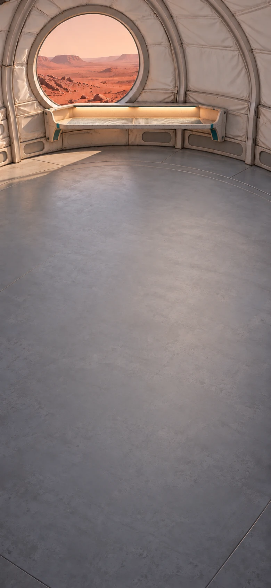
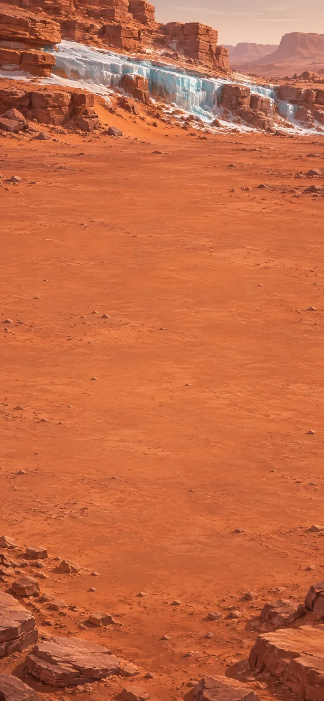

# Mars: What the Ice Kept

A solo surveyor, a small field station, and a blue line of ice beneath the Martian dust. A science-fiction expedition about making a place to work and understanding what you find.

> NOTE: This is a fictional future expedition using complete mission equipment. The preserved organism is a fictional discovery. Scientific sources and evidence limits belong in the design brief. Item artwork is deferred during this narrative and combination pass.

## A place to work

The station is small enough that I can hear the sample freezer from my bunk. Outside, a blue line crosses the foot of the Martian escarpment. My job is to sample the ice and follow its buried layers. The expedition ship waits in orbit; its cold laboratory will receive the cores at the end of the field season.

The station, rover and supplies are already here. The corer's barrel is packed beside its drive. I want it ready for the morning. There is also room for a tray of lettuce beneath the cabin's growing light. By departure, there should be something fresh to eat.

[If skipped] The corer is ready and the watered tray is beneath its light. Tomorrow's work is outside.

**Goals**
- Plant something for the weeks ahead -- Watered tray @ Growing shelf
- Prepare the field corer -- Field corer

**Hotspots**
- Growing shelf (at 50%, 23%)

**Items**
- Lettuce seeds
- Prepared growing tray

  Earth-supplied growing material and nutrients, with room for water and air around the roots. The cabin supplies pressure and warmth; the shelf has its own growing light.

- Clean water
- Corer drive

  The complete powered drive for the expedition's corer. Its battery, controls and seals are already fitted. The matching barrel is packed separately for travel and takes the mission's sealed sample liners.

- Core barrel
- Field lamp

  A cool LED inspection light. Shining through a clear section of ice can make its layers and inclusions easier to see.

- Seeded tray
- Watered tray (or from chapter The first leaves, Leafy tray)
- Field corer

**Combinations**
- Lettuce seeds [consume] + Prepared growing tray [transform] -> Seeded tray (tutorial)
- Seeded tray [transform] + Clean water -> Watered tray
- Core barrel [consume] + Corer drive [transform] -> Field corer

## Two kinds of ice

By the third week, there are small green leaves on the growing shelf. Outside, I have been following the layers along the escarpment. Today the rover stops at a low step of exposed ice, clear of the loose rock above.

A thin brown band crosses the face, with clearer ice just above it. I want to compare what is trapped in the two materials. One short core centered on the band and another from the clear ice will give me both to examine.

Each sample stays in its own sealed, transparent liner. The rover's refrigerated case is ready beside me.

[If skipped] The two cores are secure in the rover's cold case: one from the dusty band, one from the clearer ice above it.

**Goals**
- Sample the band and the clearer ice
  - both: Dusty-band core
  - and: Clear-ice core
- next: Keep both cold for the drive
  - both: Dusty-band core @ Rover cold case
  - and: Clear-ice core @ Rover cold case

**Hotspots**
- Dusty band (at 27%, 24%)
- Clear ice above the band (at 73%, 24%)
- Rover cold case (at 50%, 75%)

**Items**
- Dusty-band core
- Clear-ice core

**Combinations**
- Field corer @ Dusty band -> Dusty-band core
- Field corer @ Clear ice above the band -> Clear-ice core

## Side by side

Back at the station, the refrigerated bench has support channels for both sealed liners. The field lamp can shine through its viewing window.

I want to see what differs between the band and the clearer ice. With the samples side by side, I can compare their contents under the same light.

[If skipped] The backlit samples show scattered fine specks in the clear ice and many more in the dusty band. One dark inclusion in the band has an unusual outline.

**Goals**
- Put the two samples side by side -- Paired ice cores
- next: See what each layer holds -- Cores with an unusual inclusion

**Hotspots**
- Cold comparison bench (at 50%, 25%)

**Items**
- Paired ice cores
- Cores with an unusual inclusion

  Light passes through both cores. The clearer ice holds a scattering of fine specks. In the brown band they are much more crowded.

  Among them is one larger dark shape, wholly inside the ice. I turn its liner in the support channel. A bent projection comes into view, then another. Their edges are too small to make out here.

**Combinations**
- Dusty-band core [transform] + Clear-ice core [transform] @ Cold comparison bench -> Paired ice cores
- Paired ice cores [transform] + Field lamp [preserve] @ Cold comparison bench -> Cores with an unusual inclusion

## Under the lens

The larger inclusion has an outline unlike the scattered grains around it. I want to see those projections clearly.

The cold microscope has a refrigerated stage and a viewing window for the sealed liners. I can examine the sample while keeping the ice frozen.

[If skipped] A small, long-dead animal lies inside the dusty core. Both samples remain sealed and frozen.

**Goals**
- See what the dark shape is -- Cores with a preserved animal

**Hotspots**
- Cold microscope (at 50%, 25%)

**Items**
- Cores with a preserved animal

  A joint. Another behind it. Three folded limbs lie against one side of the abdomen. The other side has the same arrangement.

  It is no larger than a grain of rice. The body is incomplete and long dead, but it is a body: a small animal held inside the Martian ice.

  I sit down, still looking through the eyepiece. Every sample I have taken from Mars has been rock, dust or ice. Until this one.

  The little body stays where it is, with the material that surrounded it. Beside that core is the clearer ice I collected before I knew what either sample held.

**Combinations**
- Cores with an unusual inclusion [transform] @ Cold microscope -> Cores with a preserved animal

## The first leaves

I call the ship. At first I keep starting the explanation again. Then we talk through what I can see, what I cannot tell, and the two sealed cores waiting on the refrigerated stage. Their next stop will be the ship's cold laboratory.

In the days that follow, the ordinary work of the station continues. I check the samples, water the tray and finish the field survey. A month after sowing, the outer lettuce leaves are ready. The usual warmed ration is waiting in its bowl at the galley.

I can pick a handful and leave the small central leaves growing.

[If skipped] There are fresh leaves with supper, and the center of the tray is still green.

**Goals**
- Pick and rinse the first leaves -- Washed lettuce
- next: Add the harvest to supper -- Supper with fresh leaves

**Hotspots**
- Galley (at 50%, 25%)

**Items**
- Washed lettuce
- Supper with fresh leaves

  The leaves smell sharply green when I tear them over the warm meal. I have eaten this supper from a packet many times. Tonight it has a crunch.

  The tray is lighter at the edges, still green in the middle. Through the wall comes the steady sound of the sample freezer.

**Combinations**
- Watered tray [preserve] + Clean water @ Galley -> Washed lettuce
- Washed lettuce [transform] @ Galley -> Supper with fresh leaves

## Carrying it back

The scheduled flight is approaching. The rover's case served the field trip; the mission's return carrier is built for the transfer to the ship. Its cold blocks have been conditioning in the sample freezer.

The blocks fit around the carrier's support channels. Once they are in place, I can secure the two lined cores. They will stay cold through the short transfers; the isolated sample bay supplies refrigeration during flight.

[If skipped] The cores are secured in their cold carrier. The little body is still surrounded by its ice.

**Goals**
- Prepare the carrier's cold space -- Chilled return carrier
- next: Secure both cores for the ship -- Ice cores in return carrier

**Items**
- Return carrier

  The expedition's sample carrier, with fitted restraints, seals and a refrigeration connection. Its supports hold the liners apart so they cannot knock against one another during transfer.

- Conditioned cold blocks
- Chilled return carrier
- Ice cores in return carrier

  Through the inspection window, the little dark shape is still there. Beside it lies the clear-ice core. Both samples will reach the receiving laboratory together.

  The carrier is ready for the journey we planned before we knew what we would be carrying.

**Combinations**
- Conditioned cold blocks [consume] + Return carrier [transform] -> Chilled return carrier
- Cores with a preserved animal [transform] + Chilled return carrier [transform] -> Ice cores in return carrier

## The End

The station closes behind me. The flight is the one planned at the start of the season, with the carrier in its isolated sample bay.

On the ship, it passes into the cold laboratory. Another light shines through the core. The folded limbs come into view again.

The person at the eyepiece stops talking.

For a while, we both look.
