# Cosmic: A Sea Beneath the Moon

background: 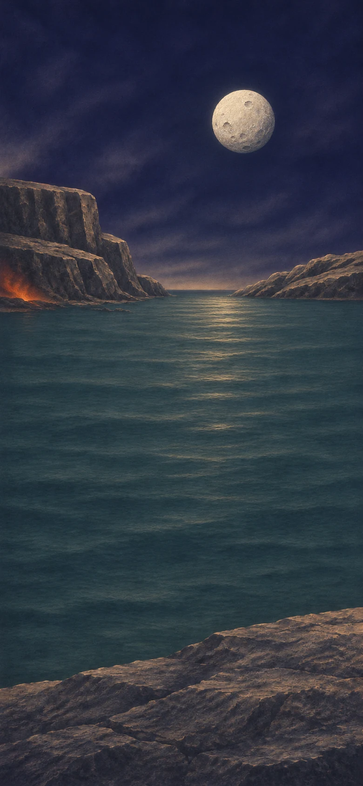

Bring particles, starlight, stone and ice together. Follow the making of a world until rain finds a shore beneath the Moon.

> NOTE: Educational process model: binary gestures bundle natural reactions, energy transfer, surrounding reservoirs and elapsed time. They are not balanced equations. See [design brief](design-brief.md) and [scientific sources](<../../archive/2026.11.05 cosmic study/research.md>) for scientific scope and sources.

## `chapter-01` The light gets out

background: 

During the first few hundred thousand years, cooling lets electrons stay with nuclei. Helium settles first; around 380,000 years after the beginning, neutral hydrogen becomes abundant and ancient light travels freely.

**Goals**
- Let the light travel -- `free-light`
- Gather the first star-making gas -- `gathering-gas`

**Items**
- `protons` Hydrogen nuclei
  - icon: 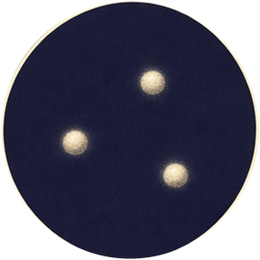 (circular)

  A hydrogen nucleus is a proton. It was already here before atoms could survive.

  *Hydrogen nuclei*
- `electrons` Electrons
  - icon: 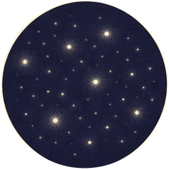 (circular)

  The early universe has both nuclei and electrons. Cooling allows them to form neutral atoms.

  *Electrons*
- `he-nuclei` Helium nuclei
  - icon: 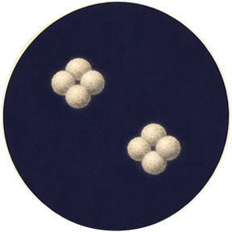 (circular)

  Most primordial helium nuclei formed in the first few minutes. During the cooling era shown here, they acquire their electrons earlier than hydrogen does.

  *Helium nuclei*
- `expansion` Expanding space
  - icon: 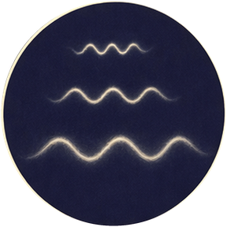 (circular)

  Expansion stretches travelling light and lowers the temperature of the young universe.

  *Expanding space*
- `trapped-light` Trapped radiation
  - icon: 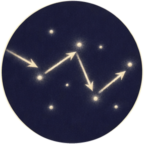 (circular)

  Free electrons scatter light. Before neutral atoms form, radiation cannot travel far without meeting another electron.

  *Trapped radiation*
- `density-well` A denser patch of the universe
  - icon: 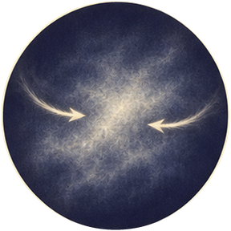 (circular)

  Slightly denser regions, including dark matter, exert more gravitational pull. Tiny differences can grow.

  *A denser patch of the universe*
- `hydrogen` Neutral hydrogen
  - icon: 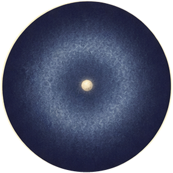 (circular)

  An electron settles around a proton. This makes an atom, not a new element: hydrogen was already present as a nucleus.

  *Neutral hydrogen*
- `helium` Neutral helium
  - icon:  (circular)

  Helium nuclei capture electrons as the universe cools, earlier than hydrogen’s main recombination. This gesture represents the complete process of making neutral helium atoms.

  *Neutral helium*
- `primordial-gas` Primordial gas
  - icon: 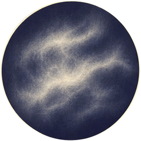 (circular)

  Mostly hydrogen, with helium and a trace of other light nuclei. There is no iron, rock or water in this gas.

  *Primordial gas*
- `free-light` Freely travelling light
  - icon: 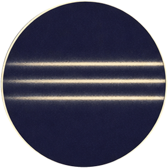 (circular)

  Around 380,000 years after the beginning, neutral hydrogen becomes abundant. Far fewer free electrons scatter the ancient light, which can now cross space. Transparency arrives before the first star shines.

  *Freely travelling light*
- `afterglow` A cooling cosmic afterglow
  - icon: 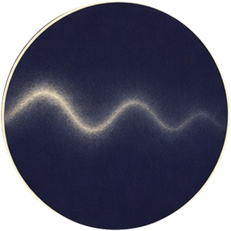 (circular)

  Travelling light stretches with expanding space. This ancient radiation will eventually reach observers as the cosmic microwave background.

  *A cooling cosmic afterglow*
- `gathering-gas` A dense knot of primordial gas
  - icon: 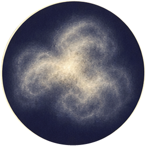 (circular)

  Gravity gathers gas into a denser region. To contract much further, this knot must lose heat. Expansion continues elsewhere; bound regions need not expand with it.

  *A dense knot of primordial gas*

**Combinations**
- `protons` [transform] + `electrons` [consume] -> `hydrogen` (tutorial)
- `he-nuclei` [transform] + `electrons` [consume] -> `helium`
- `hydrogen` [transform] + `helium` [consume] -> `primordial-gas`
- `primordial-gas` [transform] + `trapped-light` [consume] -> `free-light`
- `hydrogen` [transform] + `trapped-light` [consume] -> `free-light`
- `free-light` [transform] + `expansion` [consume] -> `afterglow`
- `primordial-gas` [transform] + `density-well` [consume] -> `gathering-gas`

## `chapter-02` Something shines in the dark

background: 

Inside the knot, gravity and escaping heat work together. A star must become dense without its own warmth keeping the gas spread out.

**Goals**
- Ignite a massive first star -- `first-star`
- Make the surrounding gas glow -- `glowing-nebula`

**Items**
- `trace-electrons` A few free electrons
  - icon: 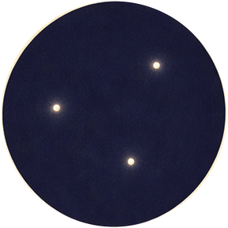 (circular)

  A small residual population of electrons helps primordial hydrogen form molecules through intermediate reactions.

  *A few free electrons*
- `open-space` Radiation escaping into space
  - icon: 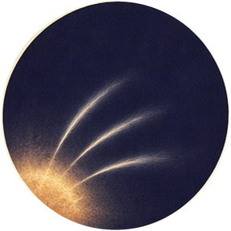 (circular)

  Radiation carries energy outward. A hot body can cool as that energy escapes; a star’s escaping radiation also illuminates its surroundings.

  *Radiation escaping into space*
- `molecular-h` Molecular hydrogen
  - icon: 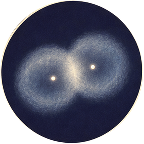 (circular)

  A small fraction of the hydrogen becomes H₂ through electron-assisted reactions. This bundles several steps; ordinary cold hydrogen atoms do not simply stick on every collision.

  *Molecular hydrogen*
- `cooling-knot` A knot that can cool
  - icon: 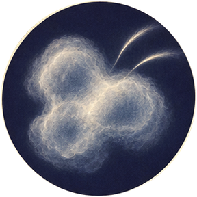 (circular)

  Molecular hydrogen radiates away energy. The gas can contract further without pressure immediately halting its collapse.

  *A knot that can cool*
- `collapsing-core` A collapsing gas core
  - icon: 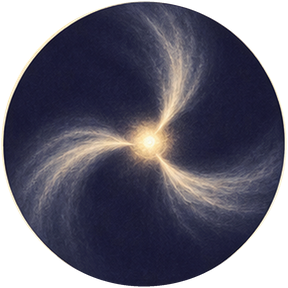 (circular)

  Escaping radiation removes heat while gravity pulls the gas inward. Collapse releases more heat; cooling and contraction happen together.

  *A collapsing gas core*
- `protostar` A massive protostar
  - icon:  (circular)

  Infall builds a dense, hot central object. It shines by releasing gravitational energy before stable hydrogen fusion supports it.

  *A massive protostar*
- `first-star` A massive first star
  - icon: 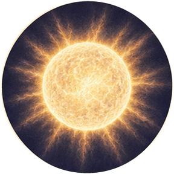 (circular)

  Accretion and contraction bring the protostar’s centre to sustained hydrogen fusion. A network of nuclear reactions makes helium and releases energy; hot internal pressure can now oppose gravity. This is nuclear burning, not hydrogen atoms forming a chemical bond.

  *A massive first star*
- `starlight` Starlight
  - icon: 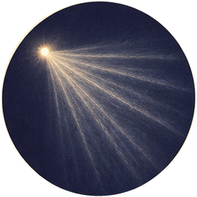 (circular)

  Energy made deep inside the star works its way outward and escapes. Unlike the fading cosmic afterglow, this is new light from a local furnace.

  *Starlight*
- `ionized-gas` Ionized surrounding gas
  - icon: 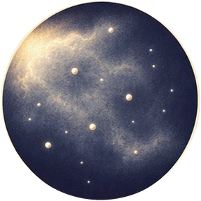 (circular)

  Energetic light from the star strips electrons from nearby hydrogen and other atoms. The star changes its surroundings; its internal nuclear fuel is a separate region.

  *Ionized surrounding gas*
- `glowing-nebula` A glowing nebula
  - icon: 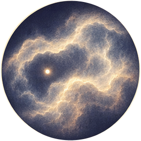 (circular)

  As electrons rejoin ions, the surrounding gas emits light of its own. A star can make a much larger region visible.

  *A glowing nebula*

**Combinations**
- `hydrogen` [transform] + `trace-electrons` [consume] -> `molecular-h`
- `gathering-gas` [transform] + `molecular-h` [consume] -> `cooling-knot`
- `cooling-knot` [transform] + `open-space` [consume] -> `collapsing-core`
- `collapsing-core` [transform] + `primordial-gas` [consume] -> `protostar`
- `protostar` [transform] + `hydrogen` [consume] -> `first-star`
- `first-star` [preserve] + `open-space` [consume] -> `starlight`
- `starlight` [transform] + `primordial-gas` [consume] -> `ionized-gas`
- `ionized-gas` [transform] + `electrons` [consume] -> `glowing-nebula`
- `first-star` [preserve] + `primordial-gas` [consume] -> `ionized-gas`
- `first-star` [preserve] + `hydrogen` [consume] -> `ionized-gas`
- `starlight` [transform] + `hydrogen` [consume] -> `ionized-gas`

## `chapter-03` Inside the furnace

background: 

Follow the massive star inward and forward through its short life. Each new fuel becomes available because an earlier stage has changed the core.

**Goals**
- Build the layered interior -- `layered-star`
- Bring the core to the end of fusion support -- `iron-core`

**Items**
- `core-compression` Compression in the stellar core
  - icon: 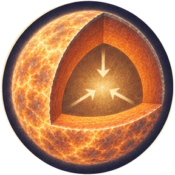 (circular)

  When a fuel runs low, the core contracts and grows hotter. Only sufficiently massive stars reach all the burning stages shown here.

  *Compression in the stellar core*
- `helium-core` A helium-rich stellar core
  - icon: 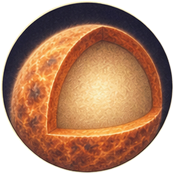 (circular)

  Hydrogen fusion leaves helium behind. The core is a changing region inside the same star, not a second object taken from it.

  *A helium-rich stellar core*
- `helium-burning` A helium-burning core
  - icon: 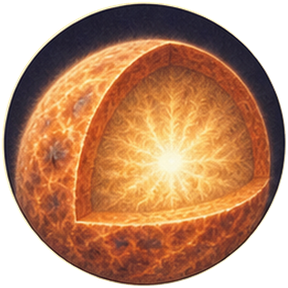 (circular)

  Contraction raises the temperature enough for helium burning. The next material cannot be made by ordinary chemical heat.

  *A helium-burning core*
- `carbon` Carbon-rich stellar material
  - icon: 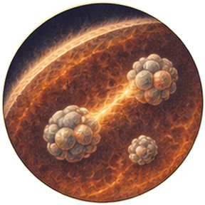 (circular)

  The triple-alpha process combines three helium nuclei through an unstable intermediate. Carbon is newly made here; the icon represents a region undergoing that process.

  *Carbon-rich stellar material*
- `oxygen` Oxygen-rich stellar material
  - icon: 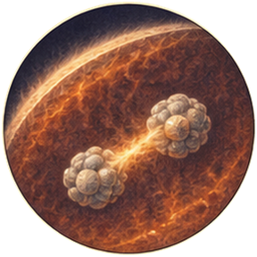 (circular)

  Some carbon nuclei capture additional helium nuclei to make oxygen. Both elements will be ingredients in later rock and water.

  *Oxygen-rich stellar material*
- `carbon-burning` Carbon-burning layers
  - icon: 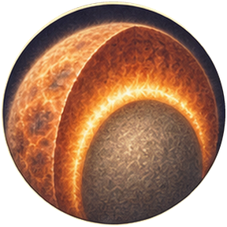 (circular)

  At higher temperatures, carbon-burning reactions create products including neon, sodium and magnesium. Several channels operate at once.

  *Carbon-burning layers*
- `oxygen-burning` Oxygen-burning layers
  - icon: 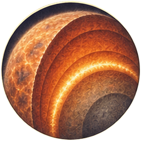 (circular)

  Contraction raises the temperature through advanced neon and oxygen burning. The oxygen-burning regions make nuclei including silicon and sulfur, while other fuels can continue burning in surrounding shells.

  *Oxygen-burning layers*
- `layered-star` An onion of burning shells
  - icon: 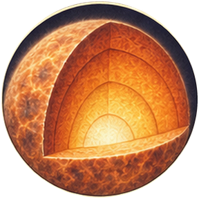 (circular)

  Different burning regions coexist inside one star. The metaphor describes layered reactions, not separate stars or chemically pure shells.

  *An onion of burning shells*
- `silicon-burning` Silicon-burning material
  - icon: 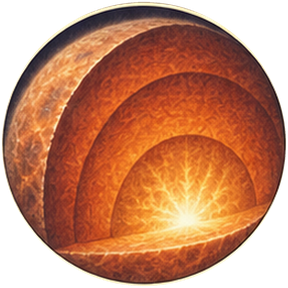 (circular)

  At immense temperatures a network of reactions rearranges nuclei toward the iron group. It is not a single silicon-plus-silicon reaction.

  *Silicon-burning material*
- `iron-core` An iron-group core
  - icon: 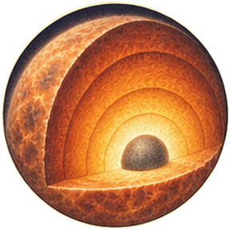 (circular)

  Further contraction brings the centre through silicon-burning reactions that accumulate iron-group nuclei. Fusion beyond the iron group cannot supply the energy that supported earlier stages. The layered star is approaching core collapse.

  *An iron-group core*
- `core-hydrogen` Hydrogen nuclei in the stellar core
  - icon: 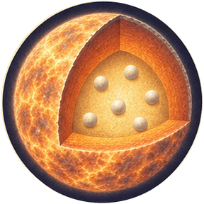 (circular)

  This is the hydrogen already inside the massive star’s hot core. Nuclear fusion here is distinct from light ionizing gas outside the star.

  *Hydrogen nuclei in the stellar core*

**Combinations**
- `first-star` [preserve] + `core-hydrogen` [consume] -> `helium-core`
- `helium-core` [transform] + `core-compression` [preserve] -> `helium-burning`
- `helium-burning` [transform] + `helium` [consume] -> `carbon`
- `carbon` [transform] + `helium` [consume] -> `oxygen`
- `carbon` [transform] + `core-compression` [preserve] -> `carbon-burning`
- `oxygen` [transform] + `core-compression` [preserve] -> `oxygen-burning`
- `oxygen-burning` [transform] + `core-compression` [preserve] -> `silicon-burning`
- `carbon-burning` [transform] + `oxygen-burning` [consume] -> `layered-star`
- `silicon-burning` [transform] + `layered-star` [consume] -> `iron-core`
- `carbon-burning` [transform] + `core-compression` [preserve] -> `oxygen-burning`
- `layered-star` [transform] + `core-compression` [preserve] -> `iron-core`
- `silicon-burning` [transform] + `core-compression` [preserve] -> `iron-core`

## `chapter-04` The star opens

background: 

The core can no longer hold itself up. Follow one massive star that explodes and leaves a neutron star; other massive stars meet different ends.

**Goals**
- Scatter the star’s enriched layers -- `stellar-ejecta`
- Find what remains at the centre -- `neutron-star`

**Items**
- `gravity-collapse` Gravity without fusion support
  - icon: 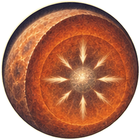 (circular)

  Pressure can no longer support the growing core. Collapse is rapid; the outer star has not yet learnt what happened.

  *Gravity without fusion support*
- `neutrino-flow` A flood of neutrinos
  - icon: 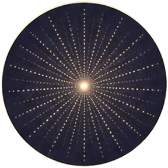 (circular)

  Core collapse releases vast energy, mostly as neutrinos. A small deposited fraction can help revive the outward shock in this explosion model.

  *A flood of neutrinos*
- `collapsed-core` A collapsing stellar core
  - icon: 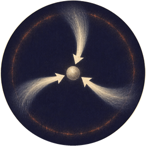 (circular)

  Electrons and protons combine into neutrons while neutrinos escape. Matter falls inward to extraordinary density.

  *A collapsing stellar core*
- `revived-shock` An outward supernova shock
  - icon: 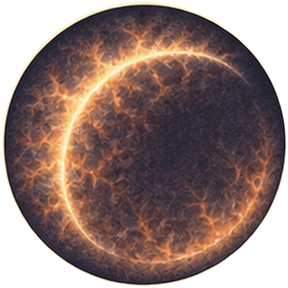 (circular)

  In this selected explosion, energy deposition helps an outward shock overcome infalling material. This is one modeled route, not a guaranteed fate for every massive star.

  *An outward supernova shock*
- `stellar-ejecta` Expanding stellar ejecta
  - icon: 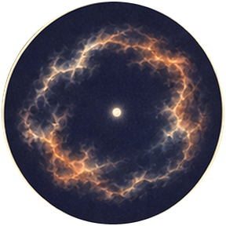 (circular)

  The revived shock tears through the star’s outer layers and ejects enriched material. The debris contains nuclei made during the star’s life and others made in the explosion. A dense remnant remains behind.

  *Expanding stellar ejecta*
- `neutron-star` A neutron star
  - icon: 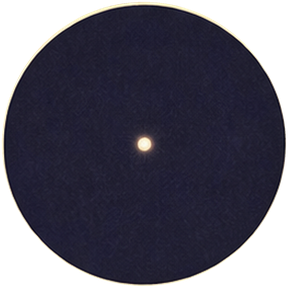 (circular)

  For this remnant, neutron-rich matter can resist further collapse. A more massive remnant might instead become a black hole.

  *A neutron star*
- `shocked-cloud` A shock running into gas
  - icon: 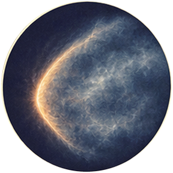 (circular)

  The debris ploughs into surrounding gas. The shock heats and compresses it rather than instantly producing a solar system.

  *A shock running into gas*
- `enriched-cloud` A cooling enriched cloud
  - icon: 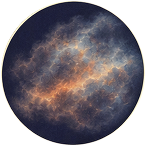 (circular)

  Radiation carries energy away from the shocked gas. Stellar material mixes into a much larger interstellar reservoir.

  *A cooling enriched cloud*
- `remnant-glow` A hot stellar remnant
  - icon: 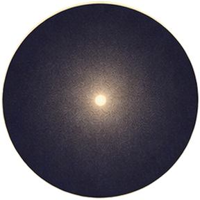 (circular)

  The compact remnant radiates stored heat. Much of the original star is now far outside it: destruction has separated a small dense survivor from a vast supply of debris.

  *A hot stellar remnant*
- `neutron-pressure` Pressure in dense neutron-rich matter
  - icon: 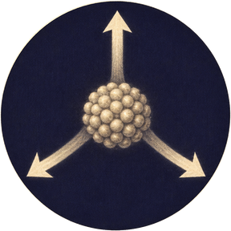 (circular)

  At extraordinary density, the pressure of neutron-rich matter can oppose gravity in a sufficiently low-mass remnant. A more massive core may continue into a black hole.

  *Pressure in dense neutron-rich matter*
- `open-space`

**Combinations**
- `iron-core` [transform] + `gravity-collapse` [consume] -> `collapsed-core`
- `collapsed-core` [transform] + `neutrino-flow` [consume] -> `revived-shock`
- `revived-shock` [transform] + `layered-star` [consume] -> `stellar-ejecta`
- `collapsed-core` [transform] + `neutron-pressure` [consume] -> `neutron-star`
- `stellar-ejecta` [transform] + `primordial-gas` [consume] -> `shocked-cloud`
- `shocked-cloud` [transform] + `open-space` [consume] -> `enriched-cloud`
- `neutron-star` [transform] + `open-space` [consume] -> `remnant-glow`

## `chapter-05` A gentler way to scatter a star

background: 

Other stars return material without a core-collapse explosion. Follow one lower-mass star much later in its life, then return to the mixed cloud.

**Goals**
- Scatter a carbon-bearing stellar wind -- `carbon-wind`
- Leave the star’s compact core -- `white-dwarf`

**Items**
- `cooling-ejecta` Cooling in a stellar outflow
  - icon: 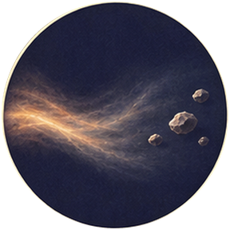 (circular)

  As a dense stellar outflow cools, atoms can condense into solid grains. Many grains are later destroyed and rebuilt.

  *Cooling in a stellar outflow*
- `lower-mass-star` An aging lower-mass star
  - icon: 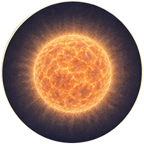 (circular)

  This is another star from a later generation, not the neutron-star remnant just made. Its mass permits a different late-life route.

  *An aging lower-mass star*
- `shell-burning` Fusion in shells around an old core
  - icon: 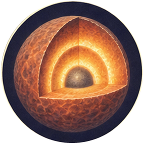 (circular)

  As central fuels change, burning can continue in shells. The outer envelope and the core respond very differently.

  *Fusion in shells around an old core*
- `stellar-pulsation` Pulsation of an extended stellar envelope
  - icon: 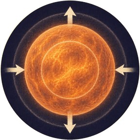 (circular)

  Pulsations and radiation acting on dust can help drive winds from evolved giant stars. The detailed mechanism depends on the star.

  *Pulsation of an extended stellar envelope*
- `red-giant` An evolved giant with burning shells
  - icon: 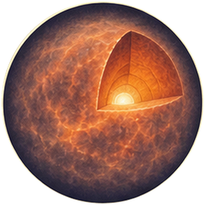 (circular)

  The evolved star has an extended envelope around a compact core, with hydrogen- and helium-burning shells. Its outer radius grows while the interior follows a very different path.

  *An evolved giant with burning shells*
- `giant-carbon` Carbon made inside an evolved giant
  - icon: 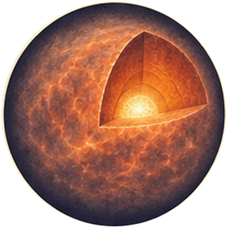 (circular)

  Helium burning makes carbon in this star as well. The material can leave by a different route from the massive-star supernova.

  *Carbon made inside an evolved giant*
- `carbon-envelope` Carbon mixed into an outer envelope
  - icon: 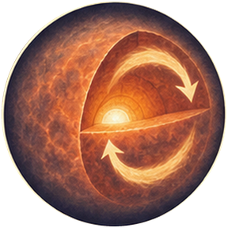 (circular)

  Episodes of deep mixing bring some freshly made material outward. This selected carbon-rich giant can enrich the gas it loses.

  *Carbon mixed into an outer envelope*
- `carbon-wind` A carbon-bearing stellar wind
  - icon: 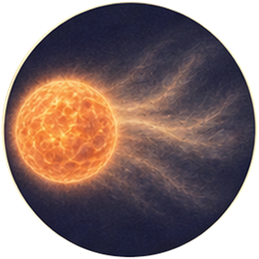 (circular)

  An evolved giant loses enriched outer material through a wind. Cosmic raw materials are supplied by slower shedding as well as spectacular explosions.

  *A carbon-bearing stellar wind*
- `wind-dust` Carbonaceous grains from a stellar wind
  - icon:  (circular)

  In cooling regions of the carbon-rich outflow, solid grains form. These grains join the mixed interstellar material that will later build the Sun’s disk.

  *Carbonaceous grains from a stellar wind*
- `exposed-core` An exposed hot stellar core
  - icon:  (circular)

  As much of the envelope is lost, a compact core is revealed. This selected star does not reach the iron-core collapse of the earlier massive star.

  *An exposed hot stellar core*
- `white-dwarf` A cooling white dwarf
  - icon:  (circular)

  The remnant shines from stored heat and cools. It is much less compact than a neutron star and follows a different evolutionary history.

  *A cooling white dwarf*
- `wind-enriched-cloud` A cloud enriched by a stellar wind
  - icon:  (circular)

  Wind material mixes with interstellar gas. The later Sun’s ingredients will have many stellar ancestors rather than a single named parent.

  *A cloud enriched by a stellar wind*
- `deep-mixing` Deep mixing after shell pulses
  - icon:  (circular)

  Helium-shell pulses can be followed by convection that brings newly made carbon toward the envelope.

  *Deep mixing after shell pulses*

**Combinations**
- `lower-mass-star` [transform] + `shell-burning` [consume] -> `red-giant`
- `red-giant` [transform] + `helium` [consume] -> `giant-carbon`
- `giant-carbon` [transform] + `deep-mixing` [consume] -> `carbon-envelope`
- `carbon-envelope` [transform] + `stellar-pulsation` [consume] -> `carbon-wind`
- `carbon-wind` [transform] + `cooling-ejecta` [consume] -> `wind-dust`
- `red-giant` [transform] + `stellar-pulsation` [consume] -> `exposed-core`
- `exposed-core` [transform] + `open-space` [consume] -> `white-dwarf`
- `carbon-wind` [transform] + `enriched-cloud` [consume] -> `wind-enriched-cloud`

## `chapter-06` Ash that can become stone

background: 

More stars live and die. Much later, a mixed cloud contains products from several stellar generations; no single supernova supplied the whole future Earth.

**Goals**
- Make a stock of rock-forming grains -- `rock-dust`
- Bring metal and carbon into the dust -- `mixed-dust`

**Items**
- `later-ejecta` Ejecta from later stellar generations
  - icon:  (circular)

  The cloud also receives material from other massive stars, giant-star winds and supernovae. The exact ancestry of each Solar System grain is mixed.

  *Ejecta from later stellar generations*
- `mixed-elements` A mixed interstellar element supply
  - icon:  (circular)

  Oxygen, carbon, silicon, magnesium and iron now coexist with inherited hydrogen and helium. We have moved across generations, not followed a sealed packet from one star.

  *A mixed interstellar element supply*
- `metal-grains` Iron-bearing metal grains
  - icon:  (circular)

  Some cooling material forms tiny metallic grains. These are solid seeds, not miniature planets.

  *Iron-bearing metal grains*
- `silicate-vapor` Silicate-forming vapor
  - icon:  (circular)

  Oxygen meets silicon and magnesium supplied by the mixed cloud. These are the ingredients of common rocky minerals.

  *Silicate-forming vapor*
- `silicate-grains` Silicate grains
  - icon:  (circular)

  Cooling permits silicate solids to condense. Rock begins as microscopic mineral grains long before there is a rocky world.

  *Silicate grains*
- `rock-dust` Rock-forming dust
  - icon:  (circular)

  Silicate and metal grains travel together. The material can later separate again if a body becomes hot enough to melt.

  *Rock-forming dust*
- `mixed-dust` Mixed interstellar dust
  - icon:  (circular)

  A small solid fraction accompanies an enormous amount of gas. These surfaces will help molecules form and will eventually supply planets.

  *Mixed interstellar dust*
- `dusty-cloud` A dusty interstellar cloud
  - icon:  (circular)

  Dust spreads through the gas. It can absorb starlight and shield the colder interior.

  *A dusty interstellar cloud*

**Combinations**
- `wind-enriched-cloud` [transform] + `later-ejecta` [consume] -> `mixed-elements`
- `mixed-elements` [transform] + `cooling-ejecta` [consume] -> `metal-grains`
- `oxygen` [transform] + `mixed-elements` [consume] -> `silicate-vapor`
- `silicate-vapor` [transform] + `cooling-ejecta` [consume] -> `silicate-grains`
- `silicate-grains` [transform] + `metal-grains` [consume] -> `rock-dust`
- `wind-dust` [transform] + `rock-dust` [consume] -> `mixed-dust`
- `mixed-dust` [transform] + `enriched-cloud` [consume] -> `dusty-cloud`

## `chapter-07` Ice before the Sun

background: 

Inside the shielded cloud, grains become cold chemical meeting places. Some water is older than the Sun that will warm it.

**Goals**
- Build icy grain mantles -- `icy-dust`
- Gather a cold molecular cloud -- `molecular-cloud`

**Items**
- `oxygen-atoms` Reactive oxygen atoms
  - icon:  (circular)

  Atomic oxygen can participate in surface reactions on cold grains. It is not the same starting material as stable O₂ gas.

  *Reactive oxygen atoms*
- `hydrogen-atoms` Reactive hydrogen atoms
  - icon:  (circular)

  Individual hydrogen atoms move and react on cold grain surfaces. Their reactions contribute to the formation of water ice.

  *Reactive hydrogen atoms*
- `shielded-cold` A shielded cold interior
  - icon:  (circular)

  Dust blocks much of the destructive radiation. In the colder interior, volatile material can remain on grain surfaces.

  *A shielded cold interior*
- `cold-grains` Cold dust surfaces
  - icon:  (circular)

  Shielding and radiative cooling leave grains cold enough to hold adsorbed atoms and molecules.

  *Cold dust surfaces*
- `oxygen-on-grains` Oxygen on a grain
  - icon:  (circular)

  An oxygen atom sticks to a cold surface. The grain gives reacting partners a place to meet and can absorb released energy.

  *Oxygen on a grain*
- `hydroxyl-on-grains` Hydroxyl on a grain
  - icon:  (circular)

  Hydrogen reacts with adsorbed oxygen to form OH. This intermediate still needs another hydrogen atom to become water.

  *Hydroxyl on a grain*
- `icy-dust` Ice-mantled dust
  - icon:  (circular)

  Another hydrogen addition forms H₂O. The cold grain retains ice: water has been made before any ocean or planet exists. Some of this interstellar water can survive solar-system formation.

  *Ice-mantled dust*
- `cloud-h2` Hydrogen molecules formed on dust
  - icon:  (circular)

  Grain surfaces help hydrogen atoms meet and release binding energy. The molecules can leave the grains and join the cloud gas. This route differs from the dust-free chemistry of the first stars.

  *Hydrogen molecules formed on dust*
- `molecular-cloud` A cold molecular cloud
  - icon:  (circular)

  Cold grains and shielding allow a molecular cloud to retain water ice while hydrogen forms molecules on grain surfaces. These processes run together across the cloud; the two routes let us follow either the ice or the hydrogen.

  *A cold molecular cloud*
- `cloud-filament` A contracting cloud filament
  - icon:  (circular)

  Gravity concentrates the molecular material. This later cloud already carries the solid and icy inheritance that the first stars lacked.

  *A contracting cloud filament*

**Combinations**
- `dusty-cloud` [transform] + `shielded-cold` [consume] -> `cold-grains`
- `cold-grains` [transform] + `oxygen-atoms` [consume] -> `oxygen-on-grains`
- `oxygen-on-grains` [transform] + `hydrogen-atoms` [consume] -> `hydroxyl-on-grains`
- `hydroxyl-on-grains` [transform] + `hydrogen-atoms` [consume] -> `icy-dust`
- `hydrogen` [transform] + `cold-grains` [consume] -> `cloud-h2`
- `cloud-h2` [transform] + `dusty-cloud` [consume] -> `molecular-cloud`
- `molecular-cloud` [preserve] + `density-well` [consume] -> `cloud-filament`
- `icy-dust` [transform] + `dusty-cloud` [consume] -> `molecular-cloud`

## `chapter-08` A Sun with leftovers

background: 

A dense part of the cloud contracts. Its slight original rotation becomes impossible to ignore as the material falls inward.

**Goals**
- Let the young Sun light its surroundings -- `solar-light`
- Leave a disk around it -- `solar-disk`

**Items**
- `cloud-spin` The cloud’s slow rotation
  - icon:  (circular)

  The cloud already has angular momentum. Contraction makes its rotation more important; rotation is not created from nothing.

  *The cloud’s slow rotation*
- `magnetic-field` A magnetic field in the gas
  - icon:  (circular)

  Magnetic fields couple to sufficiently ionized gas and can help launch outflows. They are part of a complex flow, not a rigid axle.

  *A magnetic field in the gas*
- `rotating-core` A rotating collapsing core
  - icon:  (circular)

  Falling material spins around a common centre. It cannot all take a straight path into the growing star.

  *A rotating collapsing core*
- `sun-protostar` The Sun’s protostar
  - icon:  (circular)

  Most of the collapsing cloud’s mass gathers in the central protostar. Infall releases energy, and the growing Sun begins to shine through its surroundings.

  *The Sun’s protostar*
- `young-sun` The contracting young Sun
  - icon:  (circular)

  Gas feeds the young Sun while contraction and accretion power its light. Planet formation begins in its surrounding disk before the Sun reaches sustained main-sequence hydrogen burning.

  *The contracting young Sun*
- `solar-disk` A planet-forming solar disk
  - icon:  (circular)

  Orbiting gas and inherited rocky, icy dust gather into a disk around the growing Sun. Most of the system’s mass is central, but enough material remains to build worlds.

  *A planet-forming solar disk*
- `polar-outflow` A protostellar outflow
  - icon:  (circular)

  Magnetized flows carry some material and angular momentum away from the accreting young star along the poles. Such outflows can continue as the protostar grows.

  *A protostellar outflow*
- `solar-light` Sunlight
  - icon:  (circular)

  The young Sun continually radiates into its surroundings. This is sunlight from our growing star; it will supply energy to the later sea and illuminate the Moon.

  *Sunlight*
- `heated-disk` A disk with a hot inner region
  - icon:  (circular)

  Sunlight and accretion heat the inner disk more strongly than distant regions. Distance now helps decide what can remain solid.

  *A disk with a hot inner region*
- `cleared-cavity` A cavity through the natal cloud
  - icon:  (circular)

  Outflows push through the surrounding cloud. A path opens for light to escape while a dense disk survives near the equatorial plane.

  *A cavity through the natal cloud*

**Combinations**
- `cloud-filament` [transform] + `cloud-spin` [consume] -> `rotating-core`
- `rotating-core` [transform] + `molecular-cloud` [preserve] -> `sun-protostar`
- `sun-protostar` [transform] + `hydrogen` [consume] -> `young-sun`
- `rotating-core` [transform] + `icy-dust` [consume] -> `solar-disk`
- `sun-protostar` [transform] + `magnetic-field` [consume] -> `polar-outflow`
- `young-sun` [preserve] + `open-space` [consume] -> `solar-light`
- `young-sun` [preserve] + `solar-disk` [consume] -> `heated-disk`
- `polar-outflow` [transform] + `molecular-cloud` [preserve] -> `cleared-cavity`
- `young-sun` [preserve] + `magnetic-field` [consume] -> `polar-outflow`
- `cleared-cavity` [transform] + `young-sun` [preserve] -> `solar-light`

## `chapter-09` Fire on one side, frost on the other

background: 

The disk does not offer one uniform recipe. Follow refractory material through heat and water through the colder outer region.

**Goals**
- Make the inner disk’s rocky mixture -- `inner-solids`
- Store ice beyond the snow line -- `outer-solids`

**Items**
- `inner-orbits` Hot inner orbits
  - icon:  (circular)

  Close to the young Sun, many volatile substances cannot remain as ice. Disk temperatures also change with time.

  *Hot inner orbits*
- `outer-orbits` Cold outer orbits
  - icon:  (circular)

  Farther out, water ice can survive. The snow line is a moving temperature boundary, not a permanent ring drawn on space.

  *Cold outer orbits*
- `flash-heating` Brief intense heating
  - icon:  (circular)

  Some early solids were melted in short heating events. The physical causes of chondrule heating remain debated.

  *Brief intense heating*
- `hot-vapor` Hot inner-disk vapor
  - icon:  (circular)

  In the hottest region, earlier grains evaporate. Material inherited from older stars can be thoroughly reprocessed.

  *Hot inner-disk vapor*
- `refractory-grains` Refractory mineral grains
  - icon:  (circular)

  As gas cools, high-temperature minerals can condense first. These grains record conditions different from those that preserve ice.

  *Refractory mineral grains*
- `rocky-aggregate` A rocky dust aggregate
  - icon:  (circular)

  Mineral grains join a loose aggregate. The grains need not all share one origin or one heating history.

  *A rocky dust aggregate*
- `molten-droplets` Molten rocky droplets
  - icon:  (circular)

  Brief heating melts some solids into droplets. This story leaves the disputed heating mechanism open.

  *Molten rocky droplets*
- `chondrules` Cooled chondrules
  - icon:  (circular)

  The droplets freeze into rounded rocky particles. Their textures retain evidence of rapid heating and cooling.

  *Cooled chondrules*
- `inner-solids` A mixture of stone and metal
  - icon:  (circular)

  Chondrules, fine rock and metal become raw material for rocky bodies. No planet has formed merely because its ingredients coexist.

  *A mixture of stone and metal*
- `water-vapor` Water vapor in warm orbits
  - icon:  (circular)

  Ice entering a warm region sublimates. Water is still present, but it cannot remain an icy solid there.

  *Water vapor in warm orbits*
- `recondensed-ice` Recondensed outer-disk ice
  - icon:  (circular)

  Water vapor transported into cold regions can condense again. The disk moves and processes water as well as inheriting it.

  *Recondensed outer-disk ice*
- `outer-solids` An outer-disk store of ice and dust
  - icon:  (circular)

  Inherited ice survives where the disk stays cold; vapour that reaches cold regions can freeze again alongside it. Rocky dust and ice become a store of future building materials and water carriers. Not every grain must melt and refreeze.

  *An outer-disk store of ice and dust*

**Combinations**
- `heated-disk` [transform] + `inner-orbits` [consume] -> `hot-vapor`
- `hot-vapor` [transform] + `open-space` [consume] -> `refractory-grains`
- `refractory-grains` [transform] + `rock-dust` [consume] -> `rocky-aggregate`
- `rocky-aggregate` [transform] + `flash-heating` [consume] -> `molten-droplets`
- `molten-droplets` [transform] + `open-space` [consume] -> `chondrules`
- `chondrules` [transform] + `metal-grains` [consume] -> `inner-solids`
- `icy-dust` [transform] + `inner-orbits` [consume] -> `water-vapor`
- `water-vapor` [transform] + `outer-orbits` [consume] -> `recondensed-ice`
- `recondensed-ice` [transform] + `icy-dust` [consume] -> `outer-solids`
- `icy-dust` [transform] + `outer-orbits` [consume] -> `outer-solids`

## `chapter-10` When sticking is not enough

background: 

Growing grains meet a difficulty: faster collisions can break them. Let the disk gather a crowd dense enough for gravity to take over.

**Goals**
- Make rocky planetesimals -- `rocky-planetesimals`
- Make icy planetesimals -- `icy-planetesimals`

**Items**
- `gentle-collisions` Gentle grain collisions
  - icon:  (circular)

  Small particles can adhere in sufficiently gentle collisions. This does not work at every size or speed.

  *Gentle grain collisions*
- `disk-gas-drag` Drag from orbiting gas
  - icon:  (circular)

  The gas and solids do not orbit in precisely the same way. Their interaction can drift and concentrate particles.

  *Drag from orbiting gas*
- `pressure-trap` A pressure maximum in the disk
  - icon:  (circular)

  A local gas-pressure maximum can concentrate drifting solids. Real disks have structure rather than a smooth conveyor belt.

  *A pressure maximum in the disk*
- `swarm-gravity` Gravity within a dense swarm
  - icon:  (circular)

  Once enough solids concentrate, their mutual gravity can collapse a population into larger bodies.

  *Gravity within a dense swarm*
- `rock-pebbles` Rocky pebbles
  - icon:  (circular)

  Gentle collisions make aggregates and pebbles. Continued growth by simple sticking will encounter bouncing and fragmentation.

  *Rocky pebbles*
- `ice-pebbles` Icy pebbles
  - icon:  (circular)

  Ice-bearing aggregates grow in cold parts of the disk. They carry both rock and volatile material.

  *Icy pebbles*
- `drifting-pebbles` Drifting rocky pebbles
  - icon:  (circular)

  Gas drag changes the pebbles’ orbits. Drift can move material inward or concentrate it in structured regions.

  *Drifting rocky pebbles*
- `rock-swarm` A dense swarm of rocky solids
  - icon:  (circular)

  Solids accumulate instead of all drifting away. This selected route bypasses the idea that every collision must produce a larger sticky pebble.

  *A dense swarm of rocky solids*
- `rocky-planetesimals` Rocky planetesimals
  - icon:  (circular)

  The concentrated population collapses gravitationally into substantial bodies. Many small particles become members of a larger gravitationally bound body.

  *Rocky planetesimals*
- `ice-swarm` An icy swarm concentrated by gas drag
  - icon:  (circular)

  A dense population of solids and orbiting gas exchange momentum. Their collective feedback can concentrate particles through the streaming instability. Pressure traps and this feedback can act on either rocky or icy solids and can reinforce one another; here we follow a different route for each population.

  *An icy swarm concentrated by gas drag*
- `icy-planetesimals` Icy planetesimals
  - icon:  (circular)

  Gravity binds a mixed population of rock and ice into small worlds. These are possible water carriers, not the only source of terrestrial hydrogen.

  *Icy planetesimals*

**Combinations**
- `inner-solids` [transform] + `gentle-collisions` [consume] -> `rock-pebbles`
- `outer-solids` [transform] + `gentle-collisions` [consume] -> `ice-pebbles`
- `rock-pebbles` [transform] + `disk-gas-drag` [preserve] -> `drifting-pebbles`
- `drifting-pebbles` [transform] + `pressure-trap` [consume] -> `rock-swarm`
- `rock-swarm` [transform] + `swarm-gravity` [consume] -> `rocky-planetesimals`
- `ice-pebbles` [transform] + `disk-gas-drag` [preserve] -> `ice-swarm`
- `ice-swarm` [transform] + `swarm-gravity` [consume] -> `icy-planetesimals`

## `chapter-11` Small worlds have insides

background: 

Some young bodies contain enough short-lived radioactive material to heat themselves. Rock and ice reveal different interiors.

**Goals**
- Expose rocky layers from broken bodies -- `stony-fragments`
- Keep water inside altered rock -- `water-rich-asteroids`

**Items**
- `radioactive-heat` Heat from short-lived radionuclides
  - icon:  (circular)

  Early Solar System solids included radioactive isotopes such as aluminium-26. Their decay could heat bodies that assembled early enough.

  *Heat from short-lived radionuclides*
- `small-impacts` Collisions between small bodies
  - icon:  (circular)

  Collisions can shatter a body as well as build it. Broken differentiated bodies expose materials from different depths.

  *Collisions between small bodies*
- `molten-small-world` A melting rocky planetesimal
  - icon:  (circular)

  An early-formed rocky body becomes hot enough for extensive melting. Not all asteroids melt; formation time and size matter.

  *A melting rocky planetesimal*
- `layered-small-world` A hot, layered planetesimal
  - icon:  (circular)

  Dense metal separates beneath hot silicate material. Cooling will solidify the outer rock so collisions can break off solid fragments from those rocky layers.

  *A hot, layered planetesimal*
- `cooled-asteroid` A cooled differentiated asteroid
  - icon:  (circular)

  Heat escapes and the outer rock solidifies. A metal-rich interior remains beneath the rocky exterior.

  *A cooled differentiated asteroid*
- `metal-fragments` Fragments of an asteroid core
  - icon:  (circular)

  A disruptive collision exposes metal from a formerly hidden core. Some iron meteorites are samples of such differentiated parent bodies.

  *Fragments of an asteroid core*
- `stony-fragments` Fragments of an asteroid’s rocky layers
  - icon:  (circular)

  Other fragments come from the body’s silicate layers. A mixed swarm can now include material with very different internal histories.

  *Fragments of an asteroid’s rocky layers*
- `warm-icy-body` Liquid water inside an icy body
  - icon:  (circular)

  Internal heating melts some ice while surrounding rock confines the liquid. A frozen-looking exterior can conceal water–rock reactions.

  *Liquid water inside an icy body*
- `water-rich-asteroids` Water-bearing asteroid rock
  - icon:  (circular)

  Liquid water reacts with silicate minerals inside the body, forming hydrated rock. Hydrogen can travel inside a rock even after exposed ice is gone. Such material becomes one contribution to growing Earth’s volatile inventory.

  *Water-bearing asteroid rock*
- `planet-gravity` A rocky body’s gravity
  - icon:  (circular)

  Gravity acts throughout a rocky body and around it. Within a melt, dense metal can sink through less dense silicate; outside, gravity can bind an orbit or draw material back to the surface.

  *A rocky body’s gravity*

**Combinations**
- `rocky-planetesimals` [transform] + `radioactive-heat` [consume] -> `molten-small-world`
- `molten-small-world` [transform] + `planet-gravity` [consume] -> `layered-small-world`
- `layered-small-world` [transform] + `open-space` [consume] -> `cooled-asteroid`
- `layered-small-world` [transform] + `small-impacts` [consume] -> `metal-fragments`
- `cooled-asteroid` [transform] + `small-impacts` [consume] -> `stony-fragments`
- `icy-planetesimals` [preserve] + `radioactive-heat` [consume] -> `warm-icy-body`
- `warm-icy-body` [transform] + `silicate-grains` [consume] -> `water-rich-asteroids`

## `chapter-12` Worlds that keep their gas

background: 

Farther out, other worlds grow alongside the rocky embryos. A core’s timing matters: it can only gather a massive gas envelope while gas is still available.

**Goals**
- Build a gas giant -- `gas-giant`
- Make a volatile-rich world with less gas -- `ice-giant`

**Items**
- `gravity-focusing` Gravitational focusing
  - icon:  (circular)

  A sufficiently massive body bends the paths of passing smaller bodies toward it, increasing its collision cross-section.

  *Gravitational focusing*
- `massive-core-gravity` Gravity around a growing outer core
  - icon:  (circular)

  A sufficiently massive core can bind a gaseous envelope. Cooling, gas supply and growth history affect how much it retains.

  *Gravity around a growing outer core*
- `thinning-disk` A dispersing gas disk
  - icon:  (circular)

  Radiation, accretion and outflows are removing much of the nebular gas. Its disappearance overlaps the later stages of planet growth.

  *A dispersing gas disk*
- `late-core` A later-growing outer core
  - icon:  (circular)

  Another core grows amid a disk whose gas is already dispersing. This is a core-accretion comparison, not a uniquely established history of Uranus or Neptune.

  *A later-growing outer core*
- `outer-core` A growing rock-and-ice core
  - icon:  (circular)

  Beyond the ice-stability boundary, a core gathers rock and volatile-bearing solids. Ice here describes the building material, not necessarily a frozen modern interior.

  *A growing rock-and-ice core*
- `bound-envelope` A core holding a gas envelope
  - icon:  (circular)

  Gravity retains surrounding hydrogen and helium. The envelope must lose energy to contract and allow more gas to join.

  *A core holding a gas envelope*
- `contracting-envelope` A cooling, contracting envelope
  - icon:  (circular)

  Radiative energy loss lets gas contract around the core. The surrounding disk can replenish the envelope while it survives.

  *A cooling, contracting envelope*
- `gas-giant` A gas giant
  - icon:  (circular)

  Rapid gas accumulation can build a world dominated by hydrogen and helium. The solid core route is one major formation model; the details remain active research.

  *A gas giant*
- `volatile-rich-core` A late core rich in rock and volatiles
  - icon:  (circular)

  A later body gathers substantial heavy material while much less nebular gas remains available.

  *A late core rich in rock and volatiles*
- `ice-giant` An ice-giant-like world
  - icon:  (circular)

  The depleted disk supplies only a modest hydrogen–helium envelope. This world remains richer in heavy material than the gas giant. Its deep volatile-rich interior need not be ordinary frozen ice.

  *An ice-giant-like world*
- `scattered-bodies` Small bodies scattered by a giant
  - icon:  (circular)

  A giant planet changes the paths of nearby small bodies. Scattering can send material inward or outward; it does not guarantee every water carrier reaches Earth.

  *Small bodies scattered by a giant*

**Combinations**
- `icy-planetesimals` [preserve] + `gravity-focusing` [consume] -> `outer-core`
- `outer-core` [transform] + `massive-core-gravity` [consume] -> `bound-envelope`
- `bound-envelope` [transform] + `open-space` [consume] -> `contracting-envelope`
- `contracting-envelope` [transform] + `solar-disk` [consume] -> `gas-giant`
- `late-core` [transform] + `outer-solids` [consume] -> `volatile-rich-core`
- `volatile-rich-core` [transform] + `thinning-disk` [consume] -> `ice-giant`
- `gas-giant` [preserve] + `icy-planetesimals` [preserve] -> `scattered-bodies`

## `chapter-13` Worlds from wreckage

background: 

Orbits cross. Some collisions break small bodies; others join them into embryos large enough to stir their neighbours.

**Goals**
- Grow a volatile-bearing young Earth -- `young-earth`
- Grow another rocky embryo -- `other-embryo`

**Items**
- `crossing-orbits` Crossing planetary orbits
  - icon:  (circular)

  Bodies whose paths intersect can collide. Their relative speed and angle help determine whether they merge, erode or break apart.

  *Crossing planetary orbits*
- `accreting-embryos` Accreting planetary embryos
  - icon:  (circular)

  Repeated impacts gather some of the planetesimals into larger bodies. Several embryos grow at once.

  *Accreting planetary embryos*
- `large-embryo` A strongly attracting embryo
  - icon:  (circular)

  As mass grows, gravitational focusing makes further accretion more effective. It accelerates the growth of the larger embryos.

  *A strongly attracting embryo*
- `proto-earth` A rocky proto-Earth
  - icon:  (circular)

  One growing embryo collects silicate-rich debris. It is the body we will continue to follow as Earth.

  *A rocky proto-Earth*
- `metal-bearing-earth` Proto-Earth with inherited metal
  - icon:  (circular)

  Earth accretes material from bodies that have already separated into layers. Its own differentiation and growth will continue together.

  *Proto-Earth with inherited metal*
- `hydrated-embryo` Proto-Earth with hydrated material
  - icon:  (circular)

  Hydrogen-bearing rock joins the growing Earth. This material can arrive before or after fragments rich in metal; accretion has no universal metal-first order. Impacts and heating redistribute its hydrogen, so hydrated material does not imply a cool planet or a surface ocean.

  *Proto-Earth with hydrated material*
- `young-earth` A volatile-bearing young Earth
  - icon:  (circular)

  Earth has gathered both inherited metal and hydrogen-bearing rock. Their arrivals overlap during growth rather than following one fixed order. Other hydrogen-bearing building materials may also contribute; the fractions and timing remain debated.

  *A volatile-bearing young Earth*
- `other-embryo` Theia, a hypothetical rocky embryo
  - icon:  (circular)

  Another embryo grows in the crowded system. In the impact scenario followed here, this is Theia: the conventional name for the inferred body that will encounter Earth, whose exact size and composition remain uncertain.

  *Theia, a hypothetical rocky embryo*

**Combinations**
- `rocky-planetesimals` [transform] + `crossing-orbits` [consume] -> `accreting-embryos`
- `accreting-embryos` [transform] + `gravity-focusing` [consume] -> `large-embryo`
- `large-embryo` [transform] + `stony-fragments` [consume] -> `proto-earth`
- `proto-earth` [transform] + `metal-fragments` [consume] -> `metal-bearing-earth`
- `metal-bearing-earth` [transform] + `water-rich-asteroids` [consume] -> `young-earth`
- `proto-earth` [transform] + `water-rich-asteroids` [consume] -> `hydrated-embryo`
- `hydrated-embryo` [transform] + `metal-fragments` [consume] -> `young-earth`
- `accreting-embryos` [transform] + `rocky-planetesimals` [consume] -> `other-embryo`

## `chapter-14` The iron goes down

background: 

Growth heats Earth. Look inside the same planet as metal separates from silicate and its surface repeatedly melts and freezes.

**Goals**
- Give Earth a differentiated interior -- `differentiated-earth`
- Float its first crustal rafts -- `crust-rafts`

**Items**
- `impact-energy` Energy released by accretion
  - icon:  (circular)

  Falling and colliding material releases gravitational and kinetic energy. Together with other heat sources, it can produce extensive melting.

  *Energy released by accretion*
- `mantle-convection` Convection in molten silicate
  - icon:  (circular)

  Hot material rises and cooler material sinks. Moving melt transports heat; it is not a solid conveyor belt.

  *Convection in molten silicate*
- `magma-earth` Earth’s magma ocean
  - icon:  (circular)

  Large regions of the young Earth melt. This view follows molten silicate around the growing metal core. The magma ocean is molten rock, with some volatiles dissolved in it.

  *Earth’s magma ocean*
- `iron-droplets` Metal droplets in silicate melt
  - icon:  (circular)

  Metal carried into the hot planet forms liquid droplets and larger masses within silicate melt. The droplets are part of the same molten interior.

  *Metal droplets in silicate melt*
- `sinking-metal` Sinking and merging metal
  - icon:  (circular)

  Dense metal separates and collects deeper inside. The actual pathway can include percolation, droplets and large impactor cores.

  *Sinking and merging metal*
- `differentiated-earth` Earth with an iron-rich core
  - icon:  (circular)

  The same planet now has a dense core beneath a silicate mantle. Differentiation is a continuing process, not the insertion of a prefabricated iron sphere.

  *Earth with an iron-rich core*
- `rising-melt` Hot melt reaching the surface
  - icon:  (circular)

  Convection brings internal heat toward the surface, where radiation can carry it away.

  *Hot melt reaching the surface*
- `surface-crystals` Crystals in a cooling surface layer
  - icon:  (circular)

  As melt loses heat, minerals crystallize. A thin solid layer can form while hot, moving rock remains below.

  *Crystals in a cooling surface layer*
- `crust-rafts` Fragile rafts of crust
  - icon:  (circular)

  Crystals gather into patches of solid rock. The surface is uneven and temporary; later impacts and upwelling can remake it.

  *Fragile rafts of crust*
- `foundering-crust` Crust returning to the melt
  - icon:  (circular)

  Some cooled surface material sinks or is disrupted. A crust can form without becoming an enduring continent.

  *Crust returning to the melt*

**Combinations**
- `young-earth` [transform] + `impact-energy` [consume] -> `magma-earth`
- `magma-earth` [transform] + `metal-grains` [consume] -> `iron-droplets`
- `iron-droplets` [transform] + `planet-gravity` [consume] -> `sinking-metal`
- `sinking-metal` [transform] + `magma-earth` [consume] -> `differentiated-earth`
- `magma-earth` [transform] + `mantle-convection` [consume] -> `rising-melt`
- `rising-melt` [transform] + `open-space` [consume] -> `surface-crystals`
- `surface-crystals` [transform] + `rising-melt` [consume] -> `crust-rafts`
- `crust-rafts` [transform] + `mantle-convection` [consume] -> `foundering-crust`

## `chapter-15` The encounter

background: 

Follow one leading Moon-formation scenario: a giant impact with an already differentiated Earth. The precise collision and the route from debris to Moon remain uncertain.

**Goals**
- Keep the surviving Earth -- `impact-earth`
- Gather rock into orbit -- `lunar-disk`

**Items**
- `impact-angle` An oblique encounter
  - icon:  (circular)

  An angled giant impact can transfer angular momentum and eject material into orbit. Many different collision conditions are still studied.

  *An oblique encounter*
- `bound-orbits` Orbits bound to Earth
  - icon:  (circular)

  Material needs the right combination of energy and angular momentum to remain in orbit rather than fall back or escape.

  *Orbits bound to Earth*
- `approaching-theia` Theia on an oblique collision course
  - icon:  (circular)

  Gravitational encounters bring Theia toward Earth on an angled trajectory. Geometry matters: a glancing collision distributes mass and angular momentum differently from a head-on impact.

  *Theia on an oblique collision course*
- `impact-system` Earth and debris after a giant impact
  - icon:  (circular)

  The collision remelts and reshapes Earth while throwing silicate-rich material outward. The result contains the surviving planet and debris, not the disappearance of Earth.

  *Earth and debris after a giant impact*
- `impact-earth` The surviving, remelted Earth
  - icon:  (circular)

  Much of the material remains with the planet or falls back. Earth survives the event as a hot, rapidly rotating body.

  *The surviving, remelted Earth*
- `lunar-disk` Orbiting Moon-forming debris
  - icon:  (circular)

  Some rock occupies bound orbits. This story follows a disk-accretion family of models; other simulations can form a large satellite much more directly.

  *Orbiting Moon-forming debris*
- `escaping-debris` Debris escaping the Earth–Moon system
  - icon:  (circular)

  Some material carries enough energy to escape. A collision redistributes mass; not everything becomes Earth or Moon.

  *Debris escaping the Earth–Moon system*
- `escape-energy` Excess outward speed
  - icon:  (circular)

  Some impact debris has enough energy to escape the Earth–Moon system rather than remain bound or fall back.

  *Excess outward speed*

**Combinations**
- `other-embryo` [transform] + `impact-angle` [consume] -> `approaching-theia`
- `approaching-theia` [transform] + `differentiated-earth` [consume] -> `impact-system`
- `impact-system` [transform] + `planet-gravity` [consume] -> `impact-earth`
- `impact-system` [transform] + `bound-orbits` [consume] -> `lunar-disk`
- `impact-system` [transform] + `escape-energy` [consume] -> `escaping-debris`

## `chapter-16` A companion gathers

background: 

The orbiting debris is hot. Collisions and gravity divide its future between material that falls back and material that can remain together farther out.

**Goals**
- Gather a Moon with a cooling crust -- `pale-moon`
- Return the inward-falling debris to Earth -- `reworked-earth`

**Items**
- `roche-distance` Beyond the tidal disruption region
  - icon:  (circular)

  Near Earth, strong differential gravity can disrupt loosely bound aggregates. Farther away, clumps can persist and gather.

  *Beyond the tidal disruption region*
- `debris-collisions` Collisions among orbiting debris
  - icon:  (circular)

  Collisions exchange orbital energy and angular momentum. Some material moves inward while other material spreads outward.

  *Collisions among orbiting debris*
- `spreading-ring` A spreading ring of rock
  - icon:  (circular)

  Orbiting debris collides and redistributes. The disk is neither a solid ring nor a set of rocks glued to a track.

  *A spreading ring of rock*
- `moonlets` Growing moonlets
  - icon:  (circular)

  Outside the most disruptive tidal region, self-gravitating clumps can survive and merge in this selected disk model.

  *Growing moonlets*
- `molten-moon` A hot young Moon
  - icon:  (circular)

  Moonlets gather into a substantial satellite. Its earliest history includes extensive melting; the timing and details depend on the formation model.

  *A hot young Moon*
- `falling-debris` Rock falling back toward Earth
  - icon:  (circular)

  The inward-moving part of the debris does not join the Moon. It returns energy and material to the surviving planet.

  *Rock falling back toward Earth*
- `reworked-earth` Earth remade by falling debris
  - icon:  (circular)

  Reaccretion adds to the heat and reworking of the post-impact Earth. Some of the volatile inventory acquired during accretion remains with the planet.

  *Earth remade by falling debris*
- `lunar-crystals` Crystals in the lunar magma ocean
  - icon:  (circular)

  Cooling forms minerals in the Moon’s molten outer region. Different minerals can sink or float depending on their density.

  *Crystals in the lunar magma ocean*
- `floating-feldspar` A floating feldspar-rich layer
  - icon:  (circular)

  Relatively buoyant plagioclase helps build a pale outer crust. This is a process within the Moon, not feldspar arriving from outside it.

  *A floating feldspar-rich layer*
- `pale-moon` The Moon with a pale early crust
  - icon:  (circular)

  A light-coloured crust caps a much hotter interior. Later impacts and volcanic activity will change its face; there are no familiar dark maria yet.

  *The Moon with a pale early crust*

**Combinations**
- `lunar-disk` [transform] + `debris-collisions` [consume] -> `spreading-ring`
- `spreading-ring` [transform] + `roche-distance` [consume] -> `moonlets`
- `moonlets` [transform] + `swarm-gravity` [consume] -> `molten-moon`
- `spreading-ring` [transform] + `planet-gravity` [consume] -> `falling-debris`
- `falling-debris` [transform] + `impact-earth` [consume] -> `reworked-earth`
- `molten-moon` [transform] + `open-space` [consume] -> `lunar-crystals`
- `lunar-crystals` [transform] + `molten-moon` [consume] -> `floating-feldspar`
- `floating-feldspar` [transform] + `open-space` [consume] -> `pale-moon`

## `chapter-17` Rock lets go of its water

background: 

The post-impact planet holds volatiles in hot rock as well as in its atmosphere. Heat loss, crystallization and gas release happen together.

**Goals**
- Build a steam-rich atmosphere -- `steam-sky`
- Make a coast of lava and solid rock -- `volcanic-surface`

**Items**
- `dissolved-volatiles` Volatiles dissolved in Earth’s melt
  - icon:  (circular)

  Hydrogen-bearing and other volatile material entered during accretion. The giant impact can remove or redistribute some of it; the surviving inventory is uncertain.

  *Volatiles dissolved in Earth’s melt*
- `decompression` Falling pressure in rising melt
  - icon:  (circular)

  As melt approaches the surface, lower pressure can allow dissolved gases to separate into bubbles.

  *Falling pressure in rising melt*
- `upwelling-earth` Upwelling rock on the hot Earth
  - icon:  (circular)

  Heat and buoyancy keep the interior moving. Earth’s surface is being fed from below while it loses energy to space.

  *Upwelling rock on the hot Earth*
- `gas-bubbles` Gas bubbles separating from melt
  - icon:  (circular)

  Reduced pressure lets volatile substances exsolve. Outgassing moves existing hydrogen and other elements; it does not create water’s hydrogen.

  *Gas bubbles separating from melt*
- `volcanic-plumes` Volcanic gas plumes
  - icon:  (circular)

  Gas escapes through the hot surface. Its composition depends on the melt and chemical conditions; it is not a supply of breathable air.

  *Volcanic gas plumes*
- `steam-sky` A steam-rich atmosphere
  - icon:  (circular)

  Earth retains part of its released gas. Water vapor can be abundant, with other gases also present; the atmospheric mixture evolves with the planet.

  *A steam-rich atmosphere*
- `basaltic-crust` A young basaltic crust
  - icon:  (circular)

  Newly exposed mafic melt radiates heat and crystallizes into dark basaltic rock. This is fresh post-impact crust, forming while much hotter material remains below.

  *A young basaltic crust*
- `cracked-crust` A cracked volcanic crust
  - icon:  (circular)

  Continued heat and motion fracture and rework the new rock. Fractures will give later water routes into it.

  *A cracked volcanic crust*
- `volcanic-surface` Hot lava among solid rock
  - icon:  (circular)

  New lava moves through fractures beside solid crust. The coast has hot and cooler patches at the same time, so rain can meet very different conditions only a short distance apart.

  *Hot lava among solid rock*

**Combinations**
- `reworked-earth` [transform] + `mantle-convection` [consume] -> `upwelling-earth`
- `dissolved-volatiles` [transform] + `decompression` [consume] -> `gas-bubbles`
- `gas-bubbles` [transform] + `upwelling-earth` [consume] -> `volcanic-plumes`
- `volcanic-plumes` [transform] + `planet-gravity` [consume] -> `steam-sky`
- `upwelling-earth` [transform] + `open-space` [consume] -> `basaltic-crust`
- `basaltic-crust` [transform] + `mantle-convection` [consume] -> `cracked-crust`
- `cracked-crust` [transform] + `upwelling-earth` [consume] -> `volcanic-surface`

## `chapter-18` Heat has somewhere to go

background: 

The coast cools unevenly. Rain landing on still-hot lava boils away, while sufficiently cool rock can keep it; clouds above both patches recycle the same water.

**Goals**
- Cool the surface enough to keep liquid water -- `cool-ground`
- Make rain that reaches the ground -- `ground-rain`

**Items**
- `infrared-window` Infrared energy escaping to space
  - icon:  (circular)

  An atmosphere absorbs and re-emits radiation. Net energy escaping at the top lets the planet cool, though steam can greatly delay it.

  *Infrared energy escaping to space*
- `cool-upper-air` Cooler air high above the surface
  - icon:  (circular)

  Temperature and pressure vary with altitude. Water vapor can condense in cooler regions even when the ground remains very hot.

  *Cooler air high above the surface*
- `cooling-atmosphere` A slowly cooling steam atmosphere
  - icon:  (circular)

  The atmosphere still impedes heat loss, but energy escapes from its upper layers. Surface and atmosphere must cool as a coupled system.

  *A slowly cooling steam atmosphere*
- `water-clouds` Clouds of liquid droplets
  - icon:  (circular)

  Condensation gathers water vapor into droplets aloft. Clouds are not evidence that the ground can yet hold a sea.

  *Clouds of liquid droplets*
- `falling-rain` Rain falling through hot air
  - icon:  (circular)

  Droplets grow and fall. Some may evaporate on the way down or boil on reaching the hot surface.

  *Rain falling through hot air*
- `returning-steam` Rain returning as steam
  - icon:  (circular)

  Rain hits a still-hot lava patch and boils back into the air. Cooler neighbouring rock can retain water at the same time. The steam remains part of the planet’s water inventory.

  *Rain returning as steam*
- `recycled-cloud` Water recycled through the sky
  - icon:  (circular)

  Steam cools and condenses again in the atmosphere. Water that boiled off the lava can return as rain; other drops may already be staying on the cooler rock.

  *Water recycled through the sky*
- `cool-ground` Cool rock beside the lava
  - icon:  (circular)

  Net heat loss lets water remain liquid on the cooler rock. Nearby lava can still boil rain away: these are different patches of the same unevenly cooling coast.

  *Cool rock beside the lava*
- `heavy-rain` Persistent heavy rain
  - icon:  (circular)

  As the coupled surface and atmosphere cool, more falling water survives. The duration and pattern of early rainfall are model-dependent.

  *Persistent heavy rain*
- `ground-rain` Rain remaining on the ground
  - icon:  (circular)

  Rain stays liquid on the cool rock beside the lava. Enough water can now accumulate here to fill the low ground.

  *Rain remaining on the ground*

**Combinations**
- `steam-sky` [transform] + `infrared-window` [consume] -> `cooling-atmosphere`
- `steam-sky` [transform] + `cool-upper-air` [consume] -> `water-clouds`
- `water-clouds` [transform] + `planet-gravity` [consume] -> `falling-rain`
- `falling-rain` [transform] + `volcanic-surface` [preserve] -> `returning-steam`
- `returning-steam` [transform] + `cooling-atmosphere` [consume] -> `recycled-cloud`
- `volcanic-surface` [preserve] + `infrared-window` [consume] -> `cool-ground`
- `recycled-cloud` [transform] + `cool-upper-air` [consume] -> `heavy-rain`
- `heavy-rain` [transform] + `cool-ground` [consume] -> `ground-rain`
- `falling-rain` [transform] + `cool-ground` [consume] -> `ground-rain`
- `returning-steam` [transform] + `cool-upper-air` [consume] -> `recycled-cloud`

## `chapter-19` Water finds the low ground

background: 

Come down to a local volcanic landscape as the young world cools. Its exact coast is an imagined reconstruction; liquid water need not wait for continents or the Moon.

**Goals**
- Let water gather into a sea -- `early-sea`
- Find a route through the rock -- `coastal-spring`

**Items**
- `rock-hollows` Hollows in the volcanic rock
  - icon:  (circular)

  Uneven lava and fractured crust offer low places where rain can collect.

  *Hollows in the volcanic rock*
- `rock-slope` A slope toward a broad basin
  - icon:  (circular)

  Gravity moves surface water downhill. Connected depressions can become one body of water as accumulation continues.

  *A slope toward a broad basin*
- `buried-barrier` A less permeable layer
  - icon:  (circular)

  Some layers transmit water less readily than fractured rock above them. The difference can redirect underground flow.

  *A less permeable layer*
- `rock-pools` Pools on the cooling rock
  - icon:  (circular)

  Rain gathers in small depressions. These pools are liquid water resting on a world that recently offered only hot rock.

  *Pools on the cooling rock*
- `surface-runoff` Runoff toward the basin
  - icon:  (circular)

  Overflow follows the slope. Water begins connecting separate low places rather than staying where each drop landed.

  *Runoff toward the basin*
- `early-sea` An accumulating early sea
  - icon:  (circular)

  Sustained accumulation joins the lower basins. Water accumulates over time. Weathering and tides will change this sea after it already exists.

  *An accumulating early sea*
- `groundwater` Water entering fractured rock
  - icon:  (circular)

  Some runoff takes a hidden route through fractures. A wet surface does not mean all water remains above ground.

  *Water entering fractured rock*
- `redirected-water` Groundwater diverted sideways
  - icon:  (circular)

  A less permeable layer turns part of the subsurface flow along it. Permeability helps determine where water can reappear.

  *Groundwater diverted sideways*
- `coastal-spring` A spring above the shore
  - icon:  (circular)

  The underground flow meets the surface along the slope. Water that disappeared into rock returns by another route.

  *A spring above the shore*
- `fresh-inlet` A freshwater inlet
  - icon:  (circular)

  Water from the land enters the accumulating sea. A coast can connect rain, rock, groundwater and open water without living things.

  *A freshwater inlet*

**Combinations**
- `ground-rain` [transform] + `rock-hollows` [consume] -> `rock-pools`
- `rock-pools` [transform] + `rock-slope` [consume] -> `surface-runoff`
- `surface-runoff` [transform] + `rock-hollows` [consume] -> `early-sea`
- `surface-runoff` [transform] + `cracked-crust` [consume] -> `groundwater`
- `groundwater` [transform] + `buried-barrier` [consume] -> `redirected-water`
- `redirected-water` [transform] + `rock-slope` [consume] -> `coastal-spring`
- `coastal-spring` [transform] + `early-sea` [preserve] -> `fresh-inlet`

## `chapter-20` The sea takes something from the stone

background: 

The sea already exists. Water now changes the rock it touches, carrying some of it away without carrying a visible pebble.

**Goals**
- Carry dissolved material into the sea -- `mineral-sea`
- Lay down fine sediment -- `fine-bed`

**Items**
- `carbon-dioxide` Carbon dioxide in the air
  - icon:  (circular)

  Volcanic and interior processes supply carbon-bearing gases. Dissolved carbon dioxide can make rain mildly acidic; the early mixture and abundance remain uncertain.

  *Carbon dioxide in the air*
- `quiet-water` A sheltered patch of water
  - icon:  (circular)

  When flow slows, suspended particles can settle. The smallest particles may remain suspended much longer than sand.

  *A sheltered patch of water*
- `acidic-rain` Rain with dissolved carbon dioxide
  - icon:  (circular)

  Water takes up carbon dioxide and becomes mildly acidic. This can help attack susceptible minerals; it is not a universal solvent that instantly dissolves a coast.

  *Rain with dissolved carbon dioxide*
- `weathered-rock` Basalt changing under water
  - icon:  (circular)

  Water–rock reactions alter some minerals and release dissolved constituents. Biological soil has not appeared: there are still no roots or organisms here.

  *Basalt changing under water*
- `dissolved-load` Dissolved material in runoff
  - icon:  (circular)

  Flowing water carries ions released by weathering. Clear-looking water can transport rock-derived material.

  *Dissolved material in runoff*
- `mineral-sea` A sea receiving dissolved minerals
  - icon:  (circular)

  Dissolved material enters the sea. Early chemistry need not match modern seawater, and salinity is not made by adding a finished bag of salt.

  *A sea receiving dissolved minerals*
- `fine-particles` Fine particles loosened from rock
  - icon:  (circular)

  Some altered rock becomes small solid particles rather than dissolved ions. Water transports both forms, but they behave differently.

  *Fine particles loosened from rock*
- `suspended-sediment` Sediment suspended in runoff
  - icon:  (circular)

  Moving water carries fine solids toward the coast. The cloudiness is physical material, distinct from the dissolved load.

  *Sediment suspended in runoff*
- `fine-bed` A bed of fine sediment
  - icon:  (circular)

  In quieter water, particles settle and accumulate. The sea is receiving a layered record of its surroundings.

  *A bed of fine sediment*

**Combinations**
- `ground-rain` [transform] + `carbon-dioxide` [consume] -> `acidic-rain`
- `acidic-rain` [transform] + `basaltic-crust` [consume] -> `weathered-rock`
- `weathered-rock` [transform] + `surface-runoff` [consume] -> `dissolved-load`
- `dissolved-load` [transform] + `early-sea` [preserve] -> `mineral-sea`
- `weathered-rock` [transform] + `ground-rain` [consume] -> `fine-particles`
- `fine-particles` [transform] + `surface-runoff` [consume] -> `suspended-sediment`
- `suspended-sediment` [transform] + `quiet-water` [consume] -> `fine-bed`

## `chapter-21` Another route through the rock

background: 

Under the sea, fractures let water approach hot rock. Follow a circulation loop; these reactions are interesting before there is anything alive to use them.

**Goals**
- Return heated water to the sea -- `vent-plume`
- Build a mineral deposit around a vent -- `vent-deposit`

**Items**
- `hot-buried-rock` Hot rock beneath the seafloor
  - icon:  (circular)

  The surface can hold liquid water while nearby rock remains hot. Buried heat can drive local hydrothermal circulation.

  *Hot rock beneath the seafloor*
- `seafloor-fractures` Open fractures in the seafloor
  - icon:  (circular)

  Connected fractures provide routes into and out of the crust. They do not imply modern-style plate tectonics everywhere.

  *Open fractures in the seafloor*
- `cold-seawater` Cooler surrounding seawater
  - icon:  (circular)

  The sea is cooler than the rising hydrothermal fluid. Mixing changes temperature and chemical conditions.

  *Cooler surrounding seawater*
- `descending-seawater` Seawater entering the crust
  - icon:  (circular)

  Water penetrates the fractured seafloor. The sea becomes part of a circulation system beneath its own bottom.

  *Seawater entering the crust*
- `heated-seawater` Water heated inside the crust
  - icon:  (circular)

  Contact with hot rock warms the circulating water. Confining pressure allows hot fluid to remain below the surface.

  *Water heated inside the crust*
- `mineral-fluid` Hydrothermal fluid carrying dissolved material
  - icon:  (circular)

  Hot circulating water reacts with the surrounding buried rock and exchanges dissolved constituents. Which minerals dissolve or form depends on the rock, water, pressure and temperature.

  *Hydrothermal fluid carrying dissolved material*
- `rising-fluid` Hot fluid returning through fractures
  - icon:  (circular)

  Buoyancy and pressure differences drive a return route. Water can enter through one part of the fractured system and emerge through another.

  *Hot fluid returning through fractures*
- `mineral-precipitate` Minerals precipitating at a vent
  - icon:  (circular)

  Cooling and mixing change what remains dissolved. Some mineral material precipitates; exact products depend on fluid composition.

  *Minerals precipitating at a vent*
- `vent-plume` A hydrothermal plume
  - icon:  (circular)

  Hot fluid rises into the sea and mixes with it, carrying heat and dissolved material outward. The visible plume is suspended mineral material, not smoke.

  *A hydrothermal plume*
- `vent-deposit` Mineral deposits around a seafloor outlet
  - icon:  (circular)

  Repeated precipitation builds material around a flow outlet. This scene shows a modest deposit rather than assuming every vent makes a towering black-smoker chimney.

  *Mineral deposits around a seafloor outlet*

**Combinations**
- `mineral-sea` [transform] + `seafloor-fractures` [consume] -> `descending-seawater`
- `early-sea` [preserve] + `seafloor-fractures` [consume] -> `descending-seawater`
- `descending-seawater` [transform] + `hot-buried-rock` [consume] -> `heated-seawater`
- `heated-seawater` [transform] + `hot-buried-rock` [consume] -> `mineral-fluid`
- `mineral-fluid` [transform] + `seafloor-fractures` [consume] -> `rising-fluid`
- `rising-fluid` [transform] + `cold-seawater` [consume] -> `mineral-precipitate`
- `rising-fluid` [transform] + `early-sea` [preserve] -> `vent-plume`
- `mineral-precipitate` [transform] + `seafloor-fractures` [consume] -> `vent-deposit`

## `chapter-22` The shore is not still

background: 

Time passes on this young coast. Wind and water work on bare stone; their work is uneven, with a rough headland beside a sheltered bay.

**Goals**
- Build a dark beach in the bay -- `dark-beach`
- Leave a coarse shore at the headland -- `pebble-shore`

**Items**
- `coastal-wind` Wind across the water
  - icon:  (circular)

  Moving air transfers energy to the sea surface. Wind waves are distinct from the rise and fall of tides.

  *Wind across the water*
- `rock-headland` A fractured basalt headland
  - icon:  (circular)

  A projection of fractured volcanic rock meets the waves. It belongs to the same bare coast, not a modern continent.

  *A fractured basalt headland*
- `sheltered-bay` A sheltered bend in the coast
  - icon:  (circular)

  A quieter indentation can trap sediment that energetic water would move elsewhere.

  *A sheltered bend in the coast*
- `wind-waves` Wind-driven waves
  - icon:  (circular)

  The wind transfers energy to the surface. Water moves in wave motions while the disturbance travels toward shore.

  *Wind-driven waves*
- `breaking-waves` Waves breaking on the headland
  - icon:  (circular)

  Shallow water and the rocky edge change the waves. Their impacts can exploit existing cracks.

  *Waves breaking on the headland*
- `angular-stones` Angular stones freed from the coast
  - icon:  (circular)

  Waves dislodge already fractured pieces. Breaking rock and dissolving its minerals are different ways water changes a shore.

  *Angular stones freed from the coast*
- `rounded-stones` Rounded shore pebbles
  - icon:  (circular)

  Repeated collisions and abrasion wear sharp edges. The result represents many waves, not a stone polished in one instant.

  *Rounded shore pebbles*
- `pebble-shore` A coarse pebble shore
  - icon:  (circular)

  Heavier stones remain where weaker flows cannot carry them away. The shore sorts material as well as breaking it.

  *A coarse pebble shore*
- `dark-sand` Dark sand from volcanic rock
  - icon:  (circular)

  Continued breakdown and abrasion produce smaller particles. Some may begin as volcanic fragments; there is no requirement that every grain follow one route.

  *Dark sand from volcanic rock*
- `moving-sand` Sand moving along the coast
  - icon:  (circular)

  Waves and their currents transport grains. A beach is a moving store of sediment, not a permanent pile.

  *Sand moving along the coast*
- `dark-beach` A dark beach in the sheltered bay
  - icon:  (circular)

  Sediment accumulates where the local flow loses enough energy. A sheltered sandy edge and a rough pebble shore can coexist.

  *A dark beach in the sheltered bay*

**Combinations**
- `early-sea` [preserve] + `coastal-wind` [consume] -> `wind-waves`
- `wind-waves` [transform] + `rock-headland` [consume] -> `breaking-waves`
- `breaking-waves` [transform] + `rock-headland` [consume] -> `angular-stones`
- `angular-stones` [transform] + `breaking-waves` [consume] -> `rounded-stones`
- `rounded-stones` [transform] + `rock-headland` [consume] -> `pebble-shore`
- `angular-stones` [transform] + `wind-waves` [consume] -> `dark-sand`
- `dark-sand` [transform] + `wind-waves` [consume] -> `moving-sand`
- `moving-sand` [transform] + `sheltered-bay` [consume] -> `dark-beach`

## `chapter-23` The Moon moves the edge

background: 

The Moon’s unequal pull acts on the whole Earth. At this coast, the resulting tides meet the shape of the seabed; the height is not set by distance to the Moon alone.

**Goals**
- Make a shore that floods and drains -- `tidal-shore`
- Leave water in sheltered rock pools -- `tidal-pools`

**Items**
- `earth-rotation` The rotating Earth
  - icon:  (circular)

  A place on the rotating Earth moves through a changing tidal configuration. Real tides also depend on the Sun, basin shape and the movement of water.

  *The rotating Earth*
- `shallow-seabed` A shallow coastal seabed
  - icon:  (circular)

  Depth and coastline shape control how a tidal disturbance travels and how high it rises locally.

  *A shallow coastal seabed*
- `raised-rock-rims` Rock hollows with raised rims
  - icon:  (circular)

  Some hollows retain water after the surrounding level falls. Their rims are part of the bare volcanic shore.

  *Rock hollows with raised rims*
- `lunar-tidal-force` The Moon’s uneven gravitational pull
  - icon:  (circular)

  The Moon’s pull differs across Earth. That differential effect, together with the Earth–Moon system’s motion, contributes to tides; it is not a magnet pulling only water upward.

  *The Moon’s uneven gravitational pull*
- `ocean-tide` A tide moving through the sea
  - icon:  (circular)

  The rotating Earth’s sea responds to the Moon’s differential pull. Tides travel through ocean basins rather than behaving like a fixed mound of water following the Moon.

  *A tide moving through the sea*
- `coastal-tide` The tide at this coast
  - icon:  (circular)

  The seabed and coastline shape the local tidal response. A nearby Moon alone does not determine how high the water rises on this shore.

  *The tide at this coast*
- `flooded-beach` Water spreading over the beach
  - icon:  (circular)

  A rising tide covers part of the dark sand. Wave ripples may still ride on top of this slower change in level.

  *Water spreading over the beach*
- `tidal-shore` A beach exposed by the falling tide
  - icon:  (circular)

  The water withdraws and leaves wet sand. Flooding and exposure are states of the same coast, not two separately created beaches.

  *A beach exposed by the falling tide*
- `filled-hollows` Seawater filling rock hollows
  - icon:  (circular)

  High water reaches the hollows along the volcanic edge. Their raised rims will matter when the surrounding water falls.

  *Seawater filling rock hollows*
- `tidal-pools` Pools left behind by the tide
  - icon:  (circular)

  As water withdraws from this coast, some remains inside hollows with raised rock rims. The shapes of a familiar shore are here before shells, algae or animals.

  *Pools left behind by the tide*
- `near-far-earth` Earth’s near and far sides
  - icon:  (circular)

  Different parts of Earth lie at different distances from the Moon, so the Moon pulls on them by different amounts.

  *Earth’s near and far sides*

**Combinations**
- `pale-moon` [preserve] + `near-far-earth` [consume] -> `lunar-tidal-force`
- `lunar-tidal-force` [transform] + `early-sea` [preserve] -> `ocean-tide`
- `ocean-tide` [transform] + `shallow-seabed` [consume] -> `coastal-tide`
- `coastal-tide` [transform] + `dark-beach` [consume] -> `flooded-beach`
- `flooded-beach` [transform] + `earth-rotation` [consume] -> `tidal-shore`
- `coastal-tide` [transform] + `raised-rock-rims` [consume] -> `filled-hollows`
- `filled-hollows` [transform] + `earth-rotation` [consume] -> `tidal-pools`
- `tidal-shore` [transform] + `raised-rock-rims` [consume] -> `tidal-pools`

## `chapter-24` A sea beneath the Moon

background: 

The sea is made, but it is not finished. Let water travel once more, then leave the shore to its own motion.

**Goals**
- Return fresh water to the shore -- `returning-stream`
- Leave moonlight on the sea or in a rock pool
  - either: `moonlit-sea`
  - or: `moon-reflection`

**Items**
- `cool-night` The coastal wind easing
  - icon:  (circular)

  The wind eases. Between incoming waves and other disturbances, ripples in sheltered water can fade.

  *The coastal wind easing*
- `coastal-ridge` A rocky rise behind the shore
  - icon:  (circular)

  Moving moist air can rise over higher ground and cool. This is a local ridge, not a claim about a known Hadean mountain range.

  *A rocky rise behind the shore*
- `sea-vapor` Water evaporating from the sea
  - icon:  (circular)

  Solar energy helps sustain evaporation after the planet has cooled enough to hold water. Dissolved minerals largely remain behind while water enters the air.

  *Water evaporating from the sea*
- `sea-cloud` A cloud made from seawater
  - icon:  (circular)

  Cooling vapor condenses into droplets. The water has left the sea without carrying its dissolved mineral inventory in the same proportions.

  *A cloud made from seawater*
- `inland-cloud` A cloud carried over land
  - icon:  (circular)

  Wind transports moisture away from its source. A sea can supply rain elsewhere.

  *A cloud carried over land*
- `ridge-rain` Rain on the rocky rise
  - icon:  (circular)

  Rising moist air cools and condenses; some droplets fall as rain. The cloud is part of a circulation, not a new independent water supply.

  *Rain on the rocky rise*
- `returning-stream` A stream returning to the sea
  - icon:  (circular)

  Fresh runoff finds the low ground again. The same water can pass through sea, air, rain and rock many times.

  *A stream returning to the sea*
- `still-pool` A still pool at night
  - icon:  (circular)

  Ripples fade in the sheltered hollow. The bare rock keeps a small, quiet piece of the sea beside the larger moving one.

  *A still pool at night*
- `moonlight` Sunlight reflected by the Moon
  - icon:  (circular)

  The Moon shines by reflecting sunlight. It is not still visibly glowing with the heat of formation.

  *Sunlight reflected by the Moon*
- `moonlit-sea` Moonlight across the sea
  - icon:  (circular)

  Light from the Sun, reflected by the Moon, breaks across the moving water. Hydrogen inherited from the young universe and oxygen forged in stars now meet a rocky shore.

  *Moonlight across the sea*
- `moon-reflection` The Moon reflected in a rock pool
  - icon:  (circular)

  Sunlight reflected by the Moon returns from the rock pool. Ripples break the image; calm water holds it more steadily. The small pool and the open sea offer different ways to end the journey.

  *The Moon reflected in a rock pool*

**Combinations**
- `early-sea` [preserve] + `solar-light` [preserve] -> `sea-vapor`
- `sea-vapor` [transform] + `cool-upper-air` [consume] -> `sea-cloud`
- `sea-cloud` [transform] + `coastal-wind` [consume] -> `inland-cloud`
- `inland-cloud` [transform] + `coastal-ridge` [consume] -> `ridge-rain`
- `ridge-rain` [transform] + `rock-slope` [consume] -> `returning-stream`
- `tidal-pools` [transform] + `cool-night` [consume] -> `still-pool`
- `pale-moon` [preserve] + `solar-light` [preserve] -> `moonlight`
- `moonlight` [transform] + `early-sea` [preserve] -> `moonlit-sea`
- `moonlight` [transform] + `still-pool` [consume] -> `moon-reflection`
- `moonlight` [transform] + `tidal-pools` [consume] -> `moon-reflection`
- `pale-moon` [preserve] + `still-pool` [consume] -> `moon-reflection`
- `pale-moon` [preserve] + `tidal-pools` [consume] -> `moon-reflection`
- `pale-moon` [preserve] + `early-sea` [preserve] -> `moonlit-sea`

## `ending` A sea beneath the Moon

background: 

The waves have no name for the shore. There is no one here to give it one.

Hydrogen from the young universe has joined oxygen made in stars. Stone holds the water; the Moon draws it back and forth. None of this was aiming at a sea. Here is a sea.
