#  Cosmic: The Lights That Remain

The old orange star will outlive its spiral. Follow the matter beside it through a collision that changes what it can become.

> NOTE: A selected encounter between two gas-rich spiral galaxies. Material icons represent identified bodies or portions of stated reservoirs; complete operations include physical surroundings and elapsed time. See design-brief.md and research.md. Selected material-history game. The plain-language readings retain physical conditions; science bounds and iteration findings belong in the project records.

## `a-ch1` A collision without flame

background: 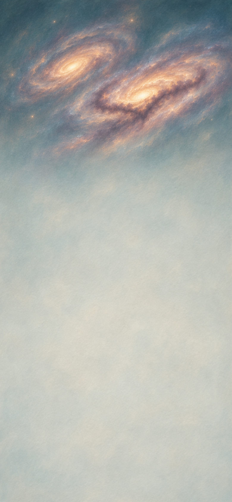

The old orange star will outlive the spiral that contains it. As two gas-rich galaxies draw through one another, its neighbours approach other stars; farther inward, a dark lane of gas approaches gas.

**Goals**
- What happens to the orange light? -- `bent-old-stream`
- Where does the gas go?
  - and: `a-collided-lane`
  - and: `a-hot-bridge`
  - and: `a-stretched-cloud`

**Hotspots**
- `a-stellar-outskirts` (center 390px, 675.2px)
  - icon: 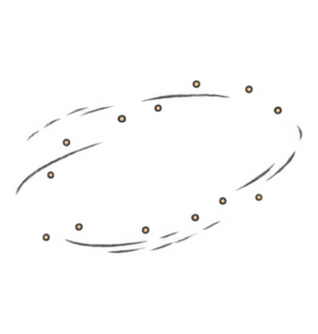

**Items**
- `a-old-stream` Stars around an old orange star

  The orange star has already shone for billions of years. Its neighbours share this part of the spiral, with immense spaces between them.

  - icon: 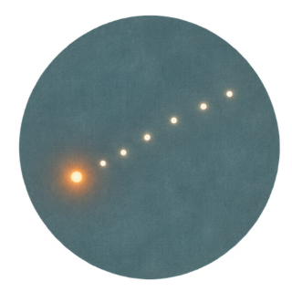 (circular)

- `a-stellar-outskirts` Outskirts of the other galaxy

  Stars fill this immense region sparsely. The approaching galaxy can bend their journeys without bringing their surfaces together. Its pull also differs across an extended cloud, stretching the cloud and drawing material beyond the old spiral.

- `a-lane-cloud` Dense gas in the dark lane

  An extended cloud of gas, threaded with inherited dust. Its darkest parts contain dense knots; much of its material is more loosely spread.

  - icon: 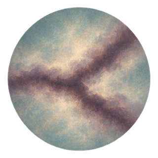 (circular)

- `a-crossing-cloud` Gas crossing the dark lane

  Gas from the other spiral moves into the lane. Unlike the stars, these extended clouds occupy much of the space through which they pass.

  - icon: 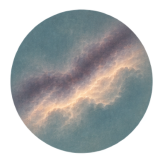 (circular)

- `a-loose-gas` Thin gas beside the dark lane
  - icon: 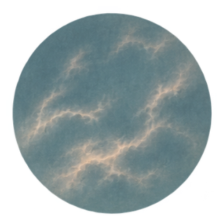 (circular)

- `a-outer-cloud` A cloud beyond the gas crossing
  - icon: 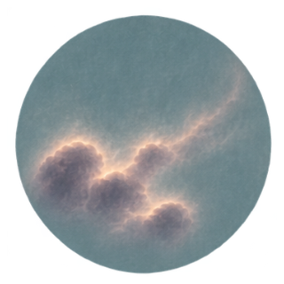 (circular)

- `bent-old-stream` Orange-star stream beyond the spiral

  The orange star is still shining. Almost every star passes between the other galaxy's stars, while their paths bend beyond the old spiral. A galaxy can lose its familiar shape without losing its lights.

  *Orange-star stream beyond the spiral*

  - icon: 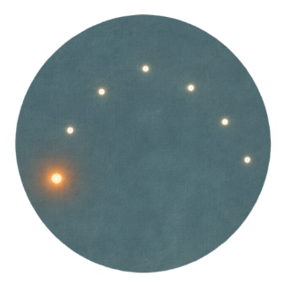 (circular)

- `a-collided-lane` Gas crowded into the dark lane

  The clouds cannot slip through one another as the stars did. Their collision compresses and heats the gas. Radiation carries heat away, allowing the denser parts to gather further. Only some of this great cloud will become stars.

  *Gas crowded into the dark lane*

  - icon: 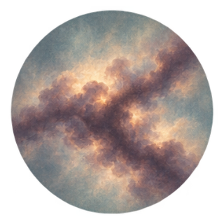 (circular)

- `a-hot-bridge` A broad bridge of hot gas

  The loosely spread gas is heated in the crossing too. It spreads into a broad bridge, too diffuse and hot to collapse promptly into stars. Different parts of this great volume will meet other clouds along the way.

  *A broad bridge of hot gas*

  - icon: 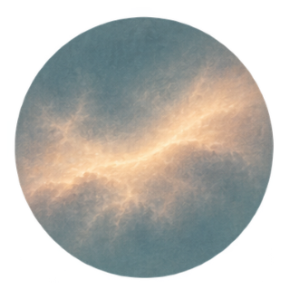 (circular)

- `a-stretched-cloud` Gas drawn out of the outer spiral

  This outer cloud misses the main gas collision. The unequal pull of the approaching galaxy stretches its surroundings and draws gas outward with the stars.

  Matter can leave a spiral arm without first being burned or broken.

  *Gas drawn out of the outer spiral*

  - icon: 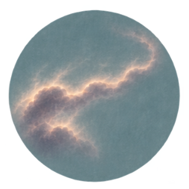 (circular)

**Combinations**
- `a-old-stream` [transform] @ `a-stellar-outskirts` -> `bent-old-stream` (tutorial)
- `a-lane-cloud` [transform] + `a-crossing-cloud` [consume] -> `a-collided-lane`
- `a-loose-gas` [transform] + `a-crossing-cloud` [consume] -> `a-hot-bridge`
- `a-outer-cloud` [transform] @ `a-stellar-outskirts` -> `a-stretched-cloud`

## `a-ch2` Many centres in the darkness

background: 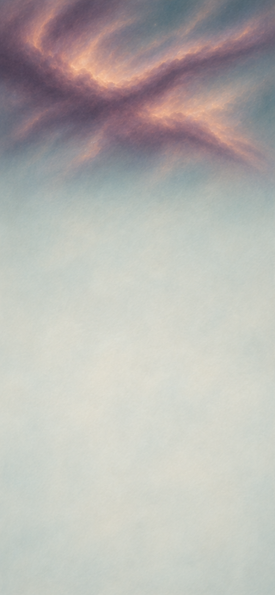

Inside the crowded lane, gas arrives in long ribbons. One ribbon feeds a broad gathering; another enters a separate, smaller knot with gas already moving around its centre.

**Goals**
- What can the large gathering become? -- `lane-born-stars`
- What forms around the smaller turning centre? -- `young-system`

**Hotspots**
- `a-collided-lane` (center 390px, 675.2px)
  - icon: 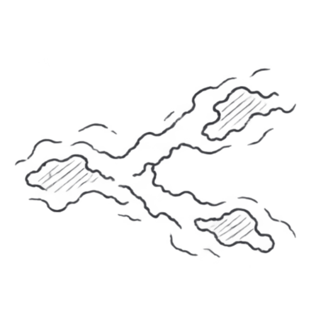

**Items**
- `a-cold-inflow` Cold gas entering the large gathering

  A long ribbon of cold gas enters a broad part of the crowded lane. Within that region, many centres are beginning to gather material.

  - icon: 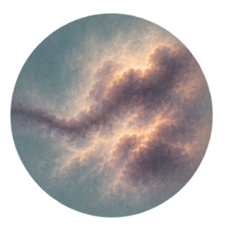 (circular)

- `a-dusty-inflow` Dusty gas entering the small turning knot

  Gas and inherited solid grains flow toward the smaller knot. The dust was already mixed through the cloud before the galaxies met.

  - icon: 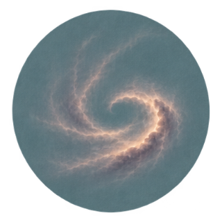 (circular)

- `a-thin-fringe` A thin cloud fringe

  Separate portions fringe the nursery and cross the smaller star's outgoing jet. Light can reach this gas; fast material can strike it too.
  - icon: 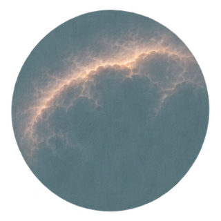 (circular)

- `lane-born-stars` Young stars from the dark lane

  The cold ribbon feeds many contracting centres, where falling matter releases light. As they gather more gas, their cores become hot enough for sustained hydrogen fusion to support the new stars. Dust still hides much of their light. The most massive will shine brilliantly and die early; smaller members can endure for billions of years.

  - icon: 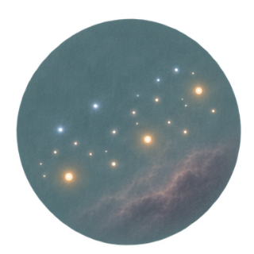 (circular)
  - from chapter `c-ch5` icon: 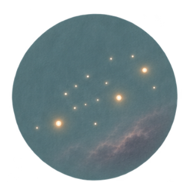 (circular)

- `young-system` Young star with a dusty disk

  The smaller turning knot contracts into a shining young star. Some incoming gas keeps circling, carrying inherited dust into its disk. The star will later settle into sustained hydrogen fusion; its planet-forming surroundings already exist. Here, matter from the dark lane continues circling outside the new light.

  - icon: 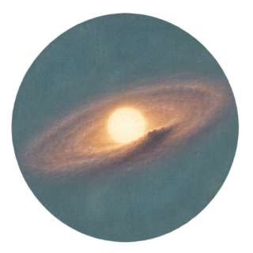 (circular)

**Combinations**
- `a-cold-inflow` [consume] @ `a-collided-lane` -> `lane-born-stars`
- `a-dusty-inflow` [consume] @ `a-collided-lane` -> `young-system`

## `a-ch3` The dark lane makes light

background: 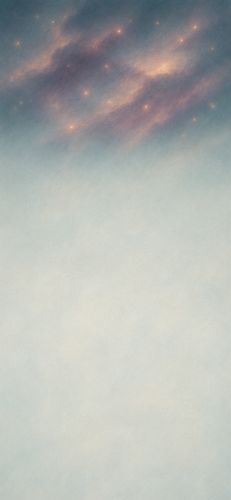

During these early millions of years, the old orange star travels beyond its former spiral. The new stars change the place that made them. Gas still falls into the smaller star's disk; nearby, loose gas and dense gas face the young population's fierce light.

**Goals**
- Find two ways to make the nearby gas shine
  - and: `a-bright-gas`
  - and: `a-jet-gas`
- What remains of the cloud that made them?
  - and: `outflowing-gas`
  - and: `a-dark-pillars`

**Items**
- `a-falling-gas` Gas falling toward the growing stars

  A continuing supply, divided among the established growing bodies. Some joins stars; some is redirected into outflows.

  - icon: 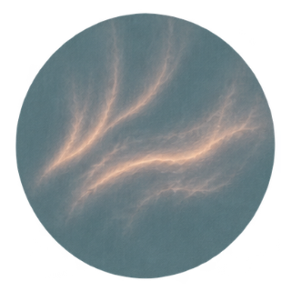 (circular)

- `a-falling-dusty-gas` Dusty gas falling into the smaller system

  Dusty gas continues falling toward the smaller star and disk. Some feeds their growth; some gas is redirected into their jet. The grains need not survive the hot launching region.
  - icon: 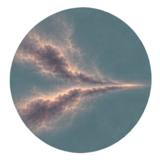 (circular)

- `a-narrow-jet` A narrow stream of gas from the young star

  While gas continues to fall toward the young star, part is launched outward in a narrow jet. Magnetic fields near the star and disk help guide that outflow. The growing system sends some of its incoming matter back into the cloud.

  *A narrow stream of gas from the young star*

  - icon: 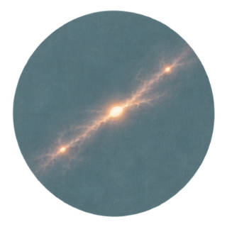 (circular)

- `a-jet-gas` Glowing gas where the jet strikes

  Gas in the narrow stream crashes into the cloud in its path. The shock heats the struck gas, making it glow where the stream meets it. These lights come from hot gas rather than another group of stars.

  *Glowing gas where the jet strikes*

  - icon: 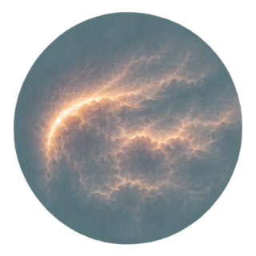 (circular)

- `a-bright-gas` Gas glowing around the new stars

  Radiation from the hottest young stars reaches the thin cloud fringe. Hydrogen loses electrons and shines as electrons are captured again. The stars have made part of their old surroundings luminous.

  *Gas glowing around the new stars*

  - icon: 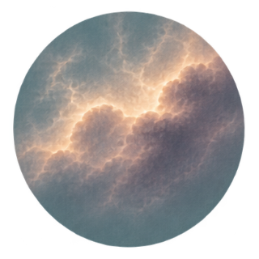 (circular)

- `a-loose-cloud` A loose cloud beside the stars
  - icon: 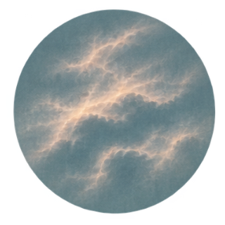 (circular)

- `a-dense-cloud` A dense cloud beside the stars
  - icon: 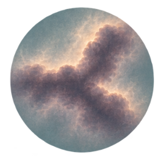 (circular)

- `a-dark-pillars` Dense cloud pillars

  The dense cloud's exposed surface erodes, but its thick interior shields material behind it. Dark pillars of gas remain where the surroundings have been cleared more quickly. Their exposed edges continue to wear away.

  *Dense cloud pillars*

  - icon: 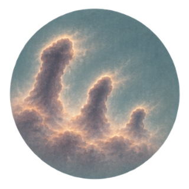 (circular)

- `outflowing-gas` Gas flowing out of the nursery

  The young stars heat the loose cloud, and their outflows drive into it. The gas expands and is swept away from the nursery; much of it will never become a star here. Beyond the new lights, this continuing flow meets the galaxy's wider gas.

  *Gas flowing out of the nursery*

  - icon: 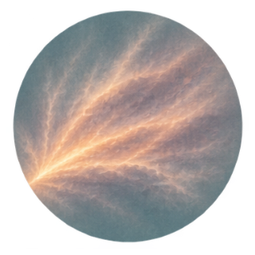 (circular)

**Combinations**
- `young-system` [preserve] + `a-falling-gas` [preserve] -> `a-narrow-jet`
- `young-system` [preserve] + `a-falling-dusty-gas` [preserve] -> `a-narrow-jet`
- `a-narrow-jet` [preserve] + `a-hot-bridge` [preserve] -> `a-jet-gas`
- `a-narrow-jet` [preserve] + `a-thin-fringe` [transform] -> `a-jet-gas`
- `lane-born-stars` [preserve] + `a-thin-fringe` [transform] -> `a-bright-gas`
- `lane-born-stars` [preserve] + `a-loose-cloud` [transform] -> `outflowing-gas`
- `lane-born-stars` [preserve] + `a-dense-cloud` [transform] -> `a-dark-pillars`

## `a-ch5` A tail beyond the spiral

background: 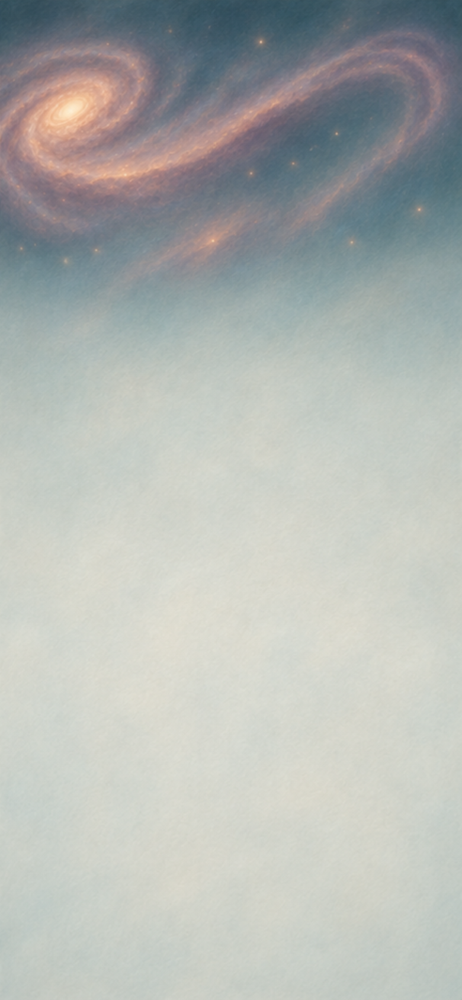

The outer cloud is becoming part of a long tail. Near its base, gas drawn from the disk meets gas coming out of the nursery: two ways to leave the same spiral.

**Goals**
- Can the surviving clumps gather again?
  - and: `tail-cloud`
  - and: `a-tail-knot`
- Where does the expelled gas go? -- `a-halo-gas`

**Hotspots**
- `a-hot-halo` (center 390px, 675.2px)
  - icon: 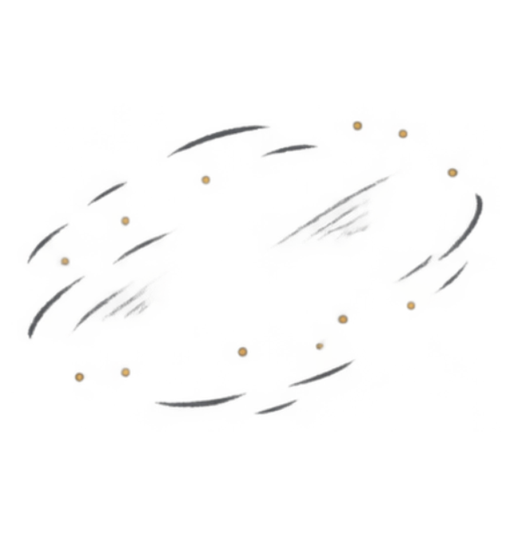

**Items**
- `a-tail-inflow` Cold gas flowing along the tail
  - icon: 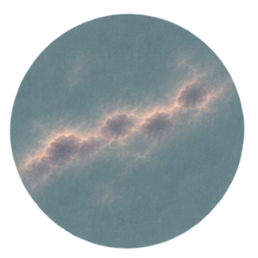 (circular)

- `a-hot-halo` The galaxy's thin, hot outer gas

  A broad region beyond the bright disk. It contains gas, though far less densely than the dark clouds in the spiral.

- `tail-cloud` Gas in the long tail

  The stretched outer cloud gathers with cold gas moving along the tail. The encounter has carried this material beyond the former bright extent of the spiral. Near the tail's base it meets gas driven out of the nursery, arriving by a different route.

  *Gas in the long tail*

  - icon: 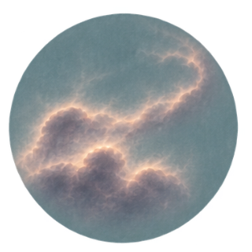 (circular)

- `a-mixed-wind` Nursery gas mixed into the outer stream

  Material driven out by young stars meets a portion of the hot bridge made in the first galactic crossing. Their collision and mixing bring those two histories together.

  A familiar-looking cloud need not have a single origin.

  *Nursery gas mixed into the outer stream*

  - icon: 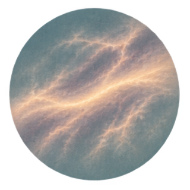 (circular)

- `a-torn-tail-edge` Gas stripped from the tail cloud's edge

  Where the outward stream meets the tail cloud, exposed material is torn away and mixed into the flow. Most of the cloud continues along the tail, while its stripped edge travels with the outgoing gas.

  *Gas stripped from the tail cloud's edge*

  - icon: 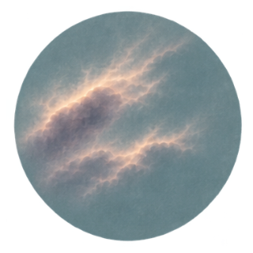 (circular)

- `a-carried-clumps` Dense clumps carried out of the nursery

  The outward flow erodes the old pillars and carries surviving clumps into the nearby tail-base region. They retain dense interiors for this part of their journey.

  *Dense clumps carried out of the nursery*

  - icon: 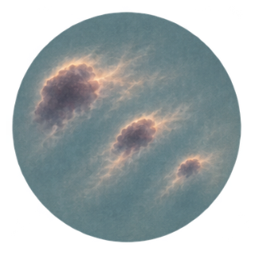 (circular)

- `a-tail-knot` A dense knot at the tail's base

  Cold gas gathers around the clumps carried from the old pillars. Material that resisted the first clearing becomes part of a new gathering outside the old nursery.

  *A dense knot at the tail's base*

  - icon: 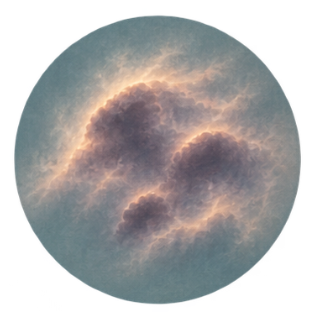 (circular)

- `a-halo-gas` Mixed gas dispersed into the outer galaxy

  Material from the outward stream, including gas it can strip from the tail, meets the thin outer gas and spreads. The clear outline of a cloud disappears. Its ingredients remain distributed through the galaxy's surroundings, where different portions can have later encounters.

  *Mixed gas dispersed into the outer galaxy*

  - icon: 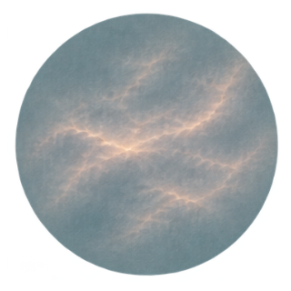 (circular)

**Combinations**
- `a-stretched-cloud` [transform] + `a-tail-inflow` [preserve] -> `tail-cloud`
- `outflowing-gas` [preserve] + `a-hot-bridge` [preserve] -> `a-mixed-wind`
- `tail-cloud` [preserve] + `a-mixed-wind` [preserve] -> `a-torn-tail-edge`
- `a-dark-pillars` [transform] + `outflowing-gas` [preserve] -> `a-carried-clumps`
- `a-carried-clumps` [transform] + `a-tail-inflow` [preserve] -> `a-tail-knot`
- `a-mixed-wind` [preserve] @ `a-hot-halo` -> `a-halo-gas`
- `a-torn-tail-edge` [transform] @ `a-hot-halo` -> `a-halo-gas`

## `a-ch6` Lights beyond the old edge

background: 

Near the tail's base, the clumps that survived the old nursery are gathering gas again. Dust near the dark-lane stars follows two other paths: some remains in their light, while some travels with their outflow.

**Goals**
- Can the surviving clumps become stars? -- `a-tail-stars`
- What becomes of the inherited dust?
  - and: `a-lit-dust`
  - and: `a-dust-poor-gas`

**Hotspots**
- `a-hot-halo` (center 390px, 675.2px)
  - icon: 

**Items**
- `a-tail-cold-cloud` A cold cloud beside the tail knot
  - icon: 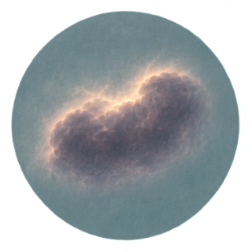 (circular)

- `a-outskirts-dust` Dusty gas near the nursery's outskirts

  Different portions of this broad dusty region lie near the stars and in the path of their outflow. The grains are inherited material, not newly manufactured dust.

  - icon: 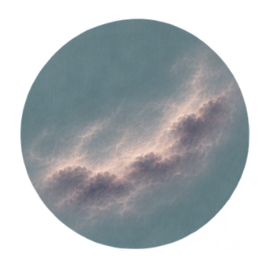 (circular)

- `a-tail-stars` Young stars at the tail's base

  The knot containing the old pillars' surviving clumps gathers with its neighbouring cold cloud. Over millions of years, part of this material contracts and begins sustained fusion, while surrounding gas remains outside the new stars. Clumps that endured the nursery's clearing have helped make new lights beyond its edge.

  *Young stars at the tail's base*

  - icon: 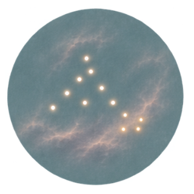 (circular)

- `a-dusty-outflow` Dust carried with the outward gas

  Outgoing gas overtakes the dusty material and carries grains with it. Some grains remain sheltered inside denser clumps for part of this journey; others become exposed as the flow erodes those clumps. Dust that was warmed by starlight can join the same outward journey.
  - icon: 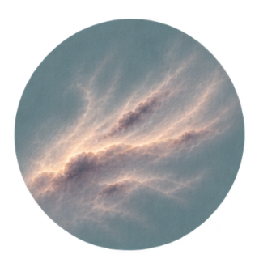 (circular)

- `a-lit-dust` Dust warmed by the dark-lane stars

  Near the original nursery, a portion of the dusty gas absorbs light from the stars born in the dark lane. Its grains warm and radiate much of that energy at infrared wavelengths.

  Gas can glow because its atoms are excited; solid grains can shine by radiating absorbed heat. Neither light requires another star to have formed in the cloud.

  *Dust warmed by the dark-lane stars*

  - icon: 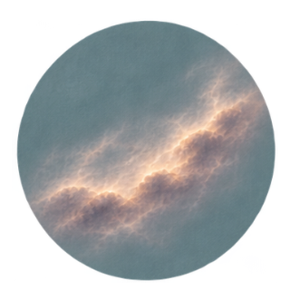 (circular)

- `a-dust-poor-gas` Outward gas with much of its dust destroyed

  Dust carried outward enters the hot outer surroundings. Collisions with fast particles gradually erode many grains, returning their material to the gas. Prior warming by starlight does not protect a grain from this later erosion.

  Of the inherited solids, some remain in the young star's disk, some are warmed near the nursery, and some cease to be solid grains.

  *Outward gas with much of its dust destroyed*

  - icon: 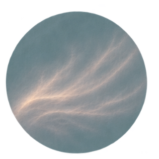 (circular)

**Combinations**
- `a-tail-knot` [transform] + `a-tail-cold-cloud` [consume] -> `a-tail-stars`
- `outflowing-gas` [preserve] + `a-outskirts-dust` [preserve] -> `a-dusty-outflow`
- `a-mixed-wind` [preserve] + `a-outskirts-dust` [preserve] -> `a-dusty-outflow`
- `a-lit-dust` [consume] + `outflowing-gas` [preserve] -> `a-dusty-outflow`
- `lane-born-stars` [preserve] + `a-outskirts-dust` [preserve] -> `a-lit-dust`
- `a-dusty-outflow` [transform] @ `a-hot-halo` -> `a-dust-poor-gas`

## `b-ch1` Grains against grains
background: 

Return to the first few million years, alongside the birth of the dark-lane stars. Around the smaller star, grains settle into a dusty disk and meet; the long history of rocky worlds is still ahead.

> NOTE: The imported young-system is the actual derived host. Warm-disk material belongs to that same system. Settled dust is a continuing reservoir; a destructive encounter does not restore an earlier unique clump. Rebuilding is optional, and both loose fragments and rebuilt clumps have useful later routes.

**Goals**
- Gather rocky pebbles in the warm disk -- `b-hard-pebbles`
- See what a hard collision leaves
  - either: `b-chipped-grains`
  - or: `b-rebuilt-clumps`

**Hotspots**
- `young-system` (center 195px, 675.2px)
  - icon: 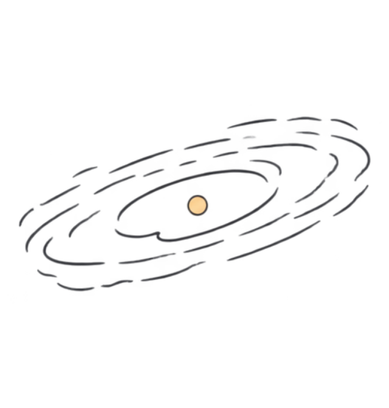
- `b-warm-disk` (center 585px, 675.2px)
  - icon: 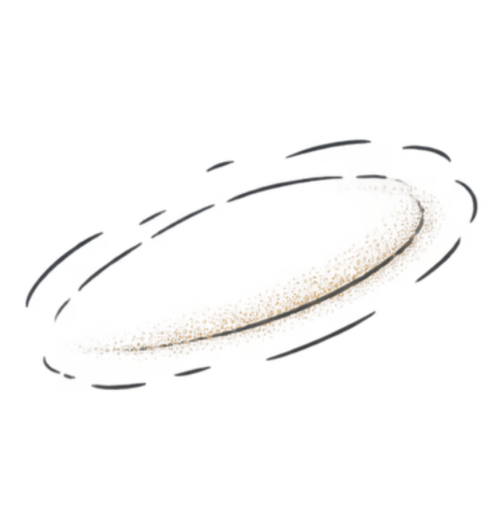

**Items**
- `b-falling-dust` Dust falling into the disk
  These inherited grains arrived with the gas that formed the smaller star. A little of that continuing inflow is still falling toward its disk.

  - icon: 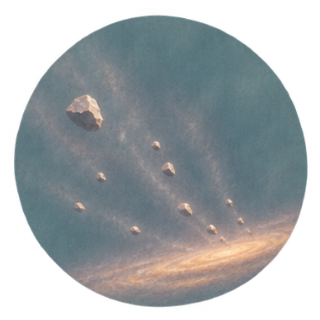 (circular)

- `b-slow-grains` Slowly meeting grains
  A neighboring supply of grains moving gently relative to one another. Several portions can take part in local encounters.

  - icon: 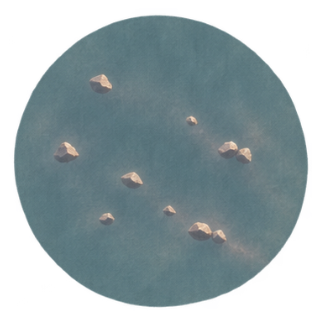 (circular)

- `b-fast-grains` Fast crossing grains
  A narrow stream crossing the slower material. Its speed relative to the loose clumps makes their collisions destructive.

  - icon: 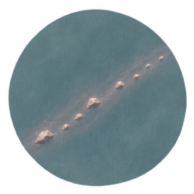 (circular)

- `b-icy-grains` Ice-coated grains moving inward
  These grains began farther out in this same disk. Gas drag is carrying them toward its warmer region.

  - icon: 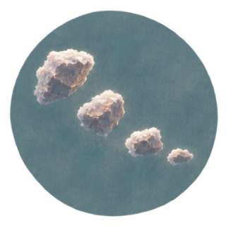 (circular)

- `b-warm-disk` Warm inner disk
  The smaller star's warm inner disk. Rock grains can remain here where their ice coatings cannot.

- `b-settled-dust` Dust settled into the disk
  The falling grains join the existing disk. Drag against its gas changes their motion, and much of this material settles toward the disk's crowded middle plane. Here, fresh grains mingle with fragments from earlier collisions.

  - icon:  (circular)

- `b-fluffy-clumps` Fluffy grain clumps
  Gentle encounters let small grains stick in open, fragile gatherings. They are not yet stones, and a harder encounter can undo them.

  - icon:  (circular)

- `b-chipped-grains` Grains from shattered clumps
  The fast grains strike the fragile gatherings. Much of their apparent growth comes apart: the same solid material is again divided among smaller pieces.

  - icon:  (circular)

- `b-dry-grains` Grains stripped of their ice
  As the inward-moving grains enter the warm disk, their ice evaporates into the surrounding gas. The rocky grains remain. The lost ice has changed phase, not vanished.

  - icon:  (circular)

- `b-hard-pebbles` Rocky pebbles
  Repeated gentle encounters build these dry grains into compact pebbles. They are still small bodies, held together where their grains touch; further sticking alone cannot carry them all the way to planets.

  - icon:  (circular)

- `b-rebuilt-clumps` Clumps rebuilt from fragments
  Broken grains meet fresh dust gently enough to stick again. The fragments gather into new loose clumps, returning some of the shattered material to larger forms.

  - icon:  (circular)

- `b-ground-icy-grains` Shattered ice-coated grains
  A fast encounter breaks the incoming icy grains before they reach the warm region. Smaller fragments still carry ice; fragmentation and evaporation are different ways to change the same material.

  - icon:  (circular)

**Combinations**
- `b-falling-dust` [consume] @ `young-system` -> `b-settled-dust`
- `b-settled-dust` [preserve] + `b-slow-grains` [consume] -> `b-fluffy-clumps`
- `b-fluffy-clumps` [transform] + `b-fast-grains` [consume] -> `b-chipped-grains`
- `b-icy-grains` [transform] @ `b-warm-disk` -> `b-dry-grains`
- `b-dry-grains` [consume] + `b-slow-grains` [consume] -> `b-hard-pebbles`
- `b-chipped-grains` [consume] + `b-settled-dust` [preserve] -> `b-rebuilt-clumps`
- `b-chipped-grains` [consume] + `b-slow-grains` [consume] -> `b-rebuilt-clumps`
- `b-icy-grains` [consume] + `b-fast-grains` [consume] -> `b-ground-icy-grains`
- `b-ground-icy-grains` [transform] @ `b-warm-disk` -> `b-dry-grains`

## `b-ch2` One world, a moon, and the pieces
background: 

In crowded bands of this same disk, the small solids begin to hold one another together. Follow one growing world and a smaller neighbour: their next collisions will leave very different gatherings.

> NOTE: The formation operation bundles selected gas-mediated concentration, gravitational collapse and elapsed accretion, not limitless sticking. The growing world has one linear identity through its impact and moon. b-shattered-body is a preserved fragment reservoir; b-rubble-pile is one actual required body drawn from a portion of it and survives for the later encounter. The giant-impact moon is a selected model, not Earth or its Moon.

**Goals**
- Give the surviving rocky world a moon -- `b-moon-world`
- Gather a small world from a shattered body's pieces -- `b-rubble-pile`

**Items**
- `b-gentle-body` Small bodies approaching slowly
  Rocky bodies travel on gently converging paths. Some approach the growing world; others cross clouds of fragments. Their low relative speeds favour encounters that retain much of the arriving mass.

  - icon:  (circular)

- `b-large-impactor` Large worlds approaching at different angles
  Large rocky bodies cross the inner disk on different paths. Some approach the growing world more directly; others graze its edge.

  - icon:  (circular)

- `b-metal-fragments` Metal-rich rocky fragments
  Fragments rich in metal, inherited with the disk's other solids. They carry material made before this young star was born.

  - icon:  (circular)

- `b-fast-stones` Fast rocky projectiles
  A population of fast stones and smaller rocky bodies crossing the inner worlds and debris. Individual portions strike different targets; survivors remain among the planets for later encounters.

  - icon:  (circular)

- `b-slow-orbital-rubble` Rubble already orbiting the struck world
  A small supply of rubble already circles the rocky world. It moves in the same direction as the impact debris, with relative speeds low enough for repeated collisions to gather material.

  - icon:  (circular)

- `b-rocky-bodies` A population of rocky bodies
  Rocky pebbles mingle with fragments or rebuilt clumps in a crowded, gas-rich band. Drag between gas and solids concentrates them until dense patches collapse under their own gravity. Many rocky bodies emerge, large enough to hold other matter nearby.

  - icon:  (circular)

- `b-growing-world` A young rocky world
  One of the newly formed rocky bodies meets a slower incoming body and keeps much of its material. Through this and further encounters, it grows into a rocky world.

  - icon:  (circular)

- `b-molten-world` The rocky world with a molten interior
  A large rocky body strikes the growing world, leaving much of its material behind. The impact releases enough energy to melt a substantial part of the enlarged world's interior.

  - icon:  (circular)

- `b-layered-world` The rocky world with a dense core
  Metal-rich fragments join the hot world. Within its molten regions, dense metal sinks while lighter rock remains above. As the material settles and the world loses heat, a dense core takes shape.

  - icon:  (circular)

- `b-shattered-body` Fragments of a shattered small body
  Fast rocky projectiles strike a smaller member of the rocky population. Its weaker binding allows the impact to break it apart. Some fragments can gather again; others remain on paths between the planets, eventually crossing the giant's rings.

  - icon:  (circular)

- `b-rubble-pile` A small world held together as rubble
  Some of the shattered body's fragments meet a slowly approaching rocky body. Repeated low-speed collisions and gravity gather them into a loose, bound world. Other fragments remain scattered between the planets.

  - icon:  (circular)

- `b-impact-world` The struck world inside an orbiting debris cloud
  Another large body grazes the hot rocky world. Some of both bodies joins the survivor; some rock enters orbit around it. The enlarged world turns within a cloud of its own and the impactor's debris.

  - icon:  (circular)

- `b-moon-world` The rocky world with a small moon
  Orbiting rubble meets the impact debris. Far enough from the world for loose clumps to hold together, repeated collisions and gravitational gathering build a small moon. Other fragments fall back or escape.

  - icon:  (circular)

- `b-metal-coated-body` A rocky body with metal-rich surface rubble
  Metal-rich fragments strike and accumulate on a separate small body that remains mostly solid. The added metal stays mixed through surface rubble instead of sinking promptly into a deep core. The material alone does not determine the interior.

  - icon:  (circular)

**Combinations**
- `b-hard-pebbles` [consume] + `b-rebuilt-clumps` [consume] -> `b-rocky-bodies`
- `b-hard-pebbles` [consume] + `b-chipped-grains` [consume] -> `b-rocky-bodies`
- `b-rocky-bodies` [consume] + `b-gentle-body` [consume] -> `b-growing-world`
- `b-growing-world` [transform] + `b-large-impactor` [consume] -> `b-molten-world`
- `b-molten-world` [transform] + `b-metal-fragments` [consume] -> `b-layered-world`
- `b-layered-world` [transform] + `b-large-impactor` [consume] -> `b-impact-world`
- `b-molten-world` [transform] + `b-large-impactor` [consume] -> `b-impact-world`
- `b-impact-world` [transform] + `b-slow-orbital-rubble` [consume] -> `b-moon-world`
- `b-rocky-bodies` [consume] + `b-fast-stones` [consume] -> `b-shattered-body`
- `b-shattered-body` [preserve] + `b-gentle-body` [consume] -> `b-rubble-pile`
- `b-rocky-bodies` [consume] + `b-metal-fragments` [consume] -> `b-metal-coated-body`

## `b-ch3` The world that takes the gas
background: 

The view returns to the first few million years of this same disk, before most of its gas escaped. Farther from the star, ice adds to a large solid gathering; the surrounding gas gives that body a future unlike the inner rocky world's.

> NOTE: The explicit return in time keeps early gas-giant formation distinct from the longer rocky-impact history. The cold-ring operation bundles a selected sufficiently massive concentration and accretion history; a ring alone does not guarantee a core. Gas capture and radiative cooling form one complete core-accretion operation. icy-survivors is a distinct selected set of bound scattered bodies, made before the giant's later retirement into ringed-giant.

**Goals**
- Let the large outer body encounter the disk's gas -- `b-giant`
- Follow what gathers around the giant and what travels beyond it
  - both: `b-loose-moon`
  - and: `icy-survivors`

**Hotspots**
- `b-cold-drift` (center 195px, 675.2px)
  - icon: 
- `b-giant` (center 585px, 675.2px)
  - icon: 

**Items**
- `b-frosty-dust` Frost-coated dust
  Inherited grains fill this part of the outer disk. Their ice coating stays solid in the colder surroundings. Grains can gather onto stones or coat fragments after a collision.

  - icon:  (circular)

- `b-small-stones` Small outer-disk stones
  Rocky fragments already present among the outer grains. These are a separate material portion from the inner pebbles.

  - icon:  (circular)

- `b-cold-drift` Cold ring where icy solids collect
  Gas pressure is higher in this cold ring than on either side, so drifting solids collect here. The ring holds a large supply of ice and rock; gas drag can crowd it into dense patches where gravity begins to draw the solids together.

- `b-cool-disk-gas` Cold gas around the outer body
  Cold gas flows through the outer body's neighbourhood. Some can settle onto the growing body; other portions approach with enough sideways motion to keep circling it.

  - icon:  (circular)

- `b-planet-dust` Dust near the outer body
  Inherited grains remain near the growing outer body. As gas settles into a disk around the giant, separate portions enter that flow or are swept up by the moons growing within it.

  - icon:  (circular)

- `b-moon-ice` Slow ice-rich pieces around the giant
  A population of ice-rich pieces and loose rubble on gently converging paths within the giant's cold outer disk. Different portions join moonlets or meet later fragments beyond the close, disruptive region.

  - icon:  (circular)

- `b-near-giant-bodies` Icy bodies passing near the giant
  A separate subset of the same disk's outer solid population. Their approaching paths take them through the giant's gravitational surroundings without physically striking it.

  - icon:  (circular)

- `b-icy-pebbles` Icy pebbles
  Frost-coated dust gathers on the small stones. The resulting pebbles contain both rock and ice.

  - icon:  (circular)

- `b-icy-core` A large ice-and-rock body
  The outer pebble population drifts into the cold gas ring and becomes strongly concentrated. Dense patches form bodies that gather nearby solids over time. One substantial body of ice and rock emerges. Its mass matters when it encounters the gas still surrounding it.

  - icon:  (circular)

- `b-giant` A young gas giant
  The large solid body binds some of the cold surrounding gas. The growing envelope radiates energy, permits further gas to settle, and undergoes rapid growth while the reservoir lasts. The earlier solid body is now deep inside this giant planet.

- `b-planet-disk` Gas circling the young giant
  Some surrounding gas enters the young giant's gravitational reach with enough sideways motion to keep circling. It settles into a small disk around the planet. Incoming solids can gather in different parts of this circling gas.

  - icon:  (circular)

- `b-rock-moon-material` A dusty disk around the giant
  Dust joins part of the gas circling the planet. The small disk now carries these fine grains alongside any larger pieces of ice and rock that arrive. Its solids can feed growing moons.

  - icon:  (circular)

- `b-loose-moon` A small moon made of loose rubble
  Slow ice-and-rock pieces enter the disk around the giant. Through concentration, repeated encounters and gravitational gathering, one portion becomes a weakly bound moon. Fine dust may already have joined the disk, or the incoming pieces may supply the necessary solids themselves. This moon begins just outside the region where the giant's unequal pull would disrupt it.

  - icon:  (circular)

- `icy-survivors` Icy bodies beyond the planets
  The giant redirects the approaching icy bodies. These bodies remain bound to the star on long orbits reaching beyond the planets. Far from the young sun, their inherited ice continues circling with them.

  - icon:  (circular)

**Combinations**
- `b-frosty-dust` [preserve] + `b-small-stones` [consume] -> `b-icy-pebbles`
- `b-icy-pebbles` [transform] @ `b-cold-drift` -> `b-icy-core`
- `b-icy-core` [transform] + `b-cool-disk-gas` [preserve] -> `b-giant`
- `b-cool-disk-gas` [preserve] @ `b-giant` -> `b-planet-disk`
- `b-planet-disk` [preserve] + `b-planet-dust` [consume] -> `b-rock-moon-material`
- `b-planet-disk` [preserve] + `b-moon-ice` [consume] -> `b-loose-moon`
- `b-rock-moon-material` [preserve] + `b-moon-ice` [consume] -> `b-loose-moon`
- `b-near-giant-bodies` [transform] @ `b-giant` -> `icy-survivors`

## `b-ch4` Too close to remain a moon
background: 

Now follow that outer planet forward. A small impact changes the loose moon's close approach, while farther material has room to gather: can the same giant have both a ring and another moon?

> NOTE: The ring is a selected hypothetical tidal-disruption origin, not an established origin claim about Saturn. Impact direction, weak binding and pericenter must fit the model. The actual b-giant retires into the movable ringed-giant after its required scattering use. The separate outer moon is not made from the same unique close moon; it uses another portion of the planet's disk. Cratering it is optional.

**Goals**
- Follow the loose moon through its close approach -- `ringed-giant`
- Gather a moon farther from the giant -- `b-outer-small-moon`

**Hotspots**
- `b-giant` (center 390px, 675.2px)
  - icon: 

**Items**
- `b-inward-impactor` A small impactor meeting the moon head-on
  A separate small body meets the rubble moon head-on. The moon already orbits just outside the region where the giant would pull it apart; this impact gives a modest backward push while leaving a bound remnant.

  - icon:  (circular)

- `b-moon-stones` Stones within the giant's small disk
  A population of small rocky solids orbiting this giant. Separate portions meet the moon-making disk and later outer fragments gently enough to gather with them.

  - icon:  (circular)

- `b-moon-projectiles` Fast stones crossing the moons
  Small stones cross the orbits of the giant's moons. Their effects depend on the target's size and how strongly it holds together.

  - icon:  (circular)

- `b-close-moon` The loose moon on a dangerously close path
  The impact changes the rubble moon's orbit. Some material is stripped immediately, and the surviving loose body approaches much nearer to the giant.

  - icon:  (circular)

- `ringed-giant` Giant planet with rings
  The close-passing rubble moon enters a region where the giant's unequal pull overwhelms its weak binding. Some pieces stay on close orbits where they cannot gather into another moon; collisions spread and flatten them into rings around the giant. The view now follows that whole outer planet. Material farther away can remain gathered as a separate moon.

  - icon:  (circular)

- `b-outer-small-moon` A small outer moon
  Incoming stones gather in an outer portion of the giant's gas disk, with any dust already mixed through it. Repeated encounters leave a small moon well beyond the strongly disruptive inner region. Farther from the giant, this new companion has room to hold together.

  - icon:  (circular)

- `b-scarred-rock-moon` The outer moon with fresh craters
  Fast stones strike the small outer moon. In this encounter it stays intact, with new craters and redistributed surface rubble. The close moon's loss of form is not the fate of every companion.

  - icon:  (circular)

**Combinations**
- `b-loose-moon` [transform] + `b-inward-impactor` [consume] -> `b-close-moon`
- `b-close-moon` [consume] @ `b-giant` [transform] -> `ringed-giant`
- `b-rock-moon-material` [preserve] + `b-moon-stones` [consume] -> `b-outer-small-moon`
- `b-planet-disk` [preserve] + `b-moon-stones` [consume] -> `b-outer-small-moon`
- `b-outer-small-moon` [transform] + `b-moon-projectiles` [consume] -> `b-scarred-rock-moon`

## `b-ch5` A system inside the encounter
background: 

Across this system's history, the giant takes its gas and the original disk thins early; the rocky world's large impacts continue much longer. Follow the early escaping gas alongside the later world that keeps its moon.

> NOTE: The host, followed moon-bearing world, outer giant, distant ice, rubble world and between-planets debris are separate selections within one system. b-dusty-outflow is required and must subsequently enter the neighbouring cold cloud. The existing b-shattered-body is the continuing rocky debris reservoir; there is no additional recipe just to redistribute and rename it. The two displayed episodes have explicitly different times: early disk loss and later rocky impacts. The moon-bearing world meets the existing fast-stone supply directly and remains one world with its moon. The earlier host is retained in the history, rather than being consumed to manufacture a system view.

**Goals**
- Bring the rocky world through its disk's remaining stones -- `rocky-system`
- Follow the early disk material back into the galaxy -- `b-dusty-outflow`

**Hotspots**
- `b-exposed-disk` (center 390px, 675.2px)
  - icon: 

**Items**
- `b-fast-stones` Fast rocky projectiles
  A population of fast stones and smaller rocky bodies crossing the inner worlds and debris. Individual portions strike different targets; survivors remain among the planets for later encounters.

- `b-exposed-disk` Exposed inner disk
  The young star's inner disk is thinning. Starlight heats its exposed gas and arriving icy bodies; sufficiently small dust grains are also readily driven outward.

- `b-lingering-gas` Exposed gas carrying small dust grains
  A remaining mixed portion of the original disk: tenuous gas with very small grains suspended through it. Planets have not taken all the birth material.

  - icon:  (circular)

- `rocky-system` Moon-bearing world after the impacts

    Fast stones strike the same moon-bearing world. Some join its surface; others break and scatter. Craters mark the encounters, while the world keeps its moon and continues around the young sun.

  - icon:  (circular)

- `b-dusty-outflow` Disk material returned to the surroundings
  Early in the system's history, stellar radiation heats the exposed disk gas while drag and radiation alter the small grains' motion. This mixed portion escapes into the surrounding nursery. Gas and dust are leaving while the retained rocky bodies still have long histories of collision ahead of them.

  - icon:  (circular)

**Combinations**
- `b-moon-world` [transform] + `b-fast-stones` [consume] -> `rocky-system`
- `b-lingering-gas` [consume] @ `b-exposed-disk` -> `b-dusty-outflow`

## `c-ch1` What the young stars leave outside
background: 

Follow the early disk outflow to a cold cloud beside the nursery. Across the wider view, the orange star still travels along the stretched stellar stream; beneath it, the tail cluster and nursery outflow are changing gas that never entered their stars.

> NOTE: This scene follows concurrent processes during the long separation. a-tail-stars, tail-cloud, outflowing-gas and b-dusty-outflow are actual earlier results. The disk export is the sole producer of the required dust-rich cloud; its promised handoff cannot be satisfied by a different parcel. A complete cluster-feedback operation includes illumination, heating, winds and gas swept into a shell. The cold neighbouring cloud contains surviving grain seeds and radiates the added heat; most surrounding gas remains hot and dilute. Sources and limits are recorded in research.md. Later cluster survival is one selected possible outcome: https://science.nasa.gov/missions/hubble/nasas-hubble-traces-string-of-pearls-star-clusters-in-galaxy-collisions/ .

**Goals**

- What do the new stars change outside their birthplace?
    - both: `c-tail-shell`
    - and: `c-wind-born-stars`
- Where does the disk's departing material go? -- `c-dust-rich-cloud`

**Items**

- `tail-cloud` Gas in the long tail
- `a-tail-stars` Young stars at the tail's base
- `outflowing-gas` Gas flowing out of the nursery
- `c-cold-neighbour` Cold dusty cloud beside the nursery
    A large, dense cloud lies at the nursery's boundary with its thin surroundings. It contains surviving grain seeds. Different parts meet the outgoing nursery flow and material escaping the small planetary disk. In a limited mixture, radiation can remove heat while most surrounding gas remains hot and dilute.
  - icon:  (circular)

- `c-tail-shell` Swept-up shell beyond the cluster
    The tail cluster lights and heats the gas around it. Expanding hot gas and stellar winds push into the surrounding cloud, sweeping a dense rim ahead of them. The stars remain behind while their influence reaches farther into the tail.
  - from chapter `c-ch5`: Gas once swept into the tail shell

  - icon:  (circular)
  - from chapter `c-ch5` icon:  (circular)

- `c-wind-born-stars` Stars born in the outflow's path
    The nursery's outflow strikes the dense neighbouring cloud. After shock heating, crowded portions radiate energy, contract and form stars. Only part of the material does so. A flow that ended one gathering has helped another begin.
  - icon:  (circular)

- `c-dust-rich-cloud` Disk material in a cold cloud
    Gas and dust escaping the small planetary disk meet the dense neighbouring cloud. The mixture radiates the added heat, allowing some disk grains to survive. Atoms gather on these and other surviving seeds. Matter that passed the growing planets has joined another cold gathering.
  - from chapter `c-ch5`: Cold gas carrying the disk's lost matter

  - icon:  (circular)
  - from chapter `c-ch5` icon:  (circular)

**Combinations**

- `tail-cloud` [preserve] + `a-tail-stars` -> `c-tail-shell`
- `outflowing-gas` [preserve] + `c-cold-neighbour` -> `c-wind-born-stars`
- `b-dusty-outflow` [transform] + `c-cold-neighbour` [preserve] -> `c-dust-rich-cloud`

## `c-ch3` The unfinished system
background: 

Around the young star, the worlds are no longer growing rapidly. Loose rocky fragments pass between the inner worlds and across the giant's rings. The giant can send distant ice inward; collisions with that ice can scatter mixed pieces across a world's path.

> NOTE: All four imported objects belong to the same previously made planetary system. rocky-system is the followed moon-bearing world; ringed-giant is the distinct outer planet; icy-survivors and b-shattered-body are separate material reservoirs. A recipe using the giant preserves that planet. The transformed rocky-system remains the same world and moon; its earlier host continues in the setting. Giant-planet scattering and debris: https://science.nasa.gov/universe/exoplanets/giant-exoplanet-hunters-look-for-debris-disks/ . Comet sublimation: https://science.nasa.gov/solar-system/comets/ . Collisional dust: https://www.nasa.gov/missions/new-horizons/nasas-new-horizons-detects-dusty-hints-of-extended-kuiper-belt/ . These are selected encounters among orbit-crossing portions, not a claim that all ice migrates inward or all impact water is retained.

**Goals**

- Where can the giant send the old ice? -- `c-cratered-system`
- What becomes of matter that missed the worlds? -- `c-lit-dust`

**Hotspots**

- `c-warm-inner-system` (center 390px, 675.2px)
  - icon: 

**Items**

- `rocky-system` Moon-bearing world after the impacts
- `icy-survivors` Icy bodies beyond the planets
- `ringed-giant` Giant planet with rings
- `b-shattered-body` Fragments of a shattered small body
- `c-warm-inner-system` Warm space between the rocky worlds
    The young star warms the space between its rocky worlds. Icy bodies passing through this region expose their cold surfaces to stronger starlight. Leftover rocky fragments also cross one another here, meeting at speed.
- `c-inward-comets` Icy bodies sent toward the star
    Close passages by the giant send some icy bodies toward the star. They carry their ice into warmer regions along different paths: some through open space, others across debris or the rocky worlds' orbits.
  - icon:  (circular)

- `c-ice-fragments` Broken pieces of ice and stone
    An inward-moving icy body meets rocky debris at speed. The collision scatters mixed pieces onto new paths, including some that cross the moon-bearing world. They contain both old ice and newly incorporated stone; pieces that miss the world can warm in the space between planets.
  - icon:  (circular)

- `c-comet-dust` Dust and gas released from warming ice
    Exposed ice turns to gas in the star's warmth, freeing embedded grains. The solid body need not melt into a puddle first. A small cold remnant can trail an immense, thin cloud.
  - icon:  (circular)

- `c-cratered-system` Moon-bearing world with new craters

    Inward-moving icy bodies or their broken pieces strike the same rocky world. New craters mark its surface; ice becomes vapour, and some material escapes. The world keeps its moon and its sun. Delivery of ice has not promised an ocean.

  - icon:  (circular)

- `c-ring-spray` Ice spray above the giant's rings
    A small rocky impact into the rings sends fine icy fragments above their thin plane. The giant remains intact. Even an apparently smooth ring is material in continual motion and collision.
  - icon:  (circular)

- `c-rock-dust` Fine dust from colliding stones
    Leftover stones collide repeatedly. Large fragments become smaller ones, and some become dust. The material that failed to become a planet has acquired a different way to fill the space between worlds.
  - icon:  (circular)

- `c-lit-dust` A faint dust glow between the worlds
    Grains from stony collisions and warming icy bodies mingle in the same inner region. They scatter the young star's light. The worlds are separated by enormous spaces, but those spaces are not entirely empty.

  - icon:  (circular)

**Combinations**

- `icy-survivors` [preserve] + `ringed-giant` -> `c-inward-comets`
- `c-inward-comets` [consume] + `b-shattered-body` [preserve] -> `c-ice-fragments`
- `c-ice-fragments` [transform] @ `c-warm-inner-system` -> `c-comet-dust`
- `c-inward-comets` [consume] @ `c-warm-inner-system` -> `c-comet-dust`
- `c-inward-comets` [consume] + `rocky-system` [transform] -> `c-cratered-system`
- `c-ice-fragments` [consume] + `rocky-system` [transform] -> `c-cratered-system`
- `b-shattered-body` + `ringed-giant` -> `c-ring-spray`
- `b-shattered-body` @ `c-warm-inner-system` -> `c-rock-dust`
- `c-comet-dust` [transform] + `c-rock-dust` [consume] @ `c-warm-inner-system` -> `c-lit-dust`

## `e-ch1` The distances inside the lights
background: 

Inside the cluster born at the tail's base, stars pass closer together than they do across most of the galaxy. Some already travel in pairs: wide companions, close companions, and pairs with one star much smaller than the other.

> NOTE: a-tail-stars is the actual derived population, used as a physical receiving region. Each new primitive below identifies particular existing members within it; none supplies another population or permits an operation without the derived cluster. The receiver supplies actual passing stars or an existing close pair, not a portable force. These are selected outcomes of stellar encounters. Wide-pair disruption: Geller et al., https://arxiv.org/abs/1310.1085 . Binary–single ejection and exchange: McMillan and Hut, https://arxiv.org/abs/astro-ph/9604015 ; Heggie, Hut and McMillan, https://arxiv.org/abs/astro-ph/9604016 . The pair that tightens in the ejection is distinct from both other followed pairs.

**Goals**

- What can separate two stars without breaking them? -- `e-separated-stars`
- Follow the encounters with closer companions
    - both: `e-escaping-star`
    - and: `e-exchanged-pair`

**Hotspots**

- `a-tail-stars` (center 390px, 675.2px)
  - icon: 

**Items**

- `a-tail-stars` Young stars at the tail's base
- `e-wide-pair` Wide companions beside a passing cluster star
    Two stars in the tail cluster circle one another at a great distance. Another cluster star is approaching the space between them.
  - icon:  (circular)

- `e-single-star` Cluster star approaching a close pair
    Elsewhere in the tail cluster, a single star approaches two stars circling tightly around one another.
  - icon:  (circular)

- `e-unequal-pair` Unequal pair beside a heavier cluster star
    Two other cluster members circle together. A heavier third star approaches their lighter companion.
  - icon:  (circular)

- `e-separated-stars` Former companions travelling apart
    The passing star changes the companions' motions differently. Their wide binding breaks, although neither star is struck. They continue shining along separate paths through the cluster.

    Two stars have survived. Their pair has not.
  - icon:  (circular)

- `e-escaping-star` Star leaving the tail cluster
    The single star passes close to the moving pair without touching either surface. The encounter leaves the pair more tightly bound and gives the single star enough motion to escape the cluster. Still held by the galaxy, it travels toward the neighbourhood of the old nursery.
  - from chapter `e-ch2`: Cluster star passing the distant ice

  - icon:  (circular)

- `e-exchanged-pair` Star pair with a new companion
    The heavier newcomer remains bound to one member of the original pair. The lighter former companion departs. Three stars still shine, but a different two now circle together.

  - icon:  (circular)

**Combinations**

- `e-wide-pair` [transform] @ `a-tail-stars` -> `e-separated-stars`
- `e-single-star` [transform] @ `a-tail-stars` -> `e-escaping-star`
- `e-unequal-pair` [transform] @ `a-tail-stars` -> `e-exchanged-pair`

## `e-ch2` What the outer paths lose
background: 

The little rubble world made among the young planets follows a crossing path toward the giant. Much farther out, the departing cluster star approaches the system's distant ice. This is a slow outer encounter; the sun, its main planets and the giant's moons lie well inside it.

> NOTE: The main system's bodies are not resupplied or transformed. b-rubble-pile is the actual unique goal result from b-ch4; its earlier impact history permits a crossing orbit, but weak internal cohesion does not weaken its stellar binding. Its giant encounter first sends it onto a distant bound orbit. The subsequent outer stellar passage unbinds that body and transfers a different subset of icy-survivors. Both outcomes concern material at hundreds of AU, with the main giant at a few AU. This scale separation is essential; do not illustrate the passer beside the giant or inside its moon system. A selected orientation and orbital phases are required, rather than an assertion that every such passage has both outcomes. Flyby ejection and capture of planetesimals: Pfalzner et al., https://arxiv.org/abs/2104.06845 ; Jilkova et al., https://arxiv.org/abs/1601.08171 . The latter demonstrates retained, ejected and transferred portions in one selected outer encounter. The modest few-km/s relative passage is a selected case, not an accepted history of the Solar System. No precise transfer rate or complete numerical realization of this fictional system is asserted.

> NOTE: The derived e-escaping-star is now the fixed physical receiver. Its earlier creation is required; this is not a new primitive passing star. The icy reservoir is extensive: only one selected portion transfers, while the original reservoir remains for the main story. The transfer result represents only the icy bodies; their new host is the same separately retained fixed star, used as the physical receiver for this selected transfer. Different outer orbital phases and approach geometry, not rock versus ice, distinguish the ejected and captured portions. The later thermal step was cut rather than asserting a fresh volatile surface after the earlier giant encounter.

**Goals**

- Can the little rubble world keep its sun? -- `e-unbound-rubble`
- Can the distant ice acquire a different star? -- `e-transferred-ice`

**Hotspots**

- `e-escaping-star` (center 390px, 675.2px)
  - icon: 

**Items**

- `b-rubble-pile` A small world held together as rubble
  - from chapter `e-ch2`: Rubble world passing the giant
- `ringed-giant` Giant planet with rings
- `icy-survivors` Icy bodies beyond the planets
- `e-escaping-star` Star leaving the tail cluster
- `e-distant-rubble` The rubble world far beyond the planets
    The rubble world passes the moving giant at a distance that leaves its loose stones together. The encounter sends it onto a long orbit far beyond the planets, into the region through which the cluster star is passing. The little world is still held by its sun, but much less tightly than before. Behind it, the giant keeps its rings and moons.
  - icon:  (circular)

- `e-unbound-rubble` The rubble world without a sun
    Far from the planets, the little world passes near the other star. The encounter gives it enough motion to leave its original sun without binding it to the passer. Its stones remain together as it travels through the galaxy without a sun of its own.
  - icon:  (circular)

- `e-transferred-ice` Old icy bodies circling the passing star
    Some distant icy bodies leave the young sun and become bound to the passing cluster star; most of the ice stays with its original sun. Both stars take part in the encounter, exchanging energy with the passing bodies. Their starting positions and motions lead to capture, while the rubble world's path leads to escape. Pieces of one star's birth disk now travel around another star.
  - icon:  (circular)

**Combinations**

- `b-rubble-pile` [transform] + `ringed-giant` [preserve] -> `e-distant-rubble`
- `e-distant-rubble` [transform] @ `e-escaping-star` -> `e-unbound-rubble`
- `icy-survivors` [preserve] @ `e-escaping-star` -> `e-transferred-ice`

## `e-ch3` When the surfaces meet
background: 

Back in the tail cluster, the changed pair still circles together. Another star passes close enough to disturb their paths. This encounter reaches a distance that the earlier ones did not.

> NOTE: The actual exchanged pair proves the cluster lineage of this encounter. The new incoming star is a separately identified member of the same existing cluster; it is neither the escaped star nor the departed small companion. The two members of the pair merge in a selected three-star encounter, while the intruder departs. This is a rare local surface collision, not the normal outcome of galaxy overlap or every binary interaction. Hydrodynamic stellar mergers need not fully mix their fuel or reset their lifetime: https://arxiv.org/abs/1307.2445 . Three-star scattering can lead to mergers: https://arxiv.org/abs/astro-ph/9604015 . No supernova, fresh elemental yield, remnant mass or remaining lifetime is specified.

> NOTE: e-merger-star is one star with an associated reservoir of expanding ejecta. Its later preserved use follows a portion of that ejecta into tail-cloud; it neither ejects the whole star nor supplies a new primitive gas shell. Keep the remnant visible as a distinct stellar point after that operation. The broad tail-cloud is the actual earlier reservoir and remains available; its interacted portion is represented by e-merger-shell.

**Goals**

- Follow the pair through the closer encounter -- `e-merger-star`
- Follow matter that the meeting stars do not retain -- `e-merger-shell`

**Items**

- `e-exchanged-pair` Star pair with a new companion
- `tail-cloud` Gas in the long tail
- `e-close-intruder` Another cluster star passing close to the pair
    One more member of the tail cluster approaches the changed pair. Its close passage can bend the two companions' paths toward one another.
  - icon:  (circular)

- `e-merger-star` One larger star inside expanding gas
    During this encounter, the pair's two stars meet surface to surface. Most of their colliding gas becomes one larger star, while some is thrown outward. The incoming third star travels away. This rare meeting joins two stars whose neighbours usually pass without touching.
  - icon:  (circular)

- `e-merger-shell` Tail gas carrying material from the merged stars
    Some gas thrown out when the stars merged strikes the nearby tail cloud. A shock heats and sweeps surrounding material into a shell. The merged star remains behind, while matter from its two predecessors joins the tail.

  - icon:  (circular)

**Combinations**

- `e-exchanged-pair` [transform] + `e-close-intruder` [preserve] -> `e-merger-star`
- `e-merger-star` [preserve] + `tail-cloud` [preserve] -> `e-merger-shell`

## `c-ch4` After the brightest stars
background: 

During the long separation, the tail cluster loses its most massive stars while its smaller neighbours have hardly begun. Follow what leaves those short-lived stars, and what their cluster can keep.

> NOTE: The cluster is a stellar population, not one star appearing in several forms. The operation with surrounding gas includes winds and the deaths of its massive members over millions of years. It does not require an external cloud to cause a supernova. The cluster survives as the same population with altered membership. The model selects a dense bound cluster and an adjacent loose population; gas loss does not unbind every cluster. Cluster survival and dispersal have observational motivation in https://science.nasa.gov/missions/hubble/antennae-galaxies/ . Dust growth is selected in cooled dense mixed material with surviving seeds; no universal yield is asserted. Sources and limits are recorded in research.md.

**Goals**

- Where do the massive stars' lost ingredients go? -- `c-enriched-tail-cloud`
- Can the cluster outlast its brightest stars? -- `c-surviving-tail-cluster`

**Hotspots**

- `a-tail-stars` (center 195px, 675.2px)
  - icon: 
- `c-cool-shell-rim` (center 585px, 675.2px)
  - icon: 

**Items**

- `c-nearby-tail-gas` Gas beside the ageing tail cluster
  - icon:  (circular)

- `c-sheltered-grains` Grains sheltered inside dense cloudlets
  - icon:  (circular)

- `c-cool-shell-rim` Dense outer rim of the expanding shell
- `c-explosion-shell` Expanding gas enriched by massive stars
    Winds and explosions carry material from the massive stars into surrounding gas. Carbon, oxygen and heavier elements join the swept-up cloud. The cluster's smaller stars continue shining inside the expanding disturbance.
  - icon:  (circular)

- `c-cold-remnant-gas` Dense gas cooled behind the shell
    The expanding shell meets dense material and mixes in some of the gas expelled by the stars. After the shock, this crowded portion radiates heat away. Elements returned by the stars join a cold, dense gathering.
  - icon:  (circular)

- `c-enriched-tail-cloud` Dusty cloud carrying the cluster's lost material
    Surviving grains meet the cooled mixture of expelled stellar gas and swept-up surroundings. Atoms settle onto those seeds, growing the grains. The dusty cloud carries matter that once belonged to stars alongside older inherited material.
  - icon:  (circular)
  - from chapter `c-ch5` icon:  (circular)

- `c-surviving-tail-cluster` Tail cluster with long-lived stars
    As surrounding gas departs, the dense cluster remains bound by its stars. Its brightest early members are gone. Smaller stars and stellar remnants continue together, far from the disk that supplied their cloud.

  - icon:  (circular)

**Combinations**

- `c-nearby-tail-gas` [preserve] + `a-tail-stars` -> `c-explosion-shell`
- `c-explosion-shell` @ `c-cool-shell-rim` -> `c-cold-remnant-gas`
- `c-cold-remnant-gas` [transform] + `c-sheltered-grains` [consume] -> `c-enriched-tail-cloud`
- `a-tail-stars` [transform] + `c-explosion-shell` -> `c-surviving-tail-cluster`

## `c-ch5` Gas near the new centre
background: 

Hundreds of millions of years later, the galaxies turn toward one another again. Gas has spread, mixed and gathered anew: material once swept into the tail shell approaches the returning galaxy, while a cold cloud carries some of the small disk's lost matter inward. The orange star and the lane-born population still travel above these changing clouds.

> NOTE: This selected merger retains central cold gas and permits later star formation; it does not imply every merger does. A compact central gas disk can coexist with a much rounder stellar remnant: https://science.nasa.gov/missions/hubble/what-happens-when-galaxies-collide-hubble-space-telescope-finds-new-surprises/ . The disk-derived cold cloud is required to make the central stars. Gas once swept into the tail shell remains a separate required reservoir and can feed the nuclear flow. Neither the gas nor the young population creates the remnant galaxy as a recipe result.

**Goals**

- What can returning gas make near the shared centre?
    - both: `c-returning-gas`
    - and: `c-central-stars`
- What do the central stars do to their remaining cloud? -- `c-central-outflow`

**Hotspots**

- `c-central-disk` (center 195px, 675.2px)
  - icon: 
- `c-returning-gas-front` (center 585px, 675.2px)
  - icon: 

**Items**

- `c-central-clouds` Gas clouds near the common centre
  - icon:  (circular)

- `c-central-disk` Dense gas disk near the common centre
- `c-returning-gas-front` Extended gas in the returning galaxy
- `c-returning-gas` Gas gathered by the returning encounter
    Material once swept into the tail shell meets the other galaxy's extended gas. The clouds cannot pass through one another as freely as stars. Their collision heats the gas and changes its motion; as it radiates heat, some gathers on inward paths. This portion continues beyond the star-forming disk toward the much smaller flow around the black hole.
  - icon:  (circular)

- `c-central-stars` New stars near the shared centre
    Cold gas carrying the small disk's lost material joins the dense central disk. Within the crowded, cooling mixture, separate centres contract and become stars. Matter that missed the planets now helps make new lights, born into the shared galaxy.
  - icon:  (circular)

- `c-central-outflow` Gas rising from the central nursery
    The young population illuminates and heats the gas left around it, driving some into thin space above the disk. Only part of the central reservoir became stars. A bright nursery and a wide, faint outflow are different consequences of the same gathering.

  - icon:  (circular)

**Combinations**

- `c-tail-shell` [transform] @ `c-returning-gas-front` -> `c-returning-gas`
- `c-dust-rich-cloud` @ `c-central-disk` -> `c-central-stars`
- `c-central-stars` [preserve] + `c-central-clouds` [preserve] -> `c-central-outflow`

## `c-ch6` Light outside the darkness
background: 

Deeper inside one of the merging centres lies a massive black hole. The approaching gas does not fall straight into darkness. It carries the motion of its long journey.

> NOTE: This is an already-existing central black hole, not another object manufactured from a gas token. The recipe models gas settling into an external accretion disk through angular-momentum transport over time, not direct radial infall. The disk represents a reservoir with different portions entering the hole, radiating and supplying an external jet. Jets originate outside the event horizon; nothing shown here escapes from inside it. Background physics: https://science.nasa.gov/universe/black-holes/anatomy/ . A feeding disk need not launch a jet; this selected case has a spinning hole and a suitable magnetized inner flow. Simulated gas-rich-merger jet context: Talbot, Sijacki and Bourne, https://arxiv.org/abs/2306.07316 . No black-hole merger, jet power or radiative efficiency is asserted.

**Goals**

- Can the dark centre light its surroundings? -- `c-hidden-bright-cloud`
- Can material leave the central flow? -- `c-fast-jet`

**Hotspots**

- `c-central-black-hole` (center 195px, 675.2px)
  - icon: 
- `c-inner-polar-space` (center 585px, 675.2px)
  - icon: 

**Items**

- `c-central-black-hole` Massive black hole at one galactic centre
- `c-inner-polar-space` Magnetized space above the inner gas disk
    Strong magnetic fields thread the inner flow around the black hole and extend above its disk, outside the event horizon.
- `c-nuclear-cloud` Dusty gas outside the hot inner disk
    This surrounding cloud is far enough from the hot inner flow for grains to survive. It can receive the central radiation while veiling part of its source.
  - icon:  (circular)

- `c-accretion-disk` Bright gas disk around the black hole
    The arriving gas keeps orbiting, transferring motion through the disk and heating as some moves inward. Some crosses the event horizon and adds to the black hole; other material remains outside. The brilliant light comes from this external gas. Nothing returns from inside the dark boundary.
  - icon:  (circular)

- `c-hidden-bright-cloud` Glowing gas veiled by warm dust
    Radiation from the external disk makes nearby gas shine and warms the grains mixed through it. Those grains veil part of the direct view and radiate absorbed energy at longer wavelengths. The black hole remains dark; the material outside it can light and warm a much larger region.
  - icon:  (circular)

- `c-fast-jet` Narrow stream of fast charged gas
    The magnetized inner flow launches a narrow jet of charged gas. Its matter comes from outside the event horizon, and energy can be drawn from the rotating black hole and surrounding flow. The fast stream carries that energy far beyond the bright disk.

  - icon:  (circular)

**Combinations**

- `c-dust-rich-cloud` @ `c-central-black-hole` -> `c-accretion-disk`
- `c-returning-gas` [preserve] @ `c-central-black-hole` -> `c-accretion-disk`
- `c-accretion-disk` + `c-nuclear-cloud` [consume] -> `c-hidden-bright-cloud`
- `c-accretion-disk` @ `c-inner-polar-space` -> `c-fast-jet`

## `c-ch7` A narrow stream, a wide disturbance
background: 

The narrow stream reaches gas far beyond the bright disk. It can cross thin regions quickly. Where it meets clouds, its small beginning spreads into a much larger disturbance.

> NOTE: The jet is a stream of physical plasma, not a portable force. Its result is a reservoir whose portions follow different channels. This is a simplified selected realization of the multiphase outflows and later bound fallback in Talbot et al., https://arxiv.org/abs/2306.07316 . It does not claim every cloud becomes hot, all cold gas is destroyed, or star formation stops everywhere. c-lifted-clouds and the stripped stream are separate portions of an extensive cold-gas population; the former can survive despite losing material from their edges.

**Goals**

- How much can a narrow stream disturb? -- `c-hot-cavity`
- Is cold gas carried outward lost to the galaxy? -- `c-falling-clouds`

**Hotspots**

- `c-thin-jet-channel` (center 195px, 675.2px)
  - icon: 
- `c-outer-bound-reach` (center 585px, 675.2px)
  - icon: 

**Items**

- `c-thin-jet-channel` Thin gas along the jet's outward path
- `c-outer-bound-reach` Outer reaches of the merging galaxies
- `c-jet-path-cloud` Gas cloud across the narrow stream
  - icon:  (circular)

- `c-cold-halo-clouds` Cold clouds beside the expanding flow
  - icon:  (circular)

- `c-loose-halo-gas` Thin surrounding gas
  - icon:  (circular)

- `c-shocked-jet-cloud` Hot broken cloud across the jet
    The fast stream strikes the cloud and transfers energy and motion to it. Gas heats, fragments and spreads. Material that might once have gathered into stars has lost that immediate possibility.
  - icon:  (circular)

- `c-outer-plasma-bubble` Expanding bubble filled by the fast stream
    Jet material pushes along a thinly filled path and inflates a much broader bubble in the surrounding gas. The disturbance extends far beyond the narrow stream that supplies its energy.
  - icon:  (circular)

- `c-lifted-clouds` Cold clouds carried outward by the expanding flow
    The expanding disturbance catches dense clouds and carries some of them outward. Their dense interiors can radiate the added heat and remain cold. An outflow can contain cold material as well as the hot gas that helped move it.
  - icon:  (circular)

- `c-hot-cavity` Wide hot cavity in the surrounding gas
    Hot material from the broken cloud mixes with thin surrounding gas and expands. Heat and motion spread beyond the jet's narrow path, leaving a broad cavity around the centre.
  - icon:  (circular)

- `c-stripped-cold-stream` Gas stripped from the lifted clouds
    Moving cold clouds encounter the surrounding gas. Material is drawn from their edges into a trailing stream. The dense survivors and their stripped material no longer have exactly the same journey.
  - icon:  (circular)

- `c-falling-clouds` Cold clouds returning toward the centre
    These clouds were lifted outward without gaining enough speed to escape the galaxies. They slow, turn and fall back. The outward event has supplied a later inward flow.

  - icon:  (circular)

**Combinations**

- `c-fast-jet` + `c-jet-path-cloud` [transform] -> `c-shocked-jet-cloud`
- `c-fast-jet` @ `c-thin-jet-channel` -> `c-outer-plasma-bubble`
- `c-outer-plasma-bubble` [preserve] + `c-cold-halo-clouds` [transform] -> `c-lifted-clouds`
- `c-hot-cavity` [preserve] + `c-cold-halo-clouds` [transform] -> `c-lifted-clouds`
- `c-shocked-jet-cloud` [transform] + `c-loose-halo-gas` -> `c-hot-cavity`
- `c-lifted-clouds` + `c-loose-halo-gas` -> `c-stripped-cold-stream`
- `c-lifted-clouds` @ `c-outer-bound-reach` -> `c-falling-clouds`

## `c-ch8` The material comes back
background: 

The returning clouds reach a centre that still contains stars, cold gas and the same black hole. Material driven outward need not be lost forever, and its return need not have only one destination.

> NOTE: The returning material is an extensive population. Different portions may feed the central disk or form stars; the game is not allocating a finite cloud twice. Inflow, outflow and cooling fallback have observational motivation in https://www.eso.org/public/news/eso1836/ , an observed galaxy distinct from this fictional merger. The merger-specific source is Talbot et al., https://arxiv.org/abs/2306.07316 . The new light is produced outside the horizon. The modest renewed star formation here does not cancel the heating and disruption enacted in the preceding chapter.

**Goals**

- Can expelled gas still make stars? -- `c-return-born-stars`
- Can it feed the same dark centre again? -- `c-refilled-disk`

**Hotspots**

- `c-central-black-hole` (center 195px, 675.2px)
  - icon: 
- `c-central-disk` (center 585px, 675.2px)
  - icon: 

**Items**

- `c-central-cold-remnant` Cold gas remaining near the centre
  - icon:  (circular)

- `c-cooled-return` Cold gas gathered from the returning stream
    A bound portion of the stripped wake slows, turns inward and returns. Near the centre it meets dense gas and loses heat. This mixture becomes part of the cold supply. Much of the galaxy's wider gas remains too hot or diffuse to do the same.
  - icon:  (circular)

- `c-return-born-stars` Stars born from returning gas
    Some returning material gathers in the central disk and forms stars. Their ingredients have travelled outward and inward before settling into these compact bodies. The outflow changed their route without ending every possibility of star formation.
  - icon:  (circular)

- `c-refilled-disk` Bright central disk supplied by returning gas
    Another portion settles into the flow around the same black hole. As gas moves through the external disk, the central source brightens again. Matter carried away by the earlier outflow has returned to feed this new light outside the event horizon.

  - icon:  (circular)

**Combinations**

- `c-stripped-cold-stream` [transform] + `c-central-cold-remnant` [consume] -> `c-cooled-return`
- `c-falling-clouds` @ `c-central-disk` -> `c-return-born-stars`
- `c-cooled-return` @ `c-central-disk` -> `c-return-born-stars`
- `c-falling-clouds` @ `c-central-black-hole` -> `c-refilled-disk`
- `c-cooled-return` @ `c-central-black-hole` -> `c-refilled-disk`

## `c-ch9` What the outskirts keep
background: 

The centres are drawing closer. Far outside them, the tail cluster survives beside gas dispersed during the first passage and material returned by its own stars. Dense cold streams now cross limited portions of these thin surroundings.

> NOTE: The fixed regions here are parts of the forming remnant, not a second galaxy token. A long-lived cluster in tidal debris is a selected possible outcome, not the promised fate of every cluster. For the gas, this model chooses cool dense inclusions amid a much hotter dilute environment; their survival depends on the stated density and radiative loss. The manuscript makes no general claim that hot halo gas promptly forms stars.

**Goals**

- Can cold material survive in these outskirts?
    - either: `c-outer-cold-cloud`
    - or: `c-outer-dust-cloud`
- What can the surviving cluster still illuminate? -- `c-cluster-lit-cloud`

**Hotspots**

- `c-outer-gas` (center 390px, 675.2px)
  - icon: 

**Items**

- `c-outer-gas` Diffuse gas around the shared galaxy
- `c-cold-outer-stream` Cold gas arriving along an outer stream
    Dense cold material crosses the shared galaxy's outskirts. In small mixtures, radiation can remove heat fast enough for cold pockets to survive amid the hot gas. Much of the wider halo stays hot and thin, holding material dispersed from the nursery and bridge hundreds of millions of years earlier.
  - icon:  (circular)

- `c-outer-grains` Surviving grains in the outer gas
  - icon:  (circular)

- `c-mixed-outer-gas` Outer gas mixed with stellar material
    The dusty tail cloud meets the remnant's wider gas. Material returned by short-lived stars spreads beyond the place where those stars formed. The original spiral is gone, but its ingredients have not vanished.
  - icon:  (circular)

- `c-swept-outer-gas` Outer gas swept by the central outflow
    The central outflow reaches diffuse material around the galaxy. It heats and stirs that material. The bright centre is connected to a much larger, fainter surrounding volume.
  - icon:  (circular)

- `c-outer-cold-cloud` Cold cloud among the remnant's outskirts
    A dense cold stream mixes with a limited portion of the surrounding gas and radiates the added heat. This sheltered pocket survives cold while a much larger volume remains hot and thin.
  - icon:  (circular)

- `c-outer-dust-cloud` Dusty cloud beside the surviving cluster
    Surviving grains mix through this cold pocket. Some arrive with material from the dusty tail cloud; others meet the gathered gas nearby. Their surfaces can scatter light from the surrounding stars.
  - icon:  (circular)

- `c-cluster-lit-cloud` Dust cloud reflecting the tail cluster's light
    Light from the surviving cluster scatters from nearby grains. The stars born outside the spiral now illuminate material carrying another part of its history. The cloud is visible without having become a new nursery.

  - icon:  (circular)

**Combinations**

- `c-enriched-tail-cloud` [transform] @ `c-outer-gas` -> `c-mixed-outer-gas`
- `c-central-outflow` [transform] @ `c-outer-gas` -> `c-swept-outer-gas`
- `c-mixed-outer-gas` [transform] + `c-cold-outer-stream` -> `c-outer-cold-cloud`
- `c-swept-outer-gas` [transform] + `c-cold-outer-stream` -> `c-outer-cold-cloud`
- `a-halo-gas` [consume] + `c-cold-outer-stream` [preserve] -> `c-outer-cold-cloud`
- `c-enriched-tail-cloud` [consume] + `c-cold-outer-stream` [preserve] -> `c-outer-dust-cloud`
- `c-outer-cold-cloud` [transform] + `c-outer-grains` [consume] -> `c-outer-dust-cloud`
- `c-outer-dust-cloud` [transform] + `c-surviving-tail-cluster` [preserve] -> `c-cluster-lit-cloud`

## `c-ch10` The stars cross
background: 

Across the changing stellar expanse, the orange star still shines and the younger sun still carries its worlds. The stars born in the dark lane now approach the returning galaxy. What has becoming stars changed?

> NOTE: This is the only late stellar-crossing recipe. The fixed receiver has a new identity so earlier contexts cannot reveal this payoff. The player must bring the actual lane-born-stars created in Act I. The old star and the already-developed planetary system continue in the narrative without duplicate orbit-changing actions. Before-result prediction is a required detailed-test question, not a manuscript mechanic or answer card. The star/gas contrast follows https://science.nasa.gov/missions/hubble/when-galaxies-collide-xnyic/ . This selected system retains its host, main worlds, rings and moons. An earlier outer stellar passage removed the followed rubble body and transferred a small part of its distant icy reservoir. The actual c-cratered-system is the same moon-bearing rocky world, re-presented as fixed context here without another recipe. Its host and the outer giant remain in the narrative beside the final crossing.

**Goals**

- What will the lane-born stars do in the returning galaxy? -- `c-returned-young-stars`

**Hotspots**

- `c-returning-stellar-outskirts` (center 195px, 675.2px)
  - icon: 
- `c-cratered-system` (center 585px, 675.2px)
  - icon: 

**Items**

- `lane-born-stars` Young stars from the dark lane
- `c-returning-stellar-outskirts` Stellar outskirts of the returning galaxy
    The returning galaxy contains many stars, with vast distances between them. Its changing gravity reaches across those distances.
- `c-returned-young-stars` Lane-born stars beyond the crossing
    The young stars pass among the other galaxy's stars. Their paths change, but they do not crush together as their parent clouds did: matter once spread through gas clouds is now gathered into small, widely separated stars. Around them travel ancient stars, other young populations and stars carrying worlds of their own. Their paths are becoming part of one shared stellar body.

  - icon:  (circular)

**Combinations**

- `lane-born-stars` [transform] @ `c-returning-stellar-outskirts` -> `c-returned-young-stars`

## `c-end` The lights that remain

The winding arms are gone. So is the dark lane by which the cloud could once be followed.

The old orange star remains. So do stars made from that cloud and the cluster born beyond the spiral. The younger sun still carries its moon-bearing rocky world and ringed giant; the small rubble world travels without that sun. Between them lies material that has been heated, scattered, gathered and given light more than once.

Their shared galaxy did not exist when any of those journeys began. It contains what survived the encounter, and what the encounter made possible.
