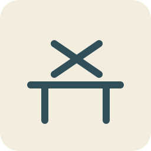

#  A Fair in the Air
background: 

Build toys that move, draw and shine—then make a little garden fair do something impossible.

## `c01` Something that moves
background: 

Jo's invitation says: **Bring something that makes somebody ask, “Can I have a go?”** You have four afternoons, a garden workshop, and a square of orange paper clipped to the bench.

“Start there,” says Jo. “The paper is looking rather pleased with being flat.”

**Goals**
- Make something the breeze can play with. -- `pinwheel`

**Hotspots**
- `pw-paper` Marked paper square
- `pw-cut-paper` Paper with four cut blades
- `pw-folded-rotor` Curved paper rotor
- `pw-bearing-rotor` Rotor on its axle
- `pw-mounted` Pinwheel held at the bench
- `pw-rubbing` Pinwheel rubbing its handle
- `pw-free` Pinwheel with room to turn

**Items**
- `pw-paper` Marked paper square

  A tough paper square with centre and corner holes, diagonal cutting lines and clear stopping marks. Reusable bench clips hold it flat; the uncut centre must stay whole.
- `work-scissors` Round-ended scissors

  The scissors cut paper and thin card. They remain a tool after cutting.
- `pw-hub` Corner-gathering hub

  A broad plastic hub with a short hollow neck. Bring each marked corner to the centre and slip its hole over the neck; the other corners stay out as blades.
- `pw-axle` Capped axle and spacer

  A blunt axle, retaining cap and short spacer sized for the hub. The hub can turn around the axle; the cap stops it falling off.
- `pw-handle` Wooden handle with axle clip

  The short handle has a prepared clip for the axle and two small mounting holes near its foot.
- `work-hand-fan` Hand fan

  A folding fan for a gentle, repeatable breeze. No motor or electricity.
- `pw-washers` Thin spacing washers

  Two smooth washers that fit around the blunt axle. They can keep the paper away from the handle without squeezing its hub.
- `work-screwdriver` Stubby screwdriver

  Fits the captive screws on the workshop clamps and prepared toy fittings. It stays a tool.
- `pw-cut-paper` Paper with four cut blades
- `pw-folded-rotor` Curved paper rotor

  The alternate corners meet at the hub. Four curved pockets stand out from the paper; the breeze will push on these instead of a flat square.
- `pw-bearing-rotor` Rotor on its axle
- `pw-mounted` Pinwheel held at the bench
- `pw-rubbing` Pinwheel rubbing its handle

  The fan makes the blades twitch, then stop with a soft scratch. One blade brushes the wooden handle each time round.
- `pw-free` Pinwheel with room to turn

  You open the retaining cap, slide in the washers and close it loosely enough for the hub to turn. The fan now sends all four blades round without a scrape.
- `pinwheel` Pinwheel

  You undo the bench clip, lift the handle free and carry it to the door. The garden breeze sets the orange blades spinning.

  “Can I—” Jo begins. You hold out the handle before she finishes.

**Combinations**
- `work-scissors` [preserve] + `pw-paper` [transform] -> `pw-cut-paper` (tutorial)
- `pw-hub` [consume] + `pw-cut-paper` [transform] -> `pw-folded-rotor`
- `pw-axle` [consume] + `pw-folded-rotor` [transform] -> `pw-bearing-rotor`
- `pw-handle` [consume] + `pw-bearing-rotor` [transform] -> `pw-mounted`
- `work-hand-fan` [preserve] + `pw-mounted` [transform] -> `pw-rubbing`
- `pw-washers` [consume] + `pw-rubbing` [transform] -> `pw-free`
- `work-screwdriver` [preserve] + `pw-free` [transform] -> `pinwheel`

## `c02` The race to the watering can
background: 

The pinwheel is very good at going round and very bad at going anywhere. Jo lays a little chassis in the bench clips; beyond the door, a chalk lane ends at the watering can.

**Goals**
- Send a wind racer down the garden lane. -- `wind-racer`

**Hotspots**
- `wr-chassis` Light wooden chassis
- `wr-bearing-chassis` Chassis with axle bearings
- `wr-rolling-chassis` Wheeled chassis
- `wr-rigged` Racer in the bench clips
- `wr-rubbing` Racer with one rubbing wheel
- `wr-free` Racer with freely turning wheels
- `wr-aimed` Racer facing the breeze

**Items**
- `wr-chassis` Light wooden chassis

  A prepared board with slots for two axle bearings, a mast socket and the same small mounting holes as the pinwheel handle. It is held in the reusable bench clips.
- `wr-bearings` Two smooth bearing tubes

  Short tubes and their push-fit saddles. An axle can turn inside each tube while the tube stays on the chassis.
- `wr-wheelset` Wheels and captive axles

  Two straight axles with four light wheels, adjustable end collars and soft push-on caps. Each wheel is fixed to its axle.
- `wr-sailcloth` Light sailcloth

  A small triangular sail with reinforced corner loops.
- `wr-mast` Mast and crossbar

  A short mast with a crossbar, clips for the sail loops and a split foot that fits the chassis socket.
- `wr-spacing-fork` Wheel-spacing fork

  A thin, fork-shaped gauge for leaving a small gap between a wheel and its bearing. It is removed after the collars are set.
- `wr-starting-gate` Portable starting gate

  A light arch with a hand-lifted bar. Put it across the chalk lane to hold the racer still until its sail is facing the wind.
- `wr-bearing-chassis` Chassis with axle bearings
- `wr-rolling-chassis` Wheeled chassis
- `wr-sail` Sail on its mast

  You clip the sail to the crossbar and mast. The broad surface catches moving air; the wheels will let that push move the whole toy.
- `wr-rigged` Racer in the bench clips
- `wr-rubbing` Racer with one rubbing wheel

  You release the test stop and fan the sail along the bench lane. The racer curves left: the left front wheel is tight against its bearing. You return it to the clips.
- `wr-free` Racer with freely turning wheels

  The spacing fork holds a small gap while you reset the axle collars. You remove the fork and give the wheels a turn: neither front wheel rubs now.
- `wr-aimed` Racer facing the breeze

  You hold the pinwheel beside the sail and turn the racer until both catch the breeze from behind. The pinwheel stays in your hand; it has shown you where the air is going.
- `wind-racer` Wind racer

  You release the racer from its bench clips, lift it to the garden lane and set it behind the starting bar. Up goes the bar. The racer rolls all the way to the watering can.

  Jo crouches at the finish. “Again. I was definitely a very slow watering can.” You lift the racer out of the lane, ready for another run.

**Combinations**
- `wr-bearings` [consume] + `wr-chassis` [transform] -> `wr-bearing-chassis`
- `wr-wheelset` [consume] + `wr-bearing-chassis` [transform] -> `wr-rolling-chassis`
- `wr-sailcloth` [consume] + `wr-mast` [transform] -> `wr-sail`
- `wr-sail` [consume] + `wr-rolling-chassis` [transform] -> `wr-rigged`
- `work-hand-fan` [preserve] + `wr-rigged` [transform] -> `wr-rubbing`
- `wr-spacing-fork` [preserve] + `wr-rubbing` [transform] -> `wr-free`
- `pinwheel` [preserve] + `wr-free` [transform] -> `wr-aimed`
- `wr-starting-gate` [preserve] + `wr-aimed` [transform] -> `wind-racer`

## `c03` A hill for a marble
background: 

“Something for a windless day?” says Jo. The shallow tray on the bench could become a marble game—if the marble will come back instead of escaping beneath the shed.

**Goals**
- Build a table that returns the marble to the player. -- `pb-return-table`

**Hotspots**
- `pb-tray` Flat game tray
- `pb-railed` Tray with retaining rails
- `pb-sloped` Sloping game tray
- `pb-launcher-table` Table with a launch lane
- `pb-deadspot` Table with a corner trap
- `pb-even-slope` Table with an even downhill slope
- `pb-return-table` Marble-return table

**Items**
- `pb-tray` Flat game tray

  A light plywood tray with prepared rail slots, launcher holes and two flipper holes. Bench clips hold it while you build.
- `pb-rails` Curved side rails

  Two side rails and a curved top rail with push-fit feet. They keep a rolling marble on the table.
- `pb-wedge` Shallow support wedge

  A broad wedge that clips beneath the far end of the tray, making a gentle slope toward the player.
- `pb-plunger-tube` Launcher tube and plunger

  A closed-back tube with a captive soft-tipped plunger and a pull handle. Its open end fits the table’s side lane.
- `pb-spring` Gentle launcher spring

  A short, low-force spring that fits inside the tube around its captive plunger. The tube encloses it in use.
- `pb-marble` Game marble

  A large marble for the enclosed table. After each test it returns to the catch apron or to your hand.
- `pb-shim` Thin levelling shim

  A broad thin shim for the low corner under the table, with a clip to hold it in place.
- `pb-apron` Curved catch apron

  A shallow curved cup with two clips. It catches the marble at the bottom edge without bouncing it onto the floor.
- `pb-railed` Tray with retaining rails
- `pb-sloped` Sloping game tray
- `pb-launcher` Enclosed marble launcher

  Pulling the handle squeezes the spring. Letting go makes it push the plunger forward. Its stop limits the push, and the spring stays inside the tube.
- `pb-launcher-table` Table with a launch lane
- `pb-deadspot` Table with a corner trap

  The marble travels up the side lane and rolls back, but settles in the left corner. The tray leans sideways as well as downhill.
- `pb-even-slope` Table with an even downhill slope

  The shim raises the low corner. You roll the marble again: this time it comes straight back to the bottom edge, where you catch it.
- `pb-return-table` Marble-return table

  The apron catches the returning marble. Jo tries the launcher and gets the same result.

  “A good machine for giving you back your own marble,” she says. “Can we persuade it to do anything on the way?”

**Combinations**
- `pb-rails` [consume] + `pb-tray` [transform] -> `pb-railed`
- `pb-wedge` [consume] + `pb-railed` [transform] -> `pb-sloped`
- `pb-spring` [consume] + `pb-plunger-tube` [transform] -> `pb-launcher`
- `pb-launcher` [consume] + `pb-sloped` [transform] -> `pb-launcher-table`
- `pb-marble` [preserve] + `pb-launcher-table` [transform] -> `pb-deadspot`
- `pb-shim` [consume] + `pb-deadspot` [transform] -> `pb-even-slope`
- `pb-apron` [consume] + `pb-even-slope` [transform] -> `pb-return-table`

## `c04` One more go
background: 

You leave the marble table in its clips and bring over the flipper parts. Jo puts a chair at the player’s end. “Testing equipment,” she says, sitting down.

**Goals**
- Make a marble game worth another turn. -- `pinball-table`

**Hotspots**
- `pb-return-table` Marble-return table
- `pb-flipper-table` Table with working flippers
- `pb-target-table` Pinball table with three targets
- `pb-short-launch` Pinball table with a short launch
- `pb-tuned` Pinball table with a longer launch
- `pb-played` Pinball table after a three-arch run
- `pb-scoring` Pinball table with a score wheel

**Items**
- `pb-pivot-plate` Flipper pivot plate

  An under-table plate with two captive pivot posts, finger buttons and soft return loops. The posts fit the prepared flipper holes.
- `pb-flipper-blades` Two flipper blades

  A left and right paddle, each with a socket for its pivot post. The short end connects to the finger button; the long end bats the marble.
- `pb-targets` Three target arches

  Wide clip-in arches with different markings. A marble can roll through each without leaving the table.
- `pb-score-wheel` Score wheel

  A numbered card wheel with a captive axle and a clip for the table edge. Turn it by hand after a successful shot.
- `pb-carry-handles` Two carrying handles

  Light handles with captive thumb screws, fitted to the table’s prepared side holes. They make lifting the finished table manageable.
- `pb-flippers` Button-operated flippers

  Pressing a short button end swings a longer paddle across the table. The soft loop brings each paddle back when you let go.
- `pb-flipper-table` Table with working flippers
- `pb-target-table` Pinball table with three targets
- `pb-short-launch` Pinball table with a short launch

  The marble returns to your flippers, and you can bat it through the lower arches. The top arch is out of reach: the launcher’s adjustable stop leaves too little spring travel.
- `pb-tuned` Pinball table with a longer launch

  You move the captive stop within its marked range. The spring can compress a little farther, while the plunger stays enclosed and its push remains gentle.
- `pb-played` Pinball table after a three-arch run

  The marble reaches the top arch, rolls back and takes a flipper shot through the middle. Jo gets the bottom arch on her turn.

  You have not made the marble stronger. You have given its push somewhere useful to go.
- `pb-scoring` Pinball table with a score wheel

  You clip on the wheel and play again, turning it one place for each arch. Jo tries to count the watering can as a bonus target. It is nowhere near the table.
- `pinball-table` Pinball table

  With the handles fitted, you undo the bench clips and lift the table onto the garden trestle. Jo carries the chair. The first stall already has a queue of one.

**Combinations**
- `pb-flipper-blades` [consume] + `pb-pivot-plate` [transform] -> `pb-flippers`
- `pb-flippers` [consume] + `pb-return-table` [transform] -> `pb-flipper-table`
- `pb-targets` [consume] + `pb-flipper-table` [transform] -> `pb-target-table`
- `pb-marble` [preserve] + `pb-target-table` [transform] -> `pb-short-launch`
- `work-screwdriver` [preserve] + `pb-short-launch` [transform] -> `pb-tuned`
- `pb-marble` [preserve] + `pb-tuned` [transform] -> `pb-played`
- `pb-score-wheel` [consume] + `pb-played` [transform] -> `pb-scoring`
- `pb-carry-handles` [consume] + `pb-scoring` [transform] -> `pinball-table`

## `c05` Round and up
background: 

A paper dragon would make a good fairground announcer. A dragon that waved would be better; first you need a machine that turns going round into going up and down.

**Goals**
- Make a crank lift a rod and let it fall again. -- `cd-working-lifter`

**Hotspots**
- `cd-base` Dragon mechanism base
- `cd-bearings` Base with shaft bearings
- `cd-crank-frame` Frame with a turning crankshaft
- `cd-cam-frame` Crankshaft with an off-centre cam
- `cd-lifter` Cam beneath a guided follower
- `cd-lost-contact` Follower losing the cam
- `cd-working-lifter` Reliable cam lifter

**Items**
- `cd-base` Dragon mechanism base

  A small wooden base held in the bench clips, with prepared holes for bearing frames, a guide and the dragon’s body.
- `cd-bearing-frames` Two bearing frames

  Upright frames with smooth shaft holes and captive mounting screws. Both holes sit at the same height.
- `cd-shaft` Crankshaft

  A straight shaft with a crank socket, collars and a capped end. The collars keep it from sliding sideways in its bearings.
- `cd-cam` Off-centre cam

  A smooth round disc whose axle hole sits away from its centre. A split hub fixes it to the crankshaft.
- `cd-follower` Follower rod

  A light rod with a broad, smooth foot and a connection eye at the top.
- `cd-guide` Follower guide

  A short vertical sleeve with a mounting foot. It lets the rod slide up and down while keeping it over the cam.
- `cd-return-spring` Light follower spring

  A soft tension spring with hooks for the guide bracket and follower collar. It pulls the follower foot gently toward the cam.
- `cd-crank-key` Removable crank handle

  A broad hand crank that fits the shaft’s socket. It can be taken out and used again.
- `cd-bearings` Base with shaft bearings
- `cd-crank-frame` Frame with a turning crankshaft
- `cd-cam-frame` Crankshaft with an off-centre cam

  As the shaft turns, the far edge of the off-centre disc rises and falls. A centred disc would turn without making that change of height.
- `cd-guided-follower` Follower in its guide
- `cd-lifter` Cam beneath a guided follower
- `cd-lost-contact` Follower losing the cam

  You turn the crank. The cam lifts the rod, but the light rod sometimes hangs in its guide as the cam drops away. Its foot loses contact.
- `cd-working-lifter` Reliable cam lifter

  The spring keeps the foot gently against the cam. You turn the crank again: round becomes up, down, up, down, without the rod wandering off sideways.

**Combinations**
- `cd-bearing-frames` [consume] + `cd-base` [transform] -> `cd-bearings`
- `cd-shaft` [consume] + `cd-bearings` [transform] -> `cd-crank-frame`
- `cd-cam` [consume] + `cd-crank-frame` [transform] -> `cd-cam-frame`
- `cd-follower` [transform] + `cd-guide` [consume] -> `cd-guided-follower`
- `cd-guided-follower` [consume] + `cd-cam-frame` [transform] -> `cd-lifter`
- `cd-crank-key` [preserve] + `cd-lifter` [transform] -> `cd-lost-contact`
- `cd-return-spring` [consume] + `cd-lost-contact` [transform] -> `cd-working-lifter`

## `c06` The dragon says hello
background: 

The lifter waits on the bench. Jo brings the dragon’s cut-out pieces, including a very small pair of spectacles. “Entirely optional,” she says. “But it looks as though it has strong opinions about turnips.”

**Goals**
- Give the fair a dragon that waves. -- `crank-dragon`

**Hotspots**
- `cd-working-lifter` Reliable cam lifter
- `cd-mounted-dragon` Dragon body on the mechanism
- `cd-linked-dragon` Dragon linked to its follower
- `cd-rubbing-wings` Dragon with rubbing wings
- `cd-clear-wings` Dragon with free-moving wings
- `cd-scaled-dragon` Dragon with a bright scaled back
- `cd-waving-dragon` Dragon giving a grand wave

**Items**
- `cd-cutouts` Dragon body and wing cut-outs

  A stiff card body, two wings and a decorative tail, with prepared hinge holes and base tabs. The body has the spectacles already drawn on it.
- `cd-hinge-pins` Soft hinge pins

  Broad-headed split pins for the two wing pivots and the tail attachment. Their prepared washers keep the card moving freely.
- `cd-linkage` Forked wing linkage

  A light fork-shaped link with captive pivots. Its bottom connects to the follower eye; its two ends join the wing roots.
- `cd-spacers` Wing-pivot spacers

  Two short collars that move the wings away from the body while leaving their pivots free.
- `cd-scales` Bright paper scales

  A row of lightweight, self-adhesive folded scales for the dragon’s back. They leave the wing hinges and linkage clear.
- `cd-jointed-dragon` Jointed card dragon
- `cd-mounted-dragon` Dragon body on the mechanism
- `cd-linked-dragon` Dragon linked to its follower

  The body stays still on its base. When the follower rises, the forked link pushes the wing roots, turning both wings about their hinges.
- `cd-rubbing-wings` Dragon with rubbing wings

  The wings start to rise, then scrape against the body. Jo supplies the voice: “I appear to be wearing my elbows too close together.”
- `cd-clear-wings` Dragon with free-moving wings

  The collars leave a gap at each shoulder. You turn the crank by hand: the links move without catching the card.
- `cd-scaled-dragon` Dragon with a bright scaled back
- `cd-waving-dragon` Dragon giving a grand wave

  One turn of the handle gives one complete rise and fall of the wings. Turn slowly and the dragon greets a mouse. Turn a little faster and it welcomes the whole street.

  Jo waves back. “We shall have to teach it when to stop.”
- `crank-dragon` Crank dragon

  You release the base from its bench clips and lift the whole dragon free, with cam, follower and links still attached. It can wave from any flat table; the little mounting holes remain clear.

**Combinations**
- `cd-hinge-pins` [consume] + `cd-cutouts` [transform] -> `cd-jointed-dragon`
- `cd-jointed-dragon` [consume] + `cd-working-lifter` [transform] -> `cd-mounted-dragon`
- `cd-linkage` [consume] + `cd-mounted-dragon` [transform] -> `cd-linked-dragon`
- `cd-crank-key` [preserve] + `cd-linked-dragon` [transform] -> `cd-rubbing-wings`
- `cd-spacers` [consume] + `cd-rubbing-wings` [transform] -> `cd-clear-wings`
- `cd-scales` [consume] + `cd-clear-wings` [transform] -> `cd-scaled-dragon`
- `cd-crank-key` [preserve] + `cd-scaled-dragon` [transform] -> `cd-waving-dragon`
- `work-screwdriver` [preserve] + `cd-waving-dragon` [transform] -> `crank-dragon`

## `c07` A look over the hedge
background: 

Jo’s hat vanishes behind the tall garden screen. Her voice remains. “Can your next invention find out whether I am still in it?”

**Goals**
- See over the screen with both feet on the ground. -- `periscope`

**Hotspots**
- `pe-net` Periscope tube net
- `pe-lined` Periscope net with a dark lining
- `pe-tube` Folded periscope tube
- `pe-upper` Tube with an upper mirror
- `pe-both` Tube with two facing mirrors
- `pe-baffled` Periscope with shaded windows
- `pe-seeing` Periscope looking over the screen

**Items**
- `pe-net` Periscope tube net

  A stiff card net held flat in the bench clips. It has scored folds, fastening tabs, opposite end windows and prepared mirror ledges at forty-five degrees.
- `pe-lining` Dark inner lining

  Self-adhesive dark paper cut to the inside faces. It absorbs stray light instead of reflecting it around the tube.
- `pe-folder` Smooth folding tool

  A blunt tool for pressing the prepared card creases and locking the tabs.
- `pe-upper-mirror` Upper mirror and clip

  A small unbreakable mirror on a clip that fits the top ledge. Its reflecting face looks down the tube and out of the upper window.
- `pe-lower-mirror` Lower mirror and clip

  A matching mirror for the lower ledge. Its reflecting face looks up the tube and toward the eyepiece; the two mirror surfaces will be parallel.
- `pe-baffles` Soft eyecup and light baffles

  A soft eyecup and two short dark sleeves. They fit around the windows without blocking the mirrors.
- `pe-hat` Jo’s striped hat

  A large floppy hat with a bright stripe. Jo will hold it above the screen while you look through the lower window.
- `pe-lined` Periscope net with a dark lining
- `pe-tube` Folded periscope tube
- `pe-upper` Tube with an upper mirror
- `pe-both` Tube with two facing mirrors

  Light from the upper window reflects down the tube, then off the lower mirror toward your eye. The pair lets you look from a different height.
- `pe-baffled` Periscope with shaded windows
- `pe-seeing` Periscope looking over the screen

  Jo holds the hat above the screen, and its stripe appears in the lower window. When she moves it left, you see it move left.

  The hat dips. Jo’s eyes replace it. “You found the person too.”
- `periscope` Periscope

  You undo the bench clip and lift out the tube. At the garden screen, you can watch the pinball stall over its top while keeping your eye at the lower window. The mirrors carry the view; they do not make the screen transparent.

**Combinations**
- `pe-lining` [consume] + `pe-net` [transform] -> `pe-lined`
- `pe-folder` [preserve] + `pe-lined` [transform] -> `pe-tube`
- `pe-upper-mirror` [consume] + `pe-tube` [transform] -> `pe-upper`
- `pe-lower-mirror` [consume] + `pe-upper` [transform] -> `pe-both`
- `pe-baffles` [consume] + `pe-both` [transform] -> `pe-baffled`
- `pe-hat` [preserve] + `pe-baffled` [transform] -> `pe-seeing`
- `work-screwdriver` [preserve] + `pe-seeing` [transform] -> `periscope`

## `c08` A pocket full of fireworks
background: 

Two mirrors let you look round a corner. Three long mirrors might do something stranger; Jo spreads a few coloured pieces beside a little turning drum.

**Goals**
- Make a pattern that changes whenever you turn it. -- `kaleidoscope`

**Hotspots**
- `ka-strips` Three long mirror strips
- `ka-triangle` Three mirrors in a triangle
- `ka-prism` Bound mirror triangle
- `ka-housed` Mirror triangle inside its tube
- `ka-eye` Mirror tube with an eyepiece
- `ka-drum-scope` Mirror tube with a rotating colour drum
- `ka-sealed` Kaleidoscope ready for light

**Items**
- `ka-strips` Three long mirror strips

  Three equal unbreakable mirror strips held in the bench’s folding cradle, reflecting faces upward.
- `ka-former` Triangular folding former

  A smooth triangular tool with three equal sides. It holds the mirrors with their reflecting faces inward while you close their long edges.
- `ka-tape` Flexible binding tape

  A prepared strip of tough tape for the outside seams of the mirror triangle. Nothing covers the reflecting faces.
- `ka-tube` Protective outer tube

  A light tube with padded mirror supports, a rotating front collar and a prepared eyecap rim.
- `ka-eyecap` Eyecap with a viewing hole

  A dark cap that closes the back of the tube while leaving a small central viewing hole.
- `ka-chips` Coloured translucent shapes

  A few large coloured pieces, including a green triangle and an orange crescent. They must have room to tumble.
- `ka-cell` Clear lidded colour cell

  A shallow clear cell with a snap lid and a rim that fits the tube’s rotating collar. Its depth leaves space for the coloured pieces to move.
- `ka-diffuser` Milky light cover

  A translucent cover for the front of the colour cell. It spreads light behind the loose pieces.
- `work-lantern` Diffused battery lantern

  A small enclosed low-voltage lantern with its battery fitted and a broad milky light face. Its light is gentle enough for viewing the toys.
- `ka-triangle` Three mirrors in a triangle

  Each mirror reflects the other mirrors as well as what is at the end. Those reflections can repeat a small view into a much larger pattern.
- `ka-prism` Bound mirror triangle
- `ka-housed` Mirror triangle inside its tube
- `ka-eye` Mirror tube with an eyepiece
- `ka-colour-drum` Colour drum with loose shapes

  You close the lid with space around the shapes. Tilt the drum and they slide; packing it full would stop the changing pattern.
- `ka-drum-scope` Mirror tube with a rotating colour drum
- `ka-sealed` Kaleidoscope ready for light
- `kaleidoscope` Kaleidoscope

  You lift the finished tube from the cradle and aim its covered end toward the lantern. The green triangle becomes a ring of green points around orange stars. Turn the drum, and the stars fall into a new pattern.

  Jo takes a turn. For once, she says nothing at all.

**Combinations**
- `ka-former` [preserve] + `ka-strips` [transform] -> `ka-triangle`
- `ka-tape` [consume] + `ka-triangle` [transform] -> `ka-prism`
- `ka-tube` [consume] + `ka-prism` [transform] -> `ka-housed`
- `ka-eyecap` [consume] + `ka-housed` [transform] -> `ka-eye`
- `ka-chips` [consume] + `ka-cell` [transform] -> `ka-colour-drum`
- `ka-colour-drum` [consume] + `ka-eye` [transform] -> `ka-drum-scope`
- `ka-diffuser` [consume] + `ka-drum-scope` [transform] -> `ka-sealed`
- `work-lantern` [preserve] + `ka-sealed` [transform] -> `kaleidoscope`

## `c09` The tall thing that must not wobble
background: 

Jo lifts a basket onto the fair’s little stage. “A crane could do this,” you say. She lowers the basket again. “Then it can have my job. Start with somewhere solid to stand.”

**Goals**
- Build a crane frame that resists bending sideways. -- `lc-wide-frame`

**Hotspots**
- `lc-base` Crane base board
- `lc-mast` Base with an upright mast
- `lc-braced` Mast with triangular braces
- `lc-boom-frame` Crane frame with a hinged boom
- `lc-stayed` Crane boom held by its stay
- `lc-pulley-frame` Crane frame with a tip pulley
- `lc-wide-frame` Braced crane with spreading feet

**Items**
- `lc-base` Crane base board

  A wide base board held in the bench clips. It has prepared mast sockets, winch holes and sockets for spreading feet.
- `lc-uprights` Mast uprights and crosspiece

  Two upright beams joined by a crosspiece, with captive mounting screws and a prepared top hinge.
- `lc-braces` Diagonal mast braces

  Two stiff diagonal struts with captive end fasteners. They join the mast to the base to make triangles.
- `lc-boom` Light crane boom

  A hollow beam with a root hinge, a tip clevis socket and an eye for its support stay.
- `lc-hinge` Captive boom hinge pin

  A broad-headed pin and soft retaining cap sized for the boom root and mast hinge.
- `lc-stay` Boom support stay

  A fixed-length cord with captive hooks for the mast top and boom eye. It holds the boom above the work area.
- `lc-pulley-wheel` Grooved pulley wheel

  A smooth wheel with a deep rope groove and a prepared axle hole.
- `lc-clevis` Pulley fork and axle

  A small fork with a captive blunt axle, retaining cap and a mounting foot for the boom tip.
- `lc-feet` Spreading crane feet

  Two broad folding feet with locking clips. They widen the base in the direction the boom reaches.
- `lc-mast` Base with an upright mast
- `lc-braced` Mast with triangular braces

  A rectangular frame can lean into a diamond. The diagonal braces hold the corners apart, so sideways force cannot change the angles so easily.
- `lc-hinged-boom` Boom with its captive hinge pin
- `lc-boom-frame` Crane frame with a hinged boom
- `lc-stayed` Crane boom held by its stay
- `lc-pulley-block` Pulley in its fork

  The rope will run over the wheel instead of scraping around the end of the boom. This single fixed pulley changes the pull’s direction; it does not halve the weight.
- `lc-pulley-frame` Crane frame with a tip pulley
- `lc-wide-frame` Braced crane with spreading feet

  The feet make a wider patch of ground to stand on. Jo nudges the mast gently; its triangles hold their shape.

  “The basket is being patient,” she says. “I am nearly as good at it.”

**Combinations**
- `lc-uprights` [consume] + `lc-base` [transform] -> `lc-mast`
- `lc-braces` [consume] + `lc-mast` [transform] -> `lc-braced`
- `lc-hinge` [consume] + `lc-boom` [transform] -> `lc-hinged-boom`
- `lc-hinged-boom` [consume] + `lc-braced` [transform] -> `lc-boom-frame`
- `lc-stay` [consume] + `lc-boom-frame` [transform] -> `lc-stayed`
- `lc-pulley-wheel` [transform] + `lc-clevis` [consume] -> `lc-pulley-block`
- `lc-pulley-block` [consume] + `lc-stayed` [transform] -> `lc-pulley-frame`
- `lc-feet` [consume] + `lc-pulley-frame` [transform] -> `lc-wide-frame`

## `c10` Please hold
background: 

The frame can stand up. Now the crane must lift a load, keep it there, and bring it down without flinging it into Jo’s tomatoes.

**Goals**
- Lift a basket, hold it, and lower it gently. -- `lifting-crane`

**Hotspots**
- `lc-wide-frame` Braced crane with spreading feet
- `lc-winch-frame` Crane with a hand winch
- `lc-rigged` Crane with a lifting line
- `lc-tipping` Crane lifting at its back feet
- `lc-balanced` Crane with rear ballast
- `lc-ratchet-frame` Crane with a holding pawl
- `lc-basket-tested` Crane after a basket delivery

**Items**
- `lc-drum` Winding drum and bearing bracket

  A small drum on a shaft with two bearing brackets, rope anchor and captive mounting screws.
- `lc-crank-wheel` Crank and toothed ratchet wheel

  A long hand crank and toothed wheel that lock onto the drum shaft. The wheel can later accept a holding pawl.
- `lc-rope` Lifting cord and closed hook

  A soft cord with a closed snap hook at one end and an anchor loop at the other. It fits the drum and pulley groove.
- `lc-test-load` Small padded test weight

  A light, soft-edged weight with a lifting loop. Jo keeps a hand beside it during the first low lift; it returns to the bench after the test.
- `lc-ballast` Rear ballast block

  A low block with a captive clip for the back of the crane base. Its weight opposes the forward turning effect of the load.
- `lc-pawl` Holding pawl and release lever

  A pivoted pawl, light spring and hand lever that attach beside the toothed wheel. It lets the drum turn while lifting and catches when it tries to unwind.
- `lc-basket` Small cargo basket

  A shallow basket with a lifting loop and a handful of light wooden play blocks already inside.
- `lc-winch` Hand winch

  The crank turns the drum, winding in cord. A longer crank gives your hand more turning effect, although your hand travels farther for each drum turn.
- `lc-winch-frame` Crane with a hand winch
- `lc-rigged` Crane with a lifting line
- `lc-tipping` Crane lifting at its back feet

  You loosen the bench clips for a low test, keeping a hand beside the load. As the weight rises, the back feet begin to lift. You lower it immediately and secure the base again.

  The frame has stayed stiff. The whole crane is trying to tip.
- `lc-balanced` Crane with rear ballast

  The block sits low behind the mast. You repeat the low lift and lower the test weight again: this time all the feet stay on the bench.
- `lc-ratchet-frame` Crane with a holding pawl

  The pawl clicks over the teeth while you wind in. If you stop turning, it catches a tooth instead of letting the drum unwind. To lower, hold the crank before easing the release lever.
- `lc-basket-tested` Crane after a basket delivery

  You hook the basket, raise it to the miniature stage and stop cranking. The pawl holds. With the crank in your hand, you ease the lever and lower the basket onto the stage.

  Jo moves one wooden block into position. “A delivery service. Excellent.” The basket comes back to the crane’s hook.
- `lifting-crane` Lifting crane

  You lower the basket, release the bench clips and lift the crane by its base. Its feet, ballast, winch and basket travel with it. At the garden stall, the crane can move play-block cargo onto the little stage.

**Combinations**
- `lc-crank-wheel` [consume] + `lc-drum` [transform] -> `lc-winch`
- `lc-winch` [consume] + `lc-wide-frame` [transform] -> `lc-winch-frame`
- `lc-rope` [consume] + `lc-winch-frame` [transform] -> `lc-rigged`
- `lc-test-load` [preserve] + `lc-rigged` [transform] -> `lc-tipping`
- `lc-ballast` [consume] + `lc-tipping` [transform] -> `lc-balanced`
- `lc-pawl` [consume] + `lc-balanced` [transform] -> `lc-ratchet-frame`
- `lc-basket` [consume] + `lc-ratchet-frame` [transform] -> `lc-basket-tested`
- `work-screwdriver` [preserve] + `lc-basket-tested` [transform] -> `lifting-crane`

## `c11` A motor makes a wiggle
background: 

The dragon waves because you keep turning its handle. Jo sets a little motor on the bench. “This one will keep turning for us. What could we make that is interesting to watch?” You stretch a bright cord between your hands.

**Goals**
- Build a guarded drive that can shake one end of a cord. -- `wm-guarded`

**Hotspots**
- `wm-base` Long wave-machine base
- `wm-post-frame` Base with cord posts
- `wm-motor-frame` Wave frame with a motor
- `wm-driver-frame` Wave frame with an eccentric driver
- `wm-belt-frame` Wave frame with a belt drive
- `wm-cord-frame` Wave frame with a loose cord
- `wm-tensioned` Wave frame with a tensioned cord
- `wm-guarded` Guarded string-wave machine

**Items**
- `wm-base` Long wave-machine base

  A light base held in the bench clips, with prepared holes for two end posts, a motor cradle, driver bearings and a soundbox.
- `wm-posts` Cord posts and tension screw

  Two short posts with captive fittings. One carries the cord anchor and an adjustable tension screw; the other supports the driver bearing.
- `wm-motor` Small low-voltage motor

  An ordinary compatible motor module with a capped drive pulley and insulated plug lead. It has no battery connected.
- `wm-cradle` Motor cradle

  A fitting cradle with a retaining strap, captive screws and soft isolation mounts. It holds the motor clear of the wooden base.
- `wm-driver` Eccentric cord driver

  A small pulley wheel on its own bearing, with a captive swivel peg a little off centre. The swivel lets the cord move without twisting up.
- `wm-belt` Soft drive belt

  A short rubber belt sized for the motor pulley and driver pulley. It will run behind a cover.
- `wm-cord` Bright flexible cord

  A long, light nylon cord with prepared end loops. One loop fits the driver swivel, the other the tension spring.
- `wm-spring` Cord tension spring

  A small extension spring with closed end hooks. It links the cord to the adjustable post and keeps a steady pull on it.
- `wm-guard` Clear drive guard

  A transparent snap-on cover for the motor pulleys and belt, with a smooth opening for the moving cord and a slot for the electrical plug.
- `wm-post-frame` Base with cord posts
- `wm-mounted-motor` Motor secured in its cradle
- `wm-motor-frame` Wave frame with a motor
- `wm-driver-frame` Wave frame with an eccentric driver

  The swivel peg follows a small circle instead of sitting at the axle centre. It will keep disturbing one end of the cord while the far end stays anchored.
- `wm-belt-frame` Wave frame with a belt drive
- `wm-cord-frame` Wave frame with a loose cord
- `wm-tensioned` Wave frame with a tensioned cord
- `wm-guarded` Guarded string-wave machine

  The clear cover keeps fingers away from the belt and pulleys. Through it you can still trace the movement: motor, belt, off-centre peg, cord. The motor remains disconnected until its controller arrives.

**Combinations**
- `wm-posts` [consume] + `wm-base` [transform] -> `wm-post-frame`
- `wm-motor` [transform] + `wm-cradle` [consume] -> `wm-mounted-motor`
- `wm-mounted-motor` [consume] + `wm-post-frame` [transform] -> `wm-motor-frame`
- `wm-driver` [consume] + `wm-motor-frame` [transform] -> `wm-driver-frame`
- `wm-belt` [consume] + `wm-driver-frame` [transform] -> `wm-belt-frame`
- `wm-cord` [consume] + `wm-belt-frame` [transform] -> `wm-cord-frame`
- `wm-spring` [consume] + `wm-cord-frame` [transform] -> `wm-tensioned`
- `wm-guard` [consume] + `wm-tensioned` [transform] -> `wm-guarded`

## `c12` Watch it. Hear it.
background: 

Jo sets the battery controller beside the covered drive. “A string can carry a wiggle a long way,” she says. “Let’s see where this one goes.”

**Goals**
- Make waves you can watch, then play the cord like a string. -- `wave-machine`

**Hotspots**
- `wm-guarded` Guarded string-wave machine
- `wm-running` Cord with a travelling wiggle
- `wm-marked` Wave cord with a paper rider
- `wm-looping` Cord making two broad loops
- `wm-soundbox-frame` Wave machine with a soundbox
- `wm-bridged` Cord resting on a movable bridge
- `wm-quiet` Wave machine on soft feet
- `wm-played` Wave machine with a plucked voice

**Items**
- `wm-controller` Battery and speed controller

  A compatible enclosed low-voltage battery holder with cells fitted, an on-off switch, speed dial and keyed plug. Its clips fit the base; start with the switch off.
- `wm-rider` Light paper rider

  A tiny folded paper flag with a loose soft clip. It can mark one place on the cord without holding it still.
- `wm-tension-key` Tension-adjusting key

  A blunt key for the post’s captive adjustment screw. Small turns change the cord’s tension; the marked limits keep the spring within its working stretch.
- `wm-soundbox` Hollow wooden soundbox

  A light open-backed box with a thin top and clips for the base. A bridge can pass a vibrating string’s movement into its broad top.
- `wm-bridge` Movable string bridge

  A smooth, low wooden bridge with a shallow cord notch. It rests on the soundbox and can slide along the cord to change the length free to vibrate.
- `wm-footpads` Soft foot pads

  Four self-adhesive pads for the base feet. They reduce the buzz passed into the workbench without touching the cord.
- `wm-pick` Soft plectrum

  A broad flexible pick for plucking the cord with the motor switched off.
- `wm-running` Cord with a travelling wiggle

  You plug in the controller, turn it on and slowly increase the speed. The peg keeps shaking one end; a disturbance travels along the cord and reflects from the far end.
- `wm-marked` Wave cord with a paper rider

  The rider bobs around its own place while the disturbance travels past it. A wave can move along the cord without carrying that piece of cord all the way to the other end.
- `wm-looping` Cord making two broad loops

  You adjust the tension a little at a time and tune the speed. At one setting, two broad loops keep their places, separated by a nearly still point. Disturbances travelling in opposite directions are meeting in a repeating pattern.
- `wm-soundbox-frame` Wave machine with a soundbox
- `wm-bridged` Cord resting on a movable bridge

  The bridge gives the moving cord another firm contact point. Moving it changes the length between contacts, so the old wave pattern changes too. It also passes vibration into the soundbox.
- `wm-quiet` Wave machine on soft feet

  You fit the pads and run the motor again. The table buzz fades while the cord still moves. You switch the drive off before trying the cord as an instrument.
- `wm-played` Wave machine with a plucked voice

  With the drive off, you tighten the cord within its marked range and pluck it. The soundbox makes the twang easier to hear. Slide the bridge to leave a shorter vibrating length and pluck again: the note rises.

  “The fast wiggles reach our ears,” says Jo. You answer with two more notes.
- `wave-machine` String-wave machine

  You release the bench clips and lift the complete base into the garden. With the bridge set aside on its fitted clip, the motor makes its broad dancing loops again; with the motor off, the bridge and pick let visitors try a tune.

  Jo listens from the pinball chair. On the workshop shelf behind her sits an old rolled drawing, with three words visible on its edge: **A fair in the air**.

**Combinations**
- `wm-controller` [consume] + `wm-guarded` [transform] -> `wm-running`
- `wm-rider` [consume] + `wm-running` [transform] -> `wm-marked`
- `wm-tension-key` [preserve] + `wm-marked` [transform] -> `wm-looping`
- `wm-soundbox` [consume] + `wm-looping` [transform] -> `wm-soundbox-frame`
- `wm-bridge` [consume] + `wm-soundbox-frame` [transform] -> `wm-bridged`
- `wm-footpads` [consume] + `wm-bridged` [transform] -> `wm-quiet`
- `wm-pick` [preserve] + `wm-quiet` [transform] -> `wm-played`
- `work-screwdriver` [preserve] + `wm-played` [transform] -> `wave-machine`

## `c13` A robot with somewhere to go
background: 

The fair needs invitations. You could draw every one. Or you could make something that draws and then drives over to deliver it.

Jo produces two small gearmotors. “These turn slowly enough to be useful. A very fast motor would mostly deliver itself into a chair.”

**Goals**
- Give the rover wheels and controlled power -- `guarded-rover`

**Hotspots**
- `rover-deck`
- `rover-rolling-deck`
- `rover-driven-deck`
- `rover-powered-deck`
- `rover-switched-deck`
- `rover-radio-deck`
- `guarded-rover`

**Items**
- `rover-deck` Rover deck

  A little birch platform with ready-drilled mounting holes. It is held in a bench jig while you fit the underside.
- `rover-caster` Ball caster
- `rover-gearmotors` Matched gearmotors

  Two low-voltage motors, reduction gears, brackets and short leads. One drives each side.
- `rover-wheels` Rubber wheels
- `rover-drive-pair` Wheel drives
- `rover-holder` Empty battery holder
- `rover-cells` Rover batteries
- `rover-pack` Rover battery pack
- `rover-switch` Switch harness

  A ready-made fused low-voltage harness with an off switch and matching plugs.
- `rover-radio` Receiver and motor driver

  The receiver listens to the matching remote. Its motor driver sends the battery's power to the two motors separately.
- `rover-covers` Gear guards
- `rover-rolling-deck` Deck with caster
- `rover-driven-deck` Three-point rover

  Two driven wheels and a free-turning ball support the deck. Different wheel speeds will turn it; no steering axle is needed.
- `rover-powered-deck` Rover with battery
- `rover-switched-deck` Switched rover
- `rover-radio-deck` Radio rover
- `guarded-rover` Guarded rover

  The wheels turn freely and the little gears are covered. Now it needs a driver with a pen.

**Combinations**
- `rover-wheels` [consume] + `rover-gearmotors` [transform] -> `rover-drive-pair`
- `rover-caster` [consume] @ `rover-deck` [transform] -> `rover-rolling-deck`
- `rover-drive-pair` [consume] @ `rover-rolling-deck` [transform] -> `rover-driven-deck`
- `rover-cells` [consume] + `rover-holder` [transform] -> `rover-pack`
- `rover-pack` [consume] @ `rover-driven-deck` [transform] -> `rover-powered-deck`
- `rover-switch` [consume] @ `rover-powered-deck` [transform] -> `rover-switched-deck`
- `rover-radio` [consume] @ `rover-switched-deck` [transform] -> `rover-radio-deck`
- `rover-covers` [consume] @ `rover-radio-deck` [transform] -> `guarded-rover`

## `c14` Sign your name badly
background: 

The test paper is on the patio. You have promised Jo a beautifully written invitation.

“I will also accept a magnificent squiggle,” she says.

**Goals**
- Make a rover that can draw, steer and lift its pen -- `drawing-rover`

**Hotspots**
- `guarded-rover`
- `rover-pen-deck`
- `rover-looping`
- `rover-trimmed`
- `rover-line-tested`
- `rover-lifting-pen`

**Items**
- `rover-pen` Felt-tip pen
- `rover-pen-clip` Spring pen clip
- `rover-pen-mount` Clipped pen
- `rover-remote` Matching remote
- `rover-remote-cells` Remote batteries
- `rover-powered-remote` Working remote
- `rover-trim-driver` Small trim screwdriver
- `rover-paper` Test-paper roll
- `rover-pen-lift` Pen-lift lever

  A small lever and hinge. Flip it by hand to raise the spring clip between drawings.
- `rover-pen-deck` Rover with pen
- `rover-looping` Rover drawing a curve

  Both wheels turn, but “straight ahead” draws a gentle curve. One motor is a little quicker. The receiver has a trim adjustment for just this problem.
- `rover-trimmed` Trimmed rover

  A small turn of the trim screw balances the wheel speeds. You have changed the control, not straightened the drawing after the fact.
- `rover-line-tested` Rover drawing a straight line

  A long teal line crosses the paper. Steering one wheel faster bends it into a loop.
- `rover-lifting-pen` Rover with pen lift
- `drawing-rover` Drawing rover

  You lift the pen, drive to a fresh patch, lower it, and draw a ridiculous looping whale. Then you pick the rover off its test stops. Jo writes **YOU ARE INVITED** inside the whale.

**Combinations**
- `rover-pen` [consume] + `rover-pen-clip` [transform] -> `rover-pen-mount`
- `rover-pen-mount` [consume] @ `guarded-rover` [transform] -> `rover-pen-deck`
- `rover-remote-cells` [consume] + `rover-remote` [transform] -> `rover-powered-remote`
- `rover-powered-remote` [preserve] @ `rover-pen-deck` [transform] -> `rover-looping`
- `rover-trim-driver` [preserve] @ `rover-looping` [transform] -> `rover-trimmed`
- `rover-paper` [consume] @ `rover-trimmed` [transform] -> `rover-line-tested`
- `rover-pen-lift` [consume] @ `rover-line-tested` [transform] -> `rover-lifting-pen`
- `rover-powered-remote` [preserve] @ `rover-lifting-pen` [transform] -> `drawing-rover`

## `c15` Put the night in a box
background: 

Your paper whale needs stars. Real ones are inconveniently far away.

The next box has a low-power lamp, a turning handle and room for a miniature night sky. First, you need to find out what its shadows actually look like.

**Goals**
- Make the first moving stars -- `theatre-blurry`

**Hotspots**
- `theatre-box`
- `theatre-lined`
- `theatre-lit-box`
- `theatre-powered-box`
- `theatre-wheel-box`
- `theatre-blurry`

**Items**
- `theatre-box` Theatre box
- `theatre-foil` Reflective lining
- `theatre-lamp` LED lamp module

  A small cool-running LED in a holder, with its current-limiting resistor already fitted.
- `theatre-battery` Lamp battery pack
- `theatre-lead` Switched lamp lead
- `theatre-power` Switched lamp supply
- `theatre-card` Black card disc
- `theatre-punch` Star hole punch
- `theatre-stars` Star disc
- `theatre-spindle` Disc spindle
- `theatre-shadow-wheel` Shadow wheel
- `theatre-paper-screen` Tracing-paper screen
- `theatre-lined` Reflective theatre box
- `theatre-lit-box` Theatre with lamp
- `theatre-powered-box` Powered theatre
- `theatre-wheel-box` Theatre with star wheel
- `theatre-blurry` Blurry star theatre

  The disc turns, and pale blobs travel across the screen. They move beautifully. They are not yet stars.

**Combinations**
- `theatre-foil` [consume] @ `theatre-box` [transform] -> `theatre-lined`
- `theatre-lamp` [consume] @ `theatre-lined` [transform] -> `theatre-lit-box`
- `theatre-battery` [consume] + `theatre-lead` [transform] -> `theatre-power`
- `theatre-power` [consume] @ `theatre-lit-box` [transform] -> `theatre-powered-box`
- `theatre-card` [transform] + `theatre-punch` [preserve] -> `theatre-stars`
- `theatre-stars` [consume] + `theatre-spindle` [transform] -> `theatre-shadow-wheel`
- `theatre-shadow-wheel` [consume] @ `theatre-powered-box` [transform] -> `theatre-wheel-box`
- `theatre-paper-screen` [consume] @ `theatre-wheel-box` [transform] -> `theatre-blurry`

## `c16` The stars come out early
background: 

At dusk, you hang a white cloth between the apple trees. Your stars ought to be big enough for everyone to see.

Jo holds the box while you look for a sharp image. “A blurry universe has its charms. Let's try a focused one.”

**Goals**
- Bring a turning night sky into focus -- `shadow-theatre`

**Hotspots**
- `theatre-blurry`
- `theatre-open-front`
- `theatre-focus-box`
- `theatre-hooded`
- `theatre-handled`

**Items**
- `theatre-screen-tabs` Screen-clip screwdriver

  Loosen the two clips to remove the close tracing-paper screen. The light needs a clear path to the garden cloth.
- `theatre-lens` Convex projection lens
- `theatre-slider` Sliding lens holder
- `theatre-focus` Adjustable lens assembly
- `theatre-hood` Dark lens hood
- `theatre-handwheel` Star-wheel handle
- `theatre-cloth` Hanging projection cloth
- `theatre-open-front` Open-front star projector
- `theatre-focus-box` Projector with focusing lens

  Sliding the lens changes where the star disc forms a sharp image. This is a projector: the light passes through the holes, then the lens forms their image on the cloth.
- `theatre-hooded` Hooded star projector
- `theatre-handled` Hand-turned star projector
- `shadow-theatre` Star theatre

  You turn the handle. A whole sky wheels across the cloth. The image is upside down; for your invented constellations, that is entirely acceptable.

  Jo unclips the finished projector from its bench stand. Behind it lies an old drawing: a whale-shaped frame, carrying a dragon and a sky of its own. At the top someone has written **A FAIR IN THE AIR**.

**Combinations**
- `theatre-screen-tabs` [preserve] @ `theatre-blurry` [transform] -> `theatre-open-front`
- `theatre-lens` [consume] + `theatre-slider` [transform] -> `theatre-focus`
- `theatre-focus` [consume] @ `theatre-open-front` [transform] -> `theatre-focus-box`
- `theatre-hood` [consume] @ `theatre-focus-box` [transform] -> `theatre-hooded`
- `theatre-handwheel` [consume] @ `theatre-hooded` [transform] -> `theatre-handled`
- `theatre-cloth` [preserve] @ `theatre-handled` [transform] -> `shadow-theatre`

## `c17` The thing that should not happen
background: 

“I could build every part except the flying,” Jo says. “Then my friend sent this.”

Inside a padded tin is a violet tile. **Experimental lift tile. Apply power to lift. Disconnect to stop.**

This part is invented science. Real batteries cannot make a tile ignore gravity. In this workshop, this one can. You still have to find out how much it lifts—and keep hold of it.

**Goals**
- Test the tile inside a tethered stand -- `lift-load-tested`

**Hotspots**
- `lift-base`
- `lift-tethered-base`
- `lift-guided-base`
- `lift-ready`
- `lift-rising`
- `lift-load-tested`

**Items**
- `lift-base` Test-stand base
- `lift-posts` Guide posts
- `lift-tether` Short safety tether
- `lift-tile` Experimental lift tile

  A violet tile in a protective rim. It produces a limited upward force while powered. It does not make electricity, carry people or lift an unlimited load.
- `lift-pack` Tile battery pack
- `lift-switch` Spring-return test switch
- `lift-switched-pack` Hold-to-lift supply
- `lift-cradle` Tile cradle
- `lift-cradled-tile` Cradled lift tile
- `lift-weight` Test weight
- `lift-tethered-base` Tethered test base
- `lift-guided-base` Guided lift stand
- `lift-ready` Tile in test stand
- `lift-rising` Rising tile stand

  You hold the switch. The tile rises until the short tether catches it. Let go, and it settles back onto the padded base. It has no propeller and no balloon. Jo laughs once, very loudly.
- `lift-load-tested` Loaded lift test

  With the weight clipped beneath it, the tile rises more slowly. The battery must now support the tile, the cradle and the extra weight. The test is small; the grin is not.

**Combinations**
- `lift-tether` [consume] @ `lift-base` [transform] -> `lift-tethered-base`
- `lift-posts` [consume] @ `lift-tethered-base` [transform] -> `lift-guided-base`
- `lift-tile` [consume] + `lift-cradle` [transform] -> `lift-cradled-tile`
- `lift-switch` [consume] + `lift-pack` [transform] -> `lift-switched-pack`
- `lift-cradled-tile` [consume] @ `lift-guided-base` [transform] -> `lift-ready`
- `lift-switched-pack` [consume] @ `lift-ready` [transform] -> `lift-rising`
- `lift-weight` [consume] @ `lift-rising` [transform] -> `lift-load-tested`

## `c18` Up is the easy part
background: 

The tile lifts. A fair also needs to come down where you want it.

You set out a tray, a sliding weight and a control unit that can vary the current. The tile stays on its short tether throughout the experiment.

**Goals**
- Make a balanced lift module with a reliable stop -- `balanced-lift`

**Hotspots**
- `lift-load-tested`
- `lift-tray-test`
- `lift-tilting-test`
- `lift-balanced-test`
- `lift-variable-test`
- `lift-stop-test`

**Items**
- `lift-tray` Slotted load tray
- `lift-offset-load` Off-centre test block
- `lift-slider` Sliding counterweight
- `lift-control` Current controller
- `lift-stop` Latching power-cut switch
- `lift-crane-sling` Short lifting sling
- `lift-module-fasteners` Small release spanner
- `lift-tray-test` Tile with load tray
- `lift-tilting-test` Tilting lift tray

  The tray's loaded end dips. Upward force alone does not keep a lopsided load level.
- `lift-balanced-test` Level lift tray

  The counterweight slides away from the heavy end until the tray hangs level. The total load is greater, so it now needs a little more lift.
- `lift-variable-test` Adjustable lift module
- `lift-stop-test` Stopped lift module

  The big switch cuts the tile's power even while the controller asks for lift. The short tether and padded base keep this a gentle test.
- `lift-supported-module` Crane with lifting sling
- `balanced-lift` Balanced lift module

  The crane takes the weight while you undo the stand's wingnuts. You lift out one complete module: tile, tray, counterweight, controller, battery and stop switch. Its short tether comes with it.

**Combinations**
- `lift-tray` [consume] @ `lift-load-tested` [transform] -> `lift-tray-test`
- `lift-offset-load` [consume] @ `lift-tray-test` [transform] -> `lift-tilting-test`
- `lift-slider` [consume] @ `lift-tilting-test` [transform] -> `lift-balanced-test`
- `lift-control` [consume] @ `lift-balanced-test` [transform] -> `lift-variable-test`
- `lift-stop` [consume] @ `lift-variable-test` [transform] -> `lift-stop-test`
- `lift-crane-sling` [consume] + `lifting-crane` [transform] -> `lift-supported-module`
- `lift-supported-module` [preserve] @ `lift-stop-test` [transform] -> `lift-slung-test`
- `lift-module-fasteners` [preserve] @ `lift-slung-test` [transform] -> `balanced-lift`

**Items**
- `lift-slung-test` Lift module held in sling

**Hotspots**
- `lift-slung-test`

## `c19` A whale without a sea
background: 

You put your rover's whale drawing beside Jo's old plan. Hers has more measurements. Yours has a much better smile.

The flying fair will be the size of a large model boat. No passengers. Plenty of room for a dragon.

**Goals**
- Build a light frame that keeps its shape -- `whale-braced-frame`

**Hotspots**
- `whale-keel`
- `whale-ribbed`
- `whale-spined`
- `whale-tailed`
- `whale-decked`
- `whale-braced-frame`

**Items**
- `whale-keel` Whale keel

  A long light wooden spine, clamped flat in the building jig.
- `whale-ribs` Slotted ribs
- `whale-top-spar` Upper spar
- `whale-tail-halves` Tail panels
- `whale-tail-hinge` Tail hinge
- `whale-tail` Hinged whale tail
- `whale-deck-slats` Thin deck slats
- `whale-crosspieces` Deck crosspieces
- `whale-deck` Fair deck
- `whale-brace-cord` Diagonal brace cord
- `whale-tensioners` Brace tensioners
- `whale-braces` Adjustable diagonal braces
- `whale-ribbed` Ribbed whale frame
- `whale-spined` Whale frame with upper spar
- `whale-tailed` Tailed whale frame
- `whale-decked` Whale frame with deck
- `whale-braced-frame` Braced whale frame

  The diagonal cords stop the rectangles leaning into diamonds. You can see straight through the whale and still recognize it.

**Combinations**
- `whale-ribs` [consume] @ `whale-keel` [transform] -> `whale-ribbed`
- `whale-top-spar` [consume] @ `whale-ribbed` [transform] -> `whale-spined`
- `whale-tail-halves` [consume] + `whale-tail-hinge` [transform] -> `whale-tail`
- `whale-tail` [consume] @ `whale-spined` [transform] -> `whale-tailed`
- `whale-deck-slats` [consume] + `whale-crosspieces` [transform] -> `whale-deck`
- `whale-deck` [consume] @ `whale-tailed` [transform] -> `whale-decked`
- `whale-brace-cord` [consume] + `whale-tensioners` [transform] -> `whale-braces`
- `whale-braces` [consume] @ `whale-decked` [transform] -> `whale-braced-frame`

## `c20` Leave room for the workings
background: 

You could wrap the whole whale beautifully and discover afterwards that its switch was inside.

You decide to keep the useful bits reachable.

**Goals**
- Skin the whale and fit its lift module -- `whale-lift-fitted`

**Hotspots**
- `whale-braced-frame`
- `whale-skinned`
- `whale-hatched`
- `whale-finned`
- `whale-mounted`
- `whale-lift-fitted`

**Items**
- `whale-skin` Cut translucent paper skin

  Light blue panels with an opening left over the service bay. The prepared tabs line up with the ribs.
- `whale-hatch` Hinged service hatch
- `whale-fin-sheets` Fin sheets
- `whale-fin-rods` Fin rods
- `whale-fins` Stiffened fins
- `whale-mount-straps` Module mounting straps
- `whale-cradle-pads` Cradle pads
- `whale-module-mount` Padded module mount
- `whale-stop-extension` Exterior stop-button extension
- `whale-skinned` Paper-skinned whale
- `whale-hatched` Whale with service hatch
- `whale-finned` Whale with fins
- `whale-mounted` Whale with module mount
- `whale-lift-inside` Whale carrying lift module
- `whale-lift-fitted` Whale with outside stop button

  The violet tile sits below the deck, visible through the open hatch. Its battery and counterweight are still there. The red stop button is on the outside, where a hand can reach it.

**Hotspots**
- `whale-lift-inside`

**Combinations**
- `whale-skin` [consume] @ `whale-braced-frame` [transform] -> `whale-skinned`
- `whale-hatch` [consume] @ `whale-skinned` [transform] -> `whale-hatched`
- `whale-fin-sheets` [consume] + `whale-fin-rods` [transform] -> `whale-fins`
- `whale-fins` [consume] @ `whale-hatched` [transform] -> `whale-finned`
- `whale-mount-straps` [consume] + `whale-cradle-pads` [transform] -> `whale-module-mount`
- `whale-module-mount` [consume] @ `whale-finned` [transform] -> `whale-mounted`
- `balanced-lift` [consume] @ `whale-mounted` [transform] -> `whale-lift-inside`
- `whale-stop-extension` [consume] @ `whale-lift-inside` [transform] -> `whale-lift-fitted`

## `c21` The dragon gets a ticket
background: 

The dragon fits the front deck. It has been practising its wave all week.

The star theatre will ride behind it. Every ordinary part still has a job; the strange tile only holds the whole thing up.

**Goals**
- Secure the two travelling attractions -- `whale-loaded`

**Hotspots**
- `whale-lift-fitted`
- `whale-dragon-seat`
- `whale-dragon-aboard`
- `whale-theatre-seat`
- `whale-theatre-aboard`
- `whale-loaded`

**Items**
- `fair-dragon-bracket` Dragon bracket
- `fair-theatre-bracket` Theatre bracket
- `fair-locking-pins` Captive locking pins
- `fair-pin-cord` Pin-retaining cord
- `fair-tethered-pins` Retained locking pins
- `fair-power-divider` Fused accessory supply

  A separate small battery pack and two switched low-voltage outlets. The lift tile keeps its own supply.
- `fair-tie-loops` Cable tie loops
- `whale-dragon-seat` Whale with dragon mount
- `whale-dragon-aboard` Whale with dragon aboard
- `whale-theatre-seat` Whale with theatre mount
- `whale-theatre-aboard` Whale with both attractions
- `whale-pinned` Whale with locked mounts
- `whale-accessory-power` Whale with accessory power
- `whale-loaded` Loaded fair whale

  The dragon's crank and the theatre's handle still turn freely. The tie loops hold wires away from both. Nothing has acquired an invisible motor.

**Hotspots**
- `whale-pinned`
- `whale-accessory-power`

**Combinations**
- `fair-dragon-bracket` [consume] @ `whale-lift-fitted` [transform] -> `whale-dragon-seat`
- `crank-dragon` [consume] @ `whale-dragon-seat` [transform] -> `whale-dragon-aboard`
- `fair-theatre-bracket` [consume] @ `whale-dragon-aboard` [transform] -> `whale-theatre-seat`
- `shadow-theatre` [consume] @ `whale-theatre-seat` [transform] -> `whale-theatre-aboard`
- `fair-locking-pins` [consume] + `fair-pin-cord` [transform] -> `fair-tethered-pins`
- `fair-tethered-pins` [consume] @ `whale-theatre-aboard` [transform] -> `whale-pinned`
- `fair-power-divider` [consume] @ `whale-pinned` [transform] -> `whale-accessory-power`
- `fair-tie-loops` [consume] @ `whale-accessory-power` [transform] -> `whale-loaded`

## `c22` Who turns the handles?
background: 

You hold up a hand underneath the whale.

“Excellent,” says Jo. “Now imagine it another metre higher.”

The handles need a slow motor. The dragon and the stars want different speeds.

**Goals**
- Drive the attractions at their own speeds -- `whale-running-fair`

**Hotspots**
- `whale-loaded`
- `whale-motor-fitted`
- `whale-dragon-driven`
- `whale-theatre-driven`
- `whale-drive-guarded`

**Items**
- `fair-gearmotor` Slow accessory gearmotor
- `fair-motor-bracket` Motor bracket with clutch
- `fair-mounted-motor` Clutched motor assembly
- `fair-dragon-coupler` Flexible crank coupler
- `fair-small-pulley` Small driving pulley
- `fair-large-pulley` Large theatre pulley
- `fair-belt` Soft drive belt
- `fair-reduction` Reducing belt drive
- `fair-guard` Clear drive cover
- `fair-accessory-switch` Accessory-switch key
- `whale-motor-fitted` Whale with accessory motor
- `whale-dragon-driven` Motor-driven dragon whale
- `whale-theatre-driven` Whale with slower star wheel

  The small pulley pulls the belt past the large pulley. The large pulley takes longer to go round, so the stars drift while the dragon waves briskly.
- `whale-drive-guarded` Guarded fair drive
- `whale-running-fair` Working fair whale

  One switch: the dragon bows, its arm rises, and stars crawl over the workshop wall. The clutch slips gently if you hold the dragon still. You switch everything off before the lifting test.

**Combinations**
- `fair-gearmotor` [consume] + `fair-motor-bracket` [transform] -> `fair-mounted-motor`
- `fair-mounted-motor` [consume] @ `whale-loaded` [transform] -> `whale-motor-fitted`
- `fair-dragon-coupler` [consume] @ `whale-motor-fitted` [transform] -> `whale-dragon-driven`
- `fair-small-pulley` [consume] + `fair-large-pulley` [transform] -> `fair-pulley-pair`
- `fair-belt` [consume] + `fair-pulley-pair` [transform] -> `fair-reduction`
- `fair-reduction` [consume] @ `whale-dragon-driven` [transform] -> `whale-theatre-driven`
- `fair-guard` [consume] @ `whale-theatre-driven` [transform] -> `whale-drive-guarded`
- `fair-accessory-switch` [preserve] @ `whale-drive-guarded` [transform] -> `whale-running-fair`

**Items**
- `fair-pulley-pair` Driving and driven pulleys

## `c23` The first flight is ten centimetres
background: 

The whale is complete enough to be dangerous to its own paper nose. So its first flight will be ten centimetres above a padded mat.

The two attractions have moved the weight. The balance that worked for an empty tray will not do.

**Goals**
- Lift the loaded whale level and stop it gently -- `whale-low-tested`

**Hotspots**
- `whale-running-fair`
- `whale-short-tethered`
- `whale-ready-low`
- `whale-nose-down`
- `whale-trimmed`
- `whale-hovering-low`

**Items**
- `flight-ground-anchor` Weighted tether anchor
- `flight-short-line` Ten-centimetre test line
- `flight-short-tether` Low test tether
- `flight-mat` Padded landing mat
- `flight-control-lead` Long lift-control lead
- `flight-trim-handle` Counterweight adjustment handle
- `flight-level` Bubble level
- `flight-stop-cord` Stop-button pull cord
- `whale-short-tethered` Whale on low tether
- `whale-ready-low` Whale above landing mat
- `whale-nose-down` Nose-heavy hovering whale

  The dragon end sinks. You cut the power; the whale rests on the mat. The lift works, but the fair's weight is uneven.
- `whale-trimmed` Rebalanced fair whale
- `whale-hovering-low` Level low-hovering whale

  The bubble sits between its marks. The whale lifts evenly, its short tether taut. The ordinary counterweight has solved a problem the extraordinary tile could not.
- `whale-low-tested` Low-tested whale

  Pulling the cord presses the exterior stop button. The whale settles on the mat with its paper nose intact. You reset the switch only after landing.

**Combinations**
- `flight-ground-anchor` [consume] + `flight-short-line` [transform] -> `flight-short-tether`
- `flight-short-tether` [consume] @ `whale-running-fair` [transform] -> `whale-short-tethered`
- `flight-mat` [consume] @ `whale-short-tethered` [transform] -> `whale-ready-low`
- `flight-control-lead` [consume] @ `whale-ready-low` [transform] -> `whale-nose-down`
- `flight-trim-handle` [preserve] @ `whale-nose-down` [transform] -> `whale-trimmed`
- `flight-level` [preserve] @ `whale-trimmed` [transform] -> `whale-hovering-low`
- `flight-stop-cord` [consume] @ `whale-hovering-low` [transform] -> `whale-low-tested`

## `c24` A place to come home
background: 

The garden has a tree, a fence and a great many places where you do not want a paper whale.

You choose the clear patch beside the cloth screen. A cradle will catch the whale when the lift is off. A longer tether will give it room to rise without letting it leave.

**Goals**
- Give the whale a clear flight space and a landing cradle -- `whale-garden-ready`

**Hotspots**
- `whale-low-tested`
- `whale-garden-tethered`
- `whale-cradled`
- `whale-aimed`

**Items**
- `flight-long-tether` Measured garden tether

  A line short enough to keep the whale below the branches. Its end stop sets the height; the controller changes lift, not the line length.
- `flight-cradle-halves` Landing-cradle sides
- `flight-crossbars` Cradle crossbars
- `flight-cradle` Landing cradle
- `flight-felt` Felt cradle pads
- `flight-padded-cradle` Padded cradle
- `flight-aiming-wedge` Projector aiming wedge
- `flight-rehearsal-remote` Tether-side control panel

  The lift controller and accessory switch plug into this ground-level panel. The stop cord remains separate and reachable.
- `whale-garden-tethered` Whale on garden tether
- `whale-cradled` Whale in landing cradle
- `whale-aimed` Whale aimed at garden screen
- `whale-garden-ready` Garden-ready flying fair

  In the rehearsal, the whale rises, the dragon waves, and the stars cross the cloth. You lower it into its cradle and turn both supplies off. The garden is ready for guests.

**Combinations**
- `flight-long-tether` [consume] @ `whale-low-tested` [transform] -> `whale-garden-tethered`
- `flight-cradle-halves` [consume] + `flight-crossbars` [transform] -> `flight-cradle`
- `flight-felt` [consume] + `flight-cradle` [transform] -> `flight-padded-cradle`
- `flight-padded-cradle` [consume] @ `whale-garden-tethered` [transform] -> `whale-cradled`
- `flight-aiming-wedge` [consume] @ `whale-cradled` [transform] -> `whale-aimed`
- `flight-rehearsal-remote` [consume] @ `whale-aimed` [transform] -> `whale-garden-ready`

## `c25` Can I have a go?
background: 

The gate clicks. Somebody has brought biscuits. Somebody has brought a very serious-looking cardboard hat.

Your fair needs its last few touches. Jo stands beside the control panel, trying unsuccessfully to look as if flying whales happen here every Saturday.

**Goals**
- Open the ground games -- `fair-open-games`
- next: Let the whale take the stage -- `fair-in-the-air`

**Hotspots**
- `fair-game-table`
- `fair-pinball-stall`
- `fair-racing-stall`
- `fair-open-games`
- `whale-garden-ready`
- `fair-whale-alight`
- `fair-in-the-air`

**Items**
- `fair-game-table` Garden games table
- `fair-race-strip` Chalk race strip
- `fair-rover-paper` Long invitation banner
- `fair-written-banner` Rover-drawn welcome banner
- `fair-start-key` Fair control key
- `fair-pinball-stall` Pinball stall
- `fair-racing-stall` Games and wind-racing stall
- `fair-open-games` Open garden games

  The banner is gloriously wobbly. The pinball flippers are already clicking. A wind racer bumps the cardboard hat, which is now serving as the finish line.
- `fair-whale-alight` Whale full of moving stars
- `fair-in-the-air` A fair in the air

  The whale lifts clear of its cradle. Its tether tightens, its dragon bows, and a slow field of stars travels across the cloth.

  Someone looks up. Then they look at the little control panel.

  “Can I have a go?”

**Combinations**
- `pinball-table` [consume] @ `fair-game-table` [transform] -> `fair-pinball-stall`
- `wind-racer` [consume] + `fair-race-strip` [transform] -> `fair-race-game`
- `fair-race-game` [consume] @ `fair-pinball-stall` [transform] -> `fair-racing-stall`
- `drawing-rover` [preserve] + `fair-rover-paper` [transform] -> `fair-written-banner`
- `fair-written-banner` [consume] @ `fair-racing-stall` [transform] -> `fair-open-games`
- `fair-accessory-switch` [preserve] @ `whale-garden-ready` [transform] -> `fair-whale-alight`
- `fair-start-key` [preserve] @ `fair-whale-alight` [transform] -> `fair-in-the-air`

**Items**
- `fair-race-game` Wind-racing game

## `c26` Yours to make
background: 

The fair runs until the last biscuit disappears. Then you bring the whale down, switch off its batteries, and leave it sleeping in its cradle.

You began with pieces that could not do much alone. Now you know how to make wheels run freely, a cam turn a circle into a wave, mirrors carry a view, pulleys change a job, and a little motor draw a very bad whale.

The lift tile belongs to this story. The rest of those ideas can come home with you.

On the bench is an empty box. You have already started looking at it differently.
