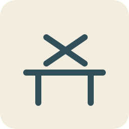

#  A Fair in the Air
background: 

Build toys that move, draw and shine—then make a little garden fair do something impossible.

## `c01` Something that moves
background: 

Jo's invitation says: **Bring something that makes somebody ask, “Can I have a go?”** You have four afternoons, a garden workshop, and a square of orange paper clipped to the bench.

“Start there,” says Jo. “The paper is looking rather pleased with being flat.”

**Goals**
- Make something the breeze can play with. -- `pinwheel`

**Hotspots**
- `pw-paper` Marked paper square
- `pw-cut-paper` Paper with four cut blades
- `pw-folded-rotor` Curved paper rotor
- `pw-bearing-rotor` Rotor on its axle
- `pw-mounted` Pinwheel held at the bench

**Items**
- `pw-paper` Marked paper square

  A tough paper square with centre and corner holes, diagonal cutting lines and clear stopping marks. Reusable bench clips hold it flat; the uncut centre must stay whole.
- `work-scissors` Round-ended scissors

  The scissors cut paper and thin card. They remain a tool after cutting.
- `pw-hub` Corner-gathering hub

  A broad plastic hub with a short hollow neck. Bring each marked corner to the centre and slip its hole over the neck; the other corners stay out as blades.
- `pw-axle` Capped axle and spacer

  A blunt axle, retaining cap, short spacer and two smooth washers sized for the hub. Fit the washers between rotor and handle and leave the cap loose enough for the hub to turn.
- `pw-handle` Wooden handle with axle clip

  The short handle has a prepared clip for the axle and two small mounting holes near its foot.
- `work-hand-fan` Hand fan

  A folding fan for a gentle, repeatable breeze. No motor or electricity.
- `pw-cut-paper` Paper with four cut blades
- `pw-folded-rotor` Curved paper rotor

  The alternate corners meet at the hub. Four curved pockets stand out from the paper; the breeze will push on these instead of a flat square.
- `pw-bearing-rotor` Rotor on its axle
- `pw-mounted` Pinwheel held at the bench
- `pinwheel` Pinwheel

  You open the bench clips and lift the pinwheel into the fan’s gentle breeze. The orange blades spin freely on their spaced axle. At the open door, the garden breeze takes over.

  “Can I—” Jo begins. You hold out the handle before she finishes.

**Combinations**
- `work-scissors` [preserve] + `pw-paper` [transform] -> `pw-cut-paper` (tutorial)
- `pw-hub` [consume] + `pw-cut-paper` [transform] -> `pw-folded-rotor`
- `pw-axle` [consume] + `pw-folded-rotor` [transform] -> `pw-bearing-rotor`
- `pw-handle` [consume] + `pw-bearing-rotor` [transform] -> `pw-mounted`
- `work-hand-fan` [preserve] + `pw-mounted` [transform] -> `pinwheel`

## `c02` The race to the watering can
background: 

The pinwheel is very good at going round and very bad at going anywhere. Jo lays a little chassis in the bench clips; beyond the door, a chalk lane ends at the watering can.

**Goals**
- Send a wind racer down the garden lane. -- `wind-racer`

**Hotspots**
- `wr-chassis` Light wooden chassis
- `wr-bearing-chassis` Chassis with axle bearings
- `wr-rolling-chassis` Wheeled chassis
- `wr-rigged` Racer in the bench clips
- `wr-aimed` Racer facing the breeze

**Items**
- `wr-chassis` Light wooden chassis

  A prepared board with slots for two axle bearings, a mast socket and the same small mounting holes as the pinwheel handle. It is held in the reusable bench clips.
- `wr-bearings` Two smooth bearing tubes

  Short tubes and their push-fit saddles. An axle can turn inside each tube while the tube stays on the chassis.
- `wr-wheelset` Wheels and captive axles

  Two straight axles with four light wheels, spacing collars and soft push-on caps. Each wheel is fixed to its axle; the collars leave a little clearance beside the bearing tubes so both axles turn freely.
- `wr-sailcloth` Light sailcloth

  A small triangular sail with reinforced corner loops.
- `wr-mast` Mast and crossbar

  A short mast with a crossbar, clips for the sail loops and a split foot that fits the chassis socket.
- `wr-starting-gate` Portable starting gate

  A light arch with a hand-lifted bar. Put it across the chalk lane to hold the racer still until its sail is facing the wind.
- `wr-bearing-chassis` Chassis with axle bearings
- `wr-rolling-chassis` Wheeled chassis
- `wr-sail` Sail on its mast

  You clip the sail to the crossbar and mast. The broad surface catches moving air; the wheels will let that push move the whole toy.
- `wr-rigged` Racer in the bench clips
- `wr-aimed` Racer facing the breeze

  You hold the pinwheel beside the sail and turn the racer until both catch the breeze from behind. The pinwheel stays in your hand; it has shown you where the air is going.
- `wind-racer` Wind racer

  You release the racer from its bench clips, lift it to the garden lane and set it behind the starting bar. Up goes the bar. The racer rolls all the way to the watering can.

  Jo crouches at the finish. “Again. I was definitely a very slow watering can.” Above the fence, your younger neighbour Kit’s fingers appear, then two curious eyes. “Can I try it at the fair?”

  “You can be the first driver,” you say. Kit promises to come back. You lift the racer from the lane for another run.

**Combinations**
- `wr-bearings` [consume] + `wr-chassis` [transform] -> `wr-bearing-chassis`
- `wr-wheelset` [consume] + `wr-bearing-chassis` [transform] -> `wr-rolling-chassis`
- `wr-sailcloth` [consume] + `wr-mast` [transform] -> `wr-sail`
- `wr-sail` [consume] + `wr-rolling-chassis` [transform] -> `wr-rigged`
- `pinwheel` [preserve] + `wr-rigged` [transform] -> `wr-aimed`
- `wr-starting-gate` [preserve] + `wr-aimed` [transform] -> `wind-racer`

## `c03` A hill for a marble
background: 

“Something for a windless day?” says Jo. The shallow tray on the bench could become a marble game—if the marble will come back instead of escaping beneath the shed.

**Goals**
- Build a table that returns the marble to the player. -- `pb-return-table`

**Hotspots**
- `pb-tray` Flat game tray
- `pb-railed` Tray with retaining rails
- `pb-sloped` Sloping game tray
- `pb-launcher-table` Table with a launch lane
- `pb-deadspot` Table with a corner trap
- `pb-return-table` Marble-return table

**Items**
- `pb-tray` Flat game tray

  A light plywood tray with prepared rail slots, launcher holes, two flipper holes and carrying handles cut into its sides. Bench clips hold it while you build.
- `pb-rails` Curved side rails

  Two side rails, a curved top rail, a launch-lane divider and a catch apron with push-fit feet. The apron includes a marble storage cup. An inward-curving return lip guides the marble toward it; a slight low spot behind the left lip can trap a marble if the tray leans sideways.
- `pb-wedge` Shallow support wedge

  A broad wedge that clips beneath the far end of the tray, making a gentle slope toward the player.
- `pb-plunger-tube` Launcher tube and plunger

  A closed-back tube with a captive soft-tipped plunger and a pull handle. Its open end fits the table’s side lane.
- `pb-spring` Gentle launcher spring

  A short, low-force spring that fits inside the tube around its captive plunger. The tube encloses it in use.
- `pb-marble` Game marble

  A large marble for the enclosed table. After each test it returns to the catch apron or to your hand.
- `pb-shim` Thin levelling shim

  A broad thin shim for the low corner under the table, with a clip to hold it in place.
- `pb-railed` Tray with retaining rails
- `pb-sloped` Sloping game tray
- `pb-launcher` Enclosed marble launcher

  Pulling the handle squeezes the spring. Letting go makes it push the plunger forward. Its stop limits the push, and the spring stays inside the tube.
- `pb-launcher-table` Table with a launch lane
- `pb-deadspot` Table with a corner trap

  The marble travels up the divided side lane and rolls back, but settles in the low pocket behind the left return lip. The tray leans sideways as well as downhill; the small dip is now lower than its way out.
- `pb-return-table` Marble-return table

  The shim lifts the low corner until the pocket slopes toward the apron. You roll the marble again: it passes the return lip and drops into the catch cup. Jo tries the launcher and gets the same result.

  “A good machine for giving you back your own marble,” she says. “Can we persuade it to do anything on the way?”

**Combinations**
- `pb-rails` [consume] + `pb-tray` [transform] -> `pb-railed`
- `pb-wedge` [consume] + `pb-railed` [transform] -> `pb-sloped`
- `pb-spring` [consume] + `pb-plunger-tube` [transform] -> `pb-launcher`
- `pb-launcher` [consume] + `pb-sloped` [transform] -> `pb-launcher-table`
- `pb-marble` [preserve] + `pb-launcher-table` [transform] -> `pb-deadspot`
- `pb-shim` [consume] + `pb-deadspot` [transform] -> `pb-return-table`

## `c04` One more go
background: 

You leave the marble table in its clips and bring over the flipper parts. Jo puts a chair at the player’s end. “Testing equipment,” she says, sitting down.

**Goals**
- Make a marble game worth another turn. -- `pinball-table`

**Hotspots**
- `pb-return-table` Marble-return table
- `pb-flipper-table` Table with working flippers
- `pb-target-table` Pinball table with three targets
- `pb-short-launch` Pinball table on its gentle setting
- `pb-tuned` Pinball table with a longer launch
- `pb-played` Pinball table after a three-arch run

**Items**
- `work-screwdriver` Stubby screwdriver

  Fits the captive screws on the workshop clamps and prepared toy fittings. It stays a tool.
- `pb-pivot-plate` Flipper pivot plate

  An under-table plate with two captive pivot posts, finger buttons and soft return loops. The posts fit the prepared flipper holes.
- `pb-flipper-blades` Two flipper blades

  A left and right paddle, each with a socket for its pivot post. The short end connects to the finger button; the long end bats the marble.
- `pb-targets` Three target arches

  Wide clip-in arches with different markings. A marble can roll through each without leaving the table.
- `pb-score-wheel` Score wheel

  A numbered card wheel with a captive axle and a clip for the table edge. Turn it by hand after a successful shot.
- `pb-flippers` Button-operated flippers

  Pressing a short button end swings a longer paddle across the table. The soft loop brings each paddle back when you let go.
- `pb-flipper-table` Table with working flippers
- `pb-target-table` Pinball table with three targets
- `pb-short-launch` Pinball table on its gentle setting

  The gentle launch sends the marble back to your flippers for shots at the lower arches. You try for the top arch too. The launcher’s adjustable stop offers a longer launch for that shot.
- `pb-tuned` Pinball table with a longer launch

  You move the captive stop within its marked range. The spring can compress a little farther, while the plunger stays enclosed and its push remains gentle.
- `pb-played` Pinball table after a three-arch run

  The marble reaches the top arch, rolls back and takes a flipper shot through the middle. Jo gets the bottom arch on her turn.

  You have not made the marble stronger. You have given its push somewhere useful to go.
- `pinball-table` Pinball table

  You clip on the score wheel and play a round, turning it one place for each arch. Jo tries to count the watering can as a bonus target. It is nowhere near the table.

  You put the marble in its catch cup, release the bench clips and lift the table by its built-in handles onto the garden trestle. Jo carries the chair. The first stall already has a queue of one.

**Combinations**
- `pb-flipper-blades` [consume] + `pb-pivot-plate` [transform] -> `pb-flippers`
- `pb-flippers` [consume] + `pb-return-table` [transform] -> `pb-flipper-table`
- `pb-targets` [consume] + `pb-flipper-table` [transform] -> `pb-target-table`
- `pb-marble` [preserve] + `pb-target-table` [transform] -> `pb-short-launch`
- `work-screwdriver` [preserve] + `pb-short-launch` [transform] -> `pb-tuned`
- `pb-marble` [preserve] + `pb-tuned` [transform] -> `pb-played`
- `pb-score-wheel` [consume] + `pb-played` [transform] -> `pinball-table`

## `c05` Round and up
background: 

A paper dragon would make a good fairground announcer. A dragon that waved would be better; first you need a machine that turns going round into going up and down.

**Goals**
- Make a crank lift a rod and let it fall again. -- `cd-working-lifter`

**Hotspots**
- `cd-base` Dragon mechanism base
- `cd-bearings` Base with shaft bearings
- `cd-crank-frame` Frame with a turning crankshaft
- `cd-cam-frame` Crankshaft with an off-centre cam
- `cd-lifter` Cam beneath a guided follower
- `cd-lost-contact` Follower losing the cam
- `cd-working-lifter` Reliable cam lifter

**Items**
- `cd-base` Dragon mechanism base

  A small wooden base held in the bench clips, with prepared holes for bearing frames, a guide and the dragon’s body, plus parking clips for a spare cam and the removable crank handle.
- `cd-bearing-frames` Two bearing frames

  Upright frames with smooth shaft holes and captive mounting screws. Both holes sit at the same height.
- `cd-shaft` Crankshaft

  A straight shaft with a crank socket, collars and a capped end. The collars keep it from sliding sideways in its bearings.
- `cd-cam` Off-centre cam

  A smooth round disc whose axle hole sits away from its centre. A split hub fixes it to the crankshaft.
- `cd-follower` Follower rod

  A light rod with a broad, smooth foot and a short two-hole crosshead at the top for independent connecting rods.
- `cd-guide` Follower guide

  A short vertical sleeve with a mounting foot. It lets the rod slide up and down while keeping it over the cam.
- `cd-return-spring` Light follower spring

  A soft tension spring with hooks for the guide bracket and follower collar. It pulls the follower foot gently toward the cam.
- `cd-crank-key` Removable crank handle

  A broad hand crank that fits the shaft’s socket. It can be taken out and used again.
- `cd-bearings` Base with shaft bearings
- `cd-crank-frame` Frame with a turning crankshaft
- `cd-cam-frame` Crankshaft with an off-centre cam

  As the shaft turns, the far edge of the off-centre disc rises and falls. A centred disc would turn without making that change of height.
- `cd-guided-follower` Follower in its guide
- `cd-lifter` Cam beneath a guided follower
- `cd-lost-contact` Follower losing the cam

  You turn the crank. The cam lifts the rod, but the light rod sometimes hangs in its guide as the cam drops away. Its foot loses contact.
- `cd-working-lifter` Reliable cam lifter

  The spring keeps the foot gently against the cam. You turn the crank again: round becomes up, down, up, down, without the rod wandering off sideways.

**Combinations**
- `cd-bearing-frames` [consume] + `cd-base` [transform] -> `cd-bearings`
- `cd-shaft` [consume] + `cd-bearings` [transform] -> `cd-crank-frame`
- `cd-cam` [consume] + `cd-crank-frame` [transform] -> `cd-cam-frame`
- `cd-follower` [transform] + `cd-guide` [consume] -> `cd-guided-follower`
- `cd-guided-follower` [consume] + `cd-cam-frame` [transform] -> `cd-lifter`
- `cd-crank-key` [preserve] + `cd-lifter` [transform] -> `cd-lost-contact`
- `cd-return-spring` [consume] + `cd-lost-contact` [transform] -> `cd-working-lifter`

## `c06` The dragon says hello
background: 

The lifter waits on the bench. Jo brings the dragon’s cut-out pieces, including a very small pair of spectacles. “Entirely optional,” she says. “But it looks as though it has strong opinions about turnips.”

**Goals**
- Give the fair a dragon that waves. -- `crank-dragon`

**Hotspots**
- `cd-working-lifter` Reliable cam lifter
- `cd-mounted-dragon` Dragon body on the mechanism
- `cd-linked-dragon` Dragon linked to its follower
- `cd-first-wave` Dragon giving one wave
- `cd-double-wave` Dragon with a second greeting
- `cd-scaled-dragon` Dragon with a bright scaled back

**Items**
- `cd-cutouts` Dragon body and wing cut-outs

  A stiff card body, two wings and a decorative tail, with prepared hinge holes and base tabs. The body has the spectacles already drawn on it.
- `cd-hinge-pins` Soft hinge pins

  Broad-headed split pins for the two wing pivots and the tail attachment. Spacing collars keep the wings clear of the body, and smooth washers let the card turn freely.
- `cd-linkage` Two jointed wing rods

  Two separate short rods, each with a pivot at both ends. They join the follower’s crosshead to the two wing roots, so each rod can change its angle as its wing turns.
- `cd-double-cam` Two-humped greeting cam

  An exchangeable cam with two rounded rises and falls around its edge, the same shaft fitting and the same maximum lift as the first cam. Its package includes a clip for parking the original cam. To exchange them, stop the mechanism, open the hub and end collar, and withdraw the shaft through its bearings.
- `cd-first-wave` Dragon giving one wave

  One turn gives one rise and fall of the wings. Jo answers with one slow wave. Behind her you notice an old drawing labelled **A fair in the air**, with tiny stalls balanced on an empty outline.

  “I drew that when I was about your age,” she says. “I could make the stalls. I never worked out where to put them.”
- `cd-double-wave` Dragon with a second greeting

  With the crank stopped, you loosen the captive collar and hub, withdraw the shaft far enough to exchange the cams, then slide it back through the bearings and secure both fittings. The original cam parks in its clip. The new cam lifts the follower twice per turn; the separate rods still follow the wings without binding.
- `cd-scales` Bright paper scales

  A row of lightweight, self-adhesive folded scales for the dragon’s back. They leave the wing hinges and linkage clear.
- `cd-jointed-dragon` Jointed card dragon
- `cd-mounted-dragon` Dragon body on the mechanism
- `cd-linked-dragon` Dragon linked to its follower

  The body stays still on its base. When the follower rises, the two rods push the wing roots. Each rod pivots independently while its wing turns about the shoulder hinge.
- `cd-scaled-dragon` Dragon with a bright scaled back
- `crank-dragon` Crank dragon

  You turn the handle: wave-wave, pause, wave-wave. “That one’s for Kit,” you say. You can swap back to the first cam for a slow single greeting.

  You release the base and lift the dragon from the bench, with the spare cam and removable handle parked in their clips. It can perform on any flat table; its little mounting holes remain clear.

**Combinations**
- `cd-hinge-pins` [consume] + `cd-cutouts` [transform] -> `cd-jointed-dragon`
- `cd-jointed-dragon` [consume] + `cd-working-lifter` [transform] -> `cd-mounted-dragon`
- `cd-linkage` [consume] + `cd-mounted-dragon` [transform] -> `cd-linked-dragon`
- `cd-crank-key` [preserve] + `cd-linked-dragon` [transform] -> `cd-first-wave`
- `cd-double-cam` [consume] + `cd-first-wave` [transform] -> `cd-double-wave`
- `cd-scales` [consume] + `cd-double-wave` [transform] -> `cd-scaled-dragon`
- `cd-crank-key` [preserve] + `cd-scaled-dragon` [transform] -> `crank-dragon`

## `c07` A look over the hedge
background: 

Jo’s hat vanishes behind the tall garden screen. Her voice remains. “Can your next invention find out whether I am still in it?”

**Goals**
- See over the screen with both feet on the ground. -- `periscope`

**Hotspots**
- `pe-net` Periscope tube net
- `pe-lined` Periscope net with a dark lining
- `pe-tube` Folded periscope tube
- `pe-upper` Tube with an upper mirror
- `pe-both` Tube with two facing mirrors
- `pe-baffled` Periscope with shaded windows

**Items**
- `pe-net` Periscope tube net

  A stiff card net held flat in the bench clips. It has scored folds, fastening tabs, opposite end windows and prepared mirror ledges at forty-five degrees.
- `pe-lining` Dark inner lining

  Self-adhesive dark paper cut to the inside faces. It absorbs stray light instead of reflecting it around the tube.
- `pe-folder` Smooth folding tool

  A blunt tool for pressing the prepared card creases and locking the tabs.
- `pe-upper-mirror` Upper mirror and clip

  A small unbreakable mirror on a clip that fits the top ledge. Its reflecting face looks down the tube and out of the upper window.
- `pe-lower-mirror` Lower mirror and clip

  A matching mirror for the lower ledge. Its reflecting face looks up the tube and toward the eyepiece; the two mirror surfaces will be parallel.
- `pe-baffles` Soft eyecup and light baffles

  A soft eyecup and two short dark sleeves. They fit around the windows without blocking the mirrors.
- `pe-hat` Jo’s striped hat

  A large floppy hat with a bright stripe. Jo will hold it above the screen while you look through the lower window.
- `pe-lined` Periscope net with a dark lining
- `pe-tube` Folded periscope tube
- `pe-upper` Tube with an upper mirror
- `pe-both` Tube with two facing mirrors

  Light from the upper window reflects down the tube, then off the lower mirror toward your eye. The pair lets you look from a different height.
- `pe-baffled` Periscope with shaded windows
- `periscope` Periscope

  You release the bench clips and lift the tube to the screen. Jo’s hat appears in the lower window; when she moves it left, you see it move left. The hat dips, and her eyes replace it.

  “You found the person too.” You turn toward the pinball stall and see that over the screen as well, with both feet still on the ground.

**Combinations**
- `pe-lining` [consume] + `pe-net` [transform] -> `pe-lined`
- `pe-folder` [preserve] + `pe-lined` [transform] -> `pe-tube`
- `pe-upper-mirror` [consume] + `pe-tube` [transform] -> `pe-upper`
- `pe-lower-mirror` [consume] + `pe-upper` [transform] -> `pe-both`
- `pe-baffles` [consume] + `pe-both` [transform] -> `pe-baffled`
- `pe-hat` [preserve] + `pe-baffled` [transform] -> `periscope`

## `c08` A pocket full of fireworks
background: 

Two mirrors let you look round a corner. Three long mirrors might do something stranger; Jo spreads a few coloured pieces beside a little turning drum.

**Goals**
- Make a pattern that changes whenever you turn it. -- `kaleidoscope`

**Hotspots**
- `ka-strips` Three long mirror strips
- `ka-triangle` Three mirrors in a triangle
- `ka-prism` Bound mirror triangle
- `ka-housed` Mirror triangle inside its tube
- `ka-eye` Mirror tube with an eyepiece
- `ka-drum-scope` Mirror tube with a rotating colour drum
- `ka-sealed` Kaleidoscope ready for light

**Items**
- `ka-strips` Three long mirror strips

  Three equal unbreakable mirror strips held in the bench’s folding cradle, reflecting faces upward.
- `ka-former` Triangular folding former

  A smooth triangular tool with three equal sides. It holds the mirrors with their reflecting faces inward while you close their long edges.
- `ka-tape` Flexible binding tape

  A prepared strip of tough tape for the outside seams of the mirror triangle. Nothing covers the reflecting faces.
- `ka-tube` Protective outer tube

  A light tube with padded mirror supports, a rotating front collar and a prepared eyecap rim.
- `ka-eyecap` Eyecap with a viewing hole

  A dark cap that closes the back of the tube while leaving a small central viewing hole.
- `ka-chips` Coloured translucent shapes

  A few large coloured pieces, including a green triangle and an orange crescent. They must have room to tumble.
- `ka-cell` Clear lidded colour cell

  A shallow clear cell with a snap lid and a rim that fits the tube’s rotating collar. Its depth leaves space for the coloured pieces to move.
- `ka-diffuser` Milky light cover

  A translucent cover for the front of the colour cell. It spreads light behind the loose pieces.
- `work-lantern` Diffused battery lantern

  A small enclosed low-voltage lantern with its battery fitted and a broad milky light face. Its light is gentle enough for viewing the toys.
- `ka-triangle` Three mirrors in a triangle

  Each mirror reflects the other mirrors as well as what is at the end. Those reflections can repeat a small view into a much larger pattern.
- `ka-prism` Bound mirror triangle
- `ka-housed` Mirror triangle inside its tube
- `ka-eye` Mirror tube with an eyepiece
- `ka-colour-drum` Colour drum with loose shapes

  You close the lid with space around the shapes. Tilt the drum and they slide; packing it full would stop the changing pattern.
- `ka-drum-scope` Mirror tube with a rotating colour drum
- `ka-sealed` Kaleidoscope ready for light
- `kaleidoscope` Kaleidoscope

  You lift the finished tube from the cradle and aim its covered end toward the lantern. The green triangle becomes a ring of green points around orange stars. Turn the drum, and the stars fall into a new pattern.

  Jo takes a turn. For once, she says nothing at all.

**Combinations**
- `ka-former` [preserve] + `ka-strips` [transform] -> `ka-triangle`
- `ka-tape` [consume] + `ka-triangle` [transform] -> `ka-prism`
- `ka-tube` [consume] + `ka-prism` [transform] -> `ka-housed`
- `ka-eyecap` [consume] + `ka-housed` [transform] -> `ka-eye`
- `ka-chips` [consume] + `ka-cell` [transform] -> `ka-colour-drum`
- `ka-colour-drum` [consume] + `ka-eye` [transform] -> `ka-drum-scope`
- `ka-diffuser` [consume] + `ka-drum-scope` [transform] -> `ka-sealed`
- `work-lantern` [preserve] + `ka-sealed` [transform] -> `kaleidoscope`

## `c09` The tall thing that must not wobble
background: 

Jo lifts a basket onto the fair’s little stage. “A crane could do this,” you say. She lowers the basket again. “Then it can have my job. Start with somewhere solid to stand.”

**Goals**
- Build a crane frame that resists bending sideways. -- `lc-wide-frame`

**Hotspots**
- `lc-base` Crane base board
- `lc-mast` Base with an upright mast
- `lc-braced` Mast with triangular braces
- `lc-boom-frame` Crane frame with a hinged boom
- `lc-stayed` Crane boom held by its stay
- `lc-pulley-frame` Crane frame with a tip pulley
- `lc-wide-frame` Braced crane with spreading feet

**Items**
- `lc-base` Crane base board

  A wide base board held in the bench clips. It has prepared mast sockets, winch holes and sockets for spreading feet.
- `lc-uprights` Mast uprights and crosspiece

  Two upright beams joined by a crosspiece, with captive mounting screws and a prepared top hinge.
- `lc-braces` Diagonal mast braces

  Two stiff diagonal struts with captive end fasteners. They join the mast to the base to make triangles.
- `lc-boom` Light crane boom

  A hollow beam with a root hinge, a tip clevis socket and an eye for its support stay.
- `lc-hinge` Captive boom hinge pin

  A broad-headed pin and soft retaining cap sized for the boom root and mast hinge.
- `lc-stay` Boom support stay

  A fixed-length cord with captive hooks for the mast top and boom eye. It holds the boom above the work area.
- `lc-pulley-wheel` Grooved pulley wheel

  A smooth wheel with a deep rope groove and a prepared axle hole.
- `lc-clevis` Pulley fork and axle

  A small fork with a captive blunt axle, retaining cap and a mounting foot for the boom tip.
- `lc-feet` Spreading crane feet

  Two broad folding feet with locking clips. They widen the base in the direction the boom reaches.
- `lc-mast` Base with an upright mast
- `lc-braced` Mast with triangular braces

  A rectangular frame can lean into a diamond. The diagonal braces hold the corners apart, so sideways force cannot change the angles so easily.
- `lc-hinged-boom` Boom with its captive hinge pin
- `lc-boom-frame` Crane frame with a hinged boom
- `lc-stayed` Crane boom held by its stay
- `lc-pulley-block` Pulley in its fork

  The rope will run over the wheel instead of scraping around the end of the boom. This single fixed pulley changes the pull’s direction; it does not halve the weight.
- `lc-pulley-frame` Crane frame with a tip pulley
- `lc-wide-frame` Braced crane with spreading feet

  The feet make a wider patch of ground to stand on. Jo nudges the mast gently; its triangles hold their shape.

  “The basket is being patient,” she says. “I am nearly as good at it.”

**Combinations**
- `lc-uprights` [consume] + `lc-base` [transform] -> `lc-mast`
- `lc-braces` [consume] + `lc-mast` [transform] -> `lc-braced`
- `lc-hinge` [consume] + `lc-boom` [transform] -> `lc-hinged-boom`
- `lc-hinged-boom` [consume] + `lc-braced` [transform] -> `lc-boom-frame`
- `lc-stay` [consume] + `lc-boom-frame` [transform] -> `lc-stayed`
- `lc-pulley-wheel` [transform] + `lc-clevis` [consume] -> `lc-pulley-block`
- `lc-pulley-block` [consume] + `lc-stayed` [transform] -> `lc-pulley-frame`
- `lc-feet` [consume] + `lc-pulley-frame` [transform] -> `lc-wide-frame`

## `c10` Please hold
background: 

The frame can stand up. Now the crane must lift a load, keep it there, and bring it down without flinging it into Jo’s tomatoes.

**Goals**
- Lift a basket, hold it, and lower it gently. -- `lifting-crane`

**Hotspots**
- `lc-wide-frame` Braced crane with spreading feet
- `lc-winch-frame` Crane with a hand winch
- `lc-rigged` Crane with a lifting line
- `lc-tipping` Crane lifting at its back feet
- `lc-balanced` Crane with rear ballast
- `lc-ratchet-frame` Crane with a holding pawl

**Items**
- `lc-drum` Winding drum and bearing bracket

  A small drum on a shaft with two bearing brackets, rope anchor and captive mounting screws.
- `lc-crank-wheel` Crank and toothed ratchet wheel

  A long hand crank and toothed wheel that lock onto the drum shaft. The wheel can later accept a holding pawl.
- `lc-rope` Lifting cord and closed hook

  A soft cord with a closed snap hook at one end and an anchor loop at the other. It fits the drum and pulley groove.
- `lc-test-load` Small padded test weight

  A light, soft-edged weight with a lifting loop. Jo keeps a hand beside it during the first low lift; it returns to the bench after the test.
- `lc-ballast` Rear ballast block

  A low block with a captive clip for the back of the crane base. Its weight opposes the forward turning effect of the load.
- `lc-pawl` Holding pawl and release lever

  A pivoted pawl, light spring and hand lever that attach beside the toothed wheel. It lets the drum turn while lifting and catches when it tries to unwind.
- `lc-basket` Small cargo basket

  A shallow basket with a lifting loop and a handful of light wooden play blocks already inside.
- `lc-winch` Hand winch

  The crank turns the drum, winding in cord. A longer crank gives your hand more turning effect, although your hand travels farther for each drum turn.
- `lc-winch-frame` Crane with a hand winch
- `lc-rigged` Crane with a lifting line
- `lc-tipping` Crane lifting at its back feet

  You loosen the bench clips for a low test, keeping a hand beside the load. As the weight rises, the back feet begin to lift. You lower it immediately and secure the base again.

  The frame has stayed stiff. The whole crane is trying to tip.
- `lc-balanced` Crane with rear ballast

  The block sits low behind the mast. You repeat the low lift and lower the test weight again: this time all the feet stay on the bench.
- `lc-ratchet-frame` Crane with a holding pawl

  The pawl clicks over the teeth while you wind in. If you stop turning, it catches a tooth instead of letting the drum unwind. To lower, hold the crank before easing the release lever.
- `lifting-crane` Lifting crane

  You hook the basket, raise it just above the miniature stage and stop cranking. The pawl holds. Jo gently guides the hanging basket sideways over the nearby platform, within the boom’s reach. With the crank in your hand, you ease the lever and lower the basket onto it.

  “A delivery service,” says Jo, moving one play block into place. You bring the basket back to the base, undo the bench clips and lift the complete crane to its garden stall.

**Combinations**
- `lc-crank-wheel` [consume] + `lc-drum` [transform] -> `lc-winch`
- `lc-winch` [consume] + `lc-wide-frame` [transform] -> `lc-winch-frame`
- `lc-rope` [consume] + `lc-winch-frame` [transform] -> `lc-rigged`
- `lc-test-load` [preserve] + `lc-rigged` [transform] -> `lc-tipping`
- `lc-ballast` [consume] + `lc-tipping` [transform] -> `lc-balanced`
- `lc-pawl` [consume] + `lc-balanced` [transform] -> `lc-ratchet-frame`
- `lc-basket` [consume] + `lc-ratchet-frame` [transform] -> `lifting-crane`

## `c11` A motor makes a wiggle
background: 

On the third afternoon, the dragon waves because you keep turning its handle. Jo sets a little motor on the bench. “This one will keep turning for us. What could we make that is interesting to watch?” You stretch a bright cord between your hands.

**Goals**
- Make a motor send a wiggle down a cord. -- `wm-running`

**Hotspots**
- `wm-base` Long wave-machine base
- `wm-post-frame` Base with cord posts
- `wm-motor-frame` Wave frame with a motor
- `wm-driver-frame` Wave frame with an eccentric driver
- `wm-belt-frame` Wave frame with a belt drive
- `wm-cord-frame` Wave frame with a loose cord
- `wm-tensioned` Wave frame with a tensioned cord
- `wm-guarded` Guarded string-wave machine
- `wm-running` Cord with a travelling wiggle

**Items**
- `wm-controller` Battery and speed controller

  A compatible enclosed low-voltage battery holder with cells fitted, an on-off switch, speed dial and keyed plug. Its clips fit the base; start with the switch off.
- `wm-running` Cord with a travelling wiggle

  You plug in the controller, turn it on and slowly increase the speed. The peg keeps shaking one end; a disturbance travels along the cord and reflects from the far end.
- `wm-base` Long wave-machine base

  A light base held in the bench clips, with prepared holes for two end posts, a motor cradle, driver bearings and a soundbox, plus small clips for parking a removable bridge and pick.
- `wm-posts` Cord posts and tension screw

  Two short posts with captive fittings. One carries the cord anchor and an adjustable tension screw; the other supports the driver bearing.
- `wm-motor` Small low-voltage motor

  An ordinary compatible motor module with a capped drive pulley and insulated plug lead. It has no battery connected.
- `wm-cradle` Motor cradle

  A fitting cradle with a retaining strap, captive screws and soft isolation mounts. It holds the motor clear of the wooden base.
- `wm-driver` Eccentric cord driver

  A small pulley wheel on its own bearing, with a captive swivel peg a little off centre. The swivel lets the cord move without twisting up.
- `wm-belt` Soft drive belt

  A short rubber belt sized for the motor pulley and driver pulley. It will run behind a cover.
- `wm-cord` Bright flexible cord

  A long, light nylon cord with prepared end loops. One loop fits the driver swivel, the other the tension spring.
- `wm-spring` Cord tension spring

  A small extension spring with closed end hooks. It links the cord to the adjustable post and keeps a steady pull on it.
- `wm-guard` Clear drive guard

  A transparent snap-on cover for the motor pulleys and belt, with a smooth opening for the moving cord and a slot for the electrical plug.
- `wm-post-frame` Base with cord posts
- `wm-mounted-motor` Motor secured in its cradle
- `wm-motor-frame` Wave frame with a motor
- `wm-driver-frame` Wave frame with an eccentric driver

  The swivel peg follows a small circle instead of sitting at the axle centre. It will keep disturbing one end of the cord while the far end stays anchored.
- `wm-belt-frame` Wave frame with a belt drive
- `wm-cord-frame` Wave frame with a loose cord
- `wm-tensioned` Wave frame with a tensioned cord
- `wm-guarded` Guarded string-wave machine

  The clear cover keeps fingers away from the belt and pulleys. Through it you can still trace the movement: motor, belt, off-centre peg, cord. The motor remains disconnected until its controller arrives.

**Combinations**
- `wm-posts` [consume] + `wm-base` [transform] -> `wm-post-frame`
- `wm-motor` [transform] + `wm-cradle` [consume] -> `wm-mounted-motor`
- `wm-mounted-motor` [consume] + `wm-post-frame` [transform] -> `wm-motor-frame`
- `wm-driver` [consume] + `wm-motor-frame` [transform] -> `wm-driver-frame`
- `wm-belt` [consume] + `wm-driver-frame` [transform] -> `wm-belt-frame`
- `wm-cord` [consume] + `wm-belt-frame` [transform] -> `wm-cord-frame`
- `wm-spring` [consume] + `wm-cord-frame` [transform] -> `wm-tensioned`
- `wm-guard` [consume] + `wm-tensioned` [transform] -> `wm-guarded`

- `wm-controller` [consume] + `wm-guarded` [transform] -> `wm-running`

## `c12` Watch it. Hear it.
background: 

The cord is already dancing. Jo folds a tiny paper rider. “Does the cord travel with the wiggle?” You have a way to find out.

**Goals**
- Make waves you can watch, then play the cord like a string. -- `wave-machine`

**Hotspots**
- `wm-running` Cord with a travelling wiggle
- `wm-marked` Wave cord with a paper rider
- `wm-looping` Cord making two broad loops
- `wm-soundbox-frame` Wave machine with a soundbox
- `wm-bridged` Cord resting on a movable bridge
- `wm-quiet` Wave machine on soft feet

**Items**
- `wm-rider` Light paper rider

  A tiny folded paper flag with a loose soft clip. It can mark one place on the cord without holding it still.
- `wm-tension-key` Tension-adjusting key

  A blunt key for the post’s captive adjustment screw. Small turns change the cord’s tension; the marked limits keep the spring within its working stretch.
- `wm-soundbox` Hollow wooden soundbox

  A light open-backed box with a thin top and clips for the base. A bridge can pass a vibrating string’s movement into its broad top.
- `wm-bridge` Movable string bridge

  A smooth, low wooden bridge with a shallow cord notch. It rests on the soundbox and can slide along the cord to change the length free to vibrate.
- `wm-footpads` Soft foot pads

  Four self-adhesive pads for the base feet. They reduce the buzz passed into the workbench without touching the cord.
- `wm-pick` Soft plectrum

  A broad flexible pick for plucking the cord with the motor switched off.
- `wm-marked` Wave cord with a paper rider

  The rider bobs around its own place while the disturbance travels past it. A wave can move along the cord without carrying that piece of cord all the way to the other end.
- `wm-looping` Cord making two broad loops

  You adjust the tension a little at a time and tune the speed. At one setting, two broad loops keep their places, separated by a nearly still point. Disturbances travelling in opposite directions are meeting in a repeating pattern.
- `wm-soundbox-frame` Wave machine with a soundbox
- `wm-bridged` Cord resting on a movable bridge

  The bridge gives the moving cord another firm contact point. Moving it changes the length between contacts, so the old wave pattern changes too. It also passes vibration into the soundbox.
- `wm-quiet` Wave machine on soft feet

  You fit the pads and run the motor again. The table buzz fades while the cord still moves. You switch the drive off before trying the cord as an instrument.
- `wave-machine` String-wave machine

  With the drive off, you tighten the cord within its marked range and pluck it. The soundbox makes the twang easier to hear. Slide the bridge to leave a shorter vibrating length and pluck again: the note rises.

  You release the bench clips and lift the complete machine into the garden, with its pick in the parking clip. Restore the earlier tension and speed, park the bridge, and the broad dancing loops return. Jo listens from the pinball chair while you switch the motor off and try a two-note tune.

**Combinations**
- `wm-rider` [consume] + `wm-running` [transform] -> `wm-marked`
- `wm-tension-key` [preserve] + `wm-marked` [transform] -> `wm-looping`
- `wm-soundbox` [consume] + `wm-looping` [transform] -> `wm-soundbox-frame`
- `wm-bridge` [consume] + `wm-soundbox-frame` [transform] -> `wm-bridged`
- `wm-footpads` [consume] + `wm-bridged` [transform] -> `wm-quiet`
- `wm-pick` [preserve] + `wm-quiet` [transform] -> `wave-machine`

## `c-air-1` A hand at the far end
background: 

Kit has left a note through the fence: **Can there be a game where you pick things up without touching them?** You set a long light handle on the bench. Jo supplies two wooden jaws. “We could borrow a crab’s idea.”

**Goals**
- Make jaws that close together and spring open again. -- `air-hand-grabber`

**Hotspots**
- `air-beam` Grabber beam
- `air-jawed` Beam with hinged jaws
- `air-guided` Grabber with a guided slider
- `air-linked` Grabber with linked jaws
- `air-actuated` Grabber with an output syringe
- `air-sprung` Grabber with a return band
- `air-hand-grabber` Grabber working by hand

**Items**
- `air-beam` Grabber beam

  A light wooden beam with a handgrip, prepared jaw pivots at its far end and holes for a slider guide and syringe cradle. Bench clips hold it while you build.
- `air-jaws` Two crab-shaped jaws

  Two short wooden levers with rounded gripping ends, hinge washers and captive pivot pins. Their short rear arms will connect to a sliding crosshead.
- `air-slider` Slider and straight guide

  A smooth crosshead with two link holes, a straight guide rail and captive mounting clips. It moves along the beam without twisting sideways.
- `air-links` Two separate jaw links

  Two short rods with a pivot at each end. They connect the crosshead to the short rear arms of the jaws. Moving the slider forward spreads those rear arms and brings the gripping ends together.
- `air-output-syringe` Needleless output syringe

  A smooth-moving toy syringe with no needle and no liquid. Its plunger starts almost fully in; air entering its nozzle can push the plunger out.
- `air-cradle` Output-syringe cradle

  A clip-in barrel support with a soft strap, captive fasteners and a plunger-end clip. It holds the syringe in line with the slider, with the nozzle toward the handle and the plunger toward the jaws.
- `air-return-band` Light return band

  A soft elastic loop with prepared anchor hooks. It pulls the slider back, opening the jaws and returning the output plunger into its barrel.
- `air-test-block` Light wooden test block

  A small smooth block to grip and release. It returns to the table after each test.
- `air-jawed` Beam with hinged jaws
- `air-guided` Grabber with a guided slider
- `air-linked` Grabber with linked jaws

  Slide the crosshead forward and the two links change their angles separately. The short arms spread; the long jaw tips close. As the jaws turn, each link swings on both its pivots.
- `air-mounted-syringe` Output syringe in its cradle
- `air-actuated` Grabber with an output syringe
- `air-sprung` Grabber with a return band
- `air-hand-grabber` Grabber working by hand

  You move the crosshead forward with a fingertip. The jaws close around the block. Let go, and the band draws the slider back: the jaws open and the block drops gently onto the bench.

  “Good crab,” says Jo. “Now we need to tell it what to do from the other end.”

**Combinations**
- `air-jaws` [consume] + `air-beam` [transform] -> `air-jawed`
- `air-slider` [consume] + `air-jawed` [transform] -> `air-guided`
- `air-links` [consume] + `air-guided` [transform] -> `air-linked`
- `air-output-syringe` [transform] + `air-cradle` [consume] -> `air-mounted-syringe`
- `air-mounted-syringe` [consume] + `air-linked` [transform] -> `air-actuated`
- `air-return-band` [consume] + `air-actuated` [transform] -> `air-sprung`
- `air-test-block` [preserve] + `air-sprung` [transform] -> `air-hand-grabber`

## `c-air-2` A squeeze travels
background: 

The jaws wait at the far end of their beam. Jo holds up a length of clear tube. “There will be something inside this,” she says. “Even when it looks empty.”

**Goals**
- Pick up pretend fruit with a squeeze from the handle. -- `pneumatic-grabber`

**Hotspots**
- `air-hand-grabber` Grabber working by hand
- `air-connected` Grabber with an air line
- `air-squeezing` Grabber closing from a distance
- `air-padded` Grabber with soft gripping pads
- `air-routed` Grabber with a secured air line

**Items**
- `air-control-syringe` Needleless hand syringe

  A matching smooth-moving toy syringe with a broad thumb pad. Its plunger is drawn out to the marked starting line, holding air ready to push through the tube.
- `air-tube` Flexible air tube

  A clear tube long enough to run from the jaws to the handgrip. Its snug push-fit ends match the two syringe nozzles; it contains air, not water.
- `air-grip-pads` Soft jaw pads

  Two thin rubbery pads with peel-off backs. Their surfaces grip a light object without needing a hard squeeze.
- `air-tube-clips` Tube clips and hand-syringe holder

  Gentle clips that hold the tube along the beam without flattening it, plus a holder beside the handgrip. A loose loop leaves room to move the hand syringe.
- `air-fruit-game` Sponge fruit and collecting cup

  Light coloured sponge shapes and a little cup. Scatter the pretend fruit beyond easy finger reach, then try to bring it back with the grabber.
- `air-control-line` Hand syringe with an air tube
- `air-connected` Grabber with an air line

  You fit the tube to the output syringe’s nozzle. Both connections are snug, and the air is enclosed between the two plungers.
- `air-squeezing` Grabber closing from a distance

  You press the hand syringe. The trapped air compresses a little, then pushes the far plunger out against the return band. The jaws close around the block. The squeeze feels springy; the two plungers do not copy each other’s travel exactly.

  Ease your thumb and let the hand plunger move back: the band opens the jaws. Your hand supplied the push; the air carried it along the tube.
- `air-padded` Grabber with soft gripping pads

  The pads spread the contact and add grip. You try the block again: the jaws can hold it with a gentler squeeze, then let it go cleanly.
- `air-routed` Grabber with a secured air line
- `pneumatic-grabber` Pneumatic grabber

  You release the beam from its bench clips and lift it by the handgrip. Reach out, squeeze, bring back a sponge plum, ease your thumb: it drops into the cup. All the syringe parts and tubing travel with the grabber.

  Jo places a sponge pear a little farther away. “The crab requests a longer lunch break.” You put Kit’s note beside the game. This one has its first player waiting already.

**Combinations**
- `air-tube` [consume] + `air-control-syringe` [transform] -> `air-control-line`
- `air-control-line` [consume] + `air-hand-grabber` [transform] -> `air-connected`
- `air-test-block` [preserve] + `air-connected` [transform] -> `air-squeezing`
- `air-grip-pads` [consume] + `air-squeezing` [transform] -> `air-padded`
- `air-tube-clips` [consume] + `air-padded` [transform] -> `air-routed`
- `air-fruit-game` [preserve] + `air-routed` [transform] -> `pneumatic-grabber`

## `c-film-1` A drum for a tiny picture show
background: 

Jo finds a strip of blank picture frames while clearing the bench. You draw a fish in the air with your finger: up, over, splash. “Could we make that happen inside a drum?”

**Goals**
- Build a drum that turns smoothly and lets you peek through its wall. -- `film-turning-drum`

**Hotspots**
- `film-wall` Marked drum-wall strip
- `film-slotted` Drum wall with viewing slits
- `film-cylinder` Dark slotted cylinder
- `film-shell` Drum with a round floor
- `film-turning-drum` Turning picture drum

**Items**
- `film-wall` Marked drum-wall strip

  A stiff dark card strip held flat in the bench clips. Twelve evenly spaced slit outlines start at its top edge; a stopping line keeps their lower ends above the picture area. Its lower edge has prepared floor tabs.
- `film-joining-tape` Drum seam tape

  A strong self-adhesive strip for joining the wall into a cylinder at its marked seam. It leaves all twelve viewing slits clear.
- `film-floor` Round drum floor

  A light prepared disc with a centred mounting socket and twelve matching tab slots. It keeps the wall round.
- `film-base` Broad picture-drum base

  A stable wooden foot with a prepared upright-axle socket and soft pads beneath it.
- `film-bearing` Spindle and turning platform

  A blunt upright axle, sleeve bearing, spacing washers, retaining cap and a small rotating platform. The axle fixes into the base; the platform turns around it and fits the drum floor’s central socket.
- `film-slotted` Drum wall with viewing slits
- `film-cylinder` Dark slotted cylinder
- `film-shell` Drum with a round floor
- `film-turntable` Picture-drum turntable
- `film-turning-drum` Turning picture drum

  You seat the floor on the platform and give the rim a gentle push. The drum turns around its upright axle while the broad base stays still. Twelve narrow windows pass your eye, one after another.

  Jo peers through a slit. “An excellent picture show about an empty drum.”

**Combinations**
- `work-scissors` [preserve] + `film-wall` [transform] -> `film-slotted`
- `film-joining-tape` [consume] + `film-slotted` [transform] -> `film-cylinder`
- `film-floor` [consume] + `film-cylinder` [transform] -> `film-shell`
- `film-bearing` [consume] + `film-base` [transform] -> `film-turntable`
- `film-turntable` [consume] + `film-shell` [transform] -> `film-turning-drum`

## `c-film-2` A fish that never gets wet
background: 

The drum is ready for a picture show of its own. Your fish will have a crooked tail, a determined nose and twelve chances to get back into the water.

**Goals**
- Make a little fish leap, splash and leap again. -- `animation-drum`

**Hotspots**
- `film-turning-drum` Turning picture drum
- `film-loaded-drum` Drum with a leaping-fish strip

**Items**
- `film-blank-strip` Twelve-frame picture strip

  A blank strip divided into twelve equal frames, with a waterline across them and a marked overlap tab. It fits inside the drum below the slits, with one frame per slit interval and pictures facing inward.
- `film-pencil` Drawing pencil

  A soft pencil with an eraser for planning the fish’s positions and adjusting the joining frames.
- `film-fish-stencil` Crooked-tail fish stencil

  Your original little fish outline cut into a thin reusable stencil. Move it, turn it and trace it with the pencil so the same fish keeps its shape through the jump.
- `film-colours` Bright colouring pencils

  Orange for the fish, blue for the water and yellow for one small fin. The same colours will help each pose look like the same creature.
- `film-key-poses` Strip with four main fish poses

  In frame one the nose breaks the water. Frame four catches the fish at the top of its leap; frame seven sends it diving down; frame ten holds the spreading ripples. The empty frames are space for the movements between.
- `film-drawn-strip` Twelve drawings of one fish

  You trace the in-between poses, changing the fish’s position and angle a little at a time. In the last frame its nose waits just below the waterline, ready to meet the first frame again.
- `film-coloured-strip` Coloured leaping-fish strip
- `film-loaded-drum` Drum with a leaping-fish strip
- `animation-drum` Animation drum

  You lift the finished base from the bench clips and set it beside the lantern. Look over the rim while it turns: the pictures smear past. Lower your eye to the slits, and the orange fish leaps—splash!—then leaps again.

  Each slit gives a brief glimpse of the next drawing, with darkness between. Those separate views let you see a sequence of poses as movement instead of a continuous blur. Turn the drum the other way and the splash gathers itself into a fish.

  You draw the fish once more with a much wider back. “A whale could carry the little stalls on your old plan.” Jo brings the unfinished drawing down from its shelf and makes room beside it for yours.

**Combinations**
- `film-pencil` [preserve] + `film-blank-strip` [transform] -> `film-key-poses`
- `film-fish-stencil` [preserve] + `film-key-poses` [transform] -> `film-drawn-strip`
- `film-colours` [preserve] + `film-drawn-strip` [transform] -> `film-coloured-strip`
- `film-coloured-strip` [consume] + `film-turning-drum` [transform] -> `film-loaded-drum`
- `work-lantern` [preserve] + `film-loaded-drum` [transform] -> `animation-drum`

## `c13` A robot with somewhere to go
background: 

On the fourth afternoon, the fair needs invitations. You could draw every one. Or you could make something that draws and then drives over to deliver it.

Jo produces two small gearmotors. “These turn slowly enough to be useful. A very fast motor would mostly deliver itself into a chair.”

**Goals**
- Make the wheels answer your remote -- `rover-tested`

**Hotspots**
- `rover-deck`
- `rover-rolling-deck`
- `rover-driven-deck`
- `rover-powered-deck`
- `rover-switched-deck`
- `rover-radio-deck`
- `guarded-rover`
- `rover-tested`

**Items**
- `rover-tested` Rover with tested wheel drives

  With its wheels raised in the jig, the rover answers the remote: both wheels forward, one wheel faster, both stopped. The batteries provide the energy; radio carries the instructions. You set it back on its wheels. Now it can earn a pen.
- `rover-remote` Matching remote
- `rover-remote-cells` Remote batteries
- `rover-powered-remote` Working remote
- `rover-deck` Rover deck

  A little birch platform with ready-drilled mounting holes. It is held in a bench jig while you fit the underside.
- `rover-caster` Ball caster
- `rover-gearmotors` Matched gearmotors

  Two low-voltage motors, reduction gears, brackets and short leads. One drives each side.
- `rover-wheels` Rubber wheels
- `rover-drive-pair` Wheel drives

  Each wheel locks to a gearbox output. Inside the supplied gearboxes, fast motor rotation becomes slower wheel rotation with more turning force.
- `rover-pack` Rover battery pack

  An enclosed low-voltage holder with matching cells already fitted. Its plug matches the fused switch harness.
- `rover-switch` Switch harness

  A ready-made fused low-voltage harness with an off switch and matching plugs.
- `rover-radio` Receiver and motor driver

  The receiver listens to the matching remote. Its motor driver sends the battery's power to the two motors separately.
- `rover-covers` Gear guards
- `rover-rolling-deck` Deck with caster
- `rover-driven-deck` Three-point rover

  Two driven wheels and a free-turning ball support the deck. Different wheel speeds will turn it; no steering axle is needed.
- `rover-powered-deck` Rover with battery
- `rover-switched-deck` Switched rover
- `rover-radio-deck` Radio rover

  Two motor plugs go to two separate driver outputs. The receiver can change one wheel without changing the other; that is how this rover will steer.
- `guarded-rover` Guarded rover

  The wheels turn freely and the little gears are covered. Now it needs a driver with a pen.

**Combinations**
- `rover-wheels` [consume] + `rover-gearmotors` [transform] -> `rover-drive-pair`
- `rover-caster` [consume] @ `rover-deck` [transform] -> `rover-rolling-deck`
- `rover-drive-pair` [consume] @ `rover-rolling-deck` [transform] -> `rover-driven-deck`
- `rover-pack` [consume] @ `rover-driven-deck` [transform] -> `rover-powered-deck`
- `rover-switch` [consume] @ `rover-powered-deck` [transform] -> `rover-switched-deck`
- `rover-radio` [consume] @ `rover-switched-deck` [transform] -> `rover-radio-deck`
- `rover-covers` [consume] @ `rover-radio-deck` [transform] -> `guarded-rover`

- `rover-remote-cells` [consume] + `rover-remote` [transform] -> `rover-powered-remote`
- `rover-powered-remote` [preserve] @ `guarded-rover` [transform] -> `rover-tested`

## `c14` Sign your name badly
background: 

The test paper is on the patio. You have promised Jo a beautifully written invitation.

“I will also accept a magnificent squiggle,” she says.

**Goals**
- Make a rover that can draw, steer and lift its pen -- `drawing-rover`

**Hotspots**
- `rover-tested`
- `rover-pen-deck`
- `rover-looping`
- `rover-trimmed`
- `rover-line-tested`
- `rover-lifting-pen`

**Items**
- `rover-pen` Felt-tip pen
- `rover-pen-clip` Spring pen clip
- `rover-pen-mount` Clipped pen
- `rover-trim-driver` Small trim screwdriver
- `rover-paper` Test-paper roll
- `rover-pen-lift` Pen-lift lever

  A small lever and hinge. Flip it by hand to raise the spring clip between drawings.
- `rover-pen-deck` Rover with pen
- `rover-looping` Rover drawing a curve

  Both wheels turn, but “straight ahead” draws a gentle curve. One motor is a little quicker. The receiver has a trim adjustment for just this problem.
- `rover-trimmed` Trimmed rover

  A small turn of the trim screw balances the wheel speeds. You have changed the control, not straightened the drawing after the fact.
- `rover-line-tested` Rover drawing a straight line

  A long teal line crosses the paper. Steering one wheel faster bends it into a loop.
- `rover-lifting-pen` Rover with pen lift
- `drawing-rover` Drawing rover

  You lift the pen, drive to a fresh patch, lower it, and draw a ridiculous looping whale. Then you pick the rover off its test stops. Jo writes **YOU ARE INVITED** inside the whale.

**Combinations**
- `rover-pen` [consume] + `rover-pen-clip` [transform] -> `rover-pen-mount`
- `rover-pen-mount` [consume] @ `rover-tested` [transform] -> `rover-pen-deck`
- `rover-powered-remote` [preserve] @ `rover-pen-deck` [transform] -> `rover-looping`
- `rover-trim-driver` [preserve] @ `rover-looping` [transform] -> `rover-trimmed`
- `rover-paper` [consume] @ `rover-trimmed` [transform] -> `rover-line-tested`
- `rover-pen-lift` [consume] @ `rover-line-tested` [transform] -> `rover-lifting-pen`
- `rover-powered-remote` [preserve] @ `rover-lifting-pen` [transform] -> `drawing-rover`

## `c15` Put the night in a box
background: 

Your paper whale needs stars. Real ones are inconveniently far away.

The next box has a low-power lamp, a turning handle and room for a miniature night sky. First, you need to find out what its shadows actually look like.

**Goals**
- Build a box that can turn a sky of stars -- `theatre-wheel-box`

**Hotspots**
- `theatre-box`
- `theatre-lined`
- `theatre-lit-box`
- `theatre-powered-box`
- `theatre-wheel-box`
- `theatre-blurry`

**Items**
- `theatre-box` Theatre box
- `theatre-foil` Reflective lining
- `theatre-lamp` LED lamp module

  A small cool-running LED in a holder, with its current-limiting resistor already fitted.
- `theatre-battery` Lamp battery pack
- `theatre-lead` Switched lamp lead
- `theatre-power` Switched lamp supply
- `theatre-card` Black card disc
- `theatre-punch` Star hole punch
- `theatre-stars` Star disc
- `theatre-spindle` Disc spindle
- `theatre-shadow-wheel` Shadow wheel
- `theatre-lined` Reflective theatre box

  The bright lining sends some otherwise lost light back toward the star disc. Its foil is kept clear of the electrical contacts.
- `theatre-lit-box` Theatre with lamp
- `theatre-powered-box` Powered theatre
- `theatre-wheel-box` Theatre with star wheel

  The spindle holds the disc between the lamp and the front opening. Light passes through its little holes; turning the disc will move those patches of light.
- `theatre-blurry` Blurry star theatre

  The disc turns, and pale blobs travel across the screen. They move beautifully. They are not yet stars.

**Combinations**
- `theatre-foil` [consume] @ `theatre-box` [transform] -> `theatre-lined`
- `theatre-lamp` [consume] @ `theatre-lined` [transform] -> `theatre-lit-box`
- `theatre-battery` [consume] + `theatre-lead` [transform] -> `theatre-power`
- `theatre-power` [consume] @ `theatre-lit-box` [transform] -> `theatre-powered-box`
- `theatre-card` [transform] + `theatre-punch` [preserve] -> `theatre-stars`
- `theatre-stars` [consume] + `theatre-spindle` [transform] -> `theatre-shadow-wheel`
- `theatre-shadow-wheel` [consume] @ `theatre-powered-box` [transform] -> `theatre-wheel-box`

## `c16` The stars come out early
background: 

At dusk, you hang a white cloth between the apple trees. Your stars ought to be big enough for everyone to see.

Jo holds the box while you look for a sharp image. “A blurry universe has its charms. Let's try a focused one.”

**Goals**
- Bring a turning night sky into focus -- `shadow-theatre`

**Hotspots**
- `theatre-wheel-box`
- `theatre-blurry`
- `theatre-focus-box`
- `theatre-hooded`
**Items**
- `theatre-lens` Convex projection lens
- `theatre-slider` Sliding lens holder
- `theatre-focus` Adjustable lens assembly
- `theatre-hood` Dark lens hood
- `theatre-handwheel` Star-wheel handle
- `theatre-cloth` Hanging projection cloth
- `theatre-focus-box` Projector with focusing lens

  Sliding the lens changes where the star disc forms a sharp image. This is a projector: the light passes through the holes, then the lens forms their image on the cloth.
- `theatre-hooded` Hooded star projector

  The hood catches stray light around the lens. The projected dark spaces become darker, so the stars stand out.
- `shadow-theatre` Star theatre

  You turn the handle. A whole sky wheels across the cloth. The image is upside down; for your invented constellations, that is entirely acceptable.

  You put the projector beside the drawing Jo has kept for years. “Your dragon could ride here,” you say, pointing to the front deck. “And this could put stars over everyone.”

  Jo lays the rover’s wobbly whale beside your animation drawing. “Your fish has grown into its new job.”

**Combinations**
- `theatre-cloth` [preserve] @ `theatre-wheel-box` [transform] -> `theatre-blurry`
- `theatre-lens` [consume] + `theatre-slider` [transform] -> `theatre-focus`
- `theatre-focus` [consume] @ `theatre-blurry` [transform] -> `theatre-focus-box`
- `theatre-hood` [consume] @ `theatre-focus-box` [transform] -> `theatre-hooded`
- `theatre-handwheel` [consume] @ `theatre-hooded` [transform] -> `shadow-theatre`

## `c17` The thing that should not happen
background: 

“I could build every part except the flying,” Jo says. “Then my friend sent this.”

Inside a padded tin is a violet tile. **Experimental lift tile. Apply power to lift. Disconnect to stop.**

This part is invented science. Real batteries cannot make a tile ignore gravity. In this workshop, this one can. You still have to find out how much it lifts—and keep hold of it.

**Goals**
- Test the tile inside a tethered stand -- `lift-load-tested`

**Hotspots**
- `lift-base`
- `lift-tethered-base`
- `lift-guided-base`
- `lift-ready`
- `lift-rising`
- `lift-load-tested`

**Items**
- `lift-base` Test-stand base
- `lift-posts` Guide posts
- `lift-tether` Short safety tether
- `lift-tile` Experimental lift tile

  A violet tile in a protective rim. In this invented technology its force points upward, even if the tile tilts. The force is limited and lasts only while powered; the tile does not make electricity.
- `lift-pack` Tile battery pack
- `lift-switch` Spring-return test switch
- `lift-switched-pack` Hold-to-lift supply
- `lift-cradle` Tile cradle with hanging supports

  The tile sits at the top. Four rigid supports hold the load tray beneath it, so the weight can hang below the point providing lift.
- `lift-cradled-tile` Cradled lift tile
- `lift-weight` Test weight
- `lift-tethered-base` Tethered test base
- `lift-guided-base` Guided lift stand
- `lift-ready` Tile in test stand
- `lift-rising` Rising tile stand

  You hold the switch. The tile rises until the short tether catches it. Let go, and it settles back onto the padded base. It has no propeller and no balloon. Jo laughs once, very loudly.
- `lift-load-tested` Loaded lift test

  With the weight clipped beneath it, the tile rises more slowly. The battery must now support the tile, the cradle and the extra weight. The test is small; the grin is not.

**Combinations**
- `lift-tether` [consume] @ `lift-base` [transform] -> `lift-tethered-base`
- `lift-posts` [consume] @ `lift-tethered-base` [transform] -> `lift-guided-base`
- `lift-tile` [consume] + `lift-cradle` [transform] -> `lift-cradled-tile`
- `lift-switch` [consume] + `lift-pack` [transform] -> `lift-switched-pack`
- `lift-cradled-tile` [consume] @ `lift-guided-base` [transform] -> `lift-ready`
- `lift-switched-pack` [consume] @ `lift-ready` [transform] -> `lift-rising`
- `lift-weight` [consume] @ `lift-rising` [transform] -> `lift-load-tested`

## `c18` Up is the easy part
background: 

The tile lifts. A fair also needs to come down where you want it.

You set out a tray, a sliding weight and a control unit that can vary the current. The tile stays on its short tether throughout the experiment.

**Goals**
- Make a balanced lift module with a reliable stop -- `balanced-lift`

**Hotspots**
- `lift-load-tested`
- `lift-tray-test`
- `lift-tilting-test`
- `lift-balanced-test`
- `lift-variable-test`
- `lift-stop-test`

**Items**
- `lift-tray` Slotted load tray
- `lift-offset-load` Off-centre test block
- `lift-slider` Sliding counterweight
- `lift-control` Current controller and replacement harness

  The new harness replaces the hold-to-lift test switch. Its dial varies the lift smoothly and its plug accepts a long control lead. Disconnect the battery before changing harnesses.
- `lift-stop` Latching power-cut switch
- `lift-crane-sling` Short lifting sling
- `lift-tray-test` Tile with load tray
- `lift-tilting-test` Tilting lift tray

  The tray's loaded end dips. Upward force alone does not keep a lopsided load level.
- `lift-balanced-test` Level lift tray

  The counterweight slides away from the heavy end until the tray hangs level. The total load is greater, so it now needs a little more lift.
- `lift-variable-test` Adjustable lift module
- `lift-stop-test` Stopped lift module

  The big switch cuts the tile's power even while the controller asks for lift. The short tether and padded base keep this a gentle test. With the controller at zero, you disconnect the battery and reset the latched stop before moving the module.
- `lift-supported-module` Crane with lifting sling

  You unhook its cargo basket and leave that on the bench, then clip the sling to the crane's closed hook.
- `balanced-lift` Balanced lift module

  The crane takes the weight while you undo the stand's wingnuts. The two test blocks stay on the bench, and you slide the counterweight back to the centre for the empty tray. You release the stand tether and lift out one complete module: tile above, tray and battery below, with counterweight, controller and stop switch. The old test switch stays with the stand.

**Combinations**
- `lift-tray` [consume] @ `lift-load-tested` [transform] -> `lift-tray-test`
- `lift-offset-load` [consume] @ `lift-tray-test` [transform] -> `lift-tilting-test`
- `lift-slider` [consume] @ `lift-tilting-test` [transform] -> `lift-balanced-test`
- `lift-control` [consume] @ `lift-balanced-test` [transform] -> `lift-variable-test`
- `lift-stop` [consume] @ `lift-variable-test` [transform] -> `lift-stop-test`
- `lift-crane-sling` [consume] + `lifting-crane` [transform] -> `lift-supported-module`
- `lift-supported-module` [preserve] @ `lift-stop-test` [transform] -> `balanced-lift`

**Items**
**Hotspots**
## `c19` A whale without a sea
background: 

You put your rover's whale drawing beside Jo's old plan. Hers has more measurements. Yours has a much better smile.

The flying fair will be the size of a large model boat. No passengers. Plenty of room for a dragon.

**Goals**
- Build a light frame that keeps its shape -- `whale-braced-frame`

**Hotspots**
- `whale-keel`
- `whale-ribbed`
- `whale-spined`
- `whale-tailed`
- `whale-decked`
- `whale-braced-frame`

**Items**
- `whale-keel` Whale keel

  A long light wooden spine, clamped flat in the building jig.
- `whale-ribs` Slotted ribs
- `whale-top-spar` Upper spar
- `whale-tail` Light whale tail

  Two light panels joined to a rigid root that slots into the keel. It is a fixed tail, not a steering mechanism.
- `whale-deck` Slatted fair deck

  A light prepared deck on two crosspieces, with mounting holes for the attractions.
- `whale-brace-cord` Diagonal brace cord
- `whale-tensioners` Brace tensioners
- `whale-braces` Adjustable diagonal braces
- `whale-ribbed` Ribbed whale frame
- `whale-spined` Whale frame with upper spar
- `whale-tailed` Tailed whale frame
- `whale-decked` Whale frame with deck

  The deck spreads each attraction’s weight across several ribs. It is a platform with a route for forces to reach the frame, not a loose floor resting on paper.
- `whale-braced-frame` Braced whale frame

  The diagonal cords stop the rectangles leaning into diamonds. You can see straight through the whale and still recognize it.

**Combinations**
- `whale-ribs` [consume] @ `whale-keel` [transform] -> `whale-ribbed`
- `whale-top-spar` [consume] @ `whale-ribbed` [transform] -> `whale-spined`
- `whale-tail` [consume] @ `whale-spined` [transform] -> `whale-tailed`
- `whale-deck` [consume] @ `whale-tailed` [transform] -> `whale-decked`
- `whale-brace-cord` [consume] + `whale-tensioners` [transform] -> `whale-braces`
- `whale-braces` [consume] @ `whale-decked` [transform] -> `whale-braced-frame`

## `c20` Leave room for the workings
background: 

You could wrap the whole whale beautifully and discover afterwards that its switch was inside.

You decide to keep the useful bits reachable.

**Goals**
- Skin the whale and fit its lift module -- `whale-lift-fitted`

**Hotspots**
- `whale-braced-frame`
- `whale-skinned`
- `whale-hatched`
- `whale-finned`
- `whale-mounted`
- `whale-lift-fitted`

**Items**
- `whale-skin` Cut translucent paper skin

  Light blue panels with an opening left over the service bay. The prepared tabs line up with the ribs.
- `whale-hatch` Hinged service hatch
- `whale-fins` Stiffened fins

  Two paper fins with light rods already fitted along their leading edges. Their tabs fit the side ribs.
- `whale-module-mount` Padded module mount

  Straps and a padded upper cradle secure the tile high on the frame; lower straps hold the tray and battery below the deck.
- `whale-stop-extension` Exterior stop-button extension
- `whale-skinned` Paper-skinned whale
- `whale-hatched` Whale with service hatch

  The hatch opens over the controller and counterweight. Closing it finishes the shape without sealing away the things you will need to adjust.
- `whale-finned` Whale with fins

  The fixed fins give the paper body its whale silhouette. They are not wings and do not make lift; that job belongs entirely to the tile.
- `whale-mounted` Whale with module mount
- `whale-lift-inside` Whale carrying lift module
- `whale-lift-fitted` Whale with outside stop button

  The violet tile is secured beneath the upper spar, above the fair deck. Its battery and counterweight sit low in the service bay, so the whale's weight hangs below the lift. A pushrod links the red exterior button to the module's stop switch.

**Hotspots**
- `whale-lift-inside`

**Combinations**
- `whale-skin` [consume] @ `whale-braced-frame` [transform] -> `whale-skinned`
- `whale-hatch` [consume] @ `whale-skinned` [transform] -> `whale-hatched`
- `whale-fins` [consume] @ `whale-hatched` [transform] -> `whale-finned`
- `whale-module-mount` [consume] @ `whale-finned` [transform] -> `whale-mounted`
- `balanced-lift` [consume] @ `whale-mounted` [transform] -> `whale-lift-inside`
- `whale-stop-extension` [consume] @ `whale-lift-inside` [transform] -> `whale-lift-fitted`

## `c21` The dragon gets a ticket
background: 

The dragon fits the front deck. It has been practising its wave all afternoon.

The star theatre will ride behind it. Every ordinary part still has a job; the strange tile only holds the whole thing up.

**Goals**
- Secure the two travelling attractions -- `whale-loaded`

**Hotspots**
- `whale-lift-fitted`
- `whale-dragon-seat`
- `whale-dragon-aboard`
- `whale-theatre-seat`
- `whale-theatre-aboard`
- `whale-loaded`

**Items**
- `fair-dragon-bracket` Dragon bracket

  A matching bracket with captive locking pins. Its cable clips leave the crank socket clear.
- `fair-theatre-bracket` Theatre bracket

  A matching bracket with captive locking pins, cable clips and a tilt adjustment for aiming the projector.
- `fair-power-divider` Fused accessory supply

  A separate small battery pack and two switched low-voltage outlets. Disconnect and remove the theatre's old battery before connecting its lamp to this supply. The lift tile keeps its own supply.
- `whale-dragon-seat` Whale with dragon mount
- `whale-dragon-aboard` Whale with dragon aboard

  The same mounting holes from the little bench toy fit the deck bracket. Its follower, both pivoting links and the spare cam all come aboard with it. Jo checks that the wings can still complete their sweep.
- `whale-theatre-seat` Whale with theatre mount
- `whale-theatre-aboard` Whale with both attractions

  The projector sits behind the dragon, with its lens pointing clear of the wings. The two attractions need their own space to work, not just enough space to fit.
- `whale-loaded` Loaded fair whale

  The dragon's crank socket and the theatre's spindle still turn freely. Their hand handles are parked in the workshop. The bracket clips hold wires away from both; a motor will need an actual connection to each shaft.

**Hotspots**
**Combinations**
- `fair-dragon-bracket` [consume] @ `whale-lift-fitted` [transform] -> `whale-dragon-seat`
- `crank-dragon` [consume] @ `whale-dragon-seat` [transform] -> `whale-dragon-aboard`
- `fair-theatre-bracket` [consume] @ `whale-dragon-aboard` [transform] -> `whale-theatre-seat`
- `shadow-theatre` [consume] @ `whale-theatre-seat` [transform] -> `whale-theatre-aboard`
- `fair-power-divider` [consume] @ `whale-theatre-aboard` [transform] -> `whale-loaded`

## `c22` Who turns the handles?
background: 

You hold up a hand underneath the whale.

“Excellent,” says Jo. “Now imagine it another metre higher.”

The handles need a slow motor. The dragon and the stars want different speeds.

**Goals**
- Drive the attractions at their own speeds -- `whale-running-fair`

**Hotspots**
- `whale-loaded`
- `whale-motor-fitted`
- `whale-dragon-driven`
- `whale-theatre-driven`
- `whale-drive-guarded`

**Items**
- `fair-mounted-motor` Clutched motor assembly

  A slow gearmotor in a bracket, with a slip clutch and a keyed output shaft. Its plug matches the accessory supply.
- `fair-dragon-coupler` Flexible crank coupler
- `fair-reduction` Reducing belt-drive set

  A small pulley for the motor shaft, a larger pulley for the theatre spindle, and their matching soft belt. The mounted shafts stay parallel; the larger pulley turns more slowly.
- `fair-guard` Clear drive cover
- `fair-accessory-switch` Accessory-switch key
- `whale-motor-fitted` Whale with accessory motor
- `whale-dragon-driven` Motor-driven dragon whale
- `whale-theatre-driven` Whale with slower star wheel

  The small pulley pulls the belt past the large pulley. The large pulley takes longer to go round, so the stars drift while the dragon waves briskly.
- `whale-drive-guarded` Guarded fair drive
- `whale-running-fair` Working fair whale

  One switch: the dragon gives two wing-waves per turn, and stars crawl over the workshop wall. The clutch slips gently if you hold the dragon still. You switch everything off before the lifting test.

**Combinations**
- `fair-mounted-motor` [consume] @ `whale-loaded` [transform] -> `whale-motor-fitted`
- `fair-dragon-coupler` [consume] @ `whale-motor-fitted` [transform] -> `whale-dragon-driven`
- `fair-reduction` [consume] @ `whale-dragon-driven` [transform] -> `whale-theatre-driven`
- `fair-guard` [consume] @ `whale-theatre-driven` [transform] -> `whale-drive-guarded`
- `fair-accessory-switch` [preserve] @ `whale-drive-guarded` [transform] -> `whale-running-fair`

**Items**
## `c23` The first flight is ten centimetres
background: 

The whale is complete enough to be dangerous to its own paper nose. So its first flight will be ten centimetres above a padded landing cradle.

The two attractions have moved the weight. The balance that worked for an empty tray will not do.

**Goals**
- Balance the loaded whale and test its emergency stop -- `whale-low-tested`

**Hotspots**
- `whale-running-fair`
- `whale-short-tethered`
- `whale-ready-low`
- `whale-nose-down`
- `whale-trimmed`
- `whale-hovering-low`

**Items**
- `flight-short-tether` Low test tether

  A short line with a frame clip and weighted anchor, limiting this first lift to ten centimetres.
- `flight-mat` Padded landing cradle

  Two curved sides joined by crossbars, with thick felt where the keel rests. Its broad padded tray catches the short emergency-stop test.
- `flight-control-lead` Long lift-control lead
- `flight-trim-handle` Counterweight adjustment handle
- `flight-level` Bubble level
- `flight-stop-cord` Stop cord with pivoted lever

  A bracket and right-angle lever fit beside the exterior stop button. Pulling the cord turns the lever and presses the button. A return spring keeps the lever clear when released.
- `whale-short-tethered` Whale on low tether
- `whale-ready-low` Whale above landing mat
- `whale-nose-down` Nose-heavy hovering whale

  The dragon end sinks. You cut the power; the whale rests in the cradle. The lift works, but the fair's weight is uneven.
- `whale-trimmed` Rebalanced fair whale
- `whale-hovering-low` Level low-hovering whale

  The bubble sits between its marks. The whale lifts evenly, its short tether taut. The ordinary counterweight has solved a problem the extraordinary tile could not.
- `whale-low-tested` Low-tested whale

  Pulling the cord presses the exterior stop button and cuts lift immediately. The whale drops the short test distance into the padded cradle. This emergency stop is different from a landing: to land gently, you turn the current down gradually. With the controller at zero and the battery disconnected, you reset the latched stop for the next flight.

**Combinations**
- `flight-short-tether` [consume] @ `whale-running-fair` [transform] -> `whale-short-tethered`
- `flight-mat` [consume] @ `whale-short-tethered` [transform] -> `whale-ready-low`
- `flight-control-lead` [consume] @ `whale-ready-low` [transform] -> `whale-nose-down`
- `flight-trim-handle` [preserve] @ `whale-nose-down` [transform] -> `whale-trimmed`
- `flight-level` [preserve] @ `whale-trimmed` [transform] -> `whale-hovering-low`
- `flight-stop-cord` [consume] @ `whale-hovering-low` [transform] -> `whale-low-tested`

## `c24` A place to come home
background: 

The garden has a tree, a fence and a great many places where you do not want a paper whale.

You choose the clear patch beside the cloth screen. Three separate tether lines will limit height and stop the whale turning away from its audience. Jo will handle the lines while you lower it into its cradle.

**Goals**
- Give the whale a clear flight space and a landing cradle -- `whale-garden-ready`

**Hotspots**
- `whale-low-tested`
- `whale-garden-tethered`
- `whale-aimed`

**Items**
- `flight-long-tether` Three-line garden tether rig

  Three measured lines, three weighted ground anchors and three separated frame clips. Replace the short test line. At full height all three lines are taut: they limit drift and turning as well as height. They stay below the branches.
- `flight-aiming-wedge` Projector aiming wedge
- `flight-rehearsal-remote` Tether-side control panel

  The panel includes a long low-voltage accessory extension lead and a master switch, plus the lift-control connection. The two supplies remain electrically separate. The stop cord remains separate and reachable.
- `whale-garden-tethered` Whale on garden tether
- `whale-aimed` Whale aimed at garden screen
- `whale-garden-ready` Garden-ready flying fair

  With the whale still in its cradle, you check the three lines, the ground controls and the clear path to the cloth. Jo takes the handling lines. The complete airborne show can wait until the guests are here.

**Combinations**
- `flight-long-tether` [consume] @ `whale-low-tested` [transform] -> `whale-garden-tethered`
- `flight-aiming-wedge` [consume] @ `whale-garden-tethered` [transform] -> `whale-aimed`
- `flight-rehearsal-remote` [consume] @ `whale-aimed` [transform] -> `whale-garden-ready`

## `c25` Can I have a go?
background: 

The gate clicks. Kit has brought biscuits and the very serious cardboard hat.

Kit takes the promised first turn with the wind racer, then uses the crab grabber to fetch a sponge pear. “This is exactly the ridiculous game I wanted.”

The pinball marble clicks past its arches. Somebody looks through the periscope; somebody else is still turning the kaleidoscope. A paper rider dances on the wave machine. Fish leap round and round inside the animation drum.

“One last invitation,” you tell the rover. Jo stands at the whale's control panel, trying to look as if this happens every Saturday.

**Goals**
- Welcome the guests and open the flying fair -- `fair-in-the-air`

**Hotspots**
- `whale-garden-ready`
- `fair-bannered`
- `fair-whale-alight`
- `fair-in-the-air`

**Items**
- `fair-bannered` Whale with welcome banner

  You hang the banner across the grounded cradle, clear of the tether lines. The two controls are ready beside it.
- `fair-rover-paper` Long welcome banner
- `fair-written-banner` Rover-drawn welcome banner

  The rover makes the border in glorious loops. You write WELCOME in the middle. Kit adds a whale with a cardboard hat.
- `fair-start-key` Lift-control key

  The removable key enables the ground controller. Turn its dial up gradually; the separate red stop cord remains reachable.
- `fair-whale-alight` Whale full of moving stars

  You turn on the accessory supply. The dragon waves. Stars travel across the cloth. Now for the part of Jo's drawing that never worked.
- `fair-in-the-air` A fair in the air

  The whale lifts clear of its cradle. Its three tethers tighten. The little dragon waves above the garden, beneath a sky it has brought along itself.

  Kit looks up. Then at the control panel.

  “Can I have a go?”

  You make room beside you. “Start with the dragon.” Jo is laughing, looking from the whale to her old drawing and back again. “Mine never got off the paper.”

**Combinations**
- `drawing-rover` [preserve] + `fair-rover-paper` [transform] -> `fair-written-banner`
- `fair-written-banner` [consume] @ `whale-garden-ready` [transform] -> `fair-bannered`
- `fair-accessory-switch` [preserve] @ `fair-bannered` [transform] -> `fair-whale-alight`
- `fair-start-key` [preserve] @ `fair-whale-alight` [transform] -> `fair-in-the-air`

## `c26` Yours to make
background: 

The fair runs until the last biscuit disappears. Then you turn down the lift while Jo guides the lines, switch off both supplies, and leave the whale sleeping in its cradle.

The rover is parked beside its very bad whale drawing. The dragon has stopped mid-wave. Inside its frame, you can still follow every link back to the cam.

The lift tile belongs to this story. The other mechanisms are real ideas to explore—with suitable materials, tools and help.

On the bench is an empty box. You have already started looking at it differently.
