# Mission to Mars

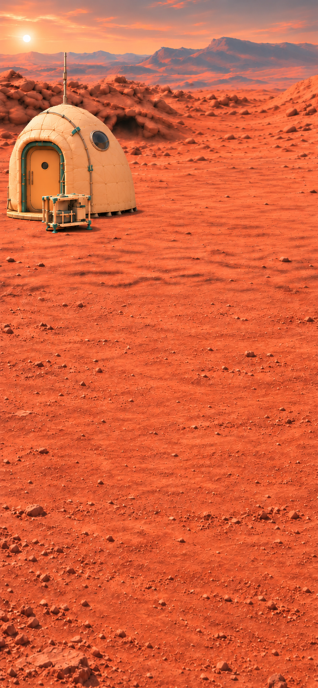

Your lander crashes badly onto the surface. Can you patch things up and complete your science mission?

> NOTE: Promoted from the accepted Mars v12 reference on 4 November 2026. Fixed identities and recipes implement the 24-chapter story in design-brief.md. The unchanged v12 manuscript, production sources and review records are preserved under projects/mars-study/. Future revisions belong to this live copy. Chapter identifiers remain stable when chapters move.

> NOTE: Visual austerity applies throughout: every component must be original compact mission equipment, finite repurposed packing/service hardware or the minimum locally made part needed for the work. Add no decorative hardware, furniture, trim or new resources. Plain useful forms, hand markings and visible repairs carry the character.

## Crash landing

*Emergency*

The stabilizer fin broke. I can't steer. We're coming in hot.

*Crash*

> NOTE: The thin reinforced-fabric starter habitat begins partly deflated. A patch closes its puncture; stored breathing gas then expands it without switching on any lamp. Electric lights remain off until the power chapter. A selected subrounded 25–30 cm stone fits below a sound low cross-member; the original legs continue carrying the lander. The astronaut rolls this stone a short distance, rather than carrying a boulder. The stone fits the existing gap below the sound lower cross-member just right of the ladder. It is an unloaded catch against further settling: the astronaut does not lift, jack or change the lander height. It remains until the permanent support is fitted. The astronaut stays suited outside through the next chapter.

**Goals**
- Stabilize the habitat -- `breathable-habitat`
- Stabilize the lander -- `rock-supported-lander`

**Hotspots**
- `deflated-habitat` (at 22.75641%, 20.7346%)
  - icon: 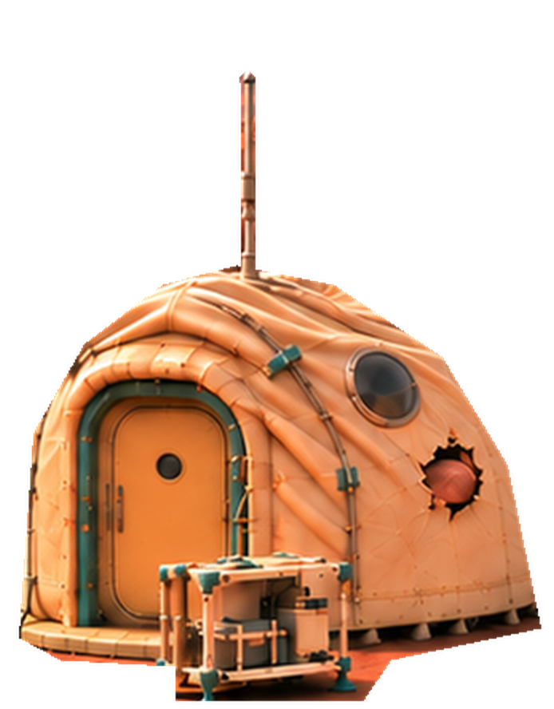
- `patched-habitat` (at 22.75641%, 20.76422%)
  - icon: 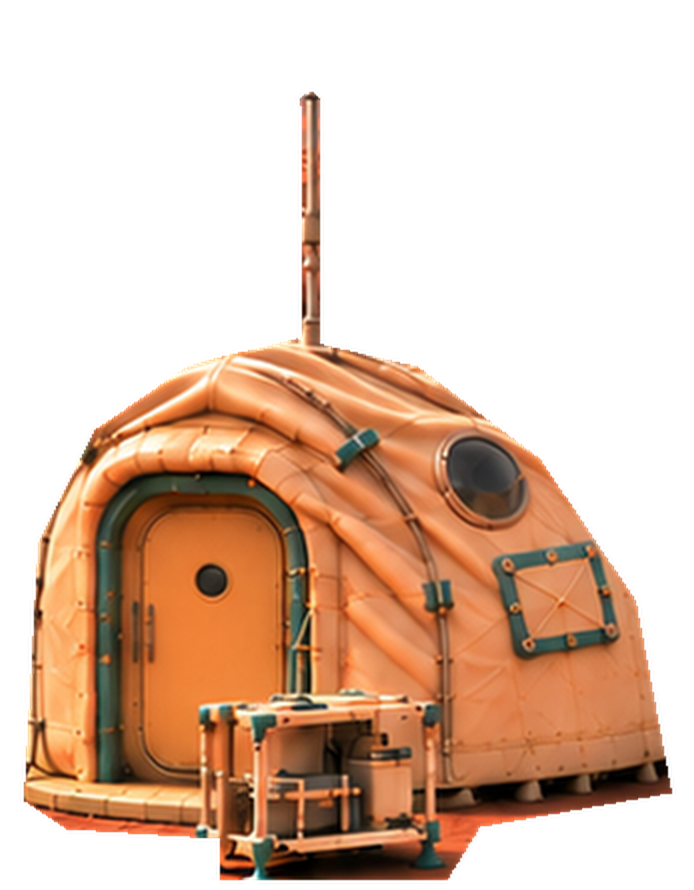
- `breathable-habitat` (at 22.75641%, 20.76422%)
  - icon: 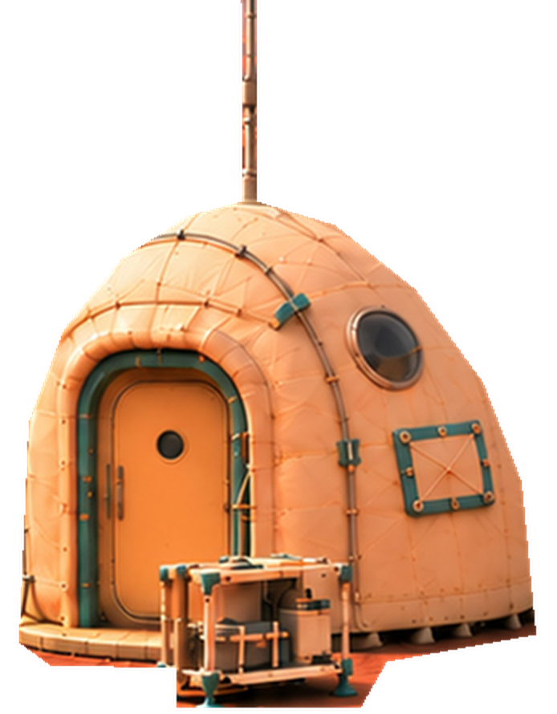
- `damaged-lander` (at 71.47436%, 22.63033%)
  - icon: 
- `rock-supported-lander` (at 71.47436%, 22.65995%)
  - icon: 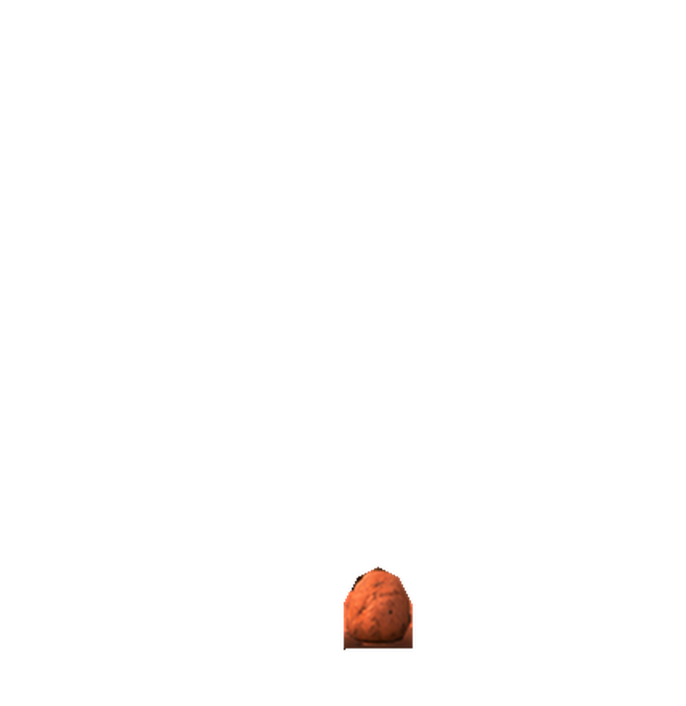

**Items**
- `deflated-habitat` Deflated habitat
  - icon: 

- `patched-habitat` Patched habitat
  - icon: 

  The blast blew rocks into the hab, but I’ve sealed the holes. Now it needs air.

- `breathable-habitat` Inflated habitat
  - icon: 

  The fabric lifts and pulls taut. The lamps are still dark.

- `damaged-lander` Damaged landing support
  - icon: 

- `rock-supported-lander` Lander with safety catch
  - icon: 

  I roll the stone into the gap beneath the lower cross-member. Nothing rises. If the damaged support settles farther, the stone will catch it.

- `pressure-patch` Pressure patch
  - icon: 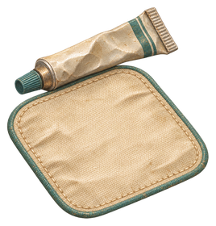

- `air-tanks` Air tanks
  - icon: 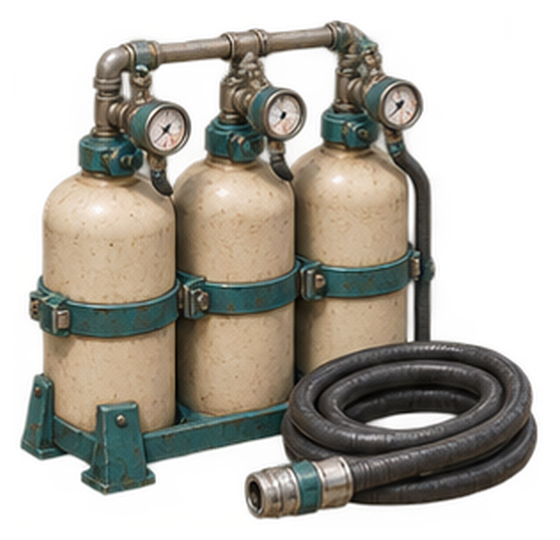

- `rock` Rock
  - icon: 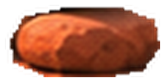

  A rounded stone with one broad bearing face. Too heavy to carry, but I can roll it a short distance.

**Combinations**
- `pressure-patch` [consume] @ `deflated-habitat` [transform] -> `patched-habitat` (tutorial)
- `air-tanks` [consume] @ `patched-habitat` [transform] -> `breathable-habitat`
- `rock` [consume] @ `damaged-lander` [transform] -> `rock-supported-lander`

## Air

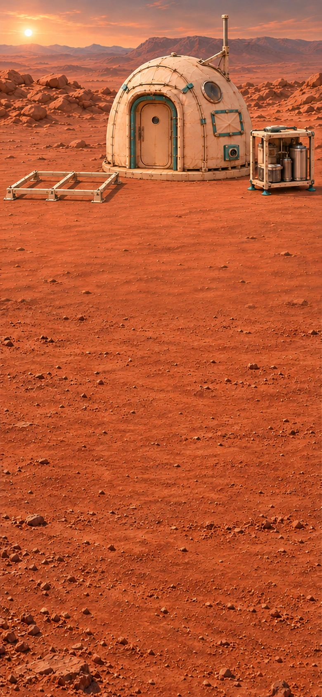

I need to power the hab’s air scrubber before the air runs out.

> NOTE: The astronaut stays suited outside. The deployed and powered solar panels retain a tight receiving rectangle over the panels. Their full cable artwork can extend beyond that rectangle. The scrubber has its own complete cable overlay and equipment-sized receiver, so either cable can be connected without hiding the other. The power goals disclose solar, scrubber and reserve charging in that order; communications is an independent goal. Three fixed identities are present at most. Cables are compatible dedicated lengths. The original array stays left of the starter dome and the scrubber right. Small reclaimed components mentioned later come from spares, not from disabling this life-support equipment. The steel pin is recovered in the following water chapter, keeping it out of this chapter’s cable work.

**Goals**
- Restore solar power -- `station-power`
- next: Restore the air scrubber -- `habitat-scrubber`[`power-cable`]
- next: Recharge the reserve battery -- `charged-reserve-battery`
- Restore comms -- `antenna-mount`[`unseated-antenna`]

**Hotspots**
- (three hotspots are a lot but okay here because the array connection, air scrubber and antenna mounting have three distinct physical jobs)
- `solar-array-base` (at 38.01282%, 21.71209%)
  - icon: 
  - hitbox: (at 20.19231%, 26.83649%) (size 38.33333%, 4.73934%)
- `deployed-solar-array` (at 38.01282%, 21.71209%)
  - icon: 
  - hitbox: (at 20.19231%, 23.63744%) (size 38.33333%, 11.49289%)
- `station-power` (at 38.01282%, 21.71209%)
  - icon: 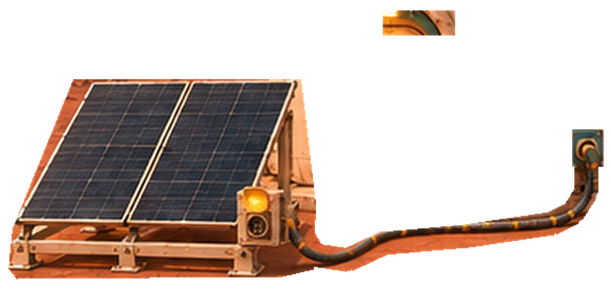
  - hitbox: (at 20.19231%, 23.63744%) (size 38.33333%, 11.49289%)
- `habitat-scrubber` (at 84.87179%, 23.31161%)
  - icon: 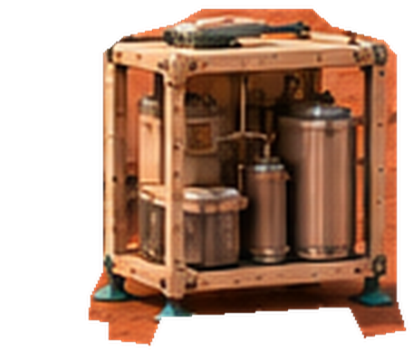
  - hitbox: (at 87.94872%, 23.19313%) (size 22.56410%, 10.84123%)
- `antenna-mount` (at 73.78205%, 5.89455%)
  - icon: 

**Items**
- `solar-array-base` Solar-panel base
  - icon: 

- `solar-panels` Solar panels
  - icon: 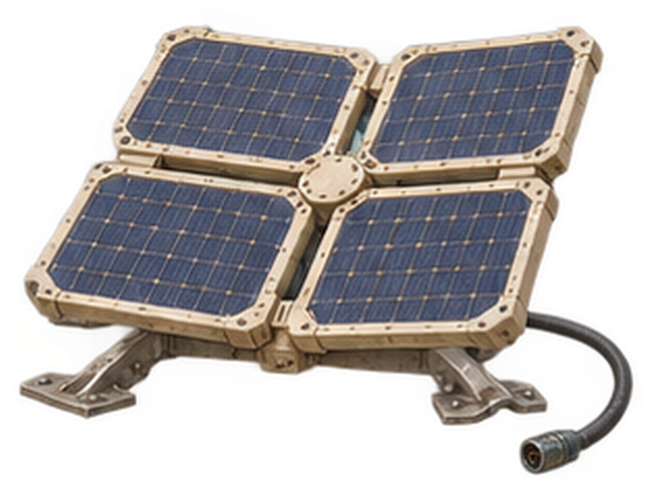

- `deployed-solar-array` Deployed solar panels
  - icon: 

- `station-power` Powered solar panels
  - icon: 

- `power-cable` Power cable
  - icon: 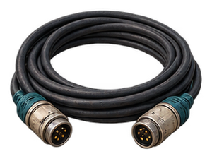

  Compatible lengths from the service supplies; each connection keeps its own cable.

- `habitat-scrubber` Air scrubber (compound)
  - icon: 
  - unnamed slot: accepts `power-cable`, icon: 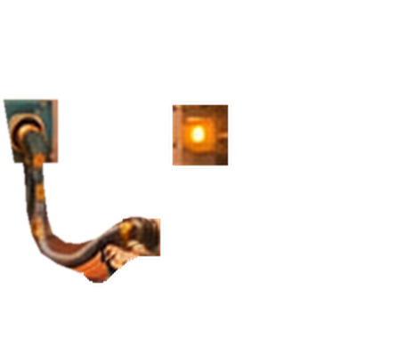

- `antenna-mount` Antenna mounting (compound)
  - icon: 
  - unnamed slot: accepts `unseated-antenna`, icon: 

  [`unseated-antenna`] *Comms established*

  “Mara here, mission control. That looked bad. What’s the damage?”

- `unseated-antenna` Unseated antenna
  - icon: 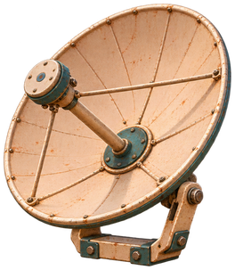

- `reserve-battery` Reserve battery
  - icon: 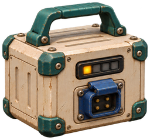

  A removable module from the station’s essential reserve.

- `charged-reserve-battery` Charged reserve battery
  - icon: 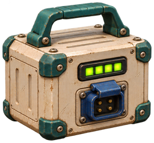

  This battery will power the air scrubber overnight.

**Combinations**
- `solar-panels` [consume] @ `solar-array-base` [transform] -> `deployed-solar-array`
- `power-cable` [consume] @ `deployed-solar-array` [transform] -> `station-power`
- `reserve-battery` [transform] @ `station-power` -> `charged-reserve-battery`

## Water

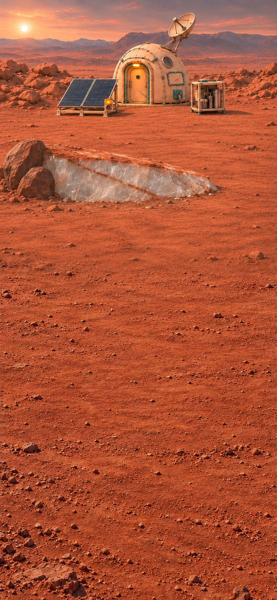

After air, water. Pale ice shows beneath a dusty bank a short walk from the hab. The little battery heater is ready beside the path.

> NOTE: The same low, stable, non-overhanging ice bank is about fifteen metres from the starter habitat and returns during source-core collection. Its rusty band, dusty cap and neighbouring rock identify it. Both pot routes are legal: load ice before putting the pot on the heater, or put the empty pot on the heater and add ice there. The heater survives both routes; only the separate pot-on-heater overlay retires when the second route produces portable meltwater. Collection, closing the original pressure-capable lid, controlled melting, carrying inside and opening are bundled operations. The open-pot pictures show the contents after opening. The cartridge is from drinking-water service; its suitability for this favourable source is an accepted mission premise. Routine repeated trips supply later work with the same small pot.

**Goals**
- Melt a pot of ice -- `meltwater`
- next: Filter clean water -- `clean-water`

**Hotspots**
- (three hotspots are a lot but okay here because the ice bank, heater and temporary pot sitting on that heater have separate actions)
- `visible-ice` (at 47.75641%, 30.03555%)
  - icon: 
- `heater` (at 77%, 39%)
  - icon: 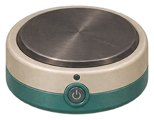
- `pot-on-heater` (at 79.6%, 34.9%)
  - icon: 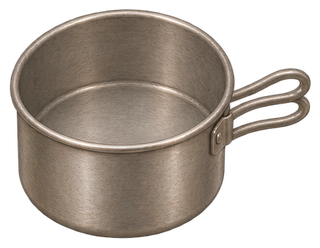

**Items**
- `visible-ice` Visible ice
  - icon: 

  A low bank with a rusty band beneath its dusty cap. I can dig loose ice from the edge and leave the deeper layers untouched.

- `shovel`

- `ice-chunks` Ice chunks
  - icon: 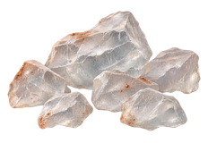

- `empty-pot` Empty pot
  - icon: 

  The small galley pot has a latched lid for melting outside. Its folding handles make it easy to carry.

- `pot-of-ice` Pot of ice
  - icon: 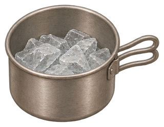

- `heater` Battery heater
  - icon: 

  The battery-powered base stays here while I carry the pot. It can warm the closed pot without spilling water into the thin Martian air.

- `pot-on-heater` Empty pot on heater
  - icon: 

- `meltwater` Pot of meltwater
  - icon: 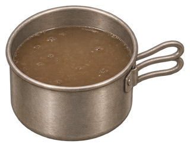

  The ice melts inside the closed pot. I carry it into the hab before opening the lid. Dust has turned the water brown.

- `fabric` Fabric
  - icon: 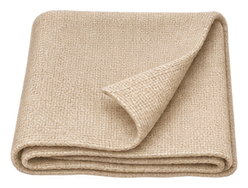

  Washable, low-lint cloth from the general supplies. I select fresh or properly cleaned pieces for food and water; used industrial cloth stays separate.

- `reclaimed-water-cartridge` Reclaimed water cartridge
  - icon: 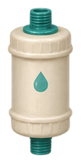

  A small cartridge recovered from the lander’s drinking-water service.

- `water-filter` Water filter
  - icon: 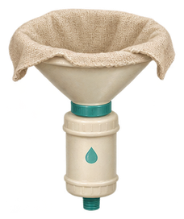

  Cloth catches grit before water enters the cartridge. The cartridge treats dissolved contamination in this source. The compact funnel fits directly over the pot.

- `clean-water` Pot of clean water
  - icon: 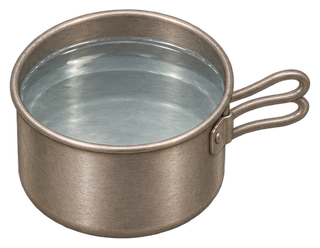

  The filter catches the brown grit; clear water returns to the rinsed pot, almost to its rim. Repeated trips will supply drinking, growing and making.

- `steel-pin` Steel pin
  - icon: 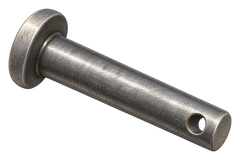

  A small steel pin from a broken cargo restraint. I keep it with the salvage.

**Combinations**
- `shovel` [preserve] @ `visible-ice` -> `ice-chunks`
- `ice-chunks` [consume] + `empty-pot` [transform] -> `pot-of-ice`
- `pot-of-ice` [transform] @ `heater` -> `meltwater`
- `empty-pot` [transform] @ `heater` -> `pot-on-heater`
- `ice-chunks` [consume] @ `pot-on-heater` [transform] -> `meltwater`
- `fabric` [consume] + `reclaimed-water-cartridge` [consume] -> `water-filter`
- `water-filter` [preserve] + `meltwater` [transform] -> `clean-water`

## `cave-shelter` Earth

The rock offers shelter, but no air. I can build a small room inside it.

> NOTE: The entrance is smaller and less regular than the deeper chamber. Natural rock partly masks the tent front; the tent fits snugly rather than occupying a huge empty stage. The initial floor is rough with hand-clearable stones, never major structural boulders. Shovelling clears loose stones, levels the shallow footprint and checks for sharp points without cutting structural rock. The insulated pressure hab rests directly on that prepared ground; its original reinforced floor includes rated base protection. There is no brick pad, exterior apron, entrance baffle, perimeter wall or separate underlay item. This shelter is established before the solar furnace or ceramics exist. The folded state is compact but has enough visible fabric to plausibly fill the final footprint.

> NOTE: The cave provides shielding; the rated tent contains breathable air. Inflation does not turn on lamps. Existing integrated air handling and regulated heat make the room usable. Lights fit directly to the inflated room, and only then does its window glow.

**Goals**
- Clear the tent footprint -- `cleared-cavern-bay`
- next: Inflate the room -- `pressurized-growing-room`
- next: Bring in light -- `lit-growing-room`

**Hotspots**
- `surveyed-cavern-floor` (at 49.29487%, 35.87085%)
  - icon: 
- `cleared-cavern-bay` (at 49.29487%, 35.87085%)
  - icon: 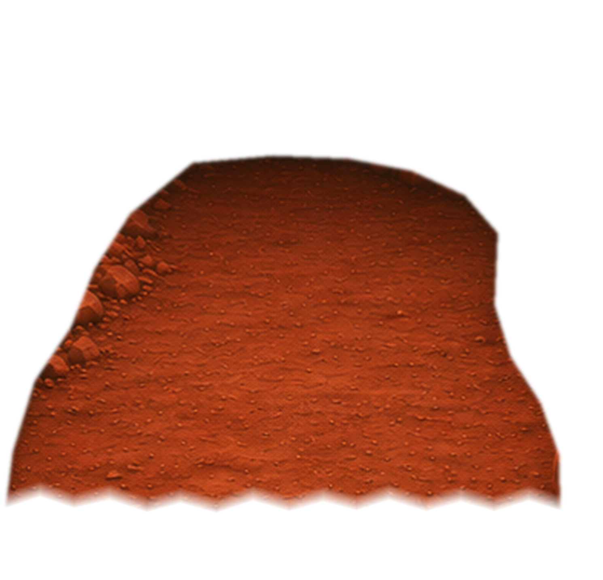
- `sealed-growing-room` (at 49.29487%, 35.87085%)
  - icon: 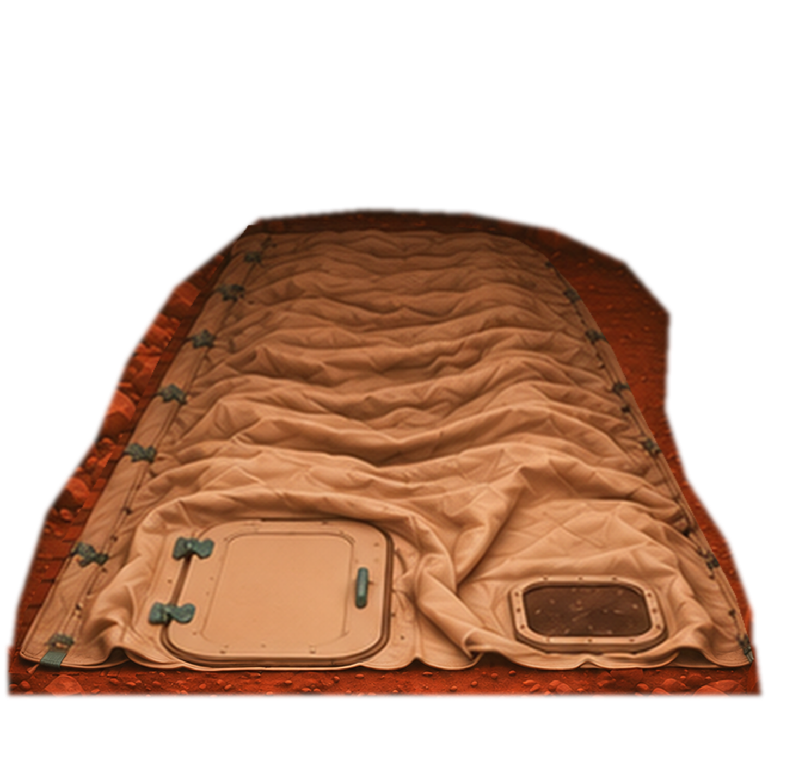
- `pressurized-growing-room` (at 49.29487%, 35.87085%)
  - icon: 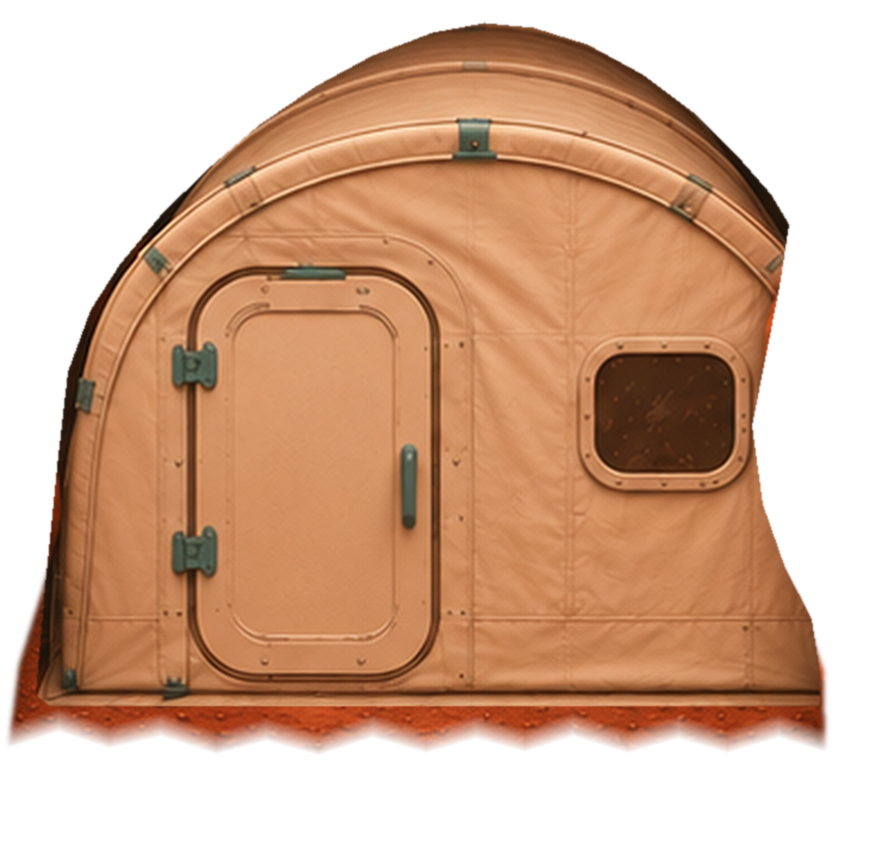
- `lit-growing-room` (at 49.29487%, 35.87085%)
  - icon: 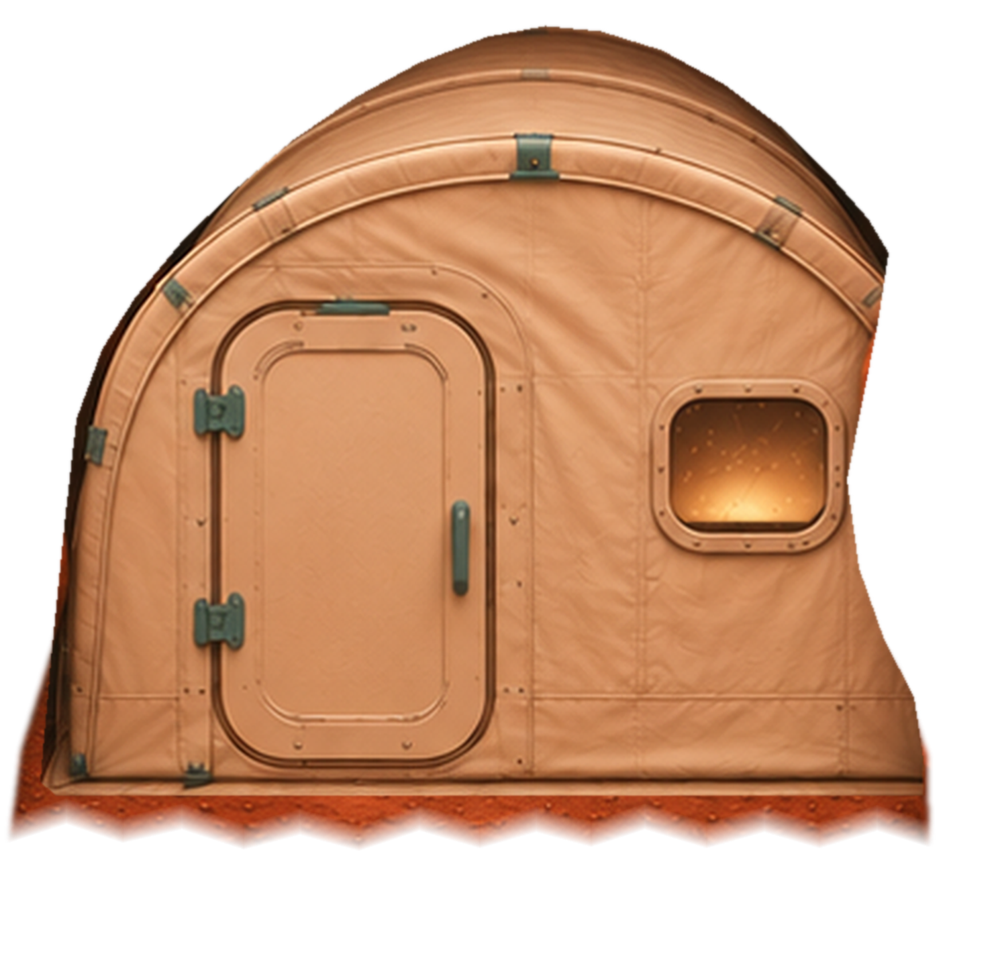

**Items**
- `surveyed-cavern-floor` Rough cavern floor
  - icon: 

- `shovel` Shovel
  - icon: 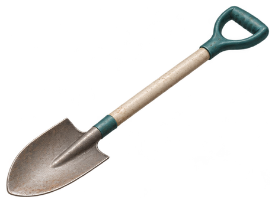

- `cleared-cavern-bay` Cleared cavern bay
  - icon: 

  Loose stones and grit lie in a small spoil pile. I level the footprint and clear the sharp edges before unfolding the hab.

- `folded-pressure-envelope` Folded insulated hab
  - icon: 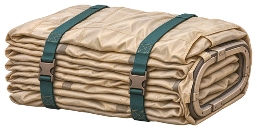

  A compact insulated pressure tent from the habitat supplies, with its own reinforced protective floor, airlock and service fittings.

- `sealed-growing-room` Unfolded pressure room
  - icon: 

- `pressurized-growing-room` Inflated pressure room
  - icon: 

  The fabric rises into the shelter of the cavern. Its doorway sits just behind the narrow mouth.

- `grow-light-rails` Grow-light rails
  - icon: 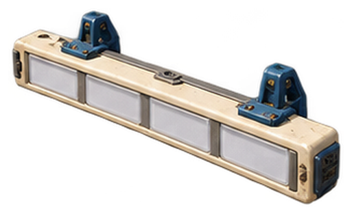

- `lit-growing-room` Lit growing room
  - icon: 

  Warm light glows through the small window. The cave outside the doorway is still dark.

- `air-tanks`

**Combinations**
- `shovel` [preserve] @ `surveyed-cavern-floor` [transform] -> `cleared-cavern-bay`
- `folded-pressure-envelope` [consume] @ `cleared-cavern-bay` [transform] -> `sealed-growing-room`
- `air-tanks` [consume] @ `sealed-growing-room` [transform] -> `pressurized-growing-room`
- `grow-light-rails` [consume] @ `pressurized-growing-room` [transform] -> `lit-growing-room`

## Fire

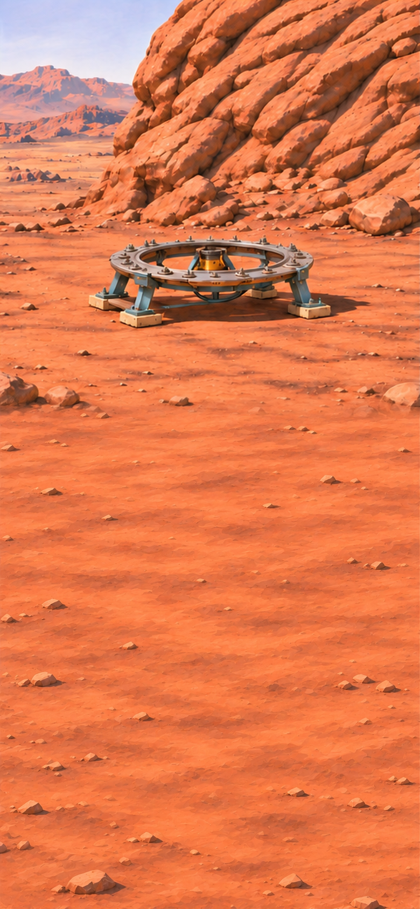

The sheltered room is up. Now I need ceramic blocks for the berth and crop beds, and porous granules for their roots.

> NOTE: The same outdoor solar furnace keeps its feet, reflector rim and receiver axis registered through assembly. Supported molds form bricks; a separate tray fires preformed loose granules for the garden. The selected local feed can make stable porous ceramic. No finished bricks are crushed for substrate. Later metal extraction adapts this furnace with high-temperature electrodes and controlled current; sunlight supplies heat, not chemical reduction.

**Goals**
- Build a solar furnace -- `solar-furnace`
- next: Fire bricks and growing granules
  - both: `ceramic-blocks`
  - and: `fired-granules`

**Hotspots**
- `reflector-base` (at 55.25641%, 28.08057%)
  - icon: 
- `open-reflector` (at 55.25641%, 28.08057%)
  - icon: 
- `solar-furnace` (at 55.25641%, 28.08057%)
  - icon: 

**Items**
- `reflector-base` Reflector base
  - icon: 

- `open-reflector` Open reflector petals
  - icon: 

- `solar-furnace` Assembled solar furnace
  - icon: 

- `reflector-petals` Reflector petals
  - icon: 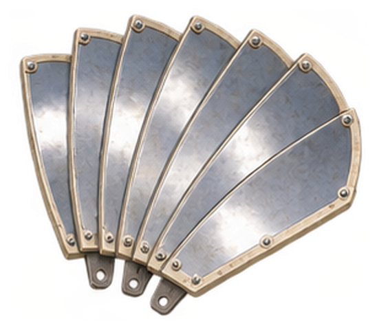

- `furnace-receiver` Furnace receiver
  - icon: 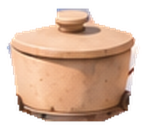

  The furnace's plain refractory receiver holds the batch where the reflector concentrates sunlight.

- `regolith` Regolith
  - icon: 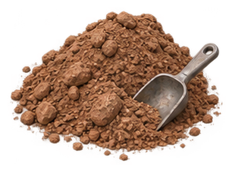

  Loose material from the surveyed surface deposit.

- `regolith-sieve` Fine mesh sieve
  - icon: 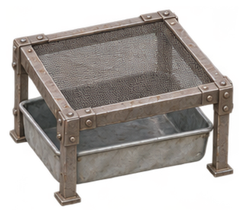

- `screened-regolith` Screened regolith
  - icon: 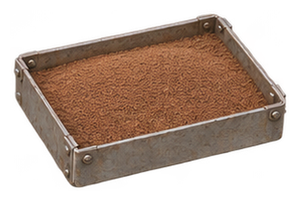

- `ceramic-blocks` Ceramic blocks
  - icon: 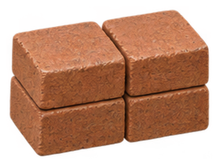

  A checked fired batch for floors and broad supports. These blocks do not contain pressure.

- `granule-charge` Granules ready to fire
  - icon: 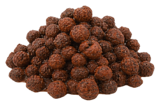

  I dampen the screened material, form small granules and dry the batch.

- `fired-granules` Fired granules
  - icon: 

  Porous ceramic granules, fired in their own shallow tray alongside the brick batches.

- `clean-water`

**Combinations**
- `reflector-petals` [consume] @ `reflector-base` [transform] -> `open-reflector`
- `furnace-receiver` [consume] @ `open-reflector` [transform] -> `solar-furnace`
- `regolith` [consume] + `regolith-sieve` [preserve] -> `screened-regolith`
- `screened-regolith` [consume] @ `solar-furnace` [preserve] -> `ceramic-blocks`
- `clean-water` [consume] + `screened-regolith` [consume] -> `granule-charge`
- `granule-charge` [transform] @ `solar-furnace` -> `fired-granules`

## A bed under the hill

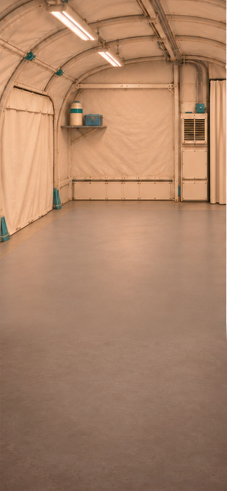

I can sleep beneath the rock. The laboratory can stay in the repaired starter habitat.

> NOTE: This is the rear-left sleeping alcove of the cave pressure hab, viewed toward its soft opaque partition from the growing area. The opposite rear-right service bay is offscreen. This view has no second exterior door, window or sink. Those belong to the single entrance/service end shown from inside in the garden scenes. Build the ceramic deck at its actual alcove before adding reflective insulation, then the thin camping mattress. The insulation lies directly on the ceramic deck, beneath the mattress. Its close-set blocks rest continuously on the floor; there are no ceramic rails spanning a gap. The existing heater warms the room. Ordinary smoothing and edge protection belong to the block operation.

**Goals**
- Make a sheltered berth -- `cave-berth`

**Hotspots**
- `berth-alcove` (at 51.98718%, 38.47749%)
  - icon: 
- `ceramic-berth` (at 51.98718%, 38.47749%)
  - icon: 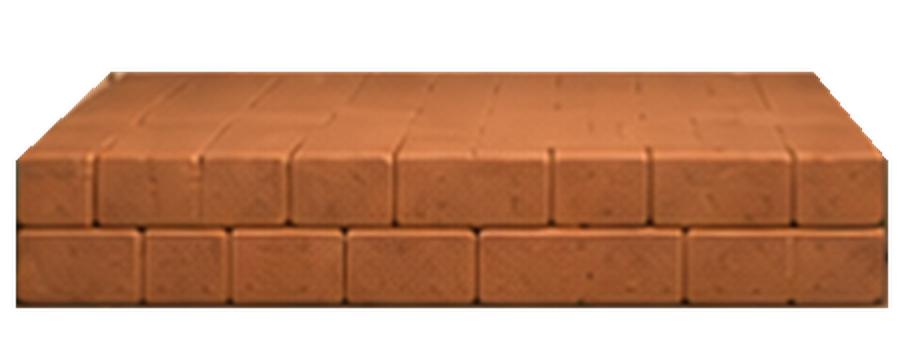
- `insulated-ceramic-berth` (at 51.98718%, 38.47749%)
  - icon: 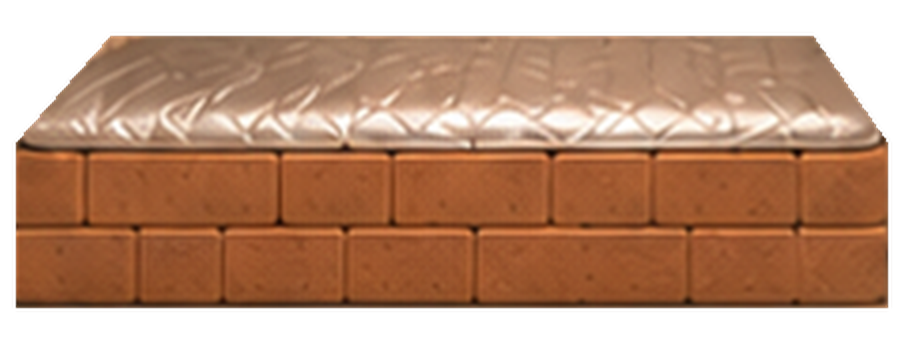
- `cave-berth` (at 51.98718%, 38.47749%)
  - icon: 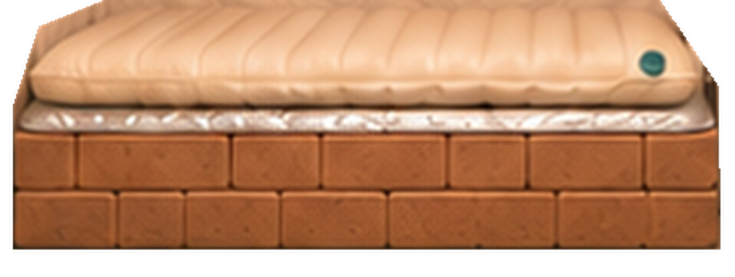

**Items**
- `berth-alcove` Bed alcove
  - icon: 

- `ceramic-berth` Ceramic berth base
  - icon: 

- `insulated-ceramic-berth` Insulated berth base
  - icon: 

- `cabin-mattress` Cabin mattress
  - icon: 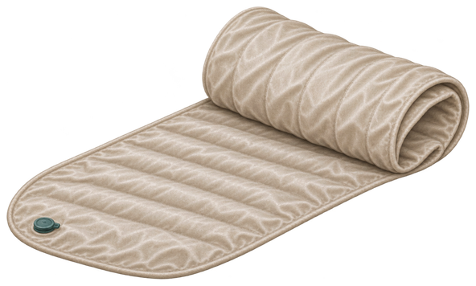

- `cave-berth` Cave berth
  - icon: 

  I put my boots beside the low berth and stretch out; beyond the partition, the lamps shine on an empty floor.

- `packing-foil` Packing foil
  - icon: 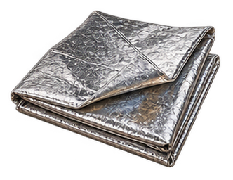

  Reflective cargo laminate redirects heat or light; it cannot create either.

- `insulation-felt` Insulation felt
  - icon: 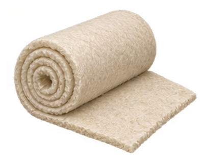

  Light loose insulation from the general supplies. Keep its fibres outside food, roots and sample containment.

- `reflective-insulation` Reflective insulation
  - icon: 

**Combinations**
- `ceramic-blocks` [consume] @ `berth-alcove` [transform] -> `ceramic-berth`
- `reflective-insulation` [consume] @ `ceramic-berth` [transform] -> `insulated-ceramic-berth`
- `cabin-mattress` [consume] @ `insulated-ceramic-berth` [transform] -> `cave-berth`
- `packing-foil` [consume] + `insulation-felt` [consume] -> `reflective-insulation`

## One room for roots

Potatoes on the left, soybeans against the far wall, lettuce on the right. Three small beds can turn this room into a place that grows food.

> NOTE: These are three independent crop locations. Each accepts its own ceramic walls, permeable Fabric underlining, prepared medium and individual drip branch, in that order. The ceramic trough base is the selected water-retaining construction premise; Fabric cushions and separates the medium, and is not a waterproof liner. The shared feed header is original room service plumbing. Each drip operation connects its own emitters to that header. Routine metering, nutrients and replenishment are included, without recirculation or a return pump.

> NOTE: The potato bed alone accepts the loose opaque foil-backed cover. Potato planting and cover fitting may occur in either order; the seed overlay is drawn after the cover, preserving shoots above its loose flaps. Soybeans and lettuce never accept that cover. Leave room below the original potato rim for later hilling. The same three locations persist through tending, storm protection and harvest.

> NOTE: Grading and rinsing the fired granules uses clean water at the visible sink as one ordinary operation. The sink remains scenery. The qualified selected batch passes its leach and salinity checks; this is not a claim that firing makes all Martian dirt safe. Wastewater remains separate from clean water and crop feed. Controlled nutrients, salinity checks and finite-cycle maintenance remain part of cultivation.

**Goals**
- (three goals are a lot but okay here because each crop has its own visible bed and independent construction chain)
- Plant potatoes and shade their medium -- `watered-potato-bed`[`seed-potatoes`,`foil-backed-cloth`]
- Plant soybeans -- `watered-soybean-bed`[`soybean-seeds`]
- Plant lettuce -- `watered-lettuce-bed`[`lettuce-seeds`]

**Hotspots**
- (three hotspots are a lot but okay here because the three crop beds occupy separate established locations and replace their own construction states)
- `potato-plot` (at 17.30769%, 31.90166%)
  - icon: 
- `potato-bed-walls` (at 17.30769%, 31.90166%)
  - icon: 
- `lined-potato-bed` (at 17.30769%, 31.90166%)
  - icon: 
- `filled-potato-bed` (at 17.30769%, 31.90166%)
  - icon: 
- `watered-potato-bed` (at 17.30769%, 31.90166%)
  - icon: 
- `soybean-plot` (at 52.4359%, 27.66588%)
  - icon: 
- `soybean-bed-walls` (at 52.4359%, 27.66588%)
  - icon: 
- `lined-soybean-bed` (at 52.4359%, 27.66588%)
  - icon: 
- `filled-soybean-bed` (at 52.4359%, 27.66588%)
  - icon: 
- `watered-soybean-bed` (at 52.4359%, 27.66588%)
  - icon: 
- `lettuce-plot` (at 85.25641%, 31.90166%)
  - icon: 
- `lettuce-bed-walls` (at 85.25641%, 31.90166%)
  - icon: 
- `lined-lettuce-bed` (at 85.25641%, 31.90166%)
  - icon: 
- `filled-lettuce-bed` (at 85.25641%, 31.90166%)
  - icon: 
- `watered-lettuce-bed` (at 85.25641%, 31.90166%)
  - icon: 

**Items**
- `potato-plot` Potato bed site
  - icon: 

- `potato-bed-walls` Ceramic potato bed
  - icon: 

- `lined-potato-bed` Fabric-lined potato bed
  - icon: 

  Clean permeable cloth cushions the granules inside the ceramic trough.

- `filled-potato-bed` Filled potato bed
  - icon: 

- `watered-potato-bed` Watered potato bed (compound)
  - icon: 
  - unnamed slot: accepts `foil-backed-cloth`, icon: 
  - unnamed slot: accepts `seed-potatoes`, icon: 

  [`seed-potatoes`,`foil-backed-cloth`] Shoots emerge through the loose cover flaps. The leaves receive light while the future potatoes remain shaded.

- `soybean-plot` Soybean bed site
  - icon: 

- `soybean-bed-walls` Ceramic soybean bed
  - icon: 

- `lined-soybean-bed` Fabric-lined soybean bed
  - icon: 

  Clean permeable cloth cushions the granules inside the ceramic trough.

- `filled-soybean-bed` Unwatered soybean bed
  - icon: 

- `watered-soybean-bed` Soybean bed (compound)
  - icon: 
  - unnamed slot: accepts `soybean-seeds`, icon: 

  [`soybean-seeds`] Small soybean leaves spread above their watered row.

- `lettuce-plot` Lettuce bed site
  - icon: 

- `lettuce-bed-walls` Ceramic lettuce bed
  - icon: 

- `lined-lettuce-bed` Fabric-lined lettuce bed
  - icon: 

  Clean permeable cloth cushions the granules inside the ceramic trough.

- `filled-lettuce-bed` Filled lettuce bed
  - icon: 

- `watered-lettuce-bed` Watered lettuce bed (compound)
  - icon: 
  - unnamed slot: accepts `lettuce-seeds`, icon: 

  [`lettuce-seeds`] The first lettuce leaves open close to the damp medium.

- `growing-medium` Growing medium
  - icon: 

  I grade and rinse the fired granules with clean water. Air remains between the porous grains; the drippers will deliver the nutrients.

- `drip-line` Drip line
  - icon: 

  Each bed gets its own small emitter branch, connected to the room's feed header. Supplied controls meter water and crop-specific nutrients, including soybean nitrogen.

- `seed-potatoes` Seed potatoes
  - icon: 

  Certified sprouting tubers, with room for new potatoes beneath the foliage.

- `soybean-seeds` Soybean seeds
  - icon: 

  A compact cultivar suited to this room.

- `lettuce-seeds` Lettuce seeds
  - icon: 

- `foil-backed-cloth` Foil-backed fabric
  - icon: 

  Fabric protects the opaque foil at its folds. Overlapping flaps leave room for shoots and planting.

- `ceramic-blocks`
- `fired-granules`
- `clean-water`
- `packing-foil`
- `fabric`

**Combinations**
- `fired-granules` [consume] + `clean-water` [consume] -> `growing-medium`
- `packing-foil` [consume] + `fabric` [consume] -> `foil-backed-cloth`
- `ceramic-blocks` [consume] @ `potato-plot` [transform] -> `potato-bed-walls`
- `fabric` [consume] @ `potato-bed-walls` [transform] -> `lined-potato-bed`
- `growing-medium` [consume] @ `lined-potato-bed` [transform] -> `filled-potato-bed`
- `drip-line` [consume] @ `filled-potato-bed` [transform] -> `watered-potato-bed`
- `ceramic-blocks` [consume] @ `soybean-plot` [transform] -> `soybean-bed-walls`
- `fabric` [consume] @ `soybean-bed-walls` [transform] -> `lined-soybean-bed`
- `growing-medium` [consume] @ `lined-soybean-bed` [transform] -> `filled-soybean-bed`
- `drip-line` [consume] @ `filled-soybean-bed` [transform] -> `watered-soybean-bed`
- `ceramic-blocks` [consume] @ `lettuce-plot` [transform] -> `lettuce-bed-walls`
- `fabric` [consume] @ `lettuce-bed-walls` [transform] -> `lined-lettuce-bed`
- `growing-medium` [consume] @ `lined-lettuce-bed` [transform] -> `filled-lettuce-bed`
- `drip-line` [consume] @ `filled-lettuce-bed` [transform] -> `watered-lettuce-bed`

## `first-harvest` Under the leaves

The stems have grown. More medium will keep new potatoes out of the light; the filling soybean pods need support. The lettuce is ready for its first picking.

> NOTE: These are the same planted crop zones, retaining their drip feeds. The original potato bed has enough unfilled depth for hilling; no collar or added wall is needed. Adding washed medium from the earlier batch includes lifting and replacing the existing loose cover around the stems. The chosen soybean cultivar benefits from support; a section of the salvaged synthetic cargo net hangs from the pressure hab's existing attachment tabs. No rods, rails, rings or wooden frame are fabricated. The two tending branches can be completed in either order.

> NOTE: The growing-potato-bed and growing-soybean-row identities first become available here, when these same plants are tall enough for hilling and net support. They are later growth states, not replacement beds or additional plantings. Keeping the tending receivers separate from the original planting states prevents global recipes from creating movable installed structures on an earlier board.

> NOTE: The lettuce is the later picking state of the same planted zone. A second section of the finite salvaged cargo net folds and ties into a sling basket, lined with fresh food-safe cloth. The same basket remains useful for every later harvest. Tending precedes the basket goal; next controls display, while the physically valid basket may be made earlier.

**Goals**
- Tend the growing crops
  - both: `hilled-potato-bed`
  - and: `supported-soybean-row`
- next: Make a lined basket for the harvest -- `lined-harvest-basket`
- next: Pick the first leaves -- `first-lettuce-harvest`

**Hotspots**
- (three hotspots are a lot but okay here because the two tended crops and the first lettuce occupy the three established beds)
- `growing-potato-bed` (at 17.94872%, 33.91588%)
  - icon: 
- `hilled-potato-bed` (at 17.94872%, 33.91588%)
  - icon: 
- `growing-soybean-row` (at 52.11538%, 28.88033%)
  - icon: 
- `supported-soybean-row` (at 52.11538%, 28.88033%)
  - icon: 
- `lettuce-tray` (at 85.64103%, 35.27844%)
  - icon: 

**Items**
- `growing-potato-bed` Growing potato bed
  - icon: 

  The same planted bed, with room below its rim for more medium around the growing stems.

- `growing-soybean-row` Growing soybean row
  - icon: 

  The same soybean plants, now carrying pods that need support.

- `hilled-potato-bed` Hilled potato bed
  - icon: 

  I lift the loose cover, mound more medium around the stems and replace it. The new tubers stay out of the light.

- `supported-soybean-row` Supported soybean row
  - icon: 

  The cargo net hangs from the room's existing attachment tabs and supports the filling pods.

- `lined-harvest-basket` Lined harvest basket
  - icon: 

  Folded and tied cargo net makes a light sling basket. Clean cloth lines it; I can empty and reuse it for each crop.

- `cargo-mesh` Cargo net
  - icon: 

  Strong, light synthetic restraint net salvaged from the cargo packing. I set aside panels for the soybean support, one sling basket and low covers close above the three crops.

- `first-lettuce-harvest` Lettuce harvest
  - icon: 

  Their edges break with a crisp snap. I leave the small centre growing. Beyond the airlock, the landscape has supplied no green at all.

- `fabric`

- `lettuce-tray` Lettuce ready to pick
  - icon: 

**Combinations**
- `growing-medium` [consume] @ `growing-potato-bed` [transform] -> `hilled-potato-bed`
- `cargo-mesh` [consume] @ `growing-soybean-row` [transform] -> `supported-soybean-row`
- `cargo-mesh` [consume] + `fabric` [consume] -> `lined-harvest-basket`
- `lined-harvest-basket` @ `lettuce-tray` -> `first-lettuce-harvest`

## `water-problem` What the water carries

After the first harvest, I bring in another pot of meltwater. Brown sludge has clogged the cloth in the filter. A clean microscope slide will take just a trace of it.

> NOTE: This is the same cloth/cartridge filter and the same small galley pot from Water. The funnel seats directly on the pot rim; there is no separate filter stand or specimen jar. Taking a small wet smear and fitting its coverslip is one operation. The ordinary slide icon is deliberately enlarged for recognition and dragging; only the microscope reading reveals detail. This first microscope field is wet filter sediment on glass, not ice. Tiny irregular brown grains and chips remain ambiguous between mineral structure and possible biological fragments; no recognizable anatomy or large plate establishes life. The later intact ice section uses the same rusty-brown material colour. The microscope faces the operator at the front of the table and the same registered background and receiver return in Something whole. This discovery follows the established farm and first harvest.

**Goals**
- Collect a trace of the sludge -- `sludge-microscope-slide`
- next: Examine it under the microscope -- `examined-sludge-slide`

**Hotspots**
- `water-filter` (at 28.8%, 18%)
  - icon: 
- `laboratory-microscope` (at 71.8%, 16.1%)
  - icon: 
  - place: `examined-sludge-slide` (at 71.8%, 19.2%)

**Items**
- `water-filter`

- `empty-microscope-slide` Microscope slide
  - icon: 

  A clean glass slide from the laboratory supplies.

- `sludge-microscope-slide` Sludge microscope slide
  - icon: 

  A brown smear lies under the cover glass. Its fine structure needs magnification.

- `laboratory-microscope` Laboratory microscope
  - icon: 

  The eyepieces face the working side of the table. Its cooled stage can also hold an ice slide below freezing.

- `examined-sludge-slide` Examined sludge slide
  - icon: 

  

  Two of the broken flakes have a curiously similar edge. Crystal fractures, perhaps. Melted, poured, caught in a filter—nothing has come through whole. I record the magnified view and send it to Earth.

**Combinations**
- `empty-microscope-slide` [consume] @ `water-filter` -> `sludge-microscope-slide`
- `sludge-microscope-slide` [transform] @ `laboratory-microscope` -> `examined-sludge-slide`

## The ground we know

*Mara, NASA surface support — recorded message:*

“I've watched that record six times. Science wants ice that has never passed through the melter. First, a reference core from the untouched part of your water bank. Then the exposed layers beyond the wash—we can choose protected ice there, away from the station.”

“The receiving laboratories can examine internal structure and chemistry that your microscope cannot resolve. Flight is looking at an earlier rendezvous.”

> NOTE: The source core penetrates untouched interior ice beside the hand-harvested edge. The narrow transparent receiver covers only the visible bank in the doorway. Collection includes sealing a thin clean liner; the earlier reflective insulation supplies a modest transfer wrap. Wrapping includes returning the sample to the existing laboratory cold storage, offscreen. Insulation delays warming and the sealed liner limits vapor loss; neither supplies cooling. Existing laboratory, rover and flight cold services maintain frozen specimens. There is no new refrigerated casket or storage fixture to build.

**Goals**
- Take an unmelted reference from the water source -- `sealed-source-core`
- next: Protect it before the farther expedition -- `stored-source-core`

**Hotspots**
- `visible-ice` (at 23%, 22.3%)
  - icon: 

**Items**
- `sealed-source-core` Cut source core
  - icon: 

  The clean barrel reaches ice beyond the hand-harvested edge. I seal the core in its thin liner before carrying it inside.

- `stored-source-core` Insulated source core
  - icon: 
  - from chapter `specimen-stow`: Local ice core

  A small piece of the same reflective insulation wraps the sealed liner. It slows warming during transfers; the laboratory’s existing cold store keeps the core frozen while I go farther from the bank.

- `visible-ice`

- `reflective-insulation`

- `core-drill` Core drill
  - icon: 

  The clean chilled barrel takes interior ice without melting it. The liner seals before leaving the barrel.

**Combinations**
- `core-drill` [preserve] @ `visible-ice` -> `sealed-source-core`
- `sealed-source-core` [transform] + `reflective-insulation` [consume] -> `stored-source-core`

## Across the gully

Broken ledges and loose rubble block the rover’s climb. I can scramble to sound rock above the central route and rig the winch. Beyond that ledge, the ice band is still a long drive away.

> NOTE: The winch is anchored on sound rock at the central far ledge of a steep broken gully, with the ice well beyond it across an intervening plateau. A difficult surveyed foot scramble permits rigging and recovery. Its slack cable snakes down the central route, lying over the terrain and receding in perspective; it is not a straight hanging line. Rover arrival includes the winched climb, unhooking, reeling and the drive beyond the winch to the distant ice. The completed state retains the same winch and shows the same rover smaller, farther away than the winch and near the ice. Both states share an exact artwork canvas and centre. The reached receiver covers the actual brown-layer ice and nearby rover, and does not appear before the pull. The brown band matches the remote core; it supports a sampling association, not certainty about what formed it. Sampling includes a sealed clear liner, routine transfer insulation and existing rover cooling. Site stability, suited access and recovery rating remain qualified scene premises.

**Goals**
- Anchor the winch above the broken slope -- `anchored-winch`
- next: Bring the rover to the ice band -- `reached-ice-bank`
- next: Bring back ice from within the band -- `remote-ice-core`

**Hotspots**
- `bedrock-anchor` (at 56.53846154%, 16.76540284%)
  - icon: 
  - hitbox: (at 56.53846154%, 16.76540284%) (size 30.76923077%, 10.66350711%)
- `anchored-winch` (at 60.25641026%, 26.06635071%)
  - icon: 
  - hitbox: (at 48.07692308%, 30.65758294%) (size 29.48717949%, 28.73222749%)
- `reached-ice-bank` (at 60.25641026%, 26.06635071%)
  - icon: 
  - hitbox: (at 67.43589744%, 9.62677725%) (size 32.82051282%, 8.59004739%)

**Items**
- `bedrock-anchor` Bedrock anchor
  - icon: 

- `anchored-winch` Winch with extended cable
  - icon: 

  The cable lies over the rubble all the way down the broken slope. I can attach it to the rover’s front tow point.

- `rover-winch` Winch
  - icon: 

  A portable powered winch with its line, anchor sling and remote control.

- `expedition-rover` Expedition rover
  - icon:  (at 45%, 54%)

  The small science store behind the seat connects to the rover’s existing cold service. It will keep the wrapped core frozen on the journey home.

- `reached-ice-bank` Reached ice bank
  - icon: 

  The rover climbs the ledge. I unhook it, reel in the cable and drive on across the plateau to the ice. The brown layer is now within reach of the core drill; the winch stays anchored for the return.

- `remote-ice-core` Remote ice core
  - icon: 

  A brown band runs through the original core inside its thin sealed liner. I wrap it in reflective insulation, secure it in the rover’s cold service and retrace the gully. This ice has never passed through the water pot.

- `core-drill`

**Combinations**
- `rover-winch` [consume] @ `bedrock-anchor` -> `anchored-winch`
- `expedition-rover` [transform] @ `anchored-winch` [transform] -> `reached-ice-bank`
- `core-drill` [preserve] @ `reached-ice-bank` -> `remote-ice-core`

## Something whole

The remote core is back in laboratory cooling. A small shaving on a glass slide will let light pass through the ice.

> NOTE: The original remote core survives slide preparation and later boards the cabin as the remote specimen. Taking a small clear shaving with the existing clean laboratory tools, mounting it on a chilled slide, fitting its cover and returning the parent core to cold storage are one complete operation. No separate sectioning fixture is a player object. The microscope’s existing cooled stage holds the thin ice frozen during viewing. The ordinary slide icon carries a clearly visible brown sample patch but reveals no creature; magnification supplies the discovery. Both slides stay in the laboratory. The two original cores provide material for independent investigation; do not claim that leaving the examined shaving behind returns that exact individual inclusion. Morphology alone establishes neither age, chemistry nor origin.

**Goals**
- Prepare an ice microscope slide -- `sectioned-ice-core`
- next: Look through the ice -- `examined-ice-core`

**Hotspots**
- `laboratory-microscope` (at 71.8%, 16.1%)
  - icon: 
  - place: `examined-ice-core` (at 71.8%, 19.2%)

**Items**
- `laboratory-microscope`

- `empty-microscope-slide`

- `remote-ice-core`

- `sectioned-ice-core` Ice microscope slide
  - icon: 

  A thin shaving rests under the cover glass. I keep it cold and return the original core to storage. To my unaided eyes, the slide looks ordinary.

- `examined-ice-core` Examined ice slide
  - icon: 

  

  Overlapping plates. Paired, jointed limbs. Where the sludge held scattered fragments, this outline stays together within the ice.

  I leave the focus there for a long time.

  I cannot tell how old it is, or where it came from. I record the view for Earth. The two original cores remain frozen for the receiving laboratories; they can investigate the material and its layers for themselves. The slides will stay here.

**Combinations**
- `empty-microscope-slide` [consume] + `remote-ice-core` [preserve] -> `sectioned-ice-core`
- `sectioned-ice-core` [transform] @ `laboratory-microscope` -> `examined-ice-core`

## Metal from the red ground

*Mara, Earth — recorded message:*

“Flight has approved an earlier return with the samples. The next fuel delivery cannot arrive in time.”

I need vessels for making fuel, and a new support for the lander. The red ground contains iron; getting it out will take heat and electric current.

> NOTE: This is direct molten-oxide electrolysis before the water-electrolysis chapter. Solar heat melts the selected local oxide/silicate bath; controlled current releases iron-rich metal and oxygen. The first process oxygen is not a collected inventory supply. There is no prior hydrogen, imported carbon packet, refining-flux token, meteoritic iron or salvaged bulk-iron substitute.

> NOTE: The two principal fictional advances are a compact adapted furnace able to sustain molten-oxide electrolysis, and a selected feed/process yielding workable iron. The user explicitly accepts iron canisters and support strong enough for this game. No alloying or carbon adjustment is implied, and precious biological carbon is conserved. Existing general repair tools provide the modest forming and joining operations; do not add qualification chores to play.

> NOTE: The furnace's mixed fate is deliberate: ceramic batches preserve it, then fitting electrodes transforms that same installation into its adapted state. Fire requires both useful ceramic products before this transformation can occur.

> NOTE: The high-temperature insert and insulated feedthroughs come from the furnace's mineral-analysis experiment. One shared electrical-repair controller and service readout, with temperature and pressure sensing, moves between scheduled metal, water-cell and fuel batches. Essential station services retain their own supply. Show a plain refractory receiver with necessary insulation and electrode contacts; no appliance casing, decorative dials or duplicated control cabinets. General repair tools provide forming and joining. These are finite allocated tools, not a limitless cache of laboratory machinery.

**Goals**
- Adapt the solar furnace -- `powered-reduction-furnace`
- next: Make usable iron from local minerals -- `iron-stock`

**Hotspots**
- `solar-furnace` (at 55.25641%, 28.08057%)
  - icon: 
- `electrochemical-furnace` (at 55.25641%, 28.08057%)
  - icon: 
- `powered-reduction-furnace` (at 55.25641%, 28.08057%)
  - icon: 

**Items**
- `solar-furnace`

- `power-cable`

- `steel-pin`

- `laboratory-electrodes` High-temperature laboratory electrodes
  - icon: 

  The mineral-analysis experiment's small high-temperature electrode insert, suitable for the furnace receiver.

- `electrochemical-furnace` Furnace with electrodes
  - icon: 

  I fit the laboratory electrodes inside the receiver.

- `powered-reduction-furnace` Powered reduction furnace
  - icon: 

  Sunlight heats the mineral bath. I connect the shared repair controller to drive the separation.

- `iron-bearing-regolith` Iron-bearing regolith
  - icon: 

  Screened local material with magnetic iron-bearing minerals from the red ground.

- `separator-electromagnet` Separator electromagnet
  - icon: 

  I wind an insulated conductor around the saved pin. Current on: magnetic grains cling. Current off: they drop into the tray.

- `iron-rich-concentrate` Iron-oxide concentrate
  - icon: 

  The darker mineral fraction is richer in iron. It is still mineral, not metal.

- `iron-stock` Iron
  - icon: 

  Electric current separates iron from its oxygen in the hot mineral bath. I cast and finish the iron into sheets and bars. Most of this useful metal came from the ground beneath my feet.

**Combinations**
- `laboratory-electrodes` [consume] @ `solar-furnace` [transform] -> `electrochemical-furnace`
- `power-cable` [consume] @ `electrochemical-furnace` [transform] -> `powered-reduction-furnace`
- `power-cable` [consume] + `steel-pin` [consume] -> `separator-electromagnet`
- `separator-electromagnet` [preserve] + `iron-bearing-regolith` [consume] -> `iron-rich-concentrate`
- `iron-rich-concentrate` [consume] @ `powered-reduction-furnace` -> `iron-stock`

## Two gases from water

The iron gives me something to build with. A divided cell will supply hydrogen for methane, and oxygen to keep separate for the engine.

> NOTE: The cell's body and the common Empty tank are locally formed Iron. The unused service insert from the regenerative-power experiment supplies the membrane, electrodes and separate gas paths; it is distinct from the furnace electrodes and does not cannibalize breathing equipment. Allocated gas-service spares provide the necessary short grey valves, seals and dedicated connectors. Local canister strength and useful gas delivery pressure are accepted game premises. The existing electrical service and ordinary safe filling are bundled, without a power-cord action here.

> NOTE: Two water-filling actions commission the two sides of one pictured vessel. The first replaces the empty cell with its hydrogen-ready state; the second preserves that state and creates a separate oxygen receiver over the right half. After the first fill, the hydrogen receiver covers the full vessel. The second fill adds the later-painted oxygen receiver over the right half, where it takes drop priority; the remaining exposed left half still receives hydrogen. Receiving areas are independent of the spigots’ painted size. Each rule has exactly one result. Empty tank can be made at the cell before or after water. Its reusable token represents the same limited batch of identical locally made vessels, with dedicated clean gas service, not a bottle switched indiscriminately between gases. Water filling and gas collection include repeated trips and batches.

**Goals**
- Fill both sides of the water cell -- `oxygen-outlet`
- next: Collect the gases separately
  - both: `hydrogen-cylinder`
  - and: `oxygen-cylinder`

**Hotspots**
- `water-electrolysis-cell` (at 37.94872%, 32.64218%)
  - icon: 
  - place: `empty-gas-tank` (at 54.8%, 30%)
- `hydrogen-cell` (at 37.94872%, 32.64218%)
  - icon: 
  - hitbox: (at 37.94872%, 32.64218%) (size 38.46154%, 14.21801%)
  - place: `empty-gas-tank` (at 21.02564%, 38.27014%)
  - place: `hydrogen-cylinder` (at 20%, 30%)
- `oxygen-outlet` (at 46.79487%, 32.52370%)
  - icon: 
  - hitbox: (at 47.56410%, 32.64218%) (size 19.23077%, 14.21801%)
  - place: `oxygen-cylinder` (at 55.12821%, 30%)

**Items**
- `salvaged-cell-internals` Reclaimed electrolyzer insert
  - icon: 

  The unused service insert supplies the membrane and electrodes. I can form an iron body around it.

- `water-electrolysis-cell` Empty water cell
  - icon: 

  Two compartments, two separate gas outlets. Each side needs water.

- `hydrogen-cell` H₂ outlet
  - icon: 

  The first side is filled. I can collect hydrogen here; another water delivery will fill the oxygen side.

- `oxygen-outlet` O₂ outlet
  - icon: 

  Both sides are filled. The right outlet supplies oxygen, kept apart from the hydrogen.

- `empty-gas-tank` Empty tank
  - icon: 

  A plain iron body with a small reclaimed service valve. I make the vessels alike, reserving separate clean fittings for each gas.

- `hydrogen-cylinder` H₂ tank
  - icon: 

  Hydrogen collected from its own side of the cell will feed the methane reaction.

- `oxygen-cylinder` O₂ tank
  - icon: 

  Oxygen stays separate. It is the engine's oxidizer, never a feed for the methane plant.

- `iron-stock`
- `clean-water`

**Combinations**
- `iron-stock` [consume] + `salvaged-cell-internals` [consume] -> `water-electrolysis-cell`
- `clean-water` [consume] @ `water-electrolysis-cell` [transform] -> `hydrogen-cell`
- `clean-water` [consume] @ `hydrogen-cell` -> `oxygen-outlet`
- `iron-stock` [consume] @ `water-electrolysis-cell` -> `empty-gas-tank`
- `iron-stock` [consume] @ `hydrogen-cell` -> `empty-gas-tank`
- `empty-gas-tank` [preserve] @ `hydrogen-cell` -> `hydrogen-cylinder`
- `empty-gas-tank` [preserve] @ `oxygen-outlet` -> `oxygen-cylinder`

## Fuel from air and water

*Mara, Earth — recorded message:*

“Hydrogen and carbon dioxide can make methane. Keep the oxygen separate. Use the station's power, and leave its essential loads running.”

One of the iron tanks makes the reaction chamber. Now it needs both gases and power.

> NOTE: Preparing the site includes adapting one of the same locally made empty tanks as the plain reaction chamber. The gas analyzer's nonessential carbon-analysis channel donates its nickel methanizer catalyst, small heater/sensor and sample-drying fittings; those original measurements stop. The microscope and specimen cooling remain intact. The existing shared controller and a simple water trap complete the equipment. A clear pale hand-marked CH₄ identifies the main converter body and remains visible as its feeds and power are fitted. Small ceramic pieces or found rocks keep the hot chamber clear of the ground. No new metal stock, supplied fuel plant, table, mounting frame or solar field appears.

> NOTE: The existing isolated atmospheric-service branch collects and releases CO₂ at useful pressure while breathing continues. Dedicated gas paths, compatible fittings, useful pressure differences and sufficient batch throughput are bounded mission capabilities. The original array has a load/time margin for scheduled processing while essential services remain powered. Gas production and recovered water are repeated batches, interrupted later by the storm. Oxygen never enters this plant. The same common Empty tank supplies the CO₂ and methane collection operations, representing dedicated members of the finite vessel batch.

**Goals**
- Connect both gases and power -- `fuel-assembly`[`hydrogen-cylinder`,`carbon-dioxide-cylinder`,`power-cable`]
- next: Collect methane for the return -- `methane-cylinder`

**Hotspots**
- `fuel-assembly` (at 50%, 34.06398%)
  - icon: 
- `habitat-scrubber` (at 84.87179%, 23.31161%)
  - icon: 
  - hitbox: (at 87.94872%, 23.19313%) (size 22.56410%, 10.84123%)

**Items**
- `fuel-assembly` Methane-making installation (compound)
  - icon: 
  - unnamed slot: accepts `power-cable`, icon: 
  - unnamed slot: accepts `hydrogen-cylinder`, icon: 
  - unnamed slot: accepts `carbon-dioxide-cylinder`, icon: 

  [`hydrogen-cylinder`,`carbon-dioxide-cylinder`,`power-cable`] The iron chamber receives hydrogen and carbon dioxide through separate feeds. Its catalyst makes methane and water; the small trap and dryer keep the fuel outlet clean.

- `habitat-scrubber`
- `empty-gas-tank`

- `carbon-dioxide-cylinder` CO₂ tank
  - icon: 

  The atmospheric branch collects carbon dioxide from Martian air. The breathing circuit keeps working.

- `methane-cylinder` CH₄ tank
  - icon: 

  The plant runs through repeated batches. I collect dry methane and return the recovered water to the process.

- `hydrogen-cylinder`
- `power-cable`

**Combinations**
- `empty-gas-tank` [preserve] @ `habitat-scrubber`[`power-cable`] -> `carbon-dioxide-cylinder`
- `empty-gas-tank` [preserve] @ `fuel-assembly`[`hydrogen-cylinder`,`carbon-dioxide-cylinder`,`power-cable`] -> `methane-cylinder`

## Amber noon

Back in the starter hab, the sky has turned amber.

*Mara, Earth — recorded message:*

“Storm alert. Science advises a major regional dust storm over your site. You may lose most of your solar power. The essential reserve covers the forecast interruption. Stop the industrial loads and protect the growing room.”

> NOTE: This control visit takes place in the original surface starter habitat, which still houses the laboratory. Its round window looks onto the storm. A compact backing plate fits just two selectors, with no unused blank third bay. Their clear symbols are battery/lightning for power, and a tap and droplet for water service. The reusable key lies on the floor below. Selecting water reserve stops outdoor melting trips and switches the clean tank to essential use; there is no well to drain. Either reserve selector may be set first. The essential battery reserve carries air handling, reduced heat and laboratory cooling through the forecast. Hot processing stops; stored breathing gas and the scrubber remain available. Both selector states are required before proceeding. Pausing the manually operated gas batches is ordinary storm preparation, not a third control action.

**Goals**
- Put the station on reserve -- `reserve-power-selected`
- next: Secure the water reserve -- `water-service-secured`

**Hotspots**
- `reserve-power-selector` (at 31.98718%, 19.78673%)
  - icon: 
- `reserve-power-selected` (at 31.98718%, 19.78673%)
  - icon: 
- `water-service-control` (at 50.83333%, 19.78673%)
  - icon: 
- `water-service-secured` (at 50.83333%, 19.78673%)
  - icon: 

**Items**
- `restored-power` Station solar array
  - icon: 

  The lamps brighten. The original array is supplying power again; I can resume the fuel batches and the regular water trips.

- `service-key` Service key
  - icon:  (at 52%, 32%)

  The removable operating key for the station’s service selectors. Turn the selector, then withdraw it for the next control.

- `reserve-power-selector` Reserve power selector
  - icon: 

- `reserve-power-selected` Reserve power selected
  - icon: 
  - from chapter `lander-repair`: Station power selector

  I pause the hot processing and leave air handling, reduced heat and laboratory cooling on the station reserve.

- `water-service-control` Water-service control
  - icon: 

- `water-service-secured` Water service secured
  - icon: 
  - from chapter `lander-repair`: Water service control

  I finish the fill and secure the clean tank. During the storm it will supply essential needs; outdoor melting trips can wait.

**Combinations**
- `service-key` [preserve] @ `reserve-power-selector` [transform] -> `reserve-power-selected`
- `service-key` [preserve] @ `water-service-control` [transform] -> `water-service-secured`

## Keep the roots alive

Enough warmth, light and water to keep the roots alive. Productive growth can resume when the solar supply recovers.

> NOTE: The entrance-end thermal screen uses original hab tabs and leaves the sink, door overlap and ventilation route usable. Separate lengths of dry, permeable Fabric cover the three crop beds, supported by the reserved cargo net only a hand-width above each crop's leaves. Their edges overlap the ceramic bed walls. Net ties reach original tabs; no poles, hoops, rails or new hardware are built. Fitting the net and cloth is one complete operation. Open the covers for shortened lamp periods and ordinary ventilation; the picture shows their closed arrangement. The original wall screen is drawn first and the crop covers afterward, preserving either installation order.

> NOTE: Low covers reduce air exchange and slow cooling; they supply no heat. This cave habitat is not an outdoor clear-sky radiation-frost case. Existing heaters and finite reserve power carry the temporary interruption. The same beds and drip feeds remain, with reduced watering as demand falls. No new thermal reservoir or player monitoring chores are added.

**Goals**
- Reduce heat and light losses -- `screened-growing-area`
- Cover the plants against cooling -- `covered-crops`

**Hotspots**
- `growing-room-service-rail` (at 51.15385%, 20.1718%)
  - icon: 
- `screened-growing-area` (at 51.15385%, 20.1718%)
  - icon: 
- `crop-canopy-supports` (at 50.0%, 22.09716%)
  - icon: 
- `covered-crops` (at 50.0%, 22.09716%)
  - icon: 

**Items**
- `growing-room-service-rail` Entrance attachment tabs
  - icon: 

  Original attachment tabs along the room's entrance end can hold the thermal screen.

- `screened-growing-area` Screened growing area
  - icon: 

  The sink, door overlap and ventilation route remain usable.

- `crop-canopy-supports` Crop beds needing covers
  - icon: 

  The plants need their own close covers. The room already has attachment tabs for the spare cargo net.

- `covered-crops` Covered crops
  - icon: 

  The low covers slow the beds’ cooling while the reserve heater carries them through the storm. Mara’s forecast update has a sentence at the end: “It’s raining outside my window.”

- `farm-thermal-screen` Farm thermal screen
  - icon: 

- `fabric`

**Combinations**
- `reflective-insulation` [consume] + `fabric` [consume] -> `farm-thermal-screen`
- `farm-thermal-screen` [consume] @ `growing-room-service-rail` [transform] -> `screened-growing-area`
- `fabric` [consume] @ `crop-canopy-supports` [transform] -> `covered-crops`

## Sun on the floor

A pale edge of sunlight returns. Under the dust, the panels are still connected.

> NOTE: Show only the original array left of the starter habitat door, with the scrubber right, matching Air. Its cables stay attached. Wiping this array restores the station supply so scheduled fuel batches can resume with the shared controller. There is no later industrial array or underground well.

> NOTE: Dust-covered solar panels is the storm-covered state of these same installed fields, introduced only here. It is a distinct receiving identity so the global cloth-cleaning rule cannot satisfy storm recovery before the storm. The ordinary Station solar array remains the earlier power installation; no second field is supplied by this state change.

**Goals**
- Wipe the panels and restore power -- `restored-power`

**Hotspots**
- `dust-covered-solar-panels` (at 20.76923%, 23.66706%)
  - icon: 
- `restored-power` (at 20.76923%, 23.66706%)
  - icon: 

**Items**

- `dust-covered-solar-panels` Dust-covered solar panels
  - icon: 

**Combinations**
- `fabric` [consume] @ `dust-covered-solar-panels` [transform] -> `restored-power`

## `lander-repair` The leg that stays

The plant is working again. Now I can finish the repair that will let this cabin leave.

> NOTE: The original stone remains an unloaded catch. Two qualified low broad ceramic stacks secure either side of the sound cross-member while the original legs remain stable; a central footer shares their firm bearing surface. These blocks do not act as lifting jacks. The shovel operation includes rolling the loose stone away, never lifting the vehicle with the shovel. Only the resulting clear gap accepts iron.

> NOTE: The final member is a short substantial square-section iron strut with a fitted saddle bearing under the original frame junction and a broad flat foot, visually comparable to the existing legs. Keep camera, ground texture/colour, ceramic registration, original feet and vehicle height unchanged. No ground bolts, giant framework or lift. Removal of both side stacks and the central ceramic footer is bundled after the permanent member is fitted. Its broad iron foot bears directly on firm ground; no temporary bricks remain in this or the next chapter. Material, buckling, bearing and procedural qualification are explicit future repair premises. This chapter-only receiver prevents premature repair construction on the crash board.

**Goals**
- Block the frame and lay its footing -- `ceramic-landing-footing`
- next: Roll the temporary stone clear -- `clear-support-gap`
- next: Fit the permanent iron support -- `level-launch-platform`

**Hotspots**
- `landing-footing-site` (at 61.47436%, 37.08531%)
  - icon: 
- `ceramic-landing-footing` (at 61.47436%, 37.08531%)
  - icon: 
- `clear-support-gap` (at 61.47436%, 37.08531%)
  - icon: 
- `level-launch-platform` (at 61.47436%, 37.08531%)
  - icon: 

**Items**
- `landing-footing-site` Lower-frame support site
  - icon: 

  The rock still waits beneath the cross-member. The original legs carry the lander.

- `ceramic-landing-footing` Ceramic blocking and footing
  - icon: 

  Two broad stacks stand on either side of the stone beneath the sound frame. Between them, a low footer waits for the permanent support.

- `clear-support-gap` Clear support gap
  - icon: 

  With the side blocks protecting the frame, I roll the loose stone out. The middle of the footing is clear.

- `level-launch-platform` Supported launch frame
  - icon: 

  The short iron strut fits between its broad foot and saddle beneath the cross-member. It is as substantial as the original legs. I clear away the temporary bricks; its broad foot bears on firm ground. This support will stay here when I leave.

- `ceramic-blocks`

- `shovel`

- `iron-stock`

**Combinations**
- `ceramic-blocks` [consume] @ `landing-footing-site` [transform] -> `ceramic-landing-footing`
- `shovel` [preserve] @ `ceramic-landing-footing` [transform] -> `clear-support-gap`
- `iron-stock` [consume] @ `clear-support-gap` [transform] -> `level-launch-platform`

## Fuel for the return

I bring over oxygen and methane in their separate cylinders. The lander’s cooling system collects each in its own flight tank.

> NOTE: These are the same locally made oxygen cylinders from water electrolysis and methane cylinders from the reaction plant, with unchanged labels, necks and service fittings. They contain ambient-temperature gases. The lander's already-equipped active tank conditioning accepts the gases and liquefies them inside its actual flight tanks; that integration is a declared future mission premise. Repeated production, deliveries and elapsed time fill the tanks using these same cylinders: two small bottles do not contain an entire ascent load.

> NOTE: Both transfer circuits work in either order and retain dedicated compatible fittings. No methane reactor, factory pads or extra array appears at the lander. The repaired lower support remains visible. Connecting each dedicated service hose is included in the tank delivery; the filled state shows it. The ports are marked O₂ and CH₄ before delivery. Departure preparation disconnects and stows the hoses before launch.

**Goals**
- Fill both separate ascent tanks
  - both: `methane-transferred`
  - and: `oxygen-transferred`

**Hotspots**
- `lander-methane-port` (at 77.17949%, 33.47156%)
  - icon: 
- `methane-transferred` (at 77.17949%, 33.47156%)
  - icon: 
- `lander-oxygen-port` (at 23.71795%, 32.81991%)
  - icon: 
- `oxygen-transferred` (at 23.71795%, 32.81991%)
  - icon: 

**Items**
- `lander-methane-port` Lander methane port
  - icon: 

- `methane-transferred` Methane transferred
  - icon: 

  The lander receives methane through its dedicated line and cools it into the fuel tank.

- `lander-oxygen-port` Lander oxygen port
  - icon: 

- `oxygen-transferred` Oxygen transferred
  - icon: 

  Oxygen follows its own clean line into the separate oxidizer system.

- `methane-cylinder`

- `oxygen-cylinder`

**Combinations**
- `methane-cylinder` [consume] @ `lander-methane-port` [transform] -> `methane-transferred`
- `oxygen-cylinder` [consume] @ `lander-oxygen-port` [transform] -> `oxygen-transferred`

## Supper from the garden

Mara confirms a hold for rendezvous alignment. The spacecraft is ready, the specimens are safe, and the farm has survived. I can gather supper.

> NOTE: Three independent harvest receivers occupy the same potato, soybean and lettuce beds. The sink remains visible scenery. One reusable lined basket gathers each crop in any order; each load is set aside on the clean counter before the next. Crop-result pictures illustrate collection with that same basket, not additional baskets. The later harvest identities are mature states of the established beds, not new plantings.

> NOTE: The clean-water item is the same cleaned galley pot used for water collection. Potatoes and soybeans may enter it in either order. Bean washing, soaking and draining, pot refills, and thorough cooking on the existing heater are bundled into those operations. Neither intermediate pot accepts lettuce: the cooked stew must exist first. Both original cores stay on existing laboratory cooling throughout; the microscope slides remain in the laboratory.

**Goals**
- (three goals are a lot but okay here because the basket can visit each of the three established crop beds independently)
- Harvest potatoes -- `harvested-potatoes`
- Harvest soybeans -- `soybeans-on-fabric`
- Harvest lettuce -- `supper-lettuce`
- next: Cook the beans and potatoes -- `potatoes-and-soybeans`
- next: Add fresh lettuce -- `stew-and-lettuce-supper`

**Hotspots**
- (three hotspots are a lot but okay here because each mature crop has its own established bed and the sink remains scenery)
- `harvest-potato-bed` (at 18.46154%, 29.94668%)
  - icon: 
- `harvest-soybean-bed` (at 54.29487%, 27.1327%)
  - icon: 
- `harvest-lettuce-bed` (at 86.34615%, 34.47867%)
  - icon: 

**Items**
- `harvest-potato-bed` Potato bed ready to harvest
  - icon: 

- `harvest-soybean-bed` Soybean bed ready to harvest
  - icon: 

- `harvest-lettuce-bed` Lettuce bed ready to harvest
  - icon: 

- `harvested-potatoes` Potato harvest
  - icon: 

  I lift the potatoes into the lined basket, then set them on the clean counter. The basket is ready for another crop.

- `soybeans-on-fabric` Soybean harvest
  - icon: 

  The dry pods release their seeds into the basket's clean lining. I set the beans aside and keep the basket ready.

- `supper-lettuce` Lettuce harvest
  - icon: 

  Crisp lettuce fills the same lined basket. I set the leaves aside for the meal.

- `pot-of-potatoes` Potatoes in the pot
  - icon: 

  Washed potato pieces settle into clean water in the galley pot. The beans can join them.

- `pot-of-soybeans` Soybeans in the pot
  - icon: 

  I wash and soak the beans, drain them and add fresh water to the galley pot. They are ready for potatoes and a thorough cook.

- `potatoes-and-soybeans` Cooked potato and soybean stew
  - icon: 

  On the small heater, the cleaned galley pot brings the prepared beans and potatoes to a full cook. Soft potato and tender beans fill the familiar vessel.

- `stew-and-lettuce-supper` Stew and lettuce supper
  - icon: 

  At the berth, the hot stew makes me pause. Crisp leaves snap against the soft potato. These are the crops I kept alive beneath the rock. For once, the message I record for Earth is about supper.

- `lined-harvest-basket`
- `clean-water`

**Combinations**
- `lined-harvest-basket` @ `harvest-potato-bed` -> `harvested-potatoes`
- `lined-harvest-basket` @ `harvest-soybean-bed` -> `soybeans-on-fabric`
- `lined-harvest-basket` @ `harvest-lettuce-bed` -> `supper-lettuce`
- `clean-water` [transform] + `harvested-potatoes` [consume] -> `pot-of-potatoes`
- `clean-water` [transform] + `soybeans-on-fabric` [consume] -> `pot-of-soybeans`
- `pot-of-potatoes` [transform] + `soybeans-on-fabric` [consume] -> `potatoes-and-soybeans`
- `pot-of-soybeans` [transform] + `harvested-potatoes` [consume] -> `potatoes-and-soybeans`
- `potatoes-and-soybeans` [transform] + `supper-lettuce` [consume] -> `stew-and-lettuce-supper`

## `specimen-stow` The things we take

Rendezvous clearance. The mission’s sample rack has room for four cores. I secure just two: one from home, one from across the gully. The other two places will go home empty.

> NOTE: Returning ice cores was part of the original mission. One compact cold rack has four close-spaced horizontal places in a two-by-two arrangement, with thin padding and simple restraints. The entire compartment is one receiving target: either original core may be installed first, then the other. Both remain visible in the upper places; the lower two remain empty because the mission ends early. All portable and fitted cores use a purely side-on horizontal profile without perspective or a visible circular end face. The laboratory slides and microscope stay behind. Each core stays in its thin sealed liner, with reused insulation for transfers between existing laboratory/rover cooling and the flight cold rack. The remote icon shows the ice exposed for identification in the cooled rack; removing and replacing its transfer wrap is bundled. Insulation only slows heat transfer; the established refrigeration keeps the samples cold. Fastening and connecting flight cooling are bundled in each drag. No new carrier-building step or examined-slice package is introduced.

**Goals**
- Secure both original cores on flight cooling -- `flight-sample-rack`[`stored-source-core`,`remote-ice-core`]

**Hotspots**
- `flight-sample-rack` (at 47.56410256%, 21.80094787%)
  - icon: 

**Items**
- `flight-sample-rack` Four-sample return rack (compound)
  - icon: 
  - unnamed slot: accepts `stored-source-core`, icon: 
  - unnamed slot: accepts `remote-ice-core`, icon: 

  [`stored-source-core`,`remote-ice-core`] Both original cores are secured on flight cooling, each in its own sealed liner. Two places remain empty. The small shaving and its microscope slide remain in the laboratory.

- `stored-source-core`
- `remote-ice-core`

## My hand on the switch

I take the pilot’s seat and close the hatch. The last command is mine.

> NOTE: The removable arming plug is real physical flight hardware, kept separate during surface operations. Spacecraft arming plugs have actual precedent; this crew-accessible Mars-ascent enable socket is an explicit fictional adaptation, not a claim about an Apollo ignition key. The single combination is the complete deliberate launch operation: insert the plug, confirm arming, then press the existing START control. Insertion alone does not ignite the engine or power the entire cabin. Normal interlocks and ascent checks are bundled. Earlier goals establish repair, separate propellants and both original cores aboard. Only the dashboard is the receiving area; the windows are outside it. The completed appearance retains the physical plug protruding from its socket.

**Goals**
- Fit the arming plug and launch -- `ascent-underway`

**Hotspots**
- `flight-console` (at 40.51282%, 37.58886%)
  - icon: 
- `ascent-underway` (at 40.51282%, 37.58886%)
  - icon: 

**Items**
- `flight-console` Flight console
  - icon: 

- `arming-plug` Arming plug
  - icon: 

  Enables the launch command circuit. Fit it, confirm ARMED, then press START.

- `ascent-underway` Ascent underway
  - icon: 

  I lock the plug's collar. ARMED. I lift the guard and press START. The engine pushes me into the seat; the lower stage and its new leg stay behind.

**Combinations**
- `arming-plug` [consume] @ `flight-console` [transform] -> `ascent-underway`

## The End

The cabin climbs above the base. The lower stage, its new leg and the small cave mouth draw together below me. Light still glows where the garden is.

In the cold locker, the two original cores fit snugly in the mission’s four-place compartment: one from the water bank beside home, one from across the gully. The surrounding layers are coming with us.

Earth will have more than a picture to examine.

> NOTE: Show the ascent cabin roughly 30–60 metres above the surface, viewed from just above it toward the completed base or in a wide scene that includes both. Preserve the recognizable cabin, lower stage and new support, original array, cave and nearby ice. This is ascent above the base, not an orbital rendezvous or Earth arrival. The player has already made the launch command.
