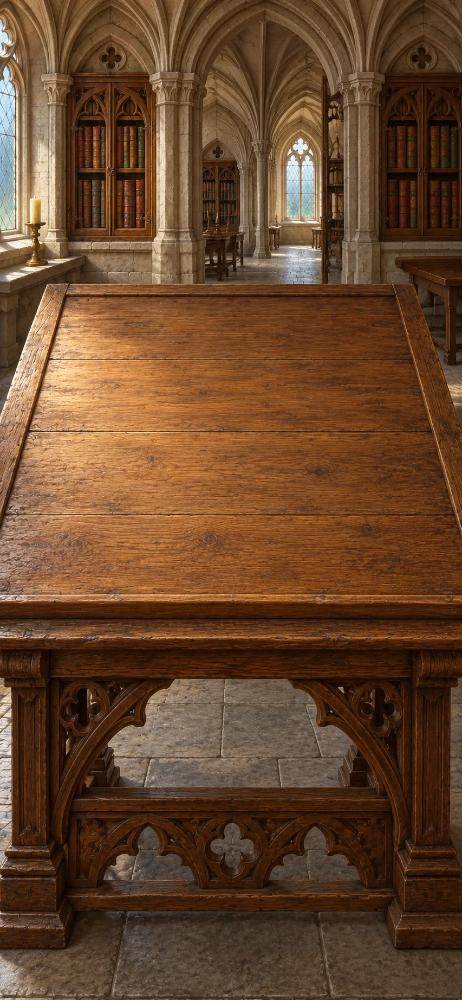

# Theology: Disputed Questions

A manuscript desk, not a test of faith. Follow a wound, a failed promise, bread, a hungry household and a request for prayer through changing arguments. Build what each writer is claiming, test it against a case, and leave real disagreements open. New chapters reuse distinctions you have made. Each item has a short explanation you can revisit.

> NOTE: Converted from `divinity-final-reading-scenes-v7`, the composed current scenario at source commit `1c95988a4e3771abcf2be28183ce009d38645d2c`. The conversion predates the current Markdown runtime. The active manuscript now runs through the shared parser and engine; subsequent authenticity revisions are recorded in the repository review history. All combinations are global. Completed goals remain satisfied.

> NOTE: Reconstructing an attributed religious argument is not endorsement, demonstration of a miracle, or authentication of an object. These desks compare texts; they do not claim that the writers met. The Book of Two Principles and the Lyon ritual are distinct witnesses, not a single creed for everyone called Cathar. Examples use Eg.; invented situations remain identified in their prose or author notes. The desk voice is a modern educational reconstruction, not a quotation or evidence that a writer read a particular other manuscript. Claims are stated directly; first person belongs mainly to hypothetical examples and attributed quotations. The voice and italic conclusion stay with the original desk when later board labels gain attribution.

> NOTE: Dating and setting: [CUHK’s primary-text introduction](https://www.cuhk.edu.hk/crs/tobias/primary_docs_ch11.html) identifies an anonymous Cathar author in northern Italy; [David d’Avray’s source study](https://discovery.ucl.ac.uk/id/eprint/1476999/1/Cathars%20from%20non-Catholic%20Sources%20DISCOVERY%20VERSION.pdf) reports Thouzellier’s c. 1250 dating. The Book of Two Principles represents a particular position within disputed Cathar traditions. [The Lyon library’s contributed manuscript record](https://www.occitanica.eu/items/show/11763) gives 1280–1330, while [IRHT’s catalogue](https://initiale.irht.cnrs.fr/codex/2627) gives the mid-thirteenth century and a tentative origin; the ritual desk’s c. 1300 follows the former range without asserting a precise year or place. “Lyon” names its present repository, not a documented performance there. [The Aquinas works catalogue](https://www.thomas-von-aquin.de/thomas-von-aquin/schriften/index.html) places Summa I in Rome by 1268 and III in Paris/Naples, 1271/2–1273. These are approximate source settings; the comparisons are editorial. The fire/water example follows medieval accounts of natural forms, not modern chemistry.

## `wound-meal` Augustine, Hippo, c. 421 — A wound and a stolen meal

*Augustine, Hippo, c. 421*

Augustine is a Christian bishop in Roman North Africa, writing a short handbook on faith, hope and love. If a good God made the world, where does evil come from? A wound and a stolen meal offer different ways into the question.

> NOTE: Source context: Augustine’s handbook · North Africa, c. 421.

**Goals**
- Is being hurt the same as doing wrong? -- `being-hurt-is-not-the-same-as-doing-wrong`
- What is the nature of evil? -- `augustine-loss`

**Items**

- `case-a-cut-body-has-lost-its-health` Eg. a wounded body has lost some health
  - from chapter `world-that-harms`: Augustine example: a wounded body has lost some health
  - from chapter `trinity`: Eg. a wounded body has lost some health
  - from chapter `cathar-rite`: Augustine example: a wounded body has lost some health

  What is a wound?

  Imagine a body cut and bleeding. It remains alive but has lost some health. The wound is damage to something good; calling it a loss does not make its pain imaginary.

  *Eg. a wounded body has lost some health*

- `healed-body` Eg. the wound heals without a separate evil thing escaping
  - from chapter `world-that-harms`: Augustine example: the wound heals without a separate evil thing escaping
  - from chapter `trinity`: Eg. the wound heals without a separate evil thing escaping
  - from chapter `cathar-rite`: Augustine example: the wound heals without a separate evil thing escaping

  What disappears when a wound heals?

  The body becomes healthy again. No separate evil substance escapes: the damage is repaired.

  *Eg. the wound heals without a separate evil thing escaping*

- `case-i-take-the-meal-my-neighbour-needs` Eg. I take the meal my neighbour needs
  - from chapter `world-that-harms`: Augustine example: I take the meal my neighbour needs
  - from chapter `trinity`: Eg. I take the meal my neighbour needs
  - from chapter `cathar-rite`: Augustine example: I take the meal my neighbour needs

  What makes taking food wrong?

  Suppose I take the meal my neighbour needs for my own comfort, knowing it is theirs. This is a choice to deprive someone, not an injury suffered.

  *Eg. I take the meal my neighbour needs*

- `fair-share` Enjoying food is good; my neighbour is still owed a share
  - from chapter `world-that-harms`: Augustine: Enjoying food is good; my neighbour is still owed a share
  - from chapter `trinity`: Enjoying food is good; my neighbour is still owed a share
  - from chapter `cathar-rite`: Augustine: Enjoying food is good; my neighbour is still owed a share

  Is enjoying food itself the problem when I steal a meal?

  Food and comfort are good, but my neighbour is still owed their share. Taking it puts my comfort before what I owe them.

  *Enjoying food is good; my neighbour is still owed a share*

- `genesis-creation-was-very-good` Genesis: creation was “very good”

  Can creation be good if things in it suffer harm?

  Genesis says God saw creation was “very good.” This gives the question its starting point: how can evil exist within a good creation?

  *Genesis: creation was “very good”*

- `health-lost` A wound is damage to a body, not a separate evil thing
  - from chapter `world-that-harms`: Augustine: A wound is damage to a body, not a separate evil thing
  - from chapter `trinity`: A wound is damage to a body, not a separate evil thing
  - from chapter `cathar-rite`: Augustine: A wound is damage to a body, not a separate evil thing

  How can a wound be real without being a separate thing?

  A cut body has lost health. When it heals, health returns without any evil substance escaping.

  The wound is damage to a good body, not an extra thing inside it. Its pain is still real.

  *A wound is damage to a body, not a separate evil thing*

- `the-wrong-is-taking-what-another-is-owed` Stealing food puts my comfort before my neighbour’s need
  - from chapter `world-that-harms`: Augustine: Stealing food puts my comfort before my neighbour’s need
  - from chapter `trinity`: Stealing food puts my comfort before my neighbour’s need
  - from chapter `cathar-rite`: Augustine: Stealing food puts my comfort before my neighbour’s need

  If food and comfort are good, why is stealing a meal wrong?

  Suppose I take the meal my neighbour needs. Enjoying food is good, but that share belongs to them.

  The wrong is choosing my comfort over what I owe them.

  *Stealing food puts my comfort before my neighbour’s need*

- `being-hurt-is-not-the-same-as-doing-wrong` Being hurt is not the same as doing wrong

  Does being harmed mean doing something wrong?

  A wound damages health. Stealing a neighbour’s meal puts personal comfort before what another person is owed.

  Both involve a loss of goodness, but one is harm suffered and the other a wrongful choice. Suffering does not make the injured person guilty.

  *Being hurt is not the same as doing wrong*

- `augustine-loss` Evil is goodness damaged or missing, not a separate thing
  - from chapter `world-that-harms`: Augustine: Evil is goodness damaged or missing, not a separate thing
  - from chapter `trinity`: Evil is goodness damaged or missing, not a separate thing
  - from chapter `cathar-rite`: Augustine: Evil is goodness damaged or missing, not a separate thing

  How can evil exist in a good creation?

  Genesis calls creation “very good.” A wound damages a good body; healing restores health without any separate evil substance escaping.

  Evil can likewise be damage to, or loss of, something good. The wound illustrates this account; it does not prove that creation is good.

  *Evil is goodness damaged or missing, not a separate thing*

**Combinations**
- `case-a-cut-body-has-lost-its-health` [transform] + `healed-body` [preserve] -> `health-lost` (tutorial)
- `case-i-take-the-meal-my-neighbour-needs` [transform] + `fair-share` [preserve] -> `the-wrong-is-taking-what-another-is-owed`
- `health-lost` + `the-wrong-is-taking-what-another-is-owed` [preserve] -> `being-hurt-is-not-the-same-as-doing-wrong`
- `health-lost` + `genesis-creation-was-very-good` [preserve] -> `augustine-loss`

> NOTE: Source `aug-evil`: [Augustine, Enchiridion §§9–15, 23–27, 42–52](https://www.newadvent.org/fathers/1302.htm). Created goodness, evil as privation, and the fallen will. §§26–27 and 42–48 describe inherited corruption and condemnation, distinct from an infant’s own acts; “inherited condition” must not be reduced to a learned habit or only bodily illness.

> NOTE: Source `genesis`: [Genesis 1:31, King James Version](https://www.biblegateway.com/passage/?search=Genesis%201%3A31&version=KJV). Brief excerpt from the creation account; not an independent demonstration of the theological claim.

## `willing-doing` Augustine, Hippo, c. 421 — Why can’t I simply do better?

*Augustine, Hippo, c. 421*

The meal has not been returned: the person who took it promised fairness, then chose comfort again. Use Augustine's account of grace to examine that failure; then ask why his church baptizes infants who have made no such choice.

> NOTE: Source context: Augustine’s grace controversy · a c. 421 reading setting reopening his earlier grace writings, including the 418 treatise.

**Goals**
- Why do we fail to do what we know is right? -- `aided-choice`
- Why would an infant need forgiveness? -- `condition-not-act`

**Items**

- `case-i-know-i-should-return-the-stolen-meal` Eg. I know I should return the stolen meal
  - from chapter `world-that-harms`: Augustine example: I know I should return the stolen meal
  - from chapter `trinity`: Eg. I know I should return the stolen meal
  - from chapter `cathar-rite`: Augustine example: I know I should return the stolen meal

  Is knowing what is right enough?

  Suppose I know I should return my neighbour’s stolen meal. Another lesson about whose food it is may not make me return it.

  *Eg. I know I should return the stolen meal*

- `failed-promise` Eg. I promise to return the meal, then keep it for myself
  - from chapter `world-that-harms`: Augustine example: I promise to return the meal, then keep it for myself
  - from chapter `trinity`: Eg. I promise to return the meal, then keep it for myself
  - from chapter `cathar-rite`: Augustine example: I promise to return the meal, then keep it for myself

  Is a promise enough to change a choice?

  Suppose I promise to return my neighbour’s stolen meal, then keep it for my own comfort. Knowing and promising have not led to action.

  *Eg. I promise to return the meal, then keep it for myself*

- `paul-the-good-that-i-would-i-do-not` Paul: I do not do the good I want to do

  Why do I sometimes fail to do what I want to do?

  Paul writes, “The good that I would I do not”: “would” here means “want to.” Wanting to do good does not always lead to doing it.

  *Paul: I do not do the good I want to do*

- `love-help` God can help us want what is right, not just teach it
  - from chapter `world-that-harms`: Augustine: God can help us want what is right, not just teach it
  - from chapter `trinity`: God can help us want what is right, not just teach it
  - from chapter `cathar-rite`: Augustine: God can help us want what is right, not just teach it

  What help is needed beyond knowing what is right?

  God’s grace can stir love and help people want and do what is right. It works within the will, beyond merely teaching a duty.

  *God can help us want what is right, not just teach it*

- `augustines-church-baptizes-infants-for-forgiveness` The church baptizes infants for the forgiveness of sins
  - from chapter `world-that-harms`: Augustine’s church baptizes infants for the forgiveness of their sins
  - from chapter `trinity`: The church baptizes infants for the forgiveness of sins
  - from chapter `cathar-rite`: Augustine’s church baptizes infants for the forgiveness of their sins

  Why baptize infants for forgiveness?

  The church baptizes infants for the forgiveness of sins. Yet they have chosen no wrongful act. What could need forgiving?

  *The church baptizes infants for the forgiveness of sins*

- `adam-condition` We inherit a sinful condition from Adam, the first human
  - from chapter `world-that-harms`: Augustine: We inherit a sinful condition from Adam, the first human
  - from chapter `trinity`: We inherit a sinful condition from Adam, the first human
  - from chapter `cathar-rite`: Augustine: We inherit a sinful condition from Adam, the first human

  What could forgiveness mean before a child has chosen wrong?

  Adam, the first human in the biblical story, disobeyed God. His descendants share in that original sin: they are born with a damaged nature and share the guilt of his disobedience.

  This inherited condition needs forgiveness before any wrongful choice of their own.

  *We inherit a sinful condition from Adam, the first human*

- `knowing-doing-gap` I know what is right, but still choose otherwise
  - from chapter `world-that-harms`: Augustine: I know what is right, but still choose otherwise
  - from chapter `trinity`: I know what is right, but still choose otherwise
  - from chapter `cathar-rite`: Augustine: I know what is right, but still choose otherwise

  Why might I fail to do what I know is right?

  Suppose I know I should return a stolen meal, promise to do so, then keep it. Paul also describes a gap between wanting and doing: “The good that I would I do not”—I do not do the good I want to do.

  Knowing and intending the good have not secured the action.

  *I know what is right, but still choose otherwise*

- `aided-choice` God helps us want and do what is right
  - from chapter `world-that-harms`: Augustine: God helps us want and do what is right
  - from chapter `trinity`: God helps us want and do what is right
  - from chapter `cathar-rite`: Augustine: God helps us want and do what is right

  What helps when knowing and promising do not lead to action?

  Suppose I promise to return a stolen meal, then keep it. God’s grace can stir love and help me want and do what is right.

  This is inward help, beyond another lesson about duty. The choice and action remain mine.

  *God helps us want and do what is right*

- `why-forgive-an-infant-who-has-not-chosen-wrong` Why would an infant need forgiveness without choosing wrong?

  Why would infants need forgiveness without choosing wrong?

  Imagine two infants, one ill and another well. Neither has chosen wrong, yet the church baptizes both for forgiveness.

  The same question arises for both: what needs forgiving before any wrongful choice? Health does not answer it.

  *Why would an infant need forgiveness without choosing wrong?*

- `condition-not-act` Infants inherit sin whether they are ill or well
  - from chapter `world-that-harms`: Augustine: Infants inherit sin whether they are ill or well
  - from chapter `trinity`: Infants inherit sin whether they are ill or well
  - from chapter `cathar-rite`: Augustine: Infants inherit sin whether they are ill or well

  Does an infant’s health determine a need for forgiveness?

  Imagine two infants, one ill and another well. Neither has chosen wrong, yet both are baptized for forgiveness. Adam’s descendants inherit a damaged nature and share the guilt of his disobedience.

  On that account, both need forgiveness for inherited sin. Health gives no exemption, and illness is no evidence of a wrongful choice.

  *Infants inherit sin whether they are ill or well*

- `two-infants` Eg. one infant is ill, one well; neither chose wrong
  - from chapter `world-that-harms`: Augustine example: one infant is ill, one well; neither chose wrong
  - from chapter `trinity`: Eg. one infant is ill, one well; neither chose wrong
  - from chapter `cathar-rite`: Augustine example: one infant is ill, one well; neither chose wrong

  Does an infant’s illness show personal wrongdoing?

  Imagine two infants, one ill and one well. Neither has chosen a wrongful act. Their different health cannot explain what either needs forgiven.

  *Eg. one infant is ill, one well; neither chose wrong*

**Combinations**
- `case-i-know-i-should-return-the-stolen-meal` [transform] + `failed-promise` -> `knowing-doing-gap`
- `paul-the-good-that-i-would-i-do-not` [preserve] + `failed-promise` -> `knowing-doing-gap`
- `knowing-doing-gap` [preserve] + `love-help` [preserve] -> `aided-choice`
- `two-infants` [preserve] + `augustines-church-baptizes-infants-for-forgiveness` [preserve] -> `why-forgive-an-infant-who-has-not-chosen-wrong`
- `why-forgive-an-infant-who-has-not-chosen-wrong` [preserve] + `adam-condition` [preserve] -> `condition-not-act`

> NOTE: Source `aug-grace`: [Augustine, On the Grace of Christ I](https://www.newadvent.org/fathers/15061.htm). Grace as inward help for willing and acting, beyond nature and instruction alone.

> NOTE: Source `romans`: [Romans 7:19, King James Version](https://www.biblegateway.com/passage/?search=Romans%207%3A19&version=KJV). Short excerpt about willing and doing. Pairing this verse with Augustine's grace argument is an editorial comparison; the linked On the Grace of Christ I supports inward help beyond teaching without supplying a specific reading of this verse.

## `world-that-harms` An anonymous Cathar author, northern Italy, c. 1250 — Who made a world that harms?

*An anonymous Cathar author, northern Italy, c. 1250*

The unnamed author of the Book of Two Principles belongs to the Christian movement commonly called Cathar. He wants to defend a wholly good God without making God the source of evil. What if the harm in this world cannot come from goodness at all?

[If skipped] Augustine describes evil as damage within a good creation. The Book of Two Principles gives evil an opposed source. The creator's responsibility remains in question.

> NOTE: Source context: Book of Two Principles · northern Italy, thirteenth century.

**Goals**
- Does foreseeing harm make you responsible? -- `a-knowing-maker-is-not-merely-a-knowing-spectator`
- Does evil have a source of its own? -- `origins-dispute`

**Items**

- `matthew-a-good-tree-cannot-bring-forth-evil-fruit` Matthew: “A good tree cannot bring forth evil fruit”

  What can fruit reveal about its source?

  Matthew warns against false prophets: “A good tree cannot bring forth evil fruit.” The saying judges a source by what it produces.

  *Matthew: “A good tree cannot bring forth evil fruit”*

- `two-principles-no-evil-can-come-from-a-wholly` A wholly good cause cannot produce evil
  - from chapter `fire-and-harm`: Cathar author: A wholly good cause cannot produce evil

  Can a wholly good cause produce evil?

  An ultimate source must be good or evil, producing its own kind. A wholly good source therefore cannot produce evil. This is the argument’s starting point, not something suffering alone proves.

  *A wholly good cause cannot produce evil*

- `case-the-same-world-feeds-people-and-destroys-them` Eg. the same world feeds people and destroys them
  - from chapter `fire-and-harm`: Cathar author example: the same world feeds people and destroys them

  Who is responsible for a world that both nourishes and harms?

  Fertile land feeds a household; a storm destroys its home. The same world sustains life and takes it away. The disaster does not show that its victims deserved it.

  *Eg. the same world feeds people and destroys them*

- `two-principles-a-maker-knowingly-chose-this-harmful-world` The creator knew this world would cause harm
  - from chapter `fire-and-harm`: Cathar author: The creator knew this world would cause harm

  Is a maker responsible for foreseeable harm?

  Consider a creator who knew the world would harm its inhabitants, yet made it. This creator did more than watch: the conditions for harm were part of what was made.

  *The creator knew this world would cause harm*

- `an-observer-can-foresee-harm-without-making-its-cause` An observer can foresee harm without causing it

  Does foreseeing harm mean causing it?

  A spectator may foresee a disaster without bringing it about. Knowing what will happen is different from making it happen.

  *An observer can foresee harm without causing it*

- `the-writer-turns-the-tree-saying-into-a-rule` A good tree cannot bear evil fruit—nor a good cause produce evil
  - from chapter `fire-and-harm`: Cathar author: A good tree cannot bear evil fruit—nor a good cause produce evil

  Does the good tree’s fruit tell us about the source of evil?

  Matthew warns against false prophets: “A good tree cannot bring forth evil fruit.” But what about the principle that no evil can come from a wholly good cause?

  The image extends from false prophets to the sources of good and evil: evil cannot be the fruit of a wholly good cause.

  *A good tree cannot bear evil fruit—nor a good cause produce evil*

- `two-principles-good-and-evil-must-have-opposed-sources` Good and evil must come from opposing sources
  - from chapter `fire-and-harm`: Cathar author: Good and evil must come from opposing sources

  Why would evil need a source of its own?

  An ultimate source is taken to be good or evil, producing its own kind—like Matthew’s good tree that cannot bear evil fruit. Yet the same world feeds a household and destroys its home in a storm.

  Neither a good source nor an evil one can then explain both. Good and evil must come from opposing sources. That conclusion preserves a wholly good God, but gives up one creator of everything; it depends on the starting premise.

  *Good and evil must come from opposing sources*

- `a-knowing-maker-is-not-merely-a-knowing-spectator` A creator who foresees harm is more than a bystander
  - from chapter `fire-and-harm`: Cathar author: A creator who foresees harm is more than a bystander

  Does foreseeing harm make a creator responsible?

  A spectator may foresee a disaster without causing it. A creator who knowingly made a harmful world also made the conditions for its harm.

  The spectator’s innocence does not answer the charge against a maker who did more than watch.

  *A creator who foresees harm is more than a bystander*

- `origins-dispute` Augustine: evil is damaged goodness. Cathar author: evil has a separate source

  Does evil have its own source, or is it damage to something good?

  Augustine calls evil a loss within a good creation, as a wound is lost health. But if an ultimate source must be good or evil and produce only its own kind, the world’s good and evil require opposing sources.

  The dispute concerns how evil arises and what a good creator can be responsible for, not simply what to call it.

  *Augustine: evil is damaged goodness. Cathar author: evil has a separate source*

**Combinations**
- `matthew-a-good-tree-cannot-bring-forth-evil-fruit` [preserve] + `two-principles-no-evil-can-come-from-a-wholly` -> `the-writer-turns-the-tree-saying-into-a-rule`
- `the-writer-turns-the-tree-saying-into-a-rule` [preserve] + `case-the-same-world-feeds-people-and-destroys-them` -> `two-principles-good-and-evil-must-have-opposed-sources`
- `two-principles-a-maker-knowingly-chose-this-harmful-world` [preserve] + `an-observer-can-foresee-harm-without-making-its-cause` [preserve] -> `a-knowing-maker-is-not-merely-a-knowing-spectator`
- `two-principles-good-and-evil-must-have-opposed-sources` + `augustine-loss` [preserve] -> `origins-dispute`
- `two-principles-no-evil-can-come-from-a-wholly` + `case-the-same-world-feeds-people-and-destroys-them` -> `two-principles-good-and-evil-must-have-opposed-sources`

> NOTE: Source `two-principles`: [Book of Two Principles, translated selections](https://www.cuhk.edu.hk/crs/tobias/primary_docs_ch11.html). A surviving radical-dualist argument from thirteenth-century Italy; use the translated primary text, not the page’s unqualified proposed Manichaean genealogy. Part I.2 assumes a first principle must be good or evil and produce its own kind; this extra premise is needed for the opposed-sources inference.

> NOTE: Source `matthew-tree`: [Matthew 7:18, King James Version](https://www.biblegateway.com/passage/?search=Matthew%207%3A18&version=KJV). Public-domain translation supplies the visible biblical quotation; the medieval treatise’s interpretation is separately attributed.

> NOTE: Source `two-principles-full`: [Book of Two Principles I.8–10, III.1–2 and V.1–6, translated primary text](https://gnosis.org/library/cathar-two-principles.htm). Online transcription based on Wakefield and Evans, with editor changes; primary text located through the search index because direct fetch failed. Use the actual argument, not the archive’s triumphalist introduction. I.9 gives the watcher analogy and I.10 its reply; V exposes disagreement among dualist groups.

## `fire-and-harm` Thomas Aquinas, Rome, c. 1267 — What has the fire example answered?

*Thomas Aquinas, Rome, c. 1267*

Thomas Aquinas is a Dominican friar and theologian working on his Summa in Rome. He asks how something acting well according to its nature could harm something else. Can fire expose a weakness in the argument for opposed sources of good and evil?

> NOTE: Source context: Aquinas · thirteenth century; an editorial comparison of texts.

**Goals**
- Does this answer the knowing maker’s responsibility? -- `limited-answer`

**Items**

- `aquinas-fire-does-what-fire-doesit-heats-and-burns` Fire acts as fire should when it heats and burns
  - from chapter `trinity`: Aquinas: Fire acts as fire should when it heats and burns
  - from chapter `baptism-water`: Fire acts as fire should when it heats and burns
  - from chapter `coin-or-supper`: Aquinas: Fire acts as fire should when it heats and burns

  Can something work well and still cause harm?

  Fire heats and burns according to its nature. Being good at being fire does not mean being morally good or benefiting everything nearby.

  *Fire acts as fire should when it heats and burns*

- `water-lost` Eg. in this account of nature, fire changes water into something else
  - from chapter `trinity`: Aquinas example: in his account of nature, fire changes water into something else
  - from chapter `baptism-water`: Eg. in this account of nature, fire changes water into something else
  - from chapter `coin-or-supper`: Aquinas example: in his account of nature, fire changes water into something else

  What if fire changes water into something else?

  In this account of nature, fire can turn water into fire. Water then loses its “form”: what makes it water. The example concerns one kind of thing being destroyed as another takes its place.

  *Eg. in this account of nature, fire changes water into something else*

- `fire-can-work-well-as-fire-while-harming-something` Fire can work as it should while harming something else
  - from chapter `trinity`: Aquinas: Fire can work as it should while harming something else
  - from chapter `baptism-water`: Fire can work as it should while harming something else
  - from chapter `coin-or-supper`: Aquinas: Fire can work as it should while harming something else

  Can fire work as it should and still destroy something?

  Fire naturally heats and burns. In this account of nature, it can turn water into fire: the water ceases to be water.

  The fire fulfils its nature while destroying something else. Being good as fire does not mean being morally good or harmless.

  *Fire can work as it should while harming something else*

- `aquinas-harmful-effects-do-not-require-a-separate-evil` Harmful effects do not require a separate evil source
  - from chapter `trinity`: Aquinas: Harmful effects do not require a separate evil source
  - from chapter `baptism-water`: Harmful effects do not require a separate evil source
  - from chapter `coin-or-supper`: Aquinas: Harmful effects do not require a separate evil source

  Must harm come from a separate evil source?

  The Cathar Book of Two Principles gives evil an opposing source: a wholly good cause cannot produce it. But in this account of nature, fire can turn water into fire, destroying the water while working well as fire.

  This concerns natural functioning, not moral goodness. It shows how harm can follow from something working well, challenging the need for a separate evil source.

  *Harmful effects do not require a separate evil source*

- `limited-answer` The fire example explains harm, but leaves the creator’s responsibility open

  Does the fire example settle a creator’s responsibility?

  In this account of nature, fire can turn water into fire. It works well as fire while destroying the water, explaining harm without a separate evil source. But the Cathar author asks about a creator who knowingly made the conditions for harm, rather than merely watching.

  The example concerns natural functioning. By itself, it does not settle the creator’s responsibility.

  *The fire example explains harm, but leaves the creator’s responsibility open*

**Combinations**
- `aquinas-fire-does-what-fire-doesit-heats-and-burns` [preserve] + `water-lost` [preserve] -> `fire-can-work-well-as-fire-while-harming-something`
- `fire-can-work-well-as-fire-while-harming-something` [preserve] + `two-principles-good-and-evil-must-have-opposed-sources` -> `aquinas-harmful-effects-do-not-require-a-separate-evil`
- `aquinas-harmful-effects-do-not-require-a-separate-evil` [preserve] + `a-knowing-maker-is-not-merely-a-knowing-spectator` [preserve] -> `limited-answer`

> NOTE: Source `summa-evil`: [Aquinas, Summa I q.49 aa.1–3](https://www.newadvent.org/summa/1049.htm). Actual objections, Augustine citations, two principles, good nature and defective agency. No evidence here that Aquinas was answering this surviving Italian treatise. Article 1 describes fire impressing its own form while destroying the form of water or air; the reading’s “turn water into fire” makes that medieval elemental transformation explicit, rather than describing modern evaporation.

> NOTE: Source `aquinas-reason-limit`: [Aquinas, Summa I q.32 a.1](https://www.newadvent.org/summa/1032.htm). Natural reason does not demonstrate the Trinity; an explanation of a received belief is not its proof.

## `trinity` Augustine, Hippo, c. 420 — Three, and not three gods?

*Augustine, Hippo, c. 420*

Return to Augustine, bishop of Hippo, for his earlier account of the Trinity. Christians name Father, Son and Holy Spirit: how can they still mean one God? The rites ahead promise the Spirit, making this more than a question about names.

[If skipped] Augustine distinguishes Father, Son and Holy Spirit while affirming one God. Aquinas says observation of created things cannot prove this belief.

> NOTE: Source context: Augustine’s On the Trinity · a return to an earlier voice; Aquinas’s reason/revelation limit frames the comparison.

**Goals**
- Does being Son mean being less divine? -- `augustine-the-name-son-does-not-mean-a-lesser`
- Which explanations of the Trinity does Augustine rule out? -- `trinity-bounded`

**Items**

- `teacher-pupil` Eg. a teacher instructs a pupil; both are human
  - from chapter `cathar-rite`: Augustine example: a teacher instructs a pupil; both are human

  Do different roles mean different natures?

  A teacher gives a lesson; a pupil receives it. Both are human. The pupil’s different role does not make them less human.

  *Eg. a teacher instructs a pupil; both are human*

- `does-being-son-mean-being-a-lesser-kind-of` Does being God’s Son mean being less divine?

  Does being God’s Son mean being less divine?

  Father and Son name a relationship. Different relationships need not mean different natures, with one greater and the other lesser.

  *Does being God’s Son mean being less divine?*

- `three-humans` Eg. three people are all human, but remain three separate beings
  - from chapter `cathar-rite`: Augustine example: three people are all human, but remain three separate beings

  Does sharing a nature make three people one being?

  Three people share human nature, yet remain three separate beings. Sharing a kind does not make them one.

  *Eg. three people are all human, but remain three separate beings*

- `one-divine-being` Father, Son and Holy Spirit are one divine being
  - from chapter `cathar-rite`: Augustine: Father, Son and Holy Spirit are one divine being

  How can Father, Son and Holy Spirit be one God?

  Father, Son and Holy Spirit are one divine being, with real differences of relationship. They are not three separate gods of the same kind.

  *Father, Son and Holy Spirit are one divine being*

- `jesus-father-glorify-thy-son` Jesus asks the Father to reveal the Son’s glory

  What does the Son’s prayer reveal about his relation to the Father?

  In John’s Gospel Jesus says, “Father … glorify thy Son”: he asks the Father to reveal the Son’s glory. One addresses the other; there is a real relationship.

  *Jesus asks the Father to reveal the Son’s glory*

- `augustine-the-name-son-does-not-mean-a-lesser` Being God’s Son does not mean being less divine
  - from chapter `cathar-rite`: Augustine: Being God’s Son does not mean being less divine

  Does the name Son mean less divine than the Father?

  A teacher and pupil have different roles but are equally human. Likewise, Father and Son name a relationship, not necessarily unequal natures.

  Being Son does not mean being a lesser kind of God. The classroom example challenges that inference; it does not prove divine unity.

  *Being God’s Son does not mean being less divine*

- `augustine-one-godnot-three-gods-sharing-a-kind` Father, Son and Spirit are one God, not three similar gods
  - from chapter `cathar-rite`: Augustine: Father, Son and Spirit are one God, not three similar gods

  Are Father, Son and Spirit three gods of the same kind?

  Three humans share a nature but remain separate beings. Father, Son and Holy Spirit are one divine being, with distinct relationships.

  Sharing a kind is therefore an inadequate comparison. It describes three similar beings, not one God.

  *Father, Son and Spirit are one God, not three similar gods*

- `trinity-bounded` One God as Father, Son and Holy Spirit
  - from chapter `cathar-rite`: Augustine: One God as Father, Son and Holy Spirit

  How can Father, Son and Holy Spirit be distinct while God is one?

  Father, Son and Holy Spirit are one divine being, not three gods sharing a kind. Yet in John’s Gospel the Son addresses the Father: “Father … glorify thy Son.”

  Unity must allow a real relationship, not one person changing roles. The belief also includes the Holy Spirit, though this verse alone does not establish that. These comparisons clarify the doctrine without proving it.

  *One God as Father, Son and Holy Spirit*

**Combinations**
- `teacher-pupil` [preserve] + `does-being-son-mean-being-a-lesser-kind-of` [transform] -> `augustine-the-name-son-does-not-mean-a-lesser`
- `three-humans` [preserve] + `one-divine-being` [preserve] -> `augustine-one-godnot-three-gods-sharing-a-kind`
- `jesus-father-glorify-thy-son` [preserve] + `augustine-one-godnot-three-gods-sharing-a-kind` [preserve] -> `trinity-bounded`

> NOTE: Source `aug-trinity`: [Augustine, On the Trinity V.1,5–9](https://www.newadvent.org/fathers/130105.htm). Primary text, public-domain translation. Relative names, one divine being, and limits of creaturely comparison.

> NOTE: Source `aquinas-trinity`: [Aquinas, Summa I q.28 aa.1–3](https://www.newadvent.org/summa/1028.htm). Relations and divine unity. Explicitly reopens Augustine; not three members of a species.

> NOTE: Source `john17-kjv`: [John 17:1, King James Version](https://www.biblegateway.com/passage/?search=John%2017%3A1&version=KJV). Brief public-domain quotation. Its Trinitarian interpretation is separately attributed.

## `cathar-rite` A Cathar minister, place uncertain, c. 1300 — Can a spiritual rite be bodily?

*A Cathar minister, place uncertain, c. 1300*

This voice belongs to the minister described in a Cathar ritual preserved in an Occitan manuscript now at Lyon. The ceremony promises forgiveness and God’s Spirit through hands and a Gospel book. What can using bodies in worship tell us about who made them?

> NOTE: Source context: The Lyon ritual · a separate medieval manuscript witness. The approximate date describes the surviving manuscript, not the origin of the rite; its place of production is uncertain.

**Goals**
- What does this bodily rite tell us about creation? -- `using-bodies-in-a-rite-does-not-prove-belief`

**Items**

- `the-rite-claims-a-spiritual-gift-through-hands-and` Hands and a Gospel book are laid on a believer to give God’s Spirit
  - from chapter `baptism-water`: Lyon ritual: hands and a Gospel book are laid on a believer to give God’s Spirit

  Can a bodily ceremony give a spiritual gift?

  In spiritual baptism, hands and a Gospel book are placed on the candidate, with a promise of forgiveness and the Holy Spirit within the believer. The rite appeals to the laying on of hands in Acts. The candidate renounces worldly desires and pledges to love enemies and pray for persecutors.

  *Hands and a Gospel book are laid on a believer to give God’s Spirit*

- `using-bodies-in-a-rite-does-not-prove-belief` Using bodies in worship does not tell us who created them

  Does using hands and a book in worship settle who made matter?

  In spiritual baptism, hands and a Gospel book are placed on the candidate with a promise of forgiveness and the Holy Spirit.

  Augustine calls evil damage within a good creation; the separate Cathar text, the Book of Two Principles, gives evil an opposed source. Using bodies in the rite does not by itself settle which account is right.

  *Using bodies in worship does not tell us who created them*

**Combinations**
- `the-rite-claims-a-spiritual-gift-through-hands-and` + `origins-dispute` [preserve] -> `using-bodies-in-a-rite-does-not-prove-belief`

> NOTE: Source `ritual`: [Occitan ritual, Lyon PA 36, Marvyn Roy Harris critical edition (Rialto)](https://www.rialto.unina.it/archivio/prorel/CatharRitual/CathRit.txt.htm). Critical text IV.15–18 cites Acts 8:14–17 (not Acts 19). III.22–31 and IV.49–53 support indwelling Spirit, forgiveness and bodily enactment. Distinct witness from Two Principles.

> NOTE: Source `matthew-enemies-kjv`: [Matthew 5:44, King James Version](https://www.biblegateway.com/passage/?search=Matthew%205%3A44&version=KJV). Biblical enemy-love command, provided here for comparison. The ritual includes enemy-love and prayer/blessing for persecutors in IV.32; the pledge does not imply the manuscript used KJV.

## `baptism-water` Thomas Aquinas, Naples, c. 1273 — Can water do more than wash?

*Thomas Aquinas, Naples, c. 1273*

Return to Aquinas, now writing about sacraments in Naples. He says God appointed baptism with water to give inward grace. How could water do more than wash—and what would authorize this particular use of it?

> NOTE: Source context: Back to Aquinas · Summa III q.62.

**Goals**
- How could water give an inward gift? -- `instrumental-baptism`
- next: Are these two rites saying the same thing? -- `rites-different`

**Items**

- `aquinass-example-the-axe-cuts-the-wood` Eg. the axe cuts the wood
  - from chapter `coin-or-supper`: Aquinas example: the axe cuts the wood

  How does an axe work?

  An axe cuts wood with its edge. Cutting alone does not explain why the wood takes the shape of a bed.

  *Eg. the axe cuts the wood*

- `the-craftsperson-uses-the-axe-to-make-a-bed` Eg. the craftsperson uses the axe to make a bed
  - from chapter `coin-or-supper`: Aquinas example: the craftsperson uses the axe to make a bed

  How does a craftsperson make a bed with an axe?

  The craftsperson directs the work, and the axe cuts the wood. Both act, but the axe is not an independent designer.

  *Eg. the craftsperson uses the axe to make a bed*

- `instituted-baptism` God chose water baptism to give grace: new life within the soul
  - from chapter `coin-or-supper`: Aquinas: God chose water baptism to give grace: new life within the soul

  Why would baptismal water do more than wash?

  God appointed baptism with water to give grace: new life within the soul. A sacrament is a bodily sign or rite appointed by God. An instrument can help explain how it acts, but the comparison cannot prove God appointed it.

  *God chose water baptism to give grace: new life within the soul*

- `dependent-tool` Eg. the axe cuts; the craftsperson works through the axe
  - from chapter `coin-or-supper`: Aquinas example: the axe cuts; the craftsperson works through the axe

  How can both an axe and a craftsperson act?

  The axe cuts the wood; the craftsperson directs it to make a bed.

  The axe makes a real contribution as an instrument, without becoming an independent designer.

  *Eg. the axe cuts; the craftsperson works through the axe*

- `instrumental-baptism` In baptism, God works through water to give new life within the soul
  - from chapter `coin-or-supper`: Aquinas: In baptism, God works through water to give new life within the soul

  How could water give an inward gift?

  An axe cuts wood while a craftsperson directs it to make a bed. God appointed baptism with water to give grace: new life within the soul.

  Water washes the body, and God works through it as an instrument to give that inward gift. The analogy does not prove that God appointed baptism or make ordinary washing a sacrament.

  *In baptism, God works through water to give new life within the soul*

- `rites-different` Using water or hands does not prove that a rite comes from God

  Does using material things make two rites equally authoritative?

  God appointed water baptism and works through it to give inward grace. The Cathar rite places hands and a Gospel book on a candidate, promises forgiveness and the Holy Spirit, and appeals to the laying on of hands in Acts.

  Both use material things, but that resemblance alone does not settle their claims to authority.

  *Using water or hands does not prove that a rite comes from God*

**Combinations**
- `aquinass-example-the-axe-cuts-the-wood` [preserve] + `the-craftsperson-uses-the-axe-to-make-a-bed` [preserve] -> `dependent-tool`
- `dependent-tool` [preserve] + `instituted-baptism` [preserve] -> `instrumental-baptism`
- `instrumental-baptism` + `the-rite-claims-a-spiritual-gift-through-hands-and` -> `rites-different`

> NOTE: Source `summa-doctrine`: [Aquinas, Summa I q.1 aa.1,8](https://www.newadvent.org/summa/1001.htm). Reason and revelation; grace perfects nature. Augustine is an explicit authority in this question.

> NOTE: Source `summa-sign`: [Aquinas, Summa III q.60 aa.3,6](https://www.newadvent.org/summa/4060.htm). Sensible signs and words; explicitly cites Augustine on the word and element.

> NOTE: Source `summa-grace`: [Aquinas, Summa III q.62 a.1](https://www.newadvent.org/summa/4062.htm). God as principal cause and the sacrament as instrument; no independent magic in matter.

## `communion-bread` Thomas Aquinas, Naples, c. 1273 — What changed if it still tastes like bread?

*Thomas Aquinas, Naples, c. 1273*

Does Communion give bread the same role that baptism gives water? Aquinas claims a change in what the bread is, even when a guest notices no change in its taste.

[If skipped] Aquinas distinguishes what the bread is from how it appears. He says the first changes while the second remains.

> NOTE: Source context: Aquinas · the Eucharistic argument.

**Goals**
- What can tasting the bread establish? -- `eucharist-account`
- Do water and bread have the same religious role? -- `two-material-roles`

**Items**

- `bread-taste` Eg. after the blessing, the bread still looks and tastes like bread
  - from chapter `coin-or-supper`: Aquinas example: after the blessing, the bread still looks and tastes like bread

  What can a guest tell by tasting Communion bread?

  At Communion, the Christian meal of bread and wine, the blessed bread still looks and tastes as before. Whether what it is has changed is another question.

  *Eg. after the blessing, the bread still looks and tastes like bread*

- `jesus-this-is-my-body` Jesus: “This is my body”

  What did Jesus mean by “This is my body”?

  At supper with his disciples, Jesus said these words over bread. They affirm that his body is truly present in Communion; how bread can be his body calls for explanation.

  *Jesus: “This is my body”*

- `aquinas-what-was-bread-becomes-christs-body` What was bread becomes Christ’s body
  - from chapter `coin-or-supper`: Aquinas: What was bread becomes Christ’s body

  What happens to the bread at Communion?

  What was bread becomes Christ’s body, though its appearance and taste remain. This change is called transubstantiation.

  *What was bread becomes Christ’s body*

- `aquinas-reads-christs-words-as-changing-bread-into-his` “This is my body” means the bread becomes Christ’s body
  - from chapter `coin-or-supper`: Aquinas: “This is my body” means the bread becomes Christ’s body

  What do Christ’s words mean for the bread?

  At supper Jesus said over bread, “This is my body.” What was bread becomes Christ’s body, though its familiar qualities remain.

  His words affirm this change in what the bread is.

  *“This is my body” means the bread becomes Christ’s body*

- `eucharist-account` What was bread becomes Christ’s body; bread’s look and taste remain
  - from chapter `coin-or-supper`: Aquinas: What was bread becomes Christ’s body; bread’s look and taste remain

  What can tasting Communion bread establish?

  After the blessing, the bread still looks and tastes like bread. Jesus said over bread, “This is my body”: what was bread becomes his body.

  In transubstantiation, the substance—what the bread is—becomes Christ’s body, while its accidents—qualities such as taste and colour—remain. Unchanged taste fits this account but cannot prove the change, which rests on divine authority.

  *What was bread becomes Christ’s body; bread’s look and taste remain*

- `two-material-roles` Baptism’s water is God’s tool; bread in Communion becomes Christ’s body
  - from chapter `coin-or-supper`: Aquinas: Baptism’s water is God’s tool; bread in Communion becomes Christ’s body

  Do water and bread play the same part?

  In baptism, God works through water to give grace, new life within the soul. In Communion, what was bread becomes Christ’s body while its appearance and taste remain.

  Both rites begin with material things, but water is an instrument of God’s action, whereas the bread’s substance becomes Christ’s body.

  *Baptism’s water is God’s tool; bread in Communion becomes Christ’s body*

**Combinations**
- `jesus-this-is-my-body` [preserve] + `aquinas-what-was-bread-becomes-christs-body` [preserve] -> `aquinas-reads-christs-words-as-changing-bread-into-his`
- `bread-taste` [preserve] + `aquinas-reads-christs-words-as-changing-bread-into-his` [preserve] -> `eucharist-account`
- `eucharist-account` + `instrumental-baptism` -> `two-material-roles`

> NOTE: Source `summa-eucharist`: [Aquinas, Summa III q.75 aa.2,4,5](https://www.newadvent.org/summa/4075.htm). Change of substance with sensible appearances remaining.

> NOTE: Source `luke22-kjv`: [Luke 22:19, King James Version](https://www.biblegateway.com/passage/?search=Luke%2022%3A19&version=KJV). Brief public-domain quotation; rival readings do not become the words of the verse.

## `coin-or-supper` Martin Luther, Wittenberg, 1517 — One coin: a letter or supper?

*Martin Luther, Wittenberg, 1517*

Martin Luther is a friar and university teacher in Wittenberg, challenging indulgence preaching. An indulgence concerns penalties remaining after sins have been forgiven; a seller’s promise may go further than church teaching. A household has one coin and no supper: which duty should claim its money?

> NOTE: Source context: Luther · Wittenberg, 1517.

**Goals**
- (three goals are a lot but okay here because the household payment case compares care, control of gifts, and repentance; the review found these distinctions concrete and did not establish a benefit from hiding one question)
- What should the household's coin pay for? -- `feed-before-letter`
- Does serving God mean controlling God's gifts? -- `working-for-god-does-not-mean-controlling-gods-gifts`
- Can a payment replace repentance? -- `luther-a-paid-guarantee-cannot-replace-a-changed-life`

**Items**

- `case-the-household-has-one-coin-and-no-supper` Eg. the household has one coin and no supper
  - from chapter `marburg`: Luther example: the household has one coin and no supper

  What should a household do with its last coin?

  Suppose a household has one coin and no supper. Spending it on an indulgence letter, offering relief from penalties for sins already forgiven, would leave the family hungry.

  *Eg. the household has one coin and no supper*

- `sellers-claim-reported-by-luther-a-coin-frees-a` Seller’s claim: a coin frees a dead soul from punishment
  - from chapter `marburg`: Seller’s claim reported by Luther: a coin frees a dead soul from punishment

  Can a coin free a dead soul?

  Some sellers claim that a coin releases a soul from purgatory: purification after death for those ultimately saved. Their promise concerns punishment, not escape from hell; a seller’s claim is not itself church teaching.

  *Seller’s claim: a coin frees a dead soul from punishment*

- `luther-household-necessities-and-poor-neighbours-come-first` Food for family and poor neighbours comes before letters reducing church penalties
  - from chapter `marburg`: Luther: Food for family and poor neighbours comes before letters reducing church penalties

  Which need should come first?

  Provide for household necessities and help poor neighbours before buying an indulgence letter, which offers relief from penalties for sins already forgiven. The money needed to feed people should meet their present need.

  *Food for family and poor neighbours comes before letters reducing church penalties*

- `declare-forgiveness` The pope announces forgiveness; God is the one who forgives
  - from chapter `marburg`: Luther: The pope announces forgiveness; God is the one who forgives

  Who forgives?

  The pope announces forgiveness, but God forgives. A minister’s announcement does not compel God to forgive.

  *The pope announces forgiveness; God is the one who forgives*

- `luther-repentance-means-a-lifetime-of-turning-away-from` Repentance means a lifetime of turning away from wrong
  - from chapter `marburg`: Luther: Repentance means a lifetime of turning away from wrong

  What does it mean to repent?

  Repentance is a lifetime of turning away from wrong, not a transaction completed once and forgotten.

  *Repentance means a lifetime of turning away from wrong*

- `coin-not-control` A seller cannot guarantee God’s mercy for a coin
  - from chapter `marburg`: Luther: A seller cannot guarantee God’s mercy for a coin

  Can a seller guarantee a dead soul’s release for a coin?

  Sellers promise that a coin frees a soul from purgatory, purification after death for those ultimately saved. An indulgence concerns penalties after forgiveness, and the pope can release penalties imposed by church authority.

  That authority does not give him command over a dead soul’s release. A seller cannot guarantee God’s mercy for payment.

  *A seller cannot guarantee God’s mercy for a coin*

- `feed-before-letter` Buy supper before paying to reduce penalties imposed by the church
  - from chapter `marburg`: Luther: Buy supper before paying to reduce penalties imposed by the church

  What should the hungry household buy?

  The household has one coin and no supper. Household necessities and care for poor neighbours come before an indulgence letter offering relief from penalties for forgiven sins.

  The coin should buy supper, answering the family’s present need.

  *Buy supper before paying to reduce penalties imposed by the church*

- `working-for-god-does-not-mean-controlling-gods-gifts` Luther and Aquinas: serving God does not mean controlling God’s gifts

  Does serving God mean controlling God’s gift?

  The pope announces forgiveness, but God forgives. Aquinas describes baptismal water as an instrument through which God gives inward grace, not an independent source of grace.

  These different practices both distinguish serving God from controlling a divine gift.

  *Luther and Aquinas: serving God does not mean controlling God’s gifts*

- `luther-a-paid-guarantee-cannot-replace-a-changed-life` Buying promised release from punishment cannot replace your own repentance
  - from chapter `marburg`: Luther: Buying promised release from punishment cannot replace your own repentance

  Can buying a promise of release replace repentance?

  Sellers cannot guarantee that payment frees a dead soul from purgatory, purification after death for those ultimately saved. Repentance means a lifetime of turning away from wrong.

  The dead person’s release and the buyer’s repentance are different matters. Buying a promise guarantees neither release nor a changed life.

  *Buying promised release from punishment cannot replace your own repentance*

- `papal-penalty-limit` The pope can cancel penalties imposed by church authority
  - from chapter `marburg`: Luther: The pope can cancel penalties imposed by church authority

  What can the pope release?

  An indulgence concerns penalties remaining after sins have been forgiven. The pope can release penalties imposed by church authority; a wider power over punishment after death needs scrutiny.

  *The pope can cancel penalties imposed by church authority*

**Combinations**
- `case-the-household-has-one-coin-and-no-supper` [transform] + `luther-household-necessities-and-poor-neighbours-come-first` [preserve] -> `feed-before-letter`
- `declare-forgiveness` [preserve] + `instrumental-baptism` -> `working-for-god-does-not-mean-controlling-gods-gifts`
- `coin-not-control` [preserve] + `luther-repentance-means-a-lifetime-of-turning-away-from` [preserve] -> `luther-a-paid-guarantee-cannot-replace-a-changed-life`
- `sellers-claim-reported-by-luther-a-coin-frees-a` [preserve] + `papal-penalty-limit` [preserve] -> `coin-not-control`

> NOTE: Source `theses`: [Luther, Ninety-Five Theses (1517), Taylor edition](https://editions.mml.ox.ac.uk/editions/luther-95-theses/luther-95-theses-eng.shtml). Especially theses 1, 27–28, 35–36, 43 and 62; indulgences concern penalties, not a legitimate purchase of guilt’s forgiveness.

## `free-service` Martin Luther, Wittenberg, 1520 — If it is a gift, why do anything?

*Martin Luther, Wittenberg, 1520*

The household still needs the supper you put before the indulgence letter. Luther now says that good deeds do not earn God's acceptance: apply his account to supplying the meal, then test an alternative case in which someone keeps a fast but leaves supper unprepared.

[If skipped] For Luther, caring for a neighbour serves a real need without earning God's acceptance. The later role of good deeds remains disputed.

> NOTE: Source context: Luther · Christian Liberty, 1520.

**Goals**
- Why help if help does not earn salvation? -- `care-not-purchase`
- next: Has fasting done the neighbour’s work? -- `practice-not-price`
- Are these writers asking the same question about grace? -- `two-grace-questions`

**Items**

- `gift-acceptance` Faith (trust in Christ), not good deeds, makes us right with God
  - from chapter `marburg`: Luther: Faith (trust in Christ), not good deeds, makes us right with God

  What makes a person right with God?

  Faith means trust in Christ and his promise. Faith, not good deeds, makes a person right with God. Helping a neighbour meets a real need; it does not earn God’s acceptance.

  *Faith (trust in Christ), not good deeds, makes us right with God*

- `christ-serves` Christ served freely; serve neighbours freely
  - from chapter `marburg`: Luther: Christ served freely; serve neighbours freely

  Why serve a neighbour freely?

  Christ served freely, so a person can serve a neighbour freely in turn. The neighbour’s need gives the work its purpose; it is not a price for God’s acceptance.

  *Christ served freely; serve neighbours freely*

- `body-practice` Eg. a person fasts for discipline but leaves supper unprepared
  - from chapter `marburg`: Luther example: a person fasts for discipline but leaves supper unprepared

  Has going without food fed the household?

  Suppose someone fasts—goes without food—to discipline their appetite, but leaves supper unprepared. The fast may train them, while the family still needs a meal.

  *Eg. a person fasts for discipline but leaves supper unprepared*

- `care-not-purchase` Feeding the household serves others; it does not buy God’s acceptance
  - from chapter `marburg`: Luther: Feeding the household serves others; it does not buy God’s acceptance

  Why feed a hungry household if good deeds do not buy God’s acceptance?

  A household has one coin and no supper; food comes before an indulgence letter offering relief from penalties for forgiven sins. Christ served freely, giving reason to serve neighbours freely.

  Feeding the household answers its hunger, without becoming a price for God’s acceptance.

  *Feeding the household serves others; it does not buy God’s acceptance*

- `two-grace-questions` Augustine: what helps me do right? Luther: what makes me right with God?

  Are these the same question about grace?

  Augustine asks how someone who knows what is right can come to want and do it: God stirs love and action, while the person really acts. Faith in Christ, not good deeds, makes a person right with God.

  A meal for a hungry household can raise both questions. Explaining how someone comes to serve does not settle what makes them right with God; faith does not make service unimportant.

  *Augustine: what helps me do right? Luther: what makes me right with God?*

- `practice-not-price` Going without food can train a person; the household still needs its meal
  - from chapter `marburg`: Luther: Going without food can train a person; the household still needs its meal

  Has a fast fed the family?

  Suppose someone fasts to discipline their appetite but leaves supper unprepared. Feeding the household answers its hunger, and Christ’s free service gives reason to serve freely.

  Fasting may train a person, but it does not feed a neighbour. Discipline should support service; neither fasting nor feeding the family purchases God’s acceptance.

  *Going without food can train a person; the household still needs its meal*

**Combinations**
- `feed-before-letter` [preserve] + `christ-serves` [preserve] -> `care-not-purchase`
- `gift-acceptance` [preserve] + `aided-choice` [preserve] -> `two-grace-questions`
- `body-practice` [transform] + `care-not-purchase` [preserve] -> `practice-not-price`

> NOTE: Source `liberty-public-domain`: [Luther, Concerning Christian Liberty (1520), Project Gutenberg primary text](https://www.gutenberg.org/cache/epub/1911/pg1911-images.html). Public-domain English text checked for gift, faith, service and bodily discipline. The discipline discussion excludes works as righteousness before God; the bishop comparison denies their making the Christian more holy. Original paraphrases, not quotations from the separate modern Hanover translation.

## `marburg` Luther and Zwingli, Marburg, 1529 — What can these opponents sign together?

*Luther and Zwingli, Marburg, 1529*

Huldrych Zwingli, the reformer of Zürich, has come to Marburg to meet Luther and other reformers. They seek common ground, but disagree about Christ’s bodily presence in Communion, the Christian meal of bread and wine. What can these opponents sign together?

> NOTE: Source context: Marburg · 1526–1529 texts beside the signed articles.

**Goals**
- (three goals are a lot but okay here because the Communion positions, the unbelieving guest, and shared agreement are distinct comparisons; the review found the three simultaneous questions intelligible)
- What is received in Communion? -- `three-supper-accounts`
- Does receiving the gift guarantee its benefit? -- `received-not-benefited`
- What can these opponents agree on? -- `shared-belief-in-the-trinity-leaves-their-communion-dispute`

**Items**

- `zwingli-a-ring-recalls-a-beloved-without-containing-their` Zwingli: a ring recalls a loved one without containing their body

  How can an object recall someone absent?

  Zwingli compares Communion bread to a ring that recalls a loved person without containing their body. The bread likewise points to Christ in the Christian meal of bread and wine.

  *Zwingli: a ring recalls a loved one without containing their body*

- `zwingli-christs-human-body-is-in-heaven` Zwingli: Christ’s human body is in heaven

  Where is Christ’s human body?

  Zwingli holds that Christ’s human body is in heaven after the Ascension, his rising to heaven. Communion bread points to that body without containing it.

  *Zwingli: Christ’s human body is in heaven*

- `luther-christs-words-give-his-body-with-the-bread` Luther: in Communion, Christ’s words give his body with the bread

  What does Luther say is received in Communion?

  Luther takes Christ’s words over bread, “This is my body,” to give his body with the bread. The gift rests on Christ’s words, not the guest’s belief.

  *Luther: in Communion, Christ’s words give his body with the bread*

- `unbelieving-guest` Eg. a guest eats the Communion bread without trusting Christ’s promise
  - from chapter `trent-justification`: Marburg example: a guest eats the Communion bread without trusting Christ’s promise

  What if a Communion guest does not trust Christ’s promise?

  Imagine a guest eating the bread in the Christian Communion meal without trusting Christ’s promise of a gift for them.

  *Eg. a guest eats the Communion bread without trusting Christ’s promise*

- `faith-benefit` Luther: the Communion meal gives forgiveness through trust in Christ’s promise

  How is Communion’s promised forgiveness received?

  Luther says forgiveness comes through faith: trust that Christ’s promise is for the receiver. This benefit is distinct from receiving Christ’s body with the bread.

  *Luther: the Communion meal gives forgiveness through trust in Christ’s promise*

- `marburgs-signers-affirm-one-god-in-three-persons` The Marburg agreement affirms one God as Father, Son and Holy Spirit

  What can be agreed about God at Marburg?

  God is one in three persons: Father, Son and Holy Spirit.

  *The Marburg agreement affirms one God as Father, Son and Holy Spirit*

- `signed-supper` Marburg: Christ is received through faith, but his bodily presence in Communion is disputed

  What can be agreed about Communion at Marburg?

  Christ is received spiritually through faith, trust in him, and the meal of bread and wine strengthens faith. His bodily presence in the meal remains disputed.

  *Marburg: Christ is received through faith, but his bodily presence in Communion is disputed*

- `zwingli-reading` Zwingli: Communion bread points to Christ’s body without containing it

  Why does Zwingli call Communion bread a sign?

  A ring recalls a loved person without containing their body. Zwingli also holds that Christ’s human body is in heaven after his Ascension.

  The bread likewise points to Christ’s body without containing it.

  *Zwingli: Communion bread points to Christ’s body without containing it*

- `two-presence-accounts` Aquinas: Communion bread becomes Christ’s body. Luther: his body comes with bread

  If Christ’s body is present in Communion, what happens to the bread?

  Aquinas says the bread becomes Christ’s body while its look and taste remain. Luther says Christ’s words give his body with the bread.

  Both affirm bodily presence, but differ over whether the bread remains.

  *Aquinas: Communion bread becomes Christ’s body. Luther: his body comes with bread*

- `three-supper-accounts` Aquinas: bread becomes Christ’s body; Luther: his body comes with bread; Zwingli: bread points to his body

  What happens to the bread and Christ’s body in Communion?

  Aquinas says bread becomes Christ’s body while its look and taste remain. Luther says Christ’s body is given with the bread. Zwingli says bread points to Christ’s body in heaven without containing it.

  Aquinas and Luther affirm bodily presence but differ over the bread; Zwingli understands the bread as a sign.

  *Aquinas: bread becomes Christ’s body; Luther: his body comes with bread; Zwingli: bread points to his body*

- `guest-not-maker` Luther: even an unbelieving Communion guest receives Christ’s body with the bread

  Can disbelief prevent Christ’s body from being given in Communion?

  A guest eats the bread without trusting Christ’s promise. Luther says Christ’s words give his body with the bread.

  Even this guest receives the body; belief does not make it present.

  *Luther: even an unbelieving Communion guest receives Christ’s body with the bread*

- `received-not-benefited` Luther: the unbelieving Communion guest receives Christ’s body, not the promised forgiveness

  Does receiving Christ’s body in Communion guarantee forgiveness?

  Luther says even an unbelieving guest receives Christ’s body with the bread. He also says the promised forgiveness is received through faith, trusting that the promise is for the receiver.

  The guest receives the body without receiving the promised forgiveness.

  *Luther: the unbelieving Communion guest receives Christ’s body, not the promised forgiveness*

- `shared-trinity` The Marburg signers agree: Father, Son and Holy Spirit are one God

  Does agreement about the Trinity settle the Communion dispute?

  The Marburg signers affirm one God as Father, Son and Holy Spirit. Augustine likewise describes them as one divine being, not three gods sharing a kind.

  This shared belief does not settle what happens to Communion bread.

  *The Marburg signers agree: Father, Son and Holy Spirit are one God*

- `shared-belief-in-the-trinity-leaves-their-communion-dispute` The Marburg signers agree on one God, but dispute Christ’s body in the Communion meal

  What can be agreed at Marburg while disagreement remains?

  God is one as Father, Son and Holy Spirit. In Communion, Christ is received spiritually through faith—trust in him—and the meal of bread and wine strengthens faith.

  His bodily presence in the meal remains disputed.

  *The Marburg signers agree on one God, but dispute Christ’s body in the Communion meal*

- `luther-zwingli-contrast` Luther: Christ’s body comes with Communion bread. Zwingli: bread points to his body

  How do Luther and Zwingli differ about Communion bread?

  Luther says Christ’s words give his body with the bread. Zwingli says the bread points to Christ’s body in heaven, like a ring recalling a loved person.

  They disagree about whether Christ’s body is present in the meal.

  *Luther: Christ’s body comes with Communion bread. Zwingli: bread points to his body*

**Combinations**
- `zwingli-a-ring-recalls-a-beloved-without-containing-their` [preserve] + `zwingli-christs-human-body-is-in-heaven` [preserve] -> `zwingli-reading`
- `eucharist-account` + `luther-christs-words-give-his-body-with-the-bread` -> `two-presence-accounts`
- `two-presence-accounts` [preserve] + `zwingli-reading` -> `three-supper-accounts`
- `unbelieving-guest` [transform] + `luther-christs-words-give-his-body-with-the-bread` -> `guest-not-maker`
- `guest-not-maker` [preserve] + `faith-benefit` [preserve] -> `received-not-benefited`
- `marburgs-signers-affirm-one-god-in-three-persons` + `trinity-bounded` [preserve] -> `shared-trinity`
- `shared-trinity` [preserve] + `signed-supper` -> `shared-belief-in-the-trinity-leaves-their-communion-dispute`
- `zwingli-reading` + `luther-christs-words-give-his-body-with-the-bread` -> `luther-zwingli-contrast`
- `luther-zwingli-contrast` [preserve] + `eucharist-account` -> `three-supper-accounts`
- `marburgs-signers-affirm-one-god-in-three-persons` + `signed-supper` -> `shared-belief-in-the-trinity-leaves-their-communion-dispute`

> NOTE: Source `later-zwingli-1526`: [Zwingli, On the Lord’s Supper (1526), Second and Third Articles](https://www.uecf.net/books/zwingli-and-bullinger/chapter5.html). Primary text after THE TEXT; G. W. Bromiley, Zwingli and Bullinger (1953), pp.185–238. Original paraphrases only; the editorial introduction is not Zwingli. Ring at Third Article; ascension at Second Article. The brief supper quotation is separately attributed to KJV Luke 22:19.

> NOTE: Source `later-luther-1529`: [Luther, Large Catechism V, The Sacrament of the Altar (1529)](https://bookofconcord.org/large-catechism/sacrament-of-the-altar/). Large Catechism V §§8–18 identity; §§20–29 forgiveness and nourishment of faith; §§33–37 benefit through faith. No later Formula of Concord labels substituted.

> NOTE: Source `later-marburg-1529`: [The Marburg Articles, 3 October 1529, Articles 1, 5–8 and 15](https://germanhistorydocs.org/en/from-the-reformations-to-the-thirty-years-war-1500-1648/ghdi:document-4311). Primary joint statement, translated by Ellen Yutzy Glebe; original paraphrases only. Article 15 affirms spiritual reception, records corporal-presence disagreement, and qualifies mutual love by conscience. A signature is not doctrinal convergence.

## `trent-justification` Catholic bishops, Trent, 1547 — Does accepting a gift make it wages?

*Catholic bishops, Trent, 1547*

Catholic bishops have gathered at Trent to set out their church’s teaching amid the Reformation. Their decree asks how a person is made right with God. If God’s help comes first, can our response still be real—and what can later good deeds change?

> NOTE: Source context: Council of Trent · Catholic bishops, 1547; earlier texts reopened.

**Goals**
- Does accepting a gift mean earning it? -- `response-not-price`
- next: Where do Luther and Trent agree? -- `gift-common-ground`
- What do later good deeds change? -- `works-dispute`

**Items**

- `trent-first-help` God offers help first; an adult can accept or refuse it
  - from chapter `prayer-and-relics`: Trent: God offers help first; an adult can accept or refuse it
  - from chapter `trent-reply`: God offers help first; an adult can accept or refuse it
  - from chapter `ending`: Trent: God offers help first; an adult can accept or refuse it

  Can someone respond when God acts first?

  God’s help comes first. An adult can consent to or resist it, but cannot begin being made right with God unaided.

  *God offers help first; an adult can accept or refuse it*

- `trent-no-price` Neither faith nor deeds earn being made right with God for the first time
  - from chapter `prayer-and-relics`: Trent: Neither faith nor deeds earn being made right with God for the first time
  - from chapter `trent-reply`: Neither faith nor deeds earn being made right with God for the first time
  - from chapter `ending`: Trent: Neither faith nor deeds earn being made right with God for the first time

  Can faith or deeds earn the first gift?

  Nothing preceding a person’s first being made right with God earns it, neither faith nor deeds. It is God’s gift.

  *Neither faith nor deeds earn being made right with God for the first time*

- `trent-growth` After God makes us right with him, deeds done with his help deepen our inner renewal
  - from chapter `prayer-and-relics`: Trent: After God makes us right with him, deeds done with his help deepen our inner renewal
  - from chapter `trent-reply`: After God makes us right with him, deeds done with his help deepen our inner renewal
  - from chapter `ending`: Trent: After God makes us right with him, deeds done with his help deepen our inner renewal

  What can good deeds change after God makes a person right with him?

  The first gift includes inner renewal. Good deeds made possible by God’s help deepen this received righteousness: a person’s renewed inner life with God.

  *After God makes us right with him, deeds done with his help deepen our inner renewal*

- `luther-fruit` Luther: deeds can train us, but do not make a Christian more holy before God

  Can deeds make a Christian more holy before God?

  Luther values deeds for training the body and serving others. He allows growth in faith and love, but says deeds do not make an already-Christian person more holy before God.

  *Luther: deeds can train us, but do not make a Christian more holy before God*

- `response-not-price` Accepting God’s help does not earn the first gift of being made right with God
  - from chapter `prayer-and-relics`: Trent: Accepting God’s help does not earn the first gift of being made right with God
  - from chapter `trent-reply`: Accepting God’s help does not earn the first gift of being made right with God
  - from chapter `ending`: Trent: Accepting God’s help does not earn the first gift of being made right with God

  Does accepting help mean earning it?

  God’s help comes first, and an adult can consent to or resist it. Neither faith nor deeds preceding the first gift of being made right with God earn it.

  Consent is a real response, but it does not earn the gift.

  *Accepting God’s help does not earn the first gift of being made right with God*

- `gift-common-ground` Luther and Trent: feeding someone does not earn our first acceptance by God

  Can feeding a household earn the first gift?

  Luther says feeding a hungry household serves a neighbour without buying God’s acceptance. An adult can consent to God’s prior help, but neither faith nor deeds earn the first gift of being made right with God.

  Both accounts hold that the meal does not buy that first gift. Their wider accounts of faith and renewal still differ.

  *Luther and Trent: feeding someone does not earn our first acceptance by God*

- `works-dispute` Trent and Luther dispute how deeds affect holiness before God, not whether conduct can improve

  What can later good deeds change in someone already made right with God?

  Deeds made possible by God’s help deepen received righteousness: the person’s renewed inner life with God. Luther allows growth in faith and love, but denies that deeds make a Christian more holy before God.

  The dispute is about deeds increasing holiness before God. It is not about whether faith, love or conduct can improve.

  *Trent and Luther dispute how deeds affect holiness before God, not whether conduct can improve*

**Combinations**
- `trent-first-help` [preserve] + `trent-no-price` [preserve] -> `response-not-price`
- `trent-growth` [preserve] + `luther-fruit` [preserve] -> `works-dispute`
- `response-not-price` [preserve] + `care-not-purchase` [preserve] -> `gift-common-ground`

> NOTE: Source `later-trent-1547`: [Council of Trent, Session VI, Decree on Justification, 13 January 1547](https://history.hanover.edu/texts/trent/ct06.html). Session VI V–VIII: prior help, consent, unearned initial gift and inward renewal; X and canon24: growth in received justice. Compare Luther’s explicit more-sacred-person exclusion, not only temporal order.

## `prayer-and-relics` John Calvin, Geneva, 1559 — May I ask a saint as I ask a friend?

*John Calvin, Geneva, 1559*

John Calvin is a reformer based in Geneva, revising his Institutes of the Christian Religion. He permits asking a living friend to pray, but objects to addressing departed saints. A parent changes the listener from a friend to Stephen: do the same words still make the same request?

> NOTE: Source context: Calvin · Institutes, 1559; his 1543 relic treatise reopened.

**Goals**
- Does changing the listener change the request? -- `saint-warrant-question`
- next: Can the water analogy answer Calvin’s objection? -- `agency-not-permission`
- Why does Calvin reject this use of the painting? -- `calvin-panel-answer`
- What history does the fragment still need? -- `fragment-gap`
- (three goals are a lot but okay here because the changed prayer recipient and instrument comparison form one sequence, while the painting and fragment pose separate questions)

**Items**

- `friend-request` I may ask a living friend to pray for my child
  - from chapter `trent-reply`: Calvin: I may ask a living friend to pray for my child

  May a parent ask a living friend to pray for a child?

  A living friend can be told what the child needs. Scripture supports prayer among living believers. Christ alone opens the way to God; the friend prays through him, without becoming another saviour.

  *I may ask a living friend to pray for my child*

- `saint-request` Eg. to a dead saint: “Stephen, pray for my child”
  - from chapter `trent-reply`: Calvin example: to a dead saint: “Stephen, pray for my child”

  Does the request change when the listener has died?

  A parent says to the departed saint, “Stephen, pray for my child.” The request is for prayer to God, not for Stephen to provide salvation.

  *Eg. to a dead saint: “Stephen, pray for my child”*

- `stephen-panel` Eg. a painting of Stephen is proposed for honour during prayer
  - from chapter `trent-reply`: Calvin example: a painting of Stephen is proposed for honour during prayer

  What use is proposed for the painting of Stephen?

  A chapel painting shows Stephen, a departed saint, remaining faithful. Someone proposes honouring him through the picture during prayer.

  *Eg. a painting of Stephen is proposed for honour during prayer*

- `calvin-pictures` Pictures are allowed, but not devotional honour before them
  - from chapter `trent-reply`: Calvin: Pictures are allowed, but not devotional honour before them

  Must every picture be rejected?

  Painting and sculpture are allowed within limits. But devotional honour before a picture is forbidden even when directed to the person it depicts.

  *Pictures are allowed, but not devotional honour before them*

- `stephen-fragment` Eg. a bone labelled “Stephen” lies in box C17
  - from chapter `trent-reply`: Calvin example: a bone labelled “Stephen” lies in box C17

  What does a label establish about a supposed relic?

  An unsigned label on box C17 claims the bone inside belonged to Stephen, the biblical saint. A saint’s remains may be treated as a relic, an object of religious reverence. No history accompanies the box.

  *Eg. a bone labelled “Stephen” lies in box C17*

- `fragment-inspection` Eg. the bone’s wrapping is marked P4; its label has no date
  - from chapter `trent-reply`: Calvin example: the bone’s wrapping is marked P4; its label has no date

  What does inspecting the supposed bone of Stephen reveal?

  In box C17, the bone is wrapped in packet P4. The label naming Stephen has no date. Neither mark says when the packet entered the box or where the bone came from.

  *Eg. the bone’s wrapping is marked P4; its label has no date*

  > NOTE: The fragment, box C17 and packet P4 are an invented case. Their marks are clues for a custody inquiry, not real archaeological findings.

- `calvin-even-genuine` Even a real saint’s bone should not receive religious honour
  - from chapter `trent-reply`: Calvin: Even a real saint’s bone should not receive religious honour

  Would a genuine saint’s bone settle the question of honour?

  Relics are saints’ remains or possessions treated with religious reverence. Even a genuine saint’s bone should not receive that devotional honour.

  *Even a real saint’s bone should not receive religious honour*

- `saint-warrant-question` May we ask a dead saint to pray, and how could he hear us?
  - from chapter `trent-reply`: Calvin: May we ask a dead saint to pray, and how could he hear us?

  Is asking the departed Stephen to pray the same as asking a living friend?

  A living friend can be told a child’s need, and Scripture supports prayer among living believers. A parent now asks the departed Stephen to pray for the child.

  What permits addressing him, and how would he know the need? Invoking saints also obscures Christ’s unique role between people and God.

  *May we ask a dead saint to pray, and how could he hear us?*

- `agency-not-permission` God’s use of water does not show he permits prayers to saints
  - from chapter `trent-reply`: Calvin: God’s use of water does not show he permits prayers to saints

  Can God’s action through water justify asking a departed saint to pray?

  Aquinas says God uses baptismal water to give grace, new life in the soul. A parent asks the departed Stephen to pray for a child.

  Water need not know a request. Its use establishes neither permission to address Stephen nor how he hears. Christ opens the way to God; invoking saints obscures his unique role.

  *God’s use of water does not show he permits prayers to saints*

- `calvin-panel-answer` A painting may show Stephen, but should not be used to honour him in worship
  - from chapter `trent-reply`: Calvin: A painting may show Stephen, but should not be used to honour him in worship

  Should Stephen be honoured through his painting during prayer?

  A painting shows the departed Stephen remaining faithful. Someone proposes honouring him through it. Pictures are allowed within limits, but devotional honour before them is rejected, whoever the honour is meant for.

  The painting may show Stephen’s life; it should not be used to honour him in worship.

  *A painting may show Stephen, but should not be used to honour him in worship*

- `fragment-gap` No record yet says when packet P4 entered box C17

  What history is missing from the supposed relic of Stephen?

  Box C17 holds a bone wrapped in packet P4. An unsigned, undated label claims the bone is Stephen’s.

  No record says when or how the packet entered the box, or where the bone came from. Its earlier custody and identity remain unproved.

  *No record yet says when packet P4 entered box C17*

- `authenticity-not-permission` Even if the bone is Stephen’s, it should not receive religious honour
  - from chapter `trent-reply`: Calvin: Even if the bone is Stephen’s, it should not receive religious honour

  Would proving whose bone it is settle whether to honour it?

  A label names Stephen, but no record says how packet P4 entered box C17 or where its bone came from. Devotional honour to saints’ remains is objectionable even when they are genuine.

  Proof of identity would answer a historical question, leaving the objection to religious honour.

  *Even if the bone is Stephen’s, it should not receive religious honour*

**Combinations**
- `friend-request` [preserve] + `saint-request` [preserve] -> `saint-warrant-question`
- `saint-warrant-question` [preserve] + `instrumental-baptism` -> `agency-not-permission`
- `stephen-panel` [preserve] + `calvin-pictures` [preserve] -> `calvin-panel-answer`
- `stephen-fragment` [preserve] + `fragment-inspection` [preserve] -> `fragment-gap`
- `fragment-gap` + `calvin-even-genuine` -> `authenticity-not-permission`

> NOTE: Source `images-calvin-1559`: [Calvin, Institutes I.11 §§9–13 (1559), Beveridge translation](https://www.ccel.org/ccel/calvin/institutes.iii.xii.html). Painting and sculpture, devotional honour, and instituted signs. Calvin’s polemical historical allegations are not independent findings. Especially §§12–13.

> NOTE: Source `images-calvin-relics-1543`: [Calvin, Treatise on Relics (1543), Krasinski translation, second edition 1870](https://www.gutenberg.org/cache/epub/32136/pg32136-images.html). Calvin begins at printed p.217; the preceding dissertation and numbered translator notes are not his text. Catalogue pp.254–256; admission concerning commissioners pp.276–277; genuine-or-false distinction p.278. Reports are attributed, not authenticated.

> NOTE: Source `calvin-prayer`: [Calvin, Institutes III.20 §§19–27](https://www.ccel.org/ccel/calvin/institutes.v.xxi.html). Primary text, Beveridge translation. Distinguishes mutual prayer among the living from invoking departed saints; challenges scriptural warrant and knowledge of particular prayers.

## `trent-reply` Catholic bishops, Trent, 1563 — What would new evidence actually change?

*Catholic bishops, Trent, 1563*

Back with the bishops at Trent, the council’s 1563 decree defends asking saints for prayer and honouring images and relics. The same parent, painting and bone now meet a different account. What does that reply answer, and what would a new custody record actually change?

A fictional archivist brings a record naming the fragment’s packet and box. For the first time, there is a transfer to check.

[If skipped] The record improves our knowledge of the bone's history. It does not settle whose bone it is, obtain a bishop's recognition or resolve the disagreement about honouring relics.

> NOTE: Source context: Council of Trent · Catholic bishops, 1563; Calvin’s objections retained.

**Goals**
- (three goals are a lot but okay here because the same prayer, painting and fragment each receive a different kind of new evidence or argument)
- What does “through Christ” answer about this request? -- `prayer-disagreement`
- Does the bow cease to be devotional if the paint has no power? -- `panel-still-disputed`
- Would proving the bone's identity settle the dispute? -- `a-better-history-for-the-bone-would-not-remove`

**Items**

- `saints-not-saviours` Ask saints in heaven to pray for our needs through Christ, the only saviour
  - from chapter `ending`: Trent: Ask saints in heaven to pray for our needs through Christ, the only saviour

  Why ask saints to pray if Christ alone is the saviour?

  Ask saints in heaven to pray and help with particular needs through Christ, the sole redeemer and saviour. A parent asking Stephen to pray for a child asks for prayer, not another saviour.

  *Ask saints in heaven to pray for our needs through Christ, the only saviour*

- `trent-image-honour` Eg. I bow before Stephen’s picture to honour him, not the paint
  - from chapter `ending`: Trent example: I bow before Stephen’s picture to honour him, not the paint

  Whom is a bow before a picture intended to honour?

  Suppose someone bows before a painting of the departed Stephen, denying divinity or power in the paint. The devotional honour is intended for Stephen, the person represented.

  *Eg. I bow before Stephen’s picture to honour him, not the paint*

  > NOTE: The bow is a proposed application in the existing invented painting case, not a recorded historical event or a ruling approving this particular image. Trent XXV discusses kissing images, uncovering the head and prostration; Calvin I.11.9–11 rejects devotional honour before images and the defence that honour passes beyond the material object.

- `case-update-a-1532-transfer-names-packet-p4-and` Eg. a 1532 record places packet P4 in box C17
  - from chapter `ending`: Trent example: a 1532 record places packet P4 in box C17

  What could a new record establish about the supposed bone of Stephen?

  Suppose an entry records sexton Martin placing packet P4 from Agnes’s chest into box C17 in 1532. It calls the contents “Stephen’s bone”. A second entry records keeper Anne receiving the sealed box in 1551.

  Neither shows how Agnes obtained the bone. Recognizing the bone as a saint’s relic requires examination and a bishop’s approval; these entries supply evidence, not approval.

  *Eg. a 1532 record places packet P4 in box C17*

  > NOTE: These people, marks, dates and custody entries are fictional evidence for this case, not an actual relic history. The record supports only the stated transfers, not identification with the biblical Stephen.

- `prayer-disagreement` Calvin still asks whether we may address saints and how they could know our prayers

  Does saying “through Christ” answer Calvin’s objections to asking saints for prayer?

  Saints in heaven may be asked to help with particular needs through Christ, the sole saviour. Calvin objects that God’s use of baptismal water gives no permission to address saints and does not explain how they hear prayers.

  The council’s decree affirms such requests without explaining how saints learn them. Appealing to Christ leaves Calvin’s questions of permission and hearing unanswered. He also objects that seeking other heavenly helpers obscures the way to God opened by Christ.

  *Calvin still asks whether we may address saints and how they could know our prayers*

- `panel-still-disputed` Trent and Calvin dispute bowing before pictures, even without power in the paint

  Does denying power in the paint settle whether to bow before a picture?

  A bow before Stephen’s picture is intended to honour him, not the paint. Calvin allows pictures within limits but rejects devotional honour before images, including honour directed through them.

  The picture may teach about Stephen’s life, yet bowing before it remains disputed.

  *Trent and Calvin dispute bowing before pictures, even without power in the paint*

- `record-not-ruling` Packet P4 entered box C17 in 1532; whose bone it held is still unproved

  What does the new record establish about the supposed relic of Stephen?

  When did packet P4 enter box C17? A new entry records that transfer from Agnes’s chest in 1532. Another records the sealed box reaching a keeper in 1551.

  The earlier history and the bone’s identity remain unproved. Recognizing the bone as a saint’s relic requires examination and a bishop’s approval; the record supplies evidence, not approval.

  *Packet P4 entered box C17 in 1532; whose bone it held is still unproved*

- `a-better-history-for-the-bone-would-not-remove` Proving whose bone it is would not resolve Calvin’s objection to honouring it

  Would proving whose bone it is settle the disagreement about honouring it?

  Records link packet P4 to box C17 in 1532 and the sealed box to another keeper in 1551. They do not prove the bone is Stephen’s. Calvin rejects religious honour to saints’ remains even when genuine.

  Yet saints’ bodies belong to Christ and await resurrection: this gives reason to honour them. Proof of identity would leave that disagreement about religious honour unresolved.

  *Proving whose bone it is would not resolve Calvin’s objection to honouring it*

**Combinations**
- `saints-not-saviours` [preserve] + `agency-not-permission` [preserve] -> `prayer-disagreement`
- `calvin-panel-answer` [preserve] + `trent-image-honour` [preserve] -> `panel-still-disputed`
- `fragment-gap` + `case-update-a-1532-transfer-names-packet-p4-and` [preserve] -> `record-not-ruling`
- `record-not-ruling` + `calvin-even-genuine` -> `a-better-history-for-the-bone-would-not-remove`
- `record-not-ruling` + `authenticity-not-permission` [preserve] -> `a-better-history-for-the-bone-would-not-remove`

> NOTE: Source `images-trent-1563`: [Council of Trent, Session XXV (3–4 December 1563), Waterworth 1848, pp.233–236](https://history.hanover.edu/texts/trent/ct25.html). Decree on invocation, relics and images. Distinguish image-honour, holy bodies, new-relic recognition and episcopal approval of unusual images. The fictional case receives no invented real ruling.

## `ending` You, your reading desk, 2026 — What remains open?
*You, your reading desk, 2026*

The packet and box now have a shared history. Whose bone they held remains unresolved; whether a genuine relic should receive religious honour remains disputed. Across these desks, better evidence has sometimes changed an answer and sometimes shown more precisely why the writers disagree.
