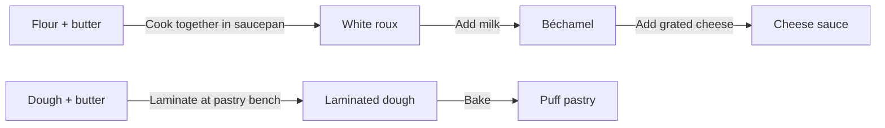
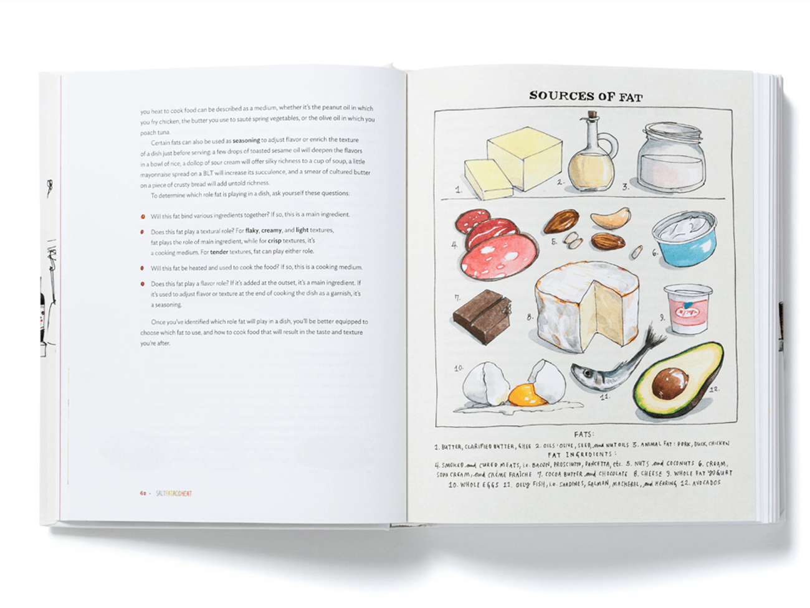
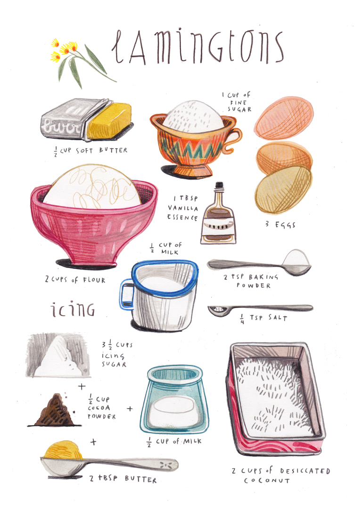
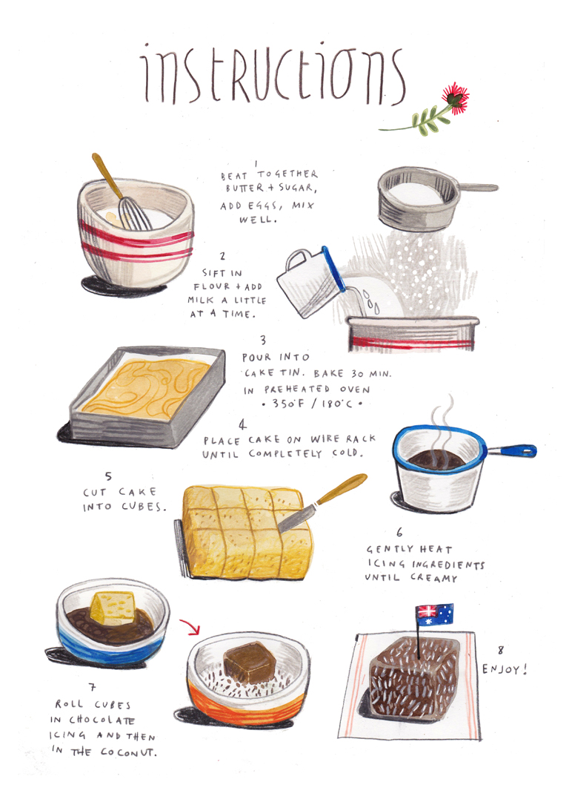
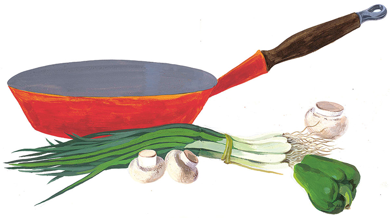

# Cookbook artwork research

This survey informed the travelling-cook and cookbook-page comparisons. The user subsequently selected Cook’s Pen and the cookbook premise. Read the [art-direction guide](contact-sheets/README.md) for the choices and verdicts; the references below remain useful for further work.

## What kind of book?

### Techniques that can be carried between dishes

The likely match for the user's favourite is *Le Cordon Bleu Complete Cooking Techniques*, by Jeni Wright and Eric Treuille with Le Cordon Bleu. The 1996 Cassell edition is recorded in [Google Books](https://books.google.com/books?id=64RyPwAACAAJ). The [publisher description reproduced by ckbk](https://app.ckbk.com/book/0688152066/le-cordon-bleu-complete-cooking-techniques) describes over 700 techniques illustrated with over 2,000 colour photographs. Its [introduction](https://app.ckbk.com/section/cook52062f01s001/introduction) emphasizes close-up views of selection, preparation, cooking and presentation. Recipes are included, but technique is the organizing emphasis. The user's exact edition remains unconfirmed.

The useful design lesson is to make the **important change observable**: what folding does to dough, what whipping does to cream, what distinguishes a flowing sauce from a filling that holds its shape. A finished-dish portrait alone cannot explain that change. This is a reason to investigate consistent viewpoints, visible cut faces and carefully chosen intermediate states; it does not require photographic art or a French-only repertoire.

### Preparations that connect to one another

Niki Segnit's *Lateral Cooking* is a particularly close conceptual reference. Its [publisher describes](https://www.bloomsbury.com/uk/lateral-cooking-9781526652874/) 77 starting-point recipes with related variations, extending through breads, batters, broths, stews and dals. The useful connection to Cookbook is the idea that learning one preparation helps make sense of its neighbours.

For example, the current [Cookbook manuscript](../../../stories/cookbook/cookbook.md) already distinguishes two uses of flour and butter: cooking a roux at a saucepan, and making laminated dough at the pastry bench. It also branches sweetened yolks into pouring custard and starch-thickened pastry cream. Those are strong subjects for a techniques book because the method and resulting texture matter as much as the ingredient list.

This is an author-facing sketch of existing relationships, with some intermediate steps omitted:

A book conceit could make the preparations feel like movable illustrations on a page, with discoveries accumulating into an understanding of cooking. Showing such a connection diagram to the player is a separate interaction proposal: current [UX](../../../docs/ux.md#work-surface-and-dragging) keeps undiscovered results hidden. An illustrated paper ground can be explored without committing to a visible recipe map.

## Think beyond the current pastry vocabulary

The user-supplied *Flavor Bible* material expands the brief from techniques alone to ingredients, sensory qualities, circumstances and relationships. Its dictionary offers entry points through ingredients, cuisines, seasons and flavour groups. The useful distinction for this project is between **a preparation relationship** (“this action changes this food”) and **a flavour affinity** (“these ingredients may work well together”). A pairing suggestion is not by itself a complete recipe or an executable combination rule.

These examples come from sampled dictionary entries. They suggest breadth for later research and visual testing, rather than additions already made to Cookbook:

| Reference family | What it contributes to the visual brief |
|---|---|
| Chickpeas, tahini and lemon | Legumes, a dense paste and citrus; savoury food beyond bread and dairy |
| Lentils, cumin and turmeric | Pulses, whole seeds and ground spice; small identifying structures that an icon style must retain |
| Yogurt with cucumber and mint; yogurt with fruit | One preparation used in savoury and sweet contexts; its identity should survive a change of accompaniment |
| Ginger, scallions and soy sauce | Roots, leaves and a dark liquid, with distinct roles and physical forms |
| Coconut milk, ginger and Thai basil | Another pale liquid and an aromatic family; the illustration cannot make every white ingredient self-identifying |
| Tamarind, lime, vinegar and yogurt | Several sources of acidity with very different appearances; a shared role need not mean interchangeable ingredients |

The broader reading also gives reasons to depict food's texture and use: crisp edges, torn crumb, smooth puree, separate grains, seeds in a paste, a sauce coating a spoon. Aroma and flavour are only partly visible. Names, context and concise explanatory writing remain necessary; colouring every sour ingredient yellow would teach a false visual rule.

Use particular ingredients, preparations and regional references when extending the repertoire. A French teaching book can inform explanatory clarity while other cooking traditions inform subjects and methods. Neither a single cookbook nor this dictionary's chef recommendations constitute a complete account of world cooking.

## Three illustrated cookbook references

### 1. Observational line and wash

**Reference:** Wendy MacNaughton's illustrations for Samin Nosrat's *Salt, Fat, Acid, Heat*. The [illustrator's project page](https://www.wendymacnaughton.com/illustration/salt-fat-acid-heat) presents drawings, charts and diagrams alongside one another.

*Reference photograph from MacNaughton's project page; artwork by Wendy MacNaughton.*

The inspected spread uses irregular dark contours, restrained washes, visible interiors and separate objects on pale paper. Its butter, nuts, fish, egg and avocado provide a wider material range than pastries alone. Another reference, the [acid wheel](references/macnaughton-acid.png), shows how a hand-drawn visual language can also carry relationships.

**For the pilot:** investigate legible contours, selective colour and explanatory views. The main risk is that pale washes and fine marks disappear at icon size. The dense wheel is a reference for organizing knowledge, not a proposed phone-sized control. Its written categories also illustrate how much explanatory work the text is doing.

### 2. Coloured-pencil recipe drawings — warmer alternative

**Reference:** Felicita Sala's [illustrated lamington recipe](https://felicitasala.blogspot.com/2013/04/illustrated-recipes-april-with-design.html), particularly its ingredient and instruction sheets.

*Reference sheets by Felicita Sala, from her illustrated-recipes post.*

These images use coloured hatching, substantial vessel shapes and generous white space. The sequence makes actions concrete through tools, contents and changed forms. The ingredient sheet also exposes a relevant difficulty: captions do much of the work distinguishing pale powders.

**For the pilot:** investigate tactile marks and clear silhouettes, simplifying vessel patterns so that contents remain prominent. Sala's [account of her later cookbook picture book](https://felicitasala.blogspot.com/2018/07/a-cookbook-as-picture-book.html) connects different households through cooking and sharing, a useful narrative reference for the story’s social meals. That warmth could suit either a travelling cook's notebook or a book without a literal caravan setting.

### 3. Opaque painted food — strongest colour masses

**Reference:** Cipe Pineles's painted cookbook manuscript, published as *Leave Me Alone with the Recipes*. The [book project](https://www.cipepineles.com/) identifies the original work as a 1945 manuscript and discusses its gouache paintings.

*Reference painting by Cipe Pineles, from the book project site.*

The inspected image has broad opaque colour, selective brush texture and recognizable food shapes, with little dependence on a continuous ink outline. Its red pan and green vegetables have a strong presence on the open ground.

**For the pilot:** investigate broad painted shapes while reserving fine detail for identifying structures. Folded dough, airy crumb and two similar custards would test whether this treatment can explain preparation states as well as it depicts produce and cookware.

## A concrete brief for the first comparison

The following is a proposed comparison brief, not an adopted player-UX specification.

| Aspect | What to compare |
|---|---|
| Ground | Light, mostly unmarked paper with generous working space. Keep paper texture in the scene rather than giving every object a rectangular paper tile. |
| Shape | Real, slightly irregular food and tool silhouettes. Preserve the features that identify the substance or state. |
| Colour | Recognizable ingredient colours with enough dark structure to separate pale food from paper. Compare selective wash against opaque paint. |
| Viewpoint | Consistent shallow overhead or three-quarter views within each related family; expose a cut edge or contents when that explains the preparation. |
| Texture | A few purposeful marks for grain, crumb, folds, gloss or aeration. Inspect whether they survive reduction. |
| Vessels | Simple cookware that supports the depiction. A different bowl is not sufficient evidence of a different food. |
| Writing | Use the existing readable names and descriptions. Keep tiny handwritten labels out of generated icon artwork. |
| Technique | Show the relevant state in the icon; reserve more elaborate action sequences, hands and comparisons for larger explanatory illustrations if needed. |

The early Kitchen manuscript used rooms, hearths and worktops. The comparison therefore needed corresponding page compositions. Production subsequently adopted cookbook grounds and pencil schematics for fixed apparatus. The current [artwork and hotspot rules](../../../docs/ux.md#item-artwork) own the adopted design.

The existing story's human purpose remains useful whichever setting is chosen: preparing breakfast, feeding market workers, making something for a celebration. A techniques book can retain occasions and appetites as reasons to cook. A new title, chapter organization or narration would be an authoring change, beyond selecting an illustration treatment.

## Pilot subjects and questions

The [contact-sheet study](contact-sheets/README.md#scale-and-composition) owns the current twenty-subject selection and its rationale. It combines sixteen subjects from the original Kitchen story with chickpeas, ginger, coriander and soy sauce as broader-food probes. Production subsequently expanded to every story item and the fitted trolley.

These related families remain useful review questions; the sauce family is a follow-up beyond the current twenty:

- **Cream → whipped cream, with a whisk:** liquid surface versus aerated shape, plus a thin tool.
- **Dough → laminated dough → puff pastry, with a rolling pin:** folds and layers versus baked expansion.
- **White roux → béchamel → cheese sauce:** a useful test of how much an image can explain when visual differences are subtle.
- **Pouring custard and pastry cream:** flowing sauce versus a filling that retains a ridge; do not conflate their preparation routes.
- **Flour, sugar and milk:** likely ambiguities that should be exposed early.

The common contact-sheet sample now includes four broader ingredients. Further subjects from the flavour table—such as tahini, lime and scallions—could test additional materials. These are research subjects, not newly authored game items.

Compare the same subjects in each shortlisted treatment on a suitable paper ground. Inspect the intended in-game dimensions using the [existing sizing contract](../../../docs/ux.md#item-artwork), then conduct the separate recognition and contextual reviews in the [icon guide](../../../docs/icon-guide.md#6-run-separate-recognition-and-art-direction-reviews). In particular, ask whether people can identify the change of state, whether it looks appetizing, and what explanation still depends on words. Attractive source pages do not answer those questions for small interactive assets.

## Reference files

[sources.json](sources.json) records the source page, image URL, creator and checksum of each retained image. These unchanged images are research references, not production assets; their inclusion does not establish permission to ship the artwork. The user-supplied food readings and the distinction between inspected images, sampled entries and unavailable book contents are documented in [working notes](../../../notes.md#31-october-2026--kitchen-cookbook-art-research).
