# Creation

background: 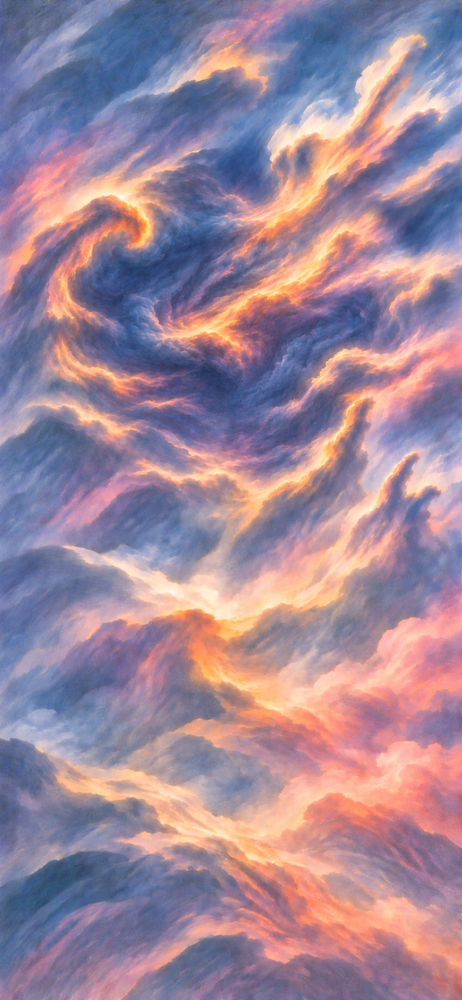

Create a world from Earth, Air, Fire and Water. Make its Sun and Moon, form oceans and continents, and develop life that eventually learns to create things of its own.

## Create the heavens and the earth

background: 

Water fills everything. Use Air, Earth and Fire to open a space within it, form a rocky world and give that world a Sun, a Moon and stars.

**Goals**
- Let there be a void in the waters -- Void
- next: Let there be land in the void -- `primordial-world`
- next: Let daylight reach the world -- Light
- next: Make a rocky Moon to light the night -- Moon
- next: Let the Moon steady the tilted world -- Steadied world
- next: Fill the sky with stars -- Stars

**Hotspots**
- (three hotspots are a lot but okay here because the surrounding waters, opened sky and world are distinct parts of one creation scene)
- Waters of the deep (at 51%, 31%)
  - icon: 
  - hitbox: (at 51%, 31%) (size 94%, 52%)
  - place: Stars (at 85%, 14%)
  - place: Asteroids (at 15%, 36%)
- Void (at 50%, 50%)
  - icon: 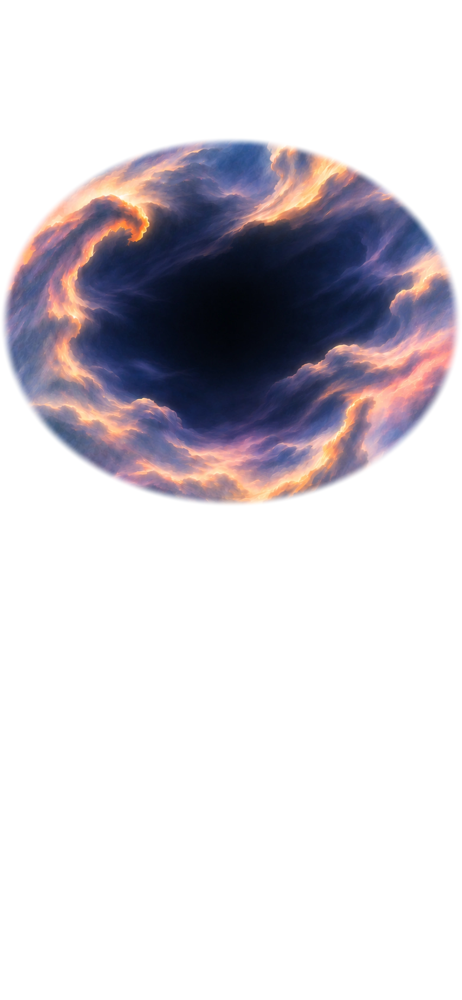
  - hitbox: (at 51%, 31%) (size 62%, 23%)
  - place: Sun (at 33%, 25.5%)
- `primordial-world` (at 50.82%, 32.72%)
  - icon: 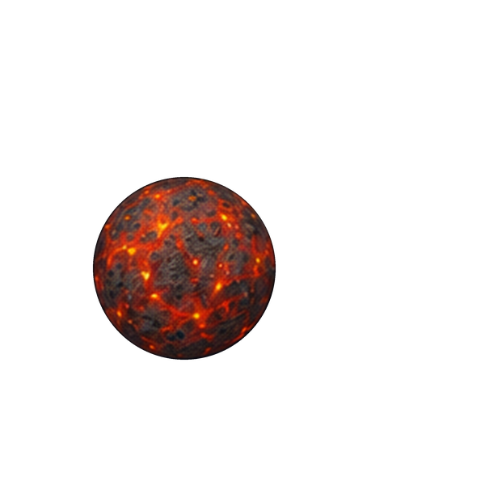
  - hitbox: (at 50.82%, 32.72%) (size 32%, 11%)
  - place: Moon (at 64.5%, 27.7%)
  - place: Light (at 36.5%, 38%)
- Steadied world (at 50.82%, 32.72%)
  - icon: 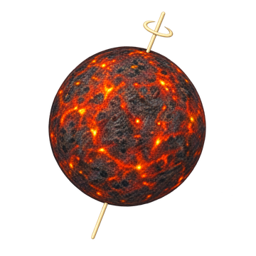
  - hitbox: (at 50.82%, 32.72%) (size 32%, 11%)
  - place: Moon (at 64.5%, 27.7%)
  - place: Light (at 36.5%, 38%)

**Items**
- Earth
  - icon: 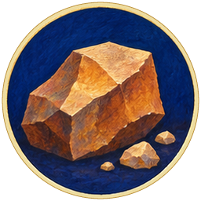 (circular)
  Pieces of rock that you can gather together or scatter through the deep.
- Air
  - icon:  (circular)
  Air that can push water aside and fill the space it leaves.
- Fire
  - icon: 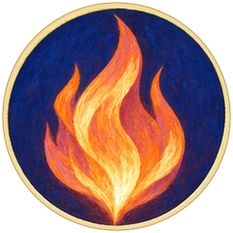 (circular)
  Fire provides heat and light.
- Waters of the deep
  - icon: 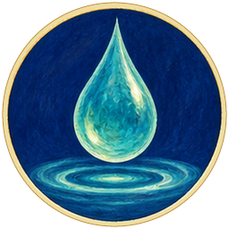 (circular)
  Water surrounds the whole creation scene. Its currents carry loose pieces of rock apart.
- Void
  - icon:  (circular)
  Air pushes the surrounding water apart, opening a space where you can form the world and its Sun.

  *Void*
- `primordial-world` Rocky world
  - icon: 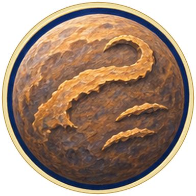 (circular)
  Rock gathers within the void and forms a rotating world. Heat from its formation leaves the surface molten. It must cool before it can have a solid crust.

  *Rocky world*
- Sun
  - icon: 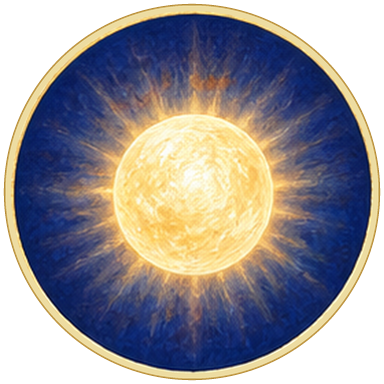 (circular)
  Fire gathers in the void to form the Sun. It will supply the world with heat and light.

  *Sun*
- Asteroids
  - icon: 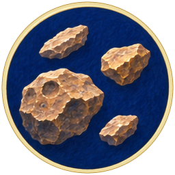 (circular)
  The currents scatter rock through the deep, forming many separate rocky bodies. Some can collide with the world.

  *Asteroids*
- Moon
  - icon: 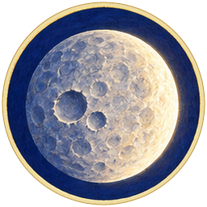 (circular)
  A massive rocky body strikes the young world at an angle. The collision tilts the world's rotation and throws rock into orbit. This debris gathers into the Moon.

  The Moon reflects sunlight, so it can light the night without producing its own light.

  *Moon*
- Steadied world
  - icon:  (circular)
  The collision left the world's rotation axis tilted. The Moon's gravity helps limit changes in that tilt over long periods. The angle can still vary; it is not fixed forever.

  *Steadied world*
- Stars
  - icon: 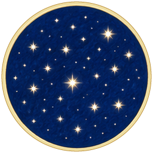 (circular)
  Fire spreads through the waters of the deep and forms many distant stars. Each star produces its own light.

  *Stars*
- Light
  - icon: 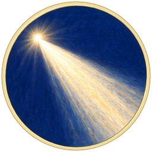 (circular)
  Sunlight illuminates the world's surface.

  *Light*

**Combinations**
- Air @ Waters of the deep [preserve] -> Void (tutorial)
- Earth @ Void [preserve] -> `primordial-world`
- Fire @ Void [preserve] -> Sun
- Earth @ Waters of the deep [preserve] -> Asteroids
- Asteroids [transform] @ `primordial-world` [preserve] -> Moon
- Fire @ Waters of the deep [preserve] -> Stars
- Sun [transform] + `primordial-world` [preserve] -> Light
- Sun [transform] + Steadied world [preserve] -> Light
- Moon [transform] + `primordial-world` [transform] -> Steadied world

## Rain, oceans and tides

background: 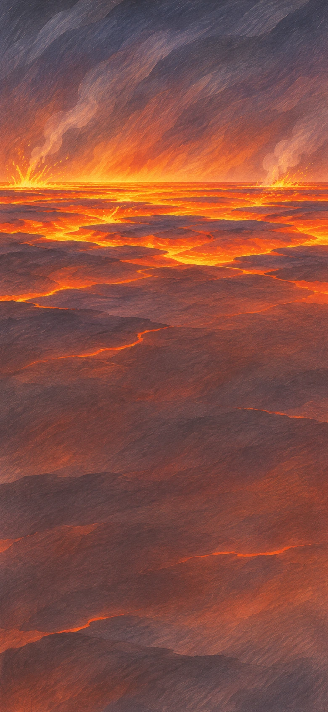

The world is still hot. Bring water from the surrounding deep onto its surface to cool it, form rain and fill an ocean.

[If skipped] The world's surface has cooled, rain has filled an ocean, and tides now cover and expose its shore.

**Goals**
- Let rain reach the ground -- First rain
- next: Gather an ocean -- Ocean
- Form a coast with rising and falling tides -- Tidal shore

> NOTE: Water and Rocky world are separate primitive identities supplied here. They represent the same water and world seen in the creation scene, now as movable symbols. The three opening hotspots remain in that scene; no identity needs to become unfixed.

**Items**
- Water
  - icon:  (circular)
  Water from the surrounding deep, ready to flow over your world.
- Rocky world
  - icon:  (circular)
  The world you gathered within the void, still molten from its making. Bring water to its hot surface.
- Stone crust
  - icon: 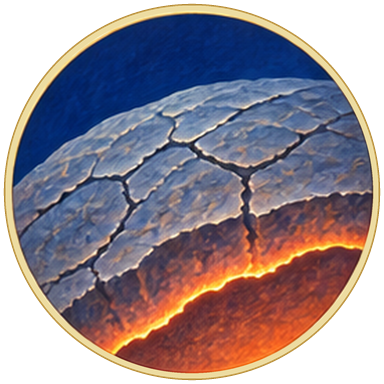 (circular)
  Water cools the world's hot surface until it hardens into solid rock. The interior remains hot.

  *Stone crust*
- Steam cloud
  - icon: 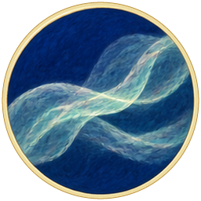 (circular)
  More water meets the still-hot crust and rises as invisible vapour. As it cools, tiny liquid droplets form the white cloud you can see.
- First rain
  - icon: 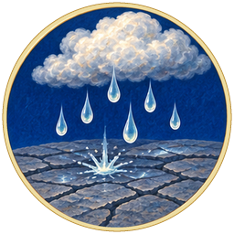 (circular)
  Rising air carries the cloud into cooler conditions. Droplets join and grow large enough to fall as rain.

  *First rain*
- Rain-filled hollows
  - icon: 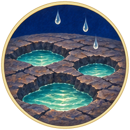 (circular)
  Rainwater collects in hollows between the ridges of the stone crust.

  *Rain-filled hollows*
- Ocean
  - icon: 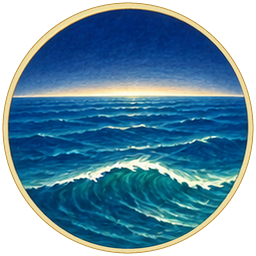 (circular)
  As more water fills the low basins, separate pools join into a continuous ocean.

  *Ocean*
- Tides
  - icon: 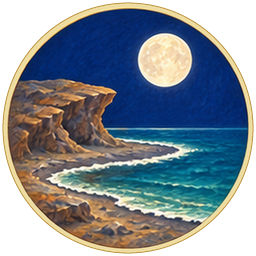 (circular)
  The Moon pulls unevenly on different parts of the world. This helps produce tides: the regular rise and fall of sea level. The Sun's gravity contributes too.

  *Tides*
- Tidal shore
  - icon: 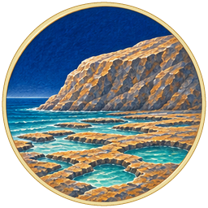 (circular)
  Rising tides cover part of the coast; falling tides expose it again. This strip between high and low tide provides both wet and dry conditions for coastal life.

  *Tidal shore*

**Combinations**
- Rocky world [transform] + Water -> Stone crust
- Water + Stone crust [transform] -> Steam cloud
- Steam cloud [transform] + Air -> First rain
- First rain [transform] + Stone crust [transform] -> Rain-filled hollows
- Rain-filled hollows [transform] + Water -> Ocean
- Moon [transform] + Water -> Tides
- Moon [transform] + Ocean [transform] -> Tides
- Ocean [transform] + Tides [transform] -> Tidal shore

## The water cycle

background: 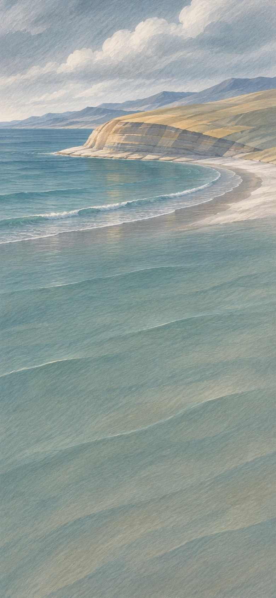

Sunlight heats the ocean, and rain carries water back onto land. Create rivers that return water and sediment to the sea.

**Goals**
- Build a delta from river sediment -- Delta
- Complete the water cycle -- Water cycle

**Items**
- Evaporation
  - icon: 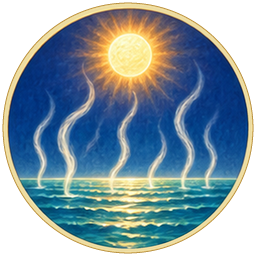 (circular)
  Sunlight warms the ocean. Water leaves its surface as invisible vapour, while dissolved salts stay behind.
- Clouds
  - icon: 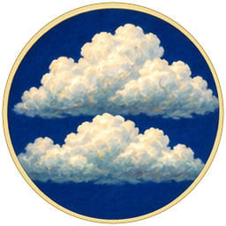 (circular)
  Rising moist air cools and water vapour condenses. A visible cloud contains tiny droplets or ice crystals; the vapour itself is invisible.

  *Clouds*
- Rainfall
  - icon: 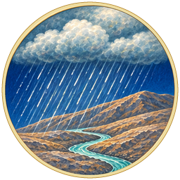 (circular)
  More water gathers in the cloud. Droplets or ice particles grow heavy enough to fall, bringing a shower to the land.

  *Rainfall*
- Storm
  - icon: 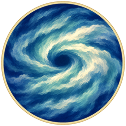 (circular)
  Strong winds drive rain across the land. Storms can break branches and uproot trees, leaving wood on the ground. This combination represents a wind-driven rainstorm, not every kind of storm.

  *Storm*
- Rivers
  - icon: 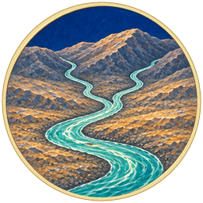 (circular)
  Gravity carries rainwater downhill into rivers. Flowing water gradually changes the landscape by eroding rock and depositing sediment.

  *Rivers*
- Sediment
  - icon: 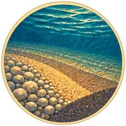 (circular)
  Flowing water loosens and carries grains of sand, silt and broken rock. These transported particles are called sediment.
- Delta
  - icon: 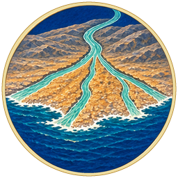 (circular)
  A river carries sediment to its mouth, where the flow slows and drops its load. Over time, deposits build outward and divide the river into branching channels: new land made from what the water carried.

  *Delta*
- Rainbow
  - icon: 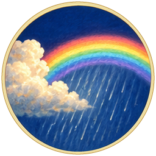 (circular)
  Sunlight bends, reflects and separates into colours inside raindrops, producing a rainbow.

  *Rainbow*
- Water cycle
  - icon: 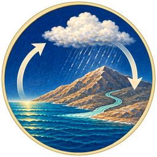 (circular)
  Water evaporates from the ocean, condenses into clouds and falls as precipitation. Rivers carry it back to the sea. Sunlight supplies energy for evaporation, and gravity brings water down.

  *Water cycle*

**Combinations**
- Ocean [transform] + Sun [transform] -> Evaporation
- Evaporation [transform] + Air -> Clouds
- Clouds [transform] + Water -> Rainfall
- Rainfall [transform] + Stone crust [transform] -> Rivers
- Rivers [transform] + Earth -> Sediment
- Sediment [transform] + Rivers [transform] -> Delta
- Rainfall [transform] + Air -> Storm
- Rainfall [transform] + Sun [transform] -> Rainbow
- Rivers [transform] + Sun [transform] -> Water cycle

## Moving plates and continents

background: 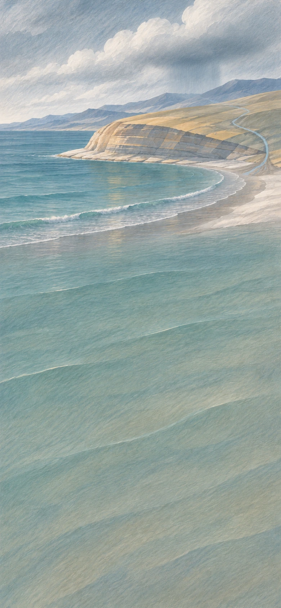

Heat inside the world helps move its rocky plates. Form continents and volcanoes, then let rain and rivers wear down the land.

**Goals**
- Open a hot spring on the seafloor -- Hydrothermal vent
- Raise a continent -- Continent
- next: Let rivers carry its minerals to sea -- Mineral-rich sea

**Items**
- Moving plates
  - icon: 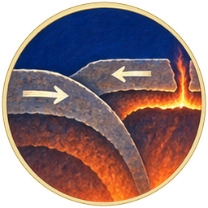 (circular)
  Fire supplies heat beneath the solid crust, which divides into moving plates. On Earth, internal heat, sinking slabs and other forces drive plate motion. The plates move over slowly deforming rock, not a global ocean of liquid magma.

  *Moving plates*
- Continent
  - icon: 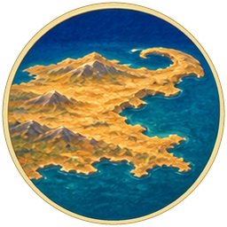 (circular)
  Plate movement gathers and reshapes continental crust into a broad landmass. Continental crust is generally thicker and less dense than oceanic crust.

  *Continent*
- Trench
  - icon: 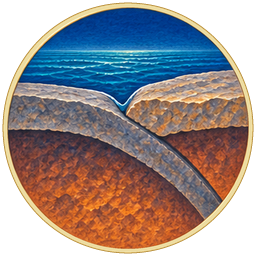 (circular)
  A plate bends beneath another at an underwater boundary, forming a deep ocean trench. This sinking of one plate beneath another is called subduction.

  *Trench*
- Volcano
  - icon: 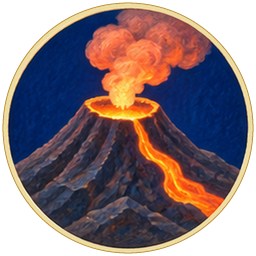 (circular)
  Some rock melts near the plate boundary. Magma rises through openings in the crust and erupts. Repeated eruptions can build volcanic mountains on land or beneath the sea.
- Hydrothermal vent
  - icon: 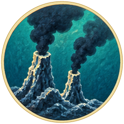 (circular)
  Seawater enters cracks in volcanically heated rock and returns through vents on the seafloor, carrying dissolved chemicals. Reactions between these chemicals and the surrounding seawater can provide energy for living organisms without sunlight.

  *Hydrothermal vent*
- Weathered rock
  - icon: 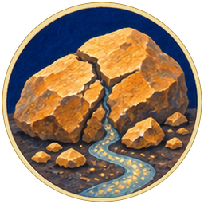 (circular)
  Rain and flowing water break down exposed rock and dissolve some of its minerals. The remaining fragments can contain coloured minerals used as pigments.
- Mineral-rich sea
  - icon: 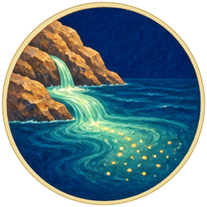 (circular)
  Rivers carry dissolved minerals and rock fragments from the weathered continent into the sea.

  *Mineral-rich sea*
- Volcanic island
  - icon: 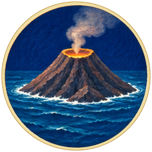 (circular)
  Repeated eruptions build a mountain from the seafloor until its summit rises above the surface, forming a new island.

  *Volcanic island*

**Combinations**
- Stone crust [transform] + Fire -> Moving plates
- Moving plates [transform] + Earth -> Continent
- Moving plates [transform] + Water -> Trench
- Moving plates [transform] + Fire -> Volcano
- Volcano [transform] + Water -> Hydrothermal vent
- Continent [transform] + Rainfall [transform] -> Weathered rock
- Weathered rock [transform] + Rivers [transform] -> Mineral-rich sea
- Volcano [transform] + Ocean [transform] -> Volcanic island

## The first living cells

background: 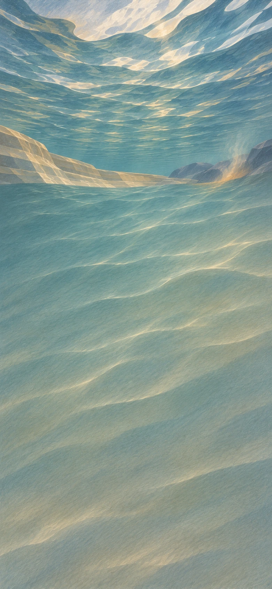

The ocean contains chemicals and energy sources, but no living cells. Create cells that reproduce and pass on inherited differences; the first step from chemistry to life is an invention in this story, because science has not established how it happened.

[If skipped] Living cells reproduce, and some inherited changes pass to their descendants. Photosynthetic microbes grow in layers along the shore and form stromatolites by trapping sediment.

**Goals**
- Make reproducing cells with inherited variation
  - and: Dividing cells
  - and: Variation
- Form stromatolites from layers of microbes and sediment -- Stromatolites

**Items**
- Organic molecules
  - icon: 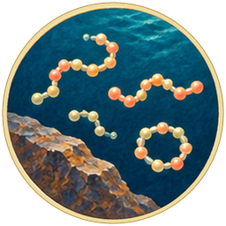 (circular)
  Seawater supplies dissolved chemicals, while a hydrothermal vent supplies heat and chemical energy. Such environments are studied as possible sites where organic molecules formed before life existed. Organic molecules are carbon-containing compounds; they are not necessarily produced by organisms, and they are not alive. No agreed pathway from chemistry to the first cell is known.

  *Organic molecules*
- Membranes
  - icon: 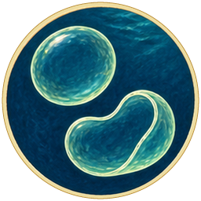 (circular)
  Some organic molecules assemble into thin membranes in water. A membrane can enclose a small volume and separate its contents from the surrounding sea. This separation is one requirement for a cell, but a membrane alone is not alive.

  *Membranes*
- Chemical fuel
  - icon: 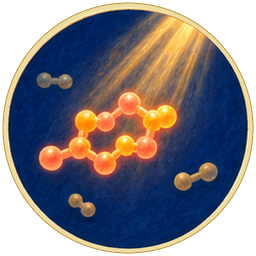 (circular)
  Light drives reactions that store some of its energy in organic molecules. Other reactions can release that stored energy. These processes are studied in research on life's origins, but a source of chemical energy does not by itself explain a living cell.

  *Chemical fuel*
- Living cell
  - icon: 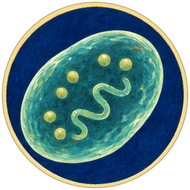 (circular)
  The membrane encloses the cell, and chemical fuel supplies energy for its reactions. A living cell also needs linked processes that maintain it and pass inherited information to descendants. This combination invents those missing steps; it is not a scientific explanation of how life began.

  *Living cell*
- Dividing cells
  - icon: 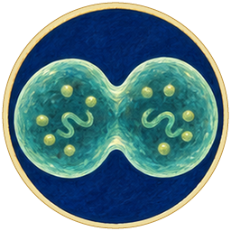 (circular)
  In water, living cells grow and divide into descendants that inherit their genetic information. Water provides a medium for their chemical reactions; growth and division also require nutrients, energy and working cellular processes.

  *Dividing cells*
- Variation
  - icon: 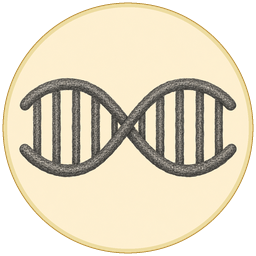 (circular)
  Ultraviolet light can change a cell's genetic information. When a changed cell reproduces, some changes pass to its descendants. Copying errors and other processes also produce inherited differences. Such genetic changes are called mutations. They do not arise because an organism needs them, and their effects can be helpful, harmful or neutral.

  *Variation*
- Sun-fed cells
  - icon: 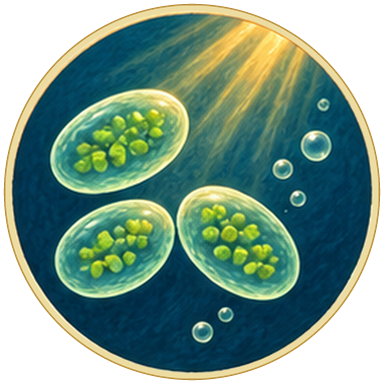 (circular)
  Some descendants of the dividing cells use sunlight to make organic matter through photosynthesis. Sunlight supplies the energy; the cells need the structures and chemical processes that capture it. This combination represents the evolution of that ability over many generations.

  *Sun-fed cells*
- Microbial mats
  - icon: 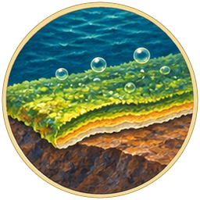 (circular)
  Microbes grow together in dense layers on wet rock. These layers are called microbial mats, and they can trap sediment.

  *Microbial mats*
- Stromatolites
  - icon: 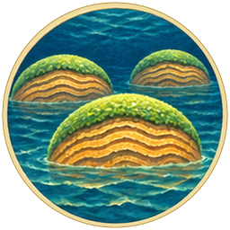 (circular)
  Microbial mats on the tidal shore trap sediment. As the microbes grow over each new deposit, layers accumulate into structures called stromatolites. Some ancient stromatolites preserve evidence of early life.

  *Stromatolites*

**Combinations**
- Mineral-rich sea [transform] + Hydrothermal vent [transform] -> Organic molecules
- Organic molecules [transform] + Water -> Membranes
- Organic molecules [transform] + Light [transform] -> Chemical fuel
- Membranes [transform] + Chemical fuel [transform] -> Living cell
- Living cell [transform] + Water -> Dividing cells
- Dividing cells [transform] + Light [transform] -> Variation
- Dividing cells [transform] + Sun [transform] -> Sun-fed cells
- Sun-fed cells [transform] + Stone crust [transform] -> Microbial mats
- Microbial mats [transform] + Tidal shore [transform] -> Stromatolites

## Oxygen changes the ocean and air

background: 

Some photosynthetic cells release oxygen into the water and air. Oxygen supports new ways of obtaining energy from food, but it is harmful to many organisms adapted to oxygen-free conditions.

**Goals**
- Form iron-rich deposits on the seabed -- Banded iron
- next: Form an ozone layer that absorbs ultraviolet light -- Ozone layer
- Make cells with smaller cells inside, and shelter microbes harmed by oxygen
  - and: Partnered cells
  - and: Sheltered microbes

**Items**
- Oxygen
  - icon:  (circular)
  Some cells use sunlight to split water molecules and release oxygen during photosynthesis. The oxygen enters the surrounding water and can reach the air. Earth's earliest life did not require an oxygen-rich atmosphere.

  *Oxygen*
- Rusted seabed
  - icon:  (circular)
- Banded iron
  - icon:  (circular)
  Oxygen reacts with dissolved iron, forming minerals that settle on the seabed. These iron-rich deposits accumulate with other sediment in bands. Such reactions consumed much of Earth's early oxygen before it accumulated in the atmosphere.

  *Banded iron*
- Oxygen-rich sky
  - icon:  (circular)
  Oxygen released by photosynthetic cells accumulates in the air when its supply exceeds the amount removed by chemical reactions and living organisms. Oxygen can damage cells that lack ways to cope with it, making the changed environment deadly for many microbes.

  *Oxygen-rich sky*
- Ozone layer
  - icon:  (circular)
  Sunlight drives reactions involving oxygen high in the atmosphere, producing ozone. The ozone layer absorbs much of the Sun's harmful ultraviolet radiation before it reaches the surface, though some ultraviolet radiation still gets through.

  *Ozone layer*
- Oxygen-using cells
  - icon:  (circular)
  Some cells use oxygen in reactions that release usable energy from food molecules. The cells supply the necessary chemical processes; oxygen participates in those reactions. Oxygen is not itself a food or an energy source.

  *Oxygen-using cells*
- Partnered cells
  - icon:  (circular)
  An oxygen-using cell becomes established inside another cell. The inner cell supplies usable energy, while the host provides a protected environment and nutrients. This combination compresses endosymbiosis: mitochondria descend from bacteria that became permanent parts of other cells. It does not explain every step in the origin of complex cells.

  *Partnered cells*
- Sheltered microbes
  - icon:  (circular)
  Even as oxygen accumulates in the air, oxygen-free pockets remain beneath microbial mats and in sediments. Microbes that cannot tolerate oxygen survive in these habitats, where overlying organisms and chemical reactions consume oxygen before it reaches them.

  *Sheltered microbes*

**Combinations**
- Water + Sun-fed cells [transform] -> Oxygen
- Oxygen [transform] + Mineral-rich sea [transform] -> Rusted seabed
- Rusted seabed [transform] + Sediment [transform] -> Banded iron
- Oxygen [transform] + Air -> Oxygen-rich sky
- Oxygen-rich sky [transform] + Light [transform] -> Ozone layer
- Living cell [transform] + Oxygen [transform] -> Oxygen-using cells
- Oxygen-using cells [transform] + Living cell [transform] -> Partnered cells
- Oxygen-rich sky [transform] + Microbial mats [transform] -> Sheltered microbes

## Multicellular life

background: 

Make organisms whose cells stay together and perform different functions. In the sea, these organisms include algae and animals with muscles, eyes and shells.

**Goals**
- Grow multicellular algae -- Algae
- next: Preserve shells as fossils -- Fossils
- Give swimming animals eyes -- Eyes

**Items**
- Cell colonies
  - icon:  (circular)
  Cells multiply in water and remain grouped together. A colony contains individual cells; it is not necessarily a single multicellular organism.

  *Cell colonies*
- Multicellular life
  - icon:  (circular)
  Cells in a colony become a coordinated organism. Their membranes support contact and chemical signalling, and different cells perform different functions. This combination represents changes over many generations. Multicellularity evolved independently in several lineages.

  *Multicellular life*
- Algae
  - icon:  (circular)
- Soft-bodied animals
  - icon:  (circular)
- Swimming animals
  - icon:  (circular)
  These soft-bodied animals use oxygen to release energy from food. Their muscles use that energy to push against water, allowing them to swim instead of drifting with the current.

  *Swimming animals*
- Eyes
  - icon:  (circular)
  Light-sensitive structures detect light and help swimming animals find food, avoid danger or orient themselves. Over many generations, some lineages develop eyes that distinguish the direction of light or form images. Eyes evolved in different forms across several animal lineages.

  *Eyes*
- Shells
  - icon:  (circular)
- Fossils
  - icon:  (circular)
  Sediment buries shells, which may be preserved, replaced by minerals or leave impressions as the sediment becomes rock. Most organisms leave no fossil, so the fossil record contains only part of life's history.

  *Fossils*

**Combinations**
- Partnered cells [transform] + Water -> Cell colonies
- Cell colonies [transform] + Membranes [transform] -> Multicellular life
- Multicellular life [transform] + Sun [transform] -> Algae
- Multicellular life [transform] + Ocean [transform] -> Soft-bodied animals
- Soft-bodied animals [transform] + Oxygen [transform] -> Swimming animals
- Swimming animals [transform] + Light [transform] -> Eyes
- Soft-bodied animals [transform] + Mineral-rich sea [transform] -> Shells
- Shells [transform] + Sediment [transform] -> Fossils

## Kelp forests and coral reefs

background: 

Create kelp forests and coral reefs that provide food and shelter for marine animals. Along the rocky coast, waves can also erode a sea cave.

**Goals**
- Grow a kelp forest -- Kelp forest
- next: Hollow a sea cave with waves -- `cave`
- Let tides carry nutrients and young animals between coastal habitats -- Living coast

**Items**
- Kelp forest
  - icon:  (circular)
  Kelp are large brown algae that anchor to submerged rock and grow toward the light. Dense kelp forests provide shelter and feeding places for many other organisms.

  *Kelp forest*
- Coral
  - icon:  (circular)
  Coral polyps are small, soft-bodied animals that attach to submerged rock along the coast. Their tentacles catch passing food. Many corals grow in colonies of connected polyps.

  *Coral*
- Reef partnership
  - icon:  (circular)
  Many reef-building corals contain tiny photosynthetic algae within their tissues. The algae supply food made through photosynthesis, while the coral provides shelter and nutrients. Stress can cause corals to lose their algae, a process called bleaching.

  *Reef partnership*
- Coral reef
  - icon:  (circular)
  Corals draw dissolved mineral ingredients from seawater to build calcium carbonate skeletons. As new corals grow on older skeletons, a reef accumulates over many generations. Its crevices and surfaces provide habitats for many other organisms.

  *Coral reef*
- Nursery waters
  - icon:  (circular)
  Young swimming animals shelter among kelp fronds. The kelp provides hiding places from predators and supports organisms they can eat, helping the young animals survive and grow.

  *Nursery waters*
- Coastal mosaic
  - icon:  (circular)
  This long coastline includes kelp beds in cooler water and coral reefs in warmer water. Both provide food and shelter, though they support different communities. Within each region, animals may use several neighbouring habitats as they grow.

  *Coastal mosaic*
- Living coast
  - icon:  (circular)
  Tides move water, nutrients and small organisms between coastal habitats. Animals feed and shelter in these connected areas, while some young animals disperse with the moving water.

  *Living coast*
- Waves
  - icon:  (circular)
- `cave` Sea cave
  - from chapter `dark-cave-chapter`: Dark cave
  - icon:  (circular)
  Repeated waves erode cracks in coastal rock until they widen into a cave. Its lower entrance meets the sea, while an upper shelf and the walls above it remain dry above the usual reach of the tide.

  *Sea cave*

**Combinations**
- Algae [transform] + Stone crust [transform] -> Kelp forest
- Soft-bodied animals [transform] + Tidal shore [transform] -> Coral
- Coral [transform] + Algae [transform] -> Reef partnership
- Reef partnership [transform] + Mineral-rich sea [transform] -> Coral reef
- Swimming animals [transform] + Kelp forest [transform] -> Nursery waters
- Nursery waters [transform] + Coral reef [transform] -> Coastal mosaic
- Coastal mosaic [transform] + Tides [transform] -> Living coast
- Ocean [transform] + Air -> Waves
- Waves [transform] + Stone crust [transform] -> `cave`

## Plants spread onto land

background: 

The continents have exposed rock but little soil. Establish plants along the wet shore, develop soil and roots, and grow a forest.

**Goals**
- Grow moss on damp soil -- Moss
- Make a forest on land -- First forest

**Items**
- Shore plants
  - icon:  (circular)
  Descendants of green algae establish themselves on the wet coast. Living out of water requires ways to retain moisture and survive exposure to air. This combination represents adaptations developing over many generations.

  *Shore plants*
- Soil
  - icon:  (circular)
  Plant remains mix with particles of weathered rock. As organic matter accumulates and organisms break it down, soil develops with spaces that hold water and air. This gives plants access to water and nutrients beyond the bare rock surface.

  *Soil*
- Windblown spores
  - icon:  (circular)
  Wind carries tiny reproductive cells called spores away from the parent plant. A spore can grow in a suitable place and continue the plant's reproductive cycle. Unlike a seed, it contains no embryo with a stored food supply.

  *Windblown spores*
- Moss
  - icon:  (circular)
- Wetland
  - icon:  (circular)
  Water collects in low ground among the mosses. The waterlogged soil contains little oxygen, creating conditions for plants and microbes adapted to wetlands.

  *Wetland*
- Roots
  - icon:  (circular)
  Roots anchor plants in soil and absorb water and dissolved nutrients. This combination represents descendants of early land plants evolving roots over many generations. Roots help support larger plants and supply their growth above ground.

  *Roots*
- Ferns
  - icon:  (circular)
  Ferns have roots that supply water and nutrients, and fronds that capture light for photosynthesis. Their fronds also produce spores. Their appearance here represents evolutionary changes over many generations; sunlight supplies the energy for their growth.

  *Ferns*
- First forest
  - icon:  (circular)
  Tall plants, including tree-sized ferns, grow in the wetland and form a forest. Wet soil supplies water, while roots and stronger stems support growth above the low vegetation. This imagined forest compresses a long evolutionary history with many branches. Modern mosses and ferns are distinct plant lineages, not stages on a single path toward trees.

  *First forest*

**Combinations**
- Algae [transform] + Living coast [transform] -> Shore plants
- Shore plants [transform] + Weathered rock [transform] -> Soil
- Shore plants [transform] + Air -> Windblown spores
- Windblown spores [transform] + Soil [transform] -> Moss
- Moss [transform] + Water -> Wetland
- Shore plants [transform] + Soil [transform] -> Roots
- Roots [transform] + Light [transform] -> Ferns
- Ferns [transform] + Wetland [transform] -> First forest

## Decomposition and forest renewal

background: 

A storm can bring down branches and trees. Return the nutrients in fallen wood to the forest, and preserve some dead material in waterlogged ground.

**Goals**
- Return nutrients from dead wood to growing plants -- Renewing forest
- next: Produce rain from water released by the forest -- Forest rain
- Bury carbon stored in peat -- Buried carbon

**Items**
- Fallen wood
  - icon:  (circular)
  Strong winds in the storm break branches and topple trees. Fallen wood supplies food for fungi and other decomposers. Trees also shed branches and die from other causes; storms are one way wood reaches the forest floor.

  *Fallen wood*
- Fungi
  - icon:  (circular)
  Descendants of complex cells evolve into fungi that absorb food from their surroundings. Fallen wood provides food for this fungal lineage. The combination represents the evolution of organisms that can digest wood; the wood itself does not turn into a living organism.

  *Fungi*
- Decomposition
  - icon:  (circular)
  Fungi release substances that break down dead wood, then absorb the products as food. Fungi and other decomposers release nutrients from dead organic matter, making those nutrients available to other organisms.

  *Decomposition*
- Returned nutrients
  - icon:  (circular)
  Decomposition releases nutrients from dead plants into the soil. Roots can take them up again to support new growth.

  *Returned nutrients*
- Renewing forest
  - icon:  (circular)
  Roots absorb nutrients released into the soil by decomposition. Plants use those nutrients, along with water, carbon dioxide and light, to grow new leaves, roots and wood.

  *Renewing forest*
- Peat
  - icon:  (circular)
  Fallen wood and other dead plant material accumulate in the wetland. Waterlogged ground contains little oxygen, slowing decomposition so that partly decayed material builds up as peat.

  *Peat*
- Buried carbon
  - icon:  (circular)
  Sediment buries the peat and the carbon in its partly decayed plants. The plants originally took this carbon from carbon dioxide during photosynthesis. Some of it can remain underground for millions of years instead of returning quickly to the atmosphere through decomposition.

  *Buried carbon*
- Forest rain
  - icon:  (circular)
  Roots take up water, and leaves release water vapour through transpiration. That vapour can contribute to clouds and later rainfall. In some regions, water released by forests helps sustain rain far downwind.

  *Forest rain*

**Combinations**
- Storm [transform] + First forest -> Fallen wood
- Partnered cells [transform] + Fallen wood [transform] -> Fungi
- Fungi [transform] + Fallen wood [transform] -> Decomposition
- Decomposition [transform] + Soil [transform] -> Returned nutrients
- Returned nutrients [transform] + Roots [transform] -> Renewing forest
- Wetland [transform] + Fallen wood [transform] -> Peat
- Peat [transform] + Earth -> Buried carbon
- Renewing forest [transform] + Clouds [transform] -> Forest rain

## Insects in the forest

background: 

Begin with the marine ancestors of arthropods, then follow a branch onto land. Plants provide food and shelter as insects develop wings and establish themselves among the forest's leaves and branches.

**Goals**
- Establish flying insects in the forest canopy -- Canopy life

**Hotspots**
- Variation (at 25%, 39%)
  - icon: 
  - hitbox: (at 25%, 39%) (size 43%, 17%)

**Items**
- Arthropods
  - icon:  (circular)
  Arthropod ancestors diversified in the sea. Inherited variation produces differences among descendants of early animals; across many generations, one lineage develops jointed limbs and an external skeleton. Arthropods and vertebrates have a shared animal ancestry but form separate branches.

  *Arthropods*
- Insects
  - icon:  (circular)
  Insects are a six-legged branch of the arthropods. Plants provide food and shelter as their ancestors establish themselves on land. This combination joins animals with their habitat; insects are not descended from plants.

  *Insects*
- Winged insects
  - icon:  (circular)
  Across many generations, some insects develop wings that push against the air and allow flight. Insects flew long before birds. Their wings evolved separately from the forelimbs that became bird wings.

  *Winged insects*
- Canopy life
  - icon:  (circular)
  Winged insects live among the forest's upper leaves and branches, a layer called the canopy. Flight helps them move between feeding and breeding sites without returning to the ground.

  *Canopy life*

**Combinations**
- Soft-bodied animals [transform] @ Variation [preserve] -> Arthropods
- Arthropods [transform] + Shore plants [transform] -> Insects
- Insects [transform] + Air -> Winged insects
- Winged insects [transform] + First forest -> Canopy life

## Vertebrates move onto land

background: 

Plants provide food and shelter on land. Develop vertebrates that can breathe air, move on limbs and reproduce away from open water, then follow several branches into reptiles, birds and mammals.

[If skipped] Vertebrate descendants have established themselves on land. Great plant-eating reptiles, small mammals and birds now occupy different habitats alongside insects.

**Goals**
- Make an egg that can develop on land -- Shelled egg
- Establish giant browsing reptiles, small mammals and birds
  - and: Great browsers
  - and: Small furred animals
  - and: Birds

**Hotspots**
- Variation (at 70%, 39%)
  - icon: 
  - hitbox: (at 70%, 39%) (size 45%, 17%)

**Items**
- Air-breathing fish
  - icon:  (circular)
  Some fish in the wetland can breathe air as well as take oxygen from water. Air breathing helps them survive where warm, still water contains little dissolved oxygen.
- Limbed vertebrates
  - icon:  (circular)
  Air-breathing fish live among roots in shallow water. Across many generations, inherited changes to paired fins contribute to limbs that support movement through shallow habitats and eventually on land. The roots provide a habitat; they do not directly cause fish to grow legs.

  *Limbed vertebrates*
- Shelled egg
  - icon:  (circular)
  Some descendants of limbed vertebrates evolve eggs with membranes that protect and support the developing embryo. A shell reduces water loss while allowing gases to pass through. These amniotic eggs can develop away from open water; other land animals reproduce in different ways.

  *Shelled egg*
- Reptiles
  - icon:  (circular)
  Over many generations, descendants of land-breeding vertebrates diversify into reptile lineages. Inherited differences affect how they feed, move and survive in their habitats.

  *Reptiles*
- Birds
  - icon:  (circular)
  In one dinosaur lineage, feathered forelimbs evolve into wings. Their shape and movement generate lift as air passes over them. Birds are descendants of that lineage, and their flight evolved independently of insect flight.

  *Birds*
- Great browsers
  - icon:  (circular)
  The forest provides food for a lineage of huge plant-eating reptiles. These long-necked browsers eat leaves and other vegetation, opening gaps as they move through the forest. Their heavy steps leave tracks in wet ground.

  *Great browsers*
- Small furred animals
  - icon:  (circular)
  A separate branch of land vertebrates gives rise to mammals with fur. These small mammals find food and shelter among fallen wood. Their lineage exists alongside the great browsing reptiles; mammals do not first appear after the giants disappear.

  *Small furred animals*

**Combinations**
- Swimming animals [transform] + Wetland [transform] -> Air-breathing fish
- Air-breathing fish [transform] + Roots [transform] -> Limbed vertebrates
- Limbed vertebrates [transform] + Membranes [transform] -> Shelled egg
- Shelled egg [transform] @ Variation [preserve] -> Reptiles
- Reptiles [transform] + Air -> Birds
- Reptiles [transform] + First forest -> Great browsers
- Limbed vertebrates [transform] + Fallen wood [transform] -> Small furred animals

## Flowers, fruit and seed dispersal

background: 

Flowering plants reproduce through flowers and seeds. Establish a forest where insects pollinate flowers and animals spread seeds by eating fruit.

**Goals**
- Send seeds on the wind -- Windborne seeds
- Establish flowering plants through animal seed dispersal -- Flowering forest

**Items**
- Water
- Flowers
  - icon:  (circular)
  Over many generations, one branch of land plants evolves flowers, structures in which reproduction takes place. Sunlight supplies energy for the plants' growth. Some flowers produce nectar, scent and bright colours that attract animals carrying pollen.

  *Flowers*
- Pollination
  - icon:  (circular)
  An insect visits a flower to collect nectar or pollen as food. Pollen sticks to its body and may rub off on another flower, allowing the plant to reproduce. The insect gains food while the plant gains a means of moving pollen.

  *Pollination*
- Seeds
  - icon:  (circular)
  When compatible pollen reaches a flower's stigma, its pollen-receiving surface, fertilization can follow. A plant embryo and its food supply develop inside a protective seed coat. The resulting seed can begin a new plant when conditions allow it to germinate.

  *Seeds*
- Seedling
  - icon:  (circular)
- Windborne seeds
  - icon:  (circular)
- Fruit
  - icon:  (circular)
  After fertilization, the flower's ovary grows into a fruit around its developing seeds. In this plant, the fruit is fleshy and edible. Animals that eat it may carry the seeds away before dropping or passing them.

  *Fruit*
- Seed dispersal
  - icon:  (circular)
  Animals eat fruit and carry its seeds away from the parent plant. Seeds dropped or passed undamaged can reach new places where plants may grow.

  *Seed dispersal*
- Flowering forest
  - icon:  (circular)
  Animals carry seeds of flowering plants to new parts of the forest. Seeds that reach suitable ground germinate, and their roots draw on nutrients returned by decomposition. Over generations, flowering plants become part of the renewing forest.

  *Flowering forest*

**Combinations**
- Shore plants [transform] + Sun [transform] -> Flowers
- Insects [transform] + Flowers -> Pollination
- Pollination [transform] + Flowers -> Seeds
- Seeds [transform] + Water -> Seedling
- Seeds [transform] + Air -> Windborne seeds
- Seeds [transform] + Flowers -> Fruit
- Fruit [transform] + Limbed vertebrates [transform] -> Seed dispersal
- Seed dispersal [transform] + Renewing forest [transform] -> Flowering forest

## Seasons and landscapes

background: 

Sunlight, height and rainfall produce different climates across the world. Make seasons, dry lowlands and glacial valleys to provide different habitats for life.

**Goals**
- Make seasons -- Seasons
- next: Make a desert -- Desert
- Form a braided river below a glacier -- Braided river

**Items**
- Steady axial tilt
  - icon:  (circular)
  The world's axis has remained tilted since the collision that formed the Moon. The Moon's gravity helps limit changes in that tilt. As the world orbits the Sun, each hemisphere receives different angles and lengths of daylight.
- Seasons
  - icon:  (circular)
  As the tilted world orbits the Sun, the hemisphere tilted toward it receives longer days and more direct sunlight. The other hemisphere receives shorter days and less direct sunlight. These patterns reverse during the orbit, producing seasons. Earth's seasons also come mainly from axial tilt, rather than its changing distance from the Sun.

  *Seasons*
- Mountain range
  - icon:  (circular)
- Rain shadow
  - icon:  (circular)
  Moist air rises over the mountain range and cools. Water condenses into clouds and falls as rain or snow. The far side receives less rain, creating a dry region called a rain shadow.

  *Rain shadow*
- Desert
  - icon:  (circular)
  Beyond the mountains, little rain arrives. Sunlight drives evaporation, leaving this ground drier still. A desert is defined by its dryness; it need not be hot.
- Oasis
  - icon:  (circular)
- Grassland
  - icon:  (circular)
- Glacier
  - icon:  (circular)
  Water falls as snow on the cold mountains. Where snowfall exceeds melting over many years, buried snow compacts into ice. The growing mass flows downhill under its own weight.

  *Glacier*
- Valley
  - icon:  (circular)
  A glacier moves over the rocky crust, grinding and carrying away stone. Over long periods it widens and deepens a valley. Rivers can later follow the same low ground.

  *Valley*
- Braided river
  - icon:  (circular)
  Rivers carry sand and gravel down the glacial valley. Deposited sediment builds bars that divide the flow into several shifting channels. These channels split and join, forming a braided river.

  *Braided river*

**Combinations**
- Steady axial tilt [transform] + Sun [transform] -> Seasons
- Continent [transform] + Moving plates [transform] -> Mountain range
- Mountain range [transform] + Clouds [transform] -> Rain shadow
- Rain shadow [transform] + Sun [transform] -> Desert
- Desert [transform] + Water -> Oasis
- Rain shadow [transform] + Shore plants [transform] -> Grassland
- Mountain range [transform] + Water -> Glacier
- Glacier [transform] + Stone crust [transform] -> Valley
- Valley [transform] + Rivers [transform] -> Braided river

## Grassland food webs

background: 

Plants feed grazers, hunters eat other animals, and decomposers return nutrients to the soil. Connect these relationships into a grassland food web.

**Goals**
- Link grassland plants, grazers and hunters in a food web -- Food web

**Items**
- Water
- Grazing herds
  - icon:  (circular)
- Scent tracking
  - icon:  (circular)
  Air carries scent from other animals. A mammal's sense of smell lets it follow that scent toward food or detect a nearby predator.

  *Scent tracking*
- Hunting mammals
  - icon:  (circular)
- Predator and prey
  - icon:  (circular)
  Hunting mammals feed on the grazing herds. The hunters depend on finding enough prey, while grazers survive by avoiding or escaping them. Changes in either population can also affect the plants the grazers eat.

  *Predator and prey*
- Dung
  - icon:  (circular)
- Dung beetles
  - icon:  (circular)
  Some insects use the grazers' dung as food and a place to raise young. Dung beetles break up or bury this waste, helping return its nutrients to the soil.

  *Dung beetles*
- Fertile grassland
  - icon:  (circular)
- Food web
  - icon:  (circular)
  Fertile soil supports grass, grazing animals eat the grass, and hunters eat the grazers. Dung beetles and other decomposers return nutrients from waste and dead organisms to the soil. Together these feeding relationships form a food web: a change in one population can affect several others.

  *Food web*
- Watering place
  - icon:  (circular)
  Grazing herds gather at the water's edge to drink. Hunters also visit because prey are concentrated here. The same water supply supports both groups and brings them into contact.

  *Watering place*

**Combinations**
- Grassland [transform] + Limbed vertebrates [transform] -> Grazing herds
- Small furred animals [transform] + Air -> Scent tracking
- Small furred animals [transform] + Scent tracking [transform] -> Hunting mammals
- Hunting mammals [transform] + Grazing herds [transform] -> Predator and prey
- Grazing herds [transform] + Grassland [transform] -> Dung
- Dung [transform] + Insects [transform] -> Dung beetles
- Dung beetles [transform] + Soil [transform] -> Fertile grassland
- Fertile grassland [transform] + Predator and prey [transform] -> Food web
- Grazing herds [transform] + Water -> Watering place

## Bird migration and island life

background: 

Birds can cross mountains and seas to reach new feeding and nesting grounds. Establish migrating flocks and island populations whose songs can change over generations.

**Goals**
- Support migrating flocks and island bird populations with food webs -- Many-voiced world

**Hotspots**
- Variation (at 76%, 27%)
  - icon: 
  - hitbox: (at 76%, 27%) (size 40%, 18%)

**Items**
- Far-ranging birds
  - icon:  (circular)
  Birds cross mountain barriers to reach feeding and breeding grounds. Their flights connect places that are difficult for animals on foot to reach.
- Seasonal journeys
  - icon:  (circular)
  As daylight and food supplies change through the year, far-ranging birds travel between seasonal feeding and breeding grounds. These repeated journeys are migrations; many birds return along similar routes each year.

  *Seasonal journeys*
- Island life
  - icon:  (circular)
  Birds reach a volcanic island during their seasonal journeys. Some stay to breed, establishing a population separated from birds on the mainland.
- Different songs
  - icon:  (circular)
  Birds breeding on the island are separated from other populations. Inherited variation and learned song traditions can both produce differences across generations. The island birds' songs gradually become distinct from those of their mainland relatives.

  *Different songs*
- Many-voiced world
  - icon:  (circular)
  Bird populations with different songs are part of larger communities of plants, grazers, hunters and decomposers. Different communities occupy the continents and islands, each with its own food web. The variety of calls reflects some of this variety in animal life.

  *Many-voiced world*

**Combinations**
- Birds [transform] + Mountain range [transform] -> Far-ranging birds
- Far-ranging birds [transform] + Seasons [transform] -> Seasonal journeys
- Seasonal journeys [transform] + Volcanic island [transform] -> Island life
- Island life [transform] @ Variation [preserve] -> Different songs
- Different songs [transform] + Food web [transform] -> Many-voiced world

## Asteroid impact

background: 

One of the asteroids strikes the inhabited world, blocking sunlight and disrupting its food supply. The giant plant-eating reptiles die out; preserve their last footprints in sediment.

[If skipped] An asteroid impact has darkened the sky and disrupted food supplies. The giant plant-eating reptiles are extinct, and their footprints are preserved in sediment.

**Goals**
- Preserve the giant plant-eating reptiles' footprints as fossils -- Fossil footprints

**Items**
- Impact winter
  - icon:  (circular)
  An asteroid strikes the inhabited world. Dust and other particles thrown into the atmosphere reduce the sunlight reaching the surface. Temperatures fall, plants grow less, and the loss of food disrupts food webs across the world.

  *Impact winter*
- Last tracks
  - icon:  (circular)
  During the impact winter, the giant plant-eating reptiles lose their food supply. This lineage becomes extinct. Its last footprints remain in the ground, but no living descendants of these animals survive.

  *Last tracks*
- Fossil footprints
  - icon:  (circular)
  Sediment fills and covers the giant plant-eating reptiles' footprints. Over time, the buried layers harden into rock, preserving the shape of the tracks. These fossils provide evidence of animals whose lineage is now extinct.

  *Fossil footprints*

**Combinations**
- Asteroids [transform] + Many-voiced world [transform] -> Impact winter
- Impact winter [transform] + Great browsers [transform] -> Last tracks
- Last tracks [transform] + Sediment [transform] -> Fossil footprints

## Surviving the impact winter

background: 

The impact has killed many trees and reduced the food available to animals. Use shelter and stored food in the fallen forest to help small mammals and seeds survive.

**Goals**
- Help small mammals survive -- Small survivors
- Grow new plants from surviving seeds -- Green shoots

**Items**
- Fallen forest
  - icon:  (circular)
  With less sunlight during the impact winter, many forest plants cannot make enough food to survive. Trees die and fall. Some seeds, roots and sheltered patches remain alive, but much of the old forest is lost.

  *Fallen forest*
- Deadwood refuge
  - icon:  (circular)
  Fungi break down fallen wood, using the energy stored in it before the impact. Damp trunks also provide shelter. Decomposers and the animals that eat them can survive on this dead material while little new vegetation grows.

  *Deadwood refuge*
- Small survivors
  - icon:  (circular)
  Some small mammals shelter among fallen trunks and find food in the community of fungi, insects and other decomposers. This food supply depends on dead material, so it can support them when reduced sunlight limits plant growth. Many other animals still die.

  *Small survivors*
- Seed cache
  - icon:  (circular)
  Surviving small mammals carry seeds into sheltered food stores. They eat some of the seeds, but others remain uneaten and can later germinate.

  *Seed cache*
- Green shoots
  - icon:  (circular)
  Uneaten seeds lie in soil where they can take root. As conditions improve, they germinate and produce new shoots. The new plants descend from those that survived the impact.

  *Green shoots*

**Combinations**
- Impact winter [transform] + First forest [transform] -> Fallen forest
- Fallen forest [transform] + Fungi [transform] -> Deadwood refuge
- Deadwood refuge [transform] + Small furred animals [transform] -> Small survivors
- Small survivors [transform] + Seeds [transform] -> Seed cache
- Seed cache [transform] + Soil [transform] -> Green shoots

## Forest recovery and mammal diversity

background: 

As sunlight returns, surviving plants regrow and insects resume pollination. Rebuild the forest's food web and follow mammal descendants into the trees, ocean and air.

**Goals**
- Rebuild a forest ecosystem -- Recovering world
- Develop tree dwellers, whales and bats
  - and: Tree dwellers
  - and: Whales
  - and: Bats

**Items**
- Pioneer woodland
  - icon:  (circular)
  Fungi break down old wood around the surviving shoots, returning nutrients to the soil. Young trees use these nutrients as they grow in the open ground. This early stage of forest regrowth is pioneer woodland.

  *Pioneer woodland*
- Returning pollinators
  - icon:  (circular)
- Returning fruit
  - icon:  (circular)
- Spreading mammals
  - icon:  (circular)
  Fruit provides food for the small mammals that survived the impact. As forests recover, their descendants spread and diversify over many generations. These mammals descend from ancestors that already lived alongside the great browsers.

  *Spreading mammals*
- Tree dwellers
  - icon:  (circular)
  Some mammal descendants live and feed among the branches of the recovering forest. Climbing lets them reach fruit, insects and shelter above the ground.
- Whales
  - icon:  (circular)
  Over many generations, some descendants of land mammals become adapted to feeding and moving in the ocean. These lineages give rise to whales. Whales retain lungs for breathing air and feed their young with milk, as other mammals do.

  *Whales*
- Bats
  - icon:  (circular)
  Over many generations, some mammal descendants evolve the ability to fly through the air. A bat's wing is a modified forelimb, with a skin membrane supported by long fingers. Bats evolved powered flight separately from birds and insects.

  *Bats*
- New food web
  - icon:  (circular)
  Returning insects pollinate flowers, allowing plants to produce fruit and seeds. Spreading mammals eat fruit, scatter seeds, browse vegetation and hunt other animals. These feeding relationships form a new food web in the recovering woodland.

  *New food web*
- Recovering world
  - icon:  (circular)
  The pioneer woodland now supports pollination, seed dispersal and interconnected feeding relationships. Plants, insects, mammals and decomposers form a forest ecosystem again. Its populations differ from those of the old forest, and the great browsers remain extinct.

  *Recovering world*

**Combinations**
- Green shoots [transform] + Fungi [transform] -> Pioneer woodland
- Pioneer woodland [transform] + Insects [transform] -> Returning pollinators
- Returning pollinators [transform] + Flowers -> Returning fruit
- Returning fruit [transform] + Small survivors [transform] -> Spreading mammals
- Spreading mammals [transform] + Canopy life [transform] -> Tree dwellers
- Spreading mammals [transform] + Ocean [transform] -> Whales
- Spreading mammals [transform] + Air -> Bats
- Returning pollinators [transform] + Spreading mammals [transform] -> New food web
- New food web [transform] + Pioneer woodland [transform] -> Recovering world

## Surviving an ice age

background: 

The climate cools over many generations, allowing glaciers to expand. Help wildlife survive through migration to warmer refuges and inherited adaptations to the cold.

[If skipped] Some animals survived the ice age in warmer refuges; others descended from populations adapted to the cold. As the ice retreats, these survivors spread into newly exposed land.

**Goals**
- Help wildlife survive until the ice retreats -- World after the ice

**Hotspots**
- Advancing ice (at 50%, 50%)
  - icon: 
  - hitbox: (at 65.4%, 27.5%) (size 38.46%, 12.44%)
- Variation (at 23%, 31%)
  - icon: 
  - hitbox: (at 23%, 31%) (size 34%, 14%)

**Items**
- Snowfall
  - icon:  (circular)
  Snow forms in the cold clouds above the glacier. Ice crystals grow and fall, adding to the snow already on the ground. Some of this snow remains through the summer.

  *Snowfall*
- Advancing ice
  - icon:  (circular)
  Repeated snowfall adds more snow to the glacier than melts each year. Over long periods, the accumulated snow compacts into ice and the glacier expands. An ice age requires this balance to persist over many years.

  *Advancing ice*
- River migration
  - icon:  (circular)
  Animals in the recovering ecosystems follow river valleys toward lower, warmer land. These valleys provide routes around the cold mountains, with water and feeding grounds along the way.

  *River migration*
- Sheltered oasis
  - icon:  (circular)
  Migrating animals reach an oasis in a warmer region. A spring supplies water, and the grove provides food and dense cover. This refuge can support animals that could not remain near the advancing ice.

  *Sheltered oasis*
- Varied survivors
  - icon:  (circular)
  The surviving small mammals have inherited differences, including variation in coat thickness. These differences are already present before severe cold arrives. They can affect which animals survive and reproduce as the climate changes.

  *Varied survivors*
- Cold-adapted populations
  - icon:  (circular)
  Near the advancing ice, mammals with thicker inherited coats can survive the cold and reproduce more successfully. Over many generations, those traits become more common in the population. Traits that help in cold conditions may be less useful in warmer climates.

  *Cold-adapted populations*
- Surviving lineages
  - icon:  (circular)
  Migration to warmer refuges and adaptation to colder conditions allow different animal lineages to survive the ice age.
- World after the ice
  - icon:  (circular)
  As the climate warms, the Sun's heat melts more ice than snowfall replaces. Glaciers retreat, and surviving populations spread into the exposed land. These include descendants of animals that migrated to refuges and of mammals adapted to the cold. Lost lineages remain extinct.

  *World after the ice*

**Combinations**
- Clouds [transform] + Glacier [transform] -> Snowfall
- Snowfall [transform] + Glacier [transform] -> Advancing ice
- Recovering world [transform] + Rivers [transform] -> River migration
- River migration [transform] + Oasis [transform] -> Sheltered oasis
- Small survivors [transform] @ Variation [preserve] -> Varied survivors
- Varied survivors [transform] @ Advancing ice [preserve] -> Cold-adapted populations
- Sheltered oasis [transform] + Cold-adapted populations [transform] -> Surviving lineages
- Surviving lineages [transform] + Sun [transform] -> World after the ice

## New forests

background: 

The ice has retreated, leaving open ground. Spread seeds into suitable soil and establish woodland where animals can find food and shelter.

[If skipped] Woodland has spread across suitable ground exposed by the retreating ice, providing food and shelter for returning wildlife.

**Goals**
- Grow new forests on the land left by the ice -- New forests

**Items**
- Dormant seeds
  - icon:  (circular)
  Some seeds remain alive without growing through a cold or dry season. They can germinate when suitable conditions return, although many will die or be eaten before then.

  *Dormant seeds*
- Scattered seeds
  - icon:  (circular)
  Animals carry seeds away from the parent trees. Seeds dropped or left in droppings reach new patches of ground, where they may remain dormant until conditions allow them to grow.

  *Scattered seeds*
- Young grove
  - icon:  (circular)
  Scattered seeds germinate in soil where warmth and moisture are suitable. The seedlings put down roots and grow leaves, forming a young group of trees.

  *Young grove*
- New forests
  - icon:  (circular)
  Trees spread from the young grove onto suitable ground exposed by the retreating ice. Their roots hold soil, their fruit and seeds feed animals, and their branches offer shelter. These woods can support the communities that will live here.

  *New forests*

**Combinations**
- Seeds [transform] + Seasons [transform] -> Dormant seeds
- Dormant seeds [transform] + Seed dispersal [transform] -> Scattered seeds
- Scattered seeds [transform] + Soil [transform] -> Young grove
- Young grove [transform] + World after the ice [preserve] -> New forests

## Learning and shared warnings

background: 

In the new forests, tree-dwelling animals learn where to find food and where to hide. Help them remember a route and warn companions about danger.

**Goals**
- Remember a route to fruit -- Learned path
- Share warnings within a group -- Social group

**Items**
- Attention
  - icon:  (circular)
  An animal among the branches focuses on a moving shape instead of every leaf around it. Attention helps it select what to respond to. This scene represents behaviour; it does not explain how conscious experience arises.

  *Attention*
- Fear
  - icon:  (circular)
  An animal notices a predator and prepares to flee or hide. Recognizing a threat can change what it does before the predator reaches it.

  *Fear*
- Safety
  - icon:  (circular)
  A frightened animal takes cover in the sheltered grove. Dense growth can conceal it from a predator, although the same hiding place will not protect it from every danger.

  *Safety*
- Memory
  - icon:  (circular)
  A creature recognizes signs of a season it has experienced before and responds using what it learned. Memory lets earlier experience affect its present behaviour. This myth shows memory arriving in one step; in real animals, different forms of learning and memory evolved over long periods.

  *Memory*
- Learned path
  - icon:  (circular)
  An animal remembers where it found fruit and follows the same route when fruit ripens again. It can reach a feeding place before the food is close enough to see.

  *Learned path*
- Call
  - icon:  (circular)
  A frightened animal calls out, and the sound travels through the air. Companions can hear the signal even when the predator is hidden from them.

  *Call*
- Shared warning
  - icon:  (circular)
  Other animals learn to associate a particular call with danger. When they hear it again, they can seek cover without first seeing the predator themselves.

  *Shared warning*
- Social group
  - icon:  (circular)
  Animals respond to one another's warnings and take shelter together. Living in a group can help them avoid danger, even though members may also compete for food or shelter.

  *Social group*

**Combinations**
- Eyes [transform] + Tree dwellers [transform] -> Attention
- Attention [transform] + Predator and prey [transform] -> Fear
- Fear [transform] + Sheltered oasis [transform] -> Safety
- Attention [transform] + Seasons [transform] -> Memory
- Memory [transform] + Returning fruit [transform] -> Learned path
- Fear [transform] + Air -> Call
- Call [transform] + Memory [transform] -> Shared warning
- Shared warning [transform] + Safety [transform] -> Social group

## Language and discovery

background: 

A community develops language, shares stories and watches the night sky. Help its members track the seasons, then test whether the Moon's phases can help them predict the tides.

[If skipped] A community has used a calendar to predict a larger tidal range near the full Moon, checked the prediction at the shore and shared what it found.

**Goals**
- Track the seasons with a calendar -- Calendar
- Test and share a prediction about the tides -- Shared discovery

**Items**
- Language
  - icon:  (circular)
  Members of a community use words and combine them to express ideas. They can communicate about things that are absent as well as dangers nearby. This myth compresses a major change into one step; the origins of human language remain uncertain, and alarm calls alone do not explain them.

  *Language*
- Story
  - icon:  (circular)
  Someone describes a remembered event in words, telling others what happened and in what order. Listeners can learn about an experience they did not share and retell it later.

  *Story*
- Constellations
  - icon:  (circular)
  People connect groups of stars with figures from their stories. Named patterns help them recognize and describe parts of the night sky; the figures depend on how people choose to group the stars.

  *Constellations*
- Calendar
  - icon:  (circular)
  People notice which star patterns are visible in the evening as the seasons change. They use these repeating appearances to track the year and anticipate seasonal changes in weather and food.

  *Calendar*
- Wonder
  - icon:  (circular)
  Looking at the stars, people feel amazement and become curious about the world around them. They want to keep watching and understand what they see.

  *Wonder*
- Question
  - icon:  (circular)
  Language lets someone put curiosity into words: do changes in the Moon help predict changes at the shore? Other people can understand the question and help investigate it.

  *Question*
- Lunar rhythm
  - icon:  (circular)
  Observers compare the Moon's phases with the difference between high and low tide. Larger tidal ranges recur around full and new Moons, giving them a repeating pattern to investigate.

  *Lunar rhythm*
- Lunar hypothesis
  - icon:  (circular)
  The observers propose that the Moon's cycle is connected to changes in tidal range. If the connection is reliable, they should be able to predict when the difference between high and low tide will grow. A prediction gives them something to check, including the possibility that they are wrong.

  *Lunar hypothesis*
- Spring-tide prediction
  - icon:  (circular)
  Using the Moon cycle they have observed and their calendar, the observers choose dates around the next full Moon. They predict a larger difference between high and low tide than around the quarter Moon. This larger range is called a spring tide; the name does not refer to the season.

  *Spring-tide prediction*
- Observed spring tide
  - icon:  (circular)
  The observers return to the same shore and compare the difference between high and low tide over the predicted days. The range grows as expected. This supports their prediction, though repeated checks are needed and local geography affects the tides' timing and height.

  *Observed spring tide*
- Shared discovery
  - icon:  (circular)
  The observers explain their prediction and describe the tides they actually saw. Other people can repeat the observation at the same shore, check the result and use it to make further predictions.

  The community can now investigate the world and share discoveries without waiting for you to provide an answer.

  *Shared discovery*
- Night vision
  - icon:  (circular)
  An animal with eyes sensitive to dim light can see by moonlight. The Moon illuminates its surroundings, while the animal's eyes detect the faint reflected light. The combination represents seeing in moonlight; sensitivity to dim light is a trait of the animal's eyes.

  *Night vision*

**Combinations**
- Social group [transform] + Call [transform] -> Language
- Language [transform] + Memory [transform] -> Story
- Story [transform] + Stars [transform] -> Constellations
- Constellations [transform] + Seasons [transform] -> Calendar
- Eyes [transform] + Stars [transform] -> Wonder
- Wonder [transform] + Language [transform] -> Question
- Tides [transform] + Moon [transform] -> Lunar rhythm
- Question [transform] + Lunar rhythm [transform] -> Lunar hypothesis
- Lunar hypothesis [transform] + Calendar [transform] -> Spring-tide prediction
- Spring-tide prediction [transform] + Tidal shore [transform] -> Observed spring tide
- Observed spring tide [transform] + Language [transform] -> Shared discovery
- Moon [transform] + Eyes [transform] -> Night vision

## `dark-cave-chapter` Pictures, songs and teaching

background: 

Enter the cave to paint, make a song and pass on what the community has learned. Bring fire into its dark interior to light the painting wall.

**Goals**
- Light the cave for painting -- Cave
- next: Paint an animal from memory -- Painted cave
- next: Add stars to the painting -- Painted cave with stars
- Make a song -- Song
- Pass on what the community has learned -- Teaching
- (three goals are a lot but okay here because painting, song and teaching are independent achievements that can be pursued in any order)

**Hotspots**
- `cave` (at 50%, 50%)
  - icon: 
  - hitbox: (at 54%, 30%) (size 78%, 30%)
- Cave (at 50%, 50%)
  - icon: 
  - hitbox: (at 54%, 30%) (size 78%, 30%)
- Painted cave (at 50%, 50%)
  - icon: 
  - hitbox: (at 54%, 30%) (size 78%, 30%)
- Painted cave with stars (at 50%, 50%)
  - icon: 
  - hitbox: (at 54%, 30%) (size 78%, 30%)

**Items**
- Cave
  Torchlight reveals the cave's dry inner walls. People can see the rock surface and the marks they paint on it.

  *Cave*
- Pigment
  - icon:  (circular)
  Weathered rock supplies fine coloured grains. Mixed with water, these grains make a paint that can leave a coloured mark on the cave wall.

  *Pigment*
- Painted cave
  Using rock pigment, a painter puts the shape of a remembered animal on the cave's dry upper wall. Other people can look at the image and recognize an animal that is not there.

  *Painted cave*
- Painted cave with stars
  The painters add dots to stand for stars around the animal already on the wall. The picture now brings together things they have seen on the land and in the night sky.

  *Painted cave with stars*

- Echo
  - icon:  (circular)
  A call reflects from the cave walls and returns to the caller after a short delay. The listener hears the sound again as an echo.

  *Echo*
- Song
  - icon:  (circular)
  A listener remembers the echoed sounds and repeats them in a chosen rhythm. The singer can repeat the pattern, change it and teach it to someone else.

  *Song*
- Teaching
  - icon:  (circular)
  People explain a discovery by telling how they made their prediction and checked it. They also pass on skills, showing others what to do and letting them practise.

  *Teaching*

**Combinations**
- Fire @ `cave` [transform] -> Cave
- Weathered rock [transform] + Water -> Pigment
- Pigment [transform] + Memory [transform] @ Cave [transform] -> Painted cave
- Stars [transform] @ Painted cave [transform] -> Painted cave with stars
- Call [transform] @ `cave` -> Echo
- Call [transform] @ Cave -> Echo
- Call [transform] @ Painted cave -> Echo
- Call [transform] @ Painted cave with stars -> Echo
- Echo [transform] + Memory [transform] -> Song
- Shared discovery [transform] + Story [transform] -> Teaching

## A day of rest

background: 

The work is done. The people gather around a campfire outside the cave to rest and sing.

**Goals**
- Sing together -- Shared song
- next: Sing about creation -- Song of creation

**Hotspots**
- Social group (at 50%, 56%)
  - icon: 
  - hitbox: (at 50%, 56%) (size 76%, 14%)

**Items**
- Shared song
  - icon:  (circular)
  One singer starts; others learn the song and join in. By listening to one another and adjusting their timing, they bring their voices together.

  *Shared song*
- Song of creation
  - icon:  (circular)
  They sing about the world and their place in it, as they understand it.

  *Song of creation*

**Combinations**
- Song [transform] @ Social group -> Shared song
- Shared song [transform] + Wonder [transform] -> Song of creation

## The End

background: 

You began with Earth, Air, Fire and Water. Now, in the world you made, people sing their song of creation.
