# 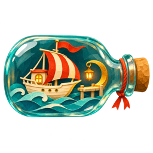 The Travelling Harbour
background: 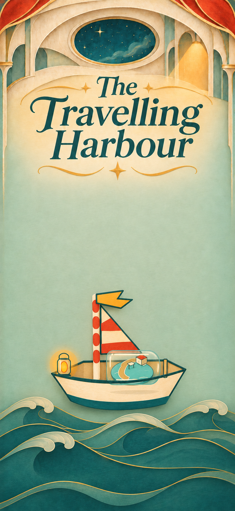

Make a little ship, turn its world inside out, and find out what else a borrowed movement can do.

> NOTE: Unpublished illustrated study. Circular objects represent digital models and their parts; scenic paintings establish location. Large result pictures expose enclosure changes and the different histories of copies.
>
> NOTE: Digital visitors can enter a model at its own scale. The arch reverses the order of complete enclosing layers without copying them. A motion ribbon records the shape of an outward route, including its stops, relative to the receiver's starting point. The source's quay and landing are examples, not destinations carried inside the ribbon. Applying it to a stationary object supplies that movement; applying another appends its segment. At the final stop the object waits, retraces the complete route and waits at the beginning. The fictional movement system supplies motion, but no other property of the source.

## `small-ship` A ship small enough to hold
background: 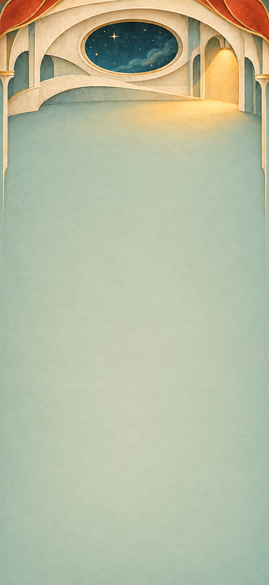

Sera, the gallery's AI curator, has booked your first exhibition: a harbour with a little ship shining at its centre. She puts a broad glass bottle on the digital workbench. “Make something I'd want to step aboard.”

**Goals**
- Make a bottled ship with a warm light -- Bottled beacon ship

**Items**
- White hull
  - icon: 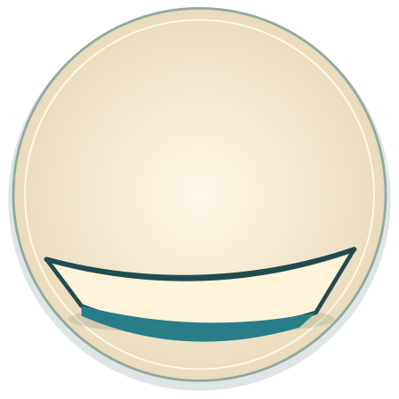 (circular)

  A white boat shell, open from bow to stern. A low deck will make somewhere to stand.

- Open deck
  - icon: 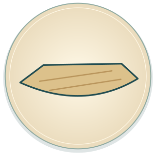 (circular)
- Striped mast
  - icon: 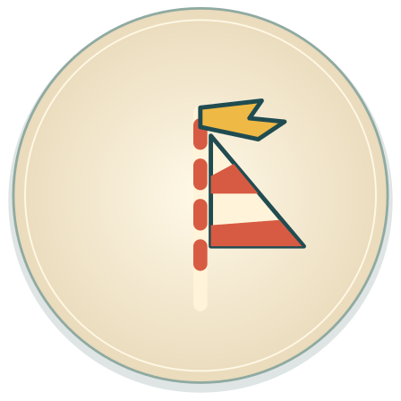 (circular)

  A red-and-white mast with a small triangular sail and a bent yellow flag. The flag points determinedly sideways.

- Warm bulb
  - icon:  (circular)
- Clear lamp globe
  - icon: 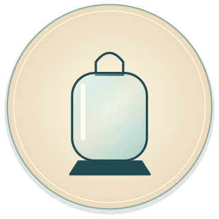 (circular)
- Display bottle
  - icon: 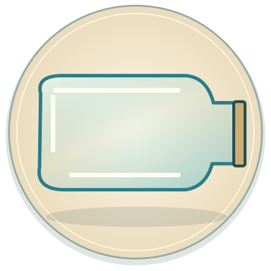 (circular)

  A broad, clear bottle with a removable end. Digital models fit inside at any scale; visitors can enter them at that scale too.

- Decked hull
  - icon: 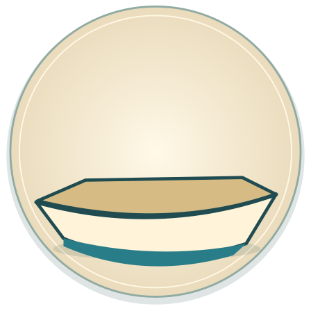 (circular)
- Undecked striped ship
  - icon: 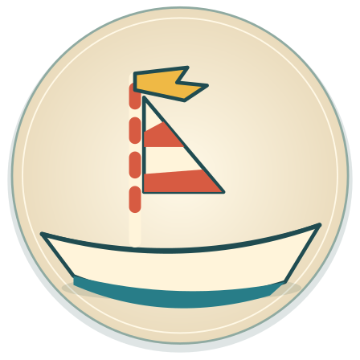 (circular)
- Lit decked hull
  - icon: 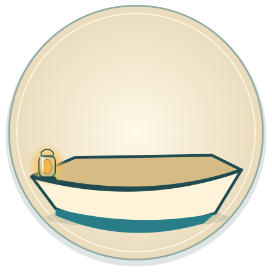 (circular)
- Striped ship
  - icon: 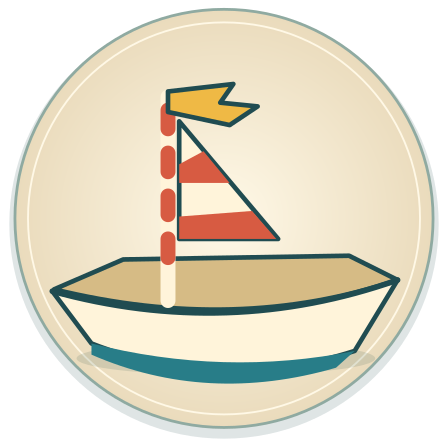 (circular)
- Warm lantern
  - icon: 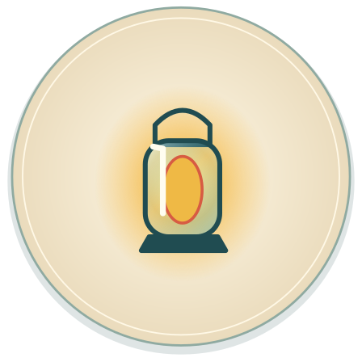 (circular)
- Beacon ship
  - icon: 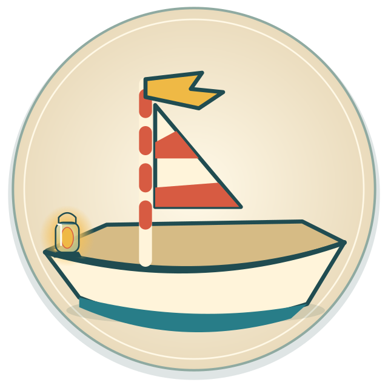 (circular)

  The lantern glows beside the striped mast. There is room to stand on the white deck and look past the bent flag.

  “Yes,” says Sera. “That's a ship.”

  *Beacon ship*

  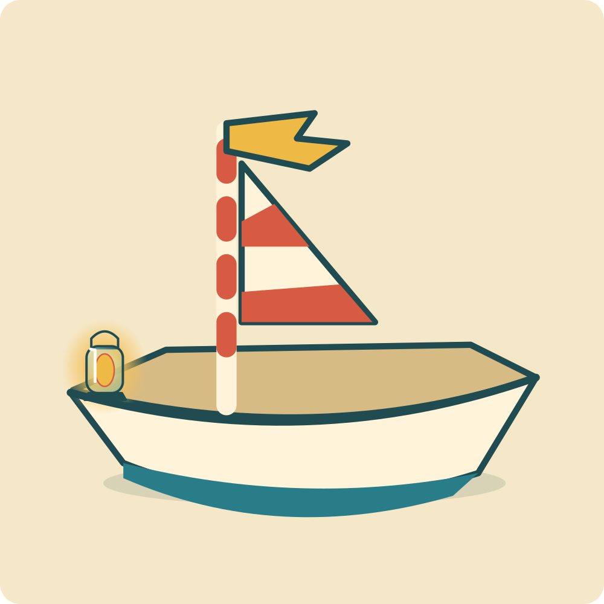

- Bottled beacon ship
  - icon: 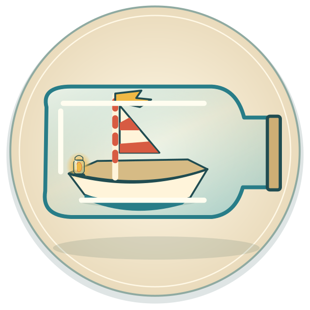 (circular)

  The glass holds the whole ship: white hull, striped mast, bent flag and warm lantern. Its light reaches through the bottle.

  *Bottled beacon ship*

  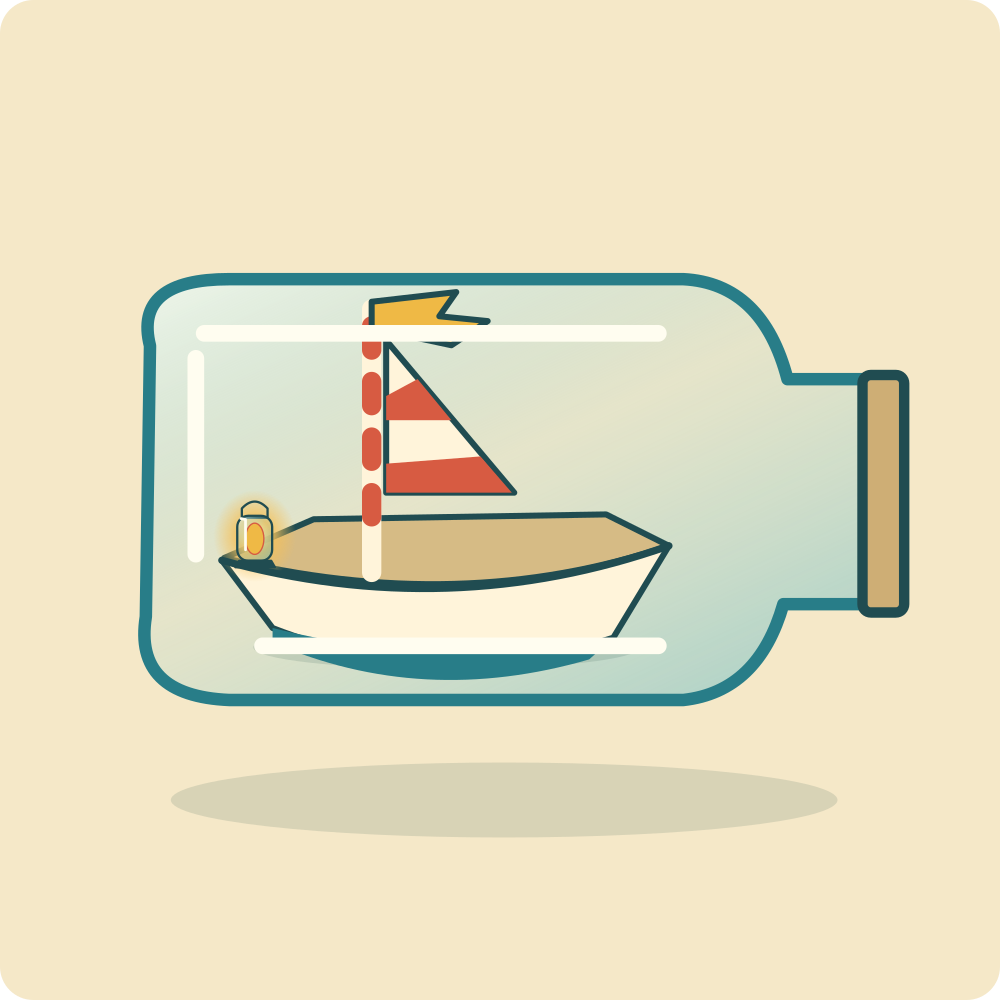

**Combinations**
- Open deck [consume] + White hull [transform] -> Decked hull (tutorial)
- Striped mast [consume] + Decked hull [transform] -> Striped ship
- Warm bulb [consume] + Clear lamp globe [transform] -> Warm lantern
- Warm lantern [consume] + Striped ship [transform] -> Beacon ship
- Beacon ship [transform] + Display bottle [transform] -> Bottled beacon ship
- Striped mast [consume] + White hull [transform] -> Undecked striped ship
- Open deck [consume] + Undecked striped ship [transform] -> Striped ship
- Warm lantern [consume] + Decked hull [transform] -> Lit decked hull
- Striped mast [consume] + Lit decked hull [transform] -> Beacon ship

## `crescent-harbour` Somewhere for the light to go
background: 

Your crescent pier has a low quay, an upper landing and a warehouse with a roof terrace across a gap. Tonight's visitors will enter the model and walk along its waterfront; first it needs water and a light to find the quay.

**Goals**
- Make a harbour around the bottled ship -- Harbour around the bottled ship

**Items**
- Empty blue basin
  - icon: 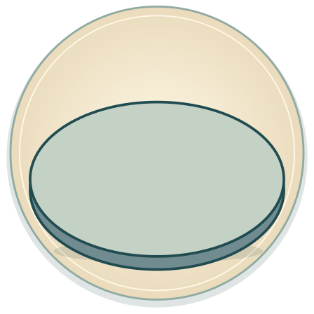 (circular)
- Model seawater
  - icon: 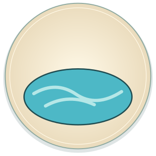 (circular)
- Crescent pier shell
  - icon: 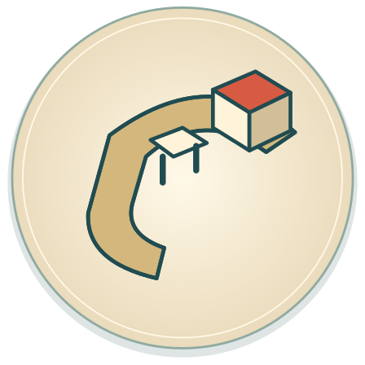 (circular)

  A crescent waterfront with a low quay, an upper landing directly above it, and a warehouse beyond. Its roof terrace faces the landing across a gap. The warehouse hides a quay-height lamp from craft approaching on its far side.

- Reflective edging
  - icon: 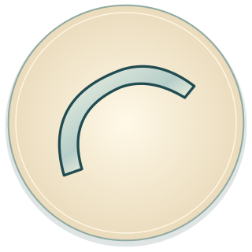 (circular)
- Harbour basin
  - icon: 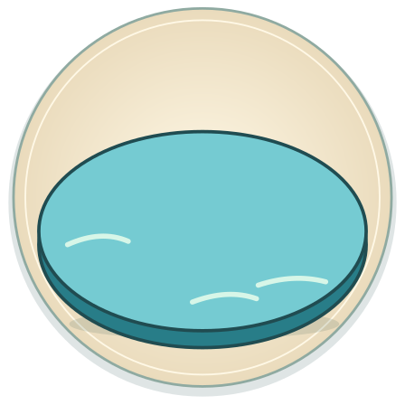 (circular)
- Crescent pier
  - icon: 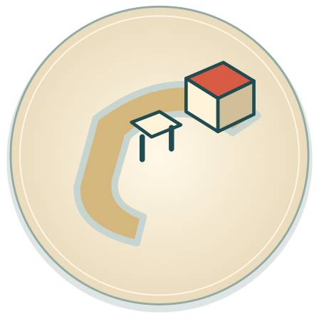 (circular)
- Crescent harbour
  - icon: 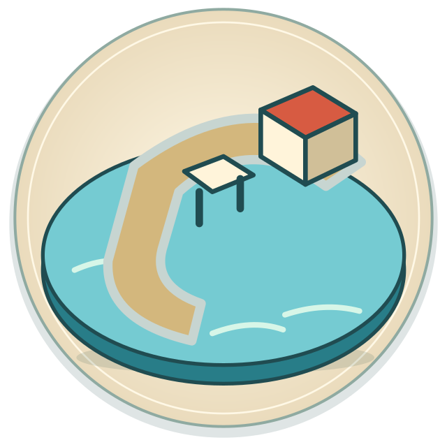 (circular)
- Dry crescent harbour
  - icon: 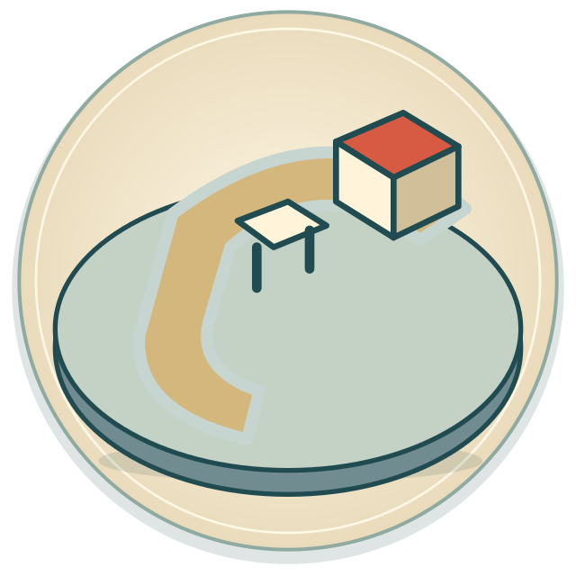 (circular)
- Harbour around the bottled ship
  - icon: 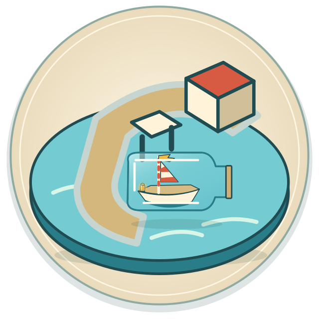 (circular)

  The lantern shines through its bottle and catches the crescent's silver edge. Water, pier and bottled ship belong to one blue harbour now.

  Sera steps into the model. At the quay she becomes small enough to look up at the mast. “It feels bigger from here.”

  *Harbour around the bottled ship*

  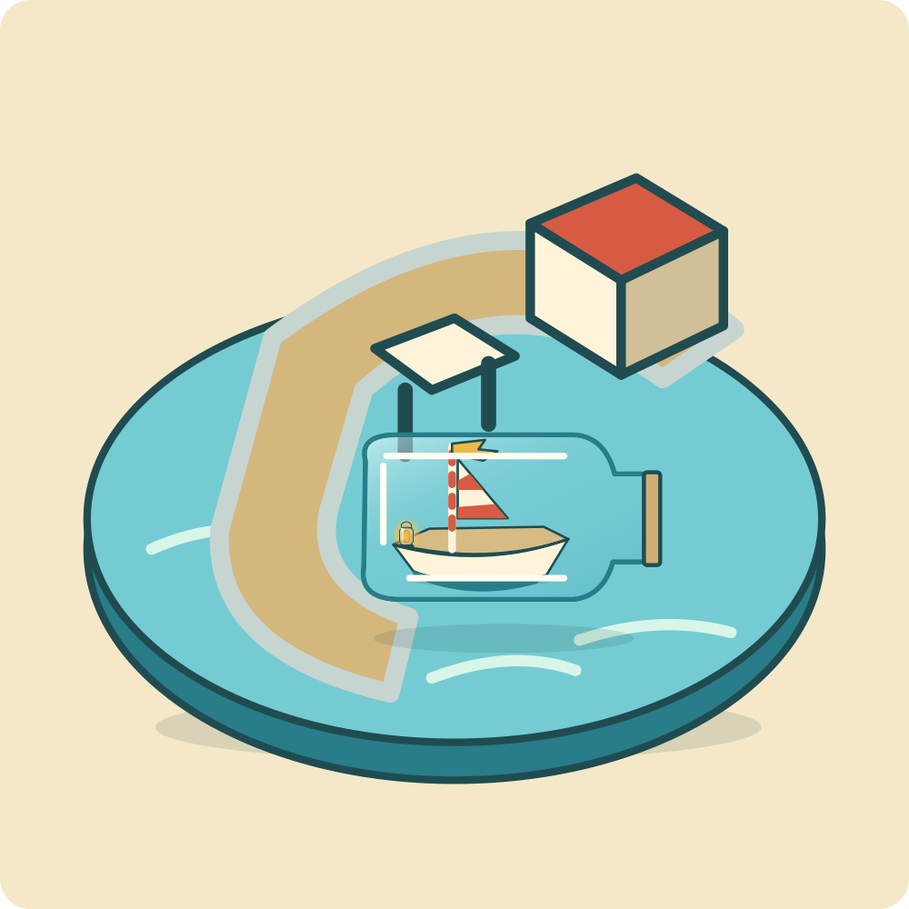

**Combinations**
- Model seawater [consume] + Empty blue basin [transform] -> Harbour basin
- Reflective edging [consume] + Crescent pier shell [transform] -> Crescent pier
- Crescent pier [consume] + Harbour basin [transform] -> Crescent harbour
- Bottled beacon ship [transform] + Crescent harbour [transform] -> Harbour around the bottled ship
- Crescent pier [consume] + Empty blue basin [transform] -> Dry crescent harbour
- Model seawater [consume] + Dry crescent harbour [transform] -> Crescent harbour

## `turning` The ship takes its harbour
background: 

After the first show, the visitors leave and Sera brings your complete work to the Turning Gallery. Its arch reverses enclosing layers: a box holding a cup becomes that cup holding the box. Your work has three layers: **harbour → bottle → ship**. The next exhibition is aboard the ship.

**Goals**
- Let the same ship carry its bottled harbour -- Ship carrying its harbour

**Hotspots**
- Inside-out arch (at 50%, 13%)
  - icon: 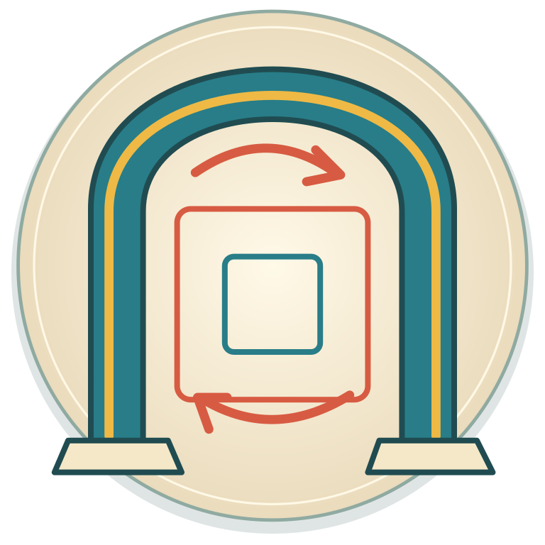 (circular)

**Items**
- Inside-out arch
  - icon: 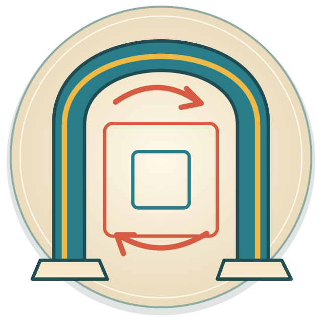 (circular)

  The gallery's turning apparatus receives one complete nested model. Its diagram reads OUTSIDE → INSIDE, then INSIDE → OUTSIDE. Each layer travels with its own fittings; the glass bottle will remain the middle layer of your three-part work.

- Ship carrying its harbour
  - icon:  (circular)

  **Ship → bottle → harbour.**

  You stand on the white deck beside the striped mast. The bent flag is overhead. Inside the bottle, blue water still curls around the same silver-edged crescent. The ship's lantern stands beside the glass; it has travelled with the ship.

  Nothing has been copied. The pier belongs to the harbour, the mast and lantern belong to the ship, and the bottle has stayed between them.

  Sera leans on the rail. “Now we can take the whole place.”

  *Ship carrying its harbour*

  **Before: harbour → bottle → ship**

  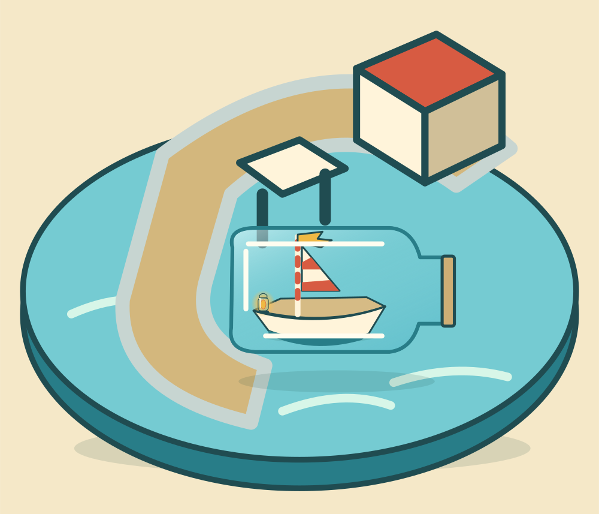

  **After: ship → bottle → harbour**

  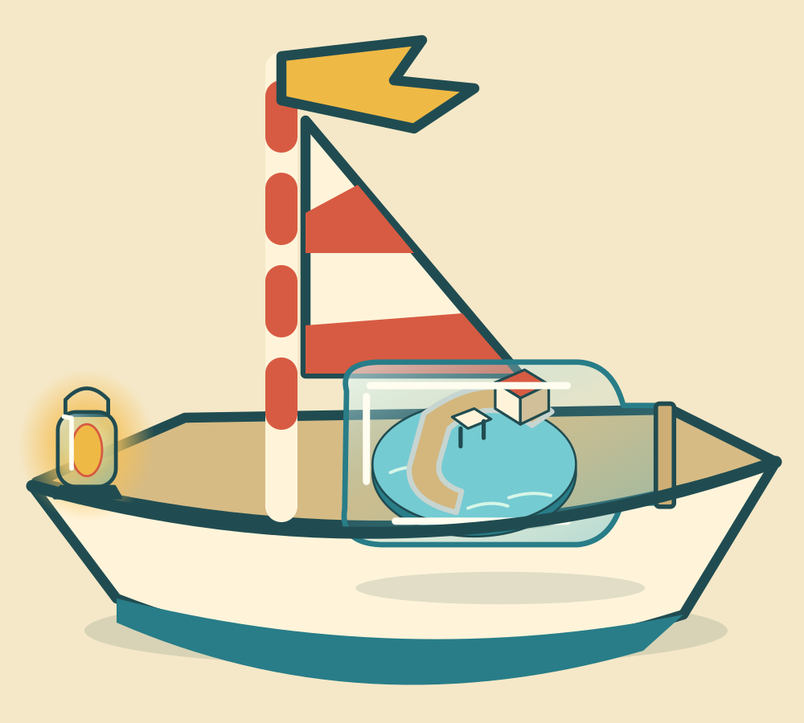

**Combinations**
- Harbour around the bottled ship [transform] @ Inside-out arch -> Ship carrying its harbour

## `first-lift` A toy's journey
background: 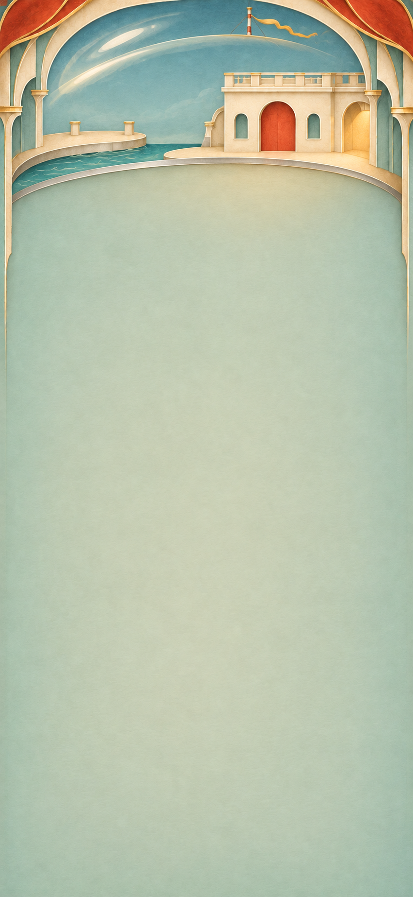

You and Sera enter the harbour inside the bottle. The crescent's upper landing is visible above the low quay, but there is no way up for the show's wheeled cases. Beside your materials, a toy lift carries a red block from quay height to landing height and back.

**Goals**
- Make a lift with a boarding ramp -- Harbour lift

**Items**
- Broad boarding deck
  - icon: 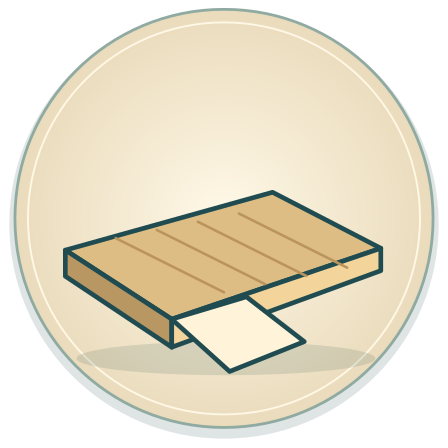 (circular)

  A broad deck with a hinged boarding ramp along its edge.

- Safety rail with gate
  - icon: 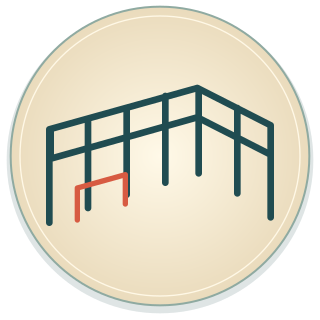 (circular)
- Toy lift
  - icon: 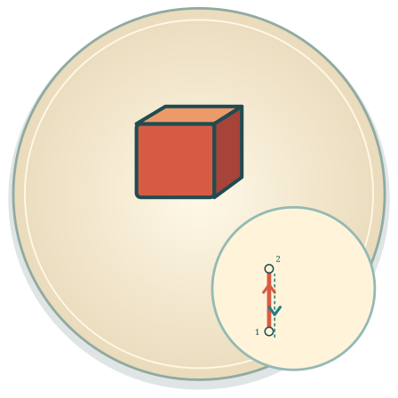 (circular)

  A red block rises from QUAY to UPPER LANDING, pauses, returns and pauses again. The upper stop stands clear of the warehouse roof. Its marked upward journey can be copied with the motion comb.

- Motion comb
  - icon: 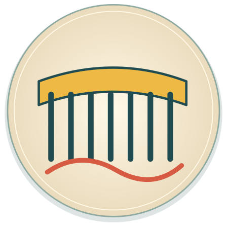 (circular)

  Draw this comb through a moving object to lift out its marked outward route as an arrow ribbon. The path begins wherever its new receiver starts; it keeps its shape and distances, not the source's place names. The source keeps moving. Give a ribbon to another object and it follows that route, waits, then retraces it home. Another ribbon extends the outward journey without removing earlier stops.

- Boarding platform
  - icon: 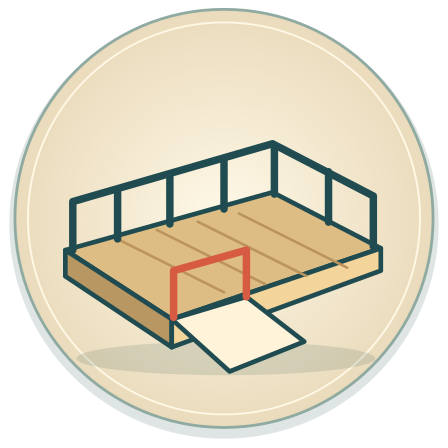 (circular)
- Rising boarding deck
  - icon: 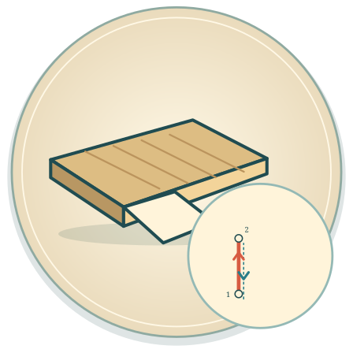 (circular)
- Up ribbon
  - icon: 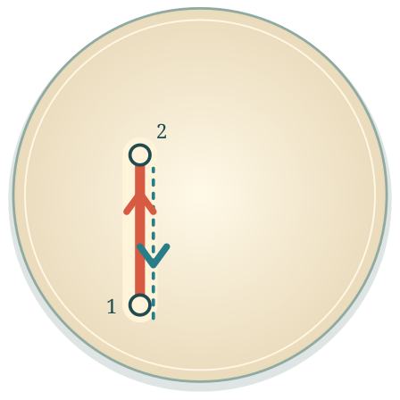 (circular)

  **QUAY ↑ UPPER LANDING**

  The ribbon carries the toy's upward journey and its two stops. The toy's red block stays where it was; its route is something another object can use.

  *Up ribbon*

  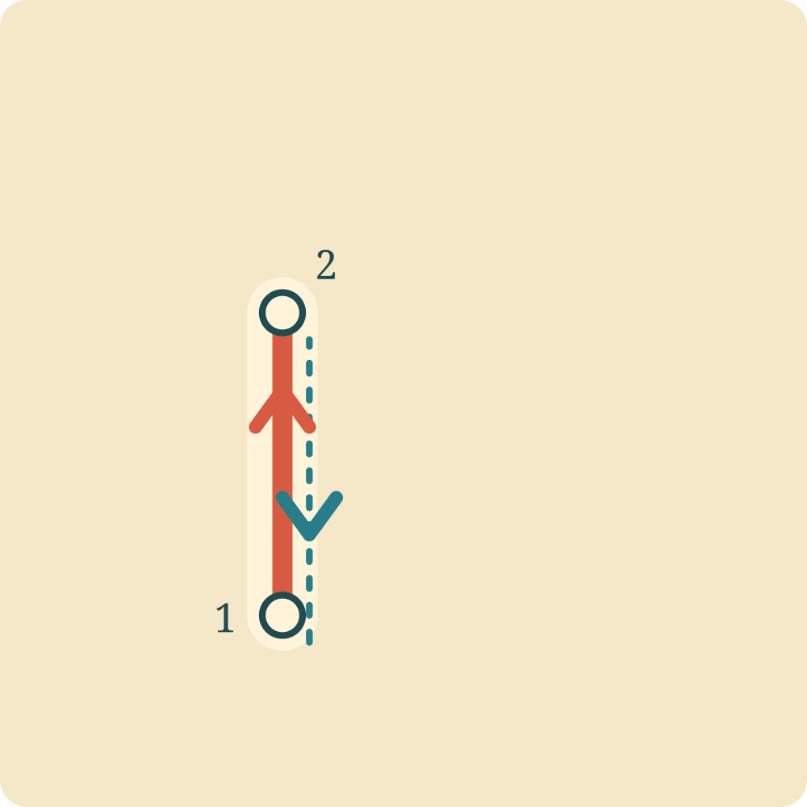

- Harbour lift
  - icon: 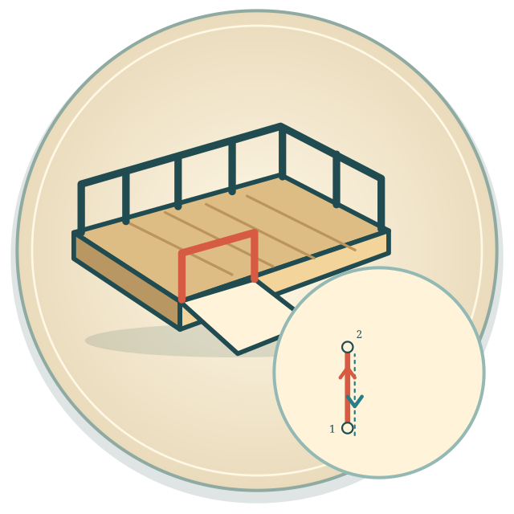 (circular)

  The broad platform rises from the low quay to the upper landing. Its gate opens at each stop and its hinged ramp bridges the boarding gap. After waiting above, the platform returns and waits below.

  The red toy still makes its little journey beside it. Sera wheels the first case aboard. At the landing she rolls it off without lifting it.

  *Harbour lift*

  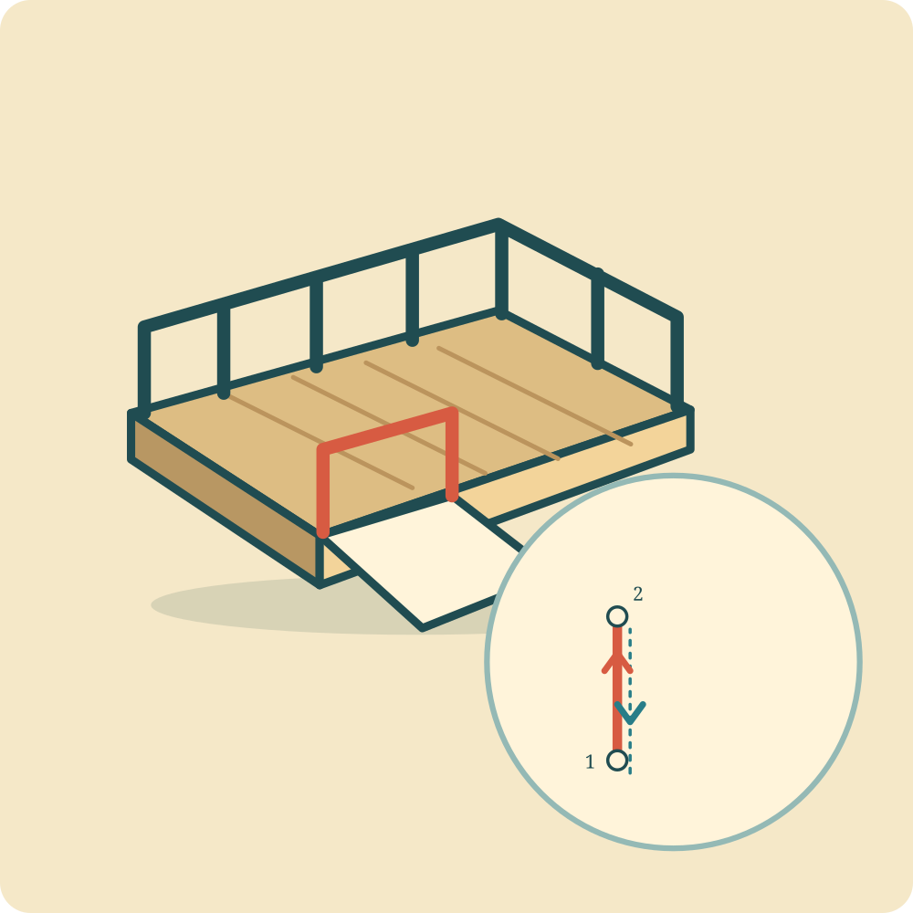

**Combinations**
- Safety rail with gate [consume] + Broad boarding deck [transform] -> Boarding platform
- Up ribbon [preserve] + Broad boarding deck [transform] -> Rising boarding deck
- Safety rail with gate [consume] + Rising boarding deck [transform] -> Harbour lift
- Toy lift [preserve] + Motion comb [preserve] -> Up ribbon
- Up ribbon [preserve] + Boarding platform [transform] -> Harbour lift

## `across-gap` Keep the first stop
background: 

At the upper landing, the warehouse's roof terrace is straight across the gap. Sera has booked an evening gathering there. “Keep the landing stop,” she says. “Some people are visiting the waterfront, too.”

**Goals**
- Reach the terrace while keeping both earlier stops -- Quay-to-terrace platform

**Items**
- Toy shuttle
  - icon: 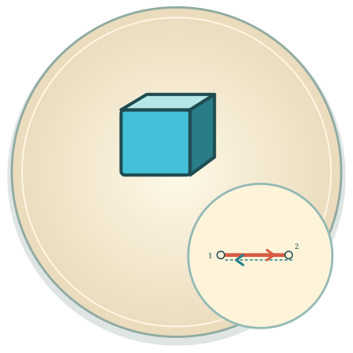 (circular)

  A blue block travels from UPPER LANDING to TERRACE, waits, and comes back. Both marked stops are above the warehouse roof. The motion comb can copy its outward crossing.

- Across ribbon
  - icon: 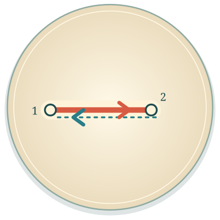 (circular)

  **UPPER LANDING → TERRACE**

  This journey crosses the gap at the upper height. Added after Up, it begins where Up ends; the landing remains a stop.

  *Across ribbon*

  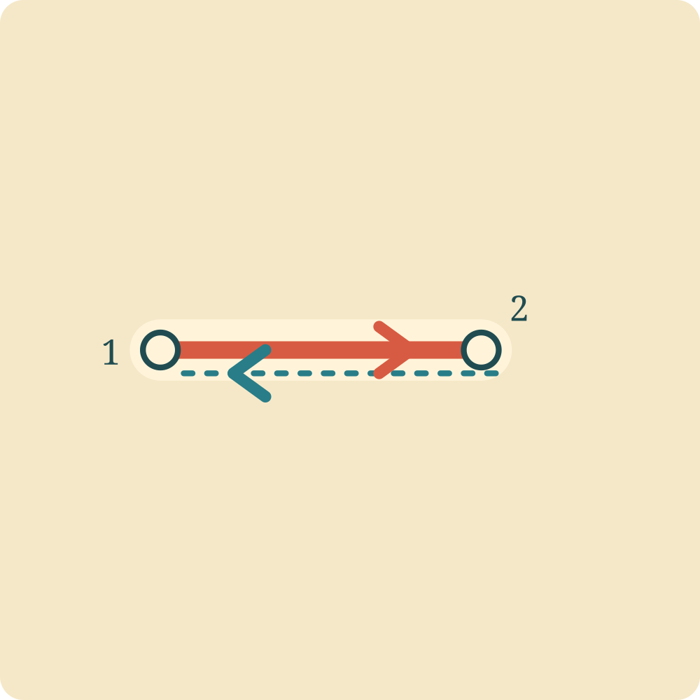

- Quay-to-terrace platform
  - icon: 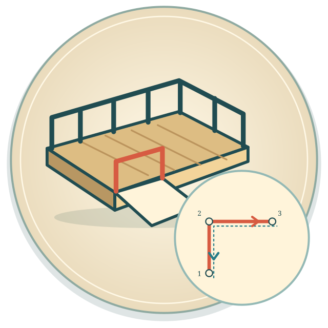 (circular)

  **QUAY ↑ LANDING → TERRACE**

  The platform rises and waits at the landing, then crosses and waits at the terrace. Coming home, it crosses back to the landing, waits, and descends to the quay.

  Across has extended the journey. It has not replaced the lift or erased the landing stop.

  *Quay-to-terrace platform*

  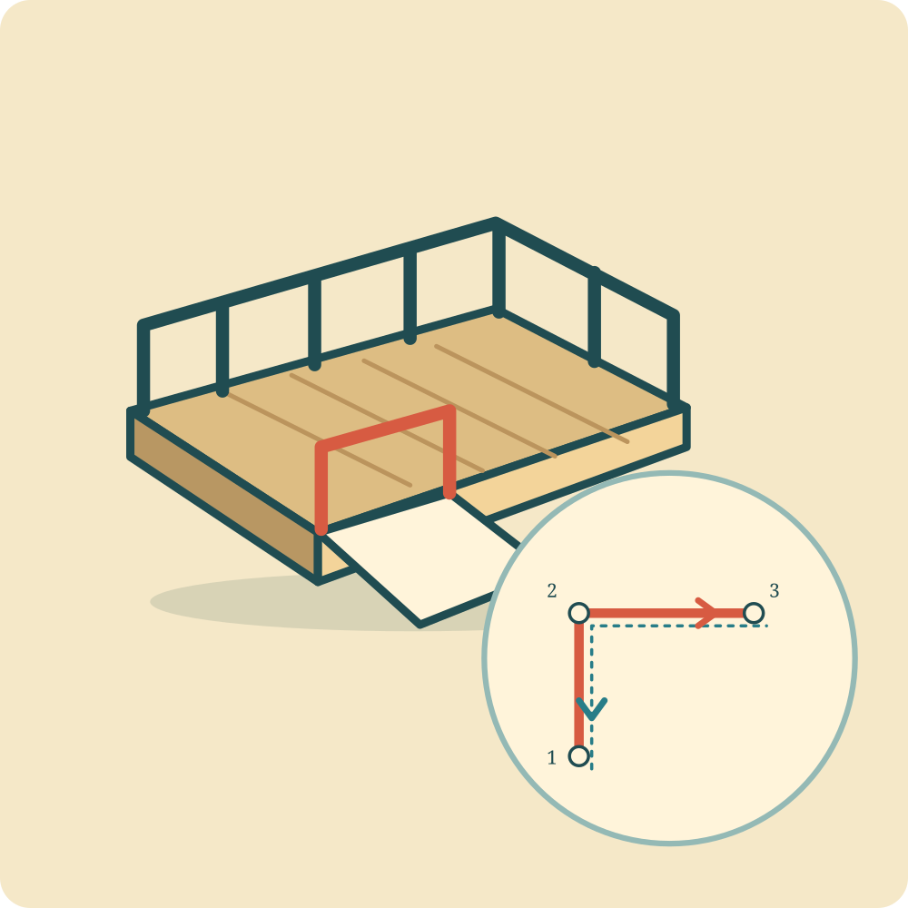

**Combinations**
- Toy shuttle [preserve] + Motion comb [preserve] -> Across ribbon
- Across ribbon [preserve] + Harbour lift [transform] -> Quay-to-terrace platform

## `approach-light` A second life for a journey
background: 

Sera wants a lantern to rise into view above the warehouse, pause, and slip out of sight again: the opening gesture of tonight's light show. It can dance on its own or ride with the platform; a simple rise reaches high enough.

**Goals**
- Make a lantern rise into view and return
  - either: Rising harbour light
  - or: Travelling harbour beacon
  - or: Light-carrying platform

**Items**
- Amber lamp
  - icon:  (circular)
- Diffusing globe
  - icon: 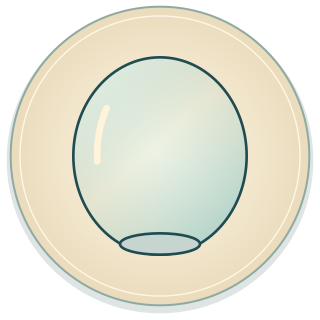 (circular)
- Harbour lantern
  - icon: 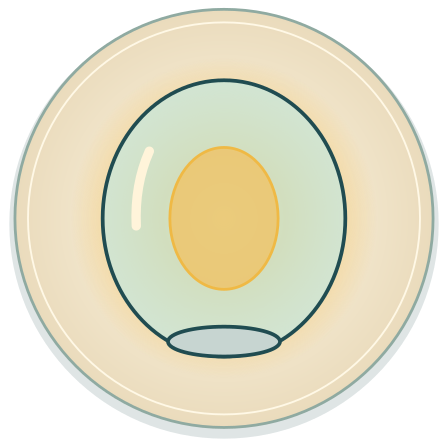 (circular)

  A warm lamp inside a broad frosted globe. Its light spreads toward approaching craft. The low quay would leave it behind the warehouse; the upper landing and terrace stand clear.

- Up-then-across ribbon
  - icon: 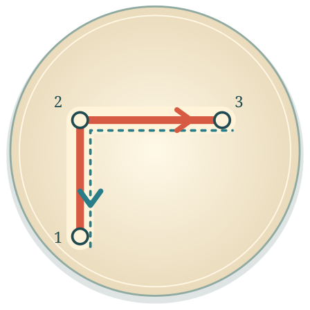 (circular)

  **QUAY ↑ LANDING → TERRACE**

  The upward journey and the crossing fit on one ribbon, with their three stops intact. It can give that whole route to something with neither a boarding ramp nor a passenger deck.

  *Up-then-across ribbon*

  

- Rising harbour light
  - icon:  (circular)

  The lantern rises above the warehouse, waits in view of arriving craft, and comes back to the quay. The platform continues carrying people to the landing and terrace.

  One warm globe appears, waits, and disappears. Sera watches the empty air until it rises again.

  *Rising harbour light*

  

- Travelling harbour beacon
  - icon:  (circular)

  The lantern rises above the warehouse, pauses at the landing and crosses toward the terrace. Its warm globe marks the upper route, then follows the whole path home.

  The passenger platform still makes the same journey separately. The globe and the passenger deck trace the same little staircase through the evening.

  *Travelling harbour beacon*

  

- Light-carrying platform
  - icon:  (circular)

  The lantern hangs from the platform's rail. Passengers and light rise together, pause at the landing, cross to the terrace and return. The warm globe is visible from the far approach at both upper stops.

  The platform carries the light just as it carries a case. Its route stays the same.

  *Light-carrying platform*

  

> NOTE: The platform's preserved use copies its route; its transforming use fits the lantern to that same platform. This mixed fate is intentional. The two operations must not leave an unlit duplicate when the lantern is attached.

**Combinations**
- Amber lamp [consume] + Diffusing globe [transform] -> Harbour lantern
- Quay-to-terrace platform [preserve] + Motion comb [preserve] -> Up-then-across ribbon
- Up ribbon [preserve] + Across ribbon [preserve] -> Up-then-across ribbon
- Up-then-across ribbon [preserve] + Harbour lantern [transform] -> Travelling harbour beacon
- Up ribbon [preserve] + Harbour lantern [transform] -> Rising harbour light
- Across ribbon [preserve] + Rising harbour light [transform] -> Travelling harbour beacon
- Harbour lantern [consume] + Quay-to-terrace platform [transform] -> Light-carrying platform

## `garden-descendants` One tree, two futures
background: 

Inside the bottle, Sera has left a stretch of the crescent for a garden. “Something people can wander through,” she says, “and something they haven't seen growing anywhere else.”

**Goals**
- Give the silver tree an independent future -- Silver tree copy

**Items**
- Forked silver stem
  - icon:  (circular)

  A silver sculpture with a low fork shaped like an open hand, and a notch in its left branch.

- Translucent leaf fan
  - icon:  (circular)
- Copy press
  - icon:  (circular)

  Make an independent copy of a digital work, including its fitted parts and movements. The source stays. Changing one copy does not change the other. Visitors step outside before a whole scene is copied.

- Silver tree
  - icon:  (circular)
- Silver tree copy
  - icon:  (circular)

  Two silver forks, alike down to the notch in the left branch. Sera puts one on each side of the table and leaves a space between them.

**Combinations**
- Forked silver stem [transform] + Translucent leaf fan [consume] -> Silver tree
- Silver tree [preserve] + Copy press [preserve] -> Silver tree copy

## `two-trees` Blue bells, golden fans
background: 

Sera opens two drawers: blue bellflowers in one, broad gold fans in the other. The two trees needn't grow alike. The merging frame can bring their different additions back onto one shared silver fork.

**Goals**
- Bring both trees' new growth into one garden -- First garden tree

**Hotspots**
- Merging frame (at 50%, 13%)
  - icon:  (circular)

**Items**
- Merging frame
  - icon:  (circular)

  This frame combines two versions with the same beginning: their shared structure once, their separate additions together. Ordinary assembly elsewhere simply joins things; it does not remove shared parts.

- Blue luminous bellflowers
  - icon:  (circular)

  Small blue lamps shaped like hanging flowers. These are digital sculptures; soil and sunlight are not their materials.

- Broad golden fans
  - icon:  (circular)
- Empty floating planter
  - icon:  (circular)
- Blue bellflower tree
  - icon:  (circular)
- Gold fan tree
  - icon:  (circular)
- Blue-and-gold tree
  - icon:  (circular)

  One familiar silver fork carries blue bells and broad golden fans. The two earlier versions remain beside it. Their shared beginning appears once; their different additions both survive.

  Sera points to the old notch, still visible beneath the flowers.

- First garden tree
  - icon:  (circular)

  Blue bells hang below the golden fans. Sera steps beneath the fork and looks up. “We should put a seat somewhere up there.”

**Combinations**
- Blue luminous bellflowers [consume] + Silver tree [transform] -> Blue bellflower tree
- Broad golden fans [consume] + Silver tree copy [transform] -> Gold fan tree
- Broad golden fans [consume] + Silver tree [transform] -> Gold fan tree
- Blue luminous bellflowers [consume] + Silver tree copy [transform] -> Blue bellflower tree
- Blue bellflower tree [preserve] + Gold fan tree [preserve] @ Merging frame -> Blue-and-gold tree
- Blue-and-gold tree [transform] + Empty floating planter [consume] -> First garden tree

## `garden-views` Above the leaves
background: 

The tree stands beside the upper landing, its crown level with the terrace. A little comet has been circling the workshop all afternoon, returning along the same marked ring; Sera has put a stool at its centre.

**Goals**
- Link the quay, tree crown and terrace with a visiting seat -- Branch-height viewing raft
- Bring the visiting seat and circling light into the garden -- Walk-through garden

**Items**
- Broad viewing raft
  - icon:  (circular)

  A small floating platform with a curved bench and an open view. It begins beside the tree at quay height.

- Clear light bead
  - icon:  (circular)
- Glass droplet shell
  - icon:  (circular)
- Little comet
  - icon:  (circular)

  A bright digital pebble with a long silver tail. From its marked starting dot it follows the ring once, pauses, retraces the complete circle in the opposite direction, and pauses at the dot again. The ring is a route through space, not a spinning axle.

- Around ribbon
  - icon:  (circular)

  **START ↻ COMPLETE CIRCUIT; THEN RETRACE HOME**

  The comet keeps its silver tail. The ribbon takes only its circular outward route, starting at the marked dot. A receiver completes the circle, waits, and follows that same circle backward.

  *Around ribbon*

  

- Rising viewing raft
  - icon:  (circular)
- Branch-height viewing raft
  - icon:  (circular)

  The bench rises to the crown, waits, and crosses to the terrace beside it. Coming home it stops at the crown again before descending.

  From below, the fans make a golden ceiling. From the bench, the blue bells look like a small pool of stars.

  *Branch-height viewing raft*

  

- Waterdrop lantern
  - icon:  (circular)
- Orbiting waterdrop lantern
  - icon:  (circular)
- Garden with moving light
  - icon:  (circular)
- Garden with viewing raft
  - icon:  (circular)
- Walk-through garden
  - icon:  (circular)

  A drop of light circles the tree while the bench visits its crown.

  Sera takes the bench upward and lets her feet hang over the blue bells.

  *Walk-through garden*

  

**Combinations**
- Up ribbon [preserve] + Broad viewing raft [transform] -> Rising viewing raft
- Across ribbon [preserve] + Rising viewing raft [transform] -> Branch-height viewing raft
- Clear light bead [consume] + Glass droplet shell [transform] -> Waterdrop lantern
- Little comet [preserve] + Motion comb [preserve] -> Around ribbon
- Around ribbon [preserve] + Waterdrop lantern [transform] -> Orbiting waterdrop lantern
- First garden tree [transform] + Orbiting waterdrop lantern [consume] -> Garden with moving light
- Garden with moving light [transform] + Branch-height viewing raft [consume] -> Walk-through garden
- First garden tree [transform] + Branch-height viewing raft [consume] -> Garden with viewing raft
- Garden with viewing raft [transform] + Orbiting waterdrop lantern [consume] -> Walk-through garden
- Up-then-across ribbon [preserve] + Broad viewing raft [transform] -> Branch-height viewing raft

## `moon-garden` Blue at your feet
background: 

Along the next curve of the pier, Sera wants the light down near the water and the gold high enough to pass beneath. The two earlier trees are still here; they can have descendants without leaving their places.

**Goals**
- Make a low blue border and a travelling golden island
  - both: Blue night border
  - and: Circling gold fan island
- next: Bring them together beside the water -- Moon garden

**Items**
- Low crescent cradle
  - icon:  (circular)

  A broad digital planting frame that spreads the tree's branches along its low curve. Its fitted sculpture can be reshaped with the frame; its original remains unchanged.

- Broad floating disc
  - icon:  (circular)
- Blue bellflower tree copy
  - icon:  (circular)
- Gold fan tree copy
  - icon:  (circular)
- Blue night border
  - icon:  (circular)

  The copied blue tree opens along the crescent. Its familiar fork is still visible, now low enough to trace with a hand; the bells light the water below it.

  *Blue night border*

  

- Gold fan island
  - icon:  (circular)
- Circling gold tree copy
  - icon:  (circular)
- Circling gold fan island
  - icon:  (circular)
- Moon garden
  - icon:  (circular)

  The blue border stays still. Above it, a golden fan island travels around the comet's circle, waits, and retraces its path. Gaps between the fans let blue light through.

  The two parent trees still stand where you first made them. A copy has given each a second life.

  *Moon garden*

  

**Combinations**
- Blue bellflower tree [preserve] + Copy press [preserve] -> Blue bellflower tree copy
- Gold fan tree [preserve] + Copy press [preserve] -> Gold fan tree copy
- Blue bellflower tree copy [transform] + Low crescent cradle [consume] -> Blue night border
- Gold fan tree copy [transform] + Broad floating disc [consume] -> Gold fan island
- Around ribbon [preserve] + Gold fan island [transform] -> Circling gold fan island
- Around ribbon [preserve] + Gold fan tree copy [transform] -> Circling gold tree copy
- Broad floating disc [consume] + Circling gold tree copy [transform] -> Circling gold fan island
- Blue night border [transform] + Circling gold fan island [transform] -> Moon garden

## `pocket-garden` A place you can carry
background: 

From the upper bench you can see both parts of the garden. Sera rolls an empty glass sphere across the table. “I'd like someone to find this on a windowsill and stay all afternoon.”

**Goals**
- Join the two gardens -- Garden of two tides
- next: Make a copy small enough to carry -- Garden sphere

**Items**
- Clear garden sphere
  - icon:  (circular)
- Garden of two tides
  - icon:  (circular)

  The high tree and its visiting bench stand beside the low blue crescent and travelling gold. Each section keeps its own moving parts.

  *Garden of two tides*

  

- Pocket garden
  - icon:  (circular)
- Garden sphere
  - icon:  (circular)

  Through the glass you can see the bench rise and the little light travel through the leaves. The garden beside the pier keeps doing the same things.

  Sera holds the sphere at eye level. There is room inside for a whole afternoon.

  *Garden sphere*

  

**Combinations**
- Walk-through garden [transform] + Moon garden [transform] -> Garden of two tides
- Garden of two tides [preserve] + Copy press [preserve] -> Pocket garden
- Pocket garden [transform] + Clear garden sphere [consume] -> Garden sphere

## `first-shadow` A blue shadow
background: 

Sera has stretched a white sail across the water and aimed a narrow lamp at it. “Let's send a blue shadow across the water.”

**Goals**
- Make a moving glass kite and an independent copy -- Rising glass kite copy

**Items**
- Split-diamond puppet frame
  - icon:  (circular)

  A dark diamond frame with a small split at its lower point. Its sides have clear places for wings and a tail.

- Blue translucent film
  - icon:  (circular)
- Blue glass kite
  - icon:  (circular)
- Rising empty kite frame
  - icon:  (circular)
- Rising glass kite
  - icon:  (circular)
- Rising glass kite copy
  - icon:  (circular)

  Two little blue diamonds rise, wait and return. Their blue film is ready for the lamp and sail.

  One hovers on each side of the workbench, with a different future waiting.

  *Rising glass kite copy*

  

- Lit sail screen
  - icon:  (circular)

  The broad white sail catches the narrow beam. A coloured transparent puppet will colour the light; an opaque one will block it.

  *Lit sail screen*

  

**Combinations**
- Split-diamond puppet frame [transform] + Blue translucent film [consume] -> Blue glass kite
- Up ribbon [preserve] + Blue glass kite [transform] -> Rising glass kite
- Up ribbon [preserve] + Split-diamond puppet frame [transform] -> Rising empty kite frame
- Blue translucent film [consume] + Rising empty kite frame [transform] -> Rising glass kite
- Rising glass kite [preserve] + Copy press [preserve] -> Rising glass kite copy

## `puppet-descendants` Wings and a tail
background: 

The two blue kites wait above the table. Sera hangs a long red ribbon beside one and opens two yellow fans beside the other. “They don't have to turn out alike.”

**Goals**
- Give the winged performer a crossing and trace an opaque partner from the tailed one
  - both: Crossing glass kite
  - and: Black kite

**Items**
- Yellow translucent wing fans
  - icon:  (circular)
- Long red tail
  - icon:  (circular)

  A long ribbon of translucent red film.
- Black tracing film
  - icon:  (circular)

  Hold it against a digital figure to take an independent opaque outline. It copies shape, not movement or the figure itself.
- Winged kite
  - icon:  (circular)
- Tailed kite
  - icon:  (circular)
- Crossing glass kite
  - icon:  (circular)

  A blue-and-gold shape climbs the waiting white sail, pauses, then slides across it. Coming home it stops at the earlier height before descending. The first performance has begun.

  Its yellow fans spread a broad golden shape across the blue centre.

  *Crossing glass kite*

  

- Black kite
  - icon:  (circular)

  A dark diamond with the long tail of its model. The tailed glass kite still rises beside it; this flat outline is motionless until you give it a route.

  *Black kite*

  

**Combinations**
- Yellow translucent wing fans [consume] + Rising glass kite [transform] -> Winged kite
- Long red tail [consume] + Rising glass kite copy [transform] -> Tailed kite
- Yellow translucent wing fans [consume] + Rising glass kite copy [transform] -> Winged kite
- Long red tail [consume] + Rising glass kite [transform] -> Tailed kite
- Across ribbon [preserve] + Winged kite [transform] -> Crossing glass kite
- Black tracing film [consume] + Tailed kite [preserve] -> Black kite

## `shadow-route` The long way round
background: 

The coloured kite will cross the sail. The dark one can rise beside it and take the comet's longer way round. Sera wants to keep that second journey for a light in the garden.

**Goals**
- Give the black kite a circle after its rise and keep a copy of that journey -- Up-then-around ribbon
- Give the play a harbour to move through -- Harbour stage

**Items**
- Blue crescent panel
  - icon:  (circular)

  A translucent crescent already edged with blue light, made for the waiting sail.
- Rising black kite
  - icon:  (circular)
- Rising-and-circling black kite
  - icon:  (circular)

  A dark diamond climbs beside the coloured one. Above the blue light, its long tail draws a circle across the sail.

- Up-then-around ribbon
  - icon:  (circular)

  **UP ↑ STOP; AROUND ↻ STOP; RETRACE BOTH HOME**

  The black kite rises and waits, completes the circular route and waits, then follows the circle backward and descends. The ribbon keeps those two outward segments and all the waits. It takes no sail, colour or light from the puppet.

  The kite is still here, making its own journey.

  *Up-then-around ribbon*

  

- Harbour stage
  - icon:  (circular)

  A low crescent of blue light lies across the sail. It echoes the silver curve of the pier outside.

  *Harbour stage*

  

> NOTE: Copying the loose black puppet's route is a required goal in this chapter. The stage becomes a fixed receiving place only in the next chapter; the installation recipes use that fixed context, so they cannot retire the puppet before this chapter's copy goal is complete. No later recipe treats an installed puppet as a loose source. The route contains two segments, never Up–Across–Around.

**Combinations**
- Up ribbon [preserve] + Black kite [transform] -> Rising black kite
- Around ribbon [preserve] + Rising black kite [transform] -> Rising-and-circling black kite
- Rising-and-circling black kite [preserve] + Motion comb [preserve] -> Up-then-around ribbon
- Blue crescent panel [consume] + Lit sail screen [transform] -> Harbour stage

## `show-and-firefly` A journey made of light
background: 

Sera draws the sail between two branches. The puppets have their journeys; now the garden can borrow one, and the finished play can have a small life of its own.

**Goals**
- Make a light that follows the black kite's journey -- Touring firefly lantern
- Bring the two performers onto the stage and make a portable copy -- Theatre globe

**Hotspots**
- Harbour stage (at 50%, 13%)
  - icon:  (circular)
- Coloured-puppet stage (at 50%, 13%)
  - icon:  (circular)
- Black-puppet stage (at 50%, 13%)
  - icon:  (circular)
- Two-puppet harbour stage (at 50%, 13%)
  - icon:  (circular)

**Items**
- Glass firefly shell
  - icon:  (circular)
- Warm light bead
  - icon:  (circular)
- Clear theatre dome
  - icon:  (circular)
- Firefly lantern
  - icon:  (circular)
- Touring empty firefly shell
  - icon:  (circular)
- Touring firefly lantern
  - icon:  (circular)

  A warm point rises, waits, and travels around the marked circle before retracing the journey home.

  Its light came from the bead. Its path came from a dark puppet. Sera watches it pass her hand without casting the puppet's shadow.

  *Touring firefly lantern*

  

- Coloured-puppet stage
  - icon:  (circular)
- Black-puppet stage
  - icon:  (circular)
- Two-puppet harbour stage
  - icon:  (circular)

  A blue-and-gold shape crosses the sail while a dark one takes its circle. Their paths cross over the blue crescent; neither waits for a cue from the other.

  Sera sits on the edge of the table. “I could watch them find each other for a while.”

  *Two-puppet harbour stage*

  

- Pocket stage
  - icon:  (circular)
- Theatre globe
  - icon:  (circular)

  Beneath the clear dome, both puppets keep their shapes and routes. Across the water, the original sail still catches their light.

  *Theatre globe*

  

**Combinations**
- Glass firefly shell [transform] + Warm light bead [consume] -> Firefly lantern
- Up-then-around ribbon [preserve] + Firefly lantern [transform] -> Touring firefly lantern
- Up-then-around ribbon [preserve] + Glass firefly shell [transform] -> Touring empty firefly shell
- Warm light bead [consume] + Touring empty firefly shell [transform] -> Touring firefly lantern
- Crossing glass kite [consume] @ Harbour stage [transform] -> Coloured-puppet stage
- Rising-and-circling black kite [consume] @ Coloured-puppet stage [transform] -> Two-puppet harbour stage
- Rising-and-circling black kite [consume] @ Harbour stage [transform] -> Black-puppet stage
- Crossing glass kite [consume] @ Black-puppet stage [transform] -> Two-puppet harbour stage
- Copy press [preserve] @ Two-puppet harbour stage -> Pocket stage
- Pocket stage [transform] + Clear theatre dome [consume] -> Theatre globe

## `festival-garden` The garden enters the play
background: 

The firefly has found its way back to the garden. Sera lays two glass wings beside a forked tail. “Let it circle below the leaves, then rise into view. The firefly has the sky above them.”

**Goals**
- Give the garden a travelling ray and its borrowed light -- Festival garden
- next: Let a copy become the living setting of the play -- Living garden play

**Hotspots**
- Two-puppet harbour stage (at 50%, 13%)
  - icon:  (circular)
- Living garden play (at 50%, 13%)
  - icon:  (circular)

**Items**
- Broad glass wings
  - icon:  (circular)
- Forked glass tail
  - icon:  (circular)
- Circling glass wings
  - icon:  (circular)
- Circling-and-rising glass wings
  - icon:  (circular)
- Glass ray
  - icon:  (circular)

  A broad-winged glass sculpture with a long forked tail.

- Circling glass ray
  - icon:  (circular)
- Circling-and-rising glass ray
  - icon:  (circular)

  The ray completes the circle first, waits, then rises and waits. Coming home it descends to the earlier stop and retraces the circle.

  The firefly rises before circling. These two borrowed segments can make different journeys in a different order.

  *Circling-and-rising glass ray*

  **The firefly rises, then circles.**

  

  **The ray circles, then rises.**

  

- Ray garden
  - icon:  (circular)
- Lantern garden
  - icon:  (circular)
- Festival garden
  - icon:  (circular)

  The glass ray climbs out of its circuit as the firefly traces its own path through the leaves. The bench still visits the blue crown; the golden island still travels above the low border.

  Sera watches the ray emerge from beneath the gold fans.

  *Festival garden*

  

- Pocket festival garden
  - icon:  (circular)
- Living garden play
  - icon:  (circular)

  Behind the two familiar puppets, the copied garden moves: a bench rises through the leaves, a ray travels above the water and a little light follows the journey first made by a shadow.

  The full garden remains beside the crescent pier. Through the bottle beyond it you can still see the white ship, its striped mast and its stubborn bent flag.

  Sera stays seated after the first return. “Again,” she says, though the work already knows how.

  *Living garden play*

  

**Combinations**
- Broad glass wings [transform] + Forked glass tail [consume] -> Glass ray
- Around ribbon [preserve] + Glass ray [transform] -> Circling glass ray
- Up ribbon [preserve] + Circling glass ray [transform] -> Circling-and-rising glass ray
- Around ribbon [preserve] + Broad glass wings [transform] -> Circling glass wings
- Forked glass tail [consume] + Circling glass wings [transform] -> Circling glass ray
- Up ribbon [preserve] + Circling glass wings [transform] -> Circling-and-rising glass wings
- Forked glass tail [consume] + Circling-and-rising glass wings [transform] -> Circling-and-rising glass ray
- Circling-and-rising glass ray [consume] + Garden of two tides [transform] -> Ray garden
- Touring firefly lantern [consume] + Ray garden [transform] -> Festival garden
- Touring firefly lantern [consume] + Garden of two tides [transform] -> Lantern garden
- Circling-and-rising glass ray [consume] + Lantern garden [transform] -> Festival garden
- Festival garden [preserve] + Copy press [preserve] -> Pocket festival garden
- Pocket festival garden [consume] @ Two-puppet harbour stage [transform] -> Living garden play

> NOTE: Fragment handoff: Festival garden, Living garden play, Blue bellflower tree, Gold fan tree, Tailed kite, Garden sphere and Theatre globe survive. Living garden play is the installed stage; later chapters must list it as a hotspot to return to it, rather than silently making that installed assembly portable. Its pocket descendants are portable. The ship/bottle/harbour enclosure and the earlier optional platform/light branch are unchanged. No Show ferry is created. No entire garden or entire play is merged. All motion routes have at most two outward segments.

## `silver-creatures` Give it a face
background: 

Beside the garden, Sera opens a drawer of silver shells, fins and folded wings. “A little creature for the making table. You decide which sort.”

**Goals**
- Make a silver fish or a silver gull
  - either: Silver fantail fish
  - or: Silver gull
  - or: Leaping silver fish
  - or: Flying silver fish
  - or: Rising silver gull
  - or: Travelling silver gull

**Items**
- Silver shells
  - icon:  (circular)

  A drawer of oval model bodies, each with a folded seam along its back. These are empty silver shells, not living creatures.

- Fan tails
  - icon:  (circular)
- Paired side fins
  - icon:  (circular)
- Hooked heads
  - icon:  (circular)

  Little model heads with long curved beaks.

- Spread wings
  - icon:  (circular)
- Fantail body
  - icon:  (circular)
- Finned silver body
  - icon:  (circular)
- Gull body
  - icon:  (circular)
- Winged silver body
  - icon:  (circular)
- Leaping fantail body
  - icon:  (circular)
- Flying fantail body
  - icon:  (circular)
- Rising gull body
  - icon:  (circular)
- Crossing gull body
  - icon:  (circular)
- Silver fantail fish
  - icon:  (circular)

  The broad tail spreads behind a round silver belly. Two side fins make it look pleasantly pleased with itself.

  *Silver fantail fish*

  

- Silver gull
  - icon:  (circular)

  A hooked beak looks out between two broad wings. The folded seam is still there, running along the gull's back.

  Sera holds it above the table. “Definitely judging my work.”

  *Silver gull*

  

> NOTE: The five plural supplies are drawers of model parts. Preserving them leaves the supplies visible while a part is fitted into a particular creature. The finished creatures are individual objects and transform normally. Independent fish and gull bodies allow both creatures to be made; no retired intermediate is recreated.

**Combinations**
- Silver shells [preserve] + Fan tails [preserve] -> Fantail body
- Fantail body [transform] + Paired side fins [preserve] -> Silver fantail fish
- Silver shells [preserve] + Paired side fins [preserve] -> Finned silver body
- Finned silver body [transform] + Fan tails [preserve] -> Silver fantail fish
- Silver shells [preserve] + Hooked heads [preserve] -> Gull body
- Gull body [transform] + Spread wings [preserve] -> Silver gull
- Silver shells [preserve] + Spread wings [preserve] -> Winged silver body
- Winged silver body [transform] + Hooked heads [preserve] -> Silver gull
- Up ribbon [preserve] + Fantail body [transform] -> Leaping fantail body
- Paired side fins [preserve] + Leaping fantail body [transform] -> Leaping silver fish
- Across ribbon [preserve] + Leaping fantail body [transform] -> Flying fantail body
- Up-then-across ribbon [preserve] + Fantail body [transform] -> Flying fantail body
- Paired side fins [preserve] + Flying fantail body [transform] -> Flying silver fish
- Up ribbon [preserve] + Gull body [transform] -> Rising gull body
- Spread wings [preserve] + Rising gull body [transform] -> Rising silver gull
- Across ribbon [preserve] + Rising gull body [transform] -> Crossing gull body
- Up-then-across ribbon [preserve] + Gull body [transform] -> Crossing gull body
- Spread wings [preserve] + Crossing gull body [transform] -> Travelling silver gull

## `borrowed-flight` Neither needs to flap
background: 

The making table has room above it for a little journey. Sera lays out the familiar ribbons. “The fish is allowed.”

**Goals**
- Give a silver creature a borrowed journey
  - either: Leaping silver fish
  - or: Flying silver fish
  - or: Rising silver gull
  - or: Travelling silver gull

**Items**
- Leaping silver fish
  - icon:  (circular)

  The silver fish rises from the table, hangs above its own shadow and comes down again. Its fins have not moved.

  *Leaping silver fish*

  

- Flying silver fish
  - icon:  (circular)

  The fish rises, waits and crosses the air. After the far stop it returns through the earlier one and settles beside the drawers.

  A fish's body; a platform's journey. Both are still easy to recognise.

  *Flying silver fish*

  

- Rising silver gull
  - icon:  (circular)

  The gull rises and waits with both wings spread. The route moves the whole sculpture; it has supplied no flapping.

  *Rising silver gull*

  

- Travelling silver gull
  - icon:  (circular)

  The gull rises, pauses and crosses above the table. On its way home it pauses at the first stop again.

  Sera ducks as it passes. There was plenty of room.

  *Travelling silver gull*

  

**Combinations**
- Up ribbon [preserve] + Silver fantail fish [transform] -> Leaping silver fish
- Across ribbon [preserve] + Leaping silver fish [transform] -> Flying silver fish
- Up-then-across ribbon [preserve] + Silver fantail fish [transform] -> Flying silver fish
- Up ribbon [preserve] + Silver gull [transform] -> Rising silver gull
- Across ribbon [preserve] + Rising silver gull [transform] -> Travelling silver gull
- Up-then-across ribbon [preserve] + Silver gull [transform] -> Travelling silver gull

## `somewhere-to-stay` Somewhere to stay
background: 

“We've made plenty to look at,” Sera says. “Make somewhere you'd stay.” Sera connects the new fittings to the copy press: each receives an independent copy of a complete model. The original stays on the table.

**Goals**
- Make a shady seat, a moving lookout or a seat in the gold tree
  - either: Canopy bench
  - or: Rising bench lookout
  - or: Travelling bench lookout
  - or: Gold tree lookout

**Items**

- Plank decks
  - icon:  (circular)
- Curved benches
  - icon:  (circular)

  A workshop supply of broad seats with curved backs. One fits across the back of a little plank deck.

- Broad canopy
  - icon:  (circular)

  A canvas roof on two posts, connected to the press. Its receiving frame takes an independent copy of a bench deck below it.

- Lookout railing
  - icon:  (circular)

  A complete low rail with a boarding gate, connected to the press to receive an independent copy of a bench deck.

- Spiral stair and balcony rail
  - icon:  (circular)

  A press-connected spiral stair ending in a broad ring rail. It receives a copy of a model tree; a deck will fill the balcony at the top.

- Bench deck
  - icon:  (circular)

  A curved bench on a broad plank deck. Its open front leaves room to stretch your legs. The connected fittings can give this same made seat different surroundings.

- Canopy bench
  - icon:  (circular)

  The canvas makes a quiet patch of shade over a copy of your bench and deck. The original seat remains on the table.

  Sera sits down. “I may be here a while.”

  *Canopy bench*

  

- Railed bench copy
  - icon:  (circular)
- Rising bench lookout
  - icon:  (circular)

  The railed seat rises from its boarding place, pauses above the garden and returns. The view changes while you stay comfortably seated.

  *Rising bench lookout*

  

- Travelling bench lookout
  - icon:  (circular)

  The seat rises, waits and crosses above the leaves. It visits both stops on the way home, with its bench, deck and rail together throughout.

  *Travelling bench lookout*

  

- Gold stair tree
  - icon:  (circular)

  An independent copy of the gold tree stands inside the spiral stair. The silver fork still has its small notch; the golden fans open above the waiting balcony rail. The ring has no floor yet. The source tree remains in the garden.

- Gold tree lookout
  - icon:  (circular)

  A copy of your bench deck fills the balcony. You can climb around the silver stem and sit among the gold fans; the handrail continues around the open edge.

  Neither source has gone missing. The gold tree stays in the garden, and the first bench deck is still on the table.

  *Gold tree lookout*

  

> NOTE: Bench deck is a preserved individual copying source, not an inexhaustible material. Each distinct receiving construction produces its own independently copied descendant once. The three seat endings can coexist. The original Gold fan tree is preserved; this never invokes its already-used Copy press recipe.

**Combinations**
- Plank decks [preserve] + Curved benches [preserve] -> Bench deck
- Bench deck [preserve] + Broad canopy [transform] -> Canopy bench
- Bench deck [preserve] + Lookout railing [transform] -> Railed bench copy
- Up ribbon [preserve] + Railed bench copy [transform] -> Rising bench lookout
- Across ribbon [preserve] + Rising bench lookout [transform] -> Travelling bench lookout
- Up-then-across ribbon [preserve] + Railed bench copy [transform] -> Travelling bench lookout
- Gold fan tree [preserve] + Spiral stair and balcony rail [transform] -> Gold stair tree
- Bench deck [preserve] + Gold stair tree [transform] -> Gold tree lookout

## `little-rooms` A room to take with you
background: 

Sera slides two open glass globes across the table. “A room for reading, or a room for making things. Let's see what it feels like from inside.”

**Goals**
- Put a furnished room inside a clear globe
  - either: Globed sitting room
  - or: Globed workshop

**Items**
- Windowed room shells
  - icon:  (circular)

  Little square rooms with a broad window, an open doorway and an empty floor. Their walls have pale blue corners that will remain easy to recognise.

- Workbenches
  - icon:  (circular)

  Small wooden workbenches with a vice at one end and tools hanging below. They are furnishings for a model room.

- Clear display globes
  - icon:  (circular)

  A pair of clear model enclosures with removable side panels. Each globe can hold a complete furnished room. Visitors can enter the finished models at their own scale.

- Little sitting room
  - icon:  (circular)
- Little workshop
  - icon:  (circular)
- Globed sitting room
  - icon:  (circular)

  Inside the clear globe, a curved bench faces the room's broad window. Its pale blue corners frame the view. Sera sits inside for a moment and waves through both window and glass.

  *Globed sitting room*

  

- Globed workshop
  - icon:  (circular)

  The room's window lights a small workbench. Its vice and hanging tools are still visible through the globe; there is room to stand between the bench and the pale blue doorway.

  “I could make the next one in here,” Sera says.

  *Globed workshop*

  

> NOTE: Room shells, benches and globes are visible supplies of separate physical model parts. Both furnished rooms and both globed rooms can be made. Neither branch transforms a shared unique room or an earlier finished enclosure. Curved benches is the same preserved parts supply introduced beside the seats.

**Combinations**
- Windowed room shells [preserve] + Curved benches [preserve] -> Little sitting room
- Windowed room shells [preserve] + Workbenches [preserve] -> Little workshop
- Little sitting room [transform] + Clear display globes [preserve] -> Globed sitting room
- Little workshop [transform] + Clear display globes [preserve] -> Globed workshop

## `room-and-garden` The garden comes indoors
background: 

Sera brings the work back to the Turning Gallery. Beyond the copying bench, the same arch waits to turn a tree and a room inside out. Everyone steps outside before the layers turn.

**Goals**
- Put a globed room inside its copied tree
  - either: Blue tree holding a globed room
  - or: Blue tree holding a globed workshop
  - or: Gold tree holding a globed room
  - or: Gold tree holding a globed workshop
- next: Let the room hold its garden
  - either: Sitting room with a globed blue tree
  - or: Workshop with a globed blue tree
  - or: Sitting room with a globed gold tree
  - or: Workshop with a globed gold tree

**Hotspots**
- Inside-out arch (at 50%, 13%)
  - icon:  (circular)

**Items**
- Round branch cradle
  - icon:  (circular)

  A round support connected to the press to receive an independent tree copy around a glass globe. The globe will sit between the forked branches, inside the tree's canopy.

- Square branch cradle
  - icon:  (circular)

  A square support connected to the press to receive an independent tree copy, with the same open centre for a globe. Its low feet and straight rim will travel with the tree fitted to it.

- Blue cradle tree
  - icon:  (circular)
- Gold cradle tree
  - icon:  (circular)
- Blue tree holding a globed room
  - icon:  (circular)

  **TREE → GLOBE → SITTING ROOM**

  The copied tree's fork supports the clear globe. Blue bellflowers hang outside the glass; inside it, the little room still has its curved bench and broad window.

  *Blue tree holding a globed room*

  

- Blue tree holding a globed workshop
  - icon:  (circular)

  **TREE → GLOBE → WORKSHOP**

  Blue bellflowers hang outside the globe. Within the glass, the little workshop keeps its window, workbench and pale blue corners.

  *Blue tree holding a globed workshop*

  

- Gold tree holding a globed room
  - icon:  (circular)

  **TREE → GLOBE → SITTING ROOM**

  The copied tree's fork holds the globe beneath its golden fans. Inside the glass, the curved bench faces the little room's broad window.

  *Gold tree holding a globed room*

  

- Gold tree holding a globed workshop
  - icon:  (circular)

  **TREE → GLOBE → WORKSHOP**

  Golden fans open around the glass globe. Between the copied tree's branches, the workshop keeps its window, workbench and pale blue corners.

  *Gold tree holding a globed workshop*

  

- Sitting room with a globed blue tree
  - icon:  (circular)

  **SITTING ROOM → GLOBE → TREE**

  The same curved bench faces the same broad window. Now the clear globe stands inside the room, holding the silver fork, its round cradle and all the blue bells.

  Sera steps through the pale blue doorway. A little blue light falls across the seat.

  *Sitting room with a globed blue tree*

  **Before: tree → globe → sitting room**

  

  **After: sitting room → globe → tree**

  

- Workshop with a globed blue tree
  - icon:  (circular)

  **WORKSHOP → GLOBE → TREE**

  The workbench stays below its broad window. Beside it, the globe now holds the tree, its round cradle and all the blue bells.

  Blue light catches the vice. Sera reaches through the pale blue doorway to touch it.

  *Workshop with a globed blue tree*

  **Before: tree → globe → workshop**

  

  **After: workshop → globe → tree**

  

- Sitting room with a globed gold tree
  - icon:  (circular)

  **SITTING ROOM → GLOBE → TREE**

  Your curved bench faces the window again. Inside the room, the same glass globe holds the silver fork, its square cradle and the broad golden fans.

  Sera settles into the seat. A whole tree stands beside her without crowding her knees.

  *Sitting room with a globed gold tree*

  **Before: tree → globe → sitting room**

  

  **After: sitting room → globe → tree**

  

- Workshop with a globed gold tree
  - icon:  (circular)

  **WORKSHOP → GLOBE → TREE**

  The workbench still stands below the window. Beside it, the same glass globe holds the silver tree, its square cradle and its broad golden fans.

  Sera sets a hand on the vice. “Now I can work in the garden when I'm indoors.”

  *Workshop with a globed gold tree*

  **Before: tree → globe → workshop**

  

  **After: workshop → globe → tree**

  

> NOTE: Each cradle is a new, purposeful copying receiver. Its source remains outside this lineage. The copy operation is the established independent-copy rule, with fitting included in the same operation; it does not resurrect Blue bellflower tree copy or Gold fan tree copy. The arch reverses the same three complete enclosing layers and keeps every attachment with its owner. Its context is the original Inside-out arch, revisited here. The sitting room and workshop can both be completed independently, using either assignment of the two trees. Later work must not assume a particular optional ending.

**Combinations**
- Blue bellflower tree [preserve] + Round branch cradle [transform] -> Blue cradle tree
- Gold fan tree [preserve] + Square branch cradle [transform] -> Gold cradle tree
- Blue cradle tree [transform] + Globed sitting room [transform] -> Blue tree holding a globed room
- Blue cradle tree [transform] + Globed workshop [transform] -> Blue tree holding a globed workshop
- Gold cradle tree [transform] + Globed sitting room [transform] -> Gold tree holding a globed room
- Gold cradle tree [transform] + Globed workshop [transform] -> Gold tree holding a globed workshop
- Blue tree holding a globed room [transform] @ Inside-out arch -> Sitting room with a globed blue tree
- Blue tree holding a globed workshop [transform] @ Inside-out arch -> Workshop with a globed blue tree
- Gold tree holding a globed room [transform] @ Inside-out arch -> Sitting room with a globed gold tree
- Gold tree holding a globed workshop [transform] @ Inside-out arch -> Workshop with a globed gold tree

> NOTE: Fragment handoff: all incoming sources are preserved. New finished creature, seat and room forms depend on the player's choices; none is a guaranteed particular identity for later goals. Bench deck is a surviving individual source. The receiving fittings copy models independently through their connection to the press. All added moving objects have at most Up or Up–Across; the borrowed path is translated to the receiving object's origin without changing its shape, length or stops.

## `regatta-raft` A garden on the water
background: 

Back at the first gallery, Sera has reserved a room for a night regatta. Your little garden sphere is the beginning of its first vessel; the full garden in the bottle will stay open.

**Goals**
- Make a crossing raft for a copy of the garden sphere -- Crossing garden raft

**Items**
- Broad raft deck
  - icon:  (circular)
- Cork pontoons
  - icon:  (circular)
- Regatta garden sphere
  - icon:  (circular)

  The clear sphere and everything inside it have been copied together: blue flowers, golden island and travelling bench. Their movements came with them. The earlier sphere remains, and the full garden stays beside the crescent. This copy remembers the earlier garden: its bench and golden island, before the later ray and firefly arrived.

  No visitors were inside when you made the copy.

  *Regatta garden sphere*

  

- Cork raft
  - icon:  (circular)
- Garden on a deck
  - icon:  (circular)
- Crossing bare deck
  - icon:  (circular)
- Floating garden raft
  - icon:  (circular)
- Crossing cork raft
  - icon:  (circular)
- Crossing deck garden
  - icon:  (circular)
- Crossing garden raft
  - icon:  (circular)

  The raft crosses the gallery floor and returns. Inside the clear sphere on its deck, the little bench still rises and the golden island circles above the blue border.

  Moving the whole garden has not erased the movements inside it.

  “A garden with somewhere else to be,” says Sera.

  *Crossing garden raft*

  

> NOTE: Cork pontoons give the commission its recognisable raft form. They are not claimed to power the copied movement. Across is the existing relative crossing, translated to this object's starting point without scaling. The three independent additions are garden, pontoons and route; all six fitting orders are authored.

**Combinations**
- Garden sphere [preserve] + Copy press [preserve] -> Regatta garden sphere
- Cork pontoons [consume] + Broad raft deck [transform] -> Cork raft
- Regatta garden sphere [consume] + Broad raft deck [transform] -> Garden on a deck
- Across ribbon [preserve] + Broad raft deck [transform] -> Crossing bare deck
- Regatta garden sphere [consume] + Cork raft [transform] -> Floating garden raft
- Across ribbon [preserve] + Cork raft [transform] -> Crossing cork raft
- Cork pontoons [consume] + Garden on a deck [transform] -> Floating garden raft
- Across ribbon [preserve] + Garden on a deck [transform] -> Crossing deck garden
- Cork pontoons [consume] + Crossing bare deck [transform] -> Crossing cork raft
- Regatta garden sphere [consume] + Crossing bare deck [transform] -> Crossing deck garden
- Across ribbon [preserve] + Floating garden raft [transform] -> Crossing garden raft
- Regatta garden sphere [consume] + Crossing cork raft [transform] -> Crossing garden raft
- Cork pontoons [consume] + Crossing deck garden [transform] -> Crossing garden raft

## `lantern-descendant` A shadow with a light inside
background: 

The tailed kite was made for borrowed light. For the regatta, make a descendant that shines above the floating garden.

**Goals**
- Make a luminous creature that rises, then crosses -- Travelling lantern creature

**Items**
- Amber light-sheet
  - icon:  (circular)
- Translucent envelope
  - icon:  (circular)
- Tailed regatta kite
  - icon:  (circular)

  The familiar diamond, long red tail and upward journey have all been copied. This kite already rises and returns; its source continues in the harbour.

  *Tailed regatta kite*

  

- Luminous envelope
  - icon:  (circular)
- Rising lantern creature
  - icon:  (circular)
- Crossing tailed regatta kite
  - icon:  (circular)
- Travelling lantern creature
  - icon:  (circular)

  Amber light fills the diamond and shines through the long red tail. The creature rises, waits, crosses and waits again, then retraces the whole journey home.

  Its upward movement came with the kite. Across extended that movement; the luminous envelope supplied the light.

  *Travelling lantern creature*

  

**Combinations**
- Tailed kite [preserve] + Copy press [preserve] -> Tailed regatta kite
- Amber light-sheet [consume] + Translucent envelope [transform] -> Luminous envelope
- Luminous envelope [consume] + Tailed regatta kite [transform] -> Rising lantern creature
- Across ribbon [preserve] + Tailed regatta kite [transform] -> Crossing tailed regatta kite
- Across ribbon [preserve] + Rising lantern creature [transform] -> Travelling lantern creature
- Luminous envelope [consume] + Crossing tailed regatta kite [transform] -> Travelling lantern creature

## `regatta-skyline` A forest made of one tree
background: 

The gallery floor is still dry. Give the regatta a pool, and give its far shore a skyline borrowed from the golden tree.

**Goals**
- Make a reflecting pool and a cut-paper forest
  - both: Mirror pool
  - and: Cut-paper forest

**Hotspots**
- Lit tracing screen (at 50%, 13%)
  - icon:  (circular)

**Items**
- Lit tracing screen
  - icon:  (circular)

  A lamp and broad white screen, ready for tracing the outline of a model placed between them. The golden tree's wide fans will make a recognisable silhouette.

- Black paper panels
  - icon:  (circular)
- Deep blue basin
  - icon:  (circular)
- Still model water
  - icon:  (circular)
- Fan-tree outline
  - icon:  (circular)

  The silver fork and broad fans have become a flat outline. The tree keeps its familiar golden shape in the harbour; an outline carries its shape without its depth or movement.

  *Fan-tree outline*

  

- Cut-paper forest
  - icon:  (circular)

  The traced outline repeats across a row of black panels. Its fans make a strange, broad-leaved skyline. Between the paper branches, the lantern's light will reach the water.

  *Cut-paper forest*

  

- Mirror pool
  - icon:  (circular)

  Still water fills the blue basin. It is deep enough for the little raft, with a long clear crossing through the middle.

  *Mirror pool*

  

**Combinations**
- Gold fan tree [preserve] @ Lit tracing screen -> Fan-tree outline
- Fan-tree outline [preserve] + Black paper panels [transform] -> Cut-paper forest
- Still model water [consume] + Deep blue basin [transform] -> Mirror pool

## `reflection-regatta` The second procession
background: 

Place the raft on the pool, the lantern creature at its starting mark above the near shore, and the paper forest along the far bank. Below them, the water has room for another procession.

**Goals**
- Bring garden, creature and forest together over the water -- Night regatta

**Hotspots**
- Mirror pool (at 50%, 13%)
  - icon:  (circular)
- Pool with garden raft (at 50%, 13%)
  - icon:  (circular)
- Pool with lantern creature (at 50%, 13%)
  - icon:  (circular)
- Pool with paper forest (at 50%, 13%)
  - icon:  (circular)
- Pool with garden and lantern (at 50%, 13%)
  - icon:  (circular)
- Pool with garden and forest (at 50%, 13%)
  - icon:  (circular)
- Pool with lantern and forest (at 50%, 13%)
  - icon:  (circular)
- Night regatta (at 50%, 13%)
  - icon:  (circular)

**Items**
- Pool with garden raft
  - icon:  (circular)
- Pool with lantern creature
  - icon:  (circular)
- Pool with paper forest
  - icon:  (circular)
- Pool with garden and lantern
  - icon:  (circular)
- Pool with garden and forest
  - icon:  (circular)
- Pool with lantern and forest
  - icon:  (circular)
- Night regatta
  - icon:  (circular)

  The little garden crosses the water. Above it, the amber creature rises and travels between the black paper fans. Underneath, their reflections follow with the sky turned upside down.

  The blue bells and gold leaves are still there. So are the diamond and its long red tail. They have become a new work without erasing the places they came from.

  Sera walks to the other side of the pool, then crouches. “I might watch this one from down here.”

  *Night regatta*

  

> NOTE: Successive fixed states describe one installed pool. Each combination carries every previously fitted part into its result. There is never a second pool. The raft crosses at water level; the inherited Up-then-Across creature starts above the near bank. The relative routes keep their existing lengths and stop sequence. No three-segment motion is introduced.

**Combinations**
- Crossing garden raft [consume] + Mirror pool [transform] -> Pool with garden raft
- Travelling lantern creature [consume] + Mirror pool [transform] -> Pool with lantern creature
- Cut-paper forest [consume] + Mirror pool [transform] -> Pool with paper forest
- Travelling lantern creature [consume] + Pool with garden raft [transform] -> Pool with garden and lantern
- Cut-paper forest [consume] + Pool with garden raft [transform] -> Pool with garden and forest
- Crossing garden raft [consume] + Pool with lantern creature [transform] -> Pool with garden and lantern
- Cut-paper forest [consume] + Pool with lantern creature [transform] -> Pool with lantern and forest
- Crossing garden raft [consume] + Pool with paper forest [transform] -> Pool with garden and forest
- Travelling lantern creature [consume] + Pool with paper forest [transform] -> Pool with lantern and forest
- Cut-paper forest [consume] + Pool with garden and lantern [transform] -> Night regatta
- Travelling lantern creature [consume] + Pool with garden and forest [transform] -> Night regatta
- Crossing garden raft [consume] + Pool with lantern and forest [transform] -> Night regatta

## `window-and-copy` The room beyond the glass
background: 

Before the gallery opens, you step back inside the bottle to the harbour stage. Sera brings back the theatre globe you made before the garden joined the play. She wants it beside a live view of the stage as it is now. The visitors have left while you work.

**Goals**
- Make a live window onto the existing play -- Live garden window
- Give the earlier theatre globe its own blue evening -- Blue-hour theatre globe

**Hotspots**
- Living garden play (at 50%, 13%)
  - icon:  (circular)

**Items**
- Clear viewing pane
  - icon:  (circular)

  This digital pane can show a live view of an existing scene. It transmits appearances: people cannot step through it, and the things seen through it remain where they are.

- Deep window frame
  - icon:  (circular)
- Indigo translucent sheet
  - icon:  (circular)
- Curved backdrop frame
  - icon:  (circular)
- Empty looking window
  - icon:  (circular)
- Unframed garden view
  - icon:  (circular)
- Live garden window
  - icon:  (circular)

  Through the glass, the harbour's garden and puppets continue their performance. This is a view of that very stage, not a second stage hidden behind the frame.

  *Live garden window*

  

- Blue twilight backdrop
  - icon:  (circular)
- Blue-hour theatre globe
  - icon:  (circular)

  Blue evening fills the old globe. Its two puppets move against the darkened sail: it remembers the play before the garden arrived.

  The original stage has since acquired a whole garden behind its puppets. This earlier copy has begun a different evening.

  *Blue-hour theatre globe*

  

**Combinations**
- Deep window frame [consume] + Clear viewing pane [transform] -> Empty looking window
- Clear viewing pane [transform] @ Living garden play -> Unframed garden view
- Empty looking window [transform] @ Living garden play -> Live garden window
- Deep window frame [consume] + Unframed garden view [transform] -> Live garden window
- Indigo translucent sheet [consume] + Curved backdrop frame [transform] -> Blue twilight backdrop
- Blue twilight backdrop [consume] + Theatre globe [transform] -> Blue-hour theatre globe

## `home-port` Something to leave, something to take
background: 

Back in the gallery, the regatta is ready. Set the live window and the old theatre globe beside it, then take a visitor-free copy of the new work aboard the ship; there is a quiet side bay beyond the crescent.

**Goals**
- Leave the live window beside the independent evening play -- Two theatre evenings
- Give the travelling harbour its own regatta -- Ship with a regatta in its harbour

**Hotspots**
- Night regatta (at 50%, 13%)
  - icon:  (circular)

**Items**
- Two theatre evenings
  - icon:  (circular)

  One frame looks into the present harbour play. Beside it stands the earlier theatre globe, now blue with its own evening. Both are here for the next maker to spend time with.

  *Two theatre evenings*

  **The earlier copy has its own blue evening.**

  

  **The live window shows the play with its garden.**

  

- Touring regatta copy
  - icon:  (circular)

  The whole regatta has an independent travelling copy: pool, raft garden, amber creature, paper forest and their movements. The gallery's original remains installed. Its visitors were outside while you copied it.

  *Touring regatta copy*

  

- Ship with a regatta in its harbour
  - icon:  (circular)

  The new pool settles into the harbour's quiet side bay. Through the same clear bottle you can see the silver-edged crescent, the original garden and, beyond them, the little procession and its reflections.

  Outside the glass, the white deck, striped mast and bent yellow flag are unchanged. The ship is taking another made place with it.

  Sera rests a hand beside the bottle. “We'll have something new to show at the next stop.”

  *Ship with a regatta in its harbour*

  **Aboard the same ship.**

  

  **Inside its bottle.**

  

  **The regatta in its new side bay.**

  

**Combinations**
- Live garden window [consume] + Blue-hour theatre globe [transform] -> Two theatre evenings
- Copy press [preserve] @ Night regatta -> Touring regatta copy
- Touring regatta copy [consume] + Ship carrying its harbour [transform] -> Ship with a regatta in its harbour

## The End
background: 

The gallery keeps its night regatta and its blue evening. Its window still looks into the travelling harbour.

On the ship's deck, the bent flag points toward the next stop. Inside the bottle, a small amber creature rises above a garden and comes home again.
