# Mars: A Place That Can Endure

A hard landing, a home beneath the rock, and a discovery worth bringing back.

> NOTE: Mars v12 fixed-item revision. Hotspots lists the items fixed in this chapter, including possible constructed states. A listed derived item appears only after its actual construction. Every identity is explicitly declared; references use stable IDs. Fixed receiver fates are authored beside the @ operand. Read design-brief.md and the fixed-item production record for physical continuity and scene registration.

## `ch01` The wrong side of the pad

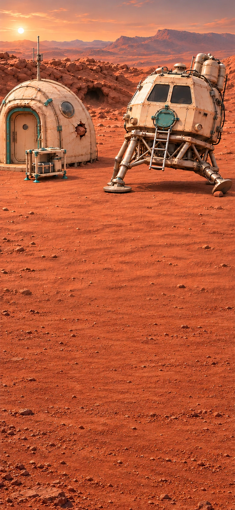

My suit is holding, and the cabin still holds air. The emergency rack is within reach, but I need stable support before I climb back aboard for the main supplies.

> NOTE: The same ascent cabin lands badly on open ground to the right and slightly in front of the rounded starter habitat. One foot catches a lone rock and its lower leg folds; there is no rubble mound under the vehicle. The engine plume throws loose debris toward the habitat, puncturing the side wall facing the landing site; the rounded damaged wall faces the landing point, while the entrance faces the viewer/left. A temporary crib takes the failed leg’s load and brings the intact cabin roughly upright. The later repair replaces that temporary support. The repair kit, tools and expendable braces are accessible from ground level. Qualified patching and ordinary lifting/cribbing are bundled; no pressure vessel or flight engine is fabricated. Material stocks represent quantities without accounting.

**Goals**
- Seal and refill the habitat -- `breathable-habitat`
- next: Make the lander safe to board -- `cribbed-landing-platform`

**Hotspots**
- `punctured-habitat-wall` (at 21.2821%, 25.5332%)
  - icon: 
- `sealed-habitat-wall` (at 21.2821%, 25.5332%)
  - icon: 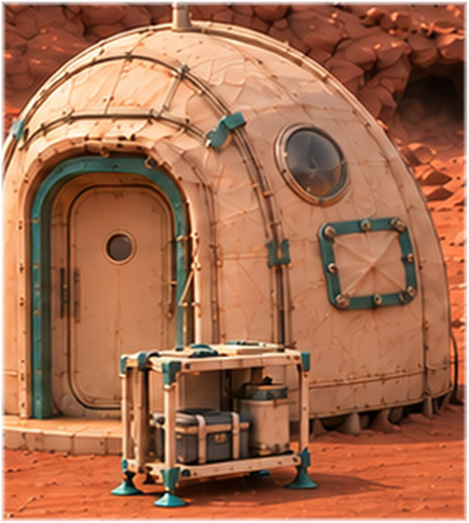
- `breathable-habitat` (at 21.2821%, 25.5332%)
  - icon: 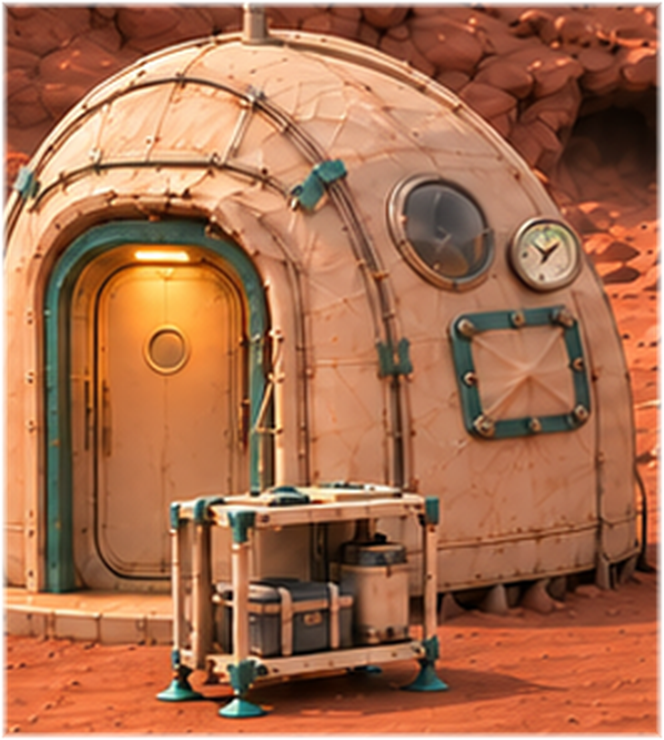
- `unstable-landing-support` (at 71.7308%, 24.0225%)
  - icon: 
- `cribbed-landing-platform` (at 71.7308%, 24.0225%)
  - icon: 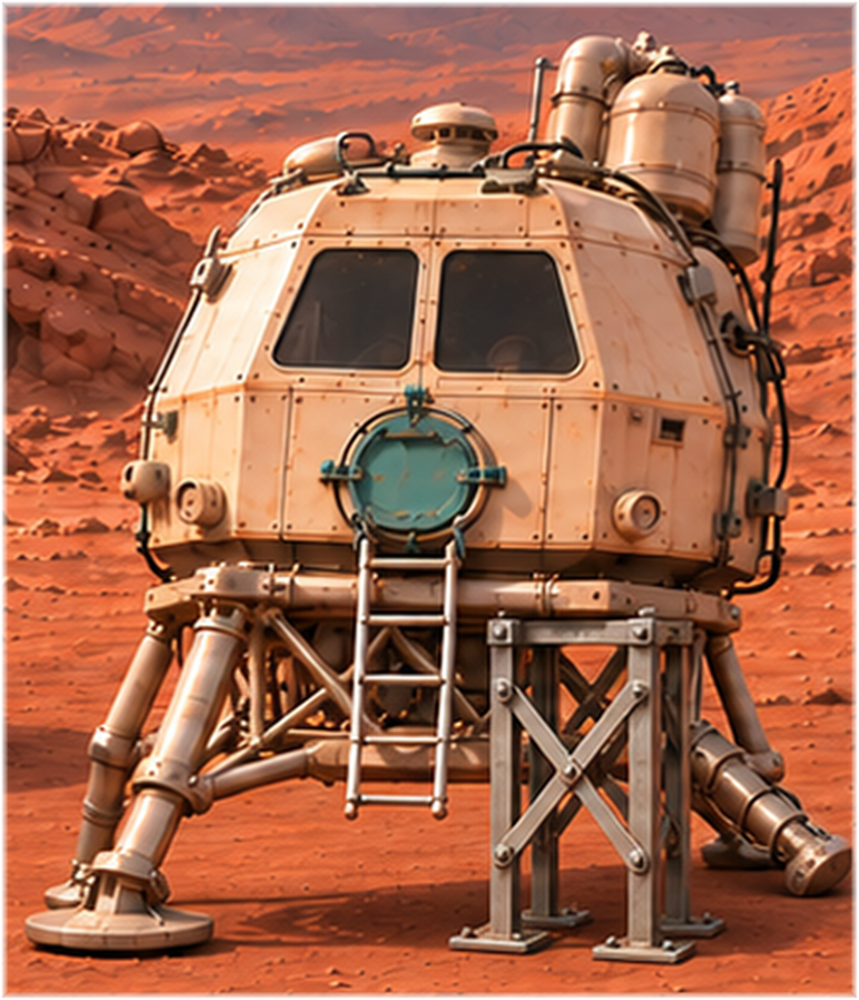

**Items**
- `breathable-habitat` Breathable habitat
  - icon: 

  The pressure holds. The heater and scrubber are on emergency power. I can take off my helmet.

- `cribbed-landing-platform` Cribbed landing platform
  - icon: 

  The crib takes the broken leg’s load. The cabin is upright again, and I can board for the main supplies. Its tanks and engine mounts are intact.

- `punctured-habitat-wall` Punctured habitat wall
  - icon: 

- `unstable-landing-support` Unstable landing support
  - icon: 

- `pressure-patch-kit` Pressure patch kit
  - icon: 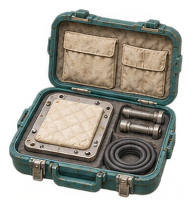

  A clamped repair rated to hold pressure across a small puncture.

- `breathing-gas-supply` Breathing-gas supply
  - icon: 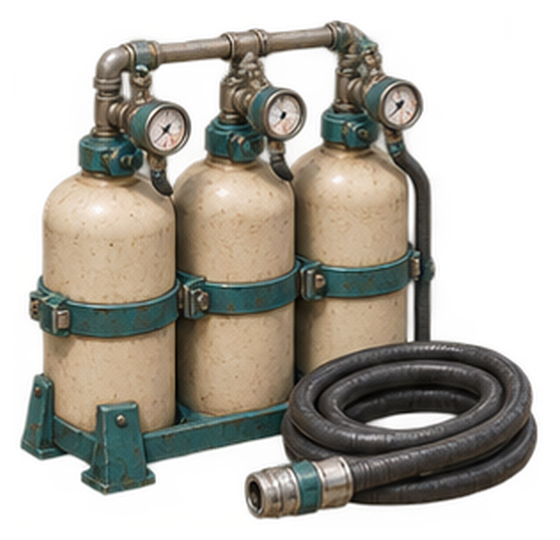

  Separate cylinders fill the habitat and farm; the farm will not drain the cabin.

- `tool-kit` Tool kit
  - icon: 

  Cutting, drilling, fastening and forming tools for steel and tubing. Kept separate from food utensils and specimen equipment.

- `shipping-braces` Shipping braces
  - icon: 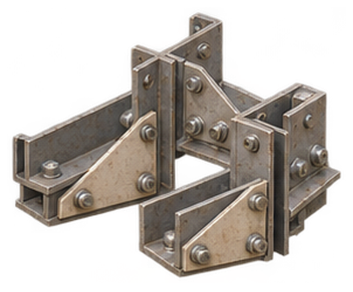

  Expendable cargo bracing, separate from the spacecraft structure.

- `sealed-habitat-wall` Sealed habitat wall
  - icon: 

  The ticking leak stops.

- `steel` Steel
  - icon: 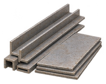

  Low-carbon steel, salvaged from the expendable shipping braces.

**Combinations**
- `pressure-patch-kit` [consume] @ `punctured-habitat-wall` [transform] -> `sealed-habitat-wall` (tutorial)
- `breathing-gas-supply` [consume] @ `sealed-habitat-wall` [transform] -> `breathable-habitat`
- `tool-kit` [preserve] + `shipping-braces` [transform] -> `steel`
- `steel` [consume] @ `unstable-landing-support` [transform] -> `cribbed-landing-platform`

## `ch02` A voice in the room

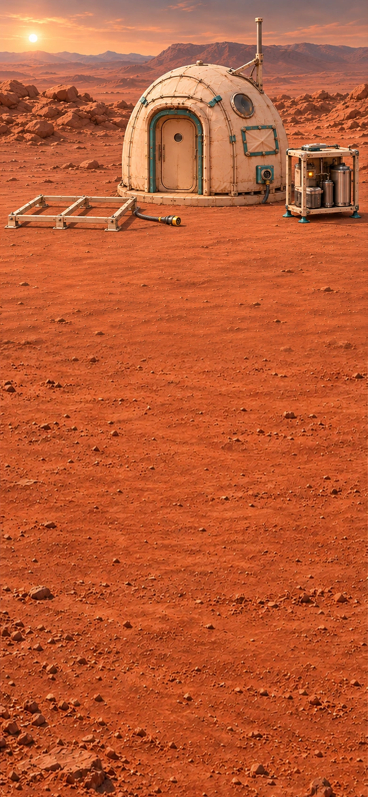

The cells survived the landing. I set the panels outside and repair the silent dish above the habitat.

> NOTE: The processor is an outdoor package with separate carbon-dioxide capture and oxygen-production branches. Its completed power lead visibly reaches the deployed array’s qualified outlet. The antenna is a dish and mount; receiver electronics remain inside the habitat. The portable battery is a removable module of the delivered battery/fuel-cell reserve, installed later. The main array supports the farm and baseline life support; later modules support industry. No live Earth reply directs the opening emergency.

**Goals**
- Charge the reserve battery -- `charged-reserve-battery`
- next: Start the outdoor air processor -- `working-atmospheric-processor`
- next: Hear from Earth -- `mounted-antenna`

**Hotspots**
- (three hotspots are a lot but okay here because the outdoor array, processor and dish each have a separate commissioning task)
- `station-power` (at 38.0128%, 24.7334%)
  - icon: 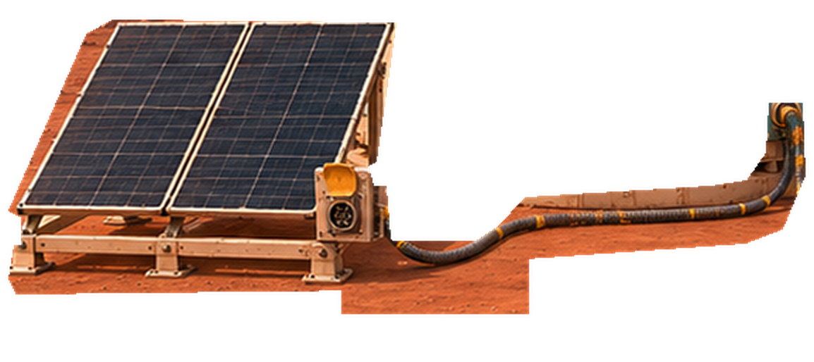
- `atmospheric-processor` (at 85%, 23.3116%)
  - icon: 
- `working-atmospheric-processor` (at 85%, 23.3116%)
  - icon: 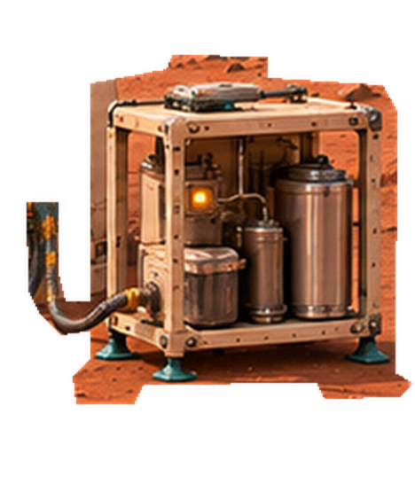
- `radio-mount` (at 73.9744%, 8.20498%)
  - icon: 
- `mounted-antenna` (at 73.9744%, 8.20498%)
  - icon: 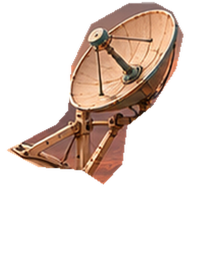

**Items**
- `working-atmospheric-processor` Working atmospheric processor
  - icon: 

  Heat and electricity split captured carbon dioxide. Clean oxygen feeds the breathing reserve; waste carbon monoxide vents outside. Stored gas got me inside. This machine can replenish its oxygen.

- `radio-mount` Radio mount
  - icon: 

- `delivered-solar-array` Delivered solar array
  - icon: 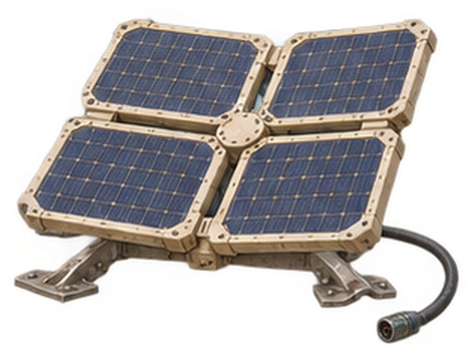

  The main array was sized for the farm, cabin and materials equipment. Its cells survived the landing.

- `power-cable` Power cable
  - icon: 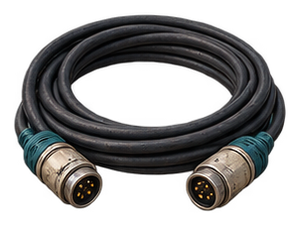

  Qualified outdoor cable with the mission equipment's matching connectors.

- `atmospheric-processor` Atmospheric processor
  - icon: 

  One unit captures carbon dioxide and makes oxygen. A separate takeoff draws captured gas before it reaches the oxygen cell.

- `bent-antenna` Bent antenna
  - icon: 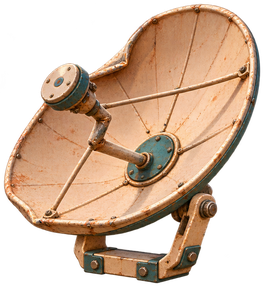

  The cable survived; the bent support prevents aiming the dish.

- `station-power` Station solar array
  - icon: 
  - from chapter `ch29`: Dust-coated solar supply
  - from chapter `ch29` icon: 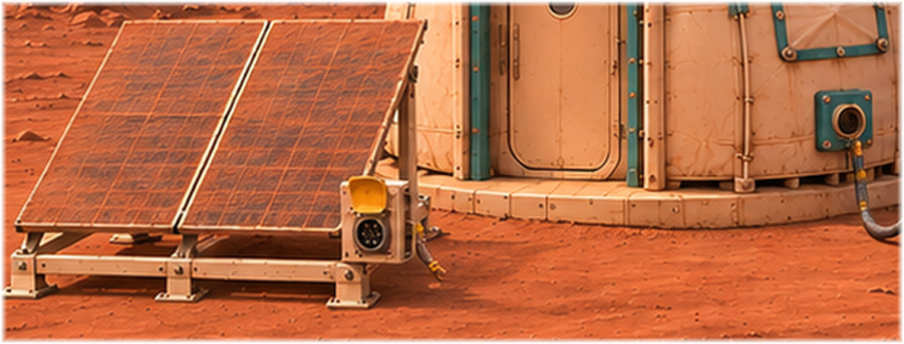

  I bring the rack online. Inside the habitat, the charge light comes on.

- `straightened-antenna` Straightened antenna
  - icon: 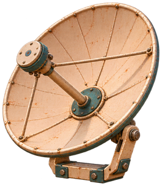

- `reserve-battery` Reserve battery
  - icon: 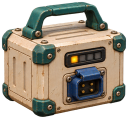

  A removable module from the station’s battery and fuel-cell reserve.

- `charged-reserve-battery` Charged reserve battery
  - icon: 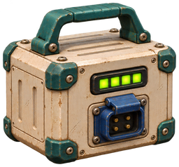

  Charged and ready for its reserve bay. The complete station reserve, not this module alone, carries the essential loads.

- `solar-power-lead` Solar power lead
  - icon: 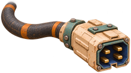

  One end is connected to the array. This plug supplies the outdoor processor.

- `mounted-antenna` Mounted antenna
  - icon: 

  “Mara here, surface support. We saw the touchdown trace. That was much closer to the habitat than planned.” It is a recorded message. I send the steady air reading. “I'm inside. I'm all right.”

**Combinations**
- `steel` [consume] + `delivered-solar-array` [consume] -> `station-power`
- `reserve-battery` [transform] @ `station-power` [preserve] -> `charged-reserve-battery`
- `power-cable` [consume] @ `station-power` [preserve] -> `solar-power-lead`
- `solar-power-lead` [consume] @ `atmospheric-processor` [transform] -> `working-atmospheric-processor`
- `tool-kit` [preserve] + `bent-antenna` [transform] -> `straightened-antenna`
- `straightened-antenna` [consume] @ `radio-mount` [transform] -> `mounted-antenna`

## `ch03` Water under the plain

*Mara, Earth — recorded message:*

“The supply ship carries your normal ascent propellant. Stored meals cover commissioning and interruptions; the growing room is meant to supply a substantial share of your food. Establish the well and treatment line first.”

> NOTE: Installing the head retires the bare bore. The well survives when hose is laid to the existing processor; the resulting pipe has its own authored route. Insulation replaces that pipe along the same route. Supplied trace heating and controls remain part of the well service equipment. Later Drinking water supply is a working view of this same Water processor identity, commissioned by these goals, not a second tank or an orphan result.

**Goals**
- Bring water through treatment -- `connected-well-line`
- next: Protect the exterior run -- `insulated-water-line`

**Hotspots**
- (three hotspots are a lot but okay here because the well, treatment inlet and connecting pipe occupy distinct places on one route)
- `surveyed-ice-bore` (at 23.0128%, 26.2737%)
  - icon: 
- `sealed-melt-well` (at 23.0128%, 26.2737%)
  - icon: 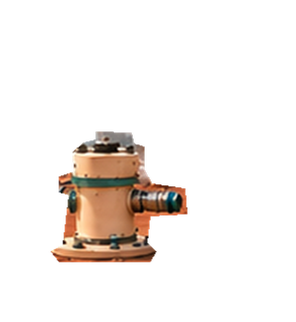
- `water-processor` (at 78.9744%, 25.3258%)
  - icon: 
- `connected-well-line` (at 48.5256%, 30.1244%)
  - icon: 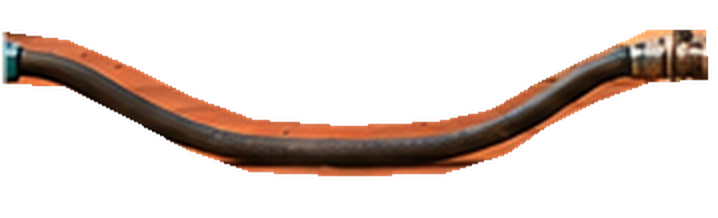
- `insulated-water-line` (at 48.5256%, 30.1244%)
  - icon: 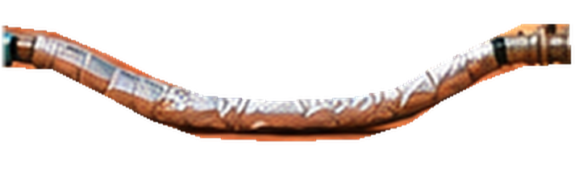

**Items**
- `insulated-water-line` Insulated water line
  - icon: 

  Insulation slows heat loss. The powered tracing still supplies the heat.

- `surveyed-ice-bore` Surveyed ice bore
  - icon: 

- `water-processor` Water processor
  - icon: 
  - from chapter `ch04`: Drinking water supply

- `heated-extraction-head` Heated extraction head
  - icon: 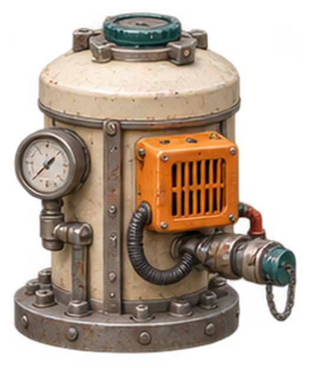

  The sealed drilling and melt-water unit controls pressure underground and pumps the recovered liquid. Its service run has powered trace heating.

- `clean-service-hose` Clean service hose
  - icon: 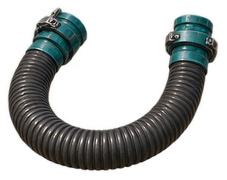

  Clean liquid-water hose. Never used for hot gas or propellants.

- `packing-foil` Packing foil
  - icon: 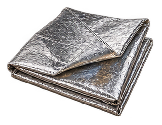

  Reflective cargo laminate redirects heat or light; it cannot create either.

- `insulation-felt` Insulation felt
  - icon: 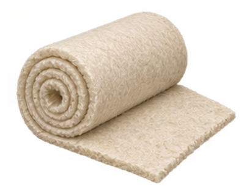

  Keep its loose fibres outside food, roots and sample containment.

- `sealed-melt-well` Sealed melt well
  - icon: 

  Beneath the sealed cover, the heater opens a liquid pocket. Cloudy water rises through the closed system.

- `connected-well-line` Connected well line
  - icon: 

  Water reaches the habitat’s treatment inlet. The exposed run still needs insulation.

- `reflective-insulation` Reflective insulation
  - icon: 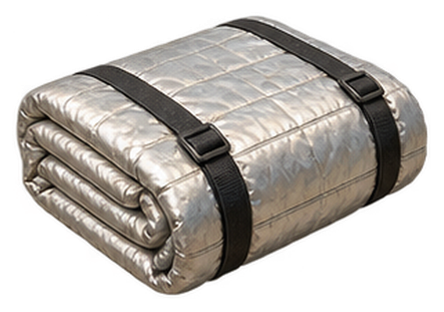

**Combinations**
- `heated-extraction-head` [consume] @ `surveyed-ice-bore` [transform] -> `sealed-melt-well`
- `clean-service-hose` [consume] @ `sealed-melt-well` [preserve] -> `connected-well-line`
- `packing-foil` [consume] + `insulation-felt` [consume] -> `reflective-insulation`
- `reflective-insulation` [consume] @ `connected-well-line` [transform] -> `insulated-water-line`

## `ch04` The work of a hundred shovels

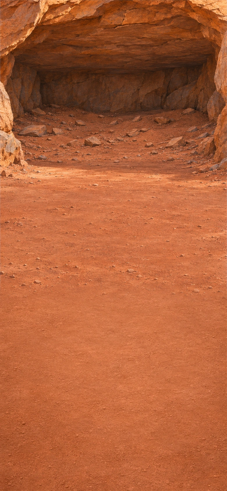

The surveyed cave is a short walk from the habitat. Clearing its loose infill is work for the excavator.

> NOTE: The cave and nearby layered ice are a favorable invented site inspected by precursor robots. This machine moves loose infill and grades ground; no improvised unsupported tunnelling. Excavated regolith later denotes selected material from its actual spoil pile. The chassis's charging connection is part of the assembled machine. The hopper can be fitted before or after the lead is connected; the drum stays stopped during fabrication. Both preparations precede the startup test and digging.

**Goals**
- Put the excavator to work -- `working-survey-excavator`
- next: Clear the surveyed growing bay -- `cleared-cavern-bay`

**Hotspots**
- `surveyed-cavern-floor` (at 50.5128%, 29.6209%)
  - icon: 
- `cleared-cavern-bay` (at 50.5128%, 29.6209%)
  - icon: 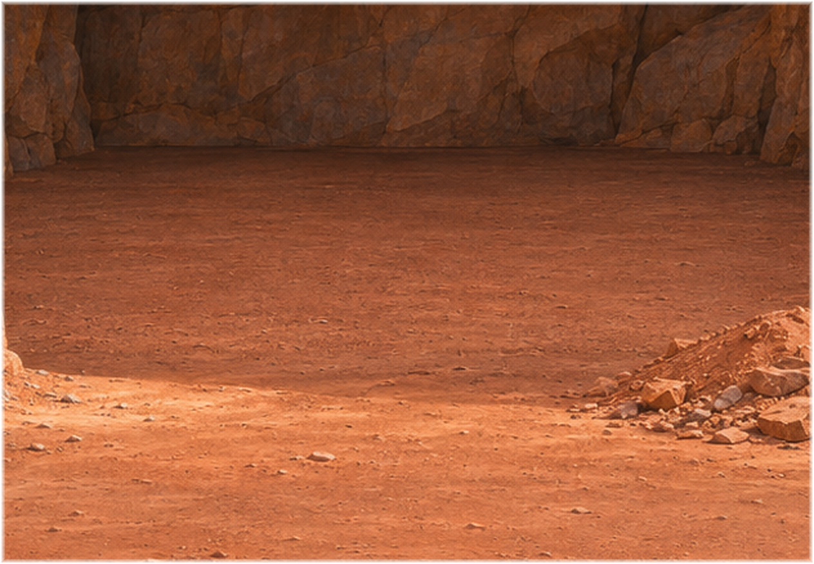

**Items**
- `working-survey-excavator` Working survey excavator
  - icon: 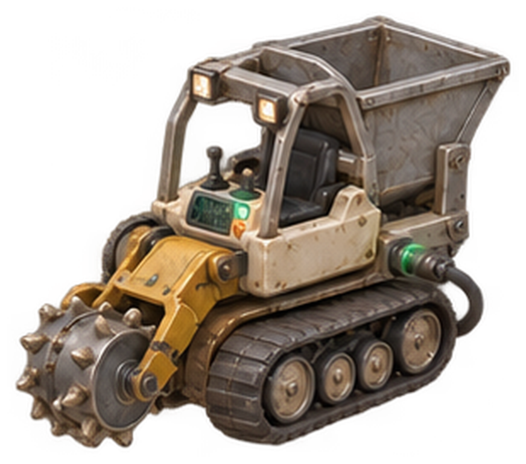

  The unloaded test passes: drum, tracks and hopper are ready for the surveyed floor.

- `cleared-cavern-bay` Cleared cavern bay
  - icon: 
  - from chapter `ch06`: Cleared growing bay

  There is shelter here, but no air I can breathe.

- `surveyed-cavern-floor` Surveyed cavern floor
  - icon: 

- `survey-excavator-without-a-hopper` Survey excavator without a hopper
  - icon: 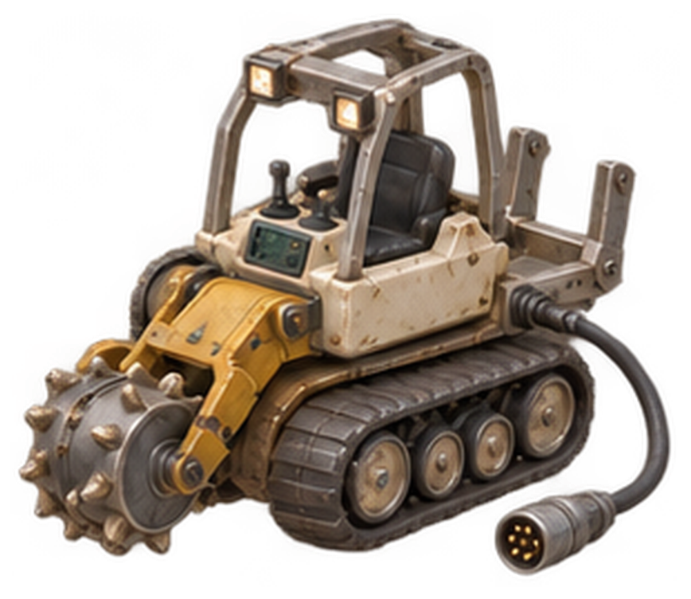

  A delivered machine for loose infill, with motors, controls and tested load limits. It cannot tunnel through solid rock.

- `excavator-with-spoil-hopper` Excavator with spoil hopper (exclusive with `powered-excavator-without-a-hopper`)
  - icon: 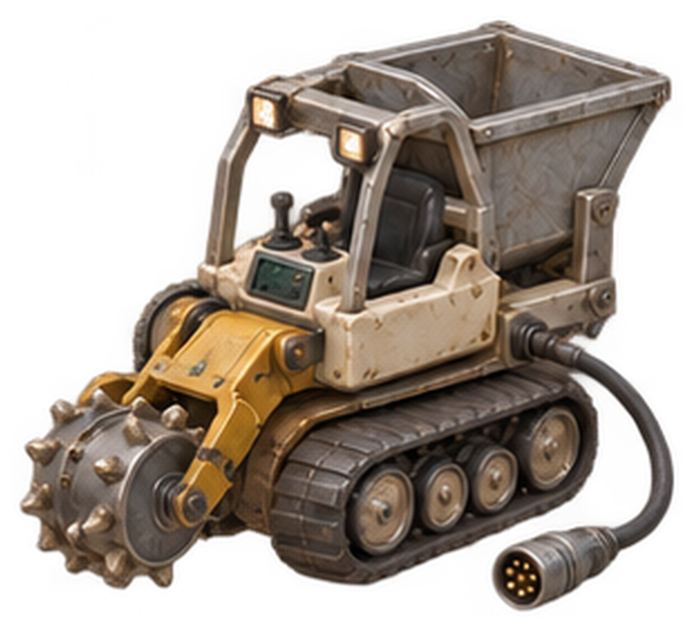

- `powered-excavator-without-a-hopper` Powered excavator without a hopper (exclusive with `excavator-with-spoil-hopper`)
  - icon: 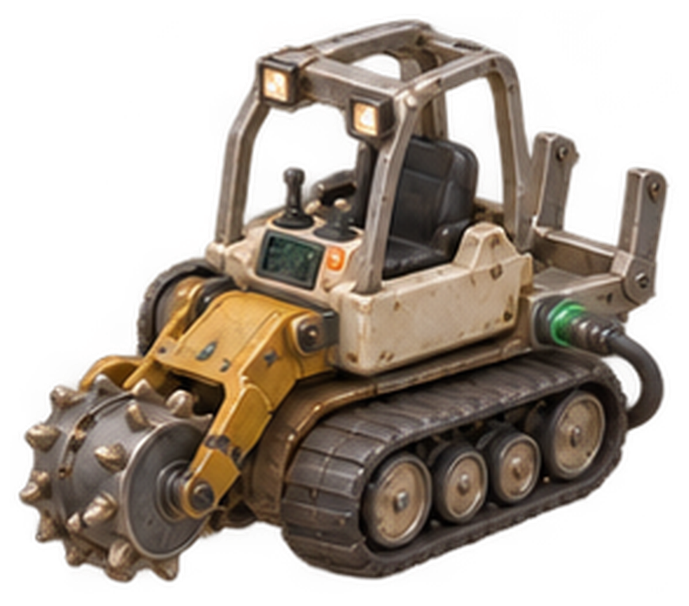

  The drum stays stopped while I work on the hopper mounts.

**Combinations**
- `steel` [consume] + `survey-excavator-without-a-hopper` [transform] -> `excavator-with-spoil-hopper`
- `power-cable` [consume] + `excavator-with-spoil-hopper` [transform] -> `working-survey-excavator`
- `power-cable` [consume] + `survey-excavator-without-a-hopper` [transform] -> `powered-excavator-without-a-hopper`
- `steel` [consume] + `powered-excavator-without-a-hopper` [transform] -> `working-survey-excavator`
- `working-survey-excavator` [preserve] @ `surveyed-cavern-floor` [transform] -> `cleared-cavern-bay`

## `ch05` A furnace in the sunlight

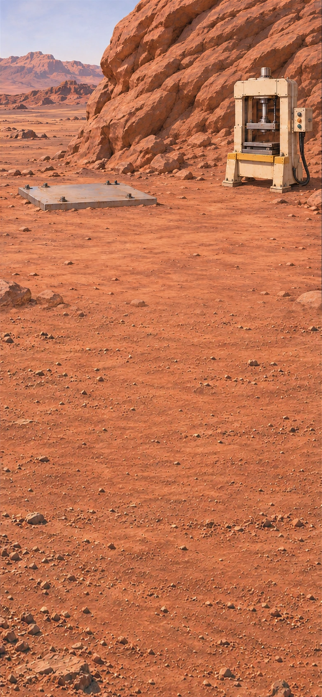

The mission came to test what this ground could become. The excavator has brought the first material to the press.

> NOTE: The cells, optical surfaces, controls and refractory receiver are imported. Steel supply their mounting structure. Surveyed feedstock performance and the compact machinery's material cycles are declared future capabilities, not demonstrations that arbitrary Martian dust is suitable. The furnace becomes Solar heating bay in later chapters. The delivered outdoor-rated press and solar furnace stand on individual supports on Martian soil. No workshop, roof, tent, shelves or finished work building is supplied or constructed.

**Goals**
- Build the solar furnace -- `assembled-solar-furnace`
- Prepare a formed feedstock -- `unfired-regolith-blanks`

**Hotspots**
- `workshop-press` (at 82.5%, 20.7938%)
  - icon: 
- `supported-reflector` (at 32.5%, 22.186%)
  - icon: 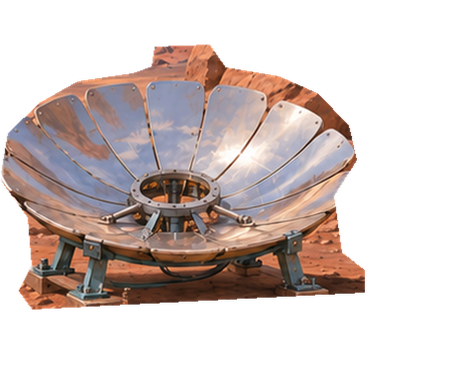
- `assembled-solar-furnace` (at 32.5%, 22.186%)
  - icon: 

**Items**
- `assembled-solar-furnace` Assembled solar furnace
  - icon: 
  - from chapter `ch06`: Solar heating bay
  - from chapter `ch32`: Solar cooking connection

  The temperature rises. The red ground has supplied no fuel for this heat; the Sun has.

- `unfired-regolith-blanks` Unfired regolith blanks
  - icon: 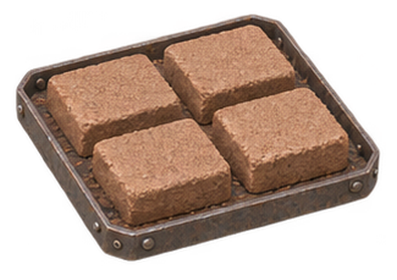

  Pressing gives shape, not finished strength. These weak blanks stay on their carriers until firing bonds the grains.

- `workshop-press` Materials press
  - icon: 

- `reflector-petals` Reflector petals
  - icon: 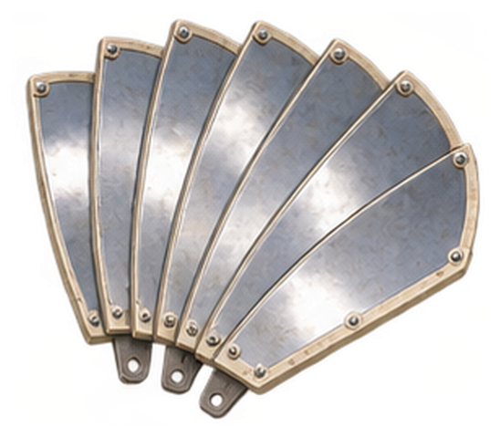

  Factory-made optical surfaces focus sunlight on the receiver.

- `furnace-receiver` Furnace receiver
  - icon: 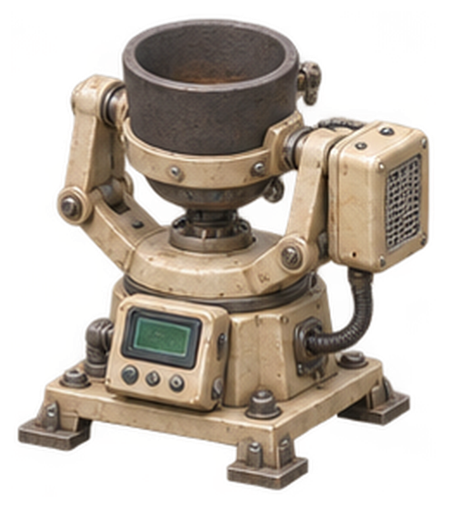

  The factory core includes tracking and temperature control. It accepts the retort and has a separate conductive heating connection.

- `fine-screening-mesh` Fine screening mesh
  - icon: 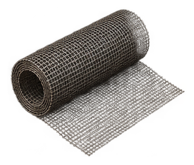

  Finer than the structural cargo mesh.

- `excavated-regolith` Excavated regolith
  - icon: 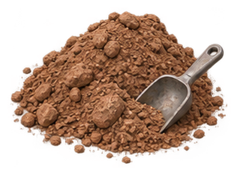

  Selected batches from the spoil pile, matched to the precursor mineral survey.

- `supported-reflector` Supported reflector
  - icon: 

- `regolith-sieve` Regolith sieve
  - icon: 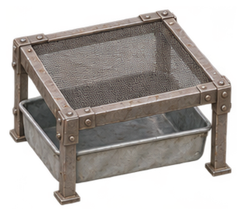

- `screened-regolith` Screened regolith
  - icon: 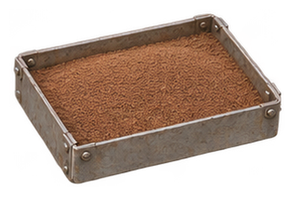

  Even grain sizes give the press a consistent feedstock.

**Combinations**
- `steel` [consume] + `reflector-petals` [consume] -> `supported-reflector`
- `furnace-receiver` [consume] @ `supported-reflector` [transform] -> `assembled-solar-furnace`
- `fine-screening-mesh` [consume] + `steel` [consume] -> `regolith-sieve`
- `excavated-regolith` [consume] + `regolith-sieve` [preserve] -> `screened-regolith`
- `screened-regolith` [consume] @ `workshop-press` [preserve] -> `unfired-regolith-blanks`

## `ch06` Air inside the hill

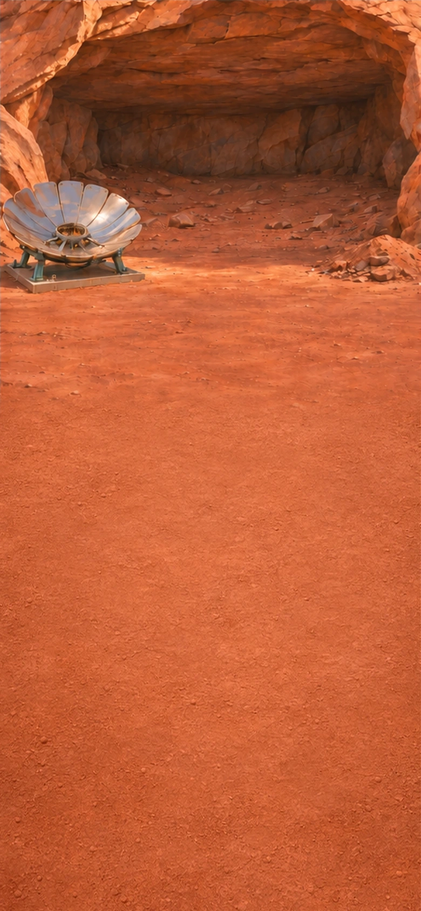

The rock will shield thirty square metres of farm. The air must come with us.

> NOTE: The imported enclosure contains its attached airlock, pressure-rated service spine, air handling and heater; these are one real deployable assembly. Initial filling uses separate cylinders from the delivered breathing-gas bank. The supporting floor, padding and farm are locally constructed. The supplied furnace carriers support pressed powder blanks until the site-specific firing process makes non-pressure ceramic blocks. Their useful performance remains an explicit material assumption.

**Goals**
- Give the liner a safe floor -- `protected-cavern-floor`
- next: Make an inhabited, illuminated room -- `lit-growing-room`

**Hotspots**
- `assembled-solar-furnace` (at 18.2692%, 26.1256%)
  - icon: 
- `cleared-cavern-bay` (at 50%, 17.7725%)
  - icon: 
- `unpadded-cavern-floor` (at 50%, 17.7725%)
  - icon: 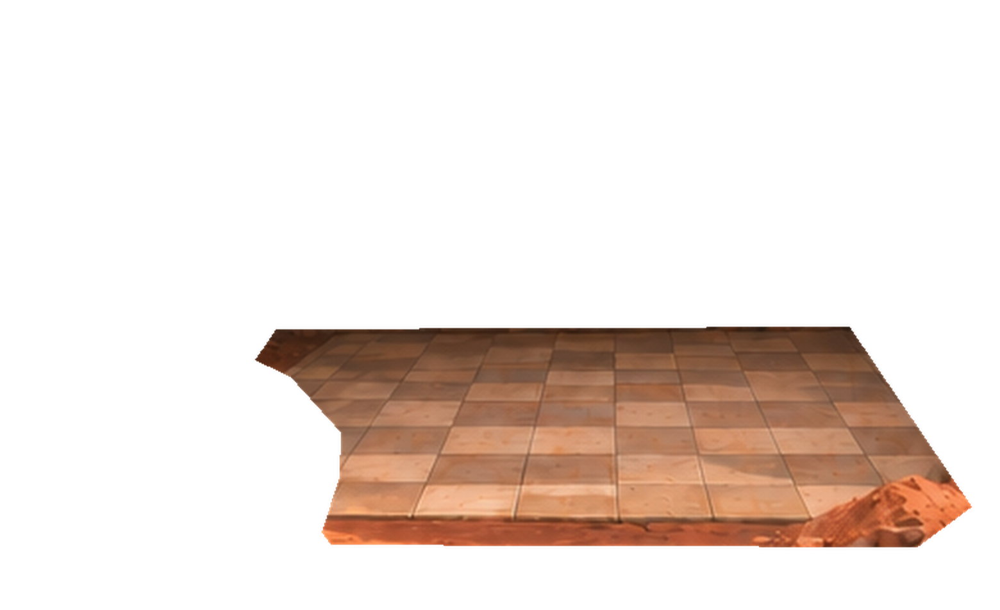
- `protected-cavern-floor` (at 50%, 17.7725%)
  - icon: 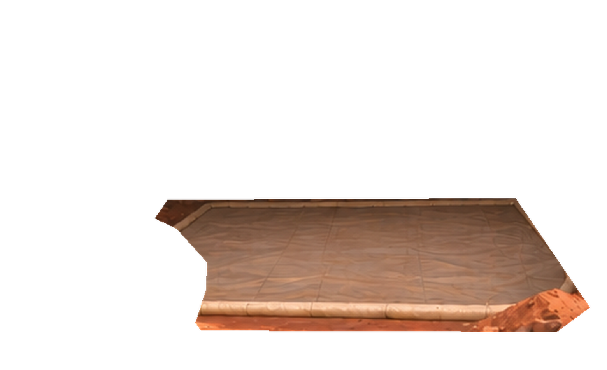
- `sealed-growing-room` (at 50%, 17.7725%)
  - icon: 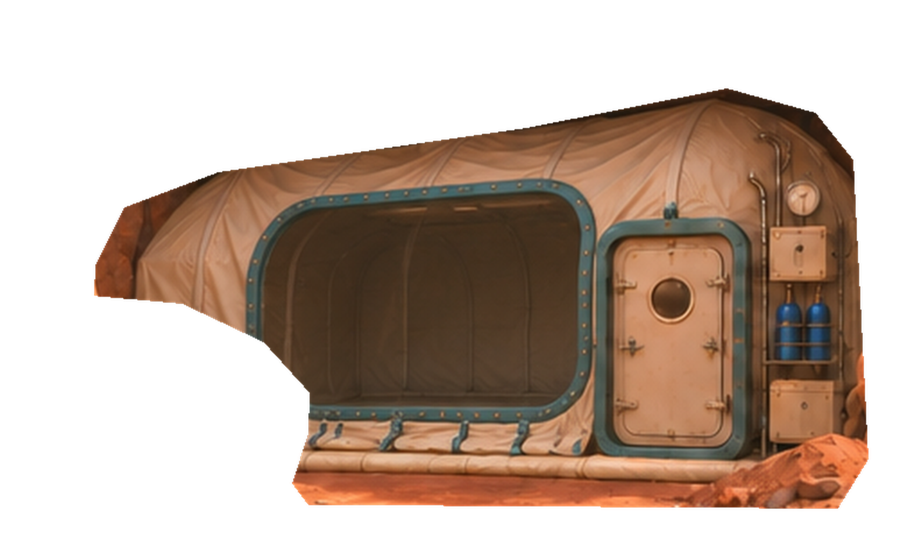
- `pressurized-growing-room` (at 50%, 17.7725%)
  - icon: 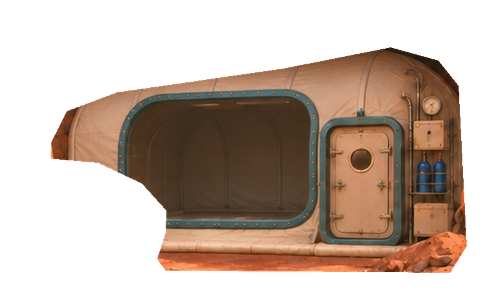
- `lit-growing-room` (at 50%, 17.7725%)
  - icon: 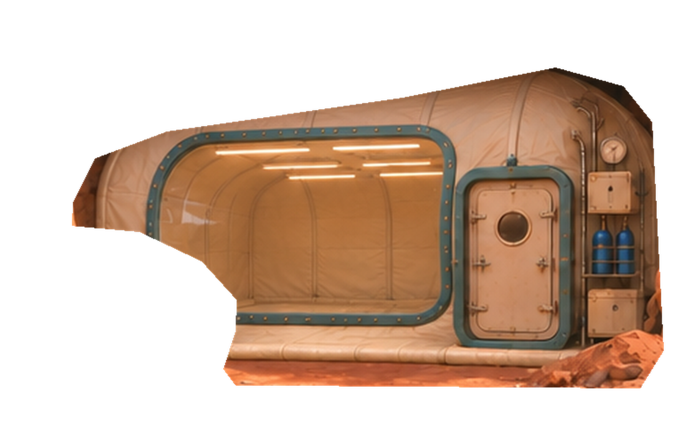

**Items**
- `protected-cavern-floor` Protected cavern floor
  - icon: 

- `lit-growing-room` Lit growing room
  - icon: 

  Air circulates, the heater starts, and the lamp drivers come online. The original array was sized for this load.

- `clean-cover-fabric` Clean cover fabric
  - icon: 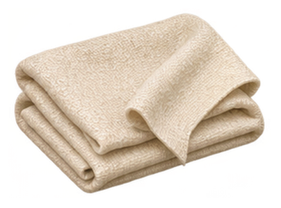

  Fresh pieces serve each job. Food cloth never returns from industrial work.

- `folded-pressure-envelope` Folded pressure envelope
  - icon: 

  An imported pressure boundary with its own airlock, air handling and heater. The floor, beds and services must be built here.

- `grow-light-rails` Grow-light rails
  - icon: 

  The original array was sized for these lamps. No sunlight reaches the beds through the rock.

- `ceramic-blocks` Ceramic blocks
  - icon: 

  The checked fired batch can make paving and supports. It will never have to hold an atmosphere.

- `unpadded-cavern-floor` Unpadded cavern floor
  - icon: 

  The level floor carries the load. Its hard edges still need padding beneath the pressure skin.

- `padded-underlay` Padded underlay
  - icon: 

- `sealed-growing-room` Sealed growing room
  - icon: 

  Imported seals hold the air; local blocks carry the weight.

- `pressurized-growing-room` Pressurized growing room
  - icon: 

  The leak check holds. I step through the airlock into a room broad enough to walk across.

- `assembled-solar-furnace`
- `cleared-cavern-bay`

**Combinations**
- `unfired-regolith-blanks` [consume] @ `assembled-solar-furnace` [preserve] -> `ceramic-blocks`
- `ceramic-blocks` [consume] @ `cleared-cavern-bay` [transform] -> `unpadded-cavern-floor`
- `insulation-felt` [consume] + `clean-cover-fabric` [consume] -> `padded-underlay`
- `padded-underlay` [consume] @ `unpadded-cavern-floor` [transform] -> `protected-cavern-floor`
- `folded-pressure-envelope` [consume] @ `protected-cavern-floor` [transform] -> `sealed-growing-room`
- `breathing-gas-supply` [consume] @ `sealed-growing-room` [transform] -> `pressurized-growing-room`
- `grow-light-rails` [consume] @ `pressurized-growing-room` [transform] -> `lit-growing-room`

## `ch07` A bed under the hill

I can sleep beneath the rock. The laboratory can stay in the repaired starter habitat.

> NOTE: The same starter-habitat mattress moves into a dry occupied alcove of the already pressurized and heated cave enclosure. The alcove has normal ventilation and separation from the future wet growing area. The berth uses the earlier steel, insulation and ordinary joining tools; it does not depend on the later process-heat installation. Mattress-first and insulation-first assembly are equally valid: the open raised frame lets insulation be fitted beneath the deck afterward. The two intermediate states are exclusive routes to the same berth.

**Goals**
- Make a sheltered berth -- `cave-berth`

**Hotspots**
- `insulated-berth-frame` (at 40.9615%, 29.1173%)
  - icon: 
- `uninsulated-berth` (at 40.9615%, 29.1173%)
  - icon: 
- `cave-berth` (at 40.9615%, 29.1173%)
  - icon: 

**Items**
- `cave-berth` Cave berth
  - icon: 

  Warm air reaches the alcove. I put my boots underneath and stretch out; beyond the partition, the lamps shine on an empty floor.

- `cabin-mattress` Cabin mattress
  - icon: 

  A thin inflatable sleeping pad from the lander, folded for stowage.

- `insulated-berth-frame` Insulated berth frame (exclusive with `uninsulated-berth`)
  - icon: 

- `uninsulated-berth` Uninsulated berth (exclusive with `insulated-berth-frame`)
  - icon: 

**Combinations**
- `steel` [consume] + `reflective-insulation` [consume] -> `insulated-berth-frame`
- `cabin-mattress` [consume] @ `insulated-berth-frame` [transform] -> `cave-berth`
- `steel` [consume] + `cabin-mattress` [consume] -> `uninsulated-berth`
- `reflective-insulation` [consume] @ `uninsulated-berth` [transform] -> `cave-berth`

## `ch08` One room for roots

Potatoes and soybeans for substantial meals; a smaller tray of lettuce for something fresh. All three will share one water circuit.

> NOTE: Growing-room floor is the actual protected floor inside the pressure enclosure. All three beds are made together and share one reservoir, dosing pump and aerated return. After lining, the reservoir can be mounted before or after the bed drain hoses are fitted. The same hose lengths complete the return; positioning their outlet above the reservoir waterline provides aeration without a second hose-preparation puzzle. Liners are generic sheet fitted to these structures; ordinary fittings and joining tools are included with their real assemblies. The existing dehumidifier sends condensate through the station processor, not directly onto the roots.

**Goals**
- Line the shared bed structure -- `beds-with-unconnected-drains`
- next: Return water through an aerated reservoir -- `empty-growing-beds`

**Hotspots**
- `growing-room-floor` (at 50%, 30.7168%)
  - icon: 
- `raised-bed-frames` (at 50%, 30.7168%)
  - icon: 
- `beds-with-unconnected-drains` (at 50%, 30.7168%)
  - icon: 
- `beds-with-loose-drain-hoses` (at 50%, 30.7168%)
  - icon: 
- `beds-with-unconnected-reservoir` (at 50%, 30.7168%)
  - icon: 
- `empty-growing-beds` (at 50%, 30.7168%)
  - icon: 

**Items**
- `beds-with-unconnected-drains` Beds with unconnected drains
  - icon: 

  The frames carry the load; the liner holds the solution.

- `empty-growing-beds` Empty growing beds
  - icon: 

  Returning water falls through air, mixing in oxygen before the pump sends it back to the roots. Each zone keeps its own depth and flow adjustment.

- `growing-room-floor` Growing-room floor
  - icon: 

- `food-safe-liner-sheet` Food-safe liner sheet
  - icon: 

  Food-compatible waterproof sheet from the growing supplies.

- `reservoir-and-irrigation-pump` Reservoir and irrigation pump
  - icon: 

  One circulation and dosing system serves the three growing zones, with a low-power backup.

- `raised-bed-frames` Raised bed frames
  - icon: 

- `beds-with-loose-drain-hoses` Beds with loose drain hoses (exclusive with `beds-with-unconnected-reservoir`)
  - icon: 

- `beds-with-unconnected-reservoir` Beds with unconnected reservoir (exclusive with `beds-with-loose-drain-hoses`)
  - icon: 

**Combinations**
- `steel` [consume] @ `growing-room-floor` [transform] -> `raised-bed-frames`
- `food-safe-liner-sheet` [consume] @ `raised-bed-frames` [transform] -> `beds-with-unconnected-drains`
- `clean-service-hose` [consume] @ `beds-with-unconnected-drains` [transform] -> `beds-with-loose-drain-hoses`
- `reservoir-and-irrigation-pump` [consume] @ `beds-with-loose-drain-hoses` [transform] -> `empty-growing-beds`
- `reservoir-and-irrigation-pump` [consume] @ `beds-with-unconnected-drains` [transform] -> `beds-with-unconnected-reservoir`
- `clean-service-hose` [consume] @ `beds-with-unconnected-reservoir` [transform] -> `empty-growing-beds`

## `ch09` What roots need

Roots need air as well as water. Local ceramic can leave space for both.

> NOTE: The fixed beds are the structure built in chapter 8. The hose supplies their existing reservoir from the fresh-water inlet; it does not replace the aerated return or add a pump. Supply connection and medium filling may happen in either order. The wash bench qualifies the fictional surveyed ceramic batch; untreated regolith is not suitable soil by default. Mineral nutrients and crop-compatible conditions belong to the delivered growing system. The thirty-square-metre farm supplies a dietary share, not complete nutritional independence.

**Goals**
- Fill the beds with clean porous medium -- `prepared-growing-beds`
- next: Feed the shared water loop -- `irrigation-supply-line`

**Hotspots**
- (three hotspots are a lot but okay here because the existing water inlet supplies a separately fixed pipe beside the growing beds)
- `water-processor` (at 8.01282%, 23.1043%)
  - icon: 
- `empty-growing-beds` (at 50%, 31.4277%)
  - icon: 
- `prepared-growing-beds` (at 50%, 31.4277%)
  - icon: 
- `irrigation-supply-line` (at 19.8077%, 27.9621%)
  - icon: 

**Items**
- `growing-medium` Growing medium
  - icon: 

  I wash dust and sharp fines from the broken ceramic. The leach check passes for this surveyed material. Gaps between the granules give roots both drainage and air.

- `prepared-growing-beds` Prepared growing beds
  - icon: 

- `irrigation-supply-line` Irrigation supply line
  - icon: 

  Fresh water feeds the existing reservoir. Its pump circulates solution through the three growing zones.

**Combinations**
- `ceramic-blocks` [consume] @ `water-processor` [preserve] -> `growing-medium`
- `growing-medium` [consume] @ `empty-growing-beds` [transform] -> `prepared-growing-beds`
- `clean-service-hose` [consume] @ `water-processor` [preserve] -> `irrigation-supply-line`

## `ch10` Potatoes, soybeans, lettuce

Keep the developing potatoes dark and the leaves in the light. The shallow lettuce shelf needs a wick to reach its water.

> NOTE: The three targets are existing zones of the completed chapter 9 beds. Each preparation or planting replaces only its own zone; the shared frame, reservoir and neighboring zones remain. Roots stay dark and leaves stay in the lamp light. The lettuce inlet lies below its shelf, so the supplied fabric draws water upward without another pump.

**Goals**
- (three goals are a lot but okay here because each established crop zone has its own planting task)
- Plant the potatoes -- `potato-bed`
- Plant the soybeans -- `soybean-row`
- Plant the early leaves -- `lettuce-tray`

**Hotspots**
- (three hotspots are a lot but okay here because the potato, soybean and lettuce zones each have their own planting task)
- `potato-growing-bay` (at 16.7308%, 29.8282%)
  - icon: 
- `dark-potato-bay` (at 16.7308%, 29.8282%)
  - icon: 
- `potato-bed` (at 16.7308%, 29.8282%)
  - icon: 
- `soybean-growing-row` (at 50.2564%, 24.9408%)
  - icon: 
- `soybean-row` (at 50.2564%, 24.9408%)
  - icon: 
- `dry-lettuce-shelf` (at 85.5128%, 30.0356%)
  - icon: 
- `wicking-lettuce-bed` (at 85.5128%, 30.0356%)
  - icon: 
- `lettuce-tray` (at 85.5128%, 30.0356%)
  - icon: 

**Items**
- `potato-bed` Planted potato bed
  - icon: 
  - from chapter `ch12`: Low-sided potato bed
  - from chapter `ch12` icon: 

  The seed pieces go below the medium. Leaves need the lamps; developing tubers stay buried.

- `soybean-row` Sown soybean row
  - icon: 
  - from chapter `ch12`: Unsupported soybean row
  - from chapter `ch12` icon: 

  The harvest will hang above the medium, inside pods.

- `lettuce-tray` Sown lettuce tray
  - icon: 
  - from chapter `ch11`: Lettuce tray ready to pick
  - from chapter `ch11` icon: 

- `seed-potatoes` Seed potatoes
  - icon: 

  Certified sprouting tubers, with room for new potatoes beneath the foliage.

- `soybean-seeds` Soybean seeds
  - icon: 

  A compact cultivar suited to this room. The nutrient solution supplies its nitrogen.

- `lettuce-seeds` Lettuce seeds
  - icon: 

  A quick fresh-leaf crop for the shallow tray.

- `foil-backed-cloth` Foil-backed cloth
  - icon: 

  The cloth protects the laminate from tearing at its folds.

- `dark-potato-bay` Wrapped potato bed
  - icon: 

  Shoots grow in light; developing tubers stay dark.

- `wicking-lettuce-bed` Wicking lettuce bed
  - icon: 

  The fabric draws solution upward without another pump.

- `potato-growing-bay` Potato growing bay
  - icon: 

- `soybean-growing-row` Soybean growing row
  - icon: 

- `dry-lettuce-shelf` Dry lettuce shelf
  - icon: 

**Combinations**
- `packing-foil` [consume] + `clean-cover-fabric` [consume] -> `foil-backed-cloth`
- `foil-backed-cloth` [consume] @ `potato-growing-bay` [transform] -> `dark-potato-bay`
- `seed-potatoes` [consume] @ `dark-potato-bay` [transform] -> `potato-bed`
- `soybean-seeds` [consume] @ `soybean-growing-row` [transform] -> `soybean-row`
- `clean-cover-fabric` [consume] @ `dry-lettuce-shelf` [transform] -> `wicking-lettuce-bed`
- `lettuce-seeds` [consume] @ `wicking-lettuce-bed` [transform] -> `lettuce-tray`

## `ch11` The first green

Something fresh to add to the stored meals. I need a basket that won't scrape the leaves.

> NOTE: This picking and first meal take place in the dry occupied alcove beside the actual farm. The ordinary clean bowl and utensils use fresh water from the service inlet upstream of the nutrient loop. The rooted lettuce stays in its bed; the basket, picked leaves and meal move. No second kitchen or relocated crop is supplied.

**Goals**
- Make a lined basket for the harvest -- `lined-harvest-basket`
- next: Taste what the growing room can do -- `first-fresh-meal`

**Hotspots**
- `clean-preparation-sink` (at 92.5%, 22.8673%)
  - icon: 
- `lettuce-tray` (at 82.2436%, 28.4064%)
  - icon: 

**Items**
- `lined-harvest-basket` Lined harvest basket
  - icon: 

- `first-fresh-meal` First fresh meal
  - icon: 

  I wash the leaves and add them to the stored meal. A sharp green smell rises from the bowl. Beyond the airlock, the landscape has supplied no green at all.

- `clean-preparation-sink` Clean preparation basin
  - icon: 

- `cargo-mesh` Cargo mesh
  - icon: 

  Structural grid for panels and plant supports, too coarse to screen regolith.

- `fresh-lettuce-leaves` Fresh lettuce leaves
  - icon: 

  Their edges break with a crisp snap. I leave the small centre growing.

**Combinations**
- `cargo-mesh` [consume] + `clean-cover-fabric` [consume] -> `lined-harvest-basket`
- `lined-harvest-basket` [preserve] @ `lettuce-tray` [preserve] -> `fresh-lettuce-leaves`
- `fresh-lettuce-leaves` [consume] @ `clean-preparation-sink` [preserve] -> `first-fresh-meal`

## `ch12` Under the leaves

More medium will keep new potatoes out of the light. The filling soybean pods need support.

> NOTE: These are the same planted crop zones, not new beds. Additional washed medium comes from the earlier prepared material. The potato root zone is dark while its foliage remains lit. The chosen soybean cultivar and installation benefit from support; this is not a claim that all soybeans require trellises. No second round of shared substrate or irrigation preparation.

**Goals**
- Keep new tubers dark -- `hilled-potato-bed`
- Support the filling pods -- `supported-soybean-row`

**Hotspots**
- `potato-bed` (at 14.7436%, 26.8069%)
  - icon: 
- `extended-potato-bed` (at 14.7436%, 26.8069%)
  - icon: 
- `hilled-potato-bed` (at 14.7436%, 26.8069%)
  - icon: 
- `soybean-row` (at 45.4487%, 21.949%)
  - icon: 
- `supported-soybean-row` (at 45.4487%, 21.949%)
  - icon: 

**Items**
- `hilled-potato-bed` Hilled potato bed
  - icon: 

  The added medium keeps new tubers from turning green beneath the lamps.

- `supported-soybean-row` Supported soybean row
  - icon: 

- `extended-potato-bed` Extended potato bed
  - icon: 

**Combinations**
- `foil-backed-cloth` [consume] @ `potato-bed` [transform] -> `extended-potato-bed`
- `growing-medium` [consume] @ `extended-potato-bed` [transform] -> `hilled-potato-bed`
- `cargo-mesh` [consume] @ `soybean-row` [transform] -> `supported-soybean-row`

## `ch13` What the water carries

The tap coughs and stops.

> NOTE: The raw intake precedes treatment and all Earth-crop water. Its service assembly includes isolation, backflush, collection and restart controls; these ordinary operations are one complete action, not a jar magically fixing machinery. The microscope and containment are supplied laboratory equipment. The first view contains damaged ambiguous fragments, not a resolved organism. Heating, pumping and filtration have compromised their original arrangement. The later untouched core supplies the recognizable articulated outline; neither view establishes age, chemistry or native origin.

**Goals**
- Clear the intake and restore water -- `collected-intake-residue`
- next: Find out what blocked it -- `first-body-on-membrane`

**Hotspots**
- `clogged-raw-water-strainer` (at 33%, 25%)
- `laboratory-microscope` (at 78%, 25%)

**Items**
- `collected-intake-residue` Collected intake residue
  - icon: 

  I isolate and backflush the intake into a clean jar, then reseat the strainer and prime the line. Water returns to the tap. A few curled flecks hold their shape in the residue.

- `first-body-on-membrane` Patterned fragments on membrane
  - icon: 

  

  A curve repeats in two of the broken flakes. Melted, pumped, caught in a filter—nothing has come through whole. I seal the holder and send the images to Earth.

- `clogged-raw-water-strainer` Clogged raw-water strainer
  - icon: 

- `laboratory-microscope` Laboratory microscope
  - icon: 

- `laboratory-membrane` Laboratory membrane
  - icon: 

  Separates suspended particles; it does not remove dissolved salts.

- `particle-bearing-membrane` Particle-bearing membrane
  - icon: 

**Combinations**
- `clean-service-hose` [consume] @ `clogged-raw-water-strainer` [preserve] -> `collected-intake-residue`
- `laboratory-membrane` [consume] + `collected-intake-residue` [transform] -> `particle-bearing-membrane`
- `particle-bearing-membrane` [transform] @ `laboratory-microscope` [preserve] -> `first-body-on-membrane`

## `ch14` The ground we know

*Mara, NASA surface support — recorded message:*

“I've watched that record six times. Science wants ice that has never passed through the melter. First, a reference core beside your well, beyond the heated cavity. Then the exposed layers beyond the wash—we can choose protected ice there, away from the station.”

“The receiving laboratories can examine internal structure and chemistry that your microscope cannot resolve. Flight is looking at an earlier rendezvous.”

> NOTE: The stable margin is outside the resource well's disturbed volume. The source core preserves a reference to that deposit; the farther exposed face permits choosing material within visible stratigraphy away from station disturbance. Mapping predicts a broad promising deposit, not a microscopic body. These are separate physical specimens.

**Goals**
- Take an unmelted reference from the water source -- `sealed-source-core`
- next: Store it before the farther expedition -- `stored-source-core`

**Hotspots**
- `unheated-bank-margin` (at 31%, 25%)
- `laboratory-core-freezer` (at 76%, 25%)

**Items**
- `sealed-source-core` Sealed source core
  - icon: 

  Beyond the heated cavity, the brown flakes remain where the ice held them.

- `stored-source-core` Stored source core
  - icon: 
  - from chapter `ch34`: Water-source core
  - from chapter `ch34` icon: 

  This core and the membrane stay in the laboratory while I go farther from the well.

- `unheated-bank-margin` Unheated bank margin
  - icon: 

- `laboratory-core-freezer` Laboratory core freezer
  - icon: 

- `core-drill` Core drill
  - icon: 

  The clean chilled barrel takes interior ice without melting it. The liner seals before leaving the barrel.

**Combinations**
- `core-drill` [preserve] @ `unheated-bank-margin` [preserve] -> `sealed-source-core`
- `sealed-source-core` [transform] @ `laboratory-core-freezer` [preserve] -> `stored-source-core`

## `ch15` A box for the road

The farther core must come back inside its original liner. Its refrigerator needs protection for the rough crossing.

> NOTE: Steel and insulation form the outer protective enclosure around qualified precision refrigeration. The same physical case remains with the rover, then goes to the laboratory's cold enclosure. This is ordinary expedition preparation, not a sample-cooling emergency.

**Goals**
- Build and mount the refrigerated field case -- `buffered-field-case`

**Hotspots**
- `rover-cargo-mount` (at 43.0128%, 20.7938%)
  - icon: 
  - place: `buffered-field-case` (at 44%, 18.3%)

**Items**
- `buffered-field-case` Buffered field case
  - icon: 

- `rover-cargo-mount` Rover cargo mount
  - icon: 

- `field-refrigeration-insert` Field refrigeration insert
  - icon: 

  Qualified refrigeration with a shock mount and thermal buffer for transfer. Its compressor and heat-rejection face must remain exposed.

- `uninsulated-field-refrigerator` Uninsulated field refrigerator
  - icon: 

  The outer shell takes knocks; the shock mount protects the liner inside.

- `insulated-field-refrigerator` Insulated field refrigerator
  - icon: 

  The cold cradle is insulated without trapping the heat the refrigerator must reject.

**Combinations**
- `steel` [consume] + `field-refrigeration-insert` [consume] -> `uninsulated-field-refrigerator`
- `reflective-insulation` [consume] + `uninsulated-field-refrigerator` [transform] -> `insulated-field-refrigerator`
- `insulated-field-refrigerator` [transform] @ `rover-cargo-mount` [preserve] -> `buffered-field-case`

## `ch16` Across the wash

The survey's safe approach crosses this wash. The soft middle could swallow a wheel.

> NOTE: The same rover from chapter 15 starts on the near approach, carrying the actual refrigerated case. Its drag represents driving. The short panels lie lengthwise toward the distant ice and are supported by prepared ground, not suspended over a ravine. The supplied portable winch includes its own power module and padded anchor sling. Rig it at the far-bank rock; the panels do not anchor it. The final operation pays out the line, attaches it, crosses, releases and stows it. The crossing survives; only the rover changes into its distant fixed appearance. No live tether follows a drag. The return uses the same route.

**Goals**
- Make a supported crossing -- `supported-traction-panels`
- next: Take the rover across -- `rover-beyond-the-wash`

**Hotspots**
- `shallow-wash-crossing` (at 55%, 23.3412%)
  - icon: 
- `supported-traction-panels` (at 55%, 23.3412%)
  - icon: 
- `winch-ready-crossing` (at 55%, 23.3412%)
  - icon: 
- `rover-beyond-the-wash` (at 38.9744%, 10.8709%)
  - icon: 

**Items**
- `supported-traction-panels` Supported traction panels
  - icon: 

  Prepared ground supports the short panels. Their rails spread wheel loads; loose mesh alone would sink.

- `rover-beyond-the-wash` Rover beyond the wash
  - icon: 

  On the far bank I release the line. The same supported route will carry the return trip.

- `shallow-wash-crossing` Shallow wash crossing
  - icon: 

- `rover-winch` Rover winch
  - icon: 

  A portable powered recovery winch, with its matched line, padded anchor sling and integral power module.

- `framed-traction-panels` Framed traction panels
  - icon: 

- `expedition-rover` Expedition rover
  - icon:  (at 50%, 54%)

  The delivered rover, with the refrigerated field case secured on its rear deck.

- `winch-ready-crossing` Winch-ready crossing
  - icon: 

  The portable winch is secured to the far-bank rock. Its line can pull along the supported wheel tracks.

**Combinations**
- `steel` [consume] + `cargo-mesh` [consume] -> `framed-traction-panels`
- `framed-traction-panels` [consume] @ `shallow-wash-crossing` [transform] -> `supported-traction-panels`
- `rover-winch` [consume] @ `supported-traction-panels` [transform] -> `winch-ready-crossing`
- `expedition-rover` [transform] @ `winch-ready-crossing` [preserve] -> `rover-beyond-the-wash`

## `ch17` A clean face

Here I can choose ice within the layer, beyond the weathered surface. The orbital survey could never show this detail.

> NOTE: The bank is low and stable, not an overhang. The supplied corer performs its ordinary surface trimming, chilled coring and containment in one substantial operation. This remote specimen remains distinct from the known-source core and first membrane.

**Goals**
- Bring back ice from within the band -- `case-with-frozen-band-core`

**Hotspots**
- `sheltered-brown-band` (at 50%, 21.5%)

**Items**
- `case-with-frozen-band-core` Case with frozen band core
  - icon: 

  I secure the case and retrace the crossing to the laboratory. This time the brown material has kept its surroundings.

- `sheltered-brown-band` Sheltered brown band
  - icon: 

- `sealed-band-core` Sealed band core
  - icon: 

  The clean head trims the weathered face before taking ice from inside the layer.

**Combinations**
- `core-drill` [preserve] @ `sheltered-brown-band` [preserve] -> `sealed-band-core`
- `sealed-band-core` [consume] + `buffered-field-case` [transform] -> `case-with-frozen-band-core`

## `ch18` Something folded

The new core is back in the laboratory. The intake fragments gave us only hints. Here the dark fleck still has its surroundings.

> NOTE: The whole sealed core and case enter the supplied contained cold enclosure. Only an external optical face is prepared; the inclusion and surrounding layers remain intact. The future cold microscope has appropriate transmitted/reflected illumination and stage control. The articulated body is fictional and does not establish age, taxon, DNA or native origin. All sample storage remains qualified and reliable through the later storm.

**Goals**
- Make a clear view into the ice -- `windowed-core-case`
- next: Resolve the folded outline -- `case-with-an-articulated-body`

**Hotspots**
- `cold-preparation-enclosure` (at 31%, 26%)
- `cold-microscope` (at 75%, 24%)

**Items**
- `windowed-core-case` Windowed core case
  - icon: 

  Only the outer optical face is prepared. The fleck remains untouched beneath it, enclosed in its ice.

- `case-with-an-articulated-body` Case with an articulated body
  - icon: 
  - from chapter `ch34`: Remote-band core
  - from chapter `ch34` icon: 

  

  I leave the focus there for a long time. Then I send the view to Earth. Both cores settle onto laboratory cooling; the first fragments remain sealed in their membrane holder.

- `cold-preparation-enclosure` Cold preparation enclosure
  - icon: 

- `cold-microscope` Cold microscope
  - icon: 

**Combinations**
- `case-with-frozen-band-core` [transform] @ `cold-preparation-enclosure` [preserve] -> `windowed-core-case`
- `windowed-core-case` [transform] @ `cold-microscope` [preserve] -> `case-with-an-articulated-body`

## `ch19` A different use for the sunlight

*Mara, Earth — recorded message:*

“The discovery takes priority over the remaining surface survey. Flight has approved a return plan, but the normal cargo delivery cannot support it. Use the local-propellant contingency. The receiving laboratories can investigate what the surface instruments cannot.”

> NOTE: This mission demonstrates a partly self-supplying station. Its modular materials equipment and life-support spares support a reviewed local-propellant contingency, not a supplied complete fuel plant. Normal fuel follows a slower cargo schedule. The orbital transfer vehicle and approved earlier trajectory are declared mission premises; local ascent fuel does not choose interplanetary windows. The damaged ground support is stable and its repair is known. Routine installation uses the established ceramic blocks, steel and qualified cable; these do not require another sequence of empty supports. The delivered array has its own prepared mounting footing on the left. Installing modules replaces that fixed footing at the drop location. The separate equipment pad on the right is cleared for the process machinery and remains empty after the array is installed.

**Goals**
- Prepare a stable industrial site -- `fuel-fab-footing`
- next: Add power for making propellant -- `industrial-solar-supply`

**Hotspots**
- `fuel-fab-area` (at 83.718%, 27.7251%)
  - icon: 
- `fuel-fab-footing` (at 83.718%, 27.7251%)
  - icon: 
- `solar-array-footing` (at 34.4872%, 25.1777%)
  - icon: 
- `industrial-solar-supply` (at 34.4872%, 25.1777%)
  - icon: 

**Items**
- `fuel-fab-footing` Fuel-fab footing
  - icon: 

  I grade the ground and lay fired blocks beneath the equipment positions.

- `industrial-solar-supply` Industrial solar supply
  - icon: 

  The growing room keeps its allotted power. This separate circuit can work for the journey home.

- `fuel-fab-area` Fuel-fab area
  - icon: 

- `spare-solar-modules` Spare solar modules
  - icon: 

  Delivered for later materials-processing trials. Additional factory-made capacity.

- `solar-array-footing` Solar-array footing
  - icon: 

**Combinations**
- `working-survey-excavator` [preserve] @ `fuel-fab-area` [transform] -> `fuel-fab-footing`
- `spare-solar-modules` [consume] @ `solar-array-footing` [transform] -> `industrial-solar-supply`

## `ch20` Two gases from water

The spare electrolyzer was packed for water recovery and materials work. Now it can work for the journey home.

> NOTE: The stack stands at its installed position, with power and cooling connected to the industrial services prepared in chapter 19. Its water inlet alone is unconnected. The hose visibly joins the processor’s polishing outlet. The completed rack has distinct dedicated hydrogen and oxygen receivers, separators and dryers. Gas cylinders denote compatible clean vessels, never one bottle copied between incompatible duties. Commissioning is bundled; both gases come from one water-splitting process.

**Goals**
- Assemble the electrolysis installation -- `fed-electrolyzer`
- next: Collect its gases in separate circuits -- `buffered-electrolysis-rack`

**Hotspots**
- `processor-polishing-outlet` (at 16.5385%, 25.8886%)
  - icon: 
- `electrolyzer-stack` (at 61.4744%, 26.1256%)
  - icon: 
- `unfed-electrolysis-rack` (at 61.4744%, 26.1256%)
  - icon: 
- `fed-electrolyzer` (at 61.4744%, 26.1256%)
  - icon: 
- `buffered-electrolysis-rack` (at 61.4744%, 26.1256%)
  - icon: 

**Items**
- `fed-electrolyzer` Fed electrolyzer
  - icon: 

  Feed polishing, power and cooling are connected. The gas outlets remain separate.

- `buffered-electrolysis-rack` Buffered electrolysis rack
  - icon: 

  Water splits into hydrogen and oxygen. Each gas passes through its own separator, dryer and regulator; the run stops when either buffer is full.

- `processor-polishing-outlet` Processor polishing outlet
  - icon: 

- `electrolyzer-stack` Electrolyzer stack
  - icon: 

  Electricity splits polished water. Dedicated cartridges separate liquid and dry each product gas.

- `gas-control-manifold` Gas-control manifold
  - icon: 

  Factory valve and control blocks with matching qualified service tails. Separate clean fittings serve each gas installation.

- `gas-cylinders` Gas cylinders
  - icon: 

  Each clean cylinder has a keyed connection and stays dedicated to its own gas.

- `unfed-electrolysis-rack` Unfed electrolysis rack
  - icon: 

  The stack needs the processor's polished water.

**Combinations**
- `gas-control-manifold` [consume] @ `electrolyzer-stack` [transform] -> `unfed-electrolysis-rack`
- `clean-service-hose` [consume] @ `unfed-electrolysis-rack` [transform] -> `fed-electrolyzer`
- `gas-cylinders` [consume] @ `fed-electrolyzer` [transform] -> `buffered-electrolysis-rack`

## `ch21` Metal from the red ground

*Mara, Earth — recorded message:*

“The lab team has stopped calling it a speck. They want to see inside those folded joints without thawing away their surroundings. Keep the whole core.”

The survey found magnetic iron-bearing minerals in the spoil. Their metal can carry the reactor that will make our return fuel.

> NOTE: Hydrogen reduction and sintering have research precedents; this compact plant, separable assayed feedstock and useful consolidated product are explicit future/site assumptions. The supplied press and retort handle atmosphere, temperature, consolidation and ordinary tests. The retort remains one unique vessel; its removable mineral liner is exchanged for a clean catalyst cartridge later. Local iron is not a catalyst or pressure vessel. The receiving lab's questions maintain the discovery's purpose without an extra comparison assay.

**Goals**
- Make usable iron from the local feedstock -- `consolidated-iron`
- next: Make the process frame -- `iron-process-frame`

**Hotspots**
- (three hotspots are a lot but okay here because the press, furnace retort seat and process-frame footing are distinct outdoor installations)
- `workshop-press` (at 73.0128%, 18.6908%)
  - icon: 
- `solar-retort-cradle` (at 38.5256%, 21.5047%)
  - icon: 
- `hydrogen-fed-retort` (at 38.5256%, 21.5047%)
  - icon: 
- `fuel-fab-footing` (at 90.5128%, 24.4668%)
  - icon: 
- `iron-process-frame` (at 90.5128%, 24.4668%)
  - icon: 

**Items**
- `consolidated-iron` Consolidated iron
  - icon: 

  The heated press closes the pores and bonds the particles. Shaping useful parts is a separate operation.

- `iron-process-frame` Iron process frame
  - icon: 

  The precision vessel will sit in a frame made from this place.

- `unconnected-materials-retort` Unconnected materials retort
  - icon: 

  A supplied pressure vessel with a removable mineral liner. Its protected carrier brings the reduced metal to the heated press.

- `separator-electromagnet` Separator electromagnet
  - icon: 

  A current-limited low-voltage supply energizes the coil. Switching it off releases the collected grains.

- `iron-rich-concentrate` Iron-rich concentrate
  - icon: 

  The survey assay identified useful iron-bearing minerals. The red colour alone would not tell me that.

- `hydrogen-fed-retort` Hydrogen-fed retort
  - icon: 

  The sealed retort sits in the solar receiver. Heat and reducing gas now meet in the same vessel; exhaust and condensate stay contained.

- `reduced-iron-sponge` Reduced iron sponge
  - icon: 

  Hydrogen takes oxygen from the hot minerals, leaving porous, weak metal.

- `iron-bars-and-brackets` Iron bars and brackets
  - icon: 

  Non-pressure supports, not flight hardware.

- `solar-retort-cradle` Solar retort cradle
  - icon: 

  The removable-vessel seat in the solar furnace already built outside the cave.

**Combinations**
- `power-cable` [consume] + `steel` [consume] -> `separator-electromagnet`
- `separator-electromagnet` [preserve] + `screened-regolith` [consume] -> `iron-rich-concentrate`
- `unconnected-materials-retort` [transform] @ `solar-retort-cradle` [transform] -> `hydrogen-fed-retort`
- `iron-rich-concentrate` [consume] @ `hydrogen-fed-retort` [preserve] -> `reduced-iron-sponge`
- `reduced-iron-sponge` [transform] @ `workshop-press` [preserve] -> `consolidated-iron`
- `consolidated-iron` [consume] @ `workshop-press` [preserve] -> `iron-bars-and-brackets`
- `iron-bars-and-brackets` [consume] @ `fuel-fab-footing` [transform] -> `iron-process-frame`

## `ch22` From the thin air

The atmospheric processor has been replenishing our oxygen since the first power repair. Its capture stage already gathers the other ingredient the fuel plant needs: carbon dioxide.

> NOTE: This is the same atmospheric processor brought online during the initial power repair. Its selective capture/compression stage feeds a qualified carbon-dioxide takeoff upstream of oxygen production. Separate controlled branches maintain breathing oxygen and process feed under the declared capacity. The receiving surface becomes available for the fuel task here. Rated service plumbing is routine; no second atmospheric machine, homemade gas separator or carbon-monoxide feed is introduced.

**Goals**
- Collect carbon dioxide from the working processor -- `compressed-carbon-dioxide`

**Hotspots**
- `atmospheric-carbon-dioxide-outlet` (at 88.5256%, 22.6599%)
  - icon: 

**Items**
- `compressed-carbon-dioxide` Compressed carbon dioxide
  - icon: 

  The takeoff collects carbon dioxide before the oxygen-making cell; the breathing line keeps running. One methane ingredient came from the well, the other from the machine that helps me breathe.

- `atmospheric-carbon-dioxide-outlet` Atmospheric carbon-dioxide outlet
  - icon: 

**Combinations**
- `gas-cylinders` [consume] @ `atmospheric-carbon-dioxide-outlet` [preserve] -> `compressed-carbon-dioxide`

## `ch23` The first methane

The retort's mineral liner can be exchanged for a clean catalyst cartridge. The same vessel has another job.

> NOTE: Only the supplied detachable retort vessel and carrier move. The furnace cradle stays. Its qualified gas connection is isolated and later reconnected at the fixed process frame; it is not stretched across the move. The mineral liner is exchanged for the clean compatible catalyst cartridge. Supplied controls handle heating, metering and cooling. This contained test precedes purification, recycle, storage and continuous production. Local iron supplies the frame, not the pressure vessel or catalyst.

**Goals**
- Build the controlled reactor -- `controlled-methane-reactor`
- next: Make its first contained methane -- `unpurified-methane-test-cylinder`

**Hotspots**
- `hydrogen-fed-retort` (at 38.5256%, 22.423%)
  - icon: 
- `iron-process-frame` (at 85.5128%, 25.622%)
  - icon: 
- `controlled-methane-reactor` (at 85.5128%, 25.622%)
  - icon: 

**Items**
- `controlled-methane-reactor` Controlled methane reactor
  - icon: 

  The controls warm the catalyst, meter both feeds and carry away reaction heat. A hot reaction needs cooling as well as a way to start.

- `unpurified-methane-test-cylinder` Unpurified methane test cylinder
  - icon: 

  The contained test stops and isolates itself. Its sensor finds methane, water vapour and unreacted gases. The fuel molecule is here; it is not ready for a rocket tank.

- `sabatier-catalyst-cartridge` Sabatier catalyst cartridge
  - icon: 

  Engineered nickel-based surfaces support the hydrogen–carbon-dioxide reaction. Ordinary iron ore cannot replace them.

- `catalyzed-retort` Catalyzed retort
  - icon: 

  The mineral insert leaves sealed. Nothing from the ore batch remains in the new gas path.

- `disconnected-materials-retort` Disconnected materials retort
  - icon: 

  Cooled, isolated and released from the furnace cradle. The same supplied vessel travels in its handling carrier.

**Combinations**
- `tool-kit` [preserve] @ `hydrogen-fed-retort` [transform] -> `disconnected-materials-retort`
- `sabatier-catalyst-cartridge` [consume] + `disconnected-materials-retort` [transform] -> `catalyzed-retort`
- `catalyzed-retort` [consume] @ `iron-process-frame` [transform] -> `controlled-methane-reactor`
- `compressed-carbon-dioxide` [preserve] @ `controlled-methane-reactor` [preserve] -> `unpurified-methane-test-cylinder`

## `ch24` The water comes back

The reaction makes water as well as methane. Recovering it requires cooling; the engine also needs the other impurities removed.

> NOTE: Fit the small imported separator first, then the locally made cooling-panel sections. A compact stock icon does not reduce the installed radiator area. Qualified coolant tubing remains separate from methane, recycled gas and drinking water. The supplied equipment design supplies thermal contact and radiating area under the declared site/energy assumptions; thin-air convection is not the sole mechanism. Water returns to treatment only after separation and cooling exist. The actual reactor supplies continuous gas after the contained test.

**Goals**
- Complete the separation and water return -- `water-recovering-methane-reactor`
- next: Feed clean methane from the actual reactor -- `purified-methane-supply`

**Hotspots**
- `controlled-methane-reactor` (at 50%, 19.6386%)
  - icon: 
- `reactor-with-uncooled-separator` (at 50%, 19.6386%)
  - icon: 
- `purifying-methane-reactor` (at 50%, 19.6386%)
  - icon: 
- `water-recovering-methane-reactor` (at 50%, 19.6386%)
  - icon: 
- `purified-methane-supply` (at 50%, 19.6386%)
  - icon: 

**Items**
- `water-recovering-methane-reactor` Water-recovering methane reactor
  - icon: 

  Reaction water returns through treatment and electrolysis. It stays separate from the gas outlets.

- `purified-methane-supply` Purified methane supply
  - icon: 

  The test cylinder empties through the completed equipment. The actual reactor now supplies clean methane through the same purification route.

- `coolant-tubing` Coolant tubing
  - icon: 

  Qualified tubing keeps process coolant separate from gas and drinking water.

- `uncooled-gas-separator` Uncooled gas separator
  - icon: 

  Condenses product water, dries and purifies methane, and returns unreacted gas.

- `purifying-methane-reactor` Purifying methane reactor
  - icon: 

  The cooled separator condenses water, dries methane and returns unreacted gas through its own line.

- `cooling-panel-sections` Cooling-panel sections
  - icon: 

  Manageable metal panels carry qualified coolant tubing. Their installed area sheds the process heat.

- `reactor-with-uncooled-separator` Reactor with uncooled separator
  - icon: 

**Combinations**
- `coolant-tubing` [consume] + `steel` [consume] -> `cooling-panel-sections`
- `uncooled-gas-separator` [consume] @ `controlled-methane-reactor` [transform] -> `reactor-with-uncooled-separator`
- `cooling-panel-sections` [consume] @ `reactor-with-uncooled-separator` [transform] -> `purifying-methane-reactor`
- `clean-service-hose` [consume] @ `purifying-methane-reactor` [transform] -> `water-recovering-methane-reactor`
- `unpurified-methane-test-cylinder` [consume] @ `water-recovering-methane-reactor` [transform] -> `purified-methane-supply`

## `ch25` Two cold stores

Both propellants must become liquid. Each needs its own vessel and flow path, even when their controls work together.

> NOTE: The two actual factory vessels stay fixed. Each has its own refrigerator, keyed feed, vent and liquid path. The supplied common control wiring is installed with the refrigerators; no operation merges filled tanks. Each feed lead is already connected to its real source. Fitting it to the matching compound position includes the ordinary production interval and displays that tank’s level. Methane and oxygen remain separate. Qualified pressure/vacuum boundaries, cleanliness and capacity are supplied capabilities, not local fabrication or a validated current mission design.

**Goals**
- Fit the refrigeration -- `refrigerated-cryogenic-tanks`
- next: Collect both liquid propellants -- `refrigerated-cryogenic-tanks`[`methane-feed-lead`, `oxygen-feed-lead`]

**Hotspots**
- (three hotspots are a lot but okay here because two separate source outlets feed the two-vessel storage bank)
- `cryogenic-tanks` (at 67.5%, 20.3199%)
  - icon: 
- `refrigerated-cryogenic-tanks` (at 67.5%, 20.3199%)
  - icon: 
- `purified-methane-supply` (at 40.5128%, 20.1126%)
  - icon: 
- `oxygen-service-outlet` (at 93.9744%, 24.2595%)
  - icon: 

**Items**
- `oxygen-service-outlet` Oxygen service outlet
  - icon: 

- `cryogenic-tanks` Cryogenic tanks
  - icon: 

  Two factory pressure-and-vacuum vessels, each with its own clean connections and vent. Each stays dedicated to one propellant.

- `cryogenic-cooling-units` Cryogenic cooling units
  - icon: 

  Two factory refrigerators qualified for their separate liquefaction duties.

- `refrigerated-cryogenic-tanks` Refrigerated cryogenic tanks (compound)
  - icon: 
  - slot: Methane collected, accepts `methane-feed-lead`, icon: 
  - slot: Oxygen collected, accepts `oxygen-feed-lead`, icon: 

  The factory walls hold pressure and vacuum. My housings protect them; the keyed liquid fittings cannot cross-connect.

- `methane-feed-lead` Methane feed lead
  - icon: 

  The free receiver-end connection from the working methane purifier.

- `oxygen-feed-lead` Oxygen feed lead
  - icon: 

  The oxygen-clean receiver-end connection from the electrolysis rack.

**Combinations**
- `cryogenic-cooling-units` [consume] @ `cryogenic-tanks` [transform] -> `refrigerated-cryogenic-tanks`
- `gas-control-manifold` [consume] @ `purified-methane-supply` [preserve] -> `methane-feed-lead`
- `gas-control-manifold` [consume] @ `oxygen-service-outlet` [preserve] -> `oxygen-feed-lead`

## `ch26` Heat worth keeping

The process loop carries warmth the growing room can use. In the pressurized service alcove, a water tank can hold some of that heat after the machinery stops.

> NOTE: The locally formed steel tank stays inside the pressurized farm service alcove. It contains non-potable low-temperature heating water at room pressure; the qualified tubing retains the process coolant. The supplied service spine provides sealed exterior connections. The tank supplements the electric heater, cannot supply cooking heat and does not generate energy. Fit the coil while the tank is empty; after that, filling the tank and attaching its exterior insulation can happen in either order. Both routes reach the same filled, insulated vessel before connection to the heat source. Ordinary cutting, joining and tube forming use the existing tool kit; no dedicated imported drum is supplied. The room-facing insulation is a removable flap. Closing the coil’s outdoor service valves isolates the cooling loop; exposing the tank wall then releases stored heat directly to room air. There is no unprovided secondary heating circuit. The tank is a finite supplement to the continuing electric heater.

**Goals**
- Store useful warmth -- `warm-water-tank`

**Hotspots**
- (three hotspots are a lot but okay here because the tank receives water and coolant through separate existing service outlets)
- `fresh-water-filling-tap` (at 17.5%, 33.4419%)
  - icon: 
- `indoor-heat-recovery-connection` (at 66.9872%, 27.5178%)
  - icon: 
- `steel-tank-without-a-coil` (at 49.2308%, 37.6185%)
  - icon: 
- `unfilled-uninsulated-tank` (at 49.2308%, 37.6185%)
  - icon: 
- `unfilled-insulated-tank` (at 49.2308%, 37.6185%)
  - icon: 
- `uninsulated-filled-tank` (at 49.2308%, 37.6185%)
  - icon: 
- `unheated-water-tank` (at 49.2308%, 37.6185%)
  - icon: 
- `warm-water-tank` (at 49.2308%, 37.6185%)
  - icon: 

**Items**
- `warm-water-tank` Warm water tank
  - icon: 

  The process loop warms the tank through its sealed coil. Closing the flap holds warmth; folding it back exposes the warm steel to the room. This stores heat—it cannot make more.

- `indoor-heat-recovery-connection` Indoor heat-recovery connection
  - icon: 

- `steel-tank-without-a-coil` Steel tank without a coil
  - icon: 

  Vented to room pressure, for non-potable heating water. Process coolant will stay inside its own tubing.

- `unfilled-uninsulated-tank` Unfilled uninsulated tank
  - icon: 

- `unfilled-insulated-tank` Unfilled insulated tank (exclusive with `uninsulated-filled-tank`)
  - icon: 

- `uninsulated-filled-tank` Uninsulated filled tank (exclusive with `unfilled-insulated-tank`)
  - icon: 

- `unheated-water-tank` Unheated water tank
  - icon: 

  Tank water surrounds the sealed coolant coil. The two fluids remain separate.

- `fresh-water-filling-tap` Fresh-water filling tap
  - icon: 

  The filling outlet in the dry service alcove, fed by the established drinking-water processor.

- `water-filling-hose` Water filling hose
  - icon: 

  The free filling end of the hose connected to the fresh-water outlet.

- `heat-recovery-leads` Heat-recovery leads
  - icon: 

  A matched supply-and-return pair from the indoor coolant service ports.

**Combinations**
- `steel` [consume] + `tool-kit` [preserve] -> `steel-tank-without-a-coil`
- `coolant-tubing` [consume] @ `steel-tank-without-a-coil` [transform] -> `unfilled-uninsulated-tank`
- `reflective-insulation` [consume] @ `unfilled-uninsulated-tank` [transform] -> `unfilled-insulated-tank`
- `clean-service-hose` [consume] @ `fresh-water-filling-tap` [preserve] -> `water-filling-hose`
- `water-filling-hose` [preserve] @ `unfilled-insulated-tank` [transform] -> `unheated-water-tank`
- `water-filling-hose` [preserve] @ `unfilled-uninsulated-tank` [transform] -> `uninsulated-filled-tank`
- `reflective-insulation` [consume] @ `uninsulated-filled-tank` [transform] -> `unheated-water-tank`
- `coolant-tubing` [consume] @ `indoor-heat-recovery-connection` [preserve] -> `heat-recovery-leads`
- `heat-recovery-leads` [consume] @ `unheated-water-tank` [transform] -> `warm-water-tank`

## `ch27` Amber noon

*Mara, Earth — recorded message:*

“Storm alert. Science advises a major regional dust storm over your site. You may lose most of your solar power. The essential reserve covers the forecast interruption. Stop the industrial loads and protect the growing room.”

> NOTE: The panel is fixed scenery with three actual key-operated selectors. The supplied service key is inserted, turned and withdrawn in each operation; it remains movable and reusable. Well drainage and plant shutdown may finish in either order, retaining control power until complete. The charged battery module is installed in its bay within the existing battery/fuel-cell reserve, whose endurance covers the forecast at essential loads. High-temperature industrial and atmospheric processing stop; stored breathing gas, scrubbers and essential heating continue. Laboratory cooling is already on essential power. No machine is put inside the panel. All three completed selector states are required before proceeding.

**Goals**
- Put the station on reserve -- `reserve-power-selected`
- next: Leave the exterior circuits safe
  - both: `well-isolated-and-drained`
  - and: `fuel-plant-shut-down`

**Hotspots**
- (three hotspots are a lot but okay here because one key operates three separate installed service selectors)
- `reserve-power-selector` (at 31.5385%, 18.4834%)
  - icon: 
- `reserve-power-selected` (at 31.5385%, 18.4834%)
  - icon: 
- `well-isolation-control` (at 55.2564%, 18.4834%)
  - icon: 
- `well-isolated-and-drained` (at 55.2564%, 18.4834%)
  - icon: 
- `fuel-plant-shutdown-control` (at 78.718%, 18.4834%)
  - icon: 
- `fuel-plant-shut-down` (at 78.718%, 18.4834%)
  - icon: 

**Items**
- `restored-power` Station solar array
  - icon: 

  The lamps brighten. The controller warms, checks and primes the well before reopening the process feeds. The plant can replace the propellant lost during the storm.

- `service-key` Service key
  - icon: 

  The removable operating key for the station’s service selectors. Turn the selector, then withdraw it for the next control.

- `reserve-power-selector` Reserve power selector
  - icon: 

- `reserve-power-selected` Reserve power selected
  - icon: 
  - from chapter `ch30`: Station power selector

  The controllers keep power until their shutdown cycles finish. Air handling, reduced heat and laboratory cooling stay on the station reserve.

- `well-isolation-control` Well isolation control
  - icon: 

- `well-isolated-and-drained` Well isolated and drained
  - icon: 
  - from chapter `ch30`: Well service control

  The well closes and drains into the raw-water receiver before its tracing switches off.

- `fuel-plant-shutdown-control` Fuel-plant shutdown control
  - icon: 

- `fuel-plant-shut-down` Fuel plant shut down
  - icon: 
  - from chapter `ch30`: Fuel-plant service control

  The plant cools and isolates before power disconnects. The stores retain some liquid; separate outdoor vents release boil-off.

**Combinations**
- `service-key` [preserve] @ `reserve-power-selector` [transform] -> `reserve-power-selected`
- `service-key` [preserve] @ `well-isolation-control` [transform] -> `well-isolated-and-drained`
- `service-key` [preserve] @ `fuel-plant-shutdown-control` [transform] -> `fuel-plant-shut-down`

## `ch28` Keep the roots alive

Enough warmth, light and circulating water to keep the roots alive. Productive growth can resume when the solar supply recovers.

> NOTE: The supplied reserve connection operates the same established pump system, not a new pump invented for one crop. The cover reduces heat loss without sealing away oxygen. The existing heater and reserve are the continuing energy source; recovered warmth softens initial cooling. Sample cooling is not part of this arc. Stored food supplies this supper; there is no repeated lettuce-meal recipe.

**Goals**
- Reduce heat and light losses -- `screened-growing-area`
- next: Protect the circulating reservoir -- `insulated-nutrient-reservoir`

**Hotspots**
- `growing-room-service-rail` (at 49.7436%, 17.4467%)
  - icon: 
- `screened-growing-area` (at 49.7436%, 17.4467%)
  - icon: 
- `shared-nutrient-reservoir` (at 46.5385%, 29.7097%)
  - icon: 
- `covered-nutrient-reservoir` (at 46.5385%, 29.7097%)
  - icon: 
- `insulated-nutrient-reservoir` (at 46.5385%, 29.7097%)
  - icon: 

**Items**
- `screened-growing-area` Screened growing area
  - icon: 

  The dimmed lamps serve the crop area. The ventilation route stays open.

- `insulated-nutrient-reservoir` Insulated nutrient reservoir
  - icon: 

  I select low-power circulation, isolate the heat tank's outdoor coil and fold back its room-facing insulation. Stored warmth helps; the reserve heaters carry the continuing load.

  Mara's forecast update has a sentence at the end: “It's raining outside my window.”

- `growing-room-service-rail` Growing-room service rail
  - icon: 

- `shared-nutrient-reservoir` Shared nutrient reservoir
  - icon: 

- `farm-thermal-screen` Farm thermal screen
  - icon: 

- `covered-nutrient-reservoir` Covered nutrient reservoir
  - icon: 

  The cover limits evaporation without closing the aeration openings. Roots still need air.

**Combinations**
- `reflective-insulation` [consume] + `clean-cover-fabric` [consume] -> `farm-thermal-screen`
- `farm-thermal-screen` [consume] @ `growing-room-service-rail` [transform] -> `screened-growing-area`
- `steel` [consume] @ `shared-nutrient-reservoir` [transform] -> `covered-nutrient-reservoir`
- `reflective-insulation` [consume] @ `covered-nutrient-reservoir` [transform] -> `insulated-nutrient-reservoir`

## `ch29` Sun on the floor

The sky has cleared. The farm has survived; the arrays need cleaning.

> NOTE: The same outdoor array is isolated and dusty. Cleaning changes it in place; the habitat feeder cannot reconnect until the cleaned-array state exists. Its other end is already at the actual habitat inlet. The controller then performs the established restart sequence: warming, checking and priming the well before reopening process feeds. Earlier shutdown goals are complete. The arrays are never carried inside, and no panel token is moved. The original array identity retires into the cleaned and restored states.

**Goals**
- Clean the outdoor panels -- `cleaned-station-solar-array`
- next: Restore the well and fuel plant -- `restored-power`

**Hotspots**
- `station-power` (at 39.0385%, 23.8152%)
  - icon: 
- `cleaned-station-solar-array` (at 39.0385%, 23.8152%)
  - icon: 
- `restored-power` (at 39.0385%, 23.8152%)
  - icon: 
- `station-solar-inlet` (at 72.2436%, 23.1043%)
  - icon: 

**Items**
- `soft-panel-brush` Soft panel brush
  - icon: 

  Fresh nonabrasive cloth wrapped around a smooth handle.

- `cleaned-station-solar-array` Cleaned station solar array
  - icon: 

- `station-solar-inlet` Station solar inlet
  - icon: 

- `habitat-power-lead` Habitat power lead
  - icon: 

  This feeder is attached to the habitat inlet. Its free plug belongs at the cleaned array.

**Combinations**
- `steel` [consume] + `clean-cover-fabric` [consume] -> `soft-panel-brush`
- `soft-panel-brush` [preserve] @ `station-power` [transform] -> `cleaned-station-solar-array`
- `power-cable` [consume] @ `station-solar-inlet` [preserve] -> `habitat-power-lead`
- `habitat-power-lead` [consume] @ `cleaned-station-solar-array` [transform] -> `restored-power`

## `ch30` The leg that stays

The plant is working again. Now I can finish the repair that will let this cabin leave.

> NOTE: The temporary crib has held the same cabin roughly upright since chapter 1. Grade the permanent footing clear of the loaded crib. Build the braced replacement in place from qualified salvaged steel and checked ceramic blocks, then use the supplied spacecraft service lifting equipment and normal fastening/load-transfer procedure. The tool kit is not an unexplained jack. The crib is replaced by the permanent support; the upper cabin, tanks and engine are unchanged. The whole fixed worksite changes in place. No mound of rocks lies beneath the lander. The lower stage and its repair stay on Mars.

**Goals**
- Build the permanent ground support -- `replacement-landing-leg`
- next: Transfer the load onto the new support -- `level-launch-platform`

**Hotspots**
- `cribbed-landing-platform` (at 68.2692%, 19.8756%)
  - icon: 
- `prepared-support-ground` (at 68.2692%, 19.8756%)
  - icon: 
- `replacement-landing-leg` (at 68.2692%, 19.8756%)
  - icon: 
- `level-launch-platform` (at 68.2692%, 19.8756%)
  - icon: 

**Items**
- `replacement-landing-leg` Replacement landing leg
  - icon: 

  Broad plates spread the load over checked ceramic blocks. The braced support matches the sound lower-stage joints.

- `level-launch-platform` Level launch platform
  - icon: 

  The permanent support takes the load. I can remove the temporary crib. This leg will stay on Mars when the upper cabin leaves.

- `prepared-support-ground` Prepared support ground
  - icon: 

  I keep the excavator clear of the loaded temporary supports.

**Combinations**
- `working-survey-excavator` [preserve] @ `cribbed-landing-platform` [transform] -> `prepared-support-ground`
- `steel` [consume] @ `prepared-support-ground` [transform] -> `replacement-landing-leg`
- `tool-kit` [preserve] @ `replacement-landing-leg` [transform] -> `level-launch-platform`

## `ch31` Two tanks, two liquids

The plant has replaced the storm losses and collected the required propellant. Time to fill the spacecraft.

> NOTE: These outlets belong to the actual two stores completed in chapter 25 and replenished after restart. Each supplied hose has a source end and a separately keyed spacecraft end. Installing either physical connector updates only its own fixed compound position and tank indication. Both are required. The habitat control panel remains indoors. Ordinary transfer isolation, disconnection and stowage are completed before the later boarding view; the spacecraft does not depart with hoses attached. The staged lander and its lower support remain the same vehicle. Rates and collection duration retain the declared future mission abstraction.

**Goals**
- Fill both separate ascent tanks -- `lander-propellant-service-connections`[`methane-transfer-hose`, `oxygen-transfer-hose`]

**Hotspots**
- (three hotspots are a lot but okay here because the two store outlets connect separately to the spacecraft service panel)
- `methane-transfer-outlet` (at 6.02564%, 24.4964%)
  - icon: 
- `oxygen-transfer-outlet` (at 93.5256%, 24.9408%)
  - icon: 
- `lander-propellant-service-connections` (at 49.4872%, 22.0675%)
  - icon: 

**Items**
- `lander-propellant-service-connections` Lander propellant service connections (compound)
  - icon: 
  - slot: Methane tank filled, accepts `methane-transfer-hose`, icon: 
  - slot: Oxygen tank filled, accepts `oxygen-transfer-hose`, icon: 

- `propellant-transfer-lines` Propellant transfer lines
  - icon: 

  Two supplied insulated transfer lines, separately rated and keyed for methane and oxygen. They never share a liquid path.

- `methane-transfer-outlet` Methane transfer outlet
  - icon: 

- `oxygen-transfer-outlet` Oxygen transfer outlet
  - icon: 

- `methane-transfer-hose` Methane transfer hose
  - icon: 

  The store end is connected. This keyed coupling belongs at the lander’s methane port.

- `oxygen-transfer-hose` Oxygen transfer hose
  - icon: 

  The oxygen-clean store end is connected. This coupling belongs at the separate oxygen port.

**Combinations**
- `propellant-transfer-lines` [consume] @ `methane-transfer-outlet` [preserve] -> `methane-transfer-hose`
- `propellant-transfer-lines` [consume] @ `oxygen-transfer-outlet` [preserve] -> `oxygen-transfer-hose`

## `ch32` A hearth for the harvest

Mara confirms a hold for rendezvous alignment. The spacecraft is ready, the specimens are safe, and the farm has survived. I can make a proper meal: potato and soybean stew with fresh lettuce.

> NOTE: The food pressure vessel is imported; the conductive jacket and support are made from known materials around the real pot. The existing receiver provides temperature control. This uses high-temperature furnace heat, not the low-grade water buffer. The brief departure hold is an orbital-alignment condition, not a countdown or waiting mechanic. Engineering and fueling are complete before this celebratory pause. The actual specimens board afterward, immediately before the astronaut commands ascent.

**Goals**
- Build a clean cooker around the existing heat source -- `solar-cooking-pot`

**Hotspots**
- `assembled-solar-furnace` (at 32.5%, 22.186%)
  - icon: 

**Items**
- `solar-cooking-pot` Solar cooking pot
  - icon: 

  The sunlight that fired the floor can cook supper. Its separate clean heating connection keeps industrial material and gas away from the food.

- `pressure-cooking-pot` Pressure cooking pot
  - icon: 

  Its absolute-pressure regulator permits cooking outside without boiling the contents away into the thin air.

- `jacketed-cooking-pot` Jacketed cooking pot
  - icon: 

- `assembled-solar-furnace`

**Combinations**
- `steel` [consume] + `pressure-cooking-pot` [consume] -> `jacketed-cooking-pot`
- `jacketed-cooking-pot` [transform] @ `assembled-solar-furnace` [preserve] -> `solar-cooking-pot`

## `ch33` Potato and soybean stew

The beans need thorough cooking before the potatoes join them in the same pot.

> NOTE: The three harvesting hotspots are the actual previously planted and tended crop zones, now represented in their harvest-ready state. Lettuce tray ready to pick is the same living tray from the first green meal, represented as a working surface here rather than carried as an item. They do not exist as early receiving surfaces, so a player cannot harvest the soybean stand before the storm. The same woven cloth provides fresh food-safe pieces, never reused industrial cloth. The same basket is emptied between crops. Ordinary washing and cutting use the established sink and utensils. The closed pressure vessel comes indoors before opening, and is resealed before outdoor reheating. Mature soybeans receive a complete cooking cycle before potatoes are added. The basket harvests each crop at its own hotspot. The final lettuce result includes washing at the established sink and has its own identity, so leaves from the first meal cannot supply this supper. The rooted tray stays alive; serving joins the fresh greens with the stew. There is no flight-food packing. The three harvest targets are the mature states of the existing fixed crop beds, at the same positions. Readiness is supplied at this chapter boundary rather than pretending an early seedling is already harvestable. Supper lettuce is a fresh separate harvest, not leaves retained from chapter 11.

**Goals**
- Cook the beans thoroughly -- `pot-of-cooked-soybeans`
- next: Serve potato and soybean stew with fresh lettuce -- `stew-and-lettuce-supper`

**Hotspots**
- (three hotspots are a lot but okay here because the three surviving crop zones are harvested in place)
- `potato-bed-ready-to-lift` (at 14.7436%, 26.3329%)
  - icon: 
- `soybean-row-ready-to-gather` (at 45.4487%, 21.949%)
  - icon: 
- `lettuce-tray-ready-to-pick` (at 82.2436%, 28.4064%)
  - icon: 

**Items**
- `pot-of-cooked-soybeans` Pot of cooked soybeans
  - icon: 

  The sealed pot completes its bean-cooking programme outside. I bring it through the airlock before releasing pressure. A bean crushes beneath the spoon. The potatoes have not gone in yet.

- `stew-and-lettuce-supper` Stew and lettuce supper
  - icon: 

  At the berth, the first spoonful is hot enough to make me pause. Crisp leaves snap against the warm, soft potato. These are the crops I kept alive beneath the rock. For once, the message I record for Earth is about supper.

- `potato-bed-ready-to-lift` Potato bed ready to lift
  - icon: 

- `soybean-row-ready-to-gather` Soybean row ready to gather
  - icon: 

- `lettuce-tray-ready-to-pick` Lettuce tray ready to pick
  - icon: 

- `prepared-potatoes` Prepared potatoes
  - icon: 

  Washed and cut at the cabin sink. The seed pieces became a substantial harvest.

- `gathered-soybean-pods` Gathered soybean pods
  - icon: 

  From the same row that endured the storm.

- `dry-soybeans` Dry soybeans
  - icon: 

  Food to cook, not beans to eat raw.

- `soaked-soybeans` Soaked soybeans
  - icon: 

  After soaking, I drain and rinse the beans.

- `potato-and-soybean-stew` Potato and soybean stew
  - icon: 

  I add the potatoes, oil and seasoning, reseal the pot for its second heating outside, then bring it indoors before opening. Potato breaks against the spoon, thickening the broth.

- `washed-supper-lettuce` Washed supper lettuce
  - icon: 

  Freshly picked and rinsed at the sink. The small centre stays growing.

**Combinations**
- `lined-harvest-basket` [preserve] @ `potato-bed-ready-to-lift` [preserve] -> `prepared-potatoes`
- `lined-harvest-basket` [preserve] @ `soybean-row-ready-to-gather` [preserve] -> `gathered-soybean-pods`
- `lined-harvest-basket` [preserve] @ `lettuce-tray-ready-to-pick` [preserve] -> `washed-supper-lettuce`
- `clean-cover-fabric` [consume] + `gathered-soybean-pods` [transform] -> `dry-soybeans`
- `dry-soybeans` [transform] + `water-filling-hose` [preserve] -> `soaked-soybeans`
- `soaked-soybeans` [consume] + `solar-cooking-pot` [transform] -> `pot-of-cooked-soybeans`
- `prepared-potatoes` [consume] + `pot-of-cooked-soybeans` [transform] -> `potato-and-soybean-stew`
- `washed-supper-lettuce` [consume] + `potato-and-soybean-stew` [preserve] -> `stew-and-lettuce-supper`

## `ch34` The things we take

Rendezvous clearance. Inside the cabin, three empty places wait for the things we found.

> NOTE: Loading takes place inside the same ascent cabin used in chapter 35. Qualified cold-transfer containment bridges the laboratory-to-cabin move. Each whole core stays sealed with its surrounding ice and is transferred into its own assigned flight-refrigerated cradle; no open ice is warmed in cabin air. The source core and remote band core remain distinct. Their drag includes the ordinary contained transfer, fastening and cooling connection. The original fragmented membrane stays in its sealed holder in a separate small locker. All three may be secured in any order. Empty field-case/freezer/transfer hardware stays behind. There is no exterior hull-loading step or invented portable carrier to assemble.

**Goals**
- Secure both cores on flight cooling
  - both: `flight-stowed-source-core`
  - and: `flight-stowed-remote-core`
- next: Secure the original membrane -- `flight-stowed-membrane`

**Hotspots**
- (three hotspots are a lot but okay here because each of the three actual specimens has its own assigned place inside the cabin)
- `water-source-core-cradle` (at 37.7564%, 14.0995%)
  - icon: 
- `flight-stowed-source-core` (at 37.7564%, 14.0995%)
  - icon: 
- `remote-band-core-cradle` (at 37.7564%, 27.2512%)
  - icon: 
- `flight-stowed-remote-core` (at 37.7564%, 27.2512%)
  - icon: 
- `flight-specimen-locker` (at 76.0256%, 19.8756%)
  - icon: 
- `flight-stowed-membrane` (at 76.0256%, 19.8756%)
  - icon: 

**Items**
- `flight-stowed-membrane` Flight-stowed membrane
  - icon: 

  The original membrane holder has its own place aboard, separate from the cores.

- `flight-specimen-locker` Flight specimen locker
  - icon: 

- `water-source-core-cradle` Water-source core cradle
  - icon: 

- `remote-band-core-cradle` Remote-band core cradle
  - icon: 

- `flight-stowed-source-core` Flight-stowed source core
  - icon: 

- `flight-stowed-remote-core` Flight-stowed remote core
  - icon: 

- `stored-source-core`
- `case-with-an-articulated-body`
- `first-body-on-membrane`

**Combinations**
- `stored-source-core` [transform] @ `water-source-core-cradle` [transform] -> `flight-stowed-source-core`
- `case-with-an-articulated-body` [transform] @ `remote-band-core-cradle` [transform] -> `flight-stowed-remote-core`
- `first-body-on-membrane` [transform] @ `flight-specimen-locker` [transform] -> `flight-stowed-membrane`

## `ch35` My hand on the switch

I take the pilot’s seat and close the hatch. The last command is mine.

> NOTE: The removable arming plug is real physical flight hardware, kept separate during surface operations. Spacecraft arming plugs have actual precedent; this crew-accessible Mars-ascent enable socket is an explicit fictional adaptation, not a claim about an Apollo ignition key. The single combination is the complete deliberate launch operation: insert the plug, confirm arming, then press the existing START control. Insertion alone does not ignite the engine or power the entire cabin. Normal interlocks and ascent checks are bundled. Earlier goals establish repair, separate propellants and all three specimens aboard.

**Goals**
- Fit the arming plug and launch -- `ascent-underway`

**Hotspots**
- `flight-console` (at 39.4872%, 28.3472%)
  - icon: 
- `ascent-underway` (at 39.4872%, 28.3472%)
  - icon: 

**Items**
- `flight-console` Flight console
  - icon: 

- `arming-plug` Arming plug
  - icon: 

  Enables the launch command circuit. Fit it, confirm ARMED, then press START.

- `ascent-underway` Ascent underway
  - icon: 

  I lock the plug's collar. ARMED. I lift the guard and press START. The engine pushes me into the seat; the lower stage and its new leg stay behind.

**Combinations**
- `arming-plug` [consume] @ `flight-console` [transform] -> `ascent-underway`

## `ch36` The End

A dull knock runs through the cabin. Docked.

At the receiving hatch, another pair of gloved hands accepts the sealed membrane holder and the two cores.

“Show me where you found it.”

> NOTE: The ending remains in Mars orbit at rendezvous with the waiting return vehicle. The actual three sealed specimens transfer through the receiving containment procedure. No Earth-arrival jump, station closeout or further inventory chores follow the player’s ascent command.
