# Cookbook

Open a notebook on the kitchen table and develop a cookbook, one useful preparation at a time. Follow ingredients into doughs, sauces, fillings and dishes worth sharing. Try the variations that interest you, notice what changes, and find the connections between the pages. The final test is a supper made from the work of the book.

> NOTE: Adapted from `kitchen-caravan-small-sessions-v8`, composed through `ui/current-scenarios.ts` at source commit `1c95988a4e3771abcf2be28183ce009d38645d2c`. The 35 cooking sessions and their recipe alternatives were retained in the Markdown conversion. This cookbook adaptation retains their order and mechanics while replacing the travelling narrative; subsequent wording revisions are recorded in the repository history.

> NOTE: The book develops over many kitchen sessions, with portions and saved preparation batches under the cooks’ care, including appropriate cold storage. Ingredients represent usable portions, not one batch kept indefinitely. Recipes compress proportions, preparation, waiting, heating and cooling. They are not complete formulas, home-preservation procedures or shelf-life guarantees. Referenced techniques support named processes, not invention dates or a universal culinary chronology.

> NOTE: Cook’s Pen artwork uses physically informed proportions with a 60px minimum standalone longest edge at the 390 × 844 reference surface; oversized apparatus is compressed. The trolley is a registered 190px compound, with smaller fitted servings. Fixed apparatus uses unlabelled pencil schematics above the working area, with a shared lower edge near y=201px. A sole station is centred at x=195px; pairs are spaced across the page. Each transparent receiving rectangle is registered to its own drawing with room around the contour; the proofing shelf has 7px padding. The player supplies station names. The ending inherits the tasting page.

## Begin with breakfast

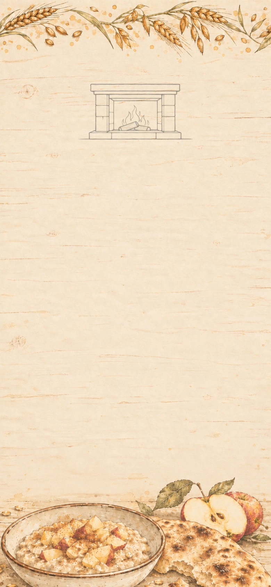

There is a clean page on the kitchen table, and breakfast seems a sensible place to begin. What can a little grain become? We can grind it for flatbread or soften it into porridge. Apples belong here too: something to bite into, something to drink. Let us cook before we decide what to write.

**Goals**
- (three goals are a lot but okay here because flatbread, juice, and porridge form a familiar breakfast that can be prepared in different orders; the review found no demonstrated benefit from showing only two dishes)
- Bake flatbread. -- Flatbread
- Press apple juice. -- Apple juice
- Cook fruit porridge. -- Fruit porridge

**Hotspots**
- Hearth fire (at 50.000000%, 19.016588%)
  - icon: 

**Items**
- Grain
  - icon: 
- Millstone
  - icon: 
- Water
  - icon: 
- Apples
  - icon: 
- Fruit press
  - icon: 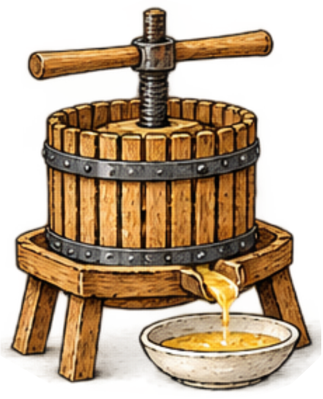
- Soaked grain
  - icon: 
- Porridge
  - icon: 
- Fruit porridge
  - icon: 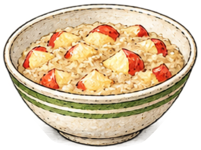

**Combinations**
- Grain + Millstone [preserve] -> Flour (tutorial)
- Flour + Water -> Dough
- Dough @ Hearth fire -> Flatbread
- Apples + Fruit press [preserve] -> Apple juice
- Grain + Water -> Soaked grain
- Soaked grain [transform] @ Hearth fire -> Porridge
- Porridge [transform] + Apples -> Fruit porridge

## Milk, two ways

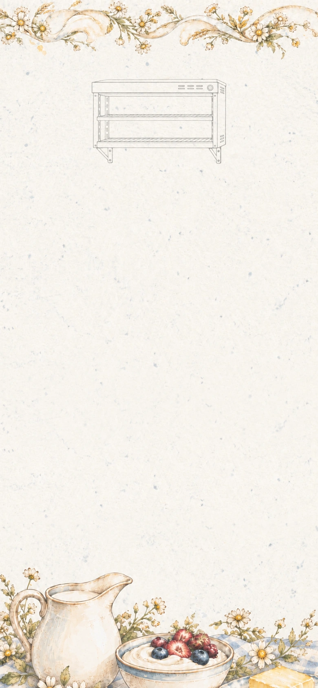

A cookbook starts to become useful when one ingredient opens several doors. Here are milk for yogurt and cream for butter. We want a cultured bowl with a little tang, and butter good enough to spread on warm bread.

The yogurt starter is a milk culture, different from bread yeast. Churning cream separates butter; later, straining yogurt will make a thicker spread.

**Goals**
- Churn butter. -- Butter
- Prepare fruit yogurt. -- Fruit yogurt

**Hotspots**
- Warm shelf (at 50.000000%, 17.654028%)
  - icon: 

**Items**
- Milk
  - icon: 
- Yogurt starter
  - icon: 
- Cream
  - icon: 
- Churn
  - icon: 
- Apples
- Fruit yogurt
  - icon: 

**Combinations**
- Milk + Yogurt starter [preserve] @ Warm shelf -> Yogurt
- Cream + Churn [preserve] -> Butter
- Yogurt + Apples -> Fruit yogurt

> NOTE: [OpenStax: What Our Ancestors Knew](https://openstax.org/books/microbiology/pages/1-1-what-our-ancestors-knew). Fermentation history; not exact recipe ratios or a universal chronology.

## A loaf worth buttering

The flatbread page needs a neighbour. What changes when dough is given yeast and time? Leave room in the notebook for the rise, the crust, and the pleasure of cutting a warm loaf. We already have the butter.

**Goals**
- Serve bread and butter. -- Bread and butter

**Hotspots**
- Proofing shelf (at 28.205128%, 18.246445%)
  - icon: 
- `bakehouse-oven-bread` Oven (at 74.615385%, 17.417062%)
  - icon: 

**Items**
- Baker’s yeast
  - icon: 
- Dough
  - icon: 
- Butter
  - icon: 
- Leavened dough
  - icon: 
- Bread and butter
  - icon: 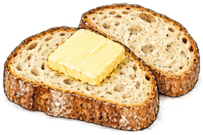

**Combinations**
- Dough + Baker’s yeast [preserve] @ Proofing shelf -> Leavened dough
- Leavened dough [transform] @ `bakehouse-oven-bread` -> Bread
- Bread + Butter -> Bread and butter

## Yogurt, thick and fresh

The yogurt page is acquiring branches. Strain some for a thick herb spread, then leave another bowl soft enough to take cucumber. The flatbread gives us a way to taste the spread as part of something we would actually eat for lunch.

**Goals**
- Serve flatbread with herbed yogurt. -- Flatbread with herbed yogurt
- Prepare cucumber yogurt. -- Cucumber yogurt

**Items**
- Straining cloth
  - icon: 
- Herbs
  - icon: 
- Cucumber
  - icon: 
- Yogurt
  - icon: 
- Flatbread
  - icon: 
- Herbed strained yogurt
  - icon: 
- Flatbread with herbed yogurt
  - icon: 
- Cucumber yogurt
  - icon: 

**Combinations**
- Yogurt + Straining cloth [preserve] -> Strained yogurt
- Strained yogurt [transform] + Herbs -> Herbed strained yogurt
- Flatbread + Herbed strained yogurt [transform] -> Flatbread with herbed yogurt
- Yogurt + Cucumber [preserve] -> Cucumber yogurt

## A little sharpness

Apple juice has another life beyond the breakfast glass. For this page, a cider maker helps us follow it through fermentation into vinegar. We want enough sharpness to wake up a bowl of leaves.

The cider maker manages the fermentation and supplies air when making vinegar. This dressing is for a meal; the culture alone does not establish a safe acidity for preserving food.

**Goals**
- Dress a green salad. -- Dressed salad

**Hotspots**
- Air fed vat (at 50.000000%, 17.357820%)
  - icon: 

**Items**
- Cider yeast
  - icon: 
- Vinegar culture
  - icon: 
- Olive oil
  - icon: 
- Salad leaves
  - icon: 
- Apple juice
  - icon: 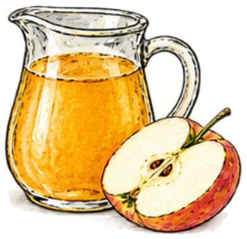
- Hard cider
  - icon: 

**Combinations**
- Apple juice + Cider yeast [preserve] -> Hard cider
- Hard cider [transform] + Vinegar culture [preserve] @ Air fed vat -> Cider vinegar
- Cider vinegar [transform] + Olive oil [preserve] -> Vinaigrette
- Salad leaves [preserve] + Vinaigrette -> Dressed salad

> NOTE: [Aspall: Vinegar Production](https://www.aspall.co.uk/blogs/our-story/vinegar-production). Producer account of alcohol-to-acid conversion and oxygen supply; no home-preservation guarantee.

## Toast and warm apples

Some pages begin with appetite. Today I want the smell of herbs warming on toast and a spoonful of soft apple against cool yogurt. The butter, bread and apples have already earned their places in the book. A little heat gives us reasons to return to them.

**Goals**
- Grill herb toast. -- Herb toast
- Serve compote yogurt. -- Compote yogurt

**Hotspots**
- Grill (at 26.923077%, 20.912322%)
  - icon: 
- `orchard-stove-orchard-lunch` Stove (at 73.076923%, 17.357820%)
  - icon: 

**Items**
- Butter
- Herbs
- Bread
  - icon: 
- Apples
- Apple juice
- Yogurt
- Herb-buttered bread
  - icon: 
- Compote yogurt
  - icon: 

**Combinations**
- Butter + Herbs -> Herb butter
- Bread + Herb butter -> Herb-buttered bread
- Herb-buttered bread [transform] @ Grill -> Herb toast
- Apples + Apple juice @ `orchard-stove-orchard-lunch` -> Apple compote
- Yogurt + Apple compote -> Compote yogurt

## A pot of broth

The savoury pages need something to build on. A pot of vegetable broth can soften bread into a plain soup or carry the sweetness of onions cooked in butter. Try both. Our herb toast has a particularly good reason to be here.

**Goals**
- Cook bread soup. -- Bread soup
- Serve onion soup with herb toast. -- Onion soup with herb toast

**Hotspots**
- `soup-stove-soup` Stove (at 50.000000%, 17.357820%)
  - icon: 

**Items**
- Root vegetables
  - icon: 
- Onions
  - icon: 
- Water
- Bread
- Butter
- Herb toast
  - icon: 
- Vegetable stock pot
  - icon: 
- Bread soup
  - icon: 
- Softened onions
  - icon: 
- Onion soup
  - icon: 
- Onion soup with herb toast
  - icon: 

**Combinations**
- Root vegetables + Water -> Vegetable stock pot
- Vegetable stock pot [transform] @ `soup-stove-soup` -> Vegetable broth
- Bread + Vegetable broth -> Bread soup
- Onions [preserve] + Butter @ `soup-stove-soup` -> Softened onions
- Softened onions [transform] + Vegetable broth -> Onion soup
- Onion soup [transform] + Herb toast [preserve] -> Onion soup with herb toast

## Roots, beans and crisp edges

Roasting gives the roots a different character from the vegetables in our broth. Fold some into bean stew and flatbread for lunch. There should also be a place in this book for crisp bread cubes: a small preparation that makes a soft dish more interesting.

**Goals**
- Roast the roots. -- Roasted roots
- next: Fill flatbread with roots and beans. -- Root-and-bean flatbread
- Bake croutons. -- Croutons

**Hotspots**
- `roasting-oven-roast` Oven (at 50.000000%, 17.417062%)
  - icon: 

**Items**
- Cooked beans
  - icon: 
- Vegetable broth
  - icon: 
- Root vegetables
- Herb butter
  - icon: 
- Flatbread
- Bread
- Bean stew with roasted roots
  - icon: 
- Root-and-bean flatbread
  - icon: 

**Combinations**
- Cooked beans [preserve] + Vegetable broth -> Bean stew
- Root vegetables + Herb butter @ `roasting-oven-roast` -> Roasted roots
- Bean stew + Roasted roots -> Bean stew with roasted roots
- Flatbread + Bean stew with roasted roots [consume] -> Root-and-bean flatbread
- Bread @ `roasting-oven-roast` -> Croutons

## A salad wants contrast

A salad page ought to say more than “add dressing.” Here we can set soft roasted roots against sharpness, and tender leaves against crisp bread. Try a mustard dressing if it appeals. In the margin lies a copied passage from John Evelyn’s old salad book: a reminder that cookbooks carry their authors’ ideas as well as their recipes.

**Goals**
- Dress a roasted-root salad. -- Roasted-root salad
- Finish green salad with croutons. -- Green salad with croutons

**Items**
- Ground mustard seed
  - icon: 
- Evelyn calls lettuce cold and moist
  - icon: 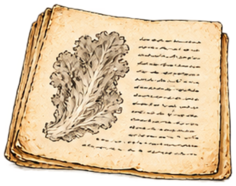

  “It is indeed of Nature more cold and moist than any of the rest”

  Evelyn describes lettuce using an old medical theory that classified foods as hot, cold, wet or dry. That theory is no longer an accepted explanation of how food affects health.

  > NOTE: John Evelyn, Acetaria (1699), catalogue entry 34: Lettuce. Excerpt spelling modernised; contextual note by the game author.

- Cider vinegar
  - icon: 
- Vinaigrette
  - icon: 
- Roasted roots
  - icon: 
- Dressed salad
  - icon: 
- Croutons
  - icon: 
- Mustard paste
  - icon: 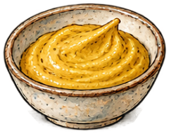
- Mustard dressing
  - icon: 
- Roasted-root salad
  - icon: 
- Green salad with croutons
  - icon: 

**Combinations**
- Ground mustard seed + Cider vinegar -> Mustard paste
- Mustard paste [transform] + Vinaigrette -> Mustard dressing
- Roasted roots + Mustard dressing [preserve] -> Roasted-root salad
- Dressed salad [transform] + Croutons [preserve] -> Green salad with croutons
- Roasted roots + Vinaigrette -> Roasted-root salad
- Ground mustard seed + Vinaigrette -> Mustard dressing

> NOTE: [John Evelyn: Acetaria (1699)](https://www.gutenberg.org/files/15517/15517-h/15517-h.htm). Primary historical salad text; period health beliefs are not accepted science.

> NOTE: [NLM: Shakespeare and the Four Humors](https://www.nlm.nih.gov/exhibition/shakespeare-and-the-four-humors/index.html). Discarded historical theory; no medical efficacy mechanic.

> NOTE: [Giada De Laurentiis: Roasted Root Vegetable Salad](https://www.foodnetwork.com/recipes/giada-de-laurentiis/roasted-root-vegetable-salad-recipe-2095657). Pairing support only, not an exact reproduction.

> NOTE: [Colman’s Mustard: Foodservice](https://colmansusa.com/foodservice). Producer guidance lists mustard powder for vinaigrettes. It does not specify this game’s exact quantity or mixing order.

## One sheet, two pastas

Roll out a sheet of egg pasta and the next page almost writes itself. We could cut noodles, or fold the sheet around a filling of roasted roots and strained yogurt. Try both shapes. Keep bread crumbs beside the pasta notes; they will have a use when we cook.

**Goals**
- (three goals are a lot but okay here because noodles and filled ravioli share reusable pasta sheets while breadcrumbs are a separate preparation; the reviewed scanning burden concerned the pantry rather than the third goal)
- Cut fresh noodles. -- Fresh noodles
- Fill ravioli. -- Filled ravioli
- Prepare breadcrumbs. -- Breadcrumbs

**Items**
- Bread knife
  - icon: 
- Eggs
  - icon: 
- Rolling pin
  - icon: 
- Cutting wheel
  - icon: 
- Bread
- Flour
  - icon: 
- Roasted roots
- Strained yogurt
  - icon: 
- Egg pasta dough
  - icon: 
- Pasta sheets
  - icon: 
- Root and yogurt filling
  - icon: 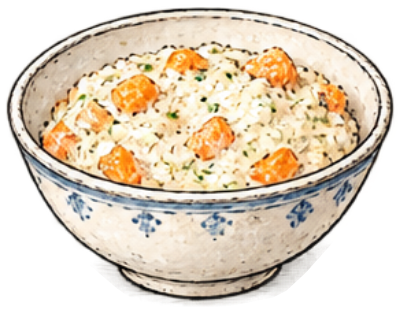

**Combinations**
- Bread + Bread knife [preserve] -> Breadcrumbs
- Flour + Eggs -> Egg pasta dough
- Egg pasta dough [transform] + Rolling pin [preserve] -> Pasta sheets
- Pasta sheets + Cutting wheel [preserve] -> Fresh noodles
- Roasted roots + Strained yogurt [transform] -> Root and yogurt filling
- Pasta sheets + Root and yogurt filling [transform] -> Filled ravioli

> NOTE: [A. Escoffier: A Guide to Modern Cookery](https://www.gutenberg.org/cache/epub/71395/pg71395-images.html). Primary culinary source for sauces, pastry, puddings and desserts; not invention dates. Common game preparations are simplified, not exact reproductions.

## Pasta at the table

Now we can find out how those shapes eat. The noodles need something crisp among their folds; the filled pasta needs room for its own flavour. Herb butter can serve both. Taste the crumbs toasted, rather than assuming that bread is bread however we use it.

**Goals**
- Finish noodles with toasted crumbs. -- Noodles with toasted crumbs
- Serve ravioli with herb butter. -- Ravioli with herb butter

**Hotspots**
- Cooking pot (at 26.923077%, 17.357820%)
  - icon: 
- Frying pan (at 73.076923%, 20.793839%)
  - icon: 

**Items**
- Fresh noodles
  - icon: 
- Herb butter
- Breadcrumbs
  - icon: 
- Filled ravioli
  - icon: 
- Herb-buttered noodles
  - icon: 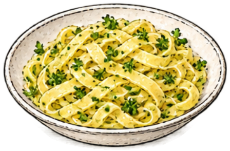
- Toasted crumbs
  - icon: 
- Noodles with toasted crumbs
  - icon: 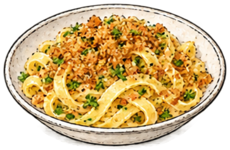
- Cooked ravioli
  - icon: 
- Ravioli with herb butter
  - icon: 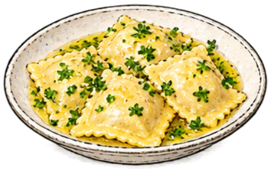

**Combinations**
- Fresh noodles [transform] @ Cooking pot -> Cooked noodles
- Cooked noodles + Herb butter -> Herb-buttered noodles
- Breadcrumbs @ Frying pan -> Toasted crumbs
- Herb-buttered noodles [transform] + Toasted crumbs [preserve] -> Noodles with toasted crumbs
- Filled ravioli [transform] @ Cooking pot -> Cooked ravioli
- Cooked ravioli [transform] + Herb butter -> Ravioli with herb butter

## Two ways with butter

Put these preparations on facing pages. Butter rubbed through flour makes crumbs that need water to bind them into shortcrust. For puff pastry, cold butter is folded between layers of dough instead of stirred through it.

The same familiar ingredients are doing different work. That distinction deserves a clear drawing and a careful sentence.

**Goals**
- Prepare shortcrust. -- Shortcrust
- Fold laminated dough. -- Laminated dough

**Hotspots**
- Pastry bench (at 50.000000%, 19.194313%)
  - icon: 

**Items**
- Flour
- Butter
- Water
- Dough
- Buttery pastry crumbs
  - icon: 

**Combinations**
- Flour + Butter @ Pastry bench -> Buttery pastry crumbs
- Buttery pastry crumbs [transform] + Water -> Shortcrust
- Dough + Butter @ Pastry bench -> Laminated dough

> NOTE: [King Arthur: Pie Crust guide](https://www.kingarthurbaking.com/learn/guides/pie-crust). Fat-in-flour crumbs need water to become dough.

> NOTE: [King Arthur: Classic Puff Pastry](https://www.kingarthurbaking.com/recipes/classic-puff-pastry-pate-feuilletee-recipe). Distinct folded butter layers; preparation is compressed.

## What pastry can hold

The pastry pages need supper as well as dessert. Shortcrust can hold bean stew or apples; the folded dough can become plain puff pastry or crisp cheese straws. Keep a plain puff for the almond page. The cheese straws deserve a place on the table now.

**Goals**
- Bake a bean pie. -- Bean pie
- next: Bake a fruit tart. -- Fruit tart
- Bake plain puff pastry. -- Puff pastry
- next: Bake cheese straws. -- Cheese straws

**Hotspots**
- `pastry-oven-pastry` Oven (at 50.000000%, 17.417062%)
  - icon: 

**Items**
- Grated cheese
  - icon: 
- Shortcrust
  - icon: 
- Apples
- Laminated dough
  - icon: 
- Bean stew
  - icon: 
- Unbaked fruit tart
  - icon: 
- Unbaked bean pie
  - icon: 
- Bean pie
  - icon: 
- Cheese-straw twists
  - icon: 
- Cheese straws
  - icon: 

**Combinations**
- Shortcrust + Apples -> Unbaked fruit tart
- Unbaked fruit tart [transform] @ `pastry-oven-pastry` -> Fruit tart
- Laminated dough [transform] @ `pastry-oven-pastry` -> Puff pastry
- Shortcrust + Bean stew -> Unbaked bean pie
- Unbaked bean pie [transform] @ `pastry-oven-pastry` -> Bean pie
- Laminated dough [transform] + Grated cheese -> Cheese-straw twists
- Cheese-straw twists [transform] @ `pastry-oven-pastry` -> Cheese straws

## The sauce page

Flour and butter again, but this time they meet in a saucepan. Cooking them into a pale roux leads to a smooth white sauce with milk, ready to enrich with cheese. Beside the pastry notes, write down the distinction: warm roux and cold crumbs are different beginnings.

**Goals**
- Prepare cheese sauce. -- Cheese sauce

**Hotspots**
- `saucepan-sauce` Saucepan (at 50.000000%, 19.135071%)
  - icon: 

**Items**
- Flour
- Butter
- Milk
- Grated cheese
- White roux
  - icon: 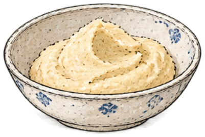
- Béchamel
  - icon: 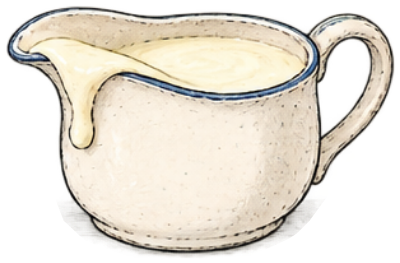

**Combinations**
- Flour + Butter @ `saucepan-sauce` -> White roux
- White roux [transform] + Milk -> Béchamel
- Béchamel [transform] + Grated cheese -> Cheese sauce

## A vegetable supper

A recipe earns its place by being useful on an ordinary evening. We have cauliflower, cooked noodles and the cheese sauce. The noodles can go into the oven; the cauliflower can follow as a gratin, or stay simple with butter. Either version belongs beside this supper.

**Goals**
- Cook a cauliflower dish.
  - either: Cauliflower gratin
  - or: Buttered cauliflower
- Bake cheese noodles. -- Baked cheese noodles

**Hotspots**
- Steamer (at 26.923077%, 17.357820%)
  - icon: 
- `supper-oven-gratin` Oven (at 73.076923%, 17.417062%)
  - icon: 

**Items**
- Cauliflower
  - icon: 
- Cheese sauce
  - icon: 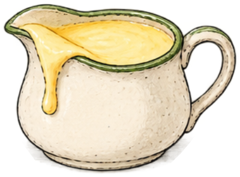
- Cooked noodles
  - icon: 
- Butter
- Cooked cauliflower
  - icon: 
- Cauliflower in cheese sauce
  - icon: 
- Cauliflower gratin
  - icon: 
- Noodles in cheese sauce
  - icon: 
- Baked cheese noodles
  - icon: 
- Buttered cauliflower
  - icon: 

**Combinations**
- Cauliflower [consume] @ Steamer -> Cooked cauliflower
- Cooked cauliflower + Cheese sauce -> Cauliflower in cheese sauce
- Cauliflower in cheese sauce [transform] @ `supper-oven-gratin` -> Cauliflower gratin
- Cooked noodles [transform] + Cheese sauce -> Noodles in cheese sauce
- Noodles in cheese sauce [transform] @ `supper-oven-gratin` -> Baked cheese noodles
- Cooked cauliflower + Butter -> Buttered cauliflower

## Fruit, sugar and time

The fruit pages need three different preparations: soft jam, a pouring syrup, and marmalade with softened citrus. Think about where each will be useful when the cakes and puddings arrive.

An ingredient’s history belongs in a cookbook too. The sugar note records one part of its connection to plantation slavery. These preparations are for the cooks to use; they make no claim of shelf-stable preservation.

**Goals**
- (three goals are a lot but okay here because jam, syrup, and marmalade show distinct uses of the preserving stove; the reviewed friction was the citrus handling sequence rather than the number of visible goals)
- Cook soft-set fruit jam. -- Soft-set fruit jam
- Prepare fruit syrup for later pages. -- Fruit syrup
- Cook marmalade. -- Marmalade

**Hotspots**
- `saucepan-preserves` Saucepan (at 50.000000%, 19.135071%)
  - icon: 

**Items**
- Sugar
  - icon: 

  A sweet ingredient used in preserves, cakes and confectionery. In a 1657 account of Barbados, Richard Ligon describes plantation sugar production that treated enslaved people as property. His account records the colonists' pursuit of profit, not the voices of the people they enslaved; it does not describe every place or period that made sugar.

  > NOTE: Game-author paraphrase and contextual note, not a quotation. Richard Ligon, A True & Exact History of the Island of Barbados (1657), pp. 22–23 and 113–116. A colonial participant’s account; not testimony from enslaved workers.

- Citrus
  - icon: 
- Apples
- Apple juice
- Water
- Macerated fruit
  - icon: 
- Softened citrus
  - icon: 
- Marmalade
  - icon: 

**Combinations**
- Apples + Sugar -> Macerated fruit
- Macerated fruit [transform] @ `saucepan-preserves` -> Soft-set fruit jam
- Apple juice + Sugar @ `saucepan-preserves` -> Fruit syrup
- Citrus [preserve] + Water @ `saucepan-preserves` -> Softened citrus
- Softened citrus [transform] + Sugar @ `saucepan-preserves` -> Marmalade

> NOTE: [UK Parliament: Trade Routes and the Slave Trade](https://www.parliament.uk/about/living-heritage/transformingsociety/tradeindustry/slavetrade/overview/trade-routes-and-the-slave-trade/). Context for sugar trade and enslaved labour; not recipe evidence.

> NOTE: [Richard Ligon: A True & Exact History of the Island of Barbados (1657), pp. 22–23, 113–116](https://www.gutenberg.org/cache/epub/70489/pg70489-images.html). Primary colonial account, consulted directly. Supports this optional, geographically and temporally bounded game-author paraphrase; not a modern recipe method or enslaved people’s own testimony.

## Tarts from earlier pages

Leave the savoury dishes on their worktops and clear a little space for dessert. Jam wants a pastry case; soft apple compote wants a crumbly covering. This is what I hope the book will do: let a reader turn back a few pages and find half the next dish already understood.

**Goals**
- Bake a jam tart. -- Jam tart
- Bake a fruit crumble. -- Fruit crumble

**Hotspots**
- `supper-oven-fruit-baking` Oven (at 50.000000%, 17.417062%)
  - icon: 

**Items**
- Breadcrumbs
- Butter
- Shortcrust
- Soft-set fruit jam
  - icon: 
- Apple compote
  - icon: 
- Fruit tart
  - icon: 
- Fruit syrup
  - icon: 
- Glazed fruit tart
  - icon: 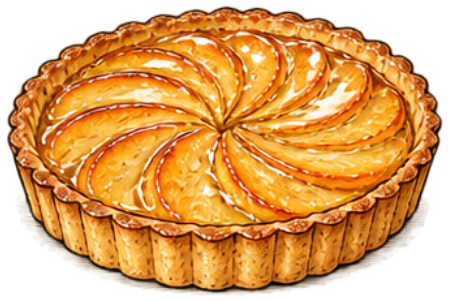
- Buttery crumble topping
  - icon: 
- Unbaked jam tart
  - icon: 
- Jam tart
  - icon: 
- Unbaked fruit crumble
  - icon: 
- Fruit crumble
  - icon: 

**Combinations**
- Breadcrumbs + Butter -> Buttery crumble topping
- Shortcrust + Soft-set fruit jam -> Unbaked jam tart
- Unbaked jam tart [transform] @ `supper-oven-fruit-baking` -> Jam tart
- Apple compote + Buttery crumble topping [consume] -> Unbaked fruit crumble
- Unbaked fruit crumble [transform] @ `supper-oven-fruit-baking` -> Fruit crumble
- Fruit tart [transform] + Fruit syrup -> Glazed fruit tart

## Almonds ground fine

At the mortar, an almond becomes an ingredient for quite different sweets. Grind it finely, then bring it together with fine sugar and water for marzipan. Our plain puff pastry has been waiting for this page. There are dates as well, for a smaller sweet if the mood takes us.

**Goals**
- Fill puff pastry with almond paste. -- Almond-filled puff pastry

**Items**
- Sugar mill
  - icon: 
- Almonds
  - icon: 
- Mortar
  - icon: 
- Pitted dates
  - icon: 
- Sugar
- Water
- Puff pastry
  - icon: 
- Marzipan-stuffed dates
  - icon: 
- Ground almonds
  - icon: 
- Almond-filled puff pastry
  - icon: 

**Combinations**
- Sugar + Sugar mill [preserve] -> Confectioner’s sugar
- Almonds + Mortar -> Ground almonds
- Ground almonds [transform] + Confectioner’s sugar -> Almond and sugar mixture
- Almond and sugar mixture + Water -> Marzipan
- Puff pastry [transform] + Marzipan -> Almond-filled puff pastry
- Marzipan + Pitted dates [preserve] -> Marzipan-stuffed dates

> NOTE: [Goethe-Institut: Marzipan](https://www.goethe.de/resources/files/pdf341/marzipan_englisch.pdf). First-party cultural recipe explicitly blends icing sugar with finely ground almonds before adding water; proportions and kneading are compressed in the game.

## Sugar taken further

There is more to sugar than sweetness. Watch what caramel contributes to an almond brittle and to a sauce made with cream. We can begin with sugar alone or with a little water; both preparations belong in the margin of this page.

**Goals**
- Make almond brittle. -- Almond brittle
- Prepare caramel sauce. -- Caramel sauce

**Hotspots**
- `sugar-pan-caramel` Saucepan (at 50.000000%, 19.135071%)
  - icon: 

**Items**
- Sugar
- Water
- Almonds
- Cream
- Sugar syrup
  - icon: 
- Caramel
  - icon: 
- Almond brittle
  - icon: 

**Combinations**
- Sugar + Water @ `sugar-pan-caramel` -> Sugar syrup
- Sugar syrup [transform] @ `sugar-pan-caramel` -> Caramel
- Caramel + Almonds -> Almond brittle
- Caramel + Cream -> Caramel sauce
- Sugar @ `sugar-pan-caramel` -> Caramel

## A sauce and a filling

The custard page needs a useful distinction. One preparation should pour; the other should stay in a pastry case. Yolks, milk and sugar give us the beginning, while starch thickens the pastry cream into a filling.

Keep some uncooked custard mixture under the cooks’ care for bread pudding. The vanilla custard will also have a later appointment with the freezing churn.

**Goals**
- Prepare custard mixture. -- Custard mixture
- next: Finish vanilla custard. -- Vanilla custard
- Cook pastry cream. -- Pastry cream

**Hotspots**
- `sugar-pan-custard` Saucepan (at 50.000000%, 19.135071%)
  - icon: 

**Items**
- Egg yolks
  - icon: 
- Vanilla
  - icon: 
- Corn starch
  - icon: 
- Sugar
- Milk
- Sweetened yolks
  - icon: 
- Pouring custard
  - icon: 
- Starch-thickened yolk base
  - icon: 
- Pastry cream mixture
  - icon: 

**Combinations**
- Egg yolks [preserve] + Sugar -> Sweetened yolks
- Sweetened yolks [transform] + Milk -> Custard mixture
- Custard mixture [transform] @ `sugar-pan-custard` -> Pouring custard
- Pouring custard [transform] + Vanilla -> Vanilla custard
- Sweetened yolks [transform] + Corn starch [preserve] -> Starch-thickened yolk base
- Starch-thickened yolk base [transform] + Milk -> Pastry cream mixture
- Pastry cream mixture [transform] @ `sugar-pan-custard` -> Pastry cream

> NOTE: [King Arthur: Pastry Cream](https://www.kingarthurbaking.com/recipes/pastry-cream-creme-patissiere-recipe). Egg yolks, milk, sugar and starch cooked into pastry filling; game separates pouring custard from starch-thickened cream.

## Bread soaked, pastry filled

Set two puddings beside each other. In one, custard settles into bread before baking; in the other, a baked pastry case holds a cream filling and fruit. The caramel sauce belongs with the bread pudding. These are the connections a useful cookbook should make easy to see.

**Goals**
- Fill a fruit cream tart. -- Fruit cream tart
- Finish caramel bread pudding. -- Caramel bread pudding

**Hotspots**
- `custard-oven-custard-baking` Oven (at 50.000000%, 17.417062%)
  - icon: 

**Items**
- Shortcrust
- Pastry cream
  - icon: 
- Apples
- Bread
- Custard mixture
  - icon: 
- Caramel sauce
  - icon: 
- Baked tart case
  - icon: 
- Cream-filled tart
  - icon: 
- Fruit cream tart
  - icon: 
- Custard-soaked bread
  - icon: 
- Bread pudding
  - icon: 
- Caramel bread pudding
  - icon: 

**Combinations**
- Shortcrust [transform] @ `custard-oven-custard-baking` -> Baked tart case
- Baked tart case [transform] + Pastry cream -> Cream-filled tart
- Cream-filled tart [transform] + Apples -> Fruit cream tart
- Bread + Custard mixture -> Custard-soaked bread
- Custard-soaked bread [transform] @ `custard-oven-custard-baking` -> Bread pudding
- Bread pudding [transform] + Caramel sauce -> Caramel bread pudding

## Steam does the lifting

Choux deserves a page of its own: first a cooked flour paste, then eggs worked in after appropriate cooling. Steam expands the shaped paste into hollow buns as the cook manages the baking.

Try a plain batch for filling and a cheese batch to eat as it is. The space inside is part of what we are making.

**Goals**
- Bake hollow choux buns. -- Hollow choux buns
- Bake cheese puffs. -- Cheese puffs

**Hotspots**
- `choux-pan-choux` Saucepan (at 26.923077%, 19.431280%)
  - icon: 
- `choux-oven-choux` Oven (at 73.076923%, 17.417062%)
  - icon: 

**Items**
- Butter
- Water
- Flour
- Eggs
- Grated cheese
- Choux cooking liquid
  - icon: 
- Cooked flour paste
  - icon: 
- Choux paste
  - icon: 
- Cheese choux paste
  - icon: 
- Cheese puffs
  - icon: 

**Combinations**
- Butter + Water @ `choux-pan-choux` -> Choux cooking liquid
- Choux cooking liquid [transform] + Flour @ `choux-pan-choux` -> Cooked flour paste
- Cooked flour paste [transform] + Eggs -> Choux paste
- Choux paste [transform] @ `choux-oven-choux` -> Hollow choux buns
- Choux paste [transform] + Grated cheese -> Cheese choux paste
- Cheese choux paste [transform] @ `choux-oven-choux` -> Cheese puffs

> NOTE: [King Arthur: Pâte à Choux](https://www.kingarthurbaking.com/recipes/pate-a-choux-recipe). Cooked flour paste and egg enrichment; shaping and baking compressed.

## Inside a choux bun

The buns have cooled, and now we can put that hollow centre to use. Pastry cream makes one filling; whipped cream makes another. Finish the custard-filled buns with caramel. Leave room in the notes for the difference between a firm filling and a soft cloud of cream.

**Goals**
- Finish caramel choux. -- Caramel choux
- Whip cream. -- Whipped cream
- next: Fill cream puffs. -- Cream puffs

**Items**
- Whisk
  - icon: 
- Cream
- Hollow choux buns
  - icon: 
- Pastry cream
- Caramel sauce
- Custard-filled choux
  - icon: 
- Caramel choux
  - icon: 

**Combinations**
- Cream + Whisk -> Whipped cream
- Hollow choux buns [transform] + Pastry cream -> Custard-filled choux
- Hollow choux buns [transform] + Whipped cream -> Cream puffs
- Custard-filled choux [transform] + Caramel sauce -> Caramel choux

## Cake lightened with air

A fresh page for cake. Here the lift begins in beaten eggs, before the batter ever sees the oven. Make a plain sponge and a cocoa variation so we can see what the same beginning allows. Leave the cooled pastries on their own counter; this page needs a clear bench.

**Goals**
- Bake a plain sponge cake. -- Sponge cake
- Bake a chocolate sponge. -- Chocolate sponge

**Hotspots**
- `choux-oven-sponge` Oven (at 50.000000%, 17.417062%)
  - icon: 

**Items**
- Cocoa powder
  - icon: 
- Eggs
- Whisk
- Sugar
- Flour
- Egg foam
  - icon: 
- Sweet egg foam
  - icon: 
- Sponge batter
  - icon: 
- Chocolate sponge batter
  - icon: 

**Combinations**
- Eggs + Whisk -> Egg foam
- Egg foam [transform] + Sugar -> Sweet egg foam
- Sweet egg foam [transform] + Flour -> Sponge batter
- Sponge batter [transform] @ `choux-oven-sponge` -> Sponge cake
- Sponge batter [transform] + Cocoa powder -> Chocolate sponge batter
- Chocolate sponge batter [transform] @ `choux-oven-sponge` -> Chocolate sponge

## A roll and a spoonful

A sponge can be a cake to slice or the beginning of a dessert to eat with a spoon. Give one a ribbon of jam and cream. Let some cake pieces take up custard and apple compote in a trifle. The earlier pages are starting to talk to one another.

**Goals**
- Finish a jam-and-cream roll. -- Jam-and-cream roll
- Assemble a cream-topped trifle. -- Cream-topped trifle

**Items**
- Sponge cake
  - icon: 
- Soft-set fruit jam
- Whipped cream
  - icon: 
- Vanilla custard
  - icon: 
- Apple compote
- Jam roll
  - icon: 
- Jam-and-cream roll
  - icon: 
- Trifle base
  - icon: 
- Fruit trifle
  - icon: 
- Cream-topped trifle
  - icon: 

**Combinations**
- Sponge cake + Soft-set fruit jam -> Jam roll
- Jam roll [transform] + Whipped cream -> Jam-and-cream roll
- Sponge cake + Vanilla custard -> Trifle base
- Trifle base [transform] + Apple compote -> Fruit trifle
- Fruit trifle [transform] + Whipped cream -> Cream-topped trifle

## Begin with chocolate

For the chocolate pages, a chocolate maker joins us at the workbench. The roasted cacao nibs have already been fermented and processed; refining, conching, tempering and setting remain skilled work under the maker’s care.

From the finished chocolate, try cream for ganache and butter for a glaze. We want to understand what each finish contributes before putting it on a cake.

**Goals**
- Prepare dark chocolate. -- Dark chocolate
- next: Make ganache and chocolate glaze.
  - both: Chocolate ganache
  - and: Chocolate glaze

**Items**
- Roasted cacao nibs
  - icon: 
- Cocoa butter
  - icon: 
- Mortar
- Sugar
- Cream
- Butter
- Ground cacao paste
  - icon: 
- Sweetened cacao paste
  - icon: 

**Combinations**
- Roasted cacao nibs [preserve] + Mortar -> Ground cacao paste
- Ground cacao paste [transform] + Sugar -> Sweetened cacao paste
- Sweetened cacao paste [transform] + Cocoa butter [preserve] -> Dark chocolate
- Dark chocolate + Cream -> Chocolate ganache
- Dark chocolate + Butter -> Chocolate glaze

> NOTE: [European Cocoa Association: Processing](https://www.eurococoa.com/cocoa-story/cocoa-story-the-production-process-from-cocoa-beans-to-semi-finished-products/). Industry association process account for nibs, paste, cocoa butter, refining and conching; not a homemade chocolate recipe.

## Chocolate, three finishes

There are three good places to try our chocolate: between layers of sponge, around a piece of marzipan, and over a cream puff. Each brings a different centre to the same page. The profiteroles can take either glaze or ganache; choose the finish you feel like eating.

**Goals**
- (three goals are a lot but okay here because cake, coated marzipan, and profiteroles are distinct finishing tasks at one counter; hiding a task did not remove it or establish a benefit in the review)
- Fill a chocolate cake with ganache. -- Ganache-filled chocolate cake
- Coat marzipan in chocolate. -- Chocolate-coated marzipan
- Finish chocolate profiteroles. -- Chocolate profiteroles

**Items**
- Chocolate sponge
  - icon: 
- Chocolate ganache
  - icon: 
- Marzipan
  - icon: 
- Dark chocolate
  - icon: 
- Cream puffs
  - icon: 
- Chocolate glaze
  - icon: 
- Chocolate-coated marzipan
  - icon: 
- Chocolate profiteroles
  - icon: 

**Combinations**
- Chocolate sponge [transform] + Chocolate ganache -> Ganache-filled chocolate cake
- Marzipan [transform] + Dark chocolate -> Chocolate-coated marzipan
- Cream puffs [transform] + Chocolate glaze -> Chocolate profiteroles
- Cream puffs [transform] + Chocolate ganache -> Chocolate profiteroles

## Scones for tea

There should be a page we turn to when someone stays for tea. Scones will do nicely, with jam and cream already understood. The rubbed-in mixture here is still unbaked flour and butter; milk brings it together into dough. A saucepan of hot chocolate would be welcome too.

**Goals**
- Serve a cream tea plate. -- Cream tea plate

**Hotspots**
- `tea-oven-tea` Oven (at 26.923077%, 17.417062%)
  - icon: 
- `chocolate-pan-tea` Saucepan (at 73.076923%, 19.431280%)
  - icon: 

**Items**
- Baking powder
  - icon: 
- Flour
- Butter
- Milk
- Soft-set fruit jam
- Whipped cream
- Cocoa powder
- Hot chocolate
  - icon: 
- Rubbed-in scone mix
  - icon: 
- Scone dough
  - icon: 
- Scones
  - icon: 
- Jam-filled scones
  - icon: 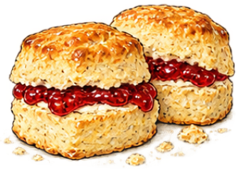
- Cream tea plate
  - icon: 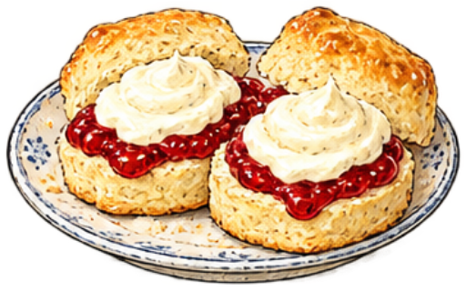

**Combinations**
- Flour + Baking powder [preserve] -> Self-raising flour
- Self-raising flour [transform] + Butter -> Rubbed-in scone mix
- Rubbed-in scone mix [transform] + Milk -> Scone dough
- Scone dough [transform] @ `tea-oven-tea` -> Scones
- Scones [transform] + Soft-set fruit jam -> Jam-filled scones
- Jam-filled scones [transform] + Whipped cream -> Cream tea plate
- Cocoa powder + Milk @ `chocolate-pan-tea` -> Hot chocolate

> NOTE: Rubbed-in scone mix: This is the unbaked flour-and-fat mixture, not crumbs from baked scones. [British Dietetic Association: Basic Scones](https://www.bda.uk.com/resource/basic-scones.html) distinguishes rubbing fat into flour from adding milk to form dough and then baking. Proportions and shaping remain compressed.

## Bread without waiting

Clear the baking bench for two more quick preparations. Fruit muffins begin with a batter; soda bread brings yogurt and baking soda together in a dough. We can keep the muffin page near tea and the loaf near supper. A good index will eventually have to admit that recipes belong in more than one place.

**Goals**
- Bake fruit muffins. -- Fruit muffins
- Bake soda bread. -- Soda bread

**Hotspots**
- `tea-oven-crew-baking` Oven (at 50.000000%, 17.417062%)
  - icon: 

**Items**
- Baking soda
  - icon: 
- Eggs
- Milk
- Butter
- Self-raising flour
  - icon: 
- Apples
- Yogurt
- Flour
- Beaten egg-and-milk mixture
  - icon: 
- Buttery muffin mixture
  - icon: 
- Muffin batter
  - icon: 
- Fruit muffin batter
  - icon: 
- Fruit muffins
  - icon: 
- Yogurt and soda mixture
  - icon: 
- Soda bread dough
  - icon: 

**Combinations**
- Eggs + Milk -> Beaten egg-and-milk mixture
- Beaten egg-and-milk mixture [transform] + Butter -> Buttery muffin mixture
- Buttery muffin mixture [transform] + Self-raising flour -> Muffin batter
- Muffin batter [transform] + Apples -> Fruit muffin batter
- Fruit muffin batter [transform] @ `tea-oven-crew-baking` -> Fruit muffins
- Yogurt + Baking soda [preserve] -> Yogurt and soda mixture
- Yogurt and soda mixture [transform] + Flour -> Soda bread dough
- Soda bread dough [transform] @ `tea-oven-crew-baking` -> Soda bread

## Cold changes things

The freezing churn asks us to think about our earlier preparations differently. Try vanilla custard, a fruit base, and sweetened milk and cream. We want three distinct frozen desserts, with enough room on the page to notice their different richness and texture.

**Goals**
- (three goals are a lot but okay here because three prepared bases teach the same churn operation through different frozen results; all three outcomes remained intelligible in both reviewed displays)
- Churn frozen custard. -- Frozen custard
- Churn fruit sorbet. -- Fruit sorbet
- Churn milk ice cream. -- Milk ice cream

**Items**
- Freezing churn
  - icon: 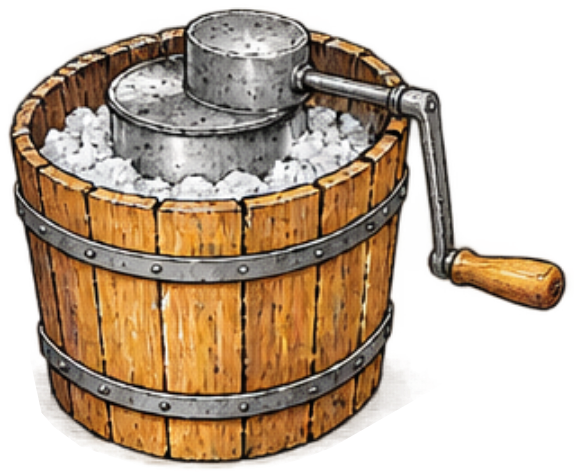
- Vanilla custard
- Apple compote
- Fruit syrup
- Cream
- Milk
- Sugar
- Fruit sorbet base
  - icon: 
- Fruit sorbet
  - icon: 
- Milk-and-cream base
  - icon: 
- Sweetened cream base
  - icon: 

**Combinations**
- Vanilla custard [transform] + Freezing churn -> Frozen custard
- Apple compote + Fruit syrup -> Fruit sorbet base
- Fruit sorbet base [transform] + Freezing churn -> Fruit sorbet
- Cream + Milk -> Milk-and-cream base
- Milk-and-cream base [transform] + Sugar -> Sweetened cream base
- Sweetened cream base [transform] + Freezing churn -> Milk ice cream

## The egg-white pages

The custards left another useful beginning: egg whites, kept under the cooks’ care. A whisk and sugar can make meringue for fruit nests. Fold in the almond and sugar mixture for macaron shells, then bring back the ganache. It is satisfying when the next page gives an earlier preparation a new purpose.

**Goals**
- Fill fruit meringue nests. -- Fruit meringue nests
- Sandwich chocolate macarons. -- Chocolate macarons

**Hotspots**
- `meringue-oven-meringue` Oven (at 50.000000%, 17.417062%)
  - icon: 

**Items**
- Egg whites
  - icon: 
- Whisk
- Sugar
- Whipped cream
- Apples
- Almond and sugar mixture
  - icon: 
- Chocolate ganache
- Egg-white foam
  - icon: 
- Meringue nests
  - icon: 
- Cream-filled meringue nests
  - icon: 
- Fruit meringue nests
  - icon: 
- Macaron batter
  - icon: 
- Macaron shells
  - icon: 
- Chocolate macarons
  - icon: 

**Combinations**
- Egg whites [preserve] + Whisk -> Egg-white foam
- Egg-white foam [transform] + Sugar -> Meringue
- Meringue [transform] @ `meringue-oven-meringue` -> Meringue nests
- Meringue nests [transform] + Whipped cream -> Cream-filled meringue nests
- Cream-filled meringue nests [transform] + Apples -> Fruit meringue nests
- Meringue [transform] + Almond and sugar mixture -> Macaron batter
- Macaron batter [transform] @ `meringue-oven-meringue` -> Macaron shells
- Macaron shells [transform] + Chocolate ganache -> Chocolate macarons

> NOTE: [King Arthur Baking School: French Macaron](https://shop.kingarthurbaking.com/content/class-pdfs/FrenchMacaron_August2025.pdf). First-party teaching recipe for almond-sugar mixture folded into meringue; exact formula is not reproduced.

## Ice cream dressed for dinner

We ought to have a simple ice-cream dessert and one with a little ceremony. A sundae can take caramel or chocolate. For Baked Alaska, cake supports the ice cream beneath its meringue coat while the cook manages the brief oven finish. Both belong in a book that makes room for appetite and occasion.

**Goals**
- Finish a sundae.
  - either: Caramel sundae
  - or: Chocolate sundae
- Finish Baked Alaska. -- Baked Alaska

**Hotspots**
- `meringue-oven-dessert-service` Oven (at 50.000000%, 17.417062%)
  - icon: 

**Items**
- Frozen custard
  - icon: 
- Caramel sauce
- Sponge cake
- Milk ice cream
  - icon: 
- Meringue
  - icon: 
- Chocolate glaze
- Caramel sundae
  - icon: 
- Ice-cream cake
  - icon: 
- Baked Alaska
  - icon: 
- Chocolate sundae
  - icon: 

**Combinations**
- Frozen custard [transform] + Caramel sauce -> Caramel sundae
- Sponge cake [transform] + Milk ice cream -> Ice-cream cake
- Ice-cream cake [transform] + Meringue @ `meringue-oven-dessert-service` -> Baked Alaska
- Milk ice cream [transform] + Chocolate glaze -> Chocolate sundae
- Milk ice cream [transform] + Caramel sauce -> Caramel sundae

## What keeping really means

The page about keeping food needs a specialist’s help. At the controlled preserving lines, we can follow fruit and bean stew through established commercial processes. Open the prepared fruit sample to try with custard; keep the processed stew tin sealed as an example for the tasting table.

Closing a jar or tin is not enough. The specialist manages sealing and heat treatment; these sketches are not instructions for home preservation.

**Goals**
- Serve bottled fruit with custard. -- Bottled fruit with custard
- Prepare a processed bean-stew tin. -- Processed bean-stew tin

**Hotspots**
- Controlled fruit line (at 26.923077%, 18.127962%)
  - icon: 
- Controlled stew line (at 73.076923%, 18.483412%)
  - icon: 

**Items**
- Preserving jar
  - icon: 
- Opener
  - icon: 
- Empty food tin
  - icon: 
- Apples
- Fruit syrup
- Vanilla custard
- Bean stew
- Apples in syrup
  - icon: 
- Fruit-filled jar
  - icon: 
- Processed fruit jar
  - icon: 
- Opened bottled fruit
  - icon: 
- Bottled fruit with custard
  - icon: 
- Stew-filled tin
  - icon: 

**Combinations**
- Apples + Fruit syrup -> Apples in syrup
- Apples in syrup [transform] + Preserving jar [consume] -> Fruit-filled jar
- Fruit-filled jar [transform] @ Controlled fruit line -> Processed fruit jar
- Processed fruit jar [transform] + Opener [preserve] -> Opened bottled fruit
- Opened bottled fruit [transform] + Vanilla custard -> Bottled fruit with custard
- Bean stew + Empty food tin [consume] -> Stew-filled tin
- Stew-filled tin [transform] @ Controlled stew line -> Processed bean-stew tin

> NOTE: [USDA NAL: How Did We Can?](https://www.nal.usda.gov/exhibits/ipd/canning/). History of heat processing and sealed containers, not a safe procedure.

> NOTE: [NCHFP: Ensuring Safe Canned Foods](https://nchfp.uga.edu/how/can/general-information/ensuring-safe-canned-foods/). Specific validated processes matter; game does not teach canning or certify safety.

## Supper from the notebook

Before we put the book in order, let us cook a supper from it. Bean stew and soda bread make a substantial beginning. Finish with either the vanilla sandwich cake or the iced chocolate cake. Choose the one you would like to share; the other can remain a reason to open the book again.

**Goals**
- Serve bean stew with soda bread. -- Bean stew and soda bread
- Finish a cake for the tasting supper.
  - either: Vanilla sandwich cake
  - or: Iced chocolate cake

**Items**
- Bean stew
- Soda bread
  - icon: 
- Butter
- Confectioner’s sugar
  - icon: 
- Vanilla
- Sponge cake
- Water
- Ganache-filled chocolate cake
  - icon: 
- Buttercream
  - icon: 
- Vanilla buttercream
  - icon: 
- Vanilla sandwich cake
  - icon: 
- Water icing
  - icon: 
- Iced chocolate cake
  - icon: 

**Combinations**
- Bean stew + Soda bread [consume] -> Bean stew and soda bread
- Butter + Confectioner’s sugar -> Buttercream
- Buttercream [transform] + Vanilla -> Vanilla buttercream
- Sponge cake + Vanilla buttercream [consume] -> Vanilla sandwich cake
- Confectioner’s sugar + Water -> Water icing
- Ganache-filled chocolate cake [transform] + Water icing [consume] -> Iced chocolate cake

## The tasting table

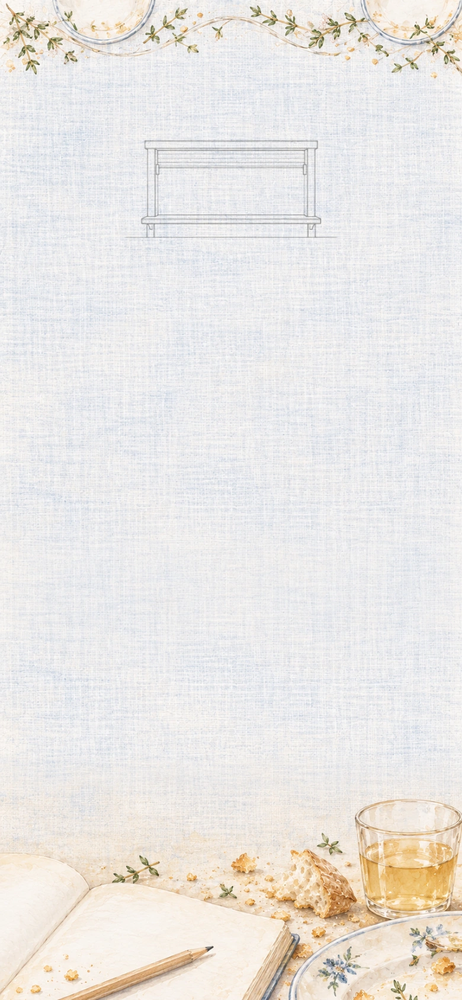

The table is set through the kitchen’s service hatch. Load the trolley with stew and soda bread, your finished cake, apple juice, and the sealed stew tin for the discussion of preserving. Bring them through together. It is time to see a meal where we have been seeing separate pages.

**Goals**
- Bring the tasting supper to the service hatch.
  - either: Supper trolley[Bean stew and soda bread, Apple juice, Processed bean-stew tin, Vanilla sandwich cake] @ Service hatch
  - or: Supper trolley[Bean stew and soda bread, Apple juice, Processed bean-stew tin, Iced chocolate cake] @ Service hatch

**Hotspots**
- Service hatch (at 50.000000%, 18.898104%)
  - icon: 

**Items**
- Supper trolley (compound)
  - icon: 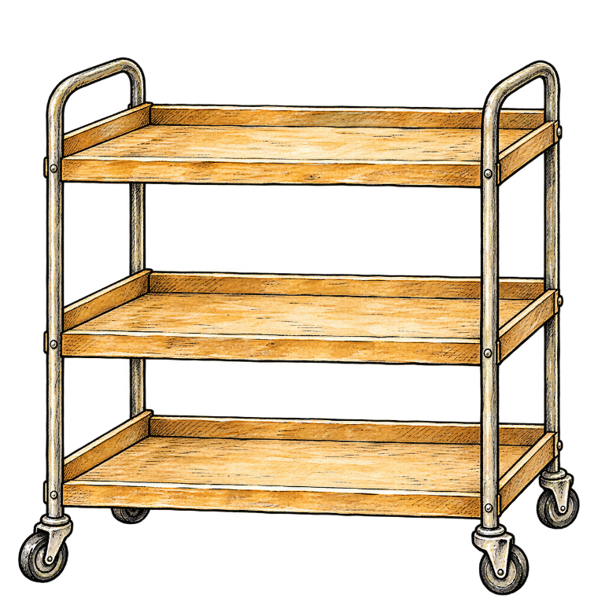 (at 28.2051%, 49.7630%)
  - unnamed slot: accepts Bean stew and soda bread, icon: 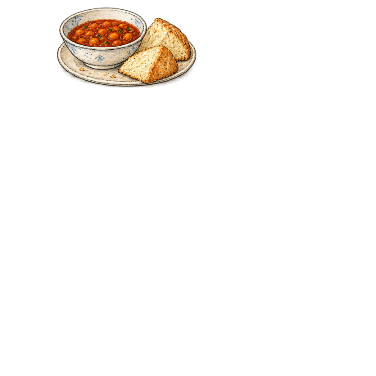
  - unnamed slot: accepts Apple juice, icon: 
  - unnamed slot: accepts Processed bean-stew tin, icon: 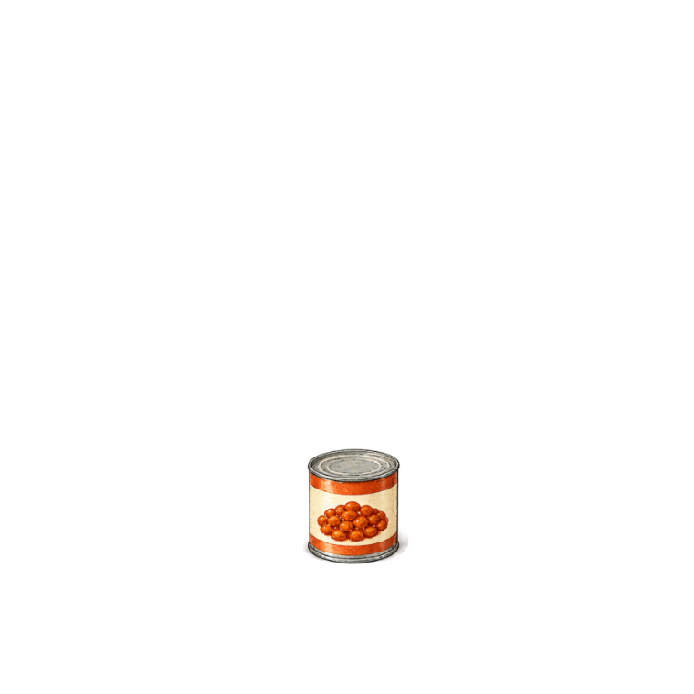
  - unnamed slot: accepts Vanilla sandwich cake, icon: 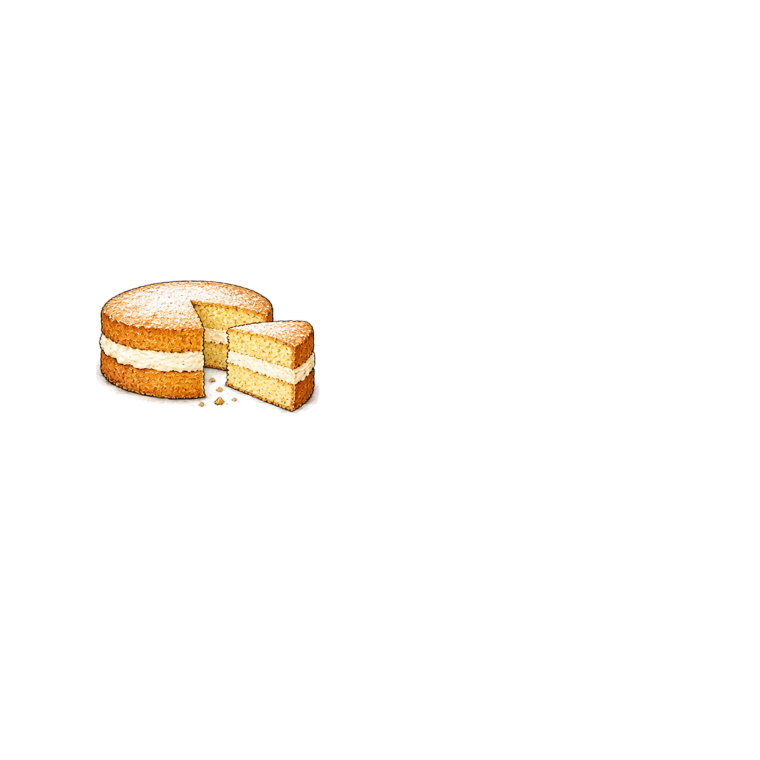
  - unnamed slot: accepts Iced chocolate cake, icon: 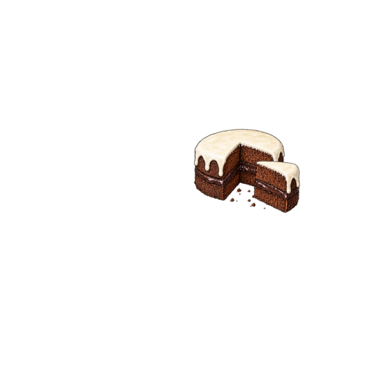
- Bean stew and soda bread
  - icon: 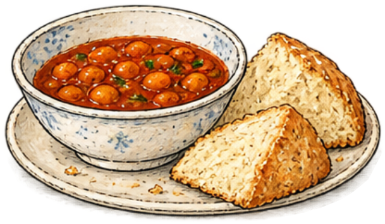
- Apple juice
- Processed bean-stew tin
  - icon: 

## Ready for another kitchen

The dishes reach the table, and the notebook lies open beside them. Bread, broth, fruit, cream: things we met near the beginning have found their way into a supper worth sharing. The sealed tin stays with the preserving notes, an example of work that needed a specialist.

There are splashes in the margins and several good reasons to turn back a page. We have a collection of tested dishes, useful variations, and techniques we can explain. Now we know what we want to put into the book—and what we would like to cook again.
