# Cookbook

Write a cookbook. Make doughs, sauces, fillings, pastries and cakes.

> NOTE: Adapted from `kitchen-caravan-small-sessions-v8` at source commit `1c95988a4e3771abcf2be28183ce009d38645d2c`. The original conversion retained its sessions and mechanics; the practical-cookbook revision changes introductions, selected preparations, fixed equipment and dinner. Decision history and evidence limits are in notes.md and the Cookbook study outcomes.

> NOTE: These are cooking sessions with usable portions and appropriate storage between them. Recipes compress proportions, seasoning, preparation, waiting, heating and cooling; they are not complete formulas, preservation procedures or shelf-life guarantees. Heat is explicit where it explains a transformation or keeps a sequence intelligible, not as a requirement for every warm dish.

> NOTE: Cook’s Pen illustrations remain the art direction. The revised dishes, equipment and serving furniture use finished pen-and-wash art; source paintings are retained in the Cookbook study. Afternoon tea takes place in a home parlour and dinner in a home dining room. Standalone icons follow the physical size hierarchy in docs/icon-guide.md. The dining table has seven required servings and space for both cakes; the tiered tea stand is 220 × 240px. Each chapter has at most two fixed stations; names and receiving outlines come from the player. See design-brief.md for lasting Cookbook intent and docs/ux.md for interaction rules.

## Breakfast
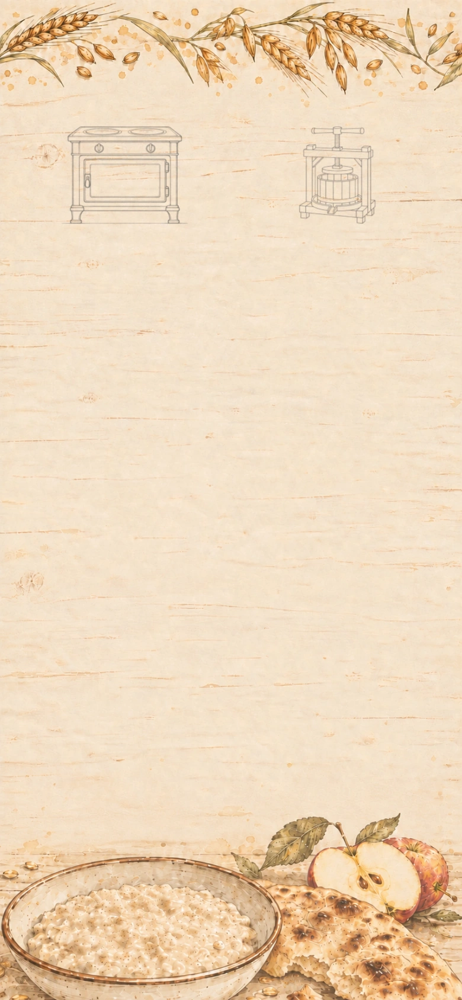

*Breakfast from scratch*

Juice, porridge, bread.

**Goals**
- (three goals are a lot but okay here because flatbread, juice, and porridge form a familiar breakfast that can be prepared in different orders)
- Cook flatbread. -- Flatbread
- Press apple juice. -- Apple juice
- Cook porridge. -- Porridge

**Hotspots**
- Cookstove (at 27%, 17.5%)
  - icon: 

- Fruit press (at 73%, 17.5%)
  - icon: 

**Items**
- Grain
  - icon: 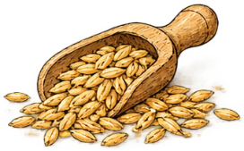
- Millstone
  - icon: 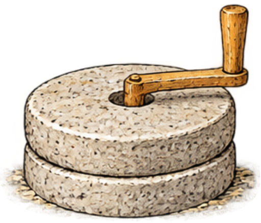
- Water
  - icon: 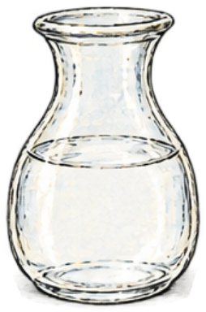
- Apples
  - icon: 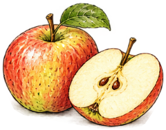
- Soaked grain
  - icon: 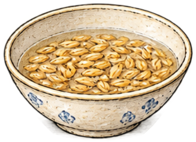
- Porridge
  - icon: 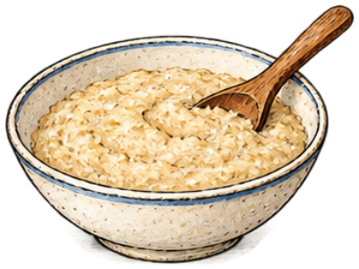

**Combinations**
- Grain + Millstone [preserve] -> Flour (tutorial)
- Flour + Water -> Dough
- Dough @ Cookstove -> Flatbread
- Apples @ Fruit press -> Apple juice
- Grain + Water -> Soaked grain
- Soaked grain [transform] @ Cookstove -> Porridge

## Dairy
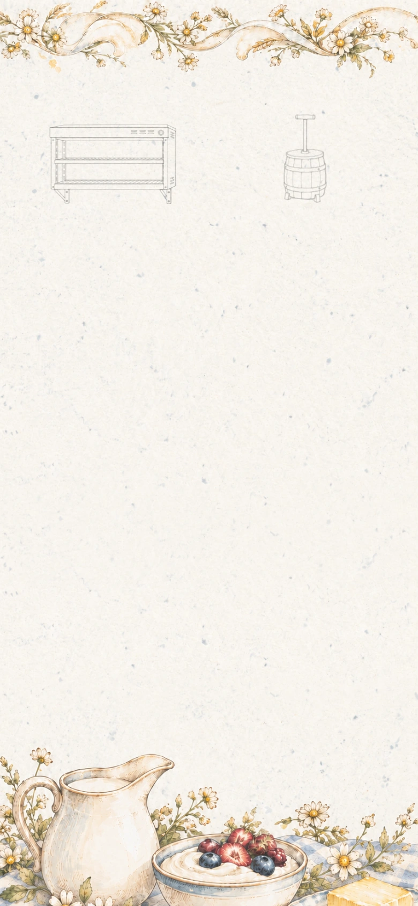

*Dairy*

**Goals**
- Churn butter. -- Butter
- next: Whip cream. -- Whipped cream
- Prepare fruit yogurt. -- Fruit yogurt

**Hotspots**
- Warm shelf (at 27%, 17.654028%)
  - icon: 

- Butter churn (at 73%, 17.5%)
  - icon: 

**Items**
- Milk
  - icon: 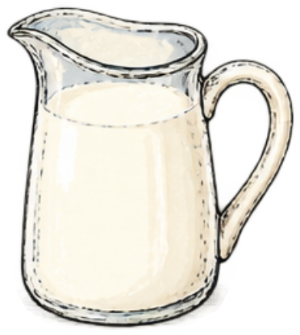
- Yogurt starter
  - icon: 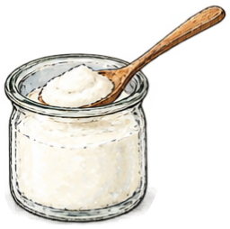
- Cream
  - icon: 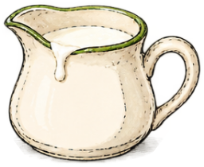
- Apples
- Fruit yogurt
  - icon: 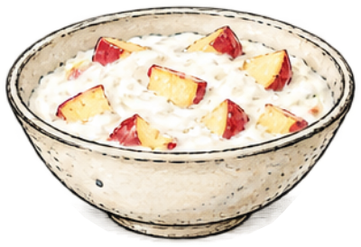

- Whisk
  - icon: 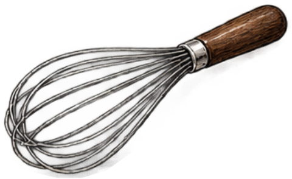
- Whipped cream
  - icon: 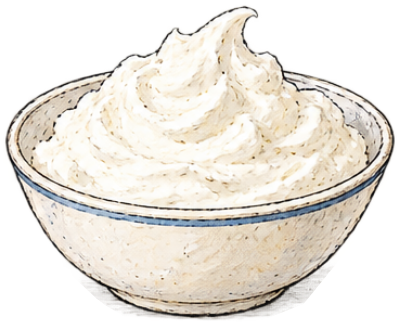

**Combinations**
- Milk + Yogurt starter [preserve] @ Warm shelf -> Yogurt
- Cream @ Butter churn -> Butter
- Cream + Whisk -> Whipped cream
- Yogurt + Apples -> Fruit yogurt

> NOTE: [OpenStax: What Our Ancestors Knew](https://openstax.org/books/microbiology/pages/1-1-what-our-ancestors-knew). Fermentation history; not exact recipe ratios or a universal chronology.

## Home-made bread
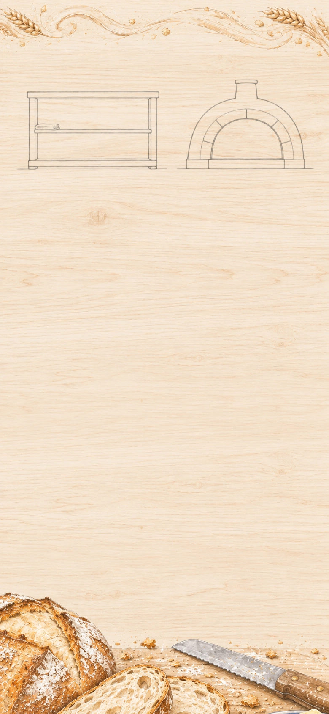

*Home-made bread*

What could be nicer than freshly baked bread with butter?

**Goals**
- Serve bread and butter. -- Bread and butter
- next: Make cucumber finger sandwiches. -- Cucumber finger sandwiches

**Hotspots**
- Proofing shelf (at 28.205128%, 18.246445%)
  - icon: 
- `bakehouse-oven-bread` Oven (at 74.615385%, 17.417062%)
  - icon: 
  - place: Bread (at 74.615385%, 19.417062%)

**Items**
- Baker’s yeast
  - icon: 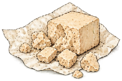
- Dough
  - icon: 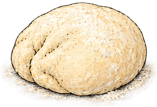
- Butter
  - icon: 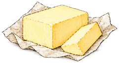
- Leavened dough
  - icon: 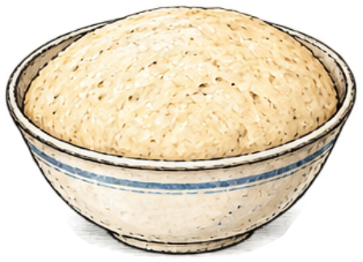
- Bread and butter
  - icon: 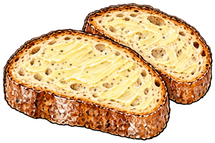

- Cucumber
  - icon: 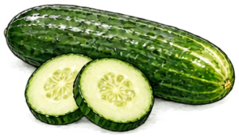
- Chef’s knife
  - icon: 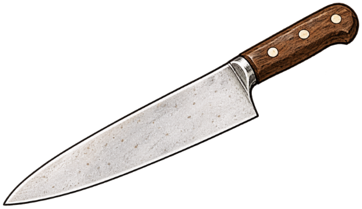
- Sliced cucumber
  - icon: 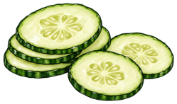
- Cucumber finger sandwiches
  - icon: 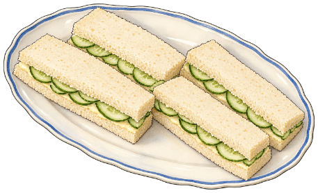

**Combinations**
- Dough + Baker’s yeast [preserve] @ Proofing shelf -> Leavened dough
- Leavened dough [transform] @ `bakehouse-oven-bread` -> Bread
- Bread + Butter -> Bread and butter
- Cucumber [preserve] + Chef’s knife [preserve] -> Sliced cucumber
- Bread and butter [transform] + Sliced cucumber [consume] -> Cucumber finger sandwiches

## Strained yogurt
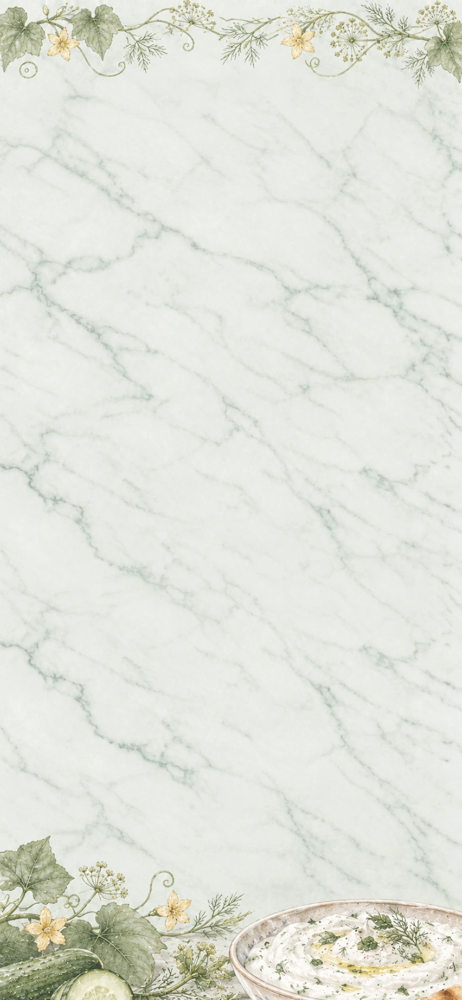

*Strained yoghurt*

**Goals**
- Serve flatbread with herbed yogurt. -- Flatbread with herbed yogurt
- Prepare cucumber yogurt. -- Cucumber yogurt

**Items**
- Strained yogurt
  - icon: 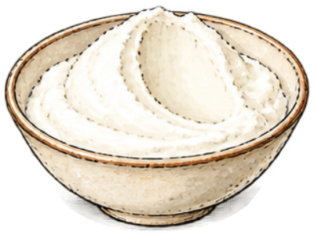
- Straining cloth
  - icon: 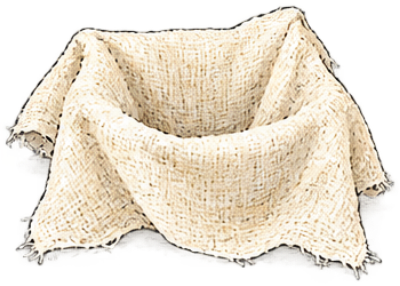
- Herbs
  - icon: 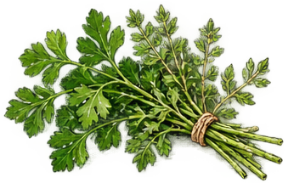
- Cucumber
- Yogurt
  - icon: 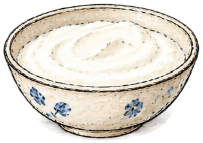
- Flatbread
  - icon: 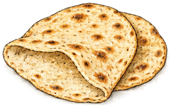
- Herbed strained yogurt
  - icon: 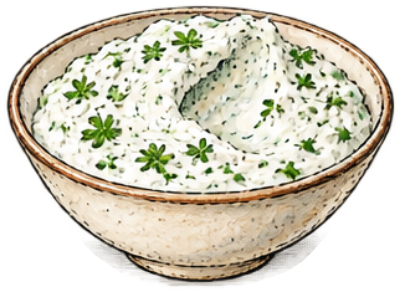
- Flatbread with herbed yogurt
  - icon: 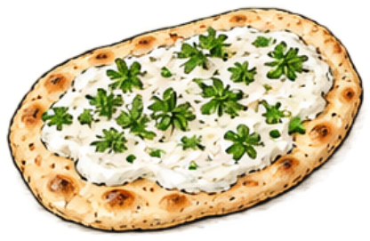
- Cucumber yogurt
  - icon: 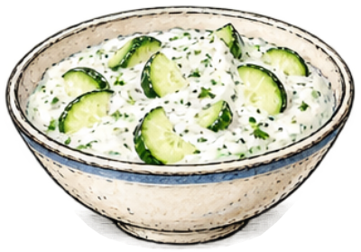

**Combinations**
- Yogurt + Straining cloth [preserve] -> Strained yogurt
- Strained yogurt [transform] + Herbs -> Herbed strained yogurt
- Flatbread + Herbed strained yogurt [transform] -> Flatbread with herbed yogurt
- Yogurt + Cucumber [preserve] -> Cucumber yogurt

## Vinegar and salad dressing
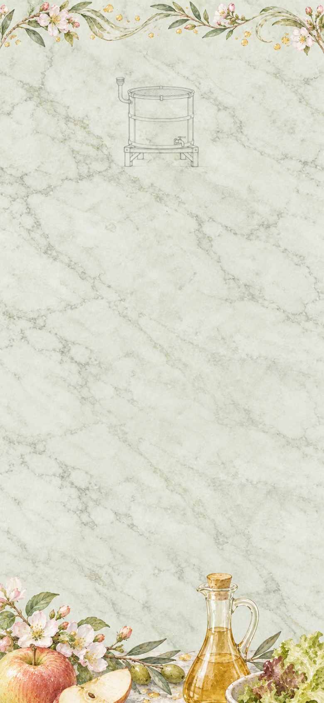

*Vinegar and dressing*

Acidity balances richness.

**Goals**
- Dress a green salad. -- Dressed salad

**Hotspots**
- Air fed vat (at 50.000000%, 17.357820%)
  - icon: 

**Items**
- Cider yeast
  - icon: 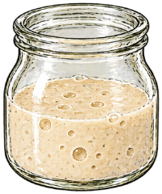
- Vinegar culture
  - icon: 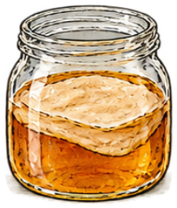
- Olive oil
  - icon: 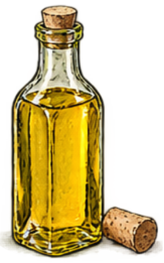
- Salad leaves
  - icon: 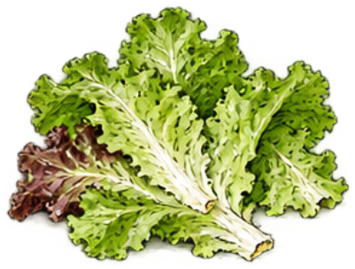
- Apple juice
  - icon: 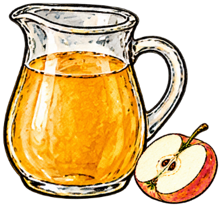
- Hard cider
  - icon: 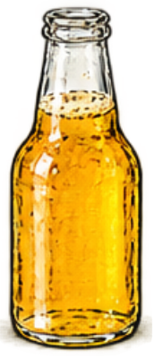

**Combinations**
- Apple juice + Cider yeast [preserve] -> Hard cider
- Hard cider [transform] + Vinegar culture [preserve] @ Air fed vat -> Cider vinegar
- Cider vinegar [transform] + Olive oil [preserve] -> Vinaigrette
- Salad leaves [consume] + Vinaigrette -> Dressed salad

> NOTE: [Aspall: Vinegar Production](https://www.aspall.co.uk/blogs/our-story/vinegar-production). Producer account of alcohol-to-acid conversion and oxygen supply; no home-preservation guarantee.

## Herb toast and apple compote
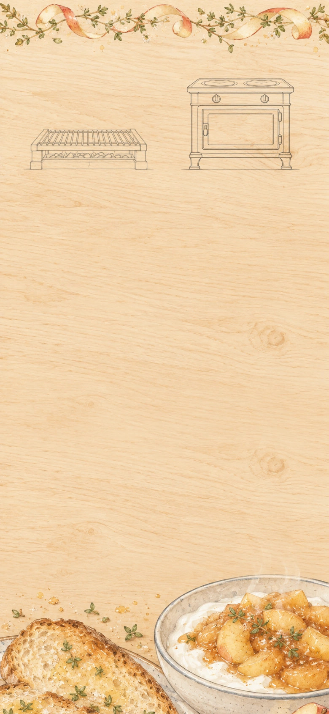

*Toast and compote*

**Goals**
- Grill herb toast. -- Herb toast
- Serve compote yogurt. -- Compote yogurt

**Hotspots**
- Grill (at 26.923077%, 20.912322%)
  - icon: 
- `orchard-stove-orchard-lunch` Hob (at 73.076923%, 17.357820%)
  - icon: 
  - place: Apple compote (at 73.076923%, 14.357820%)

**Items**
- Herb butter
  - icon: 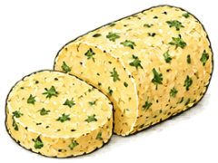
- Butter
- Herbs
- Bread
  - icon: 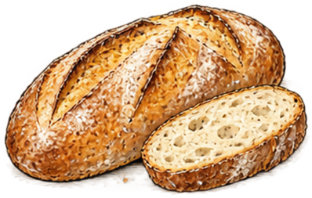
- Apples
- Apple juice
- Yogurt
- Herb-buttered bread
  - icon: 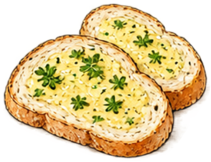
- Compote yogurt
  - icon: 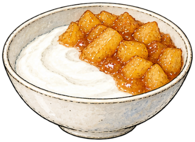

**Combinations**
- Butter + Herbs -> Herb butter
- Bread + Herb butter [consume] -> Herb-buttered bread
- Herb-buttered bread [transform] @ Grill -> Herb toast
- Apples + Apple juice @ `orchard-stove-orchard-lunch` -> Apple compote
- Yogurt + Apple compote -> Compote yogurt

## Vegetable broth and onion soup
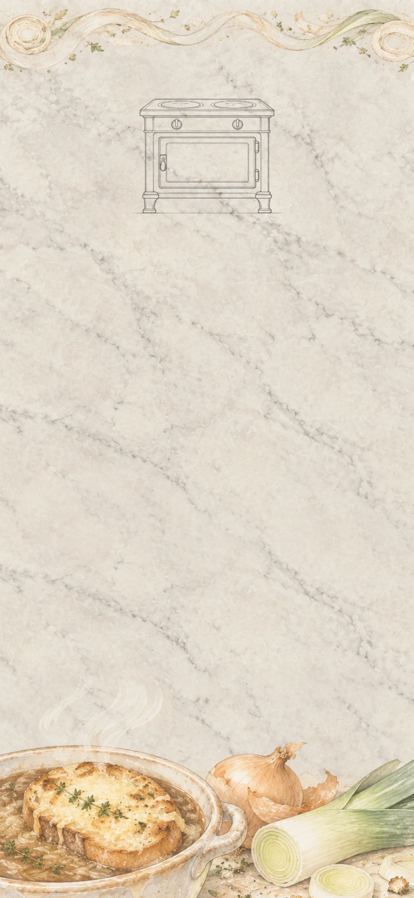

*Onion soup*

**Goals**
- Cook bread soup. -- Bread soup
- Serve onion soup with herb toast. -- Onion soup with herb toast

**Hotspots**
- `soup-stove-soup` Hob (at 50.000000%, 17.357820%)
  - icon: 
  - place: Vegetable broth (at 50.000000%, 14.357820%)
  - place: Softened onions (at 50.000000%, 14.357820%)

**Items**
- Root vegetables
  - icon: 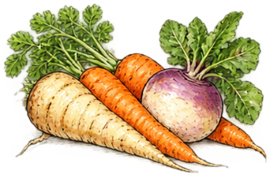
- Onions
  - icon: 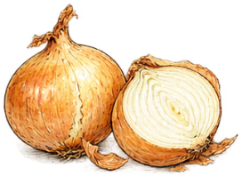
- Water
- Bread
- Butter
- Herb toast
  - icon: 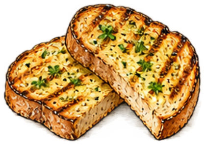
- Vegetable stock pot
  - icon: 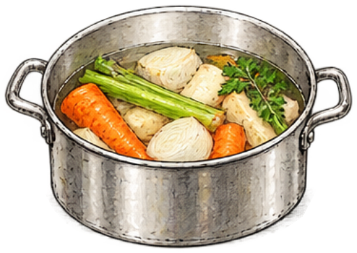
- Bread soup
  - icon: 
- Softened onions
  - icon: 
- Onion soup
  - icon: 
- Onion soup with herb toast
  - icon: 

**Combinations**
- Root vegetables + Water -> Vegetable stock pot
- Vegetable stock pot [transform] @ `soup-stove-soup` -> Vegetable broth
- Bread + Vegetable broth -> Bread soup
- Onions [preserve] + Butter @ `soup-stove-soup` -> Softened onions
- Softened onions [transform] + Vegetable broth -> Onion soup
- Onion soup [transform] + Herb toast [preserve] -> Onion soup with herb toast

## Roast vegetables and beans

*Roast vegetables and beans*

**Goals**
- Roast the roots. -- Roasted roots
- next: Fill flatbread with roots and beans. -- Root-and-bean flatbread
- Bake croutons. -- Croutons

**Hotspots**
- `roasting-oven-roast` Oven (at 50.000000%, 17.417062%)
  - icon: 
  - place: Roasted roots (at 50.000000%, 19.417062%)
  - place: Croutons (at 50.000000%, 19.417062%)

**Items**
- Olive oil
- Cooked beans
  - icon: 
- Vegetable broth
  - icon: 
- Root vegetables
- Flatbread
- Bread
- Bean stew with roasted roots
  - icon: 
- Root-and-bean flatbread
  - icon: 

**Combinations**
- Cooked beans [preserve] + Vegetable broth -> Bean stew
- Root vegetables + Olive oil @ `roasting-oven-roast` -> Roasted roots
- Bean stew + Roasted roots -> Bean stew with roasted roots
- Flatbread + Bean stew with roasted roots [consume] -> Root-and-bean flatbread
- Bread @ `roasting-oven-roast` -> Croutons

## Salads and mustard dressing

*Salads*

Add variety through texture

**Goals**
- Dress a roasted-root salad. -- Roasted-root salad
- Finish green salad with croutons. -- Green salad with croutons

**Items**
- Ground mustard seed
  - icon: 
- Cider vinegar
  - icon: 
- Vinaigrette
  - icon: 
- Roasted roots
  - icon: 
- Dressed salad
  - icon: 
- Croutons
  - icon: 
- Mustard dressing
  - icon: 
- Roasted-root salad
  - icon: 
- Green salad with croutons
  - icon: 

**Combinations**
- Roasted roots + Mustard dressing [preserve] -> Roasted-root salad
- Dressed salad [transform] + Croutons [preserve] -> Green salad with croutons
- Roasted roots + Vinaigrette -> Roasted-root salad
- Ground mustard seed [consume] + Vinaigrette -> Mustard dressing

> NOTE: [Giada De Laurentiis: Roasted Root Vegetable Salad](https://www.foodnetwork.com/recipes/giada-de-laurentiis/roasted-root-vegetable-salad-recipe-2095657). Pairing support only, not an exact reproduction.

> NOTE: [Colman’s Mustard: Foodservice](https://colmansusa.com/foodservice). Producer guidance lists mustard powder for vinaigrettes. It does not specify this game’s exact quantity or mixing order.

## Jam, syrup and marmalade

*Preserves*

**Goals**
- (three goals are a lot but okay here because jam, syrup, and marmalade show distinct uses of the preserving stove)
- Cook soft-set fruit jam. -- Soft-set fruit jam
- Prepare fruit syrup for later pages. -- Fruit syrup
- Cook marmalade. -- Marmalade

**Hotspots**
- `saucepan-preserves` Saucepan (at 50.000000%, 19.135071%)
  - icon: 

**Items**
- Sugar
  - icon: 

  A sweet ingredient used in preserves, cakes and confectionery. In a 1657 account of Barbados, Richard Ligon describes plantation sugar production that treated enslaved people as property. His account records the colonists' pursuit of profit, not the voices of the people they enslaved; it does not describe every place or period that made sugar.

  > NOTE: Game-author paraphrase and contextual note, not a quotation. Richard Ligon, A True & Exact History of the Island of Barbados (1657), pp. 22–23 and 113–116. A colonial participant’s account; not testimony from enslaved workers.

- Citrus
  - icon: 
- Apples
- Apple juice
- Water
- Macerated fruit
  - icon: 
- Softened citrus
  - icon: 
- Marmalade
  - icon: 

**Combinations**
- Apples + Sugar -> Macerated fruit
- Macerated fruit [transform] @ `saucepan-preserves` -> Soft-set fruit jam
- Apple juice + Sugar @ `saucepan-preserves` -> Fruit syrup
- Citrus [preserve] + Water @ `saucepan-preserves` -> Softened citrus
- Softened citrus [transform] + Sugar @ `saucepan-preserves` -> Marmalade

> NOTE: [UK Parliament: Trade Routes and the Slave Trade](https://www.parliament.uk/about/living-heritage/transformingsociety/tradeindustry/slavetrade/overview/trade-routes-and-the-slave-trade/). Context for sugar trade and enslaved labour; not recipe evidence.

> NOTE: [Richard Ligon: A True & Exact History of the Island of Barbados (1657), pp. 22–23, 113–116](https://www.gutenberg.org/cache/epub/70489/pg70489-images.html). Primary colonial account, consulted directly. Supports this optional, geographically and temporally bounded game-author paraphrase; not a modern recipe method or enslaved people’s own testimony.

## Sponge cake

*Sponge cakes*

**Goals**
- Make a jam roll. -- Jam roll
- Bake a chocolate sponge. -- Chocolate sponge

**Hotspots**
- `choux-oven-sponge` Oven (at 50.000000%, 17.417062%)
  - icon: 
  - place: Sponge cake (at 50.000000%, 19.417062%)
  - place: Chocolate sponge (at 50.000000%, 19.417062%)

**Items**
- Cocoa powder
  - icon: 
- Eggs
- Whisk
- Sugar
- Flour
- Egg foam
  - icon: 
- Sweet egg foam
  - icon: 
- Sponge batter
  - icon: 
- Chocolate sponge batter
  - icon: 

- Jam roll
  - icon: 

**Combinations**
- Eggs + Whisk -> Egg foam
- Egg foam [transform] + Sugar -> Sweet egg foam
- Sweet egg foam [transform] + Flour -> Sponge batter
- Sponge batter [transform] @ `choux-oven-sponge` -> Sponge cake
- Sponge batter [transform] + Cocoa powder [consume] -> Chocolate sponge batter
- Chocolate sponge batter [transform] @ `choux-oven-sponge` -> Chocolate sponge
- Sponge cake + Soft-set fruit jam -> Jam roll

## Scones and brown-butter biscuits

*Baking for tea*

**Goals**
- Bake scones. -- Scones
- Bake brown-butter biscuits. -- Brown-butter biscuits

**Hotspots**
- `tea-oven-tea` Oven (at 26.923077%, 17.417062%)
  - icon: 
  - place: Scones (at 26.923077%, 19.417062%)
  - place: Brown-butter biscuits (at 26.923077%, 19.417062%)
- `chocolate-pan-tea` Saucepan (at 73.076923%, 19.431280%)
  - icon: 

**Items**
- Sugar
- Sugar mill
  - icon: 
- Confectioner’s sugar
- Baking powder
  - icon: 
- Flour
- Butter
- Milk
- Brown butter
  - icon: 
- Rubbed-in scone mix
  - icon: 
- Scone dough
  - icon: 
- Scones
  - icon: 
- Sweetened brown butter
  - icon: 
- Biscuit dough
  - icon: 
- Brown-butter biscuits
  - icon: 

**Combinations**
- Flour + Baking powder [preserve] -> Self-raising flour
- Self-raising flour [transform] + Butter -> Rubbed-in scone mix
- Rubbed-in scone mix [transform] + Milk -> Scone dough
- Scone dough [transform] @ `tea-oven-tea` -> Scones
- Butter @ `chocolate-pan-tea` -> Brown butter
- Sugar + Sugar mill [preserve] -> Confectioner’s sugar
- Brown butter + Confectioner’s sugar -> Sweetened brown butter
- Sweetened brown butter [transform] + Flour -> Biscuit dough
- Biscuit dough [transform] @ `tea-oven-tea` -> Brown-butter biscuits

> NOTE: [British Dietetic Association: Basic Scones](https://www.bda.uk.com/resource/basic-scones.html) distinguishes rubbing fat into flour from adding milk to form dough and then baking. [King Arthur: Shortbread Cookies](https://www.kingarthurbaking.com/recipes/shortbread-cookies-recipe) and [Brown butter](https://www.kingarthurbaking.com/blog/2020/01/08/brown-butter) support the simplified biscuit preparation. Proportions, salt, shaping and cooling remain compressed. Assembly and tea-making belong to the next chapter.

## Afternoon tea

*Afternoon tea*

**Goals**
- Fill the tea stand. -- Tea stand[Cucumber finger sandwiches, Scones, Brown-butter biscuits, Jam roll, Whipped cream, Soft-set fruit jam]
- Brew a cup of tea. -- Cup of tea

**Hotspots**
- `afternoon-tea-kettle` Kettle (at 50%, 22%)
  - icon: 

**Items**
- Tea stand (compound)
  - icon:  (at 50%, 44%)
  - unnamed slot: accepts Cucumber finger sandwiches, icon: 
  - unnamed slot: accepts Scones, icon: 
  - unnamed slot: accepts Brown-butter biscuits, icon: 
  - unnamed slot: accepts Jam roll, icon: 
  - unnamed slot: accepts Whipped cream, icon: 
  - unnamed slot: accepts Soft-set fruit jam, icon: 
- Cucumber finger sandwiches
- Scones
- Brown-butter biscuits
- Jam roll
- Whipped cream
- Soft-set fruit jam
- Water
- Tea bags
  - icon: 
- Cup of boiling water
  - icon: 
- Cup of tea
  - icon: 

**Combinations**
- Water @ `afternoon-tea-kettle` -> Cup of boiling water
- Cup of boiling water [transform] + Tea bags [preserve] -> Cup of tea

> NOTE: The [Ritz afternoon tea](https://www.theritzlondon.com/dine-with-us/afternoon-tea/) and [Orangery](https://www.hrp.org.uk/kensington-palace/visit/the-orangery-restaurant/) provide the serving reference. The game uses its existing breads and cakes rather than reproducing either menu. Tea is a separate preparation, not a fitted part of the stand; no delivery location is required.

## Fresh pasta and mushroom filling

*Fresh pasta*

**Goals**
- (three goals are a lot but okay here because noodles and filled ravioli share reusable pasta sheets while breadcrumbs are a separate preparation)
- Cut fresh noodles. -- Fresh noodles
- Fill ravioli. -- Filled ravioli
- Prepare breadcrumbs. -- Breadcrumbs

**Hotspots**
- `mushroom-pan` Frying pan (at 50%, 17.5%)
  - icon: 

**Items**
- Softened onions
- Chef’s knife
- Eggs
  - icon: 
- Rolling pin
  - icon: 
- Cutting wheel
  - icon: 
- Bread
- Flour
  - icon: 
- Egg pasta dough
  - icon: 
- Pasta sheets
  - icon: 

- Mushrooms
  - icon: 
- Chopped mushrooms
  - icon: 
- Mushroom filling
  - icon: 

**Combinations**
- Bread + Rolling pin [preserve] -> Breadcrumbs
- Flour + Eggs -> Egg pasta dough
- Egg pasta dough [transform] + Rolling pin [preserve] -> Pasta sheets
- Pasta sheets + Cutting wheel [preserve] -> Fresh noodles
- Mushrooms [transform] + Chef’s knife [preserve] -> Chopped mushrooms
- Chopped mushrooms [transform] + Softened onions [transform] @ `mushroom-pan` -> Mushroom filling
- Pasta sheets + Mushroom filling -> Filled ravioli

> NOTE: [A. Escoffier: A Guide to Modern Cookery](https://www.gutenberg.org/cache/epub/71395/pg71395-images.html). Primary culinary source for sauces, pastry, puddings and desserts; not invention dates. Common game preparations are simplified, not exact reproductions.

## Pasta with butter and toasted crumbs

*Two pastas*

**Goals**
- Finish noodles with toasted crumbs. -- Noodles with toasted crumbs
- Serve ravioli with brown butter. -- Ravioli with brown butter

**Hotspots**
- Cooking pot (at 26.923077%, 17.357820%)
  - icon: 
- Frying pan (at 73.076923%, 20.793839%)
  - icon: 

**Items**
- Fresh noodles
  - icon: 
- Butter
- Breadcrumbs
  - icon: 
- Filled ravioli
  - icon: 
- Buttered noodles
  - icon: 
- Toasted crumbs
  - icon: 
- Noodles with toasted crumbs
  - icon: 
- Cooked ravioli
  - icon: 
- Ravioli with brown butter
  - icon: 

- Brown butter
  - icon: 

- Herbs
- Brown butter with herbs
  - icon: 

**Combinations**
- Fresh noodles [transform] @ Cooking pot -> Cooked noodles
- Cooked noodles + Butter -> Buttered noodles
- Breadcrumbs @ Frying pan -> Toasted crumbs
- Buttered noodles [transform] + Toasted crumbs [preserve] -> Noodles with toasted crumbs
- Filled ravioli [transform] @ Cooking pot -> Cooked ravioli
- Brown butter + Herbs @ Frying pan -> Brown butter with herbs
- Cooked ravioli [transform] + Brown butter with herbs [consume] @ Frying pan -> Ravioli with brown butter

> NOTE: [King Arthur: Brown butter](https://www.kingarthurbaking.com/blog/2020/01/08/brown-butter). Browning the milk solids changes flavour; heating and cooling are compressed.

## Shortcrust and puff pastry

*Pastry*

**Goals**
- Prepare shortcrust. -- Shortcrust
- Fold laminated dough. -- Laminated dough

**Hotspots**
- Pastry bench (at 50.000000%, 19.194313%)
  - icon: 

**Items**
- Flour
- Butter
- Water
- Dough
- Buttery pastry crumbs
  - icon: 

**Combinations**
- Flour + Butter @ Pastry bench -> Buttery pastry crumbs
- Buttery pastry crumbs [transform] + Water -> Shortcrust
- Dough + Butter @ Pastry bench -> Laminated dough

> NOTE: [King Arthur: Pie Crust guide](https://www.kingarthurbaking.com/learn/guides/pie-crust). Fat-in-flour crumbs need water to become dough.

> NOTE: [King Arthur: Classic Puff Pastry](https://www.kingarthurbaking.com/recipes/classic-puff-pastry-pate-feuilletee-recipe). Distinct folded butter layers; preparation is compressed.

## Pies, tarts and cheese straws

*Pies and tarts*

**Goals**
- Bake a bean pie. -- Bean pie
- next: Bake a fruit tart. -- Fruit tart
- Bake plain puff pastry. -- Puff pastry
- next: Bake cheese straws. -- Cheese straws

**Hotspots**
- `pastry-oven-pastry` Oven (at 50.000000%, 17.417062%)
  - icon: 
  - place: Fruit tart (at 50.000000%, 19.417062%)
  - place: Puff pastry (at 50.000000%, 19.417062%)
  - place: Bean pie (at 50.000000%, 19.417062%)
  - place: Cheese straws (at 50.000000%, 19.417062%)

**Items**
- Grated cheese
  - icon: 
- Shortcrust
  - icon: 
- Apples
- Laminated dough
  - icon: 
- Bean stew
  - icon: 
- Unbaked fruit tart
  - icon: 
- Unbaked bean pie
  - icon: 
- Bean pie
  - icon: 
- Cheese-straw twists
  - icon: 
- Cheese straws
  - icon: 

**Combinations**
- Shortcrust + Apples -> Unbaked fruit tart
- Unbaked fruit tart [transform] @ `pastry-oven-pastry` -> Fruit tart
- Laminated dough [transform] @ `pastry-oven-pastry` -> Puff pastry
- Shortcrust + Bean stew -> Unbaked bean pie
- Unbaked bean pie [transform] @ `pastry-oven-pastry` -> Bean pie
- Laminated dough [transform] + Grated cheese -> Cheese-straw twists
- Cheese-straw twists [transform] @ `pastry-oven-pastry` -> Cheese straws

## Béchamel and cheese sauce

*Sauces*

**Goals**
- Prepare cheese sauce. -- Cheese sauce

**Hotspots**
- `saucepan-sauce` Saucepan (at 50.000000%, 19.135071%)
  - icon: 

**Items**
- Flour
- Butter
- Milk
- Grated cheese
- White roux
  - icon: 
- Béchamel
  - icon: 

**Combinations**
- Flour + Butter @ `saucepan-sauce` -> White roux
- White roux [transform] + Milk @ `saucepan-sauce` -> Béchamel
- Béchamel [transform] + Grated cheese -> Cheese sauce

> NOTE: Le Cordon Bleu, Kitchen Essentials (2001), p. 119: roux, gradual milk addition and heating. [BDA: White Sauce](https://www.bda.uk.com/asset/255D726C-811E-4FFD-A8E1A57D396768BF/) supports adding cheese after removing from the heat.

## Cauliflower cheese and baked noodles

*Baked dishes*

**Goals**
- Cook a cauliflower dish.
  - either: Cauliflower gratin
  - or: Buttered cauliflower
- Bake cheese noodles. -- Baked cheese noodles

**Hotspots**
- Steamer (at 26.923077%, 17.357820%)
  - icon: 
- `supper-oven-gratin` Oven (at 73.076923%, 17.417062%)
  - icon: 
  - place: Cauliflower gratin (at 73.076923%, 19.417062%)
  - place: Baked cheese noodles (at 73.076923%, 19.417062%)

**Items**
- Cauliflower
  - icon: 
- Cheese sauce
  - icon: 
- Cooked noodles
  - icon: 
- Butter
- Steamed cauliflower
  - icon: 
- Cauliflower in cheese sauce
  - icon: 
- Cauliflower gratin
  - icon: 
- Noodles in cheese sauce
  - icon: 
- Baked cheese noodles
  - icon: 
- Buttered cauliflower
  - icon: 

**Combinations**
- Cauliflower [consume] @ Steamer -> Steamed cauliflower
- Steamed cauliflower + Cheese sauce -> Cauliflower in cheese sauce
- Cauliflower in cheese sauce [transform] @ `supper-oven-gratin` -> Cauliflower gratin
- Cooked noodles [transform] + Cheese sauce -> Noodles in cheese sauce
- Noodles in cheese sauce [transform] @ `supper-oven-gratin` -> Baked cheese noodles
- Steamed cauliflower + Butter -> Buttered cauliflower

## Bottling and canning

*Bottling and canning*

**Goals**
- Bottle apples in syrup. -- Processed fruit jar
- Can spare bean stew. -- Processed bean-stew tin

**Hotspots**
- Controlled fruit line (at 26.923077%, 18.127962%)
  - icon: 
- Controlled stew line (at 73.076923%, 18.483412%)
  - icon: 

**Items**
- Processed bean-stew tin
  - icon: 
- Preserving jar
  - icon: 
- Empty food tin
  - icon: 
- Apples
- Fruit syrup
- Bean stew
- Apples in syrup
  - icon: 
- Fruit-filled jar
  - icon: 
- Processed fruit jar
  - icon: 
- Stew-filled tin
  - icon: 

**Combinations**
- Apples + Fruit syrup -> Apples in syrup
- Apples in syrup [transform] + Preserving jar [consume] -> Fruit-filled jar
- Fruit-filled jar [transform] @ Controlled fruit line -> Processed fruit jar
- Bean stew + Empty food tin [consume] -> Stew-filled tin
- Stew-filled tin [transform] @ Controlled stew line -> Processed bean-stew tin

> NOTE: [USDA NAL: How Did We Can?](https://www.nal.usda.gov/exhibits/ipd/canning/). History of heat processing and sealed containers, not a safe procedure.

> NOTE: [NCHFP: Ensuring Safe Canned Foods](https://nchfp.uga.edu/how/can/general-information/ensuring-safe-canned-foods/). Specific validated processes matter; game does not teach canning or certify safety.

## Jam tart and breadcrumb crumble

*Jam tart and crumble*

**Goals**
- Bake a jam tart. -- Jam tart
- Bake a fruit crumble. -- Fruit crumble

**Hotspots**
- `supper-oven-fruit-baking` Oven (at 50.000000%, 17.417062%)
  - icon: 
  - place: Jam tart (at 50.000000%, 19.417062%)
  - place: Fruit crumble (at 50.000000%, 19.417062%)

**Items**
- Breadcrumbs
- Butter
- Shortcrust
- Soft-set fruit jam
  - icon: 
- Apple compote
  - icon: 
- Fruit tart
  - icon: 
- Fruit syrup
  - icon: 
- Buttery crumble topping
  - icon: 
- Unbaked jam tart
  - icon: 
- Jam tart
  - icon: 
- Unbaked fruit crumble
  - icon: 
- Fruit crumble
  - icon: 

**Combinations**
- Breadcrumbs + Butter -> Buttery crumble topping
- Shortcrust + Soft-set fruit jam -> Unbaked jam tart
- Unbaked jam tart [transform] @ `supper-oven-fruit-baking` -> Jam tart
- Apple compote + Buttery crumble topping [consume] -> Unbaked fruit crumble
- Unbaked fruit crumble [transform] @ `supper-oven-fruit-baking` -> Fruit crumble

## Marzipan

*Marzipan*

**Goals**
- Fill puff pastry with almond paste. -- Almond-filled puff pastry

**Items**
- Sugar mill
  - icon: 
- Almonds
  - icon: 
- Mortar
  - icon: 
- Pitted dates
  - icon: 
- Sugar
- Water
- Puff pastry
  - icon: 
- Marzipan-stuffed dates
  - icon: 
- Ground almonds
  - icon: 
- Almond-filled puff pastry
  - icon: 

**Combinations**
- Almonds + Mortar -> Ground almonds
- Ground almonds [transform] + Confectioner’s sugar -> Almond and sugar mixture
- Almond and sugar mixture + Water -> Marzipan
- Puff pastry [transform] + Marzipan -> Almond-filled puff pastry
- Marzipan + Pitted dates [preserve] -> Marzipan-stuffed dates

> NOTE: [Goethe-Institut: Marzipan](https://www.goethe.de/resources/files/pdf341/marzipan_englisch.pdf). First-party cultural recipe explicitly blends icing sugar with finely ground almonds before adding water; proportions and kneading are compressed in the game.

## Caramel

*Caramel*

**Goals**
- Make almond brittle. -- Almond brittle
- Prepare caramel sauce. -- Caramel sauce

**Hotspots**
- `sugar-pan-caramel` Saucepan (at 50.000000%, 19.135071%)
  - icon: 

**Items**
- Sugar
- Water
- Almonds
- Cream
- Sugar syrup
  - icon: 
- Caramel
  - icon: 
- Almond brittle
  - icon: 

**Combinations**
- Sugar + Water @ `sugar-pan-caramel` -> Sugar syrup
- Sugar syrup [transform] @ `sugar-pan-caramel` -> Caramel
- Caramel + Almonds -> Almond brittle
- Caramel + Cream -> Caramel sauce
- Sugar @ `sugar-pan-caramel` -> Caramel

## Custard and pastry cream

*Custard*

A pouring sauce and a pastry filling.

**Goals**
- Prepare custard mixture. -- Custard mixture
- next: Finish vanilla custard. -- Vanilla custard
- Cook pastry cream. -- Pastry cream

**Hotspots**
- `sugar-pan-custard` Saucepan (at 50.000000%, 19.135071%)
  - icon: 

**Items**
- Egg yolks
  - icon: 
- Vanilla
  - icon: 
- Corn starch
  - icon: 
- Sugar
- Milk
- Sweetened yolks
  - icon: 
- Pouring custard
  - icon: 
- Yolk-and-starch mixture
  - icon: 
- Pastry cream mixture
  - icon: 

**Combinations**
- Egg yolks [preserve] + Sugar -> Sweetened yolks
- Sweetened yolks [transform] + Milk -> Custard mixture
- Custard mixture [transform] @ `sugar-pan-custard` -> Pouring custard
- Pouring custard [transform] + Vanilla -> Vanilla custard
- Sweetened yolks [transform] + Corn starch [preserve] -> Yolk-and-starch mixture
- Yolk-and-starch mixture [transform] + Milk -> Pastry cream mixture
- Pastry cream mixture [transform] @ `sugar-pan-custard` -> Pastry cream

> NOTE: [King Arthur: Pastry Cream](https://www.kingarthurbaking.com/recipes/pastry-cream-creme-patissiere-recipe). Egg yolks, milk, sugar and starch cooked into pastry filling; game separates pouring custard from starch-thickened cream.

## Bread pudding and fruit tarts

*Bread pudding and fruit tarts*

**Goals**
- Fill a fruit cream tart. -- Fruit cream tart
- next: Serve the bottled fruit with custard. -- Bottled fruit with custard
- Finish caramel bread pudding. -- Caramel bread pudding

**Hotspots**
- `custard-oven-custard-baking` Oven (at 50.000000%, 17.417062%)
  - icon: 
  - place: Baked tart case (at 50.000000%, 19.417062%)
  - place: Bread pudding (at 50.000000%, 19.417062%)

**Items**
- Processed fruit jar
- Vanilla custard
- Jar opener
  - icon: 
- Opened bottled fruit
  - icon: 
- Bottled fruit with custard
  - icon: 

- Shortcrust
- Pastry cream
  - icon: 
- Apples
- Bread
- Custard mixture
  - icon: 
- Caramel sauce
  - icon: 
- Baked tart case
  - icon: 
- Cream-filled tart
  - icon: 
- Fruit cream tart
  - icon: 
- Custard-soaked bread
  - icon: 
- Bread pudding
  - icon: 
- Caramel bread pudding
  - icon: 

**Combinations**
- Shortcrust [transform] @ `custard-oven-custard-baking` -> Baked tart case
- Baked tart case [transform] + Pastry cream -> Cream-filled tart
- Cream-filled tart [transform] + Apples -> Fruit cream tart
- Bread + Custard mixture -> Custard-soaked bread
- Custard-soaked bread [transform] @ `custard-oven-custard-baking` -> Bread pudding
- Bread pudding [transform] + Caramel sauce -> Caramel bread pudding

- Processed fruit jar [transform] + Jar opener [preserve] -> Opened bottled fruit
- Opened bottled fruit [transform] + Vanilla custard -> Bottled fruit with custard

## Choux pastry

*Choux pastry*

**Goals**
- Bake hollow choux buns. -- Hollow choux buns
- Bake cheese puffs. -- Cheese puffs

**Hotspots**
- `choux-pan-choux` Saucepan (at 26.923077%, 19.431280%)
  - icon: 
- `choux-oven-choux` Oven (at 73.076923%, 17.417062%)
  - icon: 
  - place: Hollow choux buns (at 73.076923%, 19.417062%)
  - place: Cheese puffs (at 73.076923%, 19.417062%)

**Items**
- Butter
- Water
- Flour
- Eggs
- Grated cheese
- Choux cooking liquid
  - icon: 
- Cooked flour paste
  - icon: 
- Choux paste
  - icon: 
- Cheese choux paste
  - icon: 
- Cheese puffs
  - icon: 

**Combinations**
- Butter + Water @ `choux-pan-choux` -> Choux cooking liquid
- Choux cooking liquid [transform] + Flour @ `choux-pan-choux` -> Cooked flour paste
- Cooked flour paste [transform] + Eggs -> Choux paste
- Choux paste [transform] @ `choux-oven-choux` -> Hollow choux buns
- Choux paste [transform] + Grated cheese -> Cheese choux paste
- Cheese choux paste [transform] @ `choux-oven-choux` -> Cheese puffs

> NOTE: [King Arthur: Pâte à Choux](https://www.kingarthurbaking.com/recipes/pate-a-choux-recipe). Cooked flour paste and egg enrichment; shaping and baking compressed.

## Cream puffs

*Cream puffs*

**Goals**
- Finish caramel choux. -- Caramel choux
- Fill cream puffs. -- Cream puffs

**Items**
- Whipped cream
- Hollow choux buns
  - icon: 
- Pastry cream
- Caramel sauce
- Custard-filled choux
  - icon: 
- Caramel choux
  - icon: 

**Combinations**
- Hollow choux buns [transform] + Pastry cream -> Custard-filled choux
- Hollow choux buns [transform] + Whipped cream -> Cream puffs
- Custard-filled choux [transform] + Caramel sauce -> Caramel choux

## Swiss roll and trifle

*Swiss roll and trifle*

**Goals**
- Finish a jam-and-cream roll. -- Jam-and-cream roll
- Assemble a cream-topped trifle. -- Cream-topped trifle

**Items**
- Sponge cake
  - icon: 
- Soft-set fruit jam
- Whipped cream
- Vanilla custard
  - icon: 
- Apple compote
- Jam roll
- Jam-and-cream roll
  - icon: 
- Trifle base
  - icon: 
- Fruit trifle
  - icon: 
- Cream-topped trifle
  - icon: 

**Combinations**
- Jam roll [transform] + Whipped cream -> Jam-and-cream roll
- Sponge cake + Vanilla custard -> Trifle base
- Trifle base [transform] + Apple compote -> Fruit trifle
- Fruit trifle [transform] + Whipped cream -> Cream-topped trifle

## Chocolate, ganache and glaze

*Chocolate*

**Goals**
- Prepare dark chocolate. -- Dark chocolate
- next: Make ganache and chocolate glaze.
  - both: Chocolate ganache
  - and: Chocolate glaze

**Items**
- Roasted cacao nibs
  - icon: 
- Cocoa butter
  - icon: 
- Mortar
- Sugar
- Cream
- Butter
- Ground cacao paste
  - icon: 
- Sweetened cacao paste
  - icon: 

**Combinations**
- Roasted cacao nibs [preserve] + Mortar -> Ground cacao paste
- Ground cacao paste [transform] + Sugar -> Sweetened cacao paste
- Sweetened cacao paste [transform] + Cocoa butter [preserve] -> Dark chocolate
- Dark chocolate + Cream -> Chocolate ganache
- Dark chocolate + Butter -> Chocolate glaze

> NOTE: [European Cocoa Association: Processing](https://www.eurococoa.com/cocoa-story/cocoa-story-the-production-process-from-cocoa-beans-to-semi-finished-products/). Industry association process account for nibs, paste, cocoa butter, refining and conching; not a homemade chocolate recipe.

## Chocolate cakes and profiteroles

*Chocolate desserts*

**Goals**
- (three goals are a lot but okay here because cake, coated marzipan, and profiteroles are distinct finishing tasks at one counter)
- Fill and ice a chocolate cake. -- Iced chocolate cake
- Coat marzipan in chocolate. -- Chocolate-coated marzipan
- Finish chocolate profiteroles. -- Chocolate profiteroles

**Items**
- Chocolate sponge
  - icon: 
- Chocolate ganache
  - icon: 
- Marzipan
  - icon: 
- Dark chocolate
  - icon: 
- Cream puffs
  - icon: 
- Chocolate glaze
  - icon: 
- Chocolate-coated marzipan
  - icon: 
- Chocolate profiteroles
  - icon: 

- Confectioner’s sugar
- Water
- Ganache-filled chocolate cake
  - icon: 
- Icing
  - icon: 
- Iced chocolate cake
  - icon: 

**Combinations**
- Chocolate sponge [transform] + Chocolate ganache -> Ganache-filled chocolate cake
- Confectioner’s sugar + Water -> Icing
- Ganache-filled chocolate cake [transform] + Icing [consume] -> Iced chocolate cake
- Marzipan [transform] + Dark chocolate -> Chocolate-coated marzipan
- Cream puffs [transform] + Chocolate glaze -> Chocolate profiteroles
- Cream puffs [transform] + Chocolate ganache -> Chocolate profiteroles

## Muffins and soda bread

*Muffins and soda bread*

**Goals**
- Bake fruit muffins. -- Fruit muffins
- Bake soda bread. -- Soda bread

**Hotspots**
- `tea-oven-crew-baking` Oven (at 50.000000%, 17.417062%)
  - icon: 
  - place: Fruit muffins (at 50.000000%, 19.417062%)
  - place: Soda bread (at 50.000000%, 19.417062%)

**Items**
- Soda bread
  - icon: 
- Baking soda
  - icon: 
- Eggs
- Milk
- Butter
- Self-raising flour
  - icon: 
- Apples
- Yogurt
- Flour
- Beaten egg-and-milk mixture
  - icon: 
- Buttery muffin mixture
  - icon: 
- Muffin batter
  - icon: 
- Fruit muffin batter
  - icon: 
- Fruit muffins
  - icon: 
- Yogurt and soda mixture
  - icon: 
- Soda bread dough
  - icon: 

**Combinations**
- Eggs + Milk -> Beaten egg-and-milk mixture
- Beaten egg-and-milk mixture [transform] + Butter -> Buttery muffin mixture
- Buttery muffin mixture [transform] + Self-raising flour -> Muffin batter
- Muffin batter [transform] + Apples -> Fruit muffin batter
- Fruit muffin batter [transform] @ `tea-oven-crew-baking` -> Fruit muffins
- Yogurt + Baking soda [preserve] -> Yogurt and soda mixture
- Yogurt and soda mixture [transform] + Flour -> Soda bread dough
- Soda bread dough [transform] @ `tea-oven-crew-baking` -> Soda bread

## Ice cream and sorbet

*Ice cream and sorbet*

**Goals**
- (three goals are a lot but okay here because three prepared bases teach the same churn operation through different frozen results)
- Churn frozen custard. -- Frozen custard
- Churn fruit sorbet. -- Fruit sorbet
- Churn milk ice cream. -- Milk ice cream

**Hotspots**
- Freezing churn (at 50%, 17.5%)
  - icon: 

**Items**
- Vanilla custard
- Apple compote
- Fruit syrup
- Cream
- Milk
- Sugar
- Fruit sorbet base
  - icon: 
- Fruit sorbet
  - icon: 
- Milk-and-cream base
  - icon: 
- Sweetened cream base
  - icon: 

**Combinations**
- Vanilla custard [transform] @ Freezing churn -> Frozen custard
- Apple compote + Fruit syrup -> Fruit sorbet base
- Fruit sorbet base [transform] @ Freezing churn -> Fruit sorbet
- Cream + Milk -> Milk-and-cream base
- Milk-and-cream base [transform] + Sugar -> Sweetened cream base
- Sweetened cream base [transform] @ Freezing churn -> Milk ice cream

## Meringues and macarons

*Meringues and macarons*

**Goals**
- Fill fruit meringue nests. -- Fruit meringue nests
- Sandwich chocolate macarons. -- Chocolate macarons

**Hotspots**
- `meringue-oven-meringue` Oven (at 50.000000%, 17.417062%)
  - icon: 
  - place: Meringue nests (at 50.000000%, 19.417062%)
  - place: Macaron shells (at 50.000000%, 19.417062%)

**Items**
- Egg whites
  - icon: 
- Whisk
- Sugar
- Whipped cream
- Apples
- Almond and sugar mixture
  - icon: 
- Chocolate ganache
- Egg-white foam
  - icon: 
- Meringue nests
  - icon: 
- Cream-filled meringue nests
  - icon: 
- Fruit meringue nests
  - icon: 
- Macaron batter
  - icon: 
- Macaron shells
  - icon: 
- Chocolate macarons
  - icon: 

**Combinations**
- Egg whites [preserve] + Whisk -> Egg-white foam
- Egg-white foam [transform] + Sugar -> Meringue
- Meringue [transform] @ `meringue-oven-meringue` -> Meringue nests
- Meringue nests [transform] + Whipped cream -> Cream-filled meringue nests
- Cream-filled meringue nests [transform] + Apples -> Fruit meringue nests
- Meringue [transform] + Almond and sugar mixture -> Macaron batter
- Macaron batter [transform] @ `meringue-oven-meringue` -> Macaron shells
- Macaron shells [transform] + Chocolate ganache -> Chocolate macarons

> NOTE: [King Arthur Baking School: French Macaron](https://shop.kingarthurbaking.com/content/class-pdfs/FrenchMacaron_August2025.pdf). First-party teaching recipe for almond-sugar mixture folded into meringue; exact formula is not reproduced.

## Sundaes and Baked Alaska

*Sundaes and Baked Alaska*

**Goals**
- Finish a sundae.
  - either: Caramel sundae
  - or: Chocolate sundae
- Finish Baked Alaska. -- Baked Alaska

**Hotspots**
- `meringue-oven-dessert-service` Oven (at 50.000000%, 17.417062%)
  - icon: 
  - place: Baked Alaska (at 50.000000%, 19.417062%)

**Items**
- Frozen custard
  - icon: 
- Caramel sauce
- Sponge cake
- Milk ice cream
  - icon: 
- Meringue
  - icon: 
- Chocolate glaze
- Caramel sundae
  - icon: 
- Ice-cream cake
  - icon: 
- Unbaked Alaska
  - icon: 
- Baked Alaska
  - icon: 
- Chocolate sundae
  - icon: 

**Combinations**
- Frozen custard [transform] + Caramel sauce -> Caramel sundae
- Sponge cake + Milk ice cream -> Ice-cream cake
- Ice-cream cake [transform] + Meringue -> Unbaked Alaska
- Unbaked Alaska [transform] @ `meringue-oven-dessert-service` -> Baked Alaska
- Milk ice cream [transform] + Chocolate glaze -> Chocolate sundae
- Milk ice cream [transform] + Caramel sauce -> Caramel sundae

## Beef Wellington

*Beef Wellington*

Beef and mushrooms in puff pastry.

**Goals**
- Wrap the beef in pastry. -- Unbaked Wellington
- next: Bake Beef Wellington. -- Beef Wellington

**Hotspots**
- `wellington-hob` Hob (at 27%, 17.5%)
  - icon: 
  - place: Seared beef fillet (at 27%, 14.500000%)
- `wellington-oven` Oven (at 73%, 17.5%)
  - icon: 
  - place: Beef Wellington (at 73%, 19.500000%)

**Items**
- Olive oil
- Mushroom filling
- Laminated dough

- Beef fillet
  - icon: 
- Seared beef fillet
  - icon: 
- Mushroom-coated beef
  - icon: 
- Unbaked Wellington
  - icon: 
- Beef Wellington
  - icon: 

**Combinations**
- Beef fillet [transform] + Olive oil @ `wellington-hob` -> Seared beef fillet
- Seared beef fillet [transform] + Mushroom filling -> Mushroom-coated beef
- Mushroom-coated beef [transform] + Laminated dough [transform] -> Unbaked Wellington
- Unbaked Wellington [transform] @ `wellington-oven` -> Beef Wellington

> NOTE: [Gordon Ramsay: Beef Wellington](https://www.gordonramsay.com/gr/recipes/beef-wellington/). Supports searing, dry mushroom filling, cooling and wrapping in unbaked pastry. This is a simplified version, not that exact recipe; trimming, seasoning, chilling, egg wash, doneness and resting are compressed. Le Cordon Bleu, Kitchen Essentials (2001), p. 199, describes duxelles as finely chopped mushrooms and shallots or onions cooked in butter until dry.

## Celebration cakes

*Buttercream cake*

**Goals**
- Make a vanilla sandwich cake. -- Vanilla sandwich cake

**Items**
- Butter
- Confectioner’s sugar
  - icon: 
- Vanilla
- Sponge cake
- Buttercream
  - icon: 
- Vanilla buttercream
  - icon: 
- Vanilla sandwich cake
  - icon: 

**Combinations**
- Butter + Confectioner’s sugar -> Buttercream
- Buttercream [transform] + Vanilla -> Vanilla buttercream
- Sponge cake + Vanilla buttercream [consume] -> Vanilla sandwich cake

## Dinner

*Dinner*

Balance rich with plain.

**Goals**
- Set the table for dinner.
  - either: Dining table[Beef Wellington, Bean pie, Green salad with croutons, Apple juice, Fruit cream tart, Chocolate profiteroles, Vanilla sandwich cake]
  - or: Dining table[Beef Wellington, Bean pie, Green salad with croutons, Apple juice, Fruit cream tart, Chocolate profiteroles, Iced chocolate cake]

**Items**
- Dining table (compound)
  - icon:  (at 57.6%, 41.7%)
  - unnamed slot: accepts Bean pie, icon: 
  - unnamed slot: accepts Green salad with croutons, icon: 
  - unnamed slot: accepts Apple juice, icon: 
  - unnamed slot: accepts Fruit cream tart, icon: 
  - unnamed slot: accepts Vanilla sandwich cake, icon: 
  - unnamed slot: accepts Beef Wellington, icon: 
  - unnamed slot: accepts Chocolate profiteroles, icon: 
  - unnamed slot: accepts Iced chocolate cake, icon: 
- Beef Wellington
- Bean pie
- Green salad with croutons
- Apple juice
- Fruit cream tart
- Chocolate profiteroles

## Dinner is served
*Dinner is served*

The cookbook is ready.

**Items**
- Dining table
