# Creation

background: 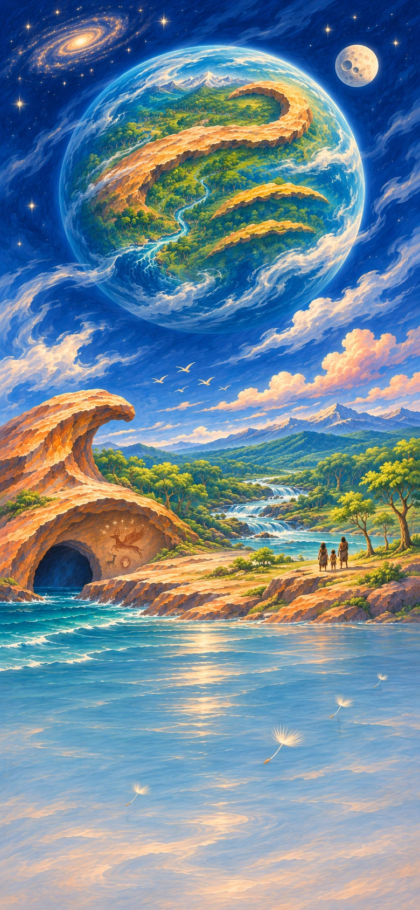

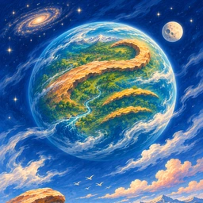

Begin with Earth, Air, Fire and Water. Kindle stars, raise oceans and bring a living world into being—then discover what it can make without you.

## `c01` Let there be somewhere

background: 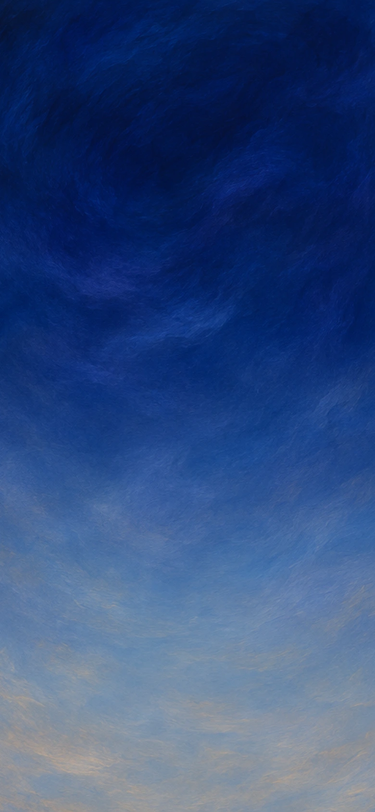

You have no throne, no worshippers, and nowhere to stand. Only Earth, Air, Fire and Water: matter, motion, energy and change.

This is a creation myth. Your gestures can span a billion years; they are not laboratory recipes. Make something worth looking at.

**Goals**
- Kindle the first light -- Light
- next: Kindle a star -- First star
- Give the darkness a galaxy -- Galaxy

**Items**
- Earth
  - icon:  (circular)
  Matter: what can have weight, form and substance.
- Air
  - icon:  (circular)
  Motion: what can travel, stir and open space.
- Fire
  - icon:  (circular)
  Energy: what can shine, warm and transform.
- Water
  - icon:  (circular)
  Change: what can flow, join and find another shape.
- Light
  - icon:  (circular)
  The first light finds nothing to illuminate. You will have to make its audience.

  *Light*
- Dust
  - icon: 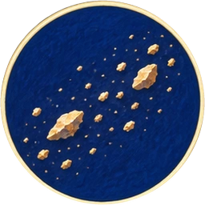 (circular)
- Mist
  - icon: 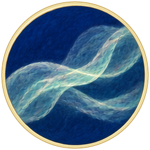 (circular)
- Gravity
  - icon: 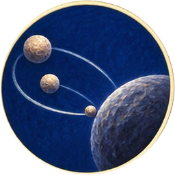 (circular)
  You give matter a mutual pull. Gravity will gather worlds, but it will also bring things crashing together.

  *Gravity*
- Dense cloud
  - icon: 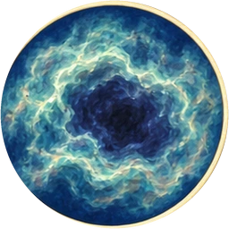 (circular)
- First star
  - icon: 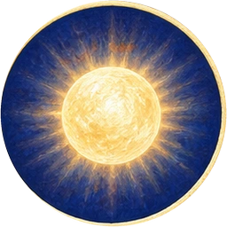 (circular)
  You gather and ignite the cloud. A real star shines through nuclear fusion in its core, not through a flame eating air.

  For the first time, there is a light from which a shadow could fall.

  *First star*
- Starfield
  - icon:  (circular)
  You let the first pattern happen again, far across the dark. Separate lights kindle in places that have never met.

  *Starfield*
- Galaxy
  - icon: 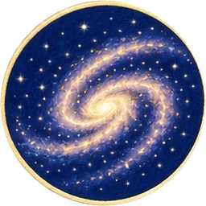 (circular)
  Gravity gathers the stars into a vast turning company. The lights no longer look lonely.

  What can a star give besides light?

  *Galaxy*

**Combinations**
- Fire + Air -> Light (tutorial)
- Earth + Air -> Dust
- Water + Air -> Mist
- Earth + Dust [transform] -> Gravity
- Mist [transform] + Dust [transform] -> Dense cloud
- Dense cloud [transform] + Fire -> First star
- First star [transform] + Air -> Starfield
- Starfield [transform] + Gravity [transform] -> Galaxy

## `c02` The gift inside a star

background: 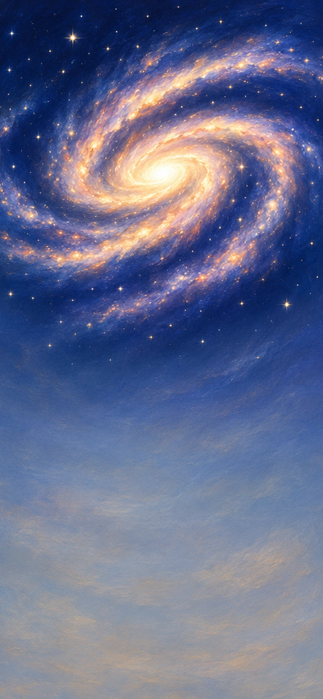

A star can shine for ages and still have a last day. Let one of your great lights change what the universe can be made of.

**Goals**
- Let a star give its matter back -- New stellar nursery

**Hotspots**
- First star (at 50%, 20%)
  - icon: 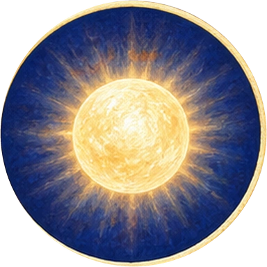 (circular)

**Items**
- Massive star
  - icon: 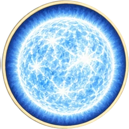 (circular)
  Gravity gathers more gas into this star. Its greater mass makes a hotter furnace—and a shorter-lived light.

  *Massive star*
- Fusing core
  - icon: 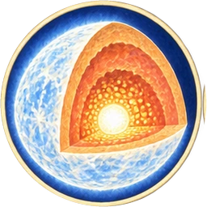 (circular)
  Inside massive stars, fusion builds many heavier elements from lighter nuclei. The star is making new material while it shines.

  *Fusing core*
- Supernova
  - icon: 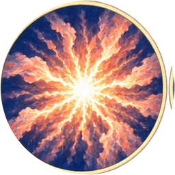 (circular)
  The core collapses; the outer layers blast outward. This is one possible ending for a massive star, not the fate of every star.

  You cannot keep this light and receive its scattered gift unchanged.

  *Supernova*
- Heavy elements
  - icon: 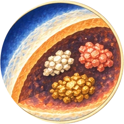 (circular)
  The stellar furnace fuses lighter nuclei into heavier ones, including carbon, oxygen and iron. These elements are still inside the star; an explosion can later scatter them into new clouds.

  *Heavy elements*
- Expanding remnant
  - icon: 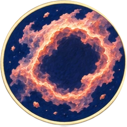 (circular)
- Glowing nebula
  - icon: 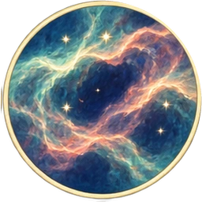 (circular)
  You excite the thin gas; it glows as it gives energy back. A nebula is a cloud, not a new substance: this one is the visible remains of a star.

  *Glowing nebula*
- Enriched dust
  - icon: 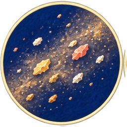 (circular)
- New stellar nursery
  - icon: 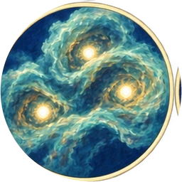 (circular)
  Gravity gathers gas and enriched dust into a new cloud. The next generation can inherit ingredients for rocky worlds.

  Destruction has not returned you to nothing.

  *New stellar nursery*

**Combinations**
- Gravity [transform] @ First star [transform] -> Massive star
- Massive star [transform] + Fire -> Fusing core
- Heavy elements [transform] + Gravity [transform] -> Supernova
- Fusing core [transform] + Earth -> Heavy elements
- Supernova [transform] + Air -> Expanding remnant
- Expanding remnant [transform] + Fire -> Glowing nebula
- Heavy elements [transform] + Expanding remnant [transform] -> Enriched dust
- Enriched dust [transform] + Gravity [transform] -> New stellar nursery

## `c03` A restless world

background: 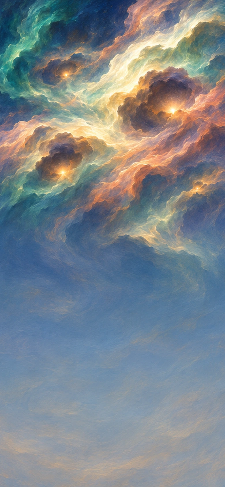

Choose one young sun among the many. Around it, give the scattered matter somewhere to gather—and an interior that will refuse to sit still.

**Goals**
- Make a world with a solid face -- Stone crust
- Give its moving core a magnetic field -- Magnetic field

**Hotspots**
- New stellar nursery (at 50%, 20%)
  - icon: 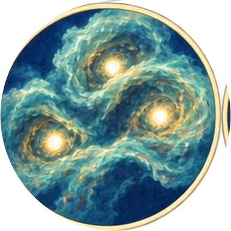 (circular)

**Items**
- Sun
  - icon: 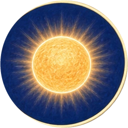 (circular)
  A new star shines with material from earlier generations. Around it, a disk still holds grains that could become something other than another star.

  *Sun*
- Planetary disk
  - icon: 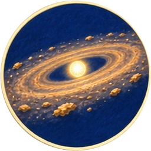 (circular)
  Around the young sun, dust and gas share a turning disk. Countless grains cross one another's paths; some meetings will make larger things.

  *Planetary disk*
- Planetesimals
  - icon: 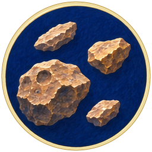 (circular)
- Rocky world
  - icon: 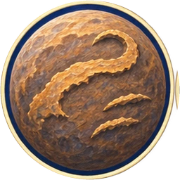 (circular)
  Small rocky bodies collide and gather into a planet. Your new world is assembled from many smaller meetings, not carved from a finished globe.

  *Rocky world*
- Magma ocean
  - icon: 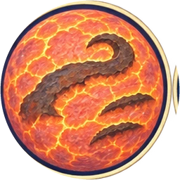 (circular)
- Iron core
  - icon: 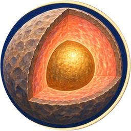 (circular)
  Dense metal sinks inward while lighter rocky material remains above it. The planet sorts itself by density.

  *Iron core*
- Magnetic field
  - icon: 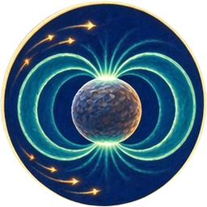 (circular)
  You set the liquid metal moving. In a planet with a conducting, convecting, rotating interior, a dynamo can sustain a magnetic field. Air is your gesture of motion here, not gas blown into the core.

  *Magnetic field*
- Stone crust
  - icon:  (circular)
  Heat escapes into space; a skin of rock hardens. Beneath it, the world remains hot enough to change its own face.

  *Stone crust*
- Aurora
  - icon: 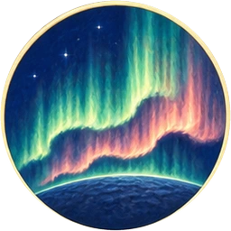 (circular)
  Charged particles from the Sun can be guided into a planet's upper atmosphere by its magnetic field. Collisions excite atmospheric gases, which glow.

  Even your invisible field can leave colours in the dark.

  *Aurora*

**Combinations**
- Gravity [transform] @ New stellar nursery [transform] -> Sun
- Enriched dust [transform] + Sun [transform] -> Planetary disk
- Planetary disk [transform] + Earth -> Planetesimals
- Planetesimals [transform] + Gravity [transform] -> Rocky world
- Rocky world + Fire -> Magma ocean
- Magma ocean [transform] + Gravity [transform] -> Iron core
- Iron core [transform] + Air -> Magnetic field
- Magma ocean [transform] + Air -> Stone crust
- Magnetic field [transform] + Sun [transform] -> Aurora

## `c04` A companion and a shore

background: 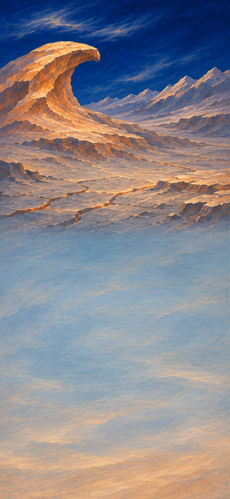

Another body crosses the young world's path. Let the meeting remake the sky, then give the cooling planet a sea.

**Goals**
- Gather a moon -- Moon
- Make a shore that never quite stays put -- Tidal shore

**Hotspots**
- Rocky world (at 50%, 20%)
  - icon: 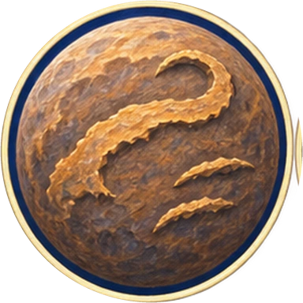 (circular)

**Items**
- Air
- Giant impact
  - icon: 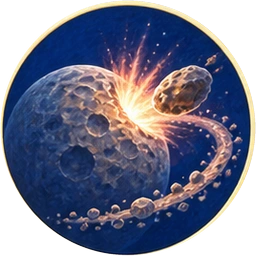 (circular)
  A violent collision throws material into orbit. A giant impact is the leading explanation for our Moon, though the details remain debated.

  Your world survives with a changed future.

  *Giant impact*
- Moon
  - icon:  (circular)
- Tides
  - icon:  (circular)
  The Moon's uneven gravitational pull helps raise tides; the Sun contributes too. A companion can touch a sea without entering it.

  *Tides*
- First rain
  - icon: 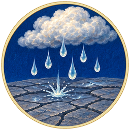 (circular)
  Steam cools above the world's hardened surface and condenses. For the first time, falling water reaches ground that can hold it.

  *First rain*
- Rain-filled hollows
  - icon:  (circular)
  Rain gathers in low places that already exist in the crust. It can erode a landscape, but rain alone did not excavate Earth's ocean basins.

  *Rain-filled hollows*
- Ocean
  - icon: 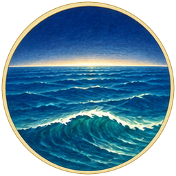 (circular)
  Water collects across the planet's low places. You have made a sea too large to see from one shore.

  *Ocean*
- Tidal shore
  - icon:  (circular)
  Water advances and retreats over the same ground. A boundary has become a recurring invitation.

  *Tidal shore*

**Combinations**
- Planetesimals [transform] @ Rocky world -> Giant impact
- Giant impact [transform] + Gravity [transform] -> Moon
- Moon [transform] + Water -> Tides
- Mist [transform] @ Rocky world -> First rain
- First rain [transform] + Stone crust [transform] -> Rain-filled hollows
- Rain-filled hollows [transform] + Water -> Ocean
- Ocean [transform] + Tides [transform] -> Tidal shore

## `c05` Water learns the way home

background: 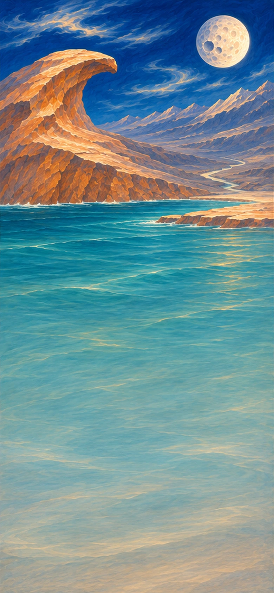

A full ocean is a beginning. Lift its water into the sky and see where the land sends it back.

**Goals**
- Let rivers build a delta -- Delta
- Keep the water travelling -- Water cycle

**Items**
- Evaporation
  - icon:  (circular)
- Clouds
  - icon: 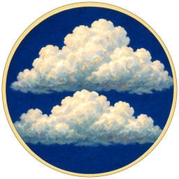 (circular)
  Rising moist air cools and water vapour condenses. A visible cloud contains tiny droplets or ice crystals; the vapour itself is invisible.

  *Clouds*
- Rainfall
  - icon: 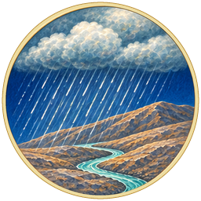 (circular)
  Droplets or ice particles grow within a cloud until gravity carries them down. The same pull that gathered worlds can bring a shower to the ground.

  *Rainfall*
- Rivers
  - icon:  (circular)
  Gravity carries water downhill. Rivers find routes through a landscape and gradually alter those routes by erosion and deposition.

  *Rivers*
- Sediment
  - icon:  (circular)
- Delta
  - icon: 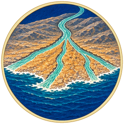 (circular)
  Where a river slows, some of its sediment settles. Over time, carried fragments can become new land.

  *Delta*
- Rainbow
  - icon:  (circular)
  Sunlight bends, reflects and separates into colours inside water droplets. Your first ornament belongs to no single place.

  *Rainbow*
- Water cycle
  - icon:  (circular)
  Water evaporates, condenses and returns as precipitation and runoff. The Sun supplies energy; gravity brings water down.

  You need not pour the ocean again each morning.

  *Water cycle*

**Combinations**
- Ocean [transform] + Sun [transform] -> Evaporation
- Evaporation [transform] + Air -> Clouds
- Clouds [transform] + Gravity [transform] -> Rainfall
- Rainfall [transform] + Gravity [transform] -> Rivers
- Rivers [transform] + Earth -> Sediment
- Sediment [transform] + Ocean [transform] -> Delta
- Clouds [transform] + Sun [transform] -> Rainbow
- Rivers [transform] + Sun [transform] -> Water cycle

## `c06` The stone is not finished

background: 

The solid face looks permanent from a shore. Beneath it, heat is still moving the world.

**Goals**
- Open a hot spring on the seafloor -- Hydrothermal vent
- Bring rock minerals into the sea -- Mineral-rich sea

**Items**
- Moving plates
  - icon:  (circular)
  You divide the outer shell into moving plates. Earth's plate motion involves a complex exchange of forces and heat; it is not a crust floating on a global liquid ocean.

  *Moving plates*
- Continent
  - icon:  (circular)
  Moving plates gather and reshape buoyant continental crust. You raise a broad mass of land; it will spend its long life being remade.

  *Continent*
- Trench
  - icon:  (circular)
  You fold a boundary downward beneath the sea. Deep ocean trenches form where one plate bends into a zone of subduction beneath another.

  *Trench*
- Volcano
  - icon:  (circular)
- Hydrothermal vent
  - icon:  (circular)
  Seawater enters cracks, heats within rock and returns carrying dissolved chemicals. On a dark seafloor, chemical differences can supply energy.

  *Hydrothermal vent*
- Weathered rock
  - icon:  (circular)
- Mineral-rich sea
  - icon:  (circular)
  Flowing water carries dissolved minerals and fragments from land to sea. A continent is giving away parts of itself.

  *Mineral-rich sea*
- Volcanic island
  - icon: 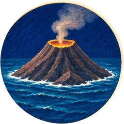 (circular)
  Repeated eruptions build a mountain from the seafloor until its summit breaks the surface. An island begins with no forest, no animals and no memory of either.

  *Volcanic island*

**Combinations**
- Stone crust [transform] + Fire -> Moving plates
- Moving plates [transform] + Earth -> Continent
- Moving plates [transform] + Water -> Trench
- Moving plates [transform] + Fire -> Volcano
- Volcano [transform] + Water -> Hydrothermal vent
- Continent [transform] + Rainfall [transform] -> Weathered rock
- Weathered rock [transform] + Rivers [transform] -> Mineral-rich sea
- Volcano [transform] + Ocean [transform] -> Volcanic island

## `c07` The first inside

background: 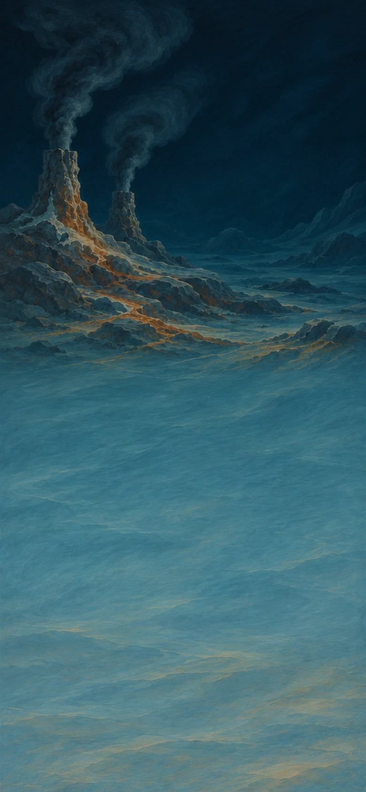

The ocean contains ingredients and energy, but no one is alive. Here your myth must cross a gap that science has not yet explained: give matter an inside that can keep itself going.

**Goals**
- Make life that can copy and vary
  - and: Dividing cells
  - and: Variation
- Let living layers change a shore -- Stromatolites

**Hotspots**
- Hydrothermal vent (at 50%, 20%)
  - icon: 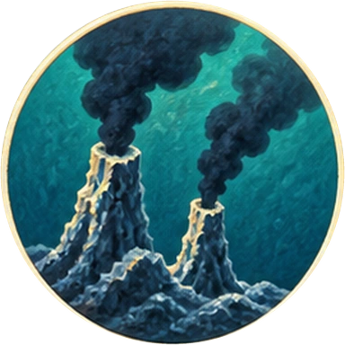 (circular)

**Items**
- Organic molecules
  - icon:  (circular)
  Hot mineral environments are one setting studied in research on life's origins. Organic molecules alone are not alive, and no agreed pathway from chemistry to the first cell is known.

  *Organic molecules*
- Membranes
  - icon:  (circular)
  Some molecules gather into thin boundaries in water. A small space can now hold a different mixture from the sea around it.

  *Membranes*
- Chemical fuel
  - icon: 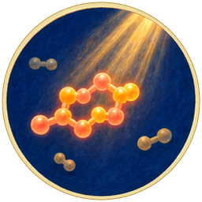 (circular)
  You let sunlight drive reactions that store some of its energy in molecules. Such chemistry is part of origin-of-life research; energetic molecules still do not explain a living cell.

  *Chemical fuel*
- Living cell
  - icon: 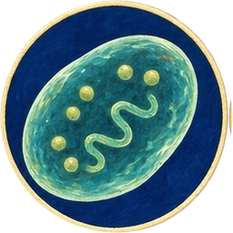 (circular)
  A boundary and an energy source are not enough to explain life. Here you supply the missing miracle: a cell that maintains itself and can pass on an inherited organization.

  Something now has an inside to protect.

  *Living cell*
- Dividing cells
  - icon:  (circular)
  One cell passes its inherited organization into descendants. Your creation can now make more living cells.

  *Dividing cells*
- Variation
  - icon:  (circular)
  The copying that passes life onward need not make identical descendants. In this gesture, ultraviolet light changes inherited information; real variation has several sources and does not arise because an organism needs it.

  Your first family already contains possibilities you did not specify.

  *Variation*
- Sun-fed cells
  - icon: 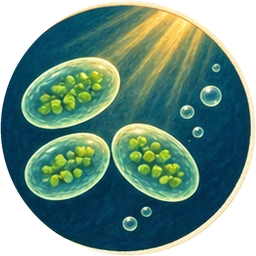 (circular)
  You let some cells capture sunlight. In this lineage, photosynthesis uses light energy to build organic matter; later descendants will change the air itself.

  *Sun-fed cells*
- Microbial mats
  - icon:  (circular)
- Stromatolites
  - icon: 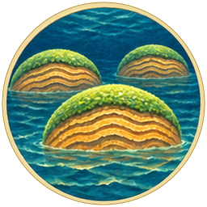 (circular)
  Layers of microbes trap sediment and build layered structures. Some stromatolites preserve evidence of very ancient life.

  Small lives can leave a landscape behind them.

  *Stromatolites*

**Combinations**
- Mineral-rich sea [transform] @ Hydrothermal vent [transform] -> Organic molecules
- Organic molecules [transform] + Water -> Membranes
- Organic molecules [transform] + Light [transform] -> Chemical fuel
- Membranes [transform] + Chemical fuel [transform] -> Living cell
- Living cell [transform] + Water -> Dividing cells
- Dividing cells [transform] + Light [transform] -> Variation
- Dividing cells [transform] + Sun [transform] -> Sun-fed cells
- Sun-fed cells [transform] + Stone crust [transform] -> Microbial mats
- Microbial mats [transform] + Tidal shore [transform] -> Stromatolites

## `c08` A dangerous new sky

background: 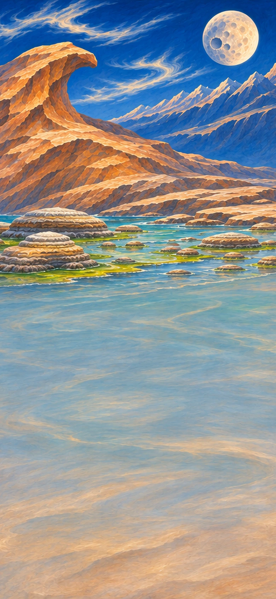

The sun-fed cells release a gas. What is waste to one kind of life can become power—or poison—to another.

**Goals**
- Let the sea record the change -- Banded iron
- next: Give life a shield against ultraviolet light -- Ozone layer
- Keep different ways of living
  - and: Partnered cells
  - and: Sheltered microbes

**Hotspots**
- Sun-fed cells (at 50%, 20%)
  - icon: 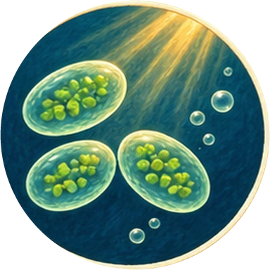 (circular)

**Items**
- Oxygen
  - icon:  (circular)
  Oxygen-producing photosynthesis splits water and releases oxygen. Earth's earliest life did not require an oxygen-rich atmosphere.

  *Oxygen*
- Rusted seabed
  - icon:  (circular)
- Banded iron
  - icon:  (circular)
  Oxygen reacted with dissolved iron and helped leave iron-rich deposits. Much early oxygen was consumed by such reactions before it accumulated in the atmosphere.

  *Banded iron*
- Oxygen-rich sky
  - icon: 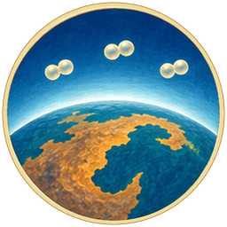 (circular)
  Oxygen eventually accumulates faster than it is removed. For organisms adapted to oxygen-free conditions, the changed environment can be deadly.

  Your flourishing creation has made a crisis for other lives.

  *Oxygen-rich sky*
- Ozone layer
  - icon:  (circular)
  Sunlight drives reactions that form ozone high in the atmosphere. Ozone absorbs much harmful ultraviolet radiation; it does not make every place safe.

  *Ozone layer*
- Oxygen-using cells
  - icon: 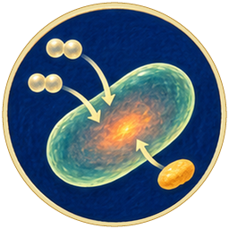 (circular)
  Some cells use oxygen to obtain usable energy from food. Oxygen is not food itself; it participates in reactions that release energy stored in food molecules.

  *Oxygen-using cells*
- Partnered cells
  - icon:  (circular)
  One cell takes another into a lasting partnership. This myth compresses endosymbiosis: mitochondria descend from bacteria that became part of other cells. It is not a complete explanation of how complex cells originated.

  *Partnered cells*
- Sheltered microbes
  - icon:  (circular)
  Oxygen-free pockets can remain beneath living layers and in sediments. A transformed world can still hold refuges for older ways of living.

  *Sheltered microbes*

**Combinations**
- Water @ Sun-fed cells [transform] -> Oxygen
- Oxygen [transform] + Heavy elements [transform] -> Rusted seabed
- Rusted seabed [transform] + Sediment [transform] -> Banded iron
- Oxygen [transform] + Air -> Oxygen-rich sky
- Oxygen-rich sky [transform] + Light [transform] -> Ozone layer
- Living cell [transform] + Oxygen [transform] -> Oxygen-using cells
- Oxygen-using cells [transform] + Living cell [transform] -> Partnered cells
- Oxygen-rich sky [transform] + Microbial mats [transform] -> Sheltered microbes

## `c09` More than a single cell

background: 

An inside can shelter partners. Now let cells stay together and discover what a body can do.

**Goals**
- Grow sea plants -- Algae
- next: Let stone keep a trace of life -- Fossils
- Give swimmers a way to see -- Eyes

**Items**
- Cell colonies
  - icon:  (circular)
- Multicellular life
  - icon: 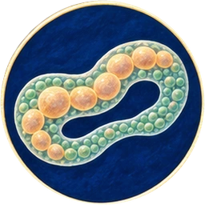 (circular)
  Cells keep contact, exchange signals and divide their work. Their membranes are living interfaces as well as boundaries. Multicellularity evolved independently in several lineages; this is one imagined passage through that possibility.

  *Multicellular life*
- Algae
  - icon:  (circular)
- Soft-bodied animals
  - icon:  (circular)
- Swimming animals
  - icon:  (circular)
  Oxygen helps these animals release energy from food. Muscles can spend that energy pushing against the water; a drifting life becomes an active pursuit.

  *Swimming animals*
- Eyes
  - icon:  (circular)
  Light-sensitive structures can help an animal find food, avoid danger or orient itself. Eyes have many forms and evolutionary histories; sight is not a single inevitable invention.

  *Eyes*
- Shells
  - icon:  (circular)
- Fossils
  - icon:  (circular)
  Sediment can bury remains that later mineralize or leave impressions. Most lives leave no fossil; the stone archive will always be incomplete.

  *Fossils*

**Combinations**
- Partnered cells [transform] + Water -> Cell colonies
- Cell colonies [transform] + Membranes [transform] -> Multicellular life
- Multicellular life [transform] + Sun [transform] -> Algae
- Multicellular life [transform] + Ocean [transform] -> Soft-bodied animals
- Soft-bodied animals [transform] + Oxygen [transform] -> Swimming animals
- Swimming animals [transform] + Light [transform] -> Eyes
- Soft-bodied animals [transform] + Mineral-rich sea [transform] -> Shells
- Shells [transform] + Sediment [transform] -> Fossils

## `c10` Cities without streets

background: 

You could fill the sea with isolated creatures. Instead, make places where one life becomes shelter for another.

**Goals**
- Raise an underwater forest -- Kelp forest
- next: Let waves hollow a cave -- Sea cave
- Make a coast crowded with life -- Living coast

**Items**
- Kelp forest
  - icon:  (circular)
  Large brown algae anchor to rock and grow toward the light. Their underwater forests offer shelter and feeding places to many other organisms.

  *Kelp forest*
- Coral
  - icon:  (circular)
  Small polyps settle on submerged rock along the coast. Their tentacles catch passing food; these rooted-looking lives are animals.

  *Coral*
- Reef partnership
  - icon:  (circular)
  Many reef-building corals host tiny photosynthetic algae. The coral offers shelter; the algae share products of photosynthesis. Stress can break this partnership.

  *Reef partnership*
- Coral reef
  - icon:  (circular)
  Corals draw dissolved mineral ingredients from seawater to build calcium carbonate skeletons. Generations of skeletons become a vast reef: both living community and inherited architecture.

  *Coral reef*
- Nursery waters
  - icon:  (circular)
  Young swimmers hide among the kelp's fronds. A larger life has made small spaces where another can survive long enough to grow.

  *Nursery waters*
- Coastal mosaic
  - icon:  (circular)
  Across a vast coast, cooler kelp beds and warmer reefs offer different kinds of shelter and food. Within each region, animals can use several neighbouring habitats over a lifetime.

  *Coastal mosaic*
- Living coast
  - icon:  (circular)
  Tides move water and nutrients through a patchwork of habitats. The coast's wealth is in its connections, not simply its number of creatures.

  *Living coast*
- Waves
  - icon:  (circular)
- Sea cave
  - icon:  (circular)
  Waves exploit cracks in coastal rock and hollow out a cave. Above the wash of the tide, its dry walls hold the marks of stone and time.

  A place can wait a very long time for a visitor.

  *Sea cave*

**Combinations**
- Algae [transform] + Stone crust [transform] -> Kelp forest
- Soft-bodied animals [transform] + Tidal shore [transform] -> Coral
- Coral [transform] + Algae [transform] -> Reef partnership
- Reef partnership [transform] + Mineral-rich sea [transform] -> Coral reef
- Swimming animals [transform] + Kelp forest [transform] -> Nursery waters
- Nursery waters [transform] + Coral reef [transform] -> Coastal mosaic
- Coastal mosaic [transform] + Tides [transform] -> Living coast
- Ocean [transform] + Air -> Waves
- Waves [transform] + Stone crust [transform] -> Sea cave

## `c11` The bare continents

background: 

From above, the continents are enormous and almost empty. Bring life across the wet margin without pretending dry stone is already soil.

**Goals**
- Clothe the wet ground -- Moss
- Make a forest on land -- First forest

**Hotspots**
- Living coast (at 50%, 20%)
  - icon:  (circular)

**Items**
- Shore plants
  - icon:  (circular)
  Along the wet margin, descendants of green algae begin living out of the water. Holding moisture and surviving exposure become new demands.

  *Shore plants*
- Soil
  - icon:  (circular)
  Living growth, weathering and the accumulation of organic matter begin making soil. Wet rock alone is not fertile earth.

  *Soil*
- Windblown spores
  - icon:  (circular)
  Air carries tiny reproductive cells away from the parent growth. A spore can begin a new plant in a suitable place; it is different from a seed with an embryo and food reserves.

  *Windblown spores*
- Moss
  - icon:  (circular)
- Wetland
  - icon:  (circular)
  Low ground holds water among the mosses. The soaked ground becomes a habitat of its own, with little air reaching the soil beneath it.

  *Wetland*
- Roots
  - icon:  (circular)
  Roots anchor plants and help them acquire water and nutrients. Underground work makes above-ground height possible.

  *Roots*
- Ferns
  - icon:  (circular)
  Roots supply water and nutrients while broad fronds gather light. Across generations, this branch can rise above the low growth and spread spores from a taller body.

  *Ferns*
- First forest
  - icon:  (circular)
  Across many generations, tall plants fill the wet ground. This imagined forest compresses a long, branching history; living mosses are not unfinished trees.

  The wind has something new to move through.

  *First forest*

**Combinations**
- Algae [transform] @ Living coast [transform] -> Shore plants
- Shore plants [transform] + Weathered rock [transform] -> Soil
- Shore plants [transform] + Air -> Windblown spores
- Windblown spores [transform] + Soil [transform] -> Moss
- Moss [transform] + Water -> Wetland
- Shore plants [transform] + Soil [transform] -> Roots
- Roots [transform] + Light [transform] -> Ferns
- Ferns [transform] + Wetland [transform] -> First forest

## `c12` Nothing lives on light alone

background: 

The forest grows, and the ground fills with what it sheds. Give the fallen material somewhere to go.

**Goals**
- Let old growth nourish new growth -- Renewing forest
- next: Let the forest feed the clouds -- Forest rain
- Bury some of the old sunlight -- Buried carbon

**Hotspots**
- First forest (at 50%, 20%)
  - icon:  (circular)

**Items**
- Fallen wood
  - icon:  (circular)
  Wind brings down an old branch. The forest has made its first gift to lives that cannot feed on sunlight.

  *Fallen wood*
- Fungi
  - icon:  (circular)
  A branch of complex life grows by absorbing food from its surroundings. This fungal lineage can feed on wood; wet wood has not spontaneously turned into life.

  *Fungi*
- Decomposition
  - icon:  (circular)
  Fungi and other decomposers break down dead organic matter. Decay releases nutrients for reuse; it is part of the forest's life, not an interruption of it.

  *Decomposition*
- Returned nutrients
  - icon:  (circular)
- Renewing forest
  - icon:  (circular)
  Roots take up nutrients returned through decomposition. New growth draws on material from lives that have ended.

  *Renewing forest*
- Peat
  - icon:  (circular)
  Dead plant material accumulates in waterlogged ground faster than it fully decays. A dark, soft store of old growth thickens beneath the living surface.

  *Peat*
- Buried carbon
  - icon:  (circular)
  Waterlogged conditions can slow decomposition. Some accumulated organic carbon is buried for immense periods, keeping part of old photosynthesis out of the air.

  *Buried carbon*
- Forest rain
  - icon:  (circular)
  Plants return water to the air through transpiration. In some regions, forests help sustain rainfall far beyond the individual tree.

  *Forest rain*

**Combinations**
- Air @ First forest -> Fallen wood
- Partnered cells [transform] + Fallen wood [transform] -> Fungi
- Fungi [transform] + Fallen wood [transform] -> Decomposition
- Decomposition [transform] + Soil [transform] -> Returned nutrients
- Returned nutrients [transform] + Roots [transform] -> Renewing forest
- Wetland [transform] + Fallen wood [transform] -> Peat
- Peat [transform] + Earth -> Buried carbon
- Renewing forest [transform] + Clouds [transform] -> Forest rain

## `c13` Small wings over a continent

background: 

The forest offers leaves, food and shelter. Let a small branch of animal life explore the spaces between them.

**Goals**
- Fill the canopy with movement -- Canopy life

**Hotspots**
- First forest (at 50%, 20%)
  - icon:  (circular)

**Items**
- Arthropods
  - icon:  (circular)
  This branch gains jointed limbs and an external skeleton. Arthropods and vertebrates are separate branches with deeper shared animal ancestry.

  *Arthropods*
- Insects
  - icon:  (circular)
  Among the land-dwelling arthropods, a six-legged branch finds food and shelter among plants. The plants offer a habitat; they do not become part of an insect's ancestry.

  *Insects*
- Winged insects
  - icon:  (circular)
  Wings open the air above the leaves. Insects took flight long before birds; their wings developed along a different evolutionary path from vertebrate forelimbs.

  *Winged insects*
- Canopy life
  - icon:  (circular)
  Flying insects move among leaves, branches and shelter above the ground. The forest has acquired another inhabited layer.

  *Canopy life*

**Combinations**
- Soft-bodied animals [transform] + Variation [transform] -> Arthropods
- Arthropods [transform] + Shore plants [transform] -> Insects
- Insects [transform] + Air -> Winged insects
- Winged insects [transform] + First forest -> Canopy life

## `c14` The shore is crossed again

background: 

The land has food and shelter, but living there asks new things of a body. Let different branches of animal life find different ways across.

**Goals**
- Give land vertebrates an egg for dry ground -- Shelled egg
- Give the forest giants, small mammals and birds
  - and: Great browsers
  - and: Small furred animals
  - and: Birds

**Hotspots**
- First forest (at 50%, 20%)
  - icon:  (circular)

**Items**
- Air-breathing fish
  - icon:  (circular)
- Limbed vertebrates
  - icon:  (circular)
  A fish lineage explores a tangle at the water's edge. Across generations, inherited changes to paired appendages contribute to limbs. No fish grows legs because it decides to leave a pond.

  *Limbed vertebrates*
- Shelled egg
  - icon:  (circular)
  The amniotic egg surrounds an embryo with protective membranes. In shelled forms, it permits reproduction away from open water. Other land animals keep different solutions.

  *Shelled egg*
- Reptiles
  - icon:  (circular)
- Birds
  - icon:  (circular)
  In one dinosaur lineage, feathered forelimbs become wings. Birds belong to that branching history; their flight evolved independently of insect flight.

  *Birds*
- Great browsers
  - icon:  (circular)
  Huge plant-eating reptiles move among the trees. Their feeding opens paths and their heavy steps leave tracks in the wet ground.

  Give these particular giants a place in your memory.

  *Great browsers*
- Small furred animals
  - icon:  (circular)
  Another vertebrate branch includes small mammals. They find food and shelter among fallen wood long before the great impact. Smallness is one way of living, not a promise of survival.

  *Small furred animals*

**Combinations**
- Swimming animals [transform] + Wetland [transform] -> Air-breathing fish
- Air-breathing fish [transform] + Roots [transform] -> Limbed vertebrates
- Limbed vertebrates [transform] + Membranes [transform] -> Shelled egg
- Shelled egg [transform] + Variation [transform] -> Reptiles
- Reptiles [transform] + Air -> Birds
- Reptiles [transform] + First forest -> Great browsers
- Limbed vertebrates [transform] + Fallen wood [transform] -> Small furred animals

## `c15` A bargain in colour

background: 

A plant cannot walk to a mate or carry its offspring far away. Let it make offers that other lives have reasons to accept.

**Goals**
- Send seeds on the wind -- Windborne seeds
- Make a forest of exchanges -- Flowering forest

**Hotspots**
- Flowers (at 50%, 20%)
  - icon:  (circular)

**Items**
- Water
- Flowers
  - icon:  (circular)
  Across many generations, one branch of land plants develops flowers: structures for reproduction that can also offer food, scent and colour to visitors.

  *Flowers*
- Pollination
  - icon:  (circular)
  An insect seeking food can carry pollen between flowers. Each partner pursues its own needs; the relationship can benefit both.

  *Pollination*
- Seeds
  - icon:  (circular)
  Compatible pollen allows fertilization; an embryo and its food supply develop inside a protective seed coat.

  *Seeds*
- Seedling
  - icon:  (circular)
- Windborne seeds
  - icon:  (circular)
- Fruit
  - icon:  (circular)
  The flowering plant encloses its seeds in fleshy tissue. Food can recruit an animal to carry what the plant cannot move itself.

  *Fruit*
- Seed dispersal
  - icon:  (circular)
- Flowering forest
  - icon:  (circular)
  Animals carry seeds into new places. Feeding and being fed have become a way for the landscape to renew itself.

  *Flowering forest*

**Combinations**
- Shore plants [transform] + Sun [transform] -> Flowers
- Insects [transform] @ Flowers -> Pollination
- Pollination [transform] + Flowers -> Seeds
- Seeds [transform] + Water -> Seedling
- Seeds [transform] + Air -> Windborne seeds
- Seeds [transform] + Flowers -> Fruit
- Fruit [transform] + Limbed vertebrates [transform] -> Seed dispersal
- Seed dispersal [transform] + Renewing forest [transform] -> Flowering forest

## `c16` One sun, many worlds

background: 

The same sunlight reaches a world of unequal heights and uneven rain. Give life places that ask different things of it.

**Goals**
- Give the planet seasons -- Seasons
- next: Make a dry country -- Desert
- Carve a path down from the ice -- Braided river

**Hotspots**
- Rocky world (at 50%, 20%)
  - icon:  (circular)

**Items**
- Axial tilt
  - icon:  (circular)
  You tip the turning planet. The direction of its axis will make sunlight arrive differently over an orbit.

  *Axial tilt*
- Seasons
  - icon:  (circular)
  A tilted planet changes the angle and duration of sunlight during its orbit. Earth's seasons mainly come from axial tilt, not from being much nearer the Sun in summer.

  *Seasons*
- Mountain range
  - icon:  (circular)
- Rain shadow
  - icon:  (circular)
  Moist air rises over mountains, cools and loses water. The far side can receive much less rain. One mountain range can help make two different climates.

  *Rain shadow*
- Desert
  - icon:  (circular)
- Oasis
  - icon:  (circular)
- Grassland
  - icon:  (circular)
- Glacier
  - icon:  (circular)
  On the cold heights, snow accumulates faster than it melts. Compacted over many years, it becomes ice that can flow under its own weight.

  *Glacier*
- Valley
  - icon:  (circular)
  Moving ice scours and reshapes rock over long periods. Gravity works with both liquid and frozen water, but they leave different landscapes.

  *Valley*
- Braided river
  - icon:  (circular)
  Water carries sand and gravel down the glacial valley. Deposits divide the flow into shifting channels that separate and meet again.

  *Braided river*

**Combinations**
- Rocky world + Air -> Axial tilt
- Axial tilt [transform] + Sun [transform] -> Seasons
- Continent [transform] + Moving plates [transform] -> Mountain range
- Mountain range [transform] + Clouds [transform] -> Rain shadow
- Rain shadow [transform] + Sun [transform] -> Desert
- Desert [transform] + Water -> Oasis
- Rain shadow [transform] + Shore plants [transform] -> Grassland
- Mountain range [transform] + Water -> Glacier
- Glacier [transform] + Gravity [transform] -> Valley
- Valley [transform] + Rivers [transform] -> Braided river

## `c17` Hunger belongs here too

background: 

Abundance does not mean that every creature can live without eating another. Connect feeding, waste and new growth across the grassland.

**Goals**
- Connect the eaters and the eaten -- Food web

**Items**
- Water
- Grazing herds
  - icon:  (circular)
- Scent tracking
  - icon:  (circular)
  Air brings traces of other animals. A mammal can follow the changing scent toward food or away from danger.

  *Scent tracking*
- Hunting mammals
  - icon:  (circular)
- Predator and prey
  - icon:  (circular)
  Hunters pursue food; prey respond to danger. These encounters affect other lives throughout the community. Neither side exists simply to balance your design.

  *Predator and prey*
- Dung
  - icon:  (circular)
- Dung beetles
  - icon:  (circular)
  Some insects specialize in dung as food and a place to raise young. The grazers' waste has become another lineage's opportunity.

  *Dung beetles*
- Fertile grassland
  - icon:  (circular)
- Food web
  - icon:  (circular)
  Food, nutrients and energy pass through overlapping relationships. Remove one connection and others may change; a food web is not a set of obedient pieces.

  The world is doing things you did not command one by one.

  *Food web*
- Watering place
  - icon:  (circular)
  Herds gather at the water's edge. The water they need also draws hunters; a place of relief can become a place of danger.

  *Watering place*

**Combinations**
- Grassland [transform] + Limbed vertebrates [transform] -> Grazing herds
- Small furred animals [transform] + Air -> Scent tracking
- Small furred animals [transform] + Scent tracking [transform] -> Hunting mammals
- Hunting mammals [transform] + Grazing herds [transform] -> Predator and prey
- Grazing herds [transform] + Grassland [transform] -> Dung
- Dung [transform] + Insects [transform] -> Dung beetles
- Dung beetles [transform] + Soil [transform] -> Fertile grassland
- Fertile grassland [transform] + Predator and prey [transform] -> Food web
- Grazing herds [transform] + Water -> Watering place

## `c18` The long journeys

background: 

Life can leave the place where it began. Give creatures ways to cross distance, and let separation change what their descendants become.

**Goals**
- Fill the world with different voices -- Many-voiced world

**Items**
- Far-ranging birds
  - icon:  (circular)
- Seasonal journeys
  - icon:  (circular)
  As food and daylight shift with the seasons, birds follow recurring routes. A distant place can become part of a life's ordinary year.

  *Seasonal journeys*
- Island life
  - icon:  (circular)
- Different songs
  - icon:  (circular)
  Separated bird populations can diverge across generations. Inherited changes and learned traditions can both affect their songs. The calls across the water are no longer quite the same.

  *Different songs*
- Many-voiced world
  - icon:  (circular)
  The continents and islands hold different living communities. From far above, their calls would blur together; down among them, each place sounds like itself.

  There is now something particular to lose.

  *Many-voiced world*

**Combinations**
- Birds [transform] + Mountain range [transform] -> Far-ranging birds
- Far-ranging birds [transform] + Seasons [transform] -> Seasonal journeys
- Seasonal journeys [transform] + Volcanic island [transform] -> Island life
- Island life [transform] + Variation [transform] -> Different songs
- Different songs [transform] + Food web [transform] -> Many-voiced world

## `c19` What the sky takes back

background: 

Not every remnant of planet-building has found a quiet orbit. The gravity that gathered your world can also bring a catastrophe. Keep a trace of what this world is about to lose.

**Goals**
- Keep the giants' last tracks -- Fossil footprints

**Hotspots**
- Many-voiced world (at 50%, 20%)
  - icon:  (circular)

**Items**
- Impact winter
  - icon:  (circular)
  The impact sends debris and aerosols into the sky, reducing sunlight and disrupting food webs. Your world is vulnerable to the wider universe that gave it matter.

  *Impact winter*
- Last tracks
  - icon:  (circular)
  In this world, the great browsing lineage dies out as its food disappears. Its paths end. Surviving reptiles and birds cannot bring those particular giants back.

  *Last tracks*
- Fossil footprints
  - icon:  (circular)
  Sediment preserves a trace of the lost giants. Stone can keep evidence of a life without keeping the life itself.

  *Fossil footprints*

**Combinations**
- Planetesimals [transform] @ Many-voiced world [transform] -> Impact winter
- Impact winter [transform] + Great browsers [transform] -> Last tracks
- Last tracks [transform] + Sediment [transform] -> Fossil footprints

## `c20` Life in the dark

background: 

The giants' paths have fallen silent. Among the fallen trees, look for lives that can endure without the old abundance.

**Goals**
- Find survivors -- Small survivors
- Keep a beginning alive -- Green shoots

**Hotspots**
- First forest (at 50%, 20%)
  - icon:  (circular)

**Items**
- Fallen forest
  - icon:  (circular)
  Much of the forest loses its supply of energy. Some seeds, roots and sheltered patches survive; whole communities do not.

  *Fallen forest*
- Deadwood refuge
  - icon:  (circular)
  Fungi draw on energy stored in fallen wood. Damp trunks shelter small lives and feed a web of decomposers and their eaters while fresh growth falters.

  *Deadwood refuge*
- Small survivors
  - icon:  (circular)
  Shelter and food webs based on dead matter help some small mammals endure disrupted sunlight. Survival is uneven, not a prize for being the best creature.

  *Small survivors*
- Seed cache
  - icon:  (circular)
  Small mammals carry seeds into sheltered stores. Some are eaten; others remain, holding a future the animals did not intend to plant.

  *Seed cache*
- Green shoots
  - icon:  (circular)
  Seeds that survived begin to grow. Recovery starts from what remains; ash and hope cannot recreate an extinct lineage.

  *Green shoots*

**Combinations**
- Impact winter [transform] + First forest [transform] -> Fallen forest
- Fallen forest [transform] + Fungi [transform] -> Deadwood refuge
- Deadwood refuge [transform] + Small furred animals [transform] -> Small survivors
- Small survivors [transform] + Seeds [transform] -> Seed cache
- Seed cache [transform] + Soil [transform] -> Green shoots

## `c21` A different green

background: 

Light returns. New feet cross the giants' old paths; help surviving lives meet one another in a changed forest.

**Goals**
- Reconnect a recovering world -- Recovering world
- Reach the branches, sea and sky
  - and: Tree dwellers
  - and: Whales
  - and: Bats

**Hotspots**
- Flowers (at 50%, 20%)
  - icon:  (circular)

**Items**
- Pioneer woodland
  - icon:  (circular)
  Fungi break down the old wood around the new shoots, returning nutrients to the soil. Young growth draws on a world that has not finished decaying.

  *Pioneer woodland*
- Returning pollinators
  - icon:  (circular)
- Returning fruit
  - icon:  (circular)
- Spreading mammals
  - icon:  (circular)
  Surviving mammal lineages diversify into new opportunities. Their earlier ancestors lived alongside the lost giants; the impact did not invent mammals.

  *Spreading mammals*
- Tree dwellers
  - icon:  (circular)
- Whales
  - icon:  (circular)
  Across many generations, some mammal lineages return to the water. Whales breathe air and nurse their young; a new habitat does not erase their ancestry.

  *Whales*
- Bats
  - icon:  (circular)
  Another independent route to powered flight opens among mammals. A bat's wing is a modified forelimb, not an insect wing attached to a new owner.

  *Bats*
- New food web
  - icon:  (circular)
  Pollinators help plants set fruit; mammals eat and scatter it, browse new growth and hunt other animals. Feeding paths reconnect through the changed woodland.

  *New food web*
- Recovering world
  - icon:  (circular)
  Pollination, fruit, feeding and dispersal link survivors into new arrangements. The great browsers are absent. Recovery is making another world, not undoing the loss.

  *Recovering world*

**Combinations**
- Green shoots [transform] + Fungi [transform] -> Pioneer woodland
- Pioneer woodland [transform] + Insects [transform] -> Returning pollinators
- Returning pollinators [transform] + Flowers -> Returning fruit
- Returning fruit [transform] + Small survivors [transform] -> Spreading mammals
- Spreading mammals [transform] + Canopy life [transform] -> Tree dwellers
- Spreading mammals [transform] + Ocean [transform] -> Whales
- Spreading mammals [transform] + Air -> Bats
- Returning pollinators [transform] + Spreading mammals [transform] -> New food web
- New food web [transform] + Pioneer woodland [transform] -> Recovering world

## `c22` When the ice advances

background: 

Ages pass. The cold heights have kept their glaciers. Now long changes in climate favour snow that survives the summer. As the ice spreads, give different lives more than one way through it.

**Goals**
- Carry life through an ice age -- World after the ice

**Items**
- Snowfall
  - icon:  (circular)
  Clouds meet the cold air above the glacier. Ice crystals grow and fall as snow; some will remain after the next summer.

  *Snowfall*
- Advancing ice
  - icon:  (circular)
  More snow accumulates than melts. Over long periods it compacts into ice, and the glacier grows outward. An ice age requires a sustained change in this balance, not just one ordinary winter.

  *Advancing ice*
- River migration
  - icon:  (circular)
  River valleys connect feeding grounds with lower, warmer country. Wildlife follows those corridors around the cold heights; a scattered world begins finding routes through the change.

  *River migration*
- Sheltered oasis
  - icon:  (circular)
  Some travellers reach a warmer spring-fed grove, with water, food and dense cover. Moving helps only when a usable route and a suitable destination remain.

  *Sheltered oasis*
- Varied survivors
  - icon:  (circular)
  Even within this small lineage, coats differ in thickness. Such inherited differences can matter when conditions change; variation does not wait for the cold to arrive.

  *Varied survivors*
- Cold-adapted populations
  - icon:  (circular)
  In these populations, inherited differences affect survival and reproduction over many generations. An individual does not will itself a winter coat, and no useful trait is best in every climate.

  *Cold-adapted populations*
- Surviving lineages
  - icon:  (circular)
- World after the ice
  - icon:  (circular)
  You return the Sun's warmth to the cold land. As the ice retreats, surviving lineages spread into the opening ground. Some moved; some descendants changed; others were lost.

  There was no single solution for every living thing.

  *World after the ice*

**Combinations**
- Clouds [transform] + Glacier [transform] -> Snowfall
- Snowfall [transform] + Glacier [transform] -> Advancing ice
- Recovering world [transform] + Rivers [transform] -> River migration
- River migration [transform] + Oasis [transform] -> Sheltered oasis
- Variation [transform] + Small survivors [transform] -> Varied survivors
- Varied survivors [transform] + Advancing ice [transform] -> Cold-adapted populations
- Sheltered oasis [transform] + Cold-adapted populations [transform] -> Surviving lineages
- Surviving lineages [transform] + Sun [transform] -> World after the ice

## `c23` Yesterday inside a creature

background: 

Look closely at one community among the branches. Let its members remember a place and share a warning before another animal reaches it.

**Goals**
- Let experience guide a return -- Learned path
- Let a warning help another life -- Social group

**Hotspots**
- Tree dwellers (at 50%, 20%)
  - icon:  (circular)

**Items**
- Attention
  - icon:  (circular)
- Fear
  - icon:  (circular)
- Safety
  - icon:  (circular)
  An animal learns where dense cover conceals it from hunters. The grove offers shelter as well as warmth; safety depends on the danger being faced.

  *Safety*
- Memory
  - icon:  (circular)
  A familiar season returns, and a creature recognizes something it has experienced before. The past can change what it does next. This myth gives memory a single moment of arrival, though learning and memory have many forms and evolutionary histories.

  *Memory*
- Learned path
  - icon:  (circular)
  Fruit ripens again in a remembered place. An animal returns along a route it learned before the food was visible from here.

  *Learned path*
- Call
  - icon:  (circular)
  A frightened animal sends a call through the air. A signal can reach companions that cannot see the danger.

  *Call*
- Shared warning
  - icon:  (circular)
  Through experience, other animals learn to recognize the alarm. A remembered association lets a sound carry information about danger.

  *Shared warning*
- Social group
  - icon:  (circular)
  A signal can let one creature benefit from another's experience. Social life also brings conflict; cooperation is an achievement, not automatic harmony.

  *Social group*

**Combinations**
- Eyes [transform] @ Tree dwellers [transform] -> Attention
- Attention [transform] + Predator and prey [transform] -> Fear
- Fear [transform] + Sheltered oasis [transform] -> Safety
- Attention [transform] + Seasons [transform] -> Memory
- Memory [transform] + Returning fruit [transform] -> Learned path
- Fear [transform] + Air -> Call
- Call [transform] + Memory [transform] -> Shared warning
- Shared warning [transform] + Safety [transform] -> Social group

## `c24` The sky looks back

background: 

A creature looks up at the night sky. Give it a way to ask about the lights—and a way to test an answer.

**Goals**
- Read a year in the sky -- Calendar
- Let an explanation meet the shore -- Shared discovery

**Items**
- Language
  - icon:  (circular)
  Here your myth gives shared symbols to a community. The origins of human language remain uncertain; no single signal explains the whole transition.

  *Language*
- Story
  - icon:  (circular)
- Constellations
  - icon:  (circular)
- Calendar
  - icon:  (circular)
- Wonder
  - icon:  (circular)
- Question
  - icon:  (circular)
- Lunar rhythm
  - icon:  (circular)
- Lunar hypothesis
  - icon:  (circular)
  The changing tidal range seems connected to the Moon's phases. An explanation should risk a prediction that observation could contradict.

  *Lunar hypothesis*
- Spring-tide prediction
  - icon:  (circular)
  Predict a larger difference between high and low tide around the next full Moon than around the quarter Moon. The name spring tide describes the larger range, not the season.

  *Spring-tide prediction*
- Observed spring tide
  - icon:  (circular)
  The observers return to this shore and compare its tidal range over the predicted days. Here the range grows as expected. Local geography affects timing and height; agreement supports a pattern without proving every detail of an explanation.

  *Observed spring tide*
- Shared discovery
  - icon:  (circular)
  The observers tell others what they expected and what they found. Others can return to the same shore, check the claim and ask a harder question.

  An answer about your world can travel without passing through you.

  *Shared discovery*
- Night vision
  - icon:  (circular)
  You let a lineage make better use of dim light. Moonlight can illuminate its path, but sensitivity in the eyes makes the difference; the Moon does not lend an animal its sight.

  *Night vision*

**Combinations**
- Social group [transform] + Call [transform] -> Language
- Language [transform] + Memory [transform] -> Story
- Story [transform] + Starfield [transform] -> Constellations
- Constellations [transform] + Seasons [transform] -> Calendar
- Eyes [transform] + Starfield [transform] -> Wonder
- Wonder [transform] + Language [transform] -> Question
- Tides [transform] + Moon [transform] -> Lunar rhythm
- Question [transform] + Lunar rhythm [transform] -> Lunar hypothesis
- Lunar hypothesis [transform] + Calendar [transform] -> Spring-tide prediction
- Spring-tide prediction [transform] + Tidal shore [transform] -> Observed spring tide
- Observed spring tide [transform] + Language [transform] -> Shared discovery
- Moon [transform] + Eyes [transform] -> Night vision

## `c25` Things you did not imagine

background: 

Return to the sea cave your waves carved long ago. Its dry walls can hold an image; its chambers can send a voice back.

**Goals**
- Let them paint an impossible creature -- Imagined beast
- next: Let them colour a sky of their own -- Painted sky
- Let separate voices make a song -- Chorus

**Hotspots**
- Sea cave (at 50%, 20%)
  - icon:  (circular)

**Items**
- Pigment
  - icon:  (circular)
  Coloured mineral earth mixed with water can leave a mark. You have made a colour that can be carried; it has no painter yet.

  *Pigment*
- Cave painting
  - icon:  (circular)
- Imagined beast
  - icon:  (circular)
  Memory supplies familiar parts; a story joins them into a creature no one has seen. Your makers have made something you never put in their forest.

  *Imagined beast*
- Echo
  - icon:  (circular)
  The rock sends a voice back. An ordinary reflected sound can become something its listeners choose to repeat.

  *Echo*
- Song
  - icon:  (circular)
  A listener remembers the returning phrase, changes its rhythm and sings it again. The cave gives back an echo; the singer gives back a pattern worth repeating.

  *Song*
- Chorus
  - icon:  (circular)
  Separate voices keep a shared pattern alive. The music belongs to their listening as much as to any one singer.

  *Chorus*
- Painted sky
  - icon:  (circular)
  Their sky can carry impossible stars. A picture can answer to imagination as well as to observation.

  *Painted sky*

**Combinations**
- Earth + Water -> Pigment
- Pigment [transform] + Memory [transform] @ Sea cave -> Cave painting
- Cave painting [transform] + Story [transform] -> Imagined beast
- Call [transform] @ Sea cave -> Echo
- Echo [transform] + Memory [transform] -> Song
- Song [transform] + Social group [transform] -> Chorus
- Pigment [transform] + Starfield [transform] @ Sea cave -> Painted sky

## `c26` The next verse

background: 

Listen to what a new generation does with an old song.

**Goals**
- Let the next generation change the song -- Children's chorus

**Items**
- Teaching
  - icon:  (circular)
- New question
  - icon:  (circular)
  A learner receives an answer and finds something else to ask. Teaching has carried curiosity forward, not completed it.

  *New question*
- Remembered song
  - icon:  (circular)
  The first singers fall silent, but their listeners keep the pattern. A song can outlive the breath that began it.

  *Remembered song*
- Changed song
  - icon:  (circular)
  Someone asks why the song must always end the same way, then tries a different ending. What they inherited has become material for a new creation.

  *Changed song*
- Children's chorus
  - icon:  (circular)
  Children learn the changed song and sing it together. It will be remembered differently, and changed again.

  You did not choose the next verse.

  *Children's chorus*

**Combinations**
- Shared discovery [transform] + Story [transform] -> Teaching
- Teaching [transform] + Question [transform] -> New question
- Memory [transform] + Chorus [transform] -> Remembered song
- Remembered song [transform] + New question [transform] -> Changed song
- Changed song [transform] + Social group [transform] -> Children's chorus

## `c27` The hand opens

background: 

You can still move mountains. Watch instead where a seed goes next.

**Goals**
- Let growth continue beyond your view -- Forest beyond the horizon

**Hotspots**
- World after the ice (at 50%, 20%)
  - icon:  (circular)

**Items**
- Dormant seeds
  - icon:  (circular)
  Some seeds can wait through unfavourable conditions. Dormancy is a living pause, not a promise that every seed will survive.

  *Dormant seeds*
- Scattered seeds
  - icon:  (circular)
- Young grove
  - icon:  (circular)
- Forest beyond the horizon
  - icon:  (circular)
  Trees establish beyond the edge of your view. Their seeds will travel too; their fallen wood will feed lives you are no longer arranging.

  You open your hand. Something keeps growing.

  *Forest beyond the horizon*

**Combinations**
- Seeds [transform] + Seasons [transform] -> Dormant seeds
- Dormant seeds [transform] + Seed dispersal [transform] -> Scattered seeds
- Scattered seeds [transform] + Soil [transform] -> Young grove
- Young grove [transform] @ World after the ice -> Forest beyond the horizon

## The End

background: 

The stars have not stopped forging elements. Water is still finding the sea. Somewhere, a creature is learning a song you have never heard.

You began with four gifts. You leave a world that can give.
