# 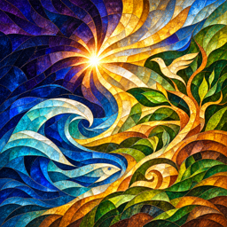 Creation

background: 

Create the world, and every living creature that moves.

## Create the heavens and the earth

background: 

In the beginning, the Earth was without form, and void.

*Let there be a vault in the heavens*

**Goals**
- Let there be a vault in the heavens -- Void
- next: Let the dry ground appear -- `primordial-world`
- next: Let there be light upon the earth -- Light
- next: Let there be a moon to rule the night -- Moon
- next: Let the Moon steady the shattered Earth -- Steadied world
- Let the skies be filled with stars -- Stars

**Hotspots**
- (three hotspots are a lot but okay here because the surrounding waters, opened sky and world are distinct parts of one creation scene)
- Waters of the deep (center 397.8px, 523.28px)
  - icon: 
  - hitbox: (center 397.8px, 523.28px) (size 733.2px, 877.76px)
  - place: Stars (center 663px, 236.32px)
  - place: Asteroids (center 117px, 607.68px)
- Void (center 390px, 844px)
  - icon: 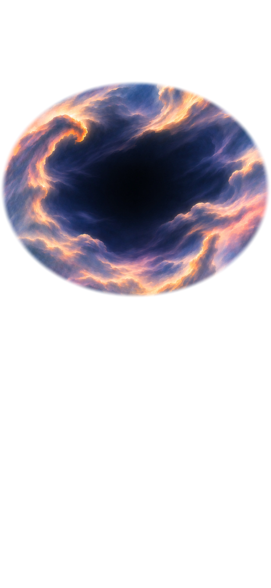
  - hitbox: (center 397.8px, 523.28px) (size 483.6px, 388.24px)
  - place: Sun (center 257.4px, 430.44px)
- `primordial-world` (center 396.396px, 552.3136px)
  - icon: 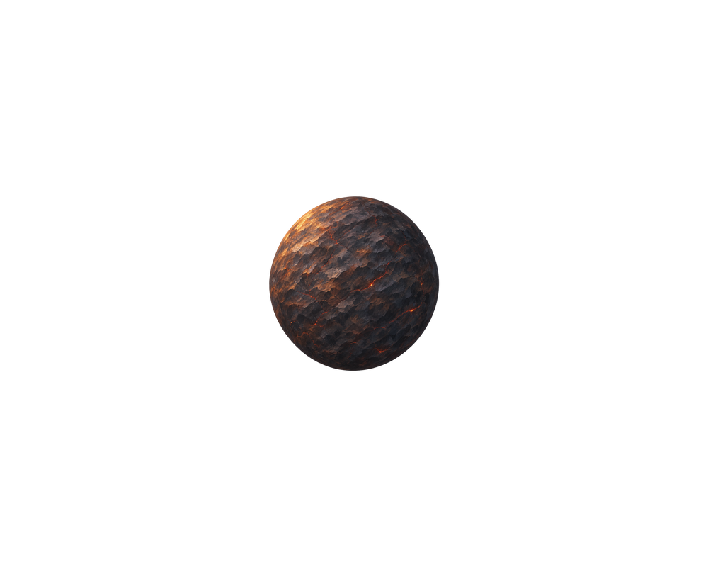
  - icon after creating Moon: 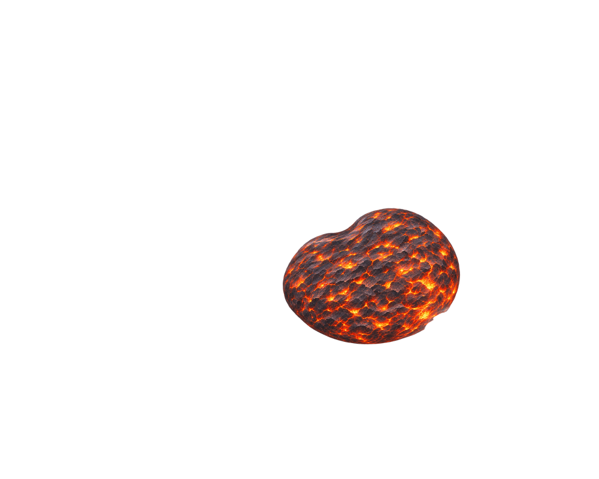
  - hitbox: (center 425.1px, 565.48px) (size 343.2px, 253.2px)
  - place: Moon (center 503.1px, 467.576px)
  - place: Light (center 284.7px, 641.44px)
- Steadied world (center 396.396px, 552.3136px)
  - icon: 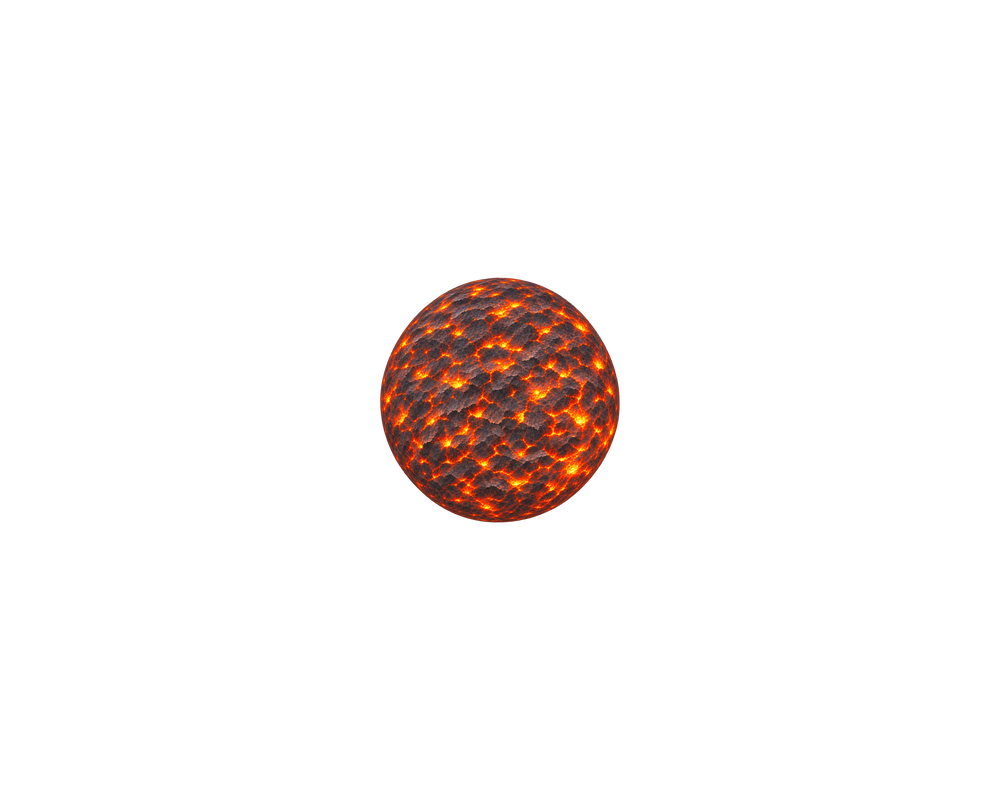
  - hitbox: (center 425.1px, 565.48px) (size 343.2px, 253.2px)
  - place: Moon (center 503.1px, 467.576px)
  - place: Light (center 284.7px, 641.44px)

**Items**
- Earth
  - icon: 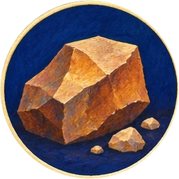 (circular)
- Air
  - icon:  (circular)
- Fire
  - icon: 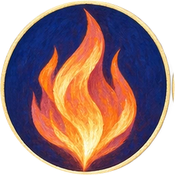 (circular)
- Waters of the deep
  - icon: 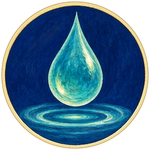 (circular)
- Void
  - icon:  (circular)
  *Let the dry ground appear*

  ---
- `primordial-world` Proto-Earth
  - icon: 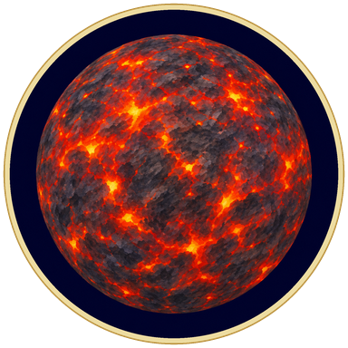 (circular)
  *Let there be light upon the earth*
  ---

  **Proto-Earth**

  Rocky planets grew through collisions and the gathering of smaller bodies, a process called accretion. Impacts released heat, while radioactive materials supplied heat from within. Earth's early surface changed repeatedly as rock melted and cooled.

  Heavy iron sank toward the centre, helping form the core, while less dense material remained above it. Oceans and continents developed on a planet whose interior was already separated into layers.
- Sun
  - icon: 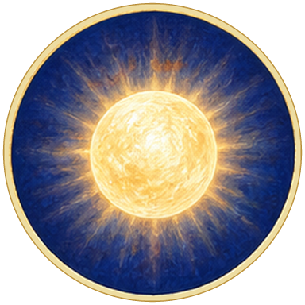 (circular)
  *And there was light*

  *The greater light to rule the day*

  ---

  **Sun**

  *Formed about 4.6 billion years ago.*

  The Sun supplies the light and warmth that drive evaporation, weather and much of the living world's food production.

  Inside the Sun, extreme pressure and temperature allow hydrogen nuclei to join and form helium. This nuclear fusion releases energy. A star can shine without air, fuel logs or the chemical burning of an ordinary fire. [NASA: the Sun's formation and energy](https://science.nasa.gov/sun/facts/).
- Asteroids
  - icon:  (circular)

  ---

  **Asteroids**

  Asteroids are rocky remnants of the early Solar System. Most orbit in a belt between Mars and Jupiter. Unlike Earth's repeatedly remade surface, some asteroids preserve material from the Solar System's formation.

  An asteroid's collision with a planet can excavate a crater and throw material into the atmosphere. Impact effects depend on its size, speed, composition and angle of approach. [NASA: asteroids](https://science.nasa.gov/solar-system/asteroids/).
- Moon
  - icon: 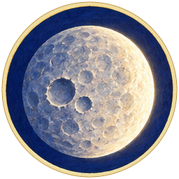 (circular)
  A massive asteroid strikes, wrecking and tilting the Earth. Debris in orbit forms the Moon.

  *The lesser light to rule the night*

  ---

  **Moon**

  *Formed about 4.5 billion years ago.*

  The leading explanation for the Moon's origin is a giant impact between the young Earth and another body, possibly about the size of Mars. Material thrown into orbit then gathered into the Moon. Lunar rocks and computer simulations help researchers investigate the details.

  The Moon shines by reflecting sunlight. Its gravity helps produce tides and moderate changes in Earth's tilt. [NASA: evidence for the Moon's formation](https://science.nasa.gov/moon/formation/).
- Steadied world
  - icon:  (circular)
  The Moon's gravity helps steady the Earth's tilt.

  ---

  **Steadied world**

  Earth rotates around an axis: an imaginary line through its poles. That axis is tilted relative to its orbit. The Moon's gravity helps limit how widely the tilt changes over long periods, though it does not lock the angle forever.
- Stars
  - icon: 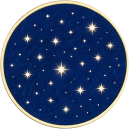 (circular)

  ---

  **Stars**

  Stars produce their own light. Their great distances make most of them appear as points, while our nearby Sun lights the day. A sky full of stars is therefore a view toward other suns.

  Stars form when gravity gathers gas into dense, hot centres where nuclear fusion can begin. [NASA: stars and their life cycles](https://science.nasa.gov/universe/stars/).
- Light
  - icon: 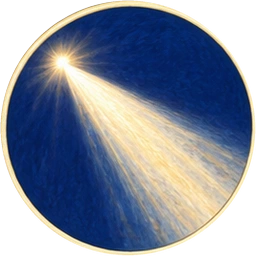 (circular)
  ---

  **Light**

  Sunlight carries energy from the Sun to Earth. It warms water, powers photosynthesis and lets eyes detect their surroundings. The same light can be reflected, absorbed or scattered, depending on what it meets.

  Light takes time to travel: sunlight reaches Earth in about eight minutes. Looking at a distant star means seeing light that began its journey much longer ago.

**Combinations**
- Air @ Waters of the deep [preserve] -> Void (tutorial)
- Earth @ Void [preserve] -> `primordial-world`
- Fire @ Void [preserve] -> Sun
- Earth @ Waters of the deep [preserve] -> Asteroids
- Asteroids [transform] @ `primordial-world` [preserve] -> Moon
- Fire @ Waters of the deep [preserve] -> Stars
- Sun [transform] + `primordial-world` [preserve] -> Light
- Sun [transform] + Steadied world [preserve] -> Light
- Moon [transform] + `primordial-world` [transform] -> Steadied world

## Rain, oceans and tides

background: 

The Earth is a fiery ball of magma. Rain cools it, and pools into the oceans.

[If skipped] The world's surface has cooled, rain has filled an ocean, and tides now cover and expose its shore.

**Goals**
- Make it rain -- First rain
- next: Fill the oceans -- Ocean
- Make coastal shores from ocean tides -- Tidal shore

> NOTE: Water and Proto-Earth are separate primitive identities supplied here. They represent the same water and world seen in the creation scene, now as movable symbols. The three opening hotspots remain in that scene; no identity needs to become unfixed.

**Items**
- Water
  - icon:  (circular)
- Proto-Earth
  - icon:  (circular)
  The world you gathered within the void, still molten from its making. Bring water to its hot surface.

  ---

  **Proto-Earth**

  Young rocky planets can have surfaces hot enough for much of their rock to be molten. Water meeting that surface absorbs heat and can turn to vapour; cooling allows a solid outer crust to form.

  A solid crust does not mean the whole planet has gone cold. Heat remains inside Earth and helps drive geological activity such as volcanism.
- Stone crust
  - icon: 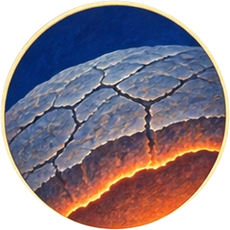 (circular)

  ---

  **Stone crust**

  As molten rock loses heat, minerals solidify into a crust. Water can absorb heat from hot rock and turn to vapour.

  The first solid surface need not stay intact. Impacts, eruptions and movement within the planet can break or remelt it. Earth's present crust is the outermost part of a planet that remains hot inside.
- Steam cloud
  - icon:  (circular)

  ---

  **Steam cloud**

  Water meeting the hot crust turns into water vapour, an invisible gas. As the rising moist air cools, some vapour condenses into tiny liquid droplets. Those droplets make the white cloud you can see.

  The distinction is familiar near a kettle: the visible white plume is made mainly of droplets, not invisible water vapour itself.
- First rain
  - icon:  (circular)
  Rising air carries the cloud into cooler conditions. Droplets join and grow large enough to fall as rain. *The first rain.*

  ---

  **First rain**

  Rain requires an atmosphere cool enough for water vapour to condense into droplets. As the young Earth lost heat, liquid water could collect at the surface rather than remaining entirely as vapour.

  Tiny zircon crystals from Western Australia's Jack Hills are about 4.4 billion years old. Their chemistry suggests that liquid water was already present when they formed. Such minerals provide clues to early wet conditions, although no record identifies a particular first shower. [NASA: ancient crystals and early oceans](https://science.nasa.gov/earth/earth-observatory/ancient-crystals-suggest-earlier-ocean/).
- Rain-filled hollows
  - icon: 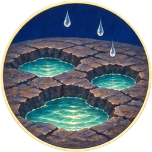 (circular)
  Rainwater collects in hollows between the ridges of the stone crust.

  ---

  **Rain-filled hollows**

  Rain runs downhill and collects in depressions. Separate pools can join as water levels rise, provided their basins have connecting low ground. Some water also soaks into the ground or evaporates.

  Movements within the crust, erosion and sediment deposition all change the shape of basins. A lake's depth and extent depend on both the landscape and the balance between water arriving and leaving.
- Ocean
  - icon:  (circular)
  As more water fills the low basins, separate pools join into a continuous ocean.

  ---

  **Ocean**

  Oceans occupy the great connected basins in Earth's surface. A large body of water stores heat and supplies vapour to the atmosphere. Dissolved chemicals arriving from rocks and vents also make the sea a setting for chemical reactions.

  An ocean is more than a destination for rivers. Its water can return to land through evaporation and rain, while its tides repeatedly cover and uncover the shore.
- Tides
  - icon: 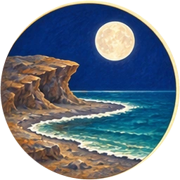 (circular)

  ---

  **Tides**

  The Moon's gravity pulls more strongly on the nearer side of Earth than on the farther side. This difference helps produce tides: recurring rises and falls in sea level. The Sun contributes a tidal effect too.

  The size and shape of a basin affect its tides: an ocean can have large tides while a small lake has tides too tiny to notice.
- Tidal shore
  - icon: 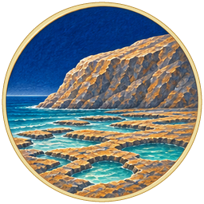 (circular)
  The strip between high and low tide provides both wet and dry conditions for coastal life.

  ---

  **Tidal shore**

  The intertidal zone is the strip of coast between high and low tide. Life here must cope with alternating submersion and exposure, as well as waves and changes in temperature and saltiness.

  Tides also bring food and nutrients, uncover feeding grounds and move young organisms along the coast. Rock pools can retain water at low tide, providing shelter for animals that would otherwise dry out.

**Combinations**
- Proto-Earth [transform] + Water -> Stone crust
- Water + Stone crust [transform] -> Steam cloud
- Steam cloud [transform] + Air -> First rain
- First rain [transform] + Stone crust [transform] -> Rain-filled hollows
- Rain-filled hollows [transform] + Water -> Ocean
- Moon [transform] + Water -> Tides
- Moon [transform] + Ocean [transform] -> Tides
- Ocean [transform] + Tides [transform] -> Tidal shore

## The water cycle

background: 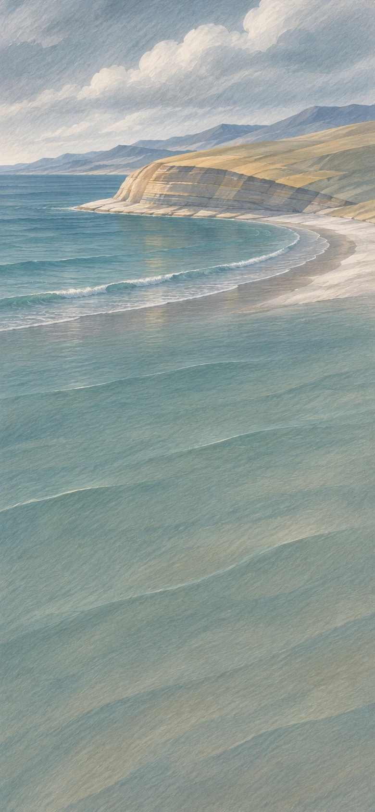

Sunlight turns ocean water into vapour. Clouds form, rain falls on land, and rivers carry the water back to sea. The rivers too evaporate in the sun. *The water cycle.*

**Goals**
- Build a delta from river sediment -- Delta
- Complete the water cycle -- Water cycle

**Items**
- Evaporation
  - icon: 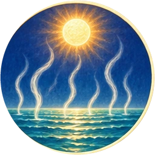 (circular)

  ---

  **Evaporation**

  Water molecules escape from a liquid surface into the air as invisible vapour. Sunlight provides energy that helps sustain evaporation from the ocean. Water need not boil to evaporate: a puddle or wet shirt can dry on an ordinary day.

  Dissolved salts mostly remain behind. This is why evaporation can move water out of a salty ocean without carrying its salt into the clouds.
- Clouds
  - icon:  (circular)

  ---

  **Clouds**

  Moist air cools as it rises. When enough water vapour condenses onto tiny particles, droplets or ice crystals form a visible cloud. The surrounding water vapour remains invisible.

  A cloud contains many very small droplets, so it need not immediately produce rain. Droplets or ice particles must grow enough to fall through the air. Clouds connect ocean evaporation to rain on distant land.
- Rainfall
  - icon:  (circular)

  ---

  **Rainfall**

  Cloud droplets can collide and merge into larger drops. Ice particles can also grow within clouds and melt as they fall through warmer air. Precipitation reaches the ground when drops or crystals become large enough to fall without evaporating along the way.
- Storm
  - icon: 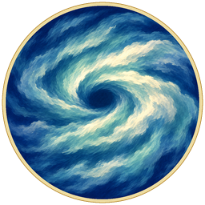 (circular)

  ---

  **Storm**

  Strong winds drive rain across the land. Storms can break branches and uproot trees, leaving wood on the ground. Some storms bring little rain; storms can also carry snow, dust or hail.
- Rivers
  - icon: 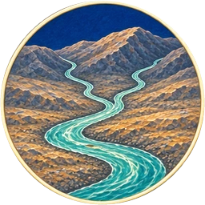 (circular)
  Rainfall flows downhill into rivers, which erode rock and carry sediment.

  ---

  **Rivers**

  Gravity carries rainwater downhill into rivers. Flowing water gradually changes the landscape by eroding rock and depositing sediment.
- Sediment
  - icon: 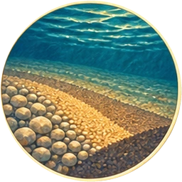 (circular)
  Flowing water loosens and carries grains of sand, silt and broken rock. These transported particles are called sediment.

  ---

  **Sediment**

  Flowing water loosens and carries grains of sand, silt and broken rock. These transported particles are called sediment.
- Delta
  - icon:  (circular)
  At a river's mouth, the water slows and drops its sediment. The deposits build new land: a delta.

  ---

  **Delta**

  A river carries sand, silt and other sediment downstream. Near its mouth, the flow often slows and deposits part of that load. Where deposition outpaces removal by waves and currents, sediment can build land outward into a lake or sea.

  The river may split into channels around its own deposits. Not every river mouth develops a delta.
- Rainbow
  - icon: 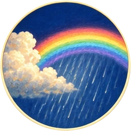 (circular)
  Sunlight bends, reflects and separates into colours inside raindrops, producing a rainbow.

  *Rainbow*

  ---

  **Rainbow**

  White sunlight contains a range of colours. As light enters a raindrop it bends, reflects inside and bends again on leaving. Different colours bend by different amounts, spreading the light into a rainbow.

  The Sun and raindrops supply the light and the tiny optical surfaces. A rainbow also depends on the observer's position: it is not a coloured object fixed at one place in the sky.
- Water cycle
  - icon: 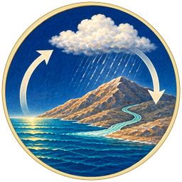 (circular)

  ---

  **Water cycle**

  Water evaporates, condenses into clouds, falls as precipitation and returns through rivers or groundwater. Plants add another route by releasing water vapour from their leaves. The same water can travel through many different places and forms.

  Sunlight supplies energy for evaporation; gravity brings rain and rivers down. [USGS: explore the water cycle](https://www.usgs.gov/special-topics/water-science-school/water-cycle).

**Combinations**
- Ocean [transform] + Sun [transform] -> Evaporation
- Evaporation [transform] + Air -> Clouds
- Clouds [transform] + Water -> Rainfall
- Rainfall [transform] + Stone crust [transform] -> Rivers
- Rivers [transform] + Earth -> Sediment
- Sediment [transform] + Rivers [transform] -> Delta
- Rainfall [transform] + Air -> Storm
- Rainfall [transform] + Sun [transform] -> Rainbow
- Rivers [transform] + Sun [transform] -> Water cycle

## Moving plates and continents

background: 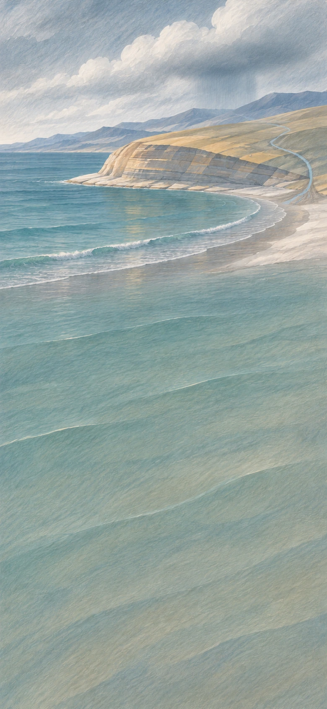

The Earth's crust shifts slowly over hot rock.

Continents are formed. Mountain ranges rise. Volcanoes erupt, on land and under the oceans. Rain and rivers wear down the land.

**Goals**
- Open a hot spring on the seafloor -- Hydrothermal vent
- Raise a continent -- Continent
- next: Let rivers carry its minerals to sea -- Mineral-rich sea

**Items**
- Moving plates
  - icon: 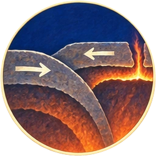 (circular)

  ---

  **Moving plates**

  Earth's rigid outer shell is divided into plates containing crust and the uppermost mantle. Their movements open ocean basins, raise mountains and carry one plate beneath another into the planet.

  The mantle beneath them is mostly solid. Over immense spans of time, hot rock can deform and flow. Internal heat, sinking slabs and other forces contribute to plate motion; the plates are not rafts floating on a global magma ocean. [USGS: what lies beneath the plates?](https://www.usgs.gov/faqs/are-tectonic-plates-floating-magma)
- Continent
  - icon: 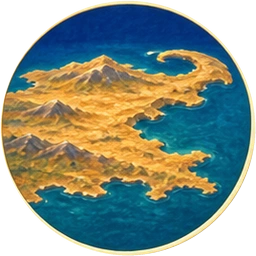 (circular)
  Shifting plates build great masses of rock into thick continents.

  ---

  **Continent**

  Continental crust is generally thicker and less dense than oceanic crust. That difference helps it stand higher, forming broad landmasses. Plate movement can gather continents together, split them apart and repeatedly reshape their edges.

  A continent is not simply a pile of soil: it is a great body of rock whose history continues through mountain building, weathering and erosion.
- Trench
  - icon: 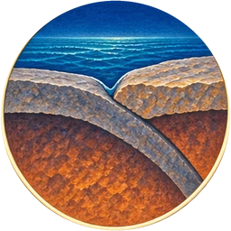 (circular)
  A plate bends beneath another at an underwater boundary, forming a deep ocean trench. This sinking of one plate beneath another is called subduction.

  *Trench*

  ---

  **Trench**

  A plate bends beneath another at an underwater boundary, forming a deep ocean trench. This sinking of one plate beneath another is called subduction.
- Volcano
  - icon: 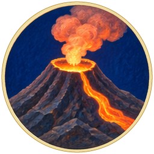 (circular)

  ---

  **Volcano**

  Magma is molten rock below the surface; when it erupts, it is called lava. Melt can form where plates separate or where one plate descends beneath another. Some volcanoes also form far from plate boundaries.

  The moving plates and internal heat provide a route for this volcanic activity. Repeated eruptions build new rock, while nearby seawater can circulate through heated cracks and return through hydrothermal vents.
- Hydrothermal vent
  - icon: 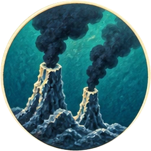 (circular)
  Deep under the oceans, volcanic heat drives scalding water up through the seabed.

  ---

  **Hydrothermal vent**

  Seawater seeps through cracks into rock heated by magma. It returns to the seabed carrying dissolved chemicals. Some of those chemicals form mineral chimneys when the hot fluid meets cold seawater.

  Microbes can use chemical reactions involving the vent fluids to make food, a process called chemosynthesis. This supports communities on a dark seafloor where photosynthesis cannot take place. [NOAA: hydrothermal vents](https://oceanexplorer.noaa.gov/fact-sheet/hydrothermal-vents-fact-sheet/).
- Weathered rock
  - icon: 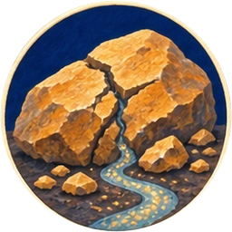 (circular)

  ---

  **Weathered rock**

  Rain and flowing water break down exposed rock and dissolve some of its minerals. The remaining fragments can contain coloured minerals used as pigments.
- Mineral-rich sea
  - icon: 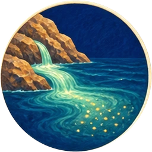 (circular)
  Rivers carry rich minerals from land into the sea.

  ---

  **Mineral-rich sea**

  Rivers carry dissolved ions and rock fragments into the sea. Rainwater reacts with rock as it flows across land or seeps through the ground, dissolving some minerals.

  Hydrothermal activity also exchanges chemicals between seawater and hot oceanic crust. Seawater's composition reflects these inputs together with processes that remove substances into organisms, sediments and new minerals.

**Combinations**
- Stone crust [transform] + Fire -> Moving plates
- Moving plates [transform] + Earth -> Continent
- Moving plates [transform] + Water -> Trench
- Moving plates [transform] + Fire -> Volcano
- Volcano [transform] + Ocean [transform] -> Hydrothermal vent
- Continent [transform] + Rainfall [transform] -> Weathered rock
- Weathered rock [transform] + Rivers [transform] -> Mineral-rich sea

## The first living cells

background: 

In the oceans' chemical soup, powered by hydrothermal vents and light, the first stirrings of life appear.

Organic molecules assemble into primitive cells. Along the shore, layers of microbes trap sediment.

[If skipped] Cells reproduce and pass on inherited changes. Along the shore, layers of microbes trap sediment and build stromatolites.

**Goals**
- Make cells reproduce -- Dividing cells
- next: Ultraviolet light causes mutation -- Variation
- Build stromatolites from microbial mats on the shore -- Stromatolites

**Items**
- Organic molecules
  - icon: 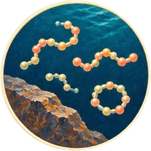 (circular)

  ---

  **Organic molecules**

  Organic molecules are carbon-based compounds, including many of the building blocks of living things. They can also form without life. Hydrothermal environments provide heat, dissolved chemicals and mineral surfaces that can assist reactions.

  Origin-of-life research also investigates shallow pools and other settings; making organic molecules is not the same as making a living cell. [NASA: where could life have begun?](https://astrobiology.nasa.gov/education/alp/where-life-got-started/)
- Membranes
  - icon: 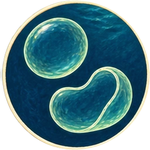 (circular)
  Some organic molecules assemble into thin membranes. For the first time, there's an *inside* and *outside*.

  ---

  **Membranes**

  Some molecules have a part attracted to water and a part that avoids it. In water, suitable molecules can arrange themselves into thin layers or closed bubbles, with an inside separate from the surrounding liquid.

  That boundary can keep useful chemicals together. A living cell's membrane also controls exchanges with its surroundings. A boundary alone does not make a living cell: reproduction and a sustained network of chemical reactions are also needed.
- Chemical fuel
  - icon:  (circular)

  ---

  **Chemical fuel**

  Light can drive chemical reactions that store energy in molecules. Other reactions can then transfer that energy into useful work. Living cells need such energy transfers to build materials, move substances and maintain themselves.
- Living cell
  - icon:  (circular)
  A membrane holds the cell together, and chemical fuel powers its reactions. A living cell also maintains itself and passes on genetic information.

  ---

  **Living cell**

  A cell keeps an internal environment, draws on an energy supply and carries genetic information that can be copied. The membrane provides a boundary; chemical fuel helps power the reactions within it. Growth and reproduction require those processes to work together.

  Scientists can investigate parts of this problem, but there is no agreed complete route from nonliving chemistry to the first cells. [NASA: research on life's beginnings](https://astrobiology.nasa.gov/education/alp/where-life-got-started/).
- Dividing cells
  - icon: 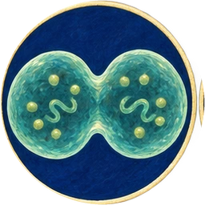 (circular)

  ---

  **Dividing cells**

  In water, living cells grow and divide into descendants that inherit their genetic information. Water provides a medium for their chemical reactions; growth and division also require nutrients, energy and working cellular processes.
- Variation
  - icon: 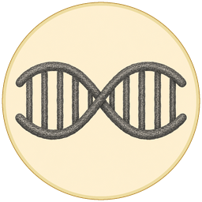 (circular)
  Changes in genetic information are called mutations. Ultraviolet light and copying errors can cause them. Some pass to descendants and may help, harm or make no difference. They do not appear because an organism needs them.

  ---

  **Variation**

  Members of a population can inherit different versions of genetic information. Mutations create new genetic changes; copying errors and ultraviolet radiation are two possible causes. In sexually reproducing organisms, the mixing of parental genes also produces new combinations of existing variants.

  Some differences help survival or reproduction in a particular setting; others harm or make little difference. They do not appear because an organism needs them. [NIH: genetic variation and evolution](https://medlineplus.gov/genetics/understanding/mutationsanddisorders/evolution/).
- Sun-fed cells
  - icon:  (circular)
  Over many generations, some cells develop photosynthesis: using sunlight to make food.

  ---

  **Sun-fed cells**

  Photosynthesis uses light energy to build organic molecules from simpler substances. Cells that capture sunlight can make food rather than depending entirely on food made elsewhere.

  Some forms of photosynthesis release oxygen and others do not. Cyanobacteria split water molecules during photosynthesis, releasing oxygen. Over Earth's history, this process profoundly changed the chemistry of the ocean and atmosphere.
- Microbial mats
  - icon: 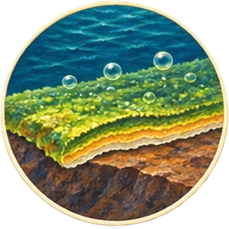 (circular)

  ---

  **Microbial mats**

  Microbes grow together in dense layers on wet rock. These layers are called microbial mats, and they can trap sediment.
- Stromatolites
  - icon:  (circular)
  Microbial mats trap sediment on the shore. Layer after layer builds a rocky mound called a stromatolite. Some preserve traces of ancient life.

  ---

  **Stromatolites**

  *Nearly 3.5 billion years ago. Archean. Pilbara, Western Australia.*

  The Western Australian Museum holds a layered rock from the Pilbara. Its structure records the work of microbial communities, making it some of the oldest evidence of life on Earth.

  Microbes grow in mats that trap sediment and help minerals build up around them. New layers of microbes grow over the accumulating rock, forming a stromatolite. These tiny builders can leave structures that survive for billions of years. [See the museum's stromatolite specimen](https://museum.wa.gov.au/explore/articles/stromatolites/).

**Combinations**
- Mineral-rich sea [transform] + Hydrothermal vent [transform] -> Organic molecules
- Organic molecules [transform] + Water -> Membranes
- Organic molecules [transform] + Light [transform] -> Chemical fuel
- Membranes [transform] + Chemical fuel [transform] -> Living cell
- Living cell [transform] + Water -> Dividing cells
- Dividing cells [transform] + Light [transform] -> Variation
- Dividing cells [transform] + Sun [transform] -> Sun-fed cells
- Sun-fed cells [transform] + Stone crust [transform] -> Microbial mats
- Microbial mats [transform] + Tidal shore [transform] -> Stromatolites

## Oxygen changes the ocean and air

background: 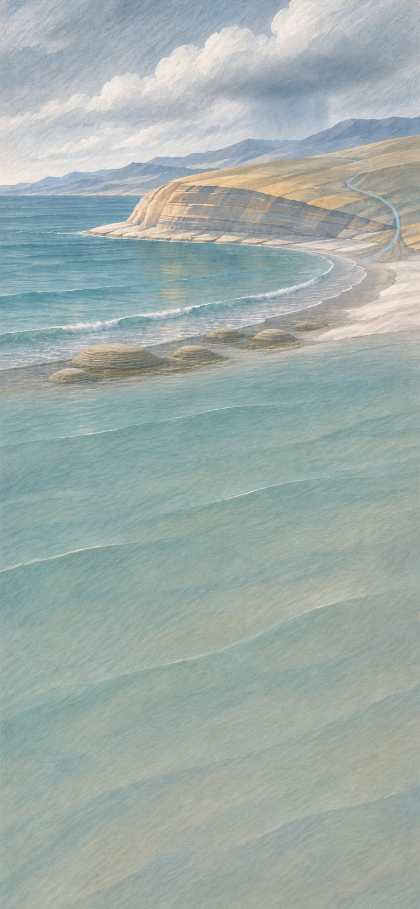

Cells release oxygen into the sea, where it reacts with iron. Oxygen builds up in the air, and sunlight helps form ozone. Some cells use oxygen to release energy from food; others need shelter from it.

**Goals**
- Form iron-rich deposits on the seabed -- Banded iron
- next: Form an ozone layer that absorbs ultraviolet light -- Ozone layer
- Make partnered cells and shelter microbes from oxygen
  - and: Partnered cells
  - and: Sheltered microbes

**Items**
- Oxygen
  - icon: 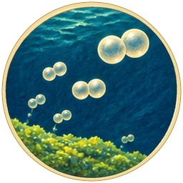 (circular)
  Some cells use sunlight to split water during photosynthesis, releasing oxygen into the sea.

  ---

  **Oxygen**

  Some cells use sunlight to split water molecules and release oxygen during photosynthesis. The oxygen enters the surrounding water and can reach the air. Earth's earliest life did not require an oxygen-rich atmosphere.
- Rusted seabed
  - icon: 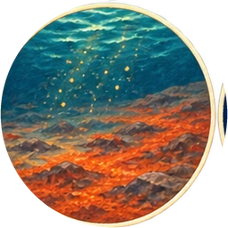 (circular)

  ---

  **Rusted seabed**

  Oxygen released by photosynthetic cells reacts with iron dissolved in the ocean. The reaction forms iron minerals that do not dissolve easily and settle onto the seabed.

  The familiar rust colour links this change to the oxidation of iron you might see on a metal object. Here, the reaction also removes oxygen from the water before it can accumulate in the atmosphere.
- Banded iron
  - icon: 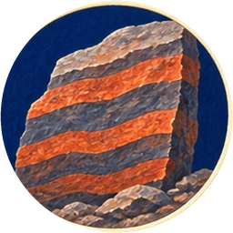 (circular)
  Oxygen reacts with iron dissolved in seawater. The minerals settle with other sediment, building bands of iron-rich rock.

  ---

  **Banded iron**

  *Nearly 3 billion years ago. Archean. Canada.*

  A boulder at New York's American Museum of Natural History comes from an ancient Canadian formation. Its dark bands contain magnetite, an iron mineral; its red bands contain silica coloured by tiny iron oxide particles.

  The museum interprets these layers as a record of oxygen released by microbes reacting with dissolved iron in seawater. The resulting minerals settled on the seabed. Reactions like this used up much early oxygen before it accumulated in the air. The bands preserve evidence of changing ocean chemistry. [See the banded iron formation](https://www.amnh.org/exhibitions/permanent/planet-earth/how-has-the-earth-evolved/banded-iron-formation).
- Oxygen-rich sky
  - icon:  (circular)

  ---

  **Oxygen-rich sky**

  *Beginning about 2.4 billion years ago. Great Oxidation Event.*

  Oxygen builds up in the atmosphere when its production exceeds the reactions and organisms that remove it. Photosynthetic microbes gradually helped transform Earth's air. The first lasting rise in atmospheric oxygen is known as the Great Oxidation Event. [NASA: the rise of oxygen](https://astrobiology.nasa.gov/news/whiffs-and-the-rise-of-oxygen/).

  Oxygen was dangerous to organisms unable to protect their cells from its reactions. The change that later supported animals also reduced the places where some earlier microbes could live. Life can remake an environment without making it better for every living thing.
- Ozone layer
  - icon: 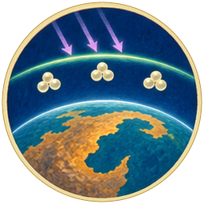 (circular)
  Sunlight turns some oxygen high in the air into ozone. This layer absorbs much of the Sun's harmful ultraviolet light.

  ---

  **Ozone layer**

  Ordinary oxygen gas has molecules containing two oxygen atoms. Ultraviolet light can split them; freed atoms can then join other oxygen molecules to form ozone, which has three atoms.

  High in the atmosphere, ozone absorbs much of the Sun's harmful ultraviolet radiation. It helps protect life below, although some ultraviolet still reaches the ground. Ozone near the ground can instead be harmful to breathe. [NASA: ozone's formation and protective role](https://science.nasa.gov/earth/earth-observatory/ozone/).
- Oxygen-using cells
  - icon:  (circular)

  ---

  **Oxygen-using cells**

  Many cells use oxygen in a sequence of reactions that releases usable energy from food molecules. Oxygen accepts electrons near the end of this process, called aerobic respiration. Cells transfer some of the released energy into ATP, a molecule that powers many cellular activities.

  Oxygen is not food: it helps extract energy stored in food. Organisms unable to protect themselves from oxygen's reactive by-products need oxygen-free environments.
- Partnered cells
  - icon: 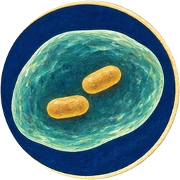 (circular)
  One cell lives inside another, using oxygen to release energy from food. Its host supplies food and shelter. The energy-producing parts of our cells, called mitochondria, descend from bacteria that formed such partnerships.

  ---

  **Partnered cells**

  An oxygen-using cell becomes a lasting resident inside another cell. The host supplies nutrients and shelter; its partner helps release usable energy from food. Over evolutionary time, the partners become parts of one more complex cell.

  Mitochondria, the energy-converting structures in our cells, descend from bacteria. Their own DNA and other bacterial features are evidence of this history, called endosymbiosis. [OpenStax: evidence for endosymbiosis](https://openstax.org/books/biology-2e/pages/23-1-eukaryotic-origins).
- Sheltered microbes
  - icon: 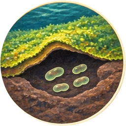 (circular)
  Microbes harmed by oxygen survive beneath microbial mats. Organisms and chemical reactions in the layers above use up oxygen before it reaches them.

  ---

  **Sheltered microbes**

  Even as oxygen accumulates in the air, oxygen-free pockets remain beneath microbial mats and in sediments. Microbes that cannot tolerate oxygen survive in these habitats, where overlying organisms and chemical reactions consume oxygen before it reaches them.

**Combinations**
- Water + Sun-fed cells [transform] -> Oxygen
- Oxygen [transform] + Mineral-rich sea [transform] -> Rusted seabed
- Rusted seabed [transform] + Sediment [transform] -> Banded iron
- Oxygen [transform] + Air -> Oxygen-rich sky
- Oxygen-rich sky [transform] + Light [transform] -> Ozone layer
- Living cell [transform] + Oxygen [transform] -> Oxygen-using cells
- Oxygen-using cells [transform] + Living cell [transform] -> Partnered cells
- Oxygen-rich sky [transform] + Microbial mats [transform] -> Sheltered microbes

## Multicellular life

background: 

Cells form colonies in the water. Their membranes let them exchange signals and work together. Some descendants use sunlight to grow; others become animals that swim, sense light and build shells from minerals.

**Goals**
- Grow multicellular algae -- Algae
- next: Preserve shells as fossils -- Fossils
- Give swimming animals eyes -- Eyes

**Items**
- Cell colonies
  - icon: 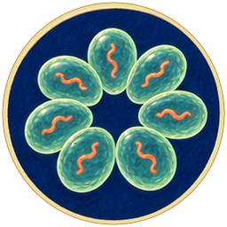 (circular)

  ---

  **Cell colonies**

  Cells multiply in water and remain grouped together. A colony contains individual cells; it is not necessarily a single multicellular organism.
- Multicellular life
  - icon:  (circular)
  Cells stay together, exchange signals through their membranes and take on different jobs. Over generations, a group becomes one organism. Multicellular life evolved more than once.

  ---

  **Multicellular life**

  In a multicellular organism, cells work together and can specialize in different tasks. Chemical signals help coordinate them. Multicellularity evolved independently in several lineages.
- Algae
  - icon: 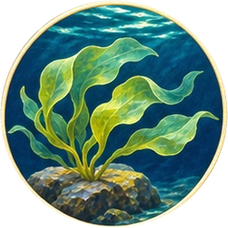 (circular)

  ---

  **Algae**

  Algae capture light to make food, but they include many different evolutionary branches. Some are single cells; others form large bodies such as seaweeds.

  Living in water keeps algae moist and supports their bodies. Large seaweeds create underwater habitats. Land plants evolved within a different branch, the green algae.
- Soft-bodied animals
  - icon: 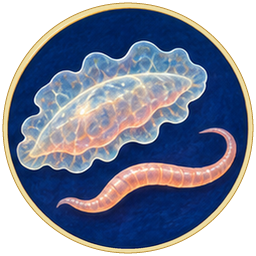 (circular)

  ---

  **Soft-bodied animals**

  Animals obtain food by eating other organisms or organic material. Early animal communities included bodies without the hard shells and bones that fossilize readily.

  Across many generations, different lineages develop ways to feed, move and sense their surroundings. Some later build mineral skeletons or shells.
- Swimming animals
  - icon:  (circular)

  ---

  **Swimming animals**

  Swimming requires an animal to transfer force to water. Muscles power movements such as bending a body, beating fins or squeezing water out in a jet. Food supplies chemical energy for this work.

  Active swimming can help an animal reach food, escape a predator or hold its position in a current.
- Eyes
  - icon: 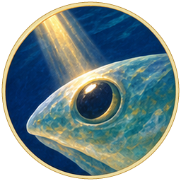 (circular)
  Over many generations, light-sensitive structures develop into eyes. Animals can spot food and danger instead of simply sensing light.

  ---

  **Eyes**

  Light-sensitive structures detect light and help swimming animals find food, avoid danger or orient themselves. Over many generations, some lineages develop eyes that distinguish the direction of light or form images. Eyes evolved in different forms across several animal lineages.
- Shells
  - icon:  (circular)

  ---

  **Shells**

  Many soft-bodied animals build protective shells using substances taken from their surroundings. Calcium carbonate, made using dissolved calcium and carbon-containing compounds, is a common shell material.

  A shell protects the animal but takes energy and materials to build. After death, hard shells are often more likely to survive burial than soft tissue. The same mineral structure that protects a living body can later preserve evidence of its existence.
- Fossils
  - icon: 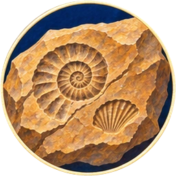 (circular)
  Buried shells leave impressions or mineral remains as sediment turns to rock. Most organisms leave no fossil, so much of life's history is missing.

  ---

  **Fossils**

  Sediment can bury shells before they are destroyed. As the sediment hardens, a shell may remain, be replaced by minerals, or leave a mould of its shape. Other fossils preserve bones, leaves or evidence of activity.

  Most organisms never fossilize. Soft bodies, exposed remains and habitats where sediment does not accumulate are easily missing from the record. Fossils provide powerful evidence, but not a complete census of ancient life. [National Park Service: body fossils](https://www.nps.gov/subjects/fossils/body-fossils.htm).

**Combinations**
- Partnered cells [transform] + Water -> Cell colonies
- Cell colonies [transform] + Membranes [transform] -> Multicellular life
- Multicellular life [transform] + Sun [transform] -> Algae
- Multicellular life [transform] + Ocean [transform] -> Soft-bodied animals
- Soft-bodied animals [transform] + Oxygen [transform] -> Swimming animals
- Swimming animals [transform] + Light [transform] -> Eyes
- Soft-bodied animals [transform] + Mineral-rich sea [transform] -> Shells
- Shells [transform] + Sediment [transform] -> Fossils

## Kelp forests and coral reefs

background: 

Algae anchor to rock, corals build reefs, and young animals shelter among them. Tides carry nutrients and young animals along the coast. Wind drives waves against the rock, wearing open a sea cave.

**Goals**
- Grow a kelp forest -- Kelp forest
- next: Hollow a sea cave with waves -- `cave`
- Connect coastal habitats with tides -- Living coast

**Items**
- Kelp forest
  - icon: 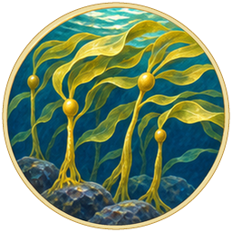 (circular)
  Kelp are large algae that anchor to underwater rock. Their fronds provide food and shelter for other sea life.

  ---

  **Kelp forest**

  Kelp are large brown algae that anchor to submerged rock and grow toward the light. Their anchoring structures are called holdfasts. Unlike plant roots, holdfasts mainly grip the surface; kelp absorb nutrients through their tissues.

  Dense fronds slow water movement and provide food and hiding places. Many young fish shelter among the fronds while feeding on smaller organisms.
- Coral
  - icon:  (circular)
  Corals are small animals called polyps. They attach to rock and catch passing food with their tentacles.

  ---

  **Coral**

  Coral polyps are small, soft-bodied animals that attach to submerged rock along the coast. Their tentacles catch passing food. Many corals grow in colonies of connected polyps.
- Reef partnership
  - icon:  (circular)
  Algae living inside the coral make food from sunlight. The coral gives them shelter and nutrients. When stressed corals lose these algae, they turn pale: coral bleaching.

  ---

  **Reef partnership**

  Many reef-building corals contain tiny photosynthetic algae inside their tissues. The algae supply food made using sunlight; the coral provides shelter and nutrients. This partnership helps support reefs in clear tropical waters.

  Stress, especially unusually warm water, can cause corals to lose their algae and turn pale. This is coral bleaching. A bleached coral is not necessarily dead, but the loss of its food-supplying partners puts it at risk. [NOAA: coral bleaching](https://oceanservice.noaa.gov/facts/coral_bleach.html).
- Coral reef
  - icon:  (circular)
  Corals use dissolved minerals to build hard skeletons. New corals grow on old skeletons, building a reef over many generations.

  ---

  **Coral reef**

  Corals draw dissolved mineral ingredients from seawater to build calcium carbonate skeletons. As new corals grow on older skeletons, a reef accumulates over many generations. Its crevices and surfaces provide habitats for many other organisms.
- Nursery waters
  - icon:  (circular)

  ---

  **Nursery waters**

  Young swimming animals shelter among kelp fronds. The kelp provides hiding places from predators and supports organisms they can eat, helping the young animals survive and grow.
- Coastal mosaic
  - icon:  (circular)
  Kelp beds grow in cooler water; coral reefs grow in warmer water. Along this long coast, both shelter young animals and provide feeding grounds.

  ---

  **Coastal mosaic**

  Coastal habitats vary with water temperature, light, depth and currents. Kelp forests often grow in cooler water, while shallow tropical coral reefs favour warmer water. Both provide food and shelter, though they support different communities. Within each region, animals may use several neighbouring habitats as they grow.
- Living coast
  - icon:  (circular)

  ---

  **Living coast**

  Tides move water, nutrients and small organisms between coastal habitats. Animals feed and shelter in these connected areas, while some young animals disperse with the moving water.
- Waves
  - icon:  (circular)

  ---

  **Waves**

  Wind transfers energy to the ocean surface and produces waves. In open water, much of that energy travels while individual water particles move in loops rather than travelling all the way with the wave.

  Near shore, waves can break, shift sediment and force water and air into cracks in rock. Repeated wave action gradually enlarges weaknesses, sometimes hollowing out sea caves.
- `cave` Sea cave
  - from chapter `dark-cave-chapter`: Dark cave
  - icon:  (circular)

  ---

  **Sea cave**

  Waves strike coastal rock, loosen fragments and enlarge existing cracks. Over a long time, this erosion can hollow out a sea cave. Changes in sea level or the height of the land can later leave former coastal passages above the waves.

**Combinations**
- Algae [transform] + Stone crust [transform] -> Kelp forest
- Soft-bodied animals [transform] + Tidal shore [transform] -> Coral
- Coral [transform] + Algae [transform] -> Reef partnership
- Reef partnership [transform] + Mineral-rich sea [transform] -> Coral reef
- Swimming animals [transform] + Kelp forest [transform] -> Nursery waters
- Nursery waters [transform] + Coral reef [transform] -> Coastal mosaic
- Coastal mosaic [transform] + Tides [transform] -> Living coast
- Ocean [transform] + Air -> Waves
- Waves [transform] + Stone crust [transform] -> `cave`

## Plants spread onto land

background: 

Plants spread from the wet shore onto bare land. Their remains mix with weathered rock to form soil. Wind carries spores, roots draw water from the soil, and ferns grow toward the light.

**Goals**
- Grow moss on damp soil -- Moss
- Make a forest on land -- First forest

**Items**
- Shore plants
  - icon:  (circular)
  Over many generations, descendants of green algae develop ways to hold water and survive in air. They spread onto the wet shore.

  ---

  **Shore plants**

  Land plants evolved from green-algal ancestors. Living outside water required ways to limit drying, support the body and reproduce in a new environment. Damp ground offered protection from water loss during the early colonization of land.
- Soil
  - icon:  (circular)
  Dead plants mix with weathered rock. As they decay, soil forms, holding water, air and nutrients for new plants.

  ---

  **Soil**

  Soil contains mineral particles, organic matter, water, air and living organisms. Weathering supplies broken rock; dead plants add material that microbes and other decomposers break down. Spaces between the particles let roots grow and water move.

  Soil is not simply powdered stone, and plants do not take most of their body mass from it: much of a growing plant's carbon comes from carbon dioxide in the air.
- Windblown spores
  - icon:  (circular)
  Spores are tiny reproductive cells carried on the wind. Unlike seeds, they contain no young plant with a stored food supply.

  ---

  **Windblown spores**

  Spores are tiny reproductive cells that can travel away from a parent organism. Wind carries them widely, but only some land in places where they can grow and continue the life cycle.

  A spore differs from a seed. A seed contains a young plant and a food supply inside a protective coat. Mosses and ferns reproduce using spores. Seed reproduction evolved later in plant history.
- Moss
  - icon:  (circular)

  ---

  **Moss**

  Mosses are small plants that reproduce by spores. They absorb water across their surfaces and lack the elaborate water-carrying tissues and true roots of larger plants. Damp ground gives a windblown spore a suitable place to grow.

  Mosses can retain water and provide tiny habitats for other organisms. They are a living branch of plant evolution, not young ferns waiting to grow into trees.
- Wetland
  - icon:  (circular)

  ---

  **Wetland**

  Wetlands have ground that is flooded or saturated for at least part of the year. Water fills spaces in the soil, restricting the supply of oxygen below the surface.

  Plants adapted to these conditions may transport air down to their roots. Wetland microbes also include organisms that obtain energy through reactions that do not require oxygen.
- Roots
  - icon:  (circular)

  ---

  **Roots**

  Roots anchor plants in soil and absorb water and dissolved nutrients. Roots help support larger plants and supply their growth above ground.
- Ferns
  - icon:  (circular)

  ---

  **Ferns**

  Ferns have roots that supply water and nutrients, and fronds that capture light for photosynthesis. Their fronds also produce spores. Sunlight supplies the energy for their growth.
- First forest
  - icon:  (circular)
  Tall ferns form a forest. Roots draw water from the wet ground, and strong stems lift leaves toward the light. Mosses, ferns and seed plants belong to different branches of plant life.

  ---

  **First forest**

  *Gilboa forest: about 380 million years ago. Devonian. New York.*

  Fossil trees at Gilboa preserve evidence of one of Earth's early forests. Forests changed what it meant to live on land: tall plants created shade and habitat above the ground, while fallen leaves and wood fed communities below.

  Tree-like growth evolved in several plant groups; modern mosses, ferns and flowering trees are branches, not steps on a ladder. [Natural History Museum: early forests and their effects](https://www.nhm.ac.uk/discover/how-trees-changed-the-world.html).

**Combinations**
- Algae [transform] + Living coast [transform] -> Shore plants
- Shore plants [transform] + Weathered rock [transform] -> Soil
- Shore plants [transform] + Air -> Windblown spores
- Windblown spores [transform] + Soil [transform] -> Moss
- Moss [transform] + Water -> Wetland
- Shore plants [transform] + Soil [transform] -> Roots
- Roots [transform] + Light [transform] -> Ferns
- Ferns [transform] + Wetland [transform] -> First forest

## Decomposition and forest renewal

background: 

Wind turns rain into a storm and brings down trees. Fungi feed on fallen wood, returning nutrients to the soil and roots. In waterlogged ground, dead plants decay slowly enough to build up.

**Goals**
- Return nutrients from dead wood to growing plants -- Renewing forest
- next: Produce rain from water released by the forest -- Forest rain
- Bury carbon stored in peat -- Buried carbon

**Items**
- Fallen wood
  - icon:  (circular)

  ---

  **Fallen wood**

  Strong winds break branches and topple trees. Fallen wood supplies food for fungi and other decomposers. Trees also shed branches and die from other causes; storms are one way wood reaches the forest floor.
- Fungi
  - icon:  (circular)
  Some descendants of complex cells evolve ways to digest wood. The fallen timber feeds these fungi.

  ---

  **Fungi**

  Fungi obtain food by releasing enzymes that break down material outside their bodies, then absorbing the products. Some fungi can digest tough components of wood.

  Fungi are their own evolutionary branch, more closely related to animals than to plants. Fungal spores can reach a fallen trunk and grow into branching threads that penetrate it. The resulting network absorbs nutrients from the decaying wood.
- Decomposition
  - icon:  (circular)
  Fungi break down dead wood and absorb food from it. Nutrients released into the soil can support new plants.

  ---

  **Decomposition**

  Fungi and other decomposers break down dead organisms and waste. Nutrients such as nitrogen and phosphorus become available for reuse; some carbon returns to the surroundings as carbon dioxide.

  Decay returns material from dead wood to growing plants. Matter can circulate through the forest again and again. Energy follows a different path: living processes release heat, so the ecosystem still needs an ongoing energy supply, usually sunlight.
- Returned nutrients
  - icon:  (circular)

  ---

  **Returned nutrients**

  Decomposition releases nutrients from dead plants into the soil. Roots can take them up again to support new growth.
- Renewing forest
  - icon:  (circular)

  ---

  **Renewing forest**

  Roots absorb nutrients released into the soil by decomposition. Plants use those nutrients, along with water, carbon dioxide and light, to grow new leaves, roots and wood.
- Peat
  - icon:  (circular)
  Waterlogged ground has little oxygen, so dead plants decay slowly. Their partly rotted remains build up as peat.

  ---

  **Peat**

  When dead plant material accumulates faster than it fully decomposes, it can build up as peat. Waterlogged ground slows many decomposers because little oxygen reaches the buried remains.

  Peat preserves some of the carbon plants took from the atmosphere while growing. This makes a wetland both a living habitat and a long-term store of past growth. Draining or burning peat can release that stored carbon again.
- Buried carbon
  - icon:  (circular)
  Plants took carbon from the air as they grew. Buried peat can keep some of that carbon underground for millions of years.

  ---

  **Buried carbon**

  Sediment can bury peat, trapping carbon in its partly decayed plant material. The plants originally took this carbon from carbon dioxide during photosynthesis. Some of it can remain underground for millions of years instead of returning quickly to the atmosphere through decomposition.
- Forest rain
  - icon:  (circular)
  Roots take up water; leaves release it as vapour. This is called transpiration. The water can form clouds and fall as rain, sometimes far downwind.

  ---

  **Forest rain**

  Roots draw water from the ground, and leaves release it as vapour through tiny openings. This process is called transpiration. The vapour joins the atmosphere, where it may contribute to clouds and rainfall farther downwind.

  Forests therefore participate in the water cycle rather than merely receiving rain. [USGS: transpiration and the water cycle](https://www.usgs.gov/water-science-school/science/evapotranspiration-and-water-cycle).

**Combinations**
- Storm [transform] + First forest -> Fallen wood
- Partnered cells [transform] + Fallen wood [transform] -> Fungi
- Fungi [transform] + Fallen wood [transform] -> Decomposition
- Decomposition [transform] + Soil [transform] -> Returned nutrients
- Returned nutrients [transform] + Roots [transform] -> Renewing forest
- Wetland [transform] + Fallen wood [transform] -> Peat
- Peat [transform] + Earth -> Buried carbon
- Renewing forest [transform] + Clouds [transform] -> Forest rain

## Insects in the forest

background: 

Variation produces different descendants of sea animals. Some become insects living among land plants. Wings let them reach the forest's upper leaves and branches, called the canopy.

**Goals**
- Establish flying insects in the forest canopy -- Canopy life

**Hotspots**
- Variation (center 195px, 658.32px)
  - icon: 
  - hitbox: (center 195px, 658.32px) (size 335.4px, 286.96px)

**Items**
- Arthropods
  - icon:  (circular)
  Over many generations, some sea animals develop jointed legs and hard outer skeletons. They belong to the arthropods, a different branch from animals with backbones.

  ---

  **Arthropods**

  Arthropods have jointed limbs, segmented bodies and an outer skeleton. Insects, spiders, crabs and extinct trilobites belong to this huge group. The outer skeleton supports and protects the body, but growing usually requires shedding it and forming a larger one.

  Variation in an ancestral animal population supplies differences on which evolution can act. The habitat affects which differences matter. Arthropods and vertebrates share more distant animal ancestors; one group does not turn into the other.
- Insects
  - icon:  (circular)
  Insects are six-legged arthropods. On land, plants provide them with food and shelter.

  ---

  **Insects**

  Insects are a six-legged branch of the arthropods. Their bodies have a head, thorax and abdomen, and the legs attach to the thorax. Plants provide food or shelter for many insects, while others hunt animals or feed on decaying material.
- Winged insects
  - icon:  (circular)
  Insect wings push against the air. Insects evolved flight long before birds, whose wings developed separately.

  ---

  **Winged insects**

  Across many generations, some insects develop wings that push against the air and allow flight. Insects flew long before birds. Their wings evolved separately from the forelimbs that became bird wings.
- Canopy life
  - icon:  (circular)

  ---

  **Canopy life**

  Winged insects live among the forest's upper leaves and branches, a layer called the canopy. Flight helps them move between feeding and breeding sites without returning to the ground.

**Combinations**
- Soft-bodied animals [transform] @ Variation [preserve] -> Arthropods
- Arthropods [transform] + Shore plants [transform] -> Insects
- Insects [transform] + Air -> Winged insects
- Winged insects [transform] + First forest -> Canopy life

## Vertebrates move onto land

background: 

Fish breathe air in shallow wetlands and move among roots. Over many generations, some descendants gain limbs and eggs that can develop on land. Forests and fallen wood shelter different branches of reptiles and mammals; others take to the air.

[If skipped] Animals with backbones have spread onto land. Giant reptiles, small mammals and birds live alongside insects.

**Goals**
- Make an egg that can develop on land -- Shelled egg
- Make giant plant-eating reptiles, small mammals and birds
  - and: Great browsers
  - and: Small furred animals
  - and: Birds

**Hotspots**
- Variation (center 546px, 658.32px)
  - icon: 
  - hitbox: (center 546px, 658.32px) (size 351px, 286.96px)

**Items**
- Air-breathing fish
  - icon:  (circular)
  Some fish breathe air as well as taking oxygen from water. This helps them survive in warm, still pools where oxygen is scarce.

  ---

  **Air-breathing fish**

  Warm, still water can contain little dissolved oxygen. Some fish supplement oxygen taken from water by breathing air. Different fish lineages use different structures, including lungs or modified parts of the gut.

  Breathing air can help fish survive in oxygen-poor water. Breathing air is not the same as living permanently on land, and many air-breathing fish today remain aquatic.
- Limbed vertebrates
  - icon:  (circular)
  Fish move among roots in shallow water. Over many generations, changes to their fins give rise to limbs that can support movement on land.

  ---

  **Limbed vertebrates**

  *Tiktaalik: about 375 million years ago. Late Devonian.*

  Tiktaalik was a fish with some features familiar from animals that walk on land. Inside its fins were bones corresponding to an upper arm, forearm and wrist. Its fins could help support it against a river bottom: some equipment useful for walking developed while animals still lived in water. [University of Chicago: reconstructing Tiktaalik's fins](https://news.uchicago.edu/story/how-fish-fins-evolved-just-transition-land).

  Sturdy fins could support movement through shallow water and over a muddy bottom before the evolution of fully developed limbs.
- Shelled egg
  - icon:  (circular)
  Membranes protect and feed the growing young animal. A shell limits water loss but lets gases through. The egg can develop away from open water.

  ---

  **Shelled egg**

  An amniotic egg contains membranes that protect the embryo, hold fluid and manage wastes. In a shelled egg, the outer covering limits water loss while allowing gases to pass through. Food stored within supports development.

  This arrangement made reproduction away from open water possible in an important branch of vertebrates. Mammals belong to that branch too, although most retain the developing young inside the parent's body rather than laying a shelled egg.
- Reptiles
  - icon:  (circular)

  ---

  **Reptiles**

  Over many generations, descendants of land-breeding vertebrates diversify into reptile lineages. Inherited differences affect how they feed, move and survive in their habitats.
- Birds
  - icon:  (circular)
  In one branch of dinosaurs, feathered forelimbs develop into wings. Birds descend from these dinosaurs.

  ---

  **Birds**

  Birds descend from a branch of feathered dinosaurs. Their wings are modified forelimbs, with bones related to those in other land vertebrates. Feathers existed before powered flight and could serve functions such as insulation and display.

  Air supplies the medium against which a wing works; evolution supplies the anatomy and behaviour. Insect wings arose separately. Birds are the only dinosaur lineage to survive the end-Cretaceous mass extinction. [American Museum of Natural History: dinosaur facts](https://www.amnh.org/dinosaurs/dinosaur-facts).
- Great browsers
  - icon:  (circular)
  Huge plant-eating reptiles browse the forest. Their heavy feet leave tracks in the wet ground.

  ---

  **Great browsers**

  *Diplodocus: about 152–145 million years ago. Late Jurassic.*

  Diplodocus was a long-necked sauropod dinosaur that ate plants. Its narrow teeth were suited to gathering vegetation rather than chewing it thoroughly. A long neck let it reach food without constantly moving its enormous body.

  Its feeding height is still debated. Bones and the spaces where supporting ligaments attached help researchers work out possible neck positions. Reconstructing feeding behaviour requires anatomy as well as a picture of the surrounding vegetation. [Natural History Museum: Diplodocus](https://www.nhm.ac.uk/discover/dino-directory/diplodocus.html).
- Small furred animals
  - icon:  (circular)
  Small mammals find food and shelter among fallen wood. Their ancestors belong to a separate branch from the giant reptiles, and both groups live here at the same time.

  ---

  **Small furred animals**

  Small mammals find insects, other food and shelter among fallen wood. Their fur, milk production and other features belong to a separate vertebrate branch from the giant browsing reptiles.

  Mammals were already present during the age of dinosaurs. Many mammal species died in the end-Cretaceous extinction. Surviving lineages later diversified into a much wider range of sizes and ways of life.

**Combinations**
- Swimming animals [transform] + Wetland [transform] -> Air-breathing fish
- Air-breathing fish [transform] + Roots [transform] -> Limbed vertebrates
- Limbed vertebrates [transform] + Membranes [transform] -> Shelled egg
- Shelled egg [transform] @ Variation [preserve] -> Reptiles
- Reptiles [transform] + Air -> Birds
- Reptiles [transform] + First forest -> Great browsers
- Limbed vertebrates [transform] + Fallen wood [transform] -> Small furred animals

## Flowers, fruit and seed dispersal

background: 

Flowers grow in sunlight. Insects carry pollen between them, helping seeds form. Wind blows seeds away, and animals spread them by eating fruit.

**Goals**
- Send seeds on the wind -- Windborne seeds
- Spread flowering plants through the forest -- Flowering forest

**Items**
- Water
- Flowers
  - icon:  (circular)

  ---

  **Flowers**

  Over many generations, one branch of land plants evolves flowers, structures in which reproduction takes place. Sunlight supplies energy for the plants' growth. Some flowers produce nectar, scent and bright colours that attract animals carrying pollen.
- Pollination
  - icon:  (circular)
  An insect collects food from a flower. Pollen sticks to its body and rubs off on another flower, helping the plant reproduce.

  ---

  **Pollination**

  An insect visits a flower to collect nectar or pollen as food. Pollen sticks to its body and may rub off on another flower, allowing the plant to reproduce. The insect gains food while the plant gains a means of moving pollen.
- Seeds
  - icon:  (circular)
  After pollen reaches a flower, fertilization can follow. A seed develops, holding a young plant and its food supply inside a protective coat.

  ---

  **Seeds**

  A seed contains a plant embryo, a protective coat and a supply of stored food. When compatible pollen reaches a flower, fertilization can follow and seeds develop. Pollination moves pollen; fertilization joins reproductive cells. They are related steps, not the same event.

  The embryo can survive away from its parent and begin growing when conditions are suitable. Seed plants existed before flowers. Conifers, for example, produce seeds without flowers or fruits. [Kew: what is a seed?](https://www.kew.org/read-and-watch/what-is-a-seed)
- Seedling
  - icon:  (circular)

  ---

  **Seedling**

  Water enters a seed and allows its living processes to become active. A root emerges, followed by a shoot. Stored food supports the young plant until it can gather enough light and make more of its own food.

  Water is essential, but temperature, oxygen and sometimes other cues matter too. Not every watered seed will germinate. The new seedling is a vulnerable life stage, quite different from a dormant seed or a mature tree.
- Windborne seeds
  - icon:  (circular)

  ---

  **Windborne seeds**

  Some seeds have wings or fine hairs that help moving air carry them away. Others are simply small and light. Dispersal reduces competition near the parent and can reach newly available ground.

  Wind does not choose a good landing place. Most scattered seeds fail to establish, while a few reach suitable soil.
- Fruit
  - icon:  (circular)
  Part of the flower grows into fruit around its seeds. Animals eat the flesh and carry the seeds away.

  ---

  **Fruit**

  After fertilization, parts of a flower develop into fruit around its seeds. Fleshy fruits can attract animals that eat them. Those animals can carry seeds away before dropping them or passing them in dung.

  Not every fruit is sweet or juicy: nuts and many dry seed containers are fruits too. For many plants, edible fruit rewards an animal with food while helping transport seeds.
- Seed dispersal
  - icon:  (circular)

  ---

  **Seed dispersal**

  Animals eat fruit and carry its seeds away from the parent plant. Seeds dropped or passed undamaged can reach new places where plants may grow.
- Flowering forest
  - icon:  (circular)

  ---

  **Flowering forest**

  Animals carry seeds of flowering plants to new parts of the forest. Seeds that reach suitable ground germinate, and their roots draw on nutrients returned by decomposition. Over generations, flowering plants become part of the renewing forest.

**Combinations**
- Shore plants [transform] + Sun [transform] -> Flowers
- Insects [transform] + Flowers -> Pollination
- Pollination [transform] + Flowers -> Seeds
- Seeds [transform] + Water -> Seedling
- Seeds [transform] + Air -> Windborne seeds
- Seeds [transform] + Flowers -> Fruit
- Fruit [transform] + Limbed vertebrates [transform] -> Seed dispersal
- Seed dispersal [transform] + Renewing forest [transform] -> Flowering forest

## Seasons and landscapes

background: 

The Earth's tilt changes how sunlight falls through the year. Moving plates raise mountains that catch clouds and snow. Glaciers carve valleys, while the land beyond the mountains stays dry.

**Goals**
- Make seasons -- Seasons
- next: Make a desert -- Desert
- Form a braided river below a glacier -- Braided river

**Items**
- Steady axial tilt
  - icon:  (circular)
  The Moon helps steady the tilt left by the early collision. As the Earth circles the Sun, this tilt changes how much daylight each half of the world receives.

  ---

  **Steady axial tilt**

  An axis is the imaginary line around which a planet turns. Earth's axis is tilted, and the Moon helps moderate changes in that tilt over long timescales.

  As Earth travels around the Sun, its axis keeps pointing in nearly the same direction during a year. Each hemisphere consequently receives changing daylight lengths and Sun angles. A steady tilt can produce changing seasons; it does not mean constant weather.
- Seasons
  - icon:  (circular)
  The half of the world tilted toward the Sun gets longer days and more direct light. Half a year later, it tilts away. This changing sunlight causes the seasons.

  ---

  **Seasons**

  When a hemisphere tilts toward the Sun, its days are longer and sunlight strikes the ground more directly. Half an orbit later, it tilts away and receives less daily solar energy. The two hemispheres therefore have opposite seasons.

  Earth's changing distance from the Sun is not the main cause. Changing day length and temperature influence plant growth, animal migration and breeding. [NASA: what causes the seasons?](https://spaceplace.nasa.gov/seasons/en/)
- Mountain range
  - icon:  (circular)
  Continents collide. The crust buckles, pushing up towering mountain ranges.

  ---

  **Mountain range**

  When continents collide, the crust can fold, break and thicken, raising a mountain range. Other mountain ranges form through different kinds of plate movement or volcanic activity.

  Mountains intercept moving air and change where rain falls. Ice and rivers then erode them, carrying fragments away.
- Islands
  - icon:  (circular)
  The sea floods low ground between the mountains. Higher slopes and peaks remain above water as separate islands.

  ---

  **Islands**

  Rising seas can flood low ground and cut off higher land, turning hills into islands. Changes in the height of the land itself can have a similar effect. Other islands form when volcanic eruptions build up from the seabed.

  Water barriers limit the movement of many organisms. An island population may exchange few genes with populations elsewhere, allowing differences to accumulate through natural selection and chance.
- Rain shadow
  - icon:  (circular)
  Moist air rises over mountains, cools and drops rain. Little moisture reaches the far side, leaving a dry region called a rain shadow.

  ---

  **Rain shadow**

  Moist air is forced upward over a mountain range. As it rises and cools, water condenses and may fall as rain or snow. Beyond the ridge, descending air warms and tends to become drier.

  One side can therefore be green while the other has much less rainfall. Clouds supply the moisture; mountains redirect the air. The resulting rain shadow can support grassland or desert, depending on how dry it is and other local conditions.
- Desert
  - icon:  (circular)
  A desert gets very little rain. It can be cold as well as hot.

  ---

  **Desert**

  A desert receives very little precipitation. Some lie in rain shadows, where mountains remove much of the moisture from incoming air. Others develop under large-scale patterns of dry, descending air or far from moisture sources.

  Deserts need not be hot. Cold deserts also have little available water, and the balance between precipitation and evaporation shapes what can live there.
- Oasis
  - icon:  (circular)

  ---

  **Oasis**

  An oasis is a place where accessible water supports life within a dry region. Water may come from a spring, a shallow underground supply or a river rather than from local rain.

  Plants concentrate around the water, offering food and cover as well as a drink. Migrating animals may depend on oases as stopping places or refuges. Its value depends on water continuing to arrive and on animals being able to reach it.
- Grassland
  - icon:  (circular)

  ---

  **Grassland**

  Grasses and other low plants can thrive where conditions limit dense woodland. Rainfall, seasonal drought, grazing and fire can all help shape grasslands.

  Plants form the food-producing base for grazing herds. Grassland is a functioning ecosystem with its own communities, not simply a forest that failed to grow.

  On Earth, widespread grasslands with large grazing mammals developed long after the extinction of non-bird dinosaurs. [National Park Service: changing life on land](https://www.nps.gov/subjects/fossils/evolution-on-land.htm).
- Glacier
  - icon:  (circular)
  Snow builds up faster than it melts, packing into ice. The growing glacier slowly flows downhill under its own weight.

  ---

  **Glacier**

  Water falls as snow on the cold mountains. Where snowfall exceeds melting over many years, buried snow compacts into ice. The growing mass flows downhill under its own weight.
- Valley
  - icon:  (circular)

  ---

  **Valley**

  A moving glacier carries rock fragments that grind against the ground. It can also pull loose blocks away. Over time, this erosion deepens and widens valleys, often producing a broad U-shaped cross-section.

  Rivers can later occupy the same low route. Valleys can channel both flowing water and animal movements through a mountain landscape. [National Park Service: landscapes left by glaciers](https://www.nps.gov/places/glacial-landscape-features-in-glacier-bay.htm).
- Braided river
  - icon:  (circular)
  Sand and gravel build up in the river, dividing its flow. Channels split and join around these deposits, forming a braided river.

  ---

  **Braided river**

  A river carrying abundant sand and gravel can deposit bars that divide its flow into several channels. These channels split, rejoin and shift as water levels and sediment supply change.

  Braided rivers are common downstream of glaciers, which supply both meltwater and rock fragments. They also occur in other settings where sediment builds up faster than a single channel can carry it away.

**Combinations**
- Steady axial tilt [transform] + Sun [transform] -> Seasons
- Continent [transform] + Moving plates [transform] -> Mountain range
- Mountain range [transform] + Ocean [transform] -> Islands
- Mountain range [transform] + Clouds [transform] -> Rain shadow
- Rain shadow [transform] + Sun [transform] -> Desert
- Desert [transform] + Water -> Oasis
- Rain shadow [transform] + Shore plants [transform] -> Grassland
- Mountain range [transform] + Water -> Glacier
- Glacier [preserve] + Stone crust [transform] -> Valley
- Valley [transform] + Rivers [transform] -> Braided river

## Grassland food webs

background: 

Grass feeds herds, and scent on the wind helps hunters find them. Insects feed on dung, returning nutrients to the soil. These feeding relationships connect into a food web.

**Goals**
- Link grassland plants, grazers and hunters in a food web -- Food web

**Items**
- Water
- Grazing herds
  - icon:  (circular)

  ---

  **Grazing herds**

  Grazing animals feed on grasses and other low vegetation. Living in a herd can improve the chance that someone notices a predator, although it also means sharing food and water.

  Grazers affect the land as they feed, trample plants and leave dung.
- Scent tracking
  - icon:  (circular)

  ---

  **Scent tracking**

  Air carries scent from other animals. A mammal's sense of smell lets it follow that scent toward food or detect a nearby predator.
- Hunting mammals
  - icon:  (circular)

  ---

  **Hunting mammals**

  Some mammals locate prey using scent as well as sight and hearing. Successful hunting depends on more than finding an animal: a hunter must catch it and gain enough food to cover the energy spent.

  Predators depend on prey populations, which depend on their own food supplies. A change in vegetation can therefore affect carnivores even when they never eat plants themselves.
- Predator and prey
  - icon:  (circular)

  ---

  **Predator and prey**

  Hunting mammals feed on the grazing herds. The hunters depend on finding enough prey, while grazers survive by avoiding or escaping them. Changes in either population can also affect the plants the grazers eat.
- Dung
  - icon:  (circular)

  ---

  **Dung**

  Dung contains material an animal has eaten but not fully digested, along with microbes and other wastes. It still holds energy and nutrients that other organisms can use.

  Grazers turn some grass into their own bodies and release some as dung. Dung feeds insects and microbes, which return some of its nutrients to the soil.
- Dung beetles
  - icon:  (circular)
  Dung beetles eat and bury animal dung. Their work returns nutrients to the soil.

  ---

  **Dung beetles**

  Some insects use the grazers' dung as food and a place to raise young. Dung beetles break up or bury this waste, helping return its nutrients to the soil.
- Fertile grassland
  - icon:  (circular)

  ---

  **Fertile grassland**

  Dung beetles break up or bury dung, and microbes continue decomposing it. Nutrients return to soil where plant roots can take them up. Burrowing also changes the soil's structure.

  The grassland's fertility partly depends on this work. The animals feeding on plants also produce waste that supports the next growth. Materials are reused, while sunlight keeps supplying fresh energy.
- Food web
  - icon:  (circular)
  Grass feeds grazers; grazers feed hunters. Decomposers return nutrients to the soil. These connected feeding relationships form a food web, where a change in one population can affect many others.

  ---

  **Food web**

  Plants capture energy from sunlight. Grazers eat plants; hunters eat grazers; decomposers use waste and dead bodies. Because most organisms have several food sources and consumers, these relationships form a web rather than a single chain.

  Nutrients can cycle back through soil and living things. Energy flows through the web and is gradually released as heat, so it must keep arriving. Changes to one population can affect others indirectly. [OpenStax: energy moving through ecosystems](https://openstax.org/books/biology-2e/pages/46-2-energy-flow-through-ecosystems).
- Watering place
  - icon:  (circular)
  Herds gather to drink. Hunters come too, drawn by the prey.

  ---

  **Watering place**

  Grazing herds gather at the water's edge to drink. Hunters also visit because prey are concentrated here. The same water supply supports both groups and brings them into contact.

**Combinations**
- Grassland [transform] + Limbed vertebrates [transform] -> Grazing herds
- Small furred animals [transform] + Air -> Scent tracking
- Small furred animals [transform] + Scent tracking [transform] -> Hunting mammals
- Hunting mammals [transform] + Grazing herds [transform] -> Predator and prey
- Grazing herds [transform] + Grassland [transform] -> Dung
- Dung [transform] + Insects [transform] -> Dung beetles
- Dung beetles [transform] + Soil [transform] -> Fertile grassland
- Fertile grassland [transform] + Predator and prey [transform] -> Food web
- Grazing herds [transform] + Water -> Watering place

## Bird migration and island life

background: 

Birds cross mountains and follow the seasons to new feeding grounds. Some settle on islands, where their songs change over generations. Each population needs a food web to support it.

**Goals**
- Support island birds with a food web -- Many-voiced world

**Hotspots**
- Variation (center 592.8px, 455.76px)
  - icon: 
  - hitbox: (center 592.8px, 455.76px) (size 312px, 303.84px)

**Items**
- Far-ranging birds
  - icon:  (circular)

  ---

  **Far-ranging birds**

  Birds cross mountain barriers to reach feeding and breeding grounds. Their flights connect places that are difficult for animals on foot to reach.
- Seasonal journeys
  - icon:  (circular)
  Birds follow seasonal changes in food and daylight, travelling between feeding and breeding grounds. These regular journeys are migrations.

  ---

  **Seasonal journeys**

  Migrating birds move between places used at different times of year, often following changes in food and breeding conditions. Increasing or decreasing daylight helps many species time the journey.

  A migration can be a short change in altitude or a journey across continents. Suitable stopping places matter as well as the destination. [Cornell Lab: the basics of bird migration](https://www.allaboutbirds.org/news/the-basics-how-why-and-where-of-bird-migration/).
- Island life
  - icon:  (circular)
  Some migrating birds stay to breed on islands, separated from mainland populations.

  ---

  **Island life**

  Birds can colonize islands by crossing open water. Migrants that find suitable conditions may remain to breed. Established island populations can become isolated from mainland relatives, especially if few newcomers arrive and reproduce.
- Different songs
  - icon:  (circular)
  Island birds breed apart from mainland birds. Inherited differences and learned songs change across generations, until their calls sound different.

  ---

  **Different songs**

  Indigo Buntings have regional song dialects. Young birds learn from local singers, so a population's distinctive sounds can pass to the next generation through listening. Cornell's recordings let you hear an example. [Cornell Lab: bird songs and local dialects](https://academy.allaboutbirds.org/birdsong/).

  Water barriers can separate populations that hear fewer of one another's songs. Isolation can also reduce mating between populations, allowing inherited genetic differences to accumulate. These are two different processes: a learned song can change without a mutation, and a new dialect need not mean a new species.
- Many-voiced world
  - icon:  (circular)
  Plants feed insects, which feed birds; other birds eat seeds or fruit. These food webs support different bird populations on the mainland and islands, each with its own calls.

  ---

  **Many-voiced world**

  A habitat can support several bird species that use different food sources or nesting places. Plants support insects and provide seeds or fruit; those resources support the birds and the animals that hunt them.

  Birdsong makes some of this diversity audible. The singers depend on the food webs around them.

**Combinations**
- Birds [transform] + Mountain range [transform] -> Far-ranging birds
- Far-ranging birds [transform] + Seasons [transform] -> Seasonal journeys
- Seasonal journeys [transform] + Islands [transform] -> Island life
- Island life [transform] @ Variation [preserve] -> Different songs
- Different songs [transform] + Food web [transform] -> Many-voiced world

## Asteroid impact

background: 

An asteroid strikes the living world. Dust blocks sunlight, plants die, and the great browsers lose their food. Their last tracks can survive beneath layers of sediment.

[If skipped] An asteroid has darkened the sky and cut off food supplies. The great browsers are extinct; their tracks remain as fossils.

**Goals**
- Preserve the great browsers' footprints as fossils -- Fossil footprints

**Items**
- Impact winter
  - icon:  (circular)
  Dust from the impact blocks sunlight. The world cools, plants struggle to grow, and animals lose their food supply.

  ---

  **Impact winter**

  *66 million years ago. End of the Cretaceous.*

  An asteroid impact throws material into the atmosphere. Dust, soot and other particles can reduce sunlight reaching the surface, cooling the world and disrupting photosynthesis. Food shortages then spread through connected food webs.

  An impact at Chicxulub, in present-day Mexico, was a major cause of the mass extinction that ended the Cretaceous Period. The Chicxulub crater and a widespread layer enriched in iridium are among the evidence linking that catastrophe to an impact. [Natural History Museum: how an asteroid changed life on Earth](https://www.nhm.ac.uk/discover/how-an-asteroid-caused-extinction-of-dinosaurs.html).
- Last tracks
  - icon:  (circular)
  The great browsers die out. Their last footprints remain, but this branch of life is gone.

  ---

  **Last tracks**

  Extinction occurs when the last members of a species die. Fossils preserve only a small sample of past life, so the youngest known fossil of a species may be older than its actual extinction. A last fossil occurrence is evidence to interpret, not necessarily the final individual.

  All non-bird dinosaurs disappeared during the end-Cretaceous mass extinction. Birds survived, but their survival does not preserve the many other dinosaur lineages that were lost.
- Fossil footprints
  - icon:  (circular)
  Sediment buries the footprints and hardens into rock. The tracks preserve evidence of the animals that made them.

  ---

  **Fossil footprints**

  A foot presses into soft ground. If later sediment fills and protects the impression before it disappears, the layers can harden into rock and preserve the track.

  Footprints are trace fossils: evidence of an organism's activity rather than part of its body. Tracks can reveal movement, size and sometimes behaviour, although identifying the exact species may be difficult. [National Park Service: trace fossils](https://www.nps.gov/subjects/fossils/trace-fossils.htm).

**Combinations**
- Asteroids [transform] + Many-voiced world [transform] -> Impact winter
- Impact winter [transform] + Great browsers [transform] -> Last tracks
- Last tracks [transform] + Sediment [transform] -> Fossil footprints

## Surviving the impact winter

background: 

The forest falls, but fungi still feed on its dead wood. Fallen trunks shelter small mammals, which gather seeds for food. Uneaten seeds can sprout in the soil.

**Goals**
- Help small mammals survive -- Small survivors
- Grow new plants from surviving seeds -- Green shoots

**Items**
- Fallen forest
  - icon:  (circular)

  ---

  **Fallen forest**

  Severe disturbance can kill many trees at once. Strong wind may topple them, fire may burn them, and prolonged darkness after a major impact can interrupt photosynthesis.

  Recovery depends partly on what remains: living roots, seeds, nearby vegetation and dead organic material. A forest floor stripped of its soil offers very different conditions from one still covered with fallen wood.
- Deadwood refuge
  - icon:  (circular)
  Fungi feed on fallen trees, using energy stored before the impact. The dead wood shelters small animals and supports food they can eat while few plants are growing.

  ---

  **Deadwood refuge**

  Fallen wood contains energy previously captured by trees through photosynthesis. Fungi break down the wood, while small animals feed on fungi or on other organisms living inside it. Hollow trunks and loose bark also provide shelter.

  This food web relies on stored organic matter rather than immediate plant growth. It can persist through periods of reduced sunlight, but its food supply is finite and eventually needs replenishing.
- Small survivors
  - icon:  (circular)

  ---

  **Small survivors**

  *66 million years ago. End of the Cretaceous.*

  When plant growth collapsed after the asteroid impact, food webs broke down. Small animals needed less food than large ones, and a flexible diet could help when familiar foods disappeared. Neither advantage guaranteed survival: many small mammal species also became extinct.

  Fossil teeth from northeastern Montana reveal especially heavy losses among larger mammals and those with specialized diets. Surviving the catastrophe depended partly on how an animal made its living. [Research on mammal extinction and survival](https://faculty.washington.edu/gpwilson/Reprints/2013%20Wilson%20Paleobio.pdf).
- Seed cache
  - icon:  (circular)
  Small mammals store seeds for food. Some seeds remain uneaten and can sprout later.

  ---

  **Seed cache**

  An animal can gather seeds and store them for later meals. Some stored seeds are forgotten, abandoned or left uneaten. If they remain alive and reach suitable conditions, they can germinate.

  Animal behaviour becomes part of plant dispersal and forest recovery.
- Green shoots
  - icon:  (circular)

  ---

  **Green shoots**

  Uneaten seeds lie in soil where they can take root. As conditions improve, they germinate and produce new shoots. A seed bank in the soil can help vegetation recover after drought, fire or other disturbance.

**Combinations**
- Impact winter [transform] + First forest [transform] -> Fallen forest
- Fallen forest [transform] + Fungi [transform] -> Deadwood refuge
- Deadwood refuge [transform] + Small furred animals [transform] -> Small survivors
- Small survivors [transform] + Seeds [transform] -> Seed cache
- Seed cache [transform] + Soil [transform] -> Green shoots

## Forest recovery and mammal diversity

background: 

Fungi return nutrients to the soil around new shoots. Insects pollinate the growing plants, and fruit feeds surviving mammals. Their descendants spread into the trees, ocean and air.

**Goals**
- Rebuild a forest ecosystem -- Recovering world
- Develop tree dwellers, whales and bats
  - and: Tree dwellers
  - and: Whales
  - and: Bats

**Items**
- Pioneer woodland
  - icon:  (circular)

  ---

  **Pioneer woodland**

  After a disturbance, trees can establish on open ground where surviving seeds or new arrivals germinate. Fast-growing species often benefit from abundant light and reduced competition.

  As their crowns spread, shade and leaf litter change conditions beneath them. Species that flourish in the first woodland may differ from those that grow well in an older forest.
- Returning pollinators
  - icon:  (circular)

  ---

  **Returning pollinators**

  As plants recover, insects can feed among their flowers again. Pollen carried between compatible flowers allows fertilization and seed production to resume.

  The woodland supplies food and habitat; surviving insects supply the visitors. A forest recovering from disturbance needs relationships as well as individual trees. Restoring plants without their pollinators may leave some species unable to reproduce.
- Returning fruit
  - icon:  (circular)

  ---

  **Returning fruit**

  Pollinated flowers can develop seeds and fruit. The flesh supplies food for animals, while the seeds contain the next generation of plants.

  Returning fruit therefore links the recovery of pollination to the recovery of mammal populations. Those mammals may then disperse seeds, helping the vegetation spread farther. Neither partner has to plan the whole cycle for both to benefit.
- Spreading mammals
  - icon:  (circular)
  Small mammals feed on returning fruit. As forests recover, their descendants spread and diversify.

  ---

  **Spreading mammals**

  *After 66 million years ago. Early Cenozoic.*

  Mammals existed alongside dinosaurs long before the end-Cretaceous extinction. Many mammal species also died during that event, but surviving lineages diversified into a wider range of body sizes and diets during the Cenozoic.

  Changing vegetation and the loss of former competitors and predators altered the opportunities available. Modern mammal diversity developed through many branching lineages, rather than through one surviving species becoming every later form.
- Tree dwellers
  - icon:  (circular)

  ---

  **Tree dwellers**

  Tree-dwelling mammals feed and shelter among branches. Climbing lets them reach fruit, insects and shelter above the ground.
- Whales
  - icon:  (circular)
  Some descendants of land mammals adapt to life in the ocean over many generations. Whales still breathe air and feed their young with milk.

  ---

  **Whales**

  *Early whale relatives: about 50 million years ago. Eocene.*

  Pakicetus lived beside lakes and rivers in what is now Pakistan and India. It was a goat-sized early whale with four legs. Later whale relatives became increasingly aquatic; Dorudon had flippers and tiny hind legs and lived entirely in water. [Natural History Museum: the fossils behind this transition](https://www.nhm.ac.uk/discover/when-whales-walked-on-four-legs.html).

  Modern whales still breathe air and nurse their young. Their flippers contain bones inherited from land-dwelling ancestors.
- Bats
  - icon:  (circular)
  A bat flies on skin stretched between long fingers. Its wings evolved separately from bird and insect wings.

  ---

  **Bats**

  A bat's wing is skin stretched across greatly lengthened fingers and other parts of the body. Its shoulder, arm and hand are modified mammal structures. Bats achieve powered flight; they do more than glide from a height.

  Birds and bats inherited forelimbs from a shared vertebrate ancestry, but evolved their flying wings separately. Insect wings have another origin.
- New food web
  - icon:  (circular)

  ---

  **New food web**

  Recovering forests assemble new feeding relationships as plants and animals return. Pollinators help flowering plants reproduce; fruit feeds animals that may disperse seeds; predators depend on the animals eating plants or one another.

  A lost species need not be replaced by one with exactly the same role. Even where woodland returns, its community and the connections within it may differ from those before the disturbance.
- Recovering world
  - icon:  (circular)
  Trees, insects, mammals and decomposers form a forest ecosystem again. Its inhabitants differ from those of the old forest. The great browsers remain extinct.

  ---

  **Recovering world**

  After disturbance, surviving and arriving organisms can establish a new forest community. Seeds spread, nutrients return through decay, and food supports animals with different needs.

  Recovery may not recreate the former ecosystem. Some species may remain absent, while survivors and newcomers form different relationships.

**Combinations**
- Green shoots [transform] + Fungi [transform] -> Pioneer woodland
- Pioneer woodland [transform] + Insects [transform] -> Returning pollinators
- Returning pollinators [transform] + Flowers -> Returning fruit
- Returning fruit [transform] + Small survivors [transform] -> Spreading mammals
- Spreading mammals [transform] + Canopy life [transform] -> Tree dwellers
- Spreading mammals [transform] + Ocean [transform] -> Whales
- Spreading mammals [transform] + Air -> Bats
- Returning pollinators [transform] + Spreading mammals [transform] -> New food web
- New food web [transform] + Pioneer woodland [transform] -> Recovering world

## An ice age

background: 

Millennia pass.

Cycles in the Earth's orbit leave northern summers too weak to melt all the winter snow. Glaciers grow. Some animals adapt, and others seek warmer refuge.

[If skipped] Some animals survived in warmer refuges; others were adapted to the cold. Their descendants spread into land left by the melting ice.

**Goals**
- Help wildlife survive until the ice retreats -- World after the ice

**Hotspots**
- Glacier (center 390px, 844px)
  - icon: 
  - hitbox: (center 510.12px, 346.04px) (size 299.988px, 209.9872px)
- Advancing ice (center 390px, 844px)
  - icon: 
  - hitbox: (center 534.3px, 616.12px) (size 397.8px, 320.72px)
- Variation (center 85.8px, 422px)
  - icon: 
  - hitbox: (center 179.4px, 523.28px) (size 265.2px, 236.32px)

**Items**
- Snowfall
  - icon:  (circular)

  ---

  **Snowfall**

  Snow forms when ice crystals grow in cold clouds and fall to the ground. Where summer melting is limited, snow can persist from one year to the next.
- Advancing ice
  - icon:  (circular)

  ---

  **Advancing ice**

  A glacier gains mass when accumulating snow exceeds losses from melting and other processes. Buried snow gradually compacts into ice, and the ice flows under its own weight. A growing glacier can extend farther into lower ground.

  An advancing front can reach living grassland or forest. Sediment pushed ahead can bury plants; the ice can uproot or break trees. Vegetation need not disappear everywhere ahead of the ice. [National Park Service: forests in the path of advancing glaciers](https://www.nps.gov/articles/000/psv39n1_one-way-to-see-the-future-of-alaska-s-unparalleled-forests-look-at-their-past.htm).
- River migration
  - icon:  (circular)

  ---

  **River migration**

  River valleys can provide travel corridors through mountainous country. Water, vegetation and lower elevations may make them useful routes for migrating animals. Roads, dams and other barriers can interrupt these routes even where habitat remains on either side.
- Sheltered oasis
  - icon:  (circular)

  ---

  **Sheltered oasis**

  A refuge is an area where a population can persist while conditions become unsuitable elsewhere. Water, shelter and a milder local climate may make a valley or grove habitable during regional cold or drought.

  Populations surviving in such refuges can later spread outward when conditions improve. A small favourable area can therefore preserve a lineage over a much wider period of environmental change.
- Varied survivors
  - icon:  (circular)
  Some mammals inherit thicker coats than others. These differences already exist before the cold arrives.

  ---

  **Varied survivors**

  A population usually contains inherited differences before a new environmental pressure appears. Variants that were once uncommon or of little consequence may become useful under changed conditions.

  Severe population losses can remove genetic diversity by chance. The variation left among survivors influences how their descendants can respond to further change.
- Cold-adapted populations
  - icon:  (circular)
  Mammals with thicker coats are more likely to survive the cold and reproduce. Over generations, thick coats become more common. This is natural selection.

  ---

  **Cold-adapted populations**

  Some mammals already inherit thicker coats than others. If that difference helps them survive the cold and leave more offspring, thick coats can become more common across generations. This is natural selection.

  The environment does not supply a needed trait on demand. It changes which existing differences affect survival and reproduction. A helpful trait in one climate may have costs in another, so evolution has no single best design. [NIH: how inherited differences affect evolution](https://medlineplus.gov/genetics/understanding/mutationsanddisorders/evolution/).
- Surviving lineages
  - icon:  (circular)

  ---

  **Surviving lineages**

  During glacial periods, some populations persisted in areas with milder local climates. Others survived in colder regions through suitable inherited traits and behaviour. Movement, shelter, diet and reproduction all affected survival.

  Lineages that endured could spread into new areas when the climate changed again. Survival depended on particular conditions, not on a single universal advantage.
- World after the ice
  - icon:  (circular)
  As the climate warms, more ice melts than snowfall replaces. Animals from warmer refuges and cold-adapted populations spread into the exposed land.

  ---

  **World after the ice**

  Snow and ice reflect much of the sunlight that reaches them. Depending on where sunlight falls, it may reflect off ice or be absorbed more readily by darker oceans and land. Earth's tilted axis determines where the sun falls over the seasons of the year, and longer-term cycles in the Earth's orbit will change these patterns over thousands of years.
  
  If there's enough summer sunshine to melt the winter's snow, then the ice retreats. [NASA: orbital cycles and climate](https://science.nasa.gov/science-research/earth-science/climate-science/milankovitch-orbital-cycles-and-their-role-in-earths-climate/).

**Combinations**
- Clouds [transform] + Glacier [preserve] -> Snowfall
- Snowfall [transform] @ Glacier [transform] -> Advancing ice
- Recovering world [transform] + Rivers [transform] -> River migration
- River migration [transform] + Oasis [transform] -> Sheltered oasis
- Small survivors [transform] @ Variation [preserve] -> Varied survivors
- Varied survivors [transform] @ Advancing ice [preserve] -> Cold-adapted populations
- Sheltered oasis [transform] + Cold-adapted populations [transform] -> Surviving lineages
- Surviving lineages [transform] + Sun [transform] -> World after the ice

## New forests

background: 

Seeds survive cold seasons without growing. Animals scatter them, and those that reach warm, damp soil can sprout. New woods spread onto the ground left by the ice.

[If skipped] New forests grow on land left by the ice, feeding and sheltering wildlife.

**Goals**
- Grow new forests on the land left by the ice -- New forests

**Items**
- Dormant seeds
  - icon:  (circular)
  Some seeds stay alive without growing through cold or dry seasons. They can sprout when warmth and water return.

  ---

  **Dormant seeds**

  Some seeds remain alive without growing through cold, dry or otherwise unsuitable periods. Their protective coverings and internal controls delay germination. Warmth, moisture or other cues can later allow growth to begin.

  Waiting spreads the risk: seeds do not all have to germinate during the same bad season. Many still die or are eaten. Dormancy preserves a possibility of future growth, not a guarantee that every seed will become a plant.
- Scattered seeds
  - icon:  (circular)

  ---

  **Scattered seeds**

  Animals carry seeds away from the parent trees. Seeds dropped or left in droppings reach new patches of ground, where they may remain dormant until conditions allow them to grow.
- Young grove
  - icon:  (circular)

  ---

  **Young grove**

  Scattered seeds germinate in soil where warmth and moisture are suitable. The seedlings put down roots and grow leaves, forming a young group of trees.
- New forests
  - icon:  (circular)

  ---

  **New forests**

  Young trees spread onto suitable land left by the ice. Roots help hold soil, fallen leaves add organic matter, and branches provide new feeding and nesting places. As the vegetation changes, the animal community changes too.

  Forest establishment takes time and depends on seeds reaching places where they can grow. The rate of spread depends on seed dispersal, soil development and climate; newly exposed ground need not immediately become forest.

**Combinations**
- Seeds [transform] + Seasons [transform] -> Dormant seeds
- Dormant seeds [transform] + Seed dispersal [transform] -> Scattered seeds
- Scattered seeds [transform] + Soil [transform] -> Young grove
- Young grove [transform] + World after the ice [preserve] -> New forests

## Learning and shared warnings

background: 

Animals watch for predators and remember when fruit ripens. A frightened animal calls out; companions learn the warning and take shelter together.

**Goals**
- Remember a route to fruit -- Learned path
- Call the alarm -- Call
- next: Learn that the call means danger -- Shared warning
- next: Take shelter together -- Social group

**Items**
- Attention
  - icon:  (circular)
  An animal picks out a moving shape among the leaves.

  ---

  **Attention**

  An animal cannot respond equally to every colour, sound and movement around it. Attention gives some information priority: a moving shape may matter more than another leaf.

  Attention can help guide a response to food or danger.
- Fear
  - icon:  (circular)

  ---

  **Fear**

  An animal notices a predator and prepares to flee or hide. Recognizing a threat can change what it does before the predator reaches it.
- Safety
  - icon:  (circular)

  ---

  **Safety**

  Vegetation, burrows and rock crevices can provide cover from predators. Shelter may also limit an animal's view or its access to food. Animals often face a trade-off between feeding in an exposed place and remaining under cover.
- Memory
  - icon:  (circular)
  An animal recognizes a season it has lived through before. It uses what it learned to find food or avoid danger.

  ---

  **Memory**

  Memory allows earlier experience to influence later behaviour. An animal can recognize a route, a danger or signs of a season that it has encountered before. The remembered experience can matter even when the original event is no longer visible.

  Many animals learn and remember in different ways. The same capacity helps animals recognize warnings and people preserve stories and songs.
- Learned path
  - icon:  (circular)

  ---

  **Learned path**

  Spatial memory helps animals return to feeding sites, nests and shelters. Remembering a route can reduce the time and energy spent searching. Learning when a food source is available can also help an animal revisit it at a useful time.
- Call
  - icon:  (circular)
  A frightened animal cries out. Its call carries on the quiet breeze.

  ---

  **Call**

  Alarm calls warn other animals of danger. Sound can travel beyond the caller's line of sight, reaching companions that cannot see a predator. Different species use calls with different levels of detail; some distinguish types of threat.
- Shared warning
  - icon:  (circular)
  Other animals learn that a certain call means danger. They can take cover before seeing the predator themselves.

  ---

  **Shared warning**

  Animals can learn that a particular alarm call is associated with danger. Responding to the signal lets them take cover without first locating the predator themselves.

  Some species also respond to other species' alarms. Information can therefore pass between animals that do not share the same calls or the same immediate view of a threat.
- Social group
  - icon:  (circular)
  One animal cries out in warning. Others listen, and gather close. There is safety in numbers.

  ---

  **Social group**

  People living together can share food, care for children and learn from one another. Relationships beyond the immediate family connect individuals with a wider pool of experience and skills. Cooperation depends on maintaining those relationships as well as on being related.

  A comparative study of foraging societies found that most adults sharing a residential group were not close genetic relatives. Human communities can draw together many families. [Research on hunter-gatherer residential groups](https://pubmed.ncbi.nlm.nih.gov/21393537/).

**Combinations**
- Eyes [transform] + Tree dwellers [transform] -> Attention
- Attention [transform] + Predator and prey [transform] -> Fear
- Fear [transform] + Sheltered oasis [transform] -> Safety
- Attention [transform] + Seasons [transform] -> Memory
- Memory [transform] + Returning fruit [transform] -> Learned path
- Fear [transform] + Air -> Call
- Call [transform] + Memory [transform] -> Shared warning
- Shared warning [transform] + Safety [transform] -> Social group

## Language and discovery

background: 

Tell stories about what you remember. Name patterns in the stars and use them to track the seasons. Compare the Moon's phases with the tides. Make a prediction, test it at the shore, and share what you find.

[If skipped] People predicted a larger gap between high and low tide near the full Moon. They checked it at the shore and shared what they found.

**Goals**
- Track the seasons with a calendar -- Calendar
- Test and share a prediction about the tides -- Shared discovery

**Items**
- Language
  - icon:  (circular)
  With words, people discuss things that are absent, share memories and make plans.

  ---

  **Language**

  Language lets people share meanings through words or signs and combine them according to learned rules. A limited vocabulary can produce endlessly varied messages, including descriptions of distant places, past events and imagined futures.

  Children acquire language through interaction with other people. Shared words and patterns let a community exchange knowledge, coordinate work and discuss things that no one can point to at that moment. [How human language works](https://openstax.org/books/introduction-anthropology/pages/6-1-the-emergence-and-development-of-language).
- Story
  - icon:  (circular)

  ---

  **Story**

  Stories arrange events into a sequence that listeners can remember and retell. Characters' choices and their consequences can carry lessons about danger, cooperation and obligations to others. Oral storytelling passes such knowledge between people without writing.

  Among Agta communities in the Philippines, researchers found that skilled storytellers were especially valued as campmates. Their stories often concerned cooperation and social relationships. [Research on storytelling and cooperation](https://pmc.ncbi.nlm.nih.gov/articles/PMC5717173/).
- Constellations
  - icon:  (circular)
  People link stars into patterns from their stories. Different communities can see different figures in the same sky.

  ---

  **Constellations**

  People recognize patterns among stars and give those patterns names, often linked to stories. Different cultures have grouped the same visible stars in different ways.

  Stars that look adjacent may lie at very different distances from Earth. A constellation is a pattern seen from our viewpoint, not necessarily a group of neighbouring stars in space. Familiar patterns still help people find their way around the sky and notice its seasonal changes.
- Calendar
  - icon:  (circular)
  People watch familiar star patterns return with the seasons. They use these patterns to track the year and prepare for changes in weather and food.

  ---

  **Calendar**

  Different constellations are visible at the same evening hour in different seasons because Earth moves around the Sun. Recognizing their return gives observers a way to follow the year.

  A calendar connects a repeating pattern to practical expectations: when food ripens, rain usually arrives or animals migrate. Calendars can also use the Moon or the Sun's position.
- Wonder
  - icon:  (circular)
  People look up at thousands of stars, each a distant sun. They marvel at the size and beauty of the universe, and want to understand it.

  ---

  **Wonder**

  Awe is a feeling of wonder that can arise when something seems vast or difficult to take in, such as a star-filled sky. Psychologists Dacher Keltner and Jonathan Haidt proposed two central features: perceived vastness, and a need to revise one's usual understanding.

  Awe can involve beauty, fear or both. It need not come from physical size alone; extraordinary skill or moral courage can also evoke it. [A psychological account of awe](https://greatergood.berkeley.edu/dacherkeltner/docs/keltner.haidt.awe.2003.pdf).
- Question
  - icon:  (circular)

  ---

  **Question**

  A scientific question identifies something that observations or experiments could help answer. Asking whether tidal range changes with the Moon's phase, for example, points toward measurements taken over a lunar cycle.

  Clear wording matters: asking when a pattern occurs is different from asking what causes it. Describing a correlation is a useful beginning, but does not by itself explain the mechanism.
- Lunar rhythm
  - icon:  (circular)
  People notice a larger gap between high and low tide around full and new Moons.

  ---

  **Lunar rhythm**

  The difference between high and low tide is called the tidal range. Around full and new Moons, the Sun, Earth and Moon are nearly aligned, and the solar and lunar tidal effects reinforce one another. Larger ranges tend to occur then.

  The changing appearance of the Moon marks this geometry; moonlight itself does not pull the water. Observers can notice the pattern long before they understand gravity. [NOAA: spring and neap tides](https://oceanservice.noaa.gov/facts/springtide.html).
- Lunar hypothesis
  - icon:  (circular)
  The observers suggest that the Moon's phases can predict changes in the tides. If they are right, the pattern should repeat.

  ---

  **Lunar hypothesis**

  A hypothesis is a proposed explanation that can be checked against evidence. If the Moon's position affects tidal range, particular phases should be associated with larger or smaller ranges.

  A prediction made before observing the result is a stronger test than an explanation adjusted afterward to fit whatever happened. Failed predictions can reveal a mistaken hypothesis, a missing factor or a problem with the measurements.
- Spring-tide prediction
  - icon:  (circular)
  Using their calendar, they predict a larger gap between high and low tide at the next full Moon than at the quarter Moon. These larger tides are called spring tides and happen throughout the year.

  ---

  **Spring-tide prediction**

  Larger differences between high and low tide usually occur around full and new Moon, when the Sun, Earth and Moon are nearly aligned. Smaller differences usually occur near quarter Moons. A calendar of lunar phases therefore helps predict the broad pattern.

  The larger ranges are called spring tides; the name refers to water springing forth, not the season. Smaller ranges are called neap tides. [NOAA: spring and neap tides](https://oceanservice.noaa.gov/facts/springtide.html).
- Observed spring tide
  - icon:  (circular)
  The gap between high and low tide grows as predicted. We have made a discovery.

  ---

  **Observed spring tide**

  Measuring high and low water at the same location over a lunar cycle reveals changes in tidal range. Comparisons need a fixed reference point: measuring from a different patch of beach each day could introduce a false change.

  Coastlines and the shape of the seabed affect local tides. Wind and air pressure also change water levels, so an observed height may differ from a prediction based on astronomical forces alone. [NOAA: weather and tides](https://oceanservice.noaa.gov/education/tutorial_tides/tides08_othereffects.html).
- Shared discovery
  - icon:  (circular)
  The community shares its prediction and what it saw. Others can check it for themselves. They can investigate the world without waiting for you.

  ---

  **Shared discovery**

  Sharing an observation allows other people to compare it with their own experience. A description of how it was made helps others repeat the procedure and look for errors.

  Several observations that agree can strengthen an explanation, but agreement alone does not guarantee that it is correct. People may share the same mistaken assumption or measurement problem. Methods and evidence matter as well as conclusions.
- Night vision
  - icon:  (circular)

  ---

  **Night vision**

  Eyes adapted to dim conditions can detect faint light reflected from the surroundings. Moonlight makes more visible than starlight alone, but seeing depends on the sensitivity and structure of the eye.

  Many nocturnal animals also rely strongly on hearing, smell or other senses.

**Combinations**
- Social group [transform] + Call [transform] -> Language
- Language [transform] + Memory [transform] -> Story
- Story [transform] + Stars [transform] -> Constellations
- Constellations [transform] + Seasons [transform] -> Calendar
- Eyes [transform] + Stars [transform] -> Wonder
- Wonder [transform] + Language [transform] -> Question
- Tides [transform] + Moon [transform] -> Lunar rhythm
- Question [transform] + Lunar rhythm [transform] -> Lunar hypothesis
- Lunar hypothesis [transform] + Calendar [transform] -> Spring-tide prediction
- Spring-tide prediction [transform] + Tidal shore [transform] -> Observed spring tide
- Observed spring tide [transform] + Language [transform] -> Shared discovery
- Moon [transform] + Eyes [transform] -> Night vision

## `dark-cave-chapter` Pictures, songs and teaching

background: 

In a dimly lit cave, we create art and songs about the world around us. We teach it to our children.

**Goals**
- Light the cave for painting -- Cave
- next: Paint an animal from memory -- Painted cave
- next: Add stars to the painting -- Painted cave with stars
- Make a song -- Song
- Pass on what the community has learned -- Teaching
- (three goals are a lot but okay here because painting, song and teaching are independent achievements that can be pursued in any order)

**Hotspots**
- `cave` (center 390px, 844px)
  - icon: 
  - hitbox: (center 421.2px, 506.4px) (size 608.4px, 506.4px)
- Cave (center 390px, 844px)
  - icon: 
  - hitbox: (center 421.2px, 506.4px) (size 608.4px, 506.4px)
- Painted cave (center 390px, 844px)
  - icon: 
  - hitbox: (center 421.2px, 506.4px) (size 608.4px, 506.4px)
- Painted cave with stars (center 390px, 844px)
  - icon: 
  - hitbox: (center 421.2px, 506.4px) (size 608.4px, 506.4px)

**Items**
- Cave

  ---

  **Cave**

  *Lighting example: Lascaux, France. Last Ice Age.*

  At Lascaux in France, archaeologists found a polished red sandstone lamp with a handle. Most of the cave's other lamps were simpler limestone pieces with shallow hollows for fuel. Lamps burning animal fat let people carry light into chambers beyond daylight. [Lascaux: lighting the cave](https://archeologie.culture.gouv.fr/lascaux/en/lighting).

  Torches and hearths also provided light in Paleolithic caves. Traces of soot, fuel and lighting equipment help archaeologists reconstruct how people worked in places beyond daylight.
- Pigment
  - icon:  (circular)

  ---

  **Pigment**

  *Lascaux, France. Last Ice Age.*

  Lascaux's painters made red from hematite and yellow from goethite, both iron minerals; manganese minerals supplied black. These colours came from rock, ground into powder. Charcoal provided black in other Paleolithic caves. [Lascaux: the painters' raw materials](https://archeologie.culture.gouv.fr/lascaux/en/raw-materials).

  Pigment is the material that gives paint its colour. Ground mineral grains can be mixed with a liquid for painting, applied as powder, or used in a solid piece to draw directly on a surface.
- Painted cave
  People use pigment to paint an animal from memory on the dry cave wall. Others recognize the animal, even though it isn't there.

  ---

  **Painted cave**

  *Last Ice Age. Lascaux, France, and Altamira, Spain.*

  Deer paintings at Lascaux and Altamira use dark contours and patches of ochre, sometimes leaving stone visible within the animal. Painters worked with uneven walls rather than flat canvases. [See a Lascaux deer](https://archeologie.culture.gouv.fr/lascaux/en/mediatheque/der-hirsch) and [Altamira's painted animals](https://www.cultura.gob.es/mnaltamira/cueva-altamira/arte.html).

  The paintings at both sites date from the last Ice Age. Recent dating of bones places visits to Lascaux about 21,000 years ago; dating those visits is easier than dating mineral paint itself. [How Lascaux is dated](https://archeologie.culture.gouv.fr/lascaux/en/dating-figures-lascaux).
- Painted cave with stars

  ---

  **Painted cave with stars**

  Paleolithic cave walls contain dots, lines and other abstract signs as well as recognizable animals. The signs are deliberate marks, but their meanings are often uncertain.

  Archaeologists study where marks occur, which figures accompany them and how layers of paint overlap. These relationships can reveal how a panel was constructed without fully explaining what it meant to its makers. [Lascaux: interpreting figures and signs](https://archeologie.culture.gouv.fr/lascaux/en/interpretations).
- Echo
  - icon:  (circular)

  ---

  **Echo**

  Sound travels through air as changes in pressure. A hard cave wall reflects some of it back. If the reflected sound returns after a sufficient delay, the listener hears a distinct echo rather than just a prolonged sound.
- Song
  - icon:  (circular)
  A singer remembers the echo and repeats its rhythm to make a song. They can sing it again, change it or teach it to others.

  ---

  **Song**

  *Flute: over 30,000 years old. Geissenklösterle, Germany.*

  The makers of a mammoth-ivory flute found in Geissenklösterle Cave hollowed two pieces of ivory, joined and sealed them, and provided finger holes to change the notes. Singing leaves little direct archaeological evidence; an instrument can survive to show that people made music. [Smithsonian: the ancient flute](https://humanorigins.si.edu/evidence/behavior/art-music/musical-instruments/ancient-flute).

  The first surviving instrument need not mark the beginning of music. Voices and objects made from perishable materials could have been used much earlier without leaving recognizable traces.
- Teaching
  - icon:  (circular)
  We pass on what we have learned. Our knowledge grows.

  ---

  **Teaching**

  Teaching helps someone learn through guidance: pointing out what matters, demonstrating an action or explaining how to do it. A learner can draw on another person's experience as well as practising and discovering things independently.

  Knowledge passes between children as well as from adults to children. Observations of Hadza and BaYaka communities found that children frequently taught one another everyday skills, including finding and preparing food. [Research on children teaching skills](https://www.repository.cam.ac.uk/items/1cb115d2-e0fc-402d-954a-0e1f38b9cc84).

**Combinations**
- Fire @ `cave` [transform] -> Cave
- Weathered rock [transform] + Water -> Pigment
- Pigment [transform] + Memory [transform] @ Cave [transform] -> Painted cave
- Stars [transform] @ Painted cave [transform] -> Painted cave with stars
- Call [transform] @ `cave` -> Echo
- Call [transform] @ Cave -> Echo
- Call [transform] @ Painted cave -> Echo
- Call [transform] @ Painted cave with stars -> Echo
- Echo [transform] + Memory [transform] -> Song
- Shared discovery [transform] + Story [transform] -> Teaching

## A day of rest

background: 

The work is done. It is time to rest, and sing.

**Goals**
- Sing together -- Shared song
- next: Sing about creation -- Song of creation

**Hotspots**
- Social group (center 390px, 945.28px)
  - icon: 
  - hitbox: (center 390px, 945.28px) (size 592.8px, 236.32px)

**Items**
- Shared song
  - icon:  (circular)

  ---

  **Shared song**

  Singing together means listening to other voices and coordinating rhythm, breath and melody. A familiar song gives people something they can participate in together, and can carry words and memories between generations.

  Shared singing may also help strangers feel connected. In a study of new adult classes, singers reported a faster initial increase in closeness than craft and writing groups did, although the other groups caught up over time. [Research on singing and social bonds](https://pmc.ncbi.nlm.nih.gov/articles/PMC4632513/).
- Song of creation
  - icon:  (circular)

  ---

  **Song of creation**

  *Artwork sources.*

  The closing watercolour draws its interwoven colour and vertical forms from the tapestry at Pluscarden Abbey, Scotland. The tapestry bears the question “Where were you when I laid the foundations of the world?” from the Book of Job. [The abbey describes its tapestry](https://www.pluscardenabbey.org/newsandevents/2016/10/31/daily-homilies-at-the-arundel-and-brighton-clergy-retreat-309).

  The sky above the campfire is adapted from [The Milky Way panorama](https://www.eso.org/public/images/eso0932a/), credited to ESO/S. Brunier under [CC BY 4.0](https://creativecommons.org/licenses/by/4.0/). The photograph was cropped, rotated and adjusted in brightness and contrast, then combined with the painted landscape.

**Combinations**
- Song [transform] @ Social group -> Shared song
- Shared song [transform] + Wonder [transform] -> Song of creation

## The End

background: 

The Song of Creation. It is good.
