# Elements - Icons

A rustic coloured-woodcut edition. Starting from four storybook elements, travel from an orchard to a coastal gathering. Make useful things for people you meet. The world remembers what you leave behind.

> NOTE: Adapted from `elements-basket-continuity-v10`, exported from the current campaign at source commit `1c95988a4e3771abcf2be28183ce009d38645d2c`. This is storybook alchemy, not chemistry, engineering, manufacturing or survival instructions. A recipe represents a recognisable craft relationship, not a complete bill of materials.

> NOTE: Only Earth, Water, Air and Fire are primitive supplies. Other Items entries identify useful craftable work or carry existing work; they do not grant finished objects. Recipes are global. Later workshop visits are later chapters, not a reopening of an earlier board.

> NOTE: Rustic coloured-woodcut edition. The player begins on the NEAR bank. The orchard, cooking clearing, lean-to and later cottage all stand on that SAME near bank, connected by a dry path. Crossing the brook later leads away from home toward the mill and village. Never put home or orchard on the far bank. Where water is visible it flows from RIGHT to LEFT; never mirror a reference. Forked willow on the left, twin poplars across the water, two low hills toward the right horizon. Scene backgrounds show the state before this chapter’s construction. Icons are separate movable objects; fixed location art is centred as documented below. The four primitive icons begin in the opening landscape: Water in the river, Air in the sky, Fire in front of the lean-to, and Earth in the open clearing. Their icon declarations give image-relative centres; subsequent movement is free.

## Four beginnings

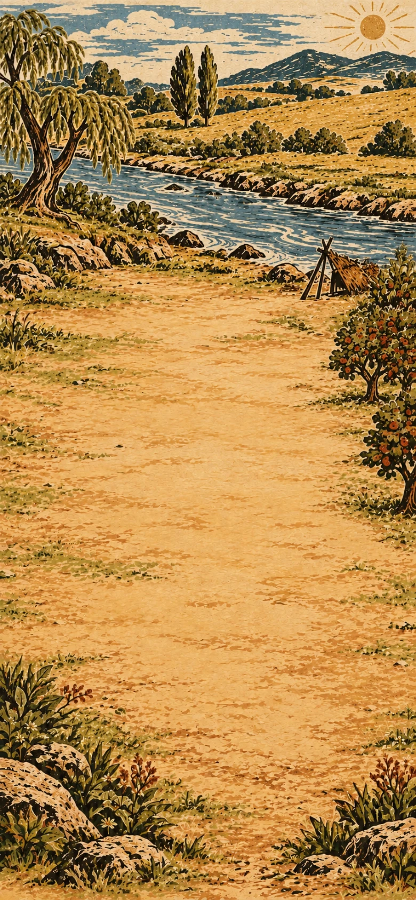

> NOTE: Scene continuity: Opening river clearing. Orchard trees hug the near RIGHT edge; a rudimentary stick-and-thatch lean-to stands above the clearing on this same bank. Far bank has only fields and twin poplars. No house or bridge.

Begin beside the river with earth, water, air and fire. Combine them to make useful materials.

**Goals**
- Make Stone -- Stone
- Make Brick -- Brick

**Items**
- Stone
  - icon: 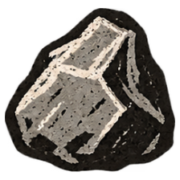
- Brick
  - icon: 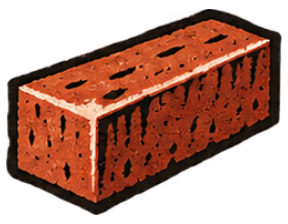
- Clay
  - icon: 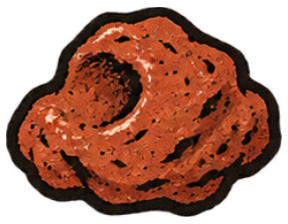

- Earth
  - icon: 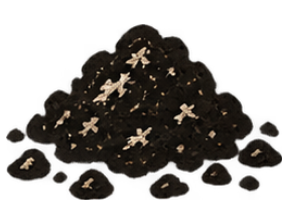 (at 28%, 53%)
- Water
  - icon: 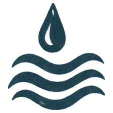 (at 54%, 24%)
- Air
  - icon: 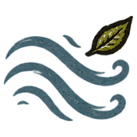 (at 55%, 7%)
- Fire
  - icon: 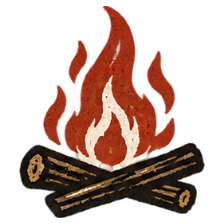 (at 75%, 36%)

**Combinations**
- Earth + Water -> Clay
- Earth + Fire -> Stone
- Clay [transform] + Fire -> Brick

## The first supper

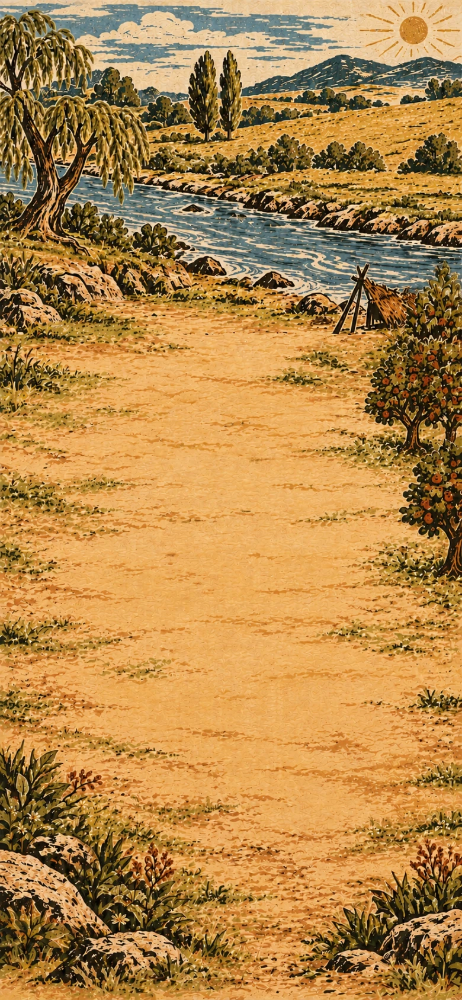

> NOTE: Scene continuity: A little closer to the near-bank orchard cooking clearing, same viewpoint and right-to-left river visible above it. Apple trees at the far right margin, same rough lean-to upper right, forked willow left. Empty broad earth clearing. No house, bridge or built oven.

There is a place to cook at the orchard's edge. Harvest and thresh ripe grain, then let moving air separate it from the chaff. Prepare bread and juice for the journey.

**Goals**
- Make Flatbread -- Flatbread
- Make Fruit juice -- Fruit juice

**Items**
- Flatbread
  - icon: 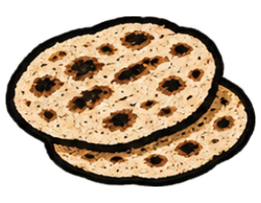
- Fruit juice
  - icon: 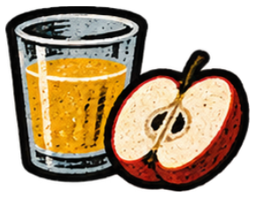
- Rain
  - icon: 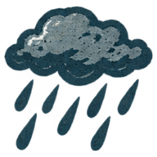
- Flour
  - icon: 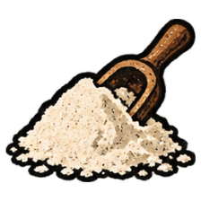
- Dough
  - icon: 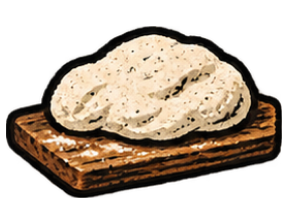
- Fruit
  - icon: 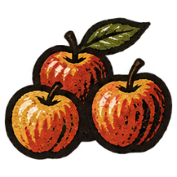

- Plant
  - icon: 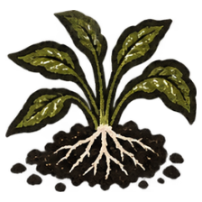

  Plants can provide food, fibres, seeds and wood. Growing them supplies materials people can harvest and use.

  *Plant*
- Grain
  - icon: 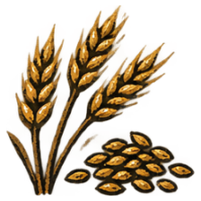

  After harvesting and threshing, the breeze blows the lighter chaff aside while the heavier grain falls. This is winnowing: separating the grain before milling or cooking it.

  *Grain*

**Combinations**
- Air + Water -> Rain
- Earth + Rain -> Plant
- Plant + Air -> Grain
- Grain [transform] + Stone -> Flour
- Flour [transform] + Water -> Dough
- Dough [transform] + Fire -> Flatbread
- Plant + Water -> Fruit
- Fruit [transform] + Water -> Fruit juice
- Fruit [transform] + Stone -> Fruit juice

> NOTE: Grain: Harvesting and threshing are compressed into the Plant-and-Air action; Air represents winnowing, not the growth of grain from air. [FAO: Processing of cereals, sections 12.1–12.2](https://www.fao.org/4/x0039e/x0039e06.htm) distinguishes threshing from separation by moving air. Not every cereal uses the same processing sequence.

> NOTE: Fruit juice: Crushing the fruit releases its juice. Represents pressing and collecting the liquid, not a complete food-preparation procedure.

## A place to wake up

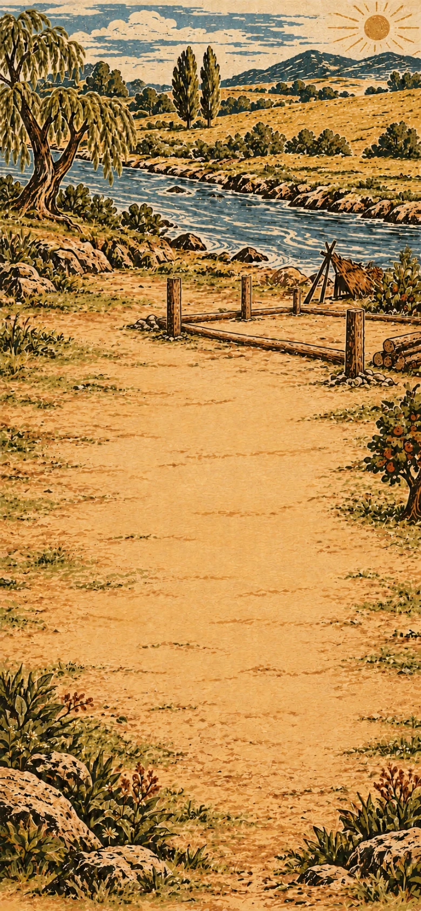

> NOTE: Scene continuity: Home construction site on our near bank, a few steps from the orchard. The same crude lean-to occupies the upper right margin. Bare level earth where the cottage will be made; a few timber posts at the extreme edge. River still beyond our home site, orchard on our side. NO finished house or bridge yet.

The path reaches a sheltered site without a home. Build a house and fit a window and somewhere to sleep.

**Goals**
- Build a house -- House
- next: Fit window and sleeping mat -- House[Window, Sleeping mat]

**Items**
- Window
  - icon: 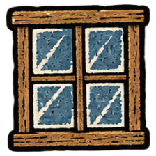
- Sleeping mat
  - icon: 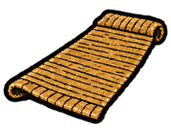
- Sand
  - icon: 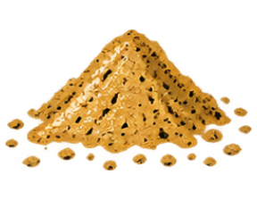
- Glass
  - icon: 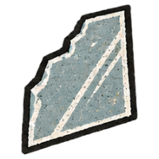
- Wood
  - icon: 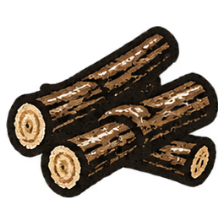
- Plant fiber
  - icon: 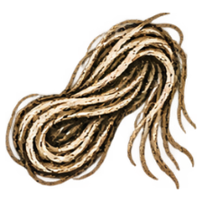
- Thread
  - icon: 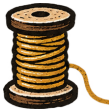
- Cloth
  - icon: 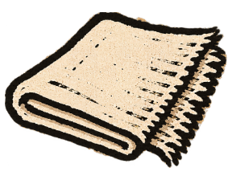
- Rope
  - icon: 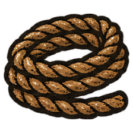

- House (compound)
  - icon: 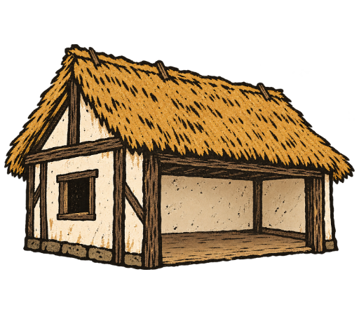
  - unnamed slot: accepts Window, icon: 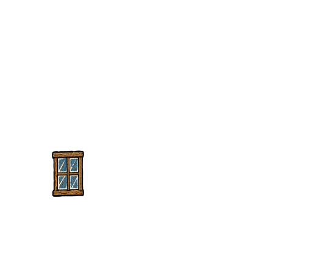
  - unnamed slot: accepts Sleeping mat, icon: 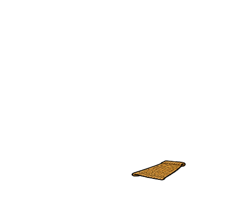
  - unnamed slot: accepts Hearth, icon: 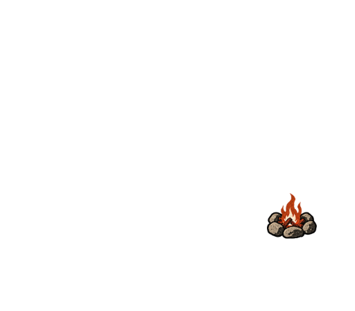
- Hearth
  - icon: 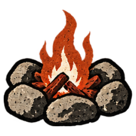

**Combinations**
- Earth + Air -> Sand
- Sand [transform] + Fire -> Glass
- Plant + Earth -> Wood
- Glass [consume] + Wood [consume] -> Window
- Plant + Stone -> Plant fiber
- Plant fiber [transform] + Wood -> Thread
- Thread [transform] + Wood -> Cloth
- Plant fiber [consume] + Thread [consume] -> Rope
- Plant fiber [consume] + Cloth [transform] -> Sleeping mat
- Brick [consume] + Wood [consume] -> House
- Stone [consume] + Fire -> Hearth

> NOTE: Glass: Storybook simplification: ordinary glass also needs flux and stabilizer; sand plus fire is not a real manufacturing instruction. Sources: [corning](#source-corning).

> NOTE: House: The window admits daylight while keeping the opening closed.

> NOTE: House: The sleeping mat lies inside the house, ready for the night.

> NOTE: Hearth: Stone contains a small warming fire.

> NOTE: House: The hearth warms the house without replacing its window or sleeping mat.

## Across the brook

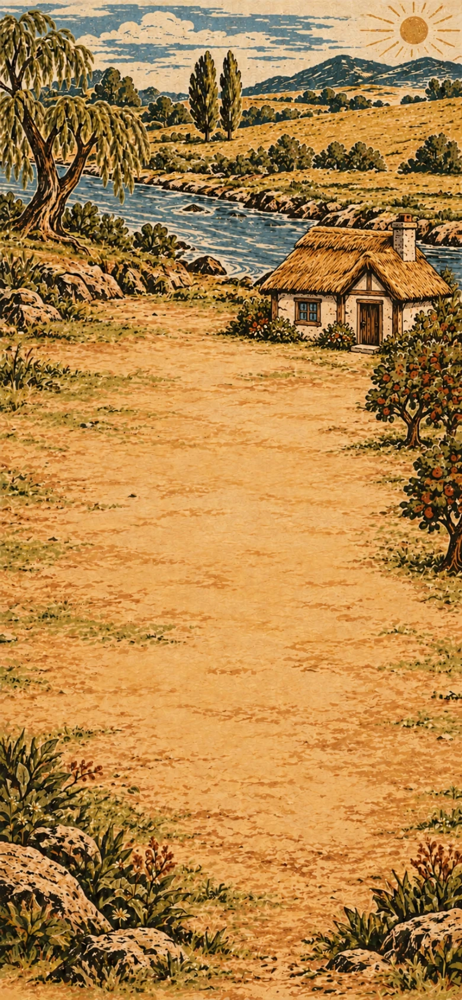

> NOTE: Scene continuity: Approaching the unbridged brook from our home bank. The cottage we just built stands upper RIGHT on our NEAR bank: cream plaster, rough dark timber, ochre thatch, square window on left and doorway on right. Orchard beside it on same bank. Water crosses upper third from right to left. A path on the opposite bank leads to a distant red-roof mill barn. No bridge yet; broad open earth on our bank.

A brook blocks the path. Build a footbridge to cross it and a handcart to move supplies.

**Goals**
- Build a footbridge -- Footbridge
- Make Handcart -- Handcart

**Items**
- Footbridge
  - icon: 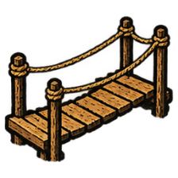
- Handcart
  - icon: 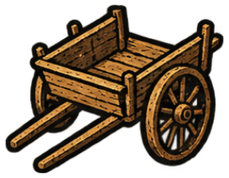
- Axe
  - icon: 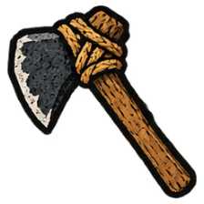
- Planks
  - icon: 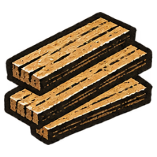
- Wheelset
  - icon: 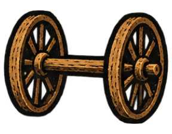

- Wheel
  - icon: 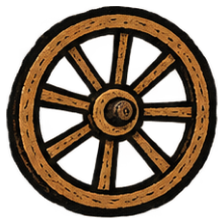

  A wheel can carry a load by rolling or transfer turning motion in a machine. Its shape makes new kinds of transport and work possible.

  *Wheel*

**Combinations**
- Wood [consume] + Stone [consume] -> Axe
- Axe + Wood [transform] -> Planks
- Planks [consume] + Rope [consume] -> Footbridge
- Planks [transform] + Stone -> Wheel
- Wheel [consume] + Wood [consume] -> Wheelset
- Planks [consume] + Wheelset [consume] -> Handcart

## The mill bend

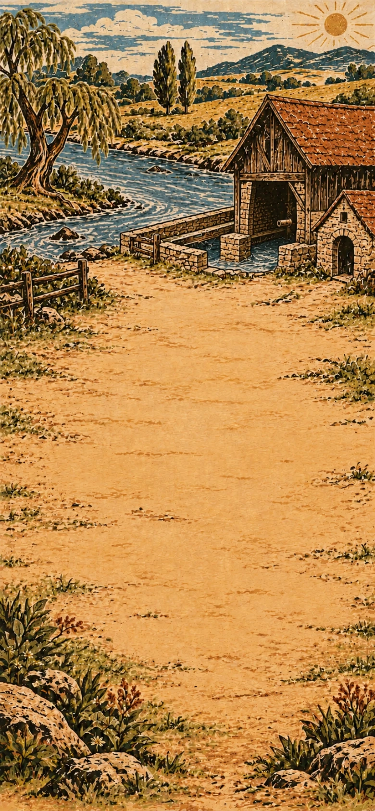

> NOTE: Scene continuity: Mill bend after crossing the brook. A low timber barn with rusty red pitched roof stands upper right beside the race. Empty wheel bearing, no finished waterwheel or grain mill machinery yet. A little bakehouse adjacent. River flows right to left across upper third; large pale empty mill yard foreground. No cottage on this bank.

The moving stream can power a mill. Grind grain for the village and press the garden's oil-bearing seeds for lamp fuel.

**Goals**
- Make Grain mill -- Grain mill
- Make Flour sack -- Flour sack
- Press seed oil -- Seed oil

**Items**
- Flour sack
  - icon: 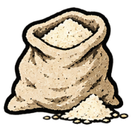
- Seed oil
  - icon: 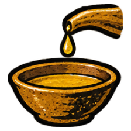
- Waterwheel
  - icon: 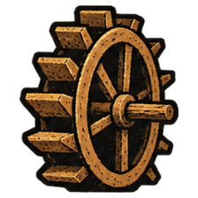
- Millstone
  - icon: 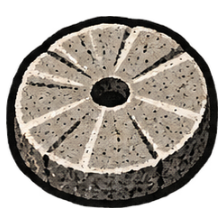
- Wooden gear
  - icon: 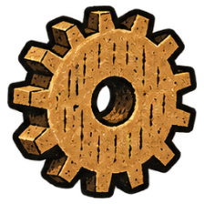
- Mill gearing
  - icon: 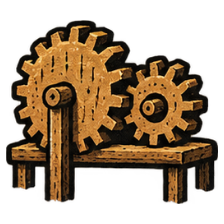
- Sack
  - icon: 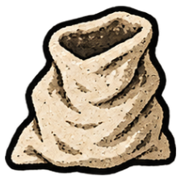
- Oil-bearing seeds
  - icon: 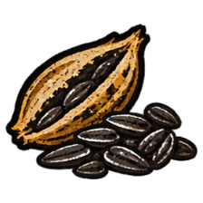

- Grain mill
  - icon: 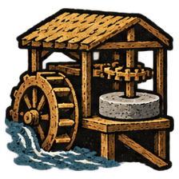

  The waterwheel, gears and grinding stone are connected. Flowing water can now do the repeated work of grinding grain for the village.

  *Grain mill*
- Weighted seed press
  - icon: 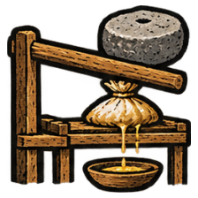

  The planks form a lever and a draining bed; the millstone supplies the weight. Prepared seeds can be squeezed here, and the oil drains into the collecting bed.

  *Weighted seed press*

**Combinations**
- Planks [transform] + Water -> Waterwheel
- Stone [consume] + Wheel [consume] -> Millstone
- Wheel [transform] + Axe -> Wooden gear
- Waterwheel [consume] + Wooden gear [consume] -> Mill gearing
- Mill gearing [consume] + Millstone [consume] -> Grain mill
- Cloth [transform] + Thread [consume] -> Sack
- Sack [transform] + Flour [consume] -> Flour sack
- Plant + Fruit [transform] -> Oil-bearing seeds
- Oil-bearing seeds [transform] + Weighted seed press [preserve] -> Seed oil
- Water + Wheel [transform] -> Waterwheel
- Millstone [consume] + Planks [consume] -> Weighted seed press

> NOTE: Oil-bearing seeds: Select oil-bearing seeds from mature garden fruit and seedpods, keeping seed for another planting as well as pressing.

> NOTE: Seed oil: The weighted press crushes suitable oil-bearing seeds and expresses their oil into its collecting bed. Sources: [fao-oil-extraction](#source-fao-oil-extraction).

> NOTE: Waterwheel: The wheel is adapted to catch the moving water. Paddles and mounting are implicit, as they are in the original planks-and-water route.

> NOTE: Weighted seed press: Build a wooden lever and draining bed, using the heavy millstone as its pressing weight. Ordinary joinery and a seed-holding press bed are compressed into this construction. It is a hand-powered batch press, not the loose grinding stone acting alone. Sources: [fao-oil-extraction](#source-fao-oil-extraction).

## Bread for the journey

> NOTE: Scene continuity: Mill bakehouse yard, rusty red roof upper left, rough bread oven built into the wall at far upper left. The mill now has a wooden working waterwheel visible in the upper background. Water runs right to left. Pale open yard, earth bank at far right with a stone-framed cellar doorway cut into it. The cellar is painted into the bank; its transparent hit area follows the doorway.

At the bakehouse, mix flour with water and tend a wild starter over time. There is a warm place for dough to rise. Bake bread and pack some for the journey.

**Goals**
- Bake bread -- Bread
- next: Pack a picnic basket -- Picnic basket

> NOTE: Hotspot **Warm cellar** is centred at (86%, 34.5%) from the background’s top-left: (671, 582) pixels in the 780×1688 asset. The background itself depicts the stone cellar entrance cut into the existing right-hand earth bank. Its separate 352×376 icon is 100% transparent and defines only the 88×94 hit area on the 390px board. Hover, focus and compatible drags reveal its name and outline; no separate miniature is drawn over the scenery.

**Hotspots**
- Warm cellar (at 86%, 34.5%)
  - icon: 

**Items**
- Bread
  - icon: 
- Picnic basket
  - icon: 
- Risen dough
  - icon: 
- Basket
  - icon: 

- Wild starter
  - icon: 

  Moistened flour, tended over time, has become a living culture of yeasts and bacteria from the flour and its surroundings. The bubbling starter can help bread dough rise.

  *Wild starter*

**Combinations**
- Flour [transform] + Air -> Wild starter
- Wild starter + Dough [transform] @ Warm cellar -> Risen dough
- Risen dough [transform] + Fire -> Bread
- Plant fiber [transform] + Rope [consume] -> Basket
- Bread [consume] + Basket [transform] -> Picnic basket

> NOTE: Wild starter: [Colorado State University Extension: Sourdough Starter Best Practices](https://extension.colostate.edu/resource/sourdough-starter-best-practices/) supports flour, water, time and microbial growth, and says deliberate capture of yeast from air is unnecessary. Air represents contact with the surroundings, not a dry flour mixture or microbes arriving only on a breeze. Moistening and tending are compressed; this is not a complete starter procedure or a claim that one culture suits every fermentation.

> NOTE: Basket: Weave the plant fibers into a carrier and bind its rim and handle with rope.

## Keep the summer

> NOTE: Scene continuity: Back in our starting-bank orchard for preserving fruit. Apple trees and low stone wall frame upper third, completed cream-and-timber thatched cottage upper right. Large empty earth courtyard foreground, no greenhouse, trellis or irrigation yet. Small glimpse of river beyond, flowing right to left.

Prepare a glaze mixture suited to the clay, then coat and fire the jars before filling them. Cook the fruit, cover the preserves with a wooden lid, and pack cider for the journey.

**Goals**
- Make Covered preserves -- Covered preserves
- Pack cider to carry
  - either: Cider jar
  - or: Cider bottle

**Items**
- Covered preserves
  - icon: 
- Cider jar
  - icon: 
- Cider bottle
  - icon: 
- Formed clay bowl
  - icon: 
- Jam
  - icon: 
- Clay jar
  - icon: 
- Jar lid
  - icon: 
- Preserve jar
  - icon: 
- Cider
  - icon: 
- Glaze mixture
  - icon: 
- Glass bottle
  - icon: 

- Fired glazed jar
  - icon: 

  The clay jar has been coated, fired and left to cool. The glaze has melted into a glassy surface; the vessel is still pottery, ready to fill.

  *Fired glazed jar*

**Combinations**
- Clay [transform] + Wheel -> Formed clay bowl
- Fruit [transform] + Fire -> Jam
- Clay [transform] + Formed clay bowl -> Clay jar
- Planks [transform] + Fired glazed jar -> Jar lid
- Jam [consume] + Fired glazed jar [transform] -> Preserve jar
- Preserve jar [transform] + Jar lid [consume] -> Covered preserves
- Wild starter + Fruit juice [transform] -> Cider
- Sand [consume] + Clay [consume] -> Glaze mixture
- Clay jar [transform] + Glaze mixture [consume] -> Fired glazed jar
- Cider [consume] + Fired glazed jar [transform] -> Cider jar
- Glass [transform] + Air -> Glass bottle
- Cider [consume] + Glass bottle [transform] -> Cider bottle

> NOTE: Formed clay bowl: Hand-shape the clay on the turning wooden disc and let the form stiffen for dry shaping work. Hand shaping and drying are compressed; firing is not implied. Liquid service uses the later glazed, fired bowl. Sources: [pottery-forming](#source-pottery-forming).

> NOTE: Glaze mixture: The potter selects a mixture suited to the fictional local clay and firing conditions. Sand and Clay stand for that selected mineral mixture, not a universal glaze formula. [MFA CAMEO: Albany slip clay](https://cameo.mfa.org/wiki/Albany_slip_clay) documents one particular mineral-rich clay used as a glaze; it does not establish that arbitrary sand and clay will work. No food-contact or heat-resistance certification is implied.

> NOTE: Covered preserves: A wooden cover is not a canning seal. The filled, fired jar and lid represent covered storage under the cooks' care, not a shelf-stable preservation or food-safety procedure.

> NOTE: Fired glazed jar: The potter coats and fires the clay jar. The glaze melts into a glassy surface; the vessel keeps its jar shape. Coating, kiln firing and cooling are compressed into one craft action. Glaze alone does not fire pottery, and a glassy coating does not make the whole vessel glass. Sources: [pottery-glaze-firing](#source-pottery-glaze-firing).

> NOTE: Cider jar: Cider fills the glazed clay jar; a fitted closure makes it ready to carry. Fitting an ordinary closure is compressed into filling the vessel; this is not a preservation or food-safety procedure.

> NOTE: Glass bottle: Blown air opens a bubble in softened glass; the glassworker shapes a bottle. Represents skilled glassblowing; heating, blowpipe, shaping and cooling are compressed, not omitted from the real process. Sources: [corning](#source-corning).

> NOTE: Cider bottle: Cider fills the glass bottle; a fitted closure makes it ready to carry. An ordinary closure is compressed into filling; no glazing is involved and no preservation procedure is implied.

## The potter's yard

> NOTE: Scene continuity: An earnest rural potter’s yard. Rough timber shed and clay-red brick wall across top third, stacked unfired pots only at extreme upper left. Bare broad ochre courtyard. A full-sized brick firing kiln stands beside the shed against the right-hand wall, painted into the scene.

The potter's yard has space for firing and glazing. Finish a bowl that can hold liquids and make a tiled table for meals.

**Goals**
- Fire and glaze the bowl -- Fired glazed bowl
- Make Tiled table -- Tiled table

> NOTE: Hotspot **Kiln yard** is centred at (83%, 26%) from the background’s top-left: (647, 439) pixels in the 780×1688 asset. The background itself depicts the full-sized brick kiln standing beside the pottery shed against its right-hand wall. Its separate 448×400 icon is 100% transparent and defines only the 112×100 hit area on the 390px board. Hover, focus and compatible drags reveal its name and outline; no separate miniature is drawn over the scenery.

**Hotspots**
- Kiln yard (at 83%, 26%)
  - icon: 

**Items**
- Fired glazed bowl
  - icon: 
- Tiled table
  - icon: 
- Tile
  - icon: 
- Table
  - icon: 

**Combinations**
- Clay [transform] + Planks -> Tile
- Formed clay bowl [transform] + Glaze mixture [consume] @ Kiln yard -> Fired glazed bowl
- Planks [consume] + Wood [consume] -> Table
- Table [transform] + Tile [consume] -> Tiled table

> NOTE: Fired glazed bowl: At the kiln, coat and fire the formed bowl to make a water-ready glazed vessel.

## Tools to lend

> NOTE: Scene continuity: Small quarry workshop. Russet and grey broken rock face across top and right edge, rough open timber shelter upper left. No completed forge, kiln or tool chest yet. Broad pale sandy working floor; the hotspot follows the iron-red seam in the actual right-hand quarry face.

At the quarry workshop, make a tool for breaking hard ground and a chest for storing tools.

**Goals**
- Make Pickaxe -- Pickaxe
- Make a wooden chest for tools -- Wooden chest

> NOTE: Hotspot **Iron quarry** is centred at (86%, 22%) from the background’s top-left: (671, 371) pixels in the 780×1688 asset. The background itself depicts the rust-red iron seam in the actual quarry face, in the same position on both visits. Its separate 352×512 icon is 100% transparent and defines only the 88×128 hit area on the 390px board. Hover, focus and compatible drags reveal its name and outline; no separate miniature is drawn over the scenery.

**Hotspots**
- Iron quarry (at 86%, 22%)
  - icon: 

**Items**
- Pickaxe
  - icon: 
- Wooden chest
  - icon: 
- Kiln
  - icon: 
- Iron ore
  - icon: 
- Bellows
  - icon: 
- Forge
  - icon: 
- Nails
  - icon: 
- Hinge
  - icon: 

- Iron
  - icon: 

  Iron can be shaped into strong cutting edges, fasteners and fittings. It adds new possibilities for tools and construction.

  *Iron*
- Stone hammer
  - icon: 

  You choose a river-worn cobble as a hand-held hammer. The river has rounded its edges over time.

  *Stone hammer*
- Carving tool
  - icon: 

  This stout workshop chisel has an edge hardened for cutting softer iron as well as shaping wood.

  *Carving tool*

**Combinations**
- Brick [transform] + Fire -> Kiln
- Stone + Water -> Stone hammer
- Stone hammer @ Iron quarry -> Iron ore
- Cloth [transform] + Air -> Bellows
- Kiln [consume] + Bellows [consume] -> Forge
- Iron ore [transform] + Forge -> Iron
- Iron [consume] + Wood [consume] -> Pickaxe
- Iron [transform] + Stone -> Carving tool
- Iron [transform] + Forge -> Nails
- Iron [consume] + Nails [consume] -> Hinge
- Planks [consume] + Nails [consume] -> Wooden chest
- Stone @ Iron quarry -> Iron ore

> NOTE: Stone hammer: A rounded river stone selected for use as a hand-held hammer. Storybook compression of river abrasion and selecting a suitable cobble. Water does not instantly turn any rock into a safe striking tool. Sources: [river-rounding](#source-river-rounding), [hammerstone](#source-hammerstone).

> NOTE: Iron ore: The stone hammer chips ore from the exposed seam at the quarry. Sources: [hammerstone-mining](#source-hammerstone-mining).

> NOTE: Carving tool: Authorial choice: this is a metal-capable workshop chisel, not a wood-only knife. Shaping, hardening and grinding its edge are ordinary workshop work compressed into Iron + Stone. [London Museum: iron cold chisel](https://www.londonmuseum.org.uk/collections/v/object-281229/chisel-iron-cold-chisel/) documents a metal-cutting tool class, not this fictional tool's exact manufacture or a universal cutting capability. Saw manufacture likewise compresses shaping, tooth cutting and finishing; no practical toolmaking instructions are supplied.

> NOTE: Nails: At the stocked forge, the smith heats the iron, draws it to points and forms the nail heads with hammer, anvil and heading tool. Reheating, drawing, cutting and heading are compressed into one smithing action; striking arbitrary cold iron with a stone is not the recipe. Sources: [forged-nails](#source-forged-nails).

> NOTE: Hinge: Metal leaves joined around a pin can swing while remaining connected.

> NOTE: Iron ore: A hard stone chips ore from the exposed seam at the quarry. A quarry-side pounding action, not digging an underground mine or a real-world tool-use procedure. Sources: [hammerstone-mining](#source-hammerstone-mining).

## A river wide enough

> NOTE: Scene continuity: First visit to the wider river landing. Unbuilt bare sandy bank, broad water upper third flowing right to left toward sea. Crooked willow left, low opposite reed bank, no dock or boat yet. Empty broad ochre shore foreground, small sheltered inlet at far right.

The river is wider here. Build a landing and a sailboat to reach the other bank.

**Goals**
- Build a dock -- Dock
- Make Sailboat -- Sailboat

**Items**
- Dock
  - icon: 
- Raft
  - icon: 
- Sail
  - icon: 
- Pier post
  - icon: 

- Sailboat
  - icon: 

  The boat can use wind in its sail to move across the water. It gives the neighbours a way to travel between the banks.

  *Sailboat*

**Combinations**
- Wood [consume] + Rope [consume] -> Raft
- Cloth [consume] + Rope [consume] -> Sail
- Raft [transform] + Sail [consume] -> Sailboat
- Planks [transform] + Stone hammer -> Pier post
- Pier post [consume] + Planks [consume] -> Dock

## A light to come home to

> NOTE: Scene continuity: Bare harbour headland before a lighthouse is made. Rocky cape upper right and slate blue sea across upper third, distant curved harbour coast on left. NO tower, lighthouse or mooring buoy. Broad open pale grassy-earth foreground. The hotspot covers the actual grassy cape and cliff at upper right, continuous with the shore.

Visitors need to find the harbour after dark and secure their boats. Build a light on the headland and prepare a mooring buoy.

**Goals**
- Build a lighthouse -- Lighthouse
- Make Mooring buoy -- Mooring buoy

> NOTE: Hotspot **Harbour headland** is centred at (87%, 24%) from the background’s top-left: (679, 405) pixels in the 780×1688 asset. The background itself depicts the actual grassy cape and rock face projecting into the sea at upper right; still without a lighthouse. Its separate 352×480 icon is 100% transparent and defines only the 88×120 hit area on the 390px board. Hover, focus and compatible drags reveal its name and outline; no separate miniature is drawn over the scenery.

**Hotspots**
- Harbour headland (at 87%, 24%)
  - icon: 

**Items**
- Lighthouse
  - icon: 
- Mooring buoy
  - icon: 
- Oil-soaked fiber wick
  - icon: 
- Oil-wick torch
  - icon: 
- Lantern
  - icon: 
- Tower
  - icon: 
- Float
  - icon: 

**Combinations**
- Oil-soaked fiber wick [consume] + Wood [consume] -> Oil-wick torch
- Glass [consume] + Oil-wick torch [transform] -> Lantern
- Brick [consume] + Window [consume] -> Tower
- Tower [transform] + Lantern [consume] @ Harbour headland -> Lighthouse
- Wood [consume] + Fired glazed jar [consume] -> Float
- Float [transform] + Rope [consume] -> Mooring buoy
- Plant fiber [consume] + Seed oil [consume] -> Oil-soaked fiber wick

> NOTE: Oil-wick torch: Secure the oil-soaked fiber bundle around the end of the wooden support to make a small portable torch. Binding and ignition are ordinary assembly/use abstractions; this is not a burn-duration or safety claim.

> NOTE: Float: The closed, empty ceramic jar is held in a wooden support, trapping air to make a float. A suitable seal and support are compressed into the craft action; an open vessel would fill with water.

## The walled garden

> NOTE: Scene continuity: Walled garden on our home bank. Same apple trees, low stone wall and cream plaster ochre-thatch cottage at upper right. Bare beds along far upper edge; no supported trellis, greenhouse or irrigation system yet. Wide open earth courtyard.

On a later morning, return to the orchard for planting. The preserving work stays in the earlier workspace while you prepare support and shelter for growing plants.

**Goals**
- Make Supported garden -- Supported garden
- Make Greenhouse -- Greenhouse

**Items**
- Supported garden
  - icon: 
- Greenhouse
  - icon: 
- Seedlings
  - icon: 
- Trellis
  - icon: 

**Combinations**
- Oil-bearing seeds [transform] + Water -> Seedlings
- Seedlings + Rope [transform] -> Trellis
- Seedlings [consume] + Trellis [transform] -> Supported garden
- Window [transform] + Seedlings [consume] -> Greenhouse

## Water without the climb

> NOTE: Scene continuity: Garden water bank after the trellis and greenhouse were built. Same home-bank orchard and cottage upper right, low stone wall. Modest wooden trellis and small glass greenhouse now visible along top edge. River runs right to left at upper left. No jar wheel, aqueduct channel or reservoir yet. Large clear ochre earth foreground.

The stream is below the growing beds. Use the current to lift water into a raised basin, then bring it to the garden without carrying every bucket uphill.

**Goals**
- Make Irrigated garden -- Irrigated garden

**Items**
- Irrigated garden
  - icon: 
- Saw
  - icon: 
- Hollow pipe
  - icon: 
- Reservoir
  - icon: 
- Waterwheel with jars
  - icon: 
- Filled reservoir
  - icon: 
- Water channel
  - icon: 
- Irrigation channel
  - icon: 

**Combinations**
- Iron [transform] + Carving tool -> Saw
- Saw [preserve] + Wood [transform] -> Hollow pipe
- Clay [consume] + Brick [consume] -> Reservoir
- Reservoir [transform] + Waterwheel with jars [preserve] -> Filled reservoir
- Hollow pipe [consume] + Planks [consume] -> Water channel
- Water channel [transform] + Filled reservoir [preserve] -> Irrigation channel
- Irrigation channel [consume] + Supported garden [transform] -> Irrigated garden
- Waterwheel [transform] + Fired glazed jar [consume] -> Waterwheel with jars

> NOTE: Filled reservoir: The stream-driven jars tip their water into the basin at the top of the wheel, above the growing beds.

> NOTE: Waterwheel with jars: Fix open glazed jars around the rim of the paddled waterwheel. The current turns the wheel; the jars scoop, lift and tip the water into the basin above the beds. Ordinary attachment and positioning are compressed. The existing pottery supply represents multiple fired vessels, not a single jar copied into several objects. No claim of a particular lift height, flow rate or engineering specification. Sources: [fao-noria](#source-fao-noria).

## A welcome in colour

> NOTE: Scene continuity: Village square before festival preparations. Crooked elm upper left, low communal hall with red tiled roof upper centre, stone wall and empty washing corner at far right. Worn pale ochre paving is open across foreground. No canopy, banner, bandstand or puppet theatre yet.

Neighbours are coming to the village square for music and a shared meal. Make a banner and a canopy for shade.

**Goals**
- Make Festival banner -- Festival banner
- Make Canopy -- Canopy

**Items**
- Festival banner
  - icon: 
- Canopy
  - icon: 
- Flowers
  - icon: 
- Dye
  - icon: 
- Dyed cloth
  - icon: 
- Loom
  - icon: 
- Dyed thread
  - icon: 
- Patterned cloth
  - icon: 
- Awning
  - icon: 

**Combinations**
- Plant + Rain -> Flowers
- Flowers [transform] + Water -> Dye
- Cloth [transform] + Dye [consume] -> Dyed cloth
- Dyed cloth [transform] + Wood [consume] -> Festival banner
- Thread [consume] + Planks [consume] -> Loom
- Loom [preserve] + Dyed thread [transform] -> Patterned cloth
- Patterned cloth [transform] + Wood [consume] -> Festival banner
- Cloth [consume] + Planks [consume] -> Awning
- Awning [transform] + Rope [consume] -> Canopy
- Thread [transform] + Dye [consume] -> Dyed thread

> NOTE: Patterned cloth: The loom holds the warp while coloured threads are woven into a pattern. Sources: [coloured-thread-weaving](#source-coloured-thread-weaving).

> NOTE: Dyed thread: The loose threads take up colour before they are woven. Sources: [coloured-thread-weaving](#source-coloured-thread-weaving).

## Charcoal for the messages

> NOTE: Scene continuity: Return to the SAME russet-grey quarry and timber shelter. Now a small clay kiln and brick forge have been built at upper left under shelter, with an anvil. No large finished heap of charcoal. Same broad pale working floor; the hotspot follows the same iron-red seam in the right-hand quarry face.

We stop at the quarry kiln for charcoal. At the landing, we can grind it into ink for our invitations.

**Goals**
- Make charcoal for ink -- Charcoal

> NOTE: Hotspot **Iron quarry** is centred at (86%, 22%) from the background’s top-left: (671, 371) pixels in the 780×1688 asset. The background itself depicts the rust-red iron seam in the actual quarry face, in the same position on both visits. Its separate 352×512 icon is 100% transparent and defines only the 88×128 hit area on the 390px board. Hover, focus and compatible drags reveal its name and outline; no separate miniature is drawn over the scenery.

**Hotspots**
- Iron quarry (at 86%, 22%)
  - icon: 

**Items**
- Charcoal
  - icon: 

**Combinations**
- Wood [transform] + Kiln -> Charcoal

> NOTE: This later chapter reuses the quarry image and the existing Kiln. The new language carries the needed existing work into this later visit; it does not restore the old board. If charcoal was already made, this chapter skips.

## News before the boats

> NOTE: Scene continuity: Return to the wider river landing. A modest rough plank dock now projects into water at upper left, one simple small sailboat moored there. River runs right to left, opposite reed bank, same crooked willow left, large empty pale shore. No mailboat or printed invitations yet.

We need to invite our neighbours to the meal and music. Back at the landing, prepare printed invitations and a mailboat to carry them.

**Goals**
- Make Printed invitations -- Printed invitations
- next: Make Mailboat -- Mailboat

**Items**
- Mailboat
  - icon: 
- Paper pulp
  - icon: 
- Paper
  - icon: 
- Ink
  - icon: 
- Printing block
  - icon: 
- Inked printing block
  - icon: 
- Letter
  - icon: 

- Printed invitations
  - icon: 

  The carved block can print the same invitation on many sheets. Several messengers can now invite neighbours to the meal and music.

  *Printed invitations*

**Combinations**
- Plant fiber [transform] + Water -> Paper pulp
- Paper pulp [transform] + Cloth -> Paper
- Charcoal [transform] + Water -> Ink
- Carving tool + Planks [transform] -> Printing block
- Printing block [transform] + Ink -> Inked printing block
- Inked printing block [preserve] + Paper [transform] -> Printed invitations
- Paper [transform] + Ink -> Letter
- Letter [consume] + Sailboat [transform] -> Mailboat
- Printed invitations [preserve] + Sailboat [transform] -> Mailboat

> NOTE: Mailboat: Load copies of the printed invitations aboard the sailboat for delivery upriver.

## A tune in the square

> NOTE: Scene continuity: Same village square: crooked elm left, red-tile communal hall upper centre, washing corner right. A rustic cloth canopy and simple coloured festival bunting now span only the upper edge. No stage or bandstand, no instruments yet. Broad empty pale paving.

The following afternoon, the square is ready for music. Make instruments and a raised place for the players.

**Goals**
- Make Flute -- Flute
- Make Drum -- Drum
- Make Bandstand -- Bandstand

**Items**
- Flute
  - icon: 
- Drum
  - icon: 
- Bandstand
  - icon: 
- Hollow tube
  - icon: 
- Platform
  - icon: 

**Combinations**
- Wood [transform] + Carving tool -> Hollow tube
- Hollow tube [transform] + Air -> Flute
- Cloth [consume] + Clay jar [transform] -> Drum
- Planks [consume] + Brick [consume] -> Platform
- Platform [transform] + Canopy [consume] -> Bandstand

## A story to pass on

> NOTE: Scene continuity: Same festival square and canopy. A low simple timber bandstand now sits along the upper left edge beneath crooked elm. Communal hall red roof upper centre. No puppet booth, picture book or exhibition yet. Clear pale paving foreground.

Later, children gather in the square. Prepare a puppet theatre and a picture book for them.

**Goals**
- Make Puppet theatre -- Puppet theatre
- Make Picture book -- Picture book

**Items**
- Puppet theatre
  - icon: 
- Picture book
  - icon: 
- Puppet
  - icon: 
- Curtain
  - icon: 
- Stage
  - icon: 
- Paint
  - icon: 
- Picture
  - icon: 
- Bound book
  - icon: 

- Brush
  - icon: 

**Combinations**
- Wood [consume] + Cloth [consume] -> Puppet
- Cloth [consume] + Window [consume] -> Curtain
- Curtain [consume] + Platform [transform] -> Stage
- Stage [transform] + Puppet [consume] -> Puppet theatre
- Dye [transform] + Fired glazed bowl -> Paint
- Plant fiber [consume] + Hollow tube [consume] -> Brush
- Paint [consume] + Paper [consume] -> Picture
- Paper [consume] + Thread [consume] -> Bound book
- Bound book [transform] + Picture [consume] -> Picture book

## What the water hides

> NOTE: Scene continuity: Quiet close view of the mill pond. The SAME rust-red timber mill and now working wooden waterwheel stand far upper left, pond water across upper third runs right to left, rushes at far right. Wide pale dry earth foreground. The hotspot follows real pond water beside the right-hand rushes; no microscope or study instruments.

At the millpond, examine a water sample more closely. A microscope can reveal things too small to see unaided.

**Goals**
- Examine pond slide -- Pond life study

> NOTE: Hotspot **Mill pond** is centred at (74%, 28%) from the background’s top-left: (577, 473) pixels in the 780×1688 asset. The background itself depicts the mill pond water between the working wheel and the right-hand rushes. Its separate 416×320 icon is 100% transparent and defines only the 104×80 hit area on the 390px board. Hover, focus and compatible drags reveal its name and outline; no separate miniature is drawn over the scenery.

**Hotspots**
- Mill pond (at 74%, 28%)
  - icon: 

**Items**
- Lens
  - icon: 
- Magnifier
  - icon: 
- Telescope
  - icon: 
- Glass slide
  - icon: 
- Pond water
  - icon: 
- Pond slide
  - icon: 

- Microscope
  - icon: 

  The microscope reveals details too small for unaided sight. A prepared pond-water sample can now be examined for tiny living things.

  *Microscope*
- Pond life study
  - icon: 

  You bring the drop into focus. Green specks drift past; a transparent swimmer turns, then slips out of view. The naturalist moves aside so the child beside you can take a look.

  *Pond life study*

**Combinations**
- Glass [transform] + Sand -> Lens
- Lens [consume] + Wood [consume] -> Magnifier
- Lens [consume] + Hollow tube [consume] -> Telescope
- Magnifier [consume] + Telescope [consume] -> Microscope
- Glass [transform] + Planks -> Glass slide
- Fired glazed bowl @ Mill pond -> Pond water
- Pond water [consume] + Glass slide [transform] -> Pond slide
- Pond slide [preserve] + Microscope [preserve] -> Pond life study
- Pond water [consume] + Glass [transform] -> Pond slide

> NOTE: Glass slide: The wooden board supports the glass while a small, flat slide is prepared. A compressed craft relationship, not instructions for cutting glass: shaping and finishing tools are implicit. Wood does not turn glass into a slide by itself.

> NOTE: Pond life study: An illustrative fictional observation, not a species identification or a test of water safety.

> NOTE: Pond slide: A thin drop is spread on a small piece of clear glass, ready for the microscope. Accepts the player's direct sample-on-glass action. Preparing the small, flat support is compressed; the separate glass-slide route remains available.

## Names for the green world

> NOTE: Scene continuity: Botanical visit to our home-bank orchard. Same cottage, stone wall, apple trees, supported trellis and small greenhouse persist across top. A simple wooden irrigation trough and jar-lifting wheel now work at upper left by right-to-left river. Open earth clearing foreground; no botanical books pre-placed.

On another orchard morning, visitors want to identify the plants. Make illustrated records they can compare with living examples.

**Goals**
- Make Illustrated flora -- Illustrated flora

**Items**
- Illustrated flora
  - icon: 
- Pressed plant specimen
  - icon: 
- Herbarium
  - icon: 
- Leaf study
  - icon: 
- Botanical drawing
  - icon: 

**Combinations**
- Plant + Paper [transform] -> Pressed plant specimen
- Pressed plant specimen [consume] + Bound book [transform] -> Herbarium
- Lens + Plant -> Leaf study
- Leaf study [consume] + Ink -> Botanical drawing
- Botanical drawing [consume] + Herbarium [transform] -> Illustrated flora
- Plant + Bound book [transform] -> Herbarium

> NOTE: Herbarium: Represents collected, dried, pressed and documented specimens, not an instantaneous binding operation. Sources: [kew](#source-kew).

> NOTE: Herbarium: The plant is pressed and preserved between the pages, beginning a specimen collection with space for its record. Compresses collection, pressing, drying and mounting, as the original specimen route does. Both routes produce the same Herbarium; no instant preservation procedure is implied. Sources: [kew](#source-kew).

## A promise to the sky

> NOTE: Scene continuity: Return to same harbour headland on a breezy clear morning. A modest pale stone lighthouse with ochre lantern roof now stands on upper-right cape; harbour coast remains left. Low dry-stone wall at edges. No weather vane or measuring instruments yet. Huge open pale forecourt.

Back at the headland, boat crews want a record of changing weather. Prepare observations they can compare over time.

**Goals**
- Make Weather record -- Weather record

**Items**
- Weather record
  - icon: 
- Collected rain level
  - icon: 
- Windsock
  - icon: 
- Rain record
  - icon: 
- Wind record
  - icon: 

- Clear collector with level marks
  - icon: 

  Rainfall can now be recorded and compared from one observation to the next. Water levels from equal collection periods in the same vessel reveal wetter and drier spells, helping people build a record of changing weather.

  *Clear collector with level marks*

- Weather book
  - icon: 

**Combinations**
- Glass bottle [transform] + Paper [consume] -> Clear collector with level marks
- Clear collector with level marks [transform] + Rain -> Collected rain level
- Cloth [consume] + Hollow tube [consume] -> Windsock
- Paper [transform] + Collected rain level -> Rain record
- Windsock + Rain record [transform] -> Weather record
- Weather record [preserve] + Bound book [transform] -> Weather book
- Windsock + Paper [transform] -> Wind record
- Wind record [transform] + Collected rain level -> Weather record
- Wind record [consume] + Rain record [consume] -> Weather record

> NOTE: Clear collector with level marks: Mark a comparison strip on paper and fix it beside the clear bottle, leaving its water level visible. Sources: [metoffice-rain-reading](#source-metoffice-rain-reading).

> NOTE: Collected rain level: Set the open marked collector in the rain for a collection interval and read its visible fill level.

> NOTE: Rain record: Record the clear collector’s relative fill level, comparing the same vessel over equal collection intervals.

> NOTE: Wind record: Record how the windsock turns and lifts, leaving room beside the wind notes for relative collector levels.

> NOTE: Weather record: The relative collector level joins the wind notes: both observations now appear in the weather record.

> NOTE: Weather record: The separate wind and rain notes become one weather record.

> NOTE: Clear collector with level marks: Authored relative-comparison instrument, not a calibrated meteorological rain gauge.

## Food for the crossing

> NOTE: Scene continuity: Tidal shore below our harbour. Slate blue sea across top third, distant same pale lighthouse at upper right and harbour curve to left. Low rocks at outer margins, broad empty warm sandy foreground. The hotspot follows the actual shallow tideline at the right edge. No caught fish, salt piles or preserves.

At the tidal shore, boats are preparing for a crossing without a cooking hearth. Preserve food that the crews can take with them.

[If skipped] Visitors have arrived at the landing for the meal and music.

**Goals**
- Make Smoked fish -- Smoked fish
- Make Pickle jar -- Pickle jar

> NOTE: Hotspot **Tidal shore** is centred at (76%, 39%) from the background’s top-left: (593, 658) pixels in the 780×1688 asset. The background itself depicts the shallow sea water washing onto the sandy shore at right. Its separate 496×344 icon is 100% transparent and defines only the 124×86 hit area on the 390px board. Hover, focus and compatible drags reveal its name and outline; no separate miniature is drawn over the scenery.

**Hotspots**
- Tidal shore (at 76%, 39%)
  - icon: 

**Items**
- Smoked fish
  - icon: 
- Pickle jar
  - icon: 
- Net
  - icon: 
- Fish
  - icon: 
- Brine
  - icon: 
- Smoke
  - icon: 
- Vinegar
  - icon: 
- Pickles
  - icon: 

- Salt
  - icon: 

**Combinations**
- Thread [consume] + Rope [consume] -> Net
- Net @ Tidal shore -> Fish
- Fired glazed bowl @ Tidal shore -> Brine
- Brine [transform] + Fire -> Salt
- Wood [transform] + Fire -> Smoke
- Smoke [preserve] + Fish [transform] -> Smoked fish
- Cider [transform] + Air -> Vinegar
- Vinegar [consume] + Fruit [consume] -> Pickles
- Pickles [consume] + Fired glazed jar [transform] -> Pickle jar

## The first boats are here

> NOTE: Scene continuity: The festival square ready for arrivals: same elm, red-roof hall, canopy and low timber stage across upper third. Right-hand washing corner still empty, no washstand or large water jar yet. Broad empty pale paving, no foreground people.

Our visitors have arrived. Prepare a place to wash and a covered jar of water for them.

**Goals**
- Make Washstand -- Washstand
- Fill and cover the water jar -- Covered water jar

**Items**
- Washstand
  - icon: 
- Covered water jar
  - icon: 
- Filter bed
  - icon: 
- Water filter
  - icon: 
- Filtered water
  - icon: 
- Boiled water
  - icon: 
- Drinking-water bowl
  - icon: 
- Covered clay jar
  - icon: 
- Filled water jar
  - icon: 

**Combinations**
- Sand [consume] + Charcoal [consume] -> Filter bed
- Filter bed [consume] + Hollow pipe [transform] -> Water filter
- Water + Water filter [preserve] -> Filtered water
- Filtered water [transform] + Fire -> Boiled water
- Boiled water [consume] + Fired glazed bowl [consume] -> Drinking-water bowl
- Fired glazed jar [transform] + Jar lid [consume] -> Covered clay jar
- Drinking-water bowl + Covered clay jar [transform] -> Covered water jar
- Fired glazed bowl [consume] + Table [transform] -> Washstand
- Boiled water [consume] + Fired glazed jar [transform] -> Filled water jar
- Drinking-water bowl + Fired glazed jar [transform] -> Filled water jar
- Filled water jar [transform] + Jar lid [consume] -> Covered water jar
- Boiled water [consume] + Covered clay jar [transform] -> Covered water jar

> NOTE: Filtered water: Narrative craft abstraction; not a real-world water safety claim. Filtering and boiling do not remove every contaminant.

> NOTE: Boiled water: Narrative craft abstraction; not a real-world water safety claim. Filtering and boiling do not remove every contaminant.

> NOTE: Drinking-water bowl: Narrative craft abstraction; not a real-world water safety claim. Filtering and boiling do not remove every contaminant.

> NOTE: Covered water jar: Narrative craft abstraction; not a real-world water safety claim. Filtering and boiling do not remove every contaminant.

> NOTE: Washstand: The smooth basin sits on the wooden stand, ready for the visitors to wash.

> NOTE: Filled water jar: Prepared water fills the glazed clay jar. Its lid can be fitted next. Narrative craft abstraction; not a real-world water safety claim. Filtering and boiling do not remove every contaminant.

> NOTE: Filled water jar: You pour prepared water from the serving bowl into the glazed clay jar; the bowl remains available. Narrative craft abstraction; not a real-world water safety claim. Filtering and boiling do not remove every contaminant.

> NOTE: Covered water jar: The lid fits the filled clay jar, ready to serve the visitors. Narrative craft abstraction; not a real-world water safety claim. Filtering and boiling do not remove every contaminant.

> NOTE: Covered water jar: You lift the lid, fill the clay jar with prepared water and put the lid back. Narrative craft abstraction; not a real-world water safety claim. Filtering and boiling do not remove every contaminant.

## The cooks join in

> NOTE: Scene continuity: Closer view of the same square’s washing corner. At extreme upper right a simple wooden washstand supports a cream basin, with a large ochre water jar beside it. Red hall roof and festival canopy visible across top. No finished soap or feast. Wide open worn paving foreground.

The visiting cooks want to help. Finish the washing station around the corner before they start preparing food.

**Goals**
- Make Wash station -- Wash station

**Items**
- Wash station
  - icon: 
- Ash
  - icon: 
- Lye
  - icon: 

- Soap
  - icon: 

  Soap helps people wash away dirt and grease. Beside a washstand, it makes everyday washing more useful.

  *Soap*

**Combinations**
- Charcoal [transform] + Fire -> Ash
- Ash [transform] + Water -> Lye
- Lye [consume] + Seed oil [consume] -> Soap
- Soap [preserve] + Washstand [transform] -> Wash station

> NOTE: Soap: Historical material relationship only; alkali is hazardous. No quantities, apparatus or real manufacturing procedure are supplied. Sources: [soap](#source-soap).

## Come and eat with us

> NOTE: Scene continuity: Inside the communal kitchen. Rough plaster walls and dark timber beams only across top and far edges; daylight from a high left window. Bare wooden bench upper left. Broad empty pale worn stone floor foreground. The kitchen hearth is built into the existing right-hand wall niche, with a soot-dark firebox, small banked fire and empty iron hook. No prepared feast.

The cooks and guests are here, with water at hand for cooking. Prepare porridge and fruit compote, then set the table for a shared meal.

**Goals**
- Cook porridge and fruit compote
  - both: Porridge
  - and: Fruit compote
- next: Lay a feast table -- Feast table

> NOTE: Hotspot **Kitchen hearth** is centred at (90%, 26%) from the background’s top-left: (702, 439) pixels in the 780×1688 asset. The background itself depicts the soot-dark firebox and small fire built into the kitchen’s right-hand wall. Its separate 272×512 icon is 100% transparent and defines only the 68×128 hit area on the 390px board. Hover, focus and compatible drags reveal its name and outline; no separate miniature is drawn over the scenery.

**Hotspots**
- Kitchen hearth (at 90%, 26%)
  - icon: 

**Items**
- Porridge
  - icon: 
- Fruit compote
  - icon: 
- Feast table
  - icon: 
- Stove
  - icon: 
- Iron-handled cooking pot
  - icon: 
- Feast
  - icon: 

**Combinations**
- Brick [consume] + Iron [consume] -> Stove
- Iron [consume] + Fired glazed bowl [transform] -> Iron-handled cooking pot
- Iron-handled cooking pot + Grain [transform] @ Kitchen hearth -> Porridge
- Iron-handled cooking pot + Fruit [transform] @ Kitchen hearth -> Fruit compote
- Bread [consume] + Fruit [consume] -> Feast
- Feast [consume] + Tiled table [transform] -> Feast table
- Porridge [consume] + Fruit compote [consume] -> Feast
- Grain [transform] + Stove -> Porridge
- Fruit [transform] + Stove -> Fruit compote

> NOTE: Feast: Bowls of warm porridge and fruit compote make a meal to share. The bread-and-fruit feast is still welcome, too.

> NOTE: Porridge: The grain cooks in the stove’s inset pot into warm porridge.

> NOTE: Fruit compote: The fruit softens in the stove’s inset pot into spoonable compote.

## A gift for winter

> NOTE: Scene continuity: Communal dry store: rough plaster and timber rafters, empty wooden shelves against upper wall, earthen ochre floor wide and clear. Small blue daylight window upper left. No finished grain bin or preserve crock yet; furnishings remain at edges.

After preparing the meal, put food aside in the village's dry store. Leave grain and preserved fruit for later use.

**Goals**
- Make Grain bin -- Grain bin
- Make Fruit crock -- Fruit crock

**Items**
- Grain bin
  - icon: 
- Fruit crock
  - icon: 
- Drying rack
  - icon: 
- Dried fruit
  - icon: 

**Combinations**
- Planks [consume] + Wooden chest [transform] -> Grain bin
- Planks [consume] + Net [consume] -> Drying rack
- Fruit [transform] + Drying rack [preserve] -> Dried fruit
- Dried fruit [consume] + Covered clay jar [transform] -> Fruit crock

## Lights beside the gathering

> NOTE: Scene continuity: Same river landing at early dusk. Rough plank dock upper left, familiar sailboat and a small mailboat now moored. Opposite reed bank, crooked willow left, water flows right to left. No hung lanterns or lamps yet. Keep broad empty shore foreground warm pale ochre and readable, rich indigo only at upper sky and edges.

At dusk, return to the landing to prepare lights. The evening boats need a visible welcome and the watch needs a lamp.

**Goals**
- Make Floating lantern -- Floating lantern
- Make Watch lamp -- Watch lamp

**Items**
- Floating lantern
  - icon: 
- Watch lamp
  - icon: 
- Oil lamp
  - icon: 
- Paper lantern frame
  - icon: 
- Paper lantern
  - icon: 

**Combinations**
- Oil-soaked fiber wick [consume] + Fired glazed bowl [consume] -> Oil lamp
- Oil lamp [transform] + Glass [consume] -> Watch lamp
- Paper [consume] + Planks [consume] -> Paper lantern frame
- Paper lantern frame [transform] + Oil lamp [consume] -> Paper lantern
- Paper lantern [transform] + Float [consume] -> Floating lantern

## The boats home

> NOTE: Scene continuity: Same landing the next morning. Dock upper left, sailboat and mailboat, rustic lamps now hang only along upper dock edge. Water right to left, willow left, open pale shore foreground. No clock or timetable pre-painted.

The next morning, guests need to know when their boats leave. Use the landing clock to make an hourly departure schedule.

**Goals**
- Schedule hourly return boats -- `return-boats`

**Items**
- `return-boats` "Return boats: 09:00 · 10:00 · 11:00"
  - icon: 
- Pendulum
  - icon: 
- Clockwork
  - icon: 

- Clock
  - icon: 

  The clock gives a shared, readable time. People can use it to agree on meetings and boat departures.

  *Clock*
- Hourglass
  - icon: 

**Combinations**
- Sand [consume] + Glass bottle [transform] -> Hourglass
- Stone [consume] + Rope [consume] -> Pendulum
- Pendulum [consume] + Wooden gear [consume] -> Clockwork
- Clockwork [transform] + Planks [consume] -> Clock
- Clock [preserve] + Paper [transform] -> `return-boats` Return boats: 09:00 · 10:00 · 11:00

> NOTE: Hourglass: The glass is reshaped into two connected bulbs; sand falls through the narrow passage between them. Reheating, two-bulb shaping, joining, sealing and calibration are compressed into this craft action. An opaque ceramic jar is not a glass hourglass.

> NOTE: Clockwork: Compresses power source, gearing and escapement; a pendulum and one gear alone cannot make clockwork. Sources: [clock](#source-clock).

> NOTE: `return-boats`: Use the clock to agree and write three hourly morning return departures: 09:00, 10:00 and 11:00. The clock remains available to call each departure.

## A steady view of the stars

> NOTE: Scene continuity: Same lighthouse headland on the following starry evening. Familiar pale stone lighthouse with ochre roof at upper right, harbour curve left. Rich slate-indigo sky with many simple star cuts across top third, no constellations drawn. Broad pale moonlit ochre forecourt remains spacious and readable. No telescope or tripod yet.

The following evening, some visitors stay to observe the stars. Return to the headland to make a chart and mount a steady telescope.

**Goals**
- Make Mounted telescope -- Mounted telescope
- next: Chart the stars -- Star chart

**Items**
- Mounted telescope
  - icon: 
- Star chart
  - icon: 
- Tripod
  - icon: 

**Combinations**
- Telescope + Paper [transform] -> Star chart
- Planks [consume] + Hinge [consume] -> Tripod
- Telescope [transform] + Tripod [consume] -> Mounted telescope
- Mounted telescope [preserve] + Paper [transform] -> Star chart

> NOTE: Star chart: The steady mounted telescope guides the observations recorded on paper.

## Look what we made together

> NOTE: Scene continuity: Same festival square next day. Crooked elm left, red tile hall upper centre, canopy, bunting and low stage remain along upper edge; washstand at far right. A simple empty display rail by the hall, but no gallery pictures or mosaic already made. Broad open pale paving foreground.

The next day, display the pictures and records in the square. Make a catalogue and a mosaic for the exhibition.

**Goals**
- Make Exhibition catalogue -- Exhibition catalogue
- Make Mosaic -- Mosaic

**Items**
- Exhibition catalogue
  - icon: 
- Mosaic
  - icon: 
- Arch
  - icon: 
- Arcade
  - icon: 
- Gallery
  - icon: 
- Mosaic pieces
  - icon: 

**Combinations**
- Stone [consume] + Brick [consume] -> Arch
- Arch [consume] + Planks [consume] -> Arcade
- Arcade [transform] + Picture [consume] -> Gallery
- Gallery [preserve] + Paper [transform] -> Exhibition catalogue
- Glass [transform] + Stone -> Mosaic pieces
- Mosaic pieces [consume] + Clay [consume] -> Mosaic

## A river worth returning to

> NOTE: Scene continuity: Final evening gathering at the same river landing. Plank dock upper left, familiar small boats, a few warm lamps only along upper edge. Right-to-left river, willow left, opposite reeds. Broad empty warm ochre shore foreground. The sheltered inlet at RIGHT is EMPTY WATER: no floating lantern, boat, flowers or candles there. The transparent Gathering landing hit area covers the real sheltered inlet where the player will place a floating lantern.

It is evening. Put the floating lantern in the sheltered basin at the landing.

[If skipped] The lantern floats in the sheltered basin. The neighbours have a shared table, working equipment and places to meet, learn and make things.

**Goals**
- Place floating lantern at the gathering landing -- Floating lantern @ Gathering landing

> NOTE: Hotspot **Gathering landing** is centred at (82%, 28%) from the background’s top-left: (640, 473) pixels in the 780×1688 asset. The background itself depicts the empty sheltered inlet beside the actual landing, below and to the right of the moored boat; its centre leaves water beneath the floating lantern’s base. Its separate 432×288 icon is 100% transparent and defines only the 108×72 hit area on the 390px board. Hover, focus and compatible drags reveal its name and outline; no separate miniature is drawn over the scenery.

**Hotspots**
- Gathering landing (at 82%, 28%)
  - icon: 

> NOTE: Source references and qualifications follow. These are author comments, not new items or goals.

> NOTE: [Corning Museum of Glass: frequently asked questions](https://info.cmog.org/frequently-asked-questions). Soda-lime glass has more ingredients than sand and heat; abstraction explicitly disclosed.

> NOTE: [Kew: A brief history of plants in books](https://www.kew.org/read-and-watch/a-brief-history-of-plants-in-books).

> NOTE: [CPSC: Soap business guidance](https://www.cpsc.gov/Business--Manufacturing/Business-Education/Business-Guidance/Soap). Supports fats/oils and alkali relationship only. No procedure implied.

> NOTE: [Science Museum Group: Model of a pendulum clock based on Galileo’s design](https://collection.sciencemuseumgroup.org.uk/objects/co8593065/model-of-a-pendulum-clock-based-on-galileos-design).

> NOTE: [Domokos et al., How River Rocks Round: Resolving the Shape-Size Paradox](https://pmc.ncbi.nlm.nih.gov/articles/PMC3922984/). Primary experimental research supports abrasion/rounding during transport, not instantaneous shaping by water.

> NOTE: [Hackney Museum: Hammerstone](https://museum-collection.hackney.gov.uk/object-1991-637). Museum describes hand-held cobbles used for striking, supporting a blunt tool distinct from an edged axe.

> NOTE: [V&A: Richard Batterham — methods of making](https://www.vam.ac.uk/articles/richard-batterham-methods-of-making). Supports forming clay vessels on a rotating wheel and distinguishes forming from later firing. Does not establish that a bare cart wheel is a complete pottery tool.

> NOTE: [V&A: Lucie Rie — a Modernist revolution in British studio ceramics](https://www.vam.ac.uk/articles/lucy-rie-british-studio-potter/). Documents clay and glaze brought to vitrifying temperature, including single firing. Supports the distinction between coating, firing and glassy surface; not a game recipe manufacturing procedure.

> NOTE: [Prehistoric metal mining in Britain: the study of cobble stone mining tools based on artefact study, ethnography and experimentation](https://www.scielo.cl/scielo.php?script=sci_arttext&pid=S0717-73562013000100002). Archaeological evidence for stone percussion tools in mining. The game uses an exposed-seam pounding action rather than implying pickaxe tunnelling.

> NOTE: [V&A: What is tapestry?](https://www.vam.ac.uk/articles/what-is-tapestry). Explains coloured weft threads woven through warp held on a loom to create a pattern. Supports using thread rather than finished cloth as the weaving input.

> NOTE: [Auckland Museum: For the Want of a Nail](https://www.aucklandmuseum.com/discover/stories/blog/2025/roman-nails). Museum account of reheating iron and nailmaking with smithing/heading tools. Supports explicit hot-working context, not an extra hot-iron inventory chore.

> NOTE: [FAO: Principles of oil extraction](https://www.fao.org/4/X5043E/x5043E03.htm). Distinguishes crushing from expression; the authored press supplies pressure and drainage, without an industrial refining chain.

> NOTE: [Met Office: Make your own rain gauge](https://weather.metoffice.gov.uk/learn-about/met-office-for-schools/other-content/other-resources/weather-station/rain-gauge). Supports a transparent vessel with a visible external scale. This candidate deliberately claims only relative fill levels, not calibrated rainfall depth.

> NOTE: [FAO: Water lifting devices, section 3.4.1 — bucket elevators, Persian wheels and norias](https://www.fao.org/4/ah810e/AH810E05.htm). A water-powered noria carries pots, buckets or bamboo containers around the wheel rim. Supports the direct-lift mechanism, not dimensions, performance or the game’s complete construction.

## The End

The lantern floats in the sheltered basin. The neighbours have a shared table, working equipment and places to meet, learn and make things.
