# Elements: A River Worth Returning To

Starting from four storybook elements, travel from an orchard to a coastal gathering. Make useful things for people you meet. The world remembers what you leave behind.

> NOTE: Adapted from `elements-basket-continuity-v10`, exported from the current campaign at source commit `1c95988a4e3771abcf2be28183ce009d38645d2c`. This is storybook alchemy, not chemistry, engineering, manufacturing or survival instructions. A recipe represents a recognisable craft relationship, not a complete bill of materials.

> NOTE: Only Earth, Water, Air and Fire are primitive supplies. Other Items entries identify useful craftable work or carry existing work; they do not grant finished objects. Recipes are global. Later workshop visits are later chapters, not a reopening of an earlier board.

## Four beginnings

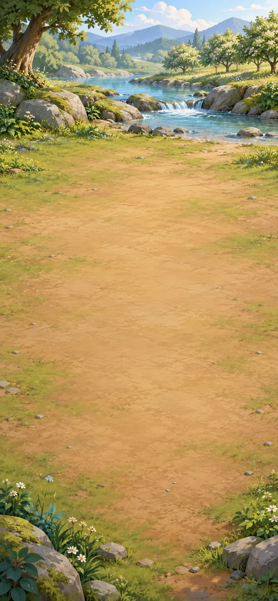

Begin beside the river with earth, water, air and fire. Combine them to make useful materials.

**Goals**
- Make Stone -- Stone
- Make Brick -- Brick

**Items**
- Earth
- Water
- Air
- Fire

**Combinations**
- Earth + Water -> Clay
- Earth + Fire -> Stone
- Clay [transform] + Fire -> Brick

## The first supper

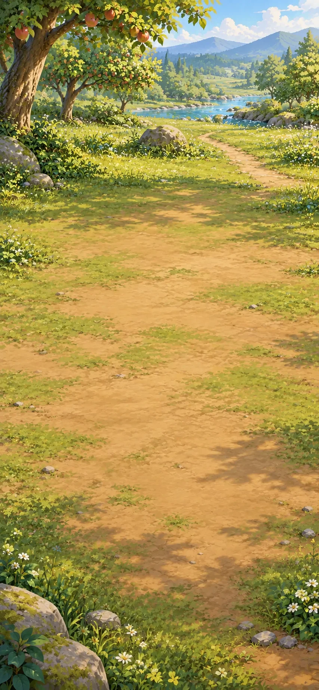

There is a place to cook at the orchard's edge. Prepare bread and juice for the journey.

**Goals**
- Make Flatbread -- Flatbread
- Make Fruit juice -- Fruit juice

**Items**
- Plant

  Plants can provide food, fibres, seeds and wood. Growing them supplies materials people can harvest and use.

  *Plant*

**Combinations**
- Air + Water -> Rain
- Earth + Rain -> Plant
- Plant + Air -> Grain
- Grain [transform] + Stone -> Flour
- Flour [transform] + Water -> Dough
- Dough [transform] + Fire -> Flatbread
- Plant + Water -> Fruit
- Fruit [transform] + Water -> Fruit juice
- Fruit [transform] + Stone -> Fruit juice

> NOTE: Fruit juice: Crushing the fruit releases its juice. Represents pressing and collecting the liquid, not a complete food-preparation procedure.

## A place to wake up

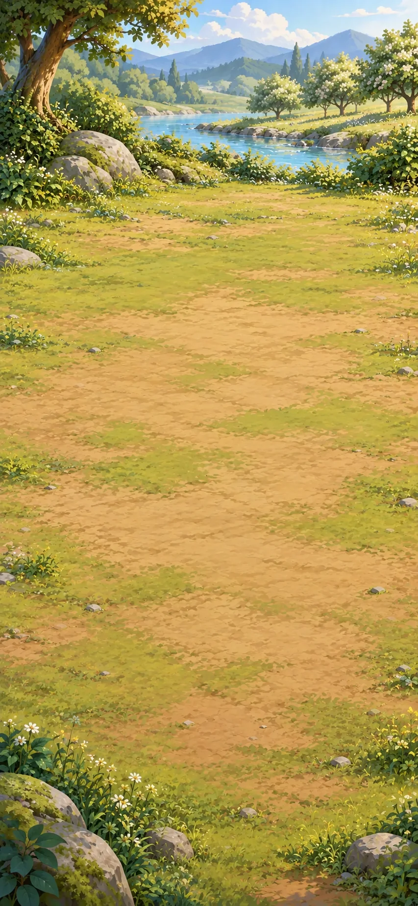

The path reaches a sheltered site without a home. Build a house and fit a window and somewhere to sleep.

**Goals**
- Build a house -- House
- next: Fit window and sleeping mat -- House[Window, Sleeping mat]

**Items**
- House (compound)
  - unnamed slot: accepts Window
  - unnamed slot: accepts Sleeping mat
  - unnamed slot: accepts Hearth
- Hearth

**Combinations**
- Earth + Air -> Sand
- Sand [transform] + Fire -> Glass
- Plant + Earth -> Wood
- Glass [consume] + Wood [consume] -> Window
- Plant + Stone -> Plant fiber
- Plant fiber [transform] + Wood -> Thread
- Thread [transform] + Wood -> Cloth
- Plant fiber [consume] + Thread [consume] -> Rope
- Plant fiber [consume] + Cloth [transform] -> Sleeping mat
- Brick [consume] + Wood [consume] -> House
- Stone [consume] + Fire -> Hearth

> NOTE: Glass: Storybook simplification: ordinary glass also needs flux and stabilizer; sand plus fire is not a real manufacturing instruction. Sources: [corning](#source-corning).

> NOTE: House: The window admits daylight while keeping the opening closed.

> NOTE: House: The sleeping mat lies inside the house, ready for the night.

> NOTE: Hearth: Stone contains a small warming fire.

> NOTE: House: The hearth warms the house without replacing its window or sleeping mat.

## Across the brook

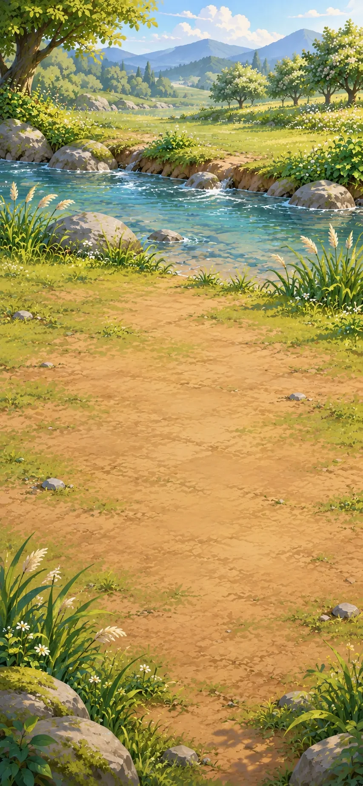

A brook blocks the path. Build a footbridge to cross it and a handcart to move supplies.

**Goals**
- Build a footbridge -- Footbridge
- Make Handcart -- Handcart

**Items**
- Wheel

  A wheel can carry a load by rolling or transfer turning motion in a machine. Its shape makes new kinds of transport and work possible.

  *Wheel*

**Combinations**
- Wood [consume] + Stone [consume] -> Axe
- Axe + Wood [transform] -> Planks
- Planks [consume] + Rope [consume] -> Footbridge
- Planks [transform] + Stone -> Wheel
- Wheel [consume] + Wood [consume] -> Wheelset
- Planks [consume] + Wheelset [consume] -> Handcart

## The mill bend

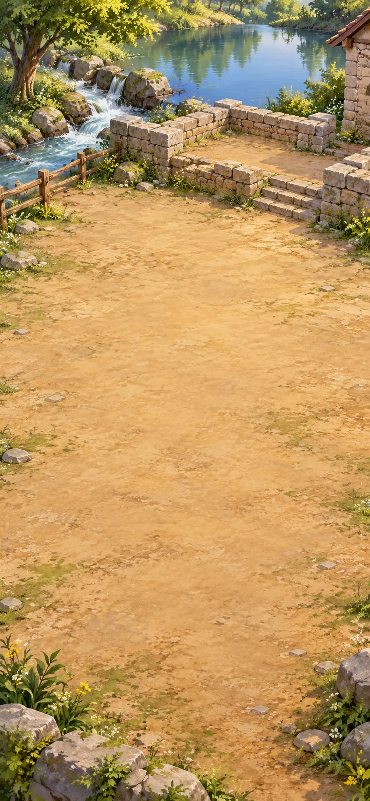

The moving stream can power a mill. Grind grain for the village and press the garden's oil-bearing seeds for lamp fuel.

**Goals**
- Make Grain mill -- Grain mill
- Make Flour sack -- Flour sack
- Press seed oil -- Seed oil

**Items**
- Grain mill

  The waterwheel, gears and grinding stone are connected. Flowing water can now do the repeated work of grinding grain for the village.

  *Grain mill*

**Combinations**
- Planks [transform] + Water -> Waterwheel
- Stone [consume] + Wheel [consume] -> Millstone
- Wheel [transform] + Axe -> Wooden gear
- Waterwheel [consume] + Wooden gear [consume] -> Mill gearing
- Mill gearing [consume] + Millstone [consume] -> Grain mill
- Cloth [transform] + Thread [consume] -> Sack
- Sack [transform] + Flour [consume] -> Flour sack
- Plant + Fruit [transform] -> Oil-bearing seeds
- Oil-bearing seeds [transform] + Weighted seed press [preserve] -> Seed oil
- Water + Wheel [transform] -> Waterwheel
- Millstone [consume] + Planks [consume] -> Weighted seed press

> NOTE: Oil-bearing seeds: Select oil-bearing seeds from mature garden fruit and seedpods, keeping seed for another planting as well as pressing.

> NOTE: Seed oil: The weighted press crushes suitable oil-bearing seeds and expresses their oil into its collecting bed. Sources: [fao-oil-extraction](#source-fao-oil-extraction).

> NOTE: Waterwheel: The wheel is adapted to catch the moving water. Paddles and mounting are implicit, as they are in the original planks-and-water route.

> NOTE: Weighted seed press: Build a wooden lever and draining bed, using the heavy millstone as its pressing weight. Ordinary joinery and a seed-holding press bed are compressed into this construction. It is a hand-powered batch press, not the loose grinding stone acting alone. Sources: [fao-oil-extraction](#source-fao-oil-extraction).

## Bread for the journey

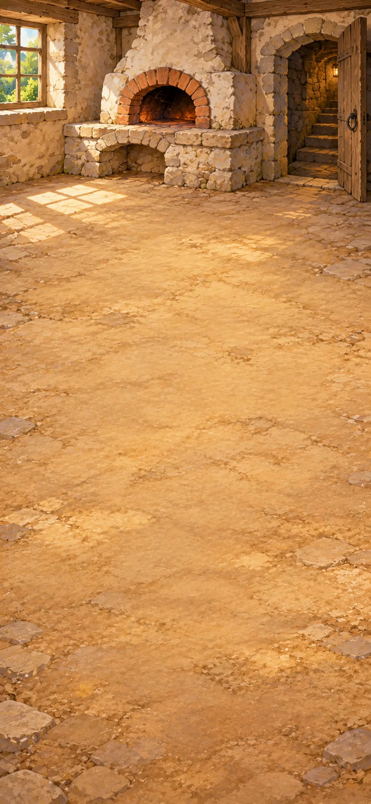

The bakehouse beside the mill has a warm place for dough to rise. Bake bread and pack some for the journey.

**Goals**
- Bake bread -- Bread
- next: Pack a picnic basket -- Picnic basket

**Hotspots**
- Warm cellar

**Combinations**
- Flour [transform] + Air -> Wild starter
- Wild starter + Dough [transform] @ Warm cellar -> Risen dough
- Risen dough [transform] + Fire -> Bread
- Plant fiber [transform] + Rope [consume] -> Basket
- Bread [consume] + Basket [transform] -> Picnic basket

> NOTE: Basket: Weave the plant fibers into a carrier and bind its rim and handle with rope.

## Keep the summer

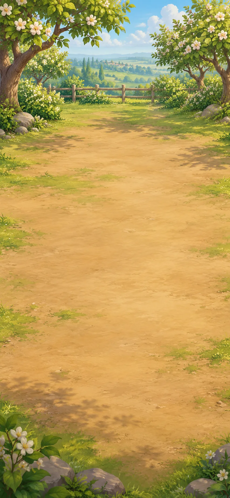

We have a lot of fruit. Let's preserve it.

**Goals**
- Make Sealed preserves -- Sealed preserves
- Pack cider to carry
  - either: Cider jar
  - or: Cider bottle

**Combinations**
- Clay [transform] + Wheel -> Formed clay bowl
- Fruit [transform] + Fire -> Jam
- Clay [transform] + Formed clay bowl -> Clay jar
- Wood [transform] + Clay jar -> Jar lid
- Jam [consume] + Clay jar [transform] -> Preserve jar
- Preserve jar [transform] + Jar lid [consume] -> Sealed preserves
- Wild starter + Fruit juice [transform] -> Cider
- Sand [consume] + Clay [consume] -> Glaze
- Clay jar [transform] + Glaze [consume] -> Glazed clay jar
- Cider [consume] + Glazed clay jar [transform] -> Cider jar
- Glass [transform] + Air -> Glass bottle
- Cider [consume] + Glass bottle [transform] -> Cider bottle

> NOTE: Formed clay bowl: Hand-shape the clay on the turning wooden disc and let the form stiffen for dry shaping work. Hand shaping and drying are compressed; firing is not implied. Liquid service uses the later glazed, fired bowl. Sources: [pottery-forming](#source-pottery-forming).

> NOTE: Glazed clay jar: The potter coats and fires the clay jar. The glaze melts into a glassy surface; the vessel keeps its jar shape. Coating, kiln firing and cooling are compressed into one craft action. Glaze alone does not fire pottery, and a glassy coating does not make the whole vessel glass. Sources: [pottery-glaze-firing](#source-pottery-glaze-firing).

> NOTE: Cider jar: Cider fills the glazed clay jar; a fitted closure makes it ready to carry. Fitting an ordinary closure is compressed into filling the vessel; this is not a preservation or food-safety procedure.

> NOTE: Glass bottle: Blown air opens a bubble in softened glass; the glassworker shapes a bottle. Represents skilled glassblowing; heating, blowpipe, shaping and cooling are compressed, not omitted from the real process. Sources: [corning](#source-corning).

> NOTE: Cider bottle: Cider fills the glass bottle; a fitted closure makes it ready to carry. An ordinary closure is compressed into filling; no glazing is involved and no preservation procedure is implied.

## The potter's yard

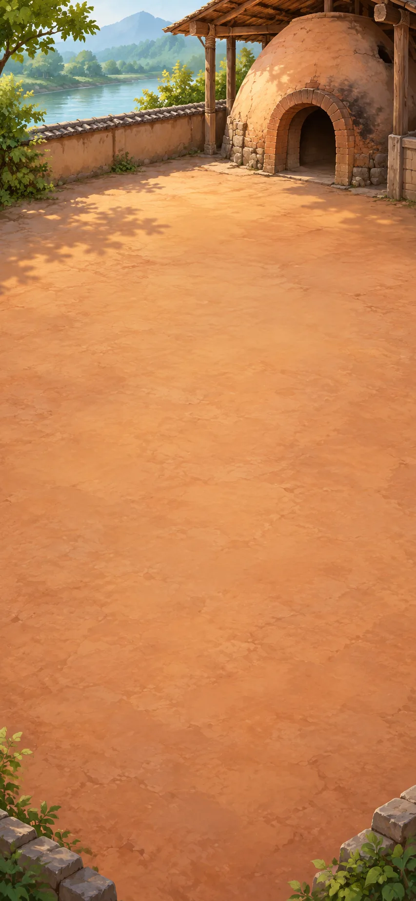

The potter's yard has space for firing and glazing. Finish a bowl that can hold liquids and make a tiled table for meals.

**Goals**
- Fire and glaze the bowl -- Fired glazed bowl
- Make Tiled table -- Tiled table

**Hotspots**
- Kiln yard

**Combinations**
- Clay [transform] + Planks -> Tile
- Formed clay bowl [transform] + Glaze [consume] @ Kiln yard -> Fired glazed bowl
- Planks [consume] + Wood [consume] -> Table
- Table [transform] + Tile [consume] -> Tiled table

> NOTE: Fired glazed bowl: At the kiln, coat and fire the formed bowl to make a water-ready glazed vessel.

## Tools to lend

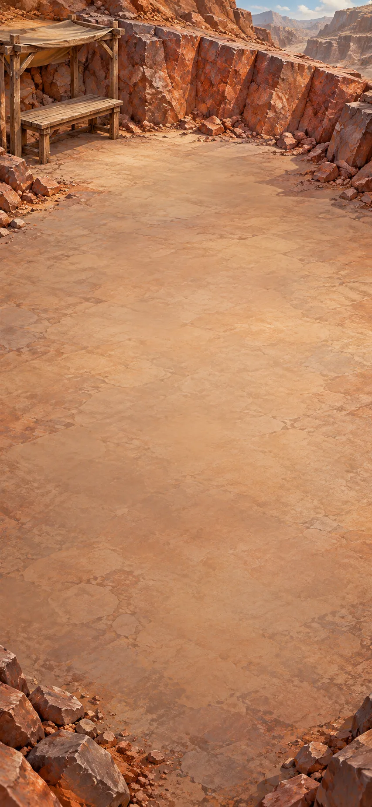

At the quarry workshop, make a tool for breaking hard ground and a chest for storing tools.

**Goals**
- Make Pickaxe -- Pickaxe
- Make a wooden chest for tools -- Wooden chest

**Hotspots**
- Iron quarry

**Items**
- Iron

  Iron can be shaped into strong cutting edges, fasteners and fittings. It adds new possibilities for tools and construction.

  *Iron*

**Combinations**
- Brick [transform] + Fire -> Kiln
- Stone + Water -> Stone hammer
- Stone hammer @ Iron quarry -> Iron ore
- Cloth [transform] + Air -> Bellows
- Kiln [consume] + Bellows [consume] -> Forge
- Iron ore [transform] + Forge -> Iron
- Iron [consume] + Wood [consume] -> Pickaxe
- Iron [transform] + Stone -> Carving tool
- Iron [transform] + Forge -> Nails
- Iron [consume] + Nails [consume] -> Hinge
- Planks [consume] + Nails [consume] -> Wooden chest
- Stone @ Iron quarry -> Iron ore

> NOTE: Stone hammer: A rounded river stone selected for use as a hand-held hammer. Storybook compression of river abrasion and selecting a suitable cobble. Water does not instantly turn any rock into a safe striking tool. Sources: [river-rounding](#source-river-rounding), [hammerstone](#source-hammerstone).

> NOTE: Iron ore: The stone hammer chips ore from the exposed seam at the quarry. Sources: [hammerstone-mining](#source-hammerstone-mining).

> NOTE: Nails: At the stocked forge, the smith heats the iron, draws it to points and forms the nail heads with hammer, anvil and heading tool. Reheating, drawing, cutting and heading are compressed into one smithing action; striking arbitrary cold iron with a stone is not the recipe. Sources: [forged-nails](#source-forged-nails).

> NOTE: Hinge: Metal leaves joined around a pin can swing while remaining connected.

> NOTE: Iron ore: A hard stone chips ore from the exposed seam at the quarry. A quarry-side pounding action, not digging an underground mine or a real-world tool-use procedure. Sources: [hammerstone-mining](#source-hammerstone-mining).

## A river wide enough

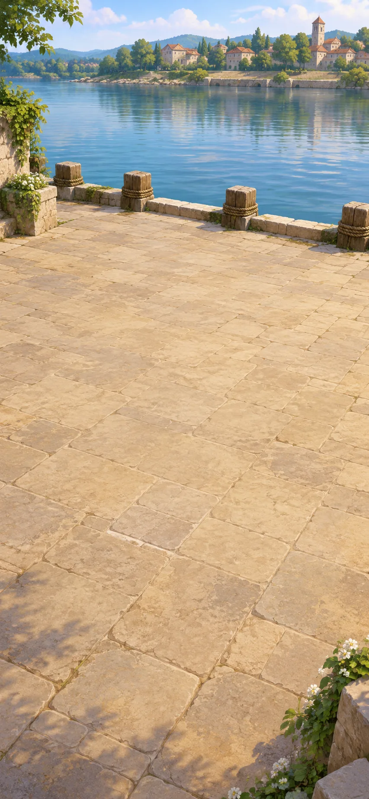

The river is wider here. Build a landing and a sailboat to reach the other bank.

**Goals**
- Build a dock -- Dock
- Make Sailboat -- Sailboat

**Items**
- Sailboat

  The boat can use wind in its sail to move across the water. It gives the neighbours a way to travel between the banks.

  *Sailboat*

**Combinations**
- Wood [consume] + Rope [consume] -> Raft
- Cloth [consume] + Rope [consume] -> Sail
- Raft [transform] + Sail [consume] -> Sailboat
- Planks [transform] + Stone hammer -> Pier post
- Pier post [consume] + Planks [consume] -> Dock

## A light to come home to

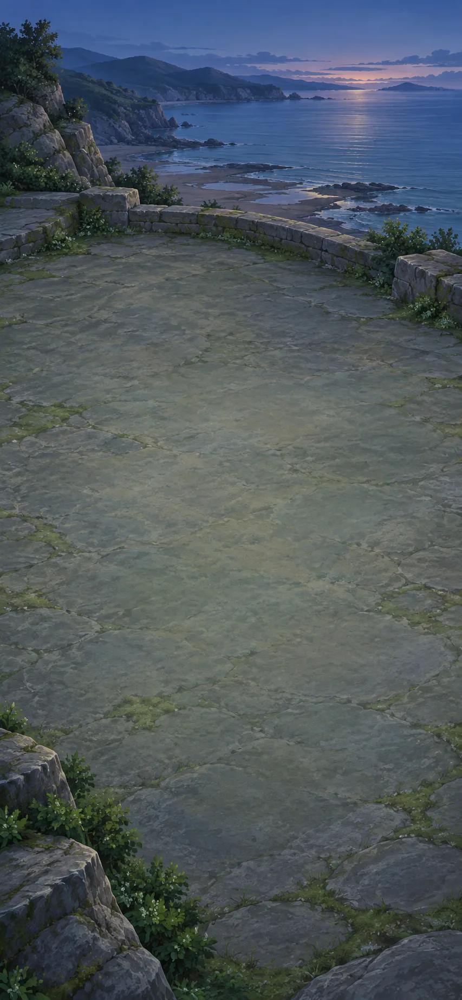

Visitors need to find the harbour after dark and secure their boats. Build a light on the headland and prepare a mooring buoy.

**Goals**
- Build a lighthouse -- Lighthouse
- Make Mooring buoy -- Mooring buoy

**Hotspots**
- Harbour headland

**Combinations**
- Oil-soaked fiber wick [consume] + Wood [consume] -> Oil-wick torch
- Glass [consume] + Oil-wick torch [transform] -> Lantern
- Brick [consume] + Window [consume] -> Tower
- Tower [transform] + Lantern [consume] @ Harbour headland -> Lighthouse
- Wood [consume] + Glazed clay jar [consume] -> Float
- Float [transform] + Rope [consume] -> Mooring buoy
- Plant fiber [consume] + Seed oil [consume] -> Oil-soaked fiber wick

> NOTE: Oil-wick torch: Secure the oil-soaked fiber bundle around the end of the wooden support to make a small portable torch. Binding and ignition are ordinary assembly/use abstractions; this is not a burn-duration or safety claim.

> NOTE: Float: The closed, empty ceramic jar is held in a wooden support, trapping air to make a float. A suitable seal and support are compressed into the craft action; an open vessel would fill with water.

## The walled garden

On a later morning, return to the orchard for planting. The preserving work stays in the earlier workspace while you prepare support and shelter for growing plants.

**Goals**
- Make Climbing garden -- Climbing garden
- Make Greenhouse -- Greenhouse

**Combinations**
- Oil-bearing seeds [transform] + Water -> Seedlings
- Seedlings + Rope [transform] -> Trellis
- Seedlings [consume] + Trellis [transform] -> Climbing garden
- Window [transform] + Seedlings [consume] -> Greenhouse

## Water without the climb

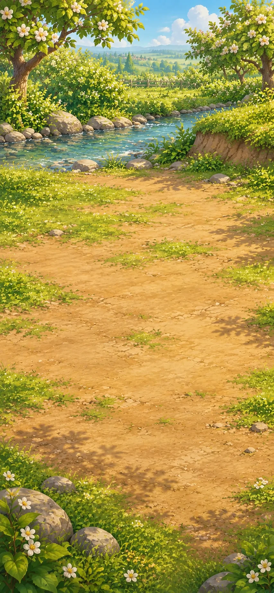

The stream is below the growing beds. Use the current to lift water into a raised basin, then bring it to the garden without carrying every bucket uphill.

**Goals**
- Make Irrigated garden -- Irrigated garden

**Combinations**
- Iron [transform] + Carving tool -> Saw
- Saw [preserve] + Wood [transform] -> Hollow pipe
- Clay [consume] + Brick [consume] -> Reservoir
- Reservoir [transform] + Waterwheel with jars [preserve] -> Filled reservoir
- Hollow pipe [consume] + Planks [consume] -> Water channel
- Water channel [transform] + Filled reservoir [preserve] -> Irrigation channel
- Irrigation channel [consume] + Climbing garden [transform] -> Irrigated garden
- Waterwheel [transform] + Glazed clay jar [consume] -> Waterwheel with jars

> NOTE: Filled reservoir: The stream-driven jars tip their water into the basin at the top of the wheel, above the growing beds.

> NOTE: Waterwheel with jars: Fix open glazed jars around the rim of the paddled waterwheel. The current turns the wheel; the jars scoop, lift and tip the water into the basin above the beds. Ordinary attachment and positioning are compressed. The existing pottery supply represents multiple fired vessels, not a single jar copied into several objects. No claim of a particular lift height, flow rate or engineering specification. Sources: [fao-noria](#source-fao-noria).

## A welcome in colour

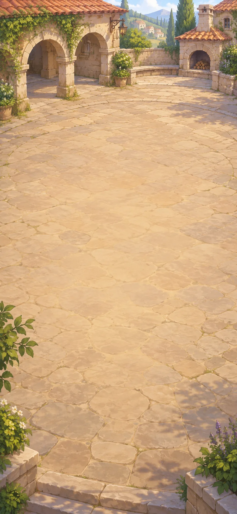

Neighbours are coming to the village square for music and a shared meal. Make a banner and a canopy for shade.

**Goals**
- Make Festival banner -- Festival banner
- Make Canopy -- Canopy

**Combinations**
- Plant + Rain -> Flowers
- Flowers [transform] + Water -> Dye
- Cloth [transform] + Dye [consume] -> Dyed cloth
- Dyed cloth [transform] + Wood [consume] -> Festival banner
- Thread [consume] + Planks [consume] -> Loom
- Loom [preserve] + Dyed thread [transform] -> Patterned cloth
- Patterned cloth [transform] + Wood [consume] -> Festival banner
- Cloth [consume] + Planks [consume] -> Awning
- Awning [transform] + Rope [consume] -> Canopy
- Thread [transform] + Dye [consume] -> Dyed thread

> NOTE: Patterned cloth: The loom holds the warp while coloured threads are woven into a pattern. Sources: [coloured-thread-weaving](#source-coloured-thread-weaving).

> NOTE: Dyed thread: The loose threads take up colour before they are woven. Sources: [coloured-thread-weaving](#source-coloured-thread-weaving).

## Charcoal for the messages

We stop at the quarry kiln for charcoal. At the landing, we can grind it into ink for our invitations.

**Goals**
- Make charcoal for ink -- Charcoal

**Hotspots**
- Iron quarry

**Combinations**
- Wood [transform] + Kiln -> Charcoal

> NOTE: This later chapter reuses the quarry image and the existing Kiln. The new language carries the needed existing work into this later visit; it does not restore the old board. If charcoal was already made, this chapter skips.

## News before the boats

We need to invite our neighbours to the meal and music. Back at the landing, prepare printed invitations and a mailboat to carry them.

**Goals**
- Make Printed invitations -- Printed invitations
- next: Make Mailboat -- Mailboat

**Items**
- Printed invitations

  The carved block can print the same invitation on many sheets. Several messengers can now invite neighbours to the meal and music.

  *Printed invitations*

**Combinations**
- Plant fiber [transform] + Water -> Paper pulp
- Paper pulp [transform] + Cloth -> Paper
- Charcoal [transform] + Water -> Ink
- Carving tool + Planks [transform] -> Printing block
- Printing block [transform] + Ink -> Inked printing block
- Inked printing block [preserve] + Paper [transform] -> Printed invitations
- Paper [transform] + Ink [consume] -> Letter
- Letter [consume] + Sailboat [transform] -> Mailboat
- Printed invitations [preserve] + Sailboat [transform] -> Mailboat

> NOTE: Mailboat: Load copies of the printed invitations aboard the sailboat for delivery upriver.

## A tune in the square

The following afternoon, the square is ready for music. Make instruments and a raised place for the players.

**Goals**
- Make Flute -- Flute
- Make Drum -- Drum
- Make Bandstand -- Bandstand

**Combinations**
- Wood [transform] + Carving tool -> Hollow tube
- Hollow tube [transform] + Air -> Flute
- Cloth [consume] + Clay jar [transform] -> Drum
- Planks [consume] + Brick [consume] -> Platform
- Platform [transform] + Canopy [consume] -> Bandstand

## A story to pass on

Later, children gather in the square. Prepare a puppet theatre and a picture book for them.

**Goals**
- Make Puppet theatre -- Puppet theatre
- Make Picture book -- Picture book

**Items**
- Brush

**Combinations**
- Wood [consume] + Cloth [consume] -> Puppet
- Cloth [consume] + Window [consume] -> Curtain
- Curtain [consume] + Platform [transform] -> Stage
- Stage [transform] + Puppet [consume] -> Puppet theatre
- Dye [transform] + Fired glazed bowl -> Paint
- Plant fiber [consume] + Hollow tube [consume] -> Brush
- Paint [consume] + Paper [consume] -> Picture
- Paper [consume] + Thread [consume] -> Bound book
- Bound book [transform] + Picture [consume] -> Picture book

## What the water hides

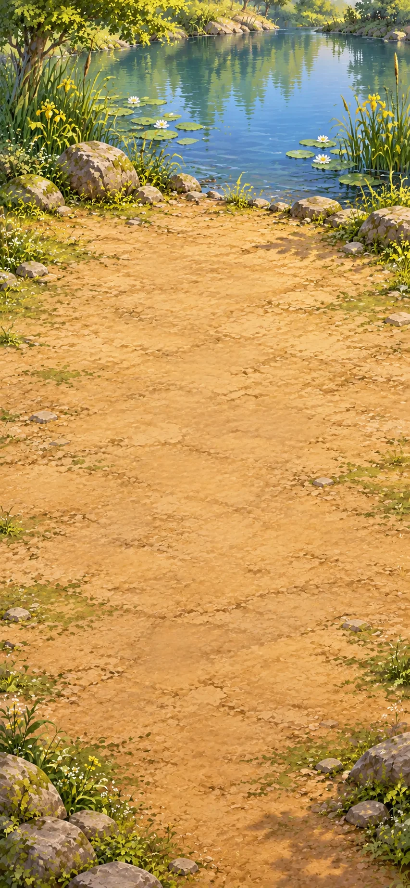

At the millpond, examine a water sample more closely. A microscope can reveal things too small to see unaided.

**Goals**
- Examine pond slide -- Pond life study

**Hotspots**
- Mill pond

**Items**
- Microscope

  The microscope reveals details too small for unaided sight. A prepared pond-water sample can now be examined for tiny living things.

  *Microscope*
- Pond life study

  You bring the drop into focus. Green specks drift past; a transparent swimmer turns, then slips out of view. The naturalist moves aside so the child beside you can take a look.

  *Pond life study*

**Combinations**
- Glass [transform] + Sand -> Lens
- Lens [consume] + Wood [consume] -> Magnifier
- Lens [consume] + Hollow tube [consume] -> Telescope
- Magnifier [consume] + Telescope [consume] -> Microscope
- Glass [transform] + Planks -> Glass slide
- Fired glazed bowl @ Mill pond -> Pond water
- Pond water [consume] + Glass slide [transform] -> Pond slide
- Pond slide [preserve] + Microscope [preserve] -> Pond life study
- Pond water [consume] + Glass [transform] -> Pond slide

> NOTE: Glass slide: The wooden board supports the glass while a small, flat slide is prepared. A compressed craft relationship, not instructions for cutting glass: shaping and finishing tools are implicit. Wood does not turn glass into a slide by itself.

> NOTE: Pond life study: An illustrative fictional observation, not a species identification or a test of water safety.

> NOTE: Pond slide: A thin drop is spread on a small piece of clear glass, ready for the microscope. Accepts the player's direct sample-on-glass action. Preparing the small, flat support is compressed; the separate glass-slide route remains available.

## Names for the green world

On another orchard morning, visitors want to identify the plants. Make illustrated records they can compare with living examples.

**Goals**
- Make Illustrated flora -- Illustrated flora

**Combinations**
- Plant + Paper [transform] -> Pressed plant specimen
- Pressed plant specimen [consume] + Bound book [transform] -> Herbarium
- Lens + Plant -> Leaf study
- Leaf study [consume] + Ink [consume] -> Botanical drawing
- Botanical drawing [consume] + Herbarium [transform] -> Illustrated flora
- Plant + Bound book [transform] -> Herbarium

> NOTE: Herbarium: Represents collected, dried, pressed and documented specimens, not an instantaneous binding operation. Sources: [kew](#source-kew).

> NOTE: Herbarium: The plant is pressed and preserved between the pages, beginning a specimen collection with space for its record. Compresses collection, pressing, drying and mounting, as the original specimen route does. Both routes produce the same Herbarium; no instant preservation procedure is implied. Sources: [kew](#source-kew).

## A promise to the sky

Back at the headland, boat crews want a record of changing weather. Prepare observations they can compare over time.

**Goals**
- Make Weather record -- Weather record

**Items**
- Clear collector with level marks

  Rainfall can now be recorded and compared from one observation to the next. Water levels from equal collection periods in the same vessel reveal wetter and drier spells, helping people build a record of changing weather.

  *Clear collector with level marks*

- Weather book

**Combinations**
- Glass bottle [transform] + Paper [consume] -> Clear collector with level marks
- Clear collector with level marks [transform] + Rain -> Collected rain level
- Cloth [consume] + Hollow tube [consume] -> Windsock
- Paper [transform] + Collected rain level -> Rain record
- Windsock + Rain record [transform] -> Weather record
- Weather record [preserve] + Bound book [transform] -> Weather book
- Windsock + Paper [transform] -> Wind record
- Wind record [transform] + Collected rain level -> Weather record
- Wind record [consume] + Rain record [consume] -> Weather record

> NOTE: Clear collector with level marks: Mark a comparison strip on paper and fix it beside the clear bottle, leaving its water level visible. Sources: [metoffice-rain-reading](#source-metoffice-rain-reading).

> NOTE: Collected rain level: Set the open marked collector in the rain for a collection interval and read its visible fill level.

> NOTE: Rain record: Record the clear collector’s relative fill level, comparing the same vessel over equal collection intervals.

> NOTE: Wind record: Record how the windsock turns and lifts, leaving room beside the wind notes for relative collector levels.

> NOTE: Weather record: The relative collector level joins the wind notes: both observations now appear in the weather record.

> NOTE: Weather record: The separate wind and rain notes become one weather record.

> NOTE: Clear collector with level marks: Authored relative-comparison instrument, not a calibrated meteorological rain gauge.

## Food for the crossing

At the tidal shore, boats are preparing for a crossing without a cooking hearth. Preserve food that the crews can take with them.

[If skipped] Visitors have arrived at the landing for the meal and music.

**Goals**
- Make Smoked fish -- Smoked fish
- Make Pickle jar -- Pickle jar

**Hotspots**
- Tidal shore

**Items**
- Salt

**Combinations**
- Thread [consume] + Rope [consume] -> Net
- Net @ Tidal shore -> Fish
- Fired glazed bowl @ Tidal shore -> Brine
- Brine [transform] + Fire -> Salt
- Wood [transform] + Fire -> Smoke
- Smoke [preserve] + Fish [transform] -> Smoked fish
- Cider [transform] + Air -> Vinegar
- Vinegar [consume] + Fruit [consume] -> Pickles
- Pickles [consume] + Clay jar [transform] -> Pickle jar

## The first boats are here

Our visitors have arrived. Prepare a place to wash and a covered jar of water for them.

**Goals**
- Make Washstand -- Washstand
- Fill and cover the water jar -- Covered water jar

**Combinations**
- Sand [consume] + Charcoal [consume] -> Filter bed
- Filter bed [consume] + Hollow pipe [transform] -> Water filter
- Water + Water filter [preserve] -> Filtered water
- Filtered water [transform] + Fire -> Boiled water
- Boiled water [consume] + Fired glazed bowl [consume] -> Drinking-water bowl
- Glazed clay jar [transform] + Jar lid [consume] -> Covered clay jar
- Drinking-water bowl + Covered clay jar [transform] -> Covered water jar
- Fired glazed bowl [consume] + Table [transform] -> Washstand
- Boiled water [consume] + Glazed clay jar [transform] -> Filled water jar
- Drinking-water bowl + Glazed clay jar [transform] -> Filled water jar
- Filled water jar [transform] + Jar lid [consume] -> Covered water jar
- Boiled water [consume] + Covered clay jar [transform] -> Covered water jar

> NOTE: Filtered water: Narrative craft abstraction; not a real-world water safety claim. Filtering and boiling do not remove every contaminant.

> NOTE: Boiled water: Narrative craft abstraction; not a real-world water safety claim. Filtering and boiling do not remove every contaminant.

> NOTE: Drinking-water bowl: Narrative craft abstraction; not a real-world water safety claim. Filtering and boiling do not remove every contaminant.

> NOTE: Covered water jar: Narrative craft abstraction; not a real-world water safety claim. Filtering and boiling do not remove every contaminant.

> NOTE: Washstand: The smooth basin sits on the wooden stand, ready for the visitors to wash.

> NOTE: Filled water jar: Prepared water fills the glazed clay jar. Its lid can be fitted next. Narrative craft abstraction; not a real-world water safety claim. Filtering and boiling do not remove every contaminant.

> NOTE: Filled water jar: You pour prepared water from the serving bowl into the glazed clay jar; the bowl remains available. Narrative craft abstraction; not a real-world water safety claim. Filtering and boiling do not remove every contaminant.

> NOTE: Covered water jar: The lid fits the filled clay jar, ready to serve the visitors. Narrative craft abstraction; not a real-world water safety claim. Filtering and boiling do not remove every contaminant.

> NOTE: Covered water jar: You lift the lid, fill the clay jar with prepared water and put the lid back. Narrative craft abstraction; not a real-world water safety claim. Filtering and boiling do not remove every contaminant.

## The cooks join in

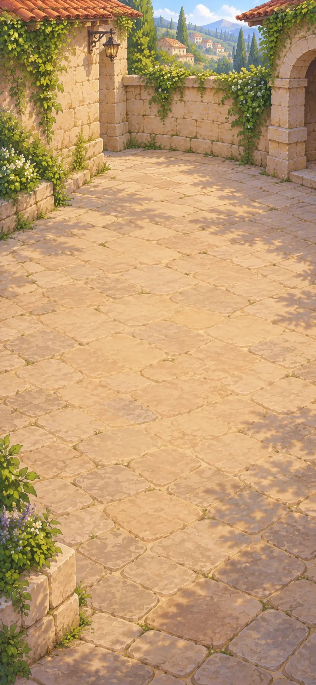

The visiting cooks want to help. Finish the washing station around the corner before they start preparing food.

**Goals**
- Make Wash station -- Wash station

**Items**
- Soap

  Soap helps people wash away dirt and grease. Beside a washstand, it makes everyday washing more useful.

  *Soap*

**Combinations**
- Charcoal [transform] + Fire -> Ash
- Ash [transform] + Water -> Lye
- Lye [consume] + Seed oil [consume] -> Soap
- Soap [preserve] + Washstand [transform] -> Wash station

> NOTE: Soap: Historical material relationship only; alkali is hazardous. No quantities, apparatus or real manufacturing procedure are supplied. Sources: [soap](#source-soap).

## Come and eat with us

The cooks and guests are here. Prepare porridge and fruit compote, then set the table for a shared meal.

**Goals**
- Cook porridge and fruit compote
  - both: Porridge
  - and: Fruit compote
- next: Lay a feast table -- Feast table

**Hotspots**
- Kitchen hearth

**Combinations**
- Brick [consume] + Iron [consume] -> Stove
- Iron [consume] + Fired glazed bowl [transform] -> Cooking pot
- Cooking pot + Grain [transform] @ Kitchen hearth -> Porridge
- Cooking pot + Fruit [transform] @ Kitchen hearth -> Fruit compote
- Bread [consume] + Fruit [consume] -> Feast
- Feast [consume] + Tiled table [transform] -> Feast table
- Porridge [consume] + Fruit compote [consume] -> Feast
- Grain [transform] + Stove -> Porridge
- Fruit [transform] + Stove -> Fruit compote

> NOTE: Feast: Bowls of warm porridge and fruit compote make a meal to share. The bread-and-fruit feast is still welcome, too.

> NOTE: Porridge: The grain cooks in the stove’s inset pot into warm porridge.

> NOTE: Fruit compote: The fruit softens in the stove’s inset pot into spoonable compote.

## A gift for winter

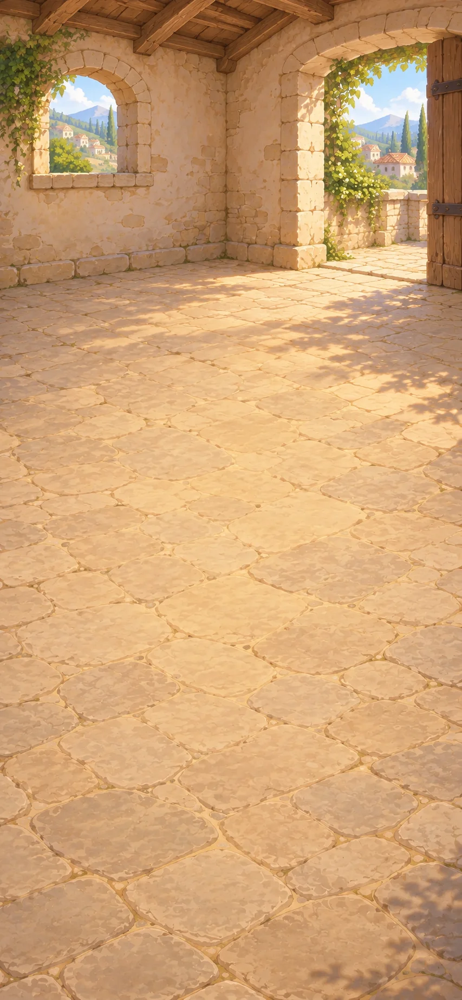

After preparing the meal, put food aside in the village's dry store. Leave grain and preserved fruit for later use.

**Goals**
- Make Grain bin -- Grain bin
- Make Fruit crock -- Fruit crock

**Combinations**
- Planks [consume] + Wooden chest [transform] -> Grain bin
- Planks [consume] + Net [consume] -> Drying rack
- Fruit [transform] + Drying rack [preserve] -> Dried fruit
- Clay jar [transform] + Clay [consume] -> Crock
- Crock [transform] + Jar lid [consume] -> Lidded crock
- Dried fruit [consume] + Lidded crock [transform] -> Fruit crock

## Lights beside the gathering

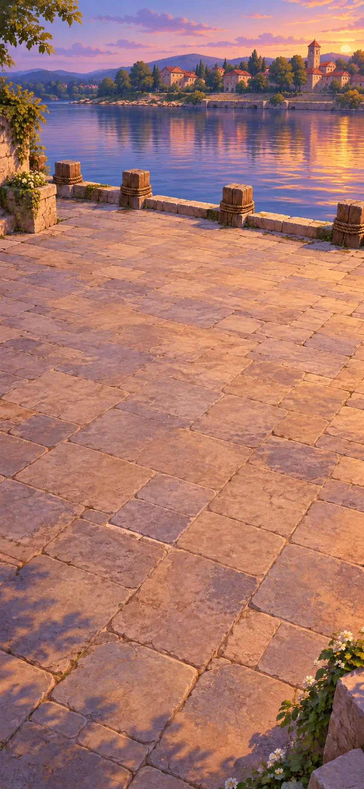

At dusk, return to the landing to prepare lights. The evening boats need a visible welcome and the watch needs a lamp.

**Goals**
- Make Floating lantern -- Floating lantern
- Make Watch lamp -- Watch lamp

**Combinations**
- Oil-soaked fiber wick [consume] + Fired glazed bowl [consume] -> Oil lamp
- Oil lamp [transform] + Glass [consume] -> Watch lamp
- Paper [consume] + Planks [consume] -> Paper lantern frame
- Paper lantern frame [transform] + Oil lamp [consume] -> Paper lantern
- Paper lantern [transform] + Float [consume] -> Floating lantern

## The boats home

The next morning, guests need to know when their boats leave. Use the landing clock to make an hourly departure schedule.

**Goals**
- Schedule hourly return boats -- `return-boats`

**Items**
- Clock

  The clock gives a shared, readable time. People can use it to agree on meetings and boat departures.

  *Clock*
- Hourglass

**Combinations**
- Sand [consume] + Glass bottle [transform] -> Hourglass
- Stone [consume] + Rope [consume] -> Pendulum
- Pendulum [consume] + Wooden gear [consume] -> Clockwork
- Clockwork [transform] + Planks [consume] -> Clock
- Clock [preserve] + Paper [transform] -> `return-boats` Return boats: 09:00 · 10:00 · 11:00

> NOTE: Hourglass: The glass is reshaped into two connected bulbs; sand falls through the narrow passage between them. Reheating, two-bulb shaping, joining, sealing and calibration are compressed into this craft action. An opaque ceramic jar is not a glass hourglass.

> NOTE: Clockwork: Compresses power source, gearing and escapement; a pendulum and one gear alone cannot make clockwork. Sources: [clock](#source-clock).

> NOTE: `return-boats`: Use the clock to agree and write three hourly morning return departures: 09:00, 10:00 and 11:00. The clock remains available to call each departure.

## A steady view of the stars

The following evening, some visitors stay to observe the stars. Return to the headland to make a chart and mount a steady telescope.

**Goals**
- Make Mounted telescope -- Mounted telescope
- next: Chart the stars -- Star chart

**Combinations**
- Telescope + Paper [transform] -> Star chart
- Planks [consume] + Hinge [consume] -> Tripod
- Telescope [transform] + Tripod [consume] -> Mounted telescope
- Mounted telescope [preserve] + Paper [transform] -> Star chart

> NOTE: Star chart: The steady mounted telescope guides the observations recorded on paper.

## Look what we made together

The next day, display the pictures and records in the square. Make a catalogue and a mosaic for the exhibition.

**Goals**
- Make Exhibition catalogue -- Exhibition catalogue
- Make Mosaic -- Mosaic

**Combinations**
- Stone [consume] + Brick [consume] -> Arch
- Arch [consume] + Planks [consume] -> Arcade
- Arcade [transform] + Picture [consume] -> Gallery
- Gallery [preserve] + Paper [transform] -> Exhibition catalogue
- Glass [transform] + Stone -> Mosaic pieces
- Mosaic pieces [consume] + Clay [consume] -> Mosaic

## A river worth returning to

It is evening. Put the floating lantern in the sheltered basin at the landing.

[If skipped] The lantern floats in the sheltered basin. The neighbours have a shared table, working equipment and places to meet, learn and make things.

**Goals**
- Place floating lantern at the gathering landing -- Floating lantern @ Gathering landing

**Hotspots**
- Gathering landing

> NOTE: Source references and qualifications follow. These are author comments, not new items or goals.

> NOTE: [Corning Museum of Glass: frequently asked questions](https://info.cmog.org/frequently-asked-questions). Soda-lime glass has more ingredients than sand and heat; abstraction explicitly disclosed.

> NOTE: [Kew: A brief history of plants in books](https://www.kew.org/read-and-watch/a-brief-history-of-plants-in-books).

> NOTE: [CPSC: Soap business guidance](https://www.cpsc.gov/Business--Manufacturing/Business-Education/Business-Guidance/Soap). Supports fats/oils and alkali relationship only. No procedure implied.

> NOTE: [Science Museum Group: Model of a pendulum clock based on Galileo’s design](https://collection.sciencemuseumgroup.org.uk/objects/co8593065/model-of-a-pendulum-clock-based-on-galileos-design).

> NOTE: [Domokos et al., How River Rocks Round: Resolving the Shape-Size Paradox](https://pmc.ncbi.nlm.nih.gov/articles/PMC3922984/). Primary experimental research supports abrasion/rounding during transport, not instantaneous shaping by water.

> NOTE: [Hackney Museum: Hammerstone](https://museum-collection.hackney.gov.uk/object-1991-637). Museum describes hand-held cobbles used for striking, supporting a blunt tool distinct from an edged axe.

> NOTE: [V&A: Richard Batterham — methods of making](https://www.vam.ac.uk/articles/richard-batterham-methods-of-making). Supports forming clay vessels on a rotating wheel and distinguishes forming from later firing. Does not establish that a bare cart wheel is a complete pottery tool.

> NOTE: [V&A: Lucie Rie — a Modernist revolution in British studio ceramics](https://www.vam.ac.uk/articles/lucy-rie-british-studio-potter/). Documents clay and glaze brought to vitrifying temperature, including single firing. Supports the distinction between coating, firing and glassy surface; not a game recipe manufacturing procedure.

> NOTE: [Prehistoric metal mining in Britain: the study of cobble stone mining tools based on artefact study, ethnography and experimentation](https://www.scielo.cl/scielo.php?script=sci_arttext&pid=S0717-73562013000100002). Archaeological evidence for stone percussion tools in mining. The game uses an exposed-seam pounding action rather than implying pickaxe tunnelling.

> NOTE: [V&A: What is tapestry?](https://www.vam.ac.uk/articles/what-is-tapestry). Explains coloured weft threads woven through warp held on a loom to create a pattern. Supports using thread rather than finished cloth as the weaving input.

> NOTE: [Auckland Museum: For the Want of a Nail](https://www.aucklandmuseum.com/discover/stories/blog/2025/roman-nails). Museum account of reheating iron and nailmaking with smithing/heading tools. Supports explicit hot-working context, not an extra hot-iron inventory chore.

> NOTE: [FAO: Principles of oil extraction](https://www.fao.org/4/X5043E/x5043E03.htm). Distinguishes crushing from expression; the authored press supplies pressure and drainage, without an industrial refining chain.

> NOTE: [Met Office: Make your own rain gauge](https://weather.metoffice.gov.uk/learn-about/met-office-for-schools/other-content/other-resources/weather-station/rain-gauge). Supports a transparent vessel with a visible external scale. This candidate deliberately claims only relative fill levels, not calibrated rainfall depth.

> NOTE: [FAO: Water lifting devices, section 3.4.1 — bucket elevators, Persian wheels and norias](https://www.fao.org/4/ah810e/AH810E05.htm). A water-powered noria carries pots, buckets or bamboo containers around the wheel rim. Supports the direct-lift mechanism, not dimensions, performance or the game’s complete construction.

## The End

The lantern floats in the sheltered basin. The neighbours have a shared table, working equipment and places to meet, learn and make things.
