# The maker's clearing — Traditional game

Twenty belongings in traditional game. A small icon comparison for Elements.

## Before nightfall
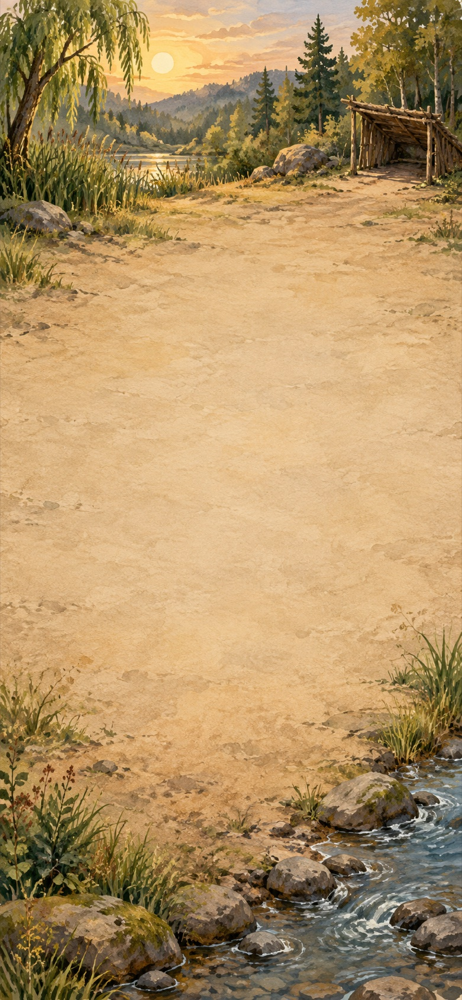

A travelling maker has unpacked a lifetime's work at the edge of the woodland. Before nightfall, fit the house with a window and a sleeping mat. The other belongings can wait.

**Goals**
- Let in the light -- House[Window]
- next: Make a place to sleep -- House[Window, Sleeping mat]

**Items**
- Telescope
  - icon: 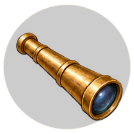 (circular)
- Pendulum
  - icon: 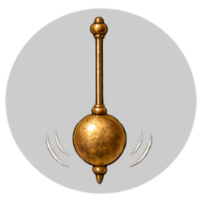 (circular)
- Clockwork
  - icon:  (circular)
- Botanical drawing
  - icon: 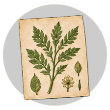 (circular)
- Bread
  - icon: 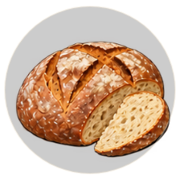 (circular)
- Porridge
  - icon: 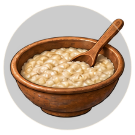 (circular)
- Feast table
  - icon: 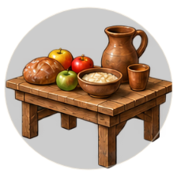 (circular)
- Cider
  - icon: 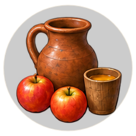 (circular)
- Brick
  - icon: 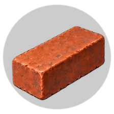 (circular)
- Iron
  - icon: 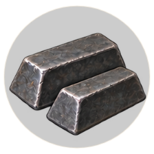 (circular)
- Thread
  - icon: 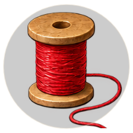 (circular)
- Brine
  - icon: 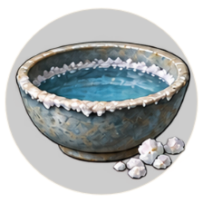 (circular)
- Smoke
  - icon: 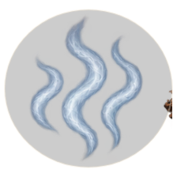 (circular)
- Earth
  - icon: 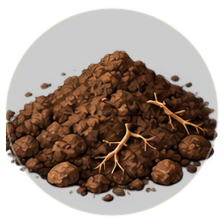 (circular)
- Air
  - icon: 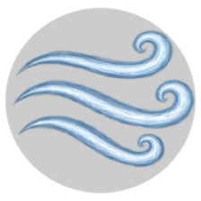 (circular)
- Plant
  - icon: 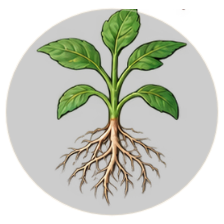 (circular)
- Flower
  - icon:  (circular)
- House (compound)
  - icon: 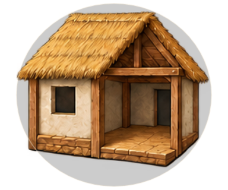
  - unnamed slot: accepts Window, icon: 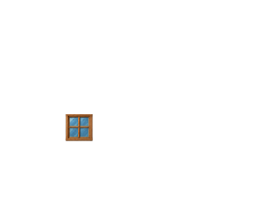
  - unnamed slot: accepts Sleeping mat, icon: 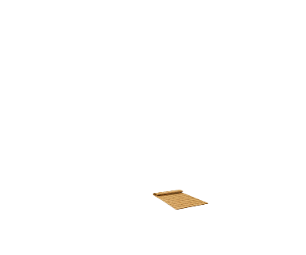
- Window
  - icon: 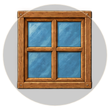 (circular)
- Sleeping mat
  - icon: 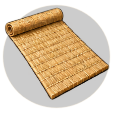 (circular)
