# The maker's clearing — Coloured woodcut

Twenty belongings in coloured woodcut. A small icon comparison for Elements.

## Before nightfall
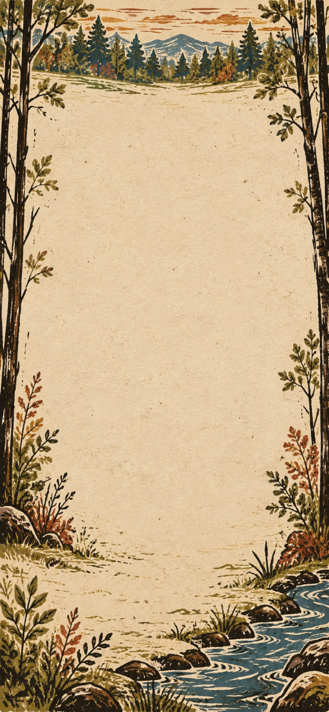

A travelling maker has unpacked a lifetime's work at the edge of the woodland. Before nightfall, fit the house with a window and a sleeping mat. The other belongings can wait.

**Goals**
- Let in the light -- House[Window]
- next: Make a place to sleep -- House[Window, Sleeping mat]

**Items**
- Telescope
  - icon: 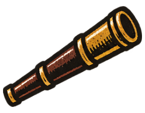
- Pendulum
  - icon: 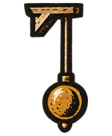
- Clockwork
  - icon: 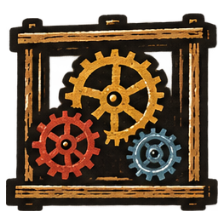
- Botanical drawing
  - icon: 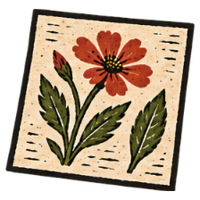
- Bread
  - icon: 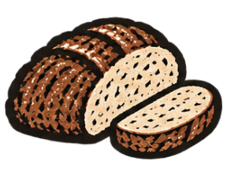
- Porridge
  - icon: 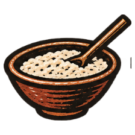
- Feast table
  - icon: 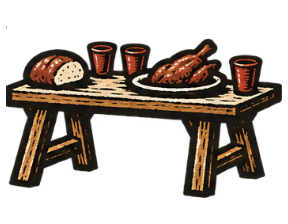
- Cider
  - icon: 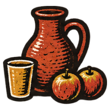
- Brick
  - icon: 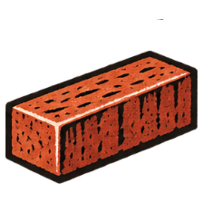
- Iron
  - icon: 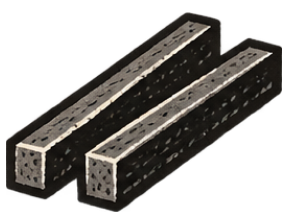
- Thread
  - icon: 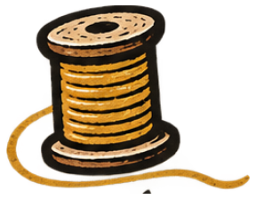
- Brine
  - icon: 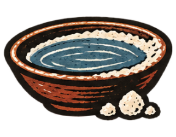
- Smoke
  - icon: 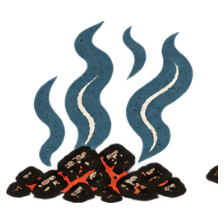
- Earth
  - icon: 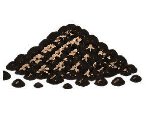
- Air
  - icon: 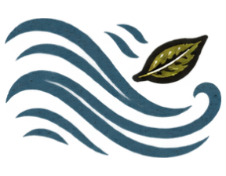
- Plant
  - icon: 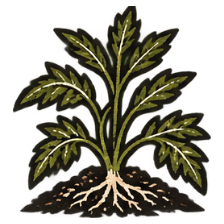
- Flower
  - icon: 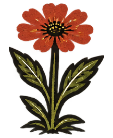
- House (compound)
  - icon: 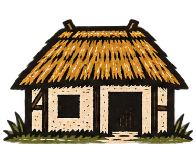
  - unnamed slot: accepts Window, icon: 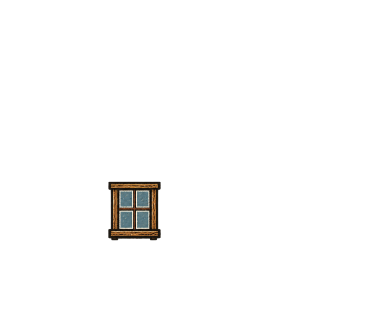
  - unnamed slot: accepts Sleeping mat, icon: 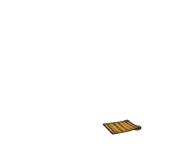
- Window
  - icon: 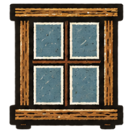
- Sleeping mat
  - icon: 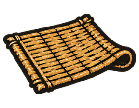
