# History of ideas

Follow questions across centuries: what explains an eclipse, what makes a life good, and when should a rule change? Combine evidence, arguments and inventions to discover how ideas meet—and what each encounter makes possible.

> NOTE: Item statements are authored paraphrases or teaching reconstructions, not historical quotations. Combining them reconstructs an argument, comparison, model or object; it does not certify its truth. Dates belong to the indicated inquiry. Teaching comparisons do not assert direct historical influence. The final observatory and civic arrangements are speculative proposals, not forecasts.

> NOTE: Originally converted from `atlas-focused-sessions-v6`, composed from `ui/current-scenarios.ts` at source commit `1c95988a4e3771abcf2be28183ce009d38645d2c`. The companion design brief owns current intent; the Ideas study records subsequent revisions and evaluation. Primitive readings are optional; essential premises belong in names, goals or experienced results.

## Calendar and portent

background: 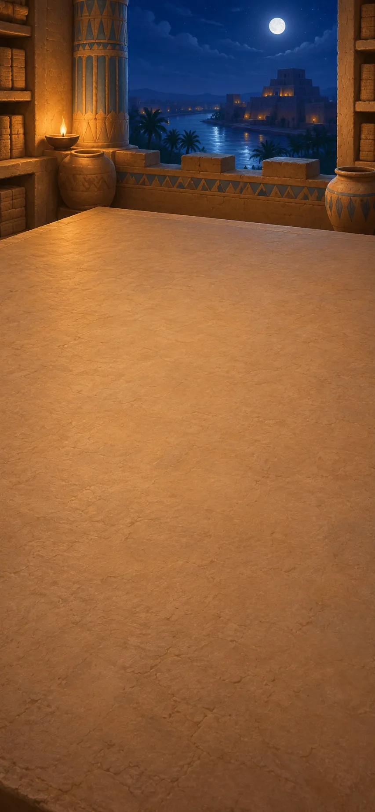

*Sky watchers and scribes, Mesopotamia, c. 700–500 BCE*

The palace wants to know when to watch for an eclipse. The archive records both sightings and nights nobody could observe; the omen reader asks a different question about the same event.

**Goals**
- When should observers watch? -- "Recurring eclipse seasons"
- Does prediction decide an eclipse’s meaning? -- "Prediction alongside portent"

**Items**
- "Dated reports of seen eclipses"

  Observers have recorded eclipses and their dates over several generations. Compare their reports to look for recurring patterns.

- "Clouded nights and unattended watches"

  Nobody saw the sky on these nights. That does not tell us whether an eclipse happened.

- "A calendar of lunar months"

  A calendar based on the Moon gives observers a shared way to date what they see.

- "An eclipse may threaten the king"

  Some ancient interpreters treated an eclipse as a warning about the king. This is a belief about its meaning, not an explanation of what makes the Moon dark.

- "A sky archive with its gaps"

  Does an empty entry mean an uneventful sky?

  Dated sightings record eclipses; clouded nights and unattended watches record missing observations. Keep both in the archive.

  A gap means nobody could report what happened. It cannot count as evidence that no eclipse occurred.

  *A sky archive with its gaps*

- "Recurring eclipse seasons"

  When is another eclipse worth watching for?

  Set the dated eclipse reports against the lunar calendar. Repeated intervals suggest seasons when eclipses can occur.

  The pattern tells observers when to watch; it cannot promise an eclipse visible from this place. Clouded watches remain gaps in the comparison.

  *Recurring eclipse seasons*

- "Prediction alongside portent"

  Does predicting an eclipse settle what it means?

  The calendar suggests when to watch. An omen reader takes an eclipse as a warning about the king.

  Those claims answer different questions. A successful forecast can coexist with the omen belief; it neither establishes nor disproves the alleged warning.

  *Prediction alongside portent*

**Combinations**
- "Dated reports of seen eclipses" [preserve] + "Clouded nights and unattended watches" [preserve] -> "A sky archive with its gaps" (tutorial)
- "A sky archive with its gaps" [preserve] + "A calendar of lunar months" [preserve] -> "Recurring eclipse seasons"
- "Recurring eclipse seasons" [preserve] + "An eclipse may threaten the king" [preserve] -> "Prediction alongside portent"

> NOTE: Historical setting: [Rochberg, Science and Ancient Mesopotamia](https://www.cambridge.org/core/books/cambridge-history-of-science/science-and-ancient-mesopotamia/C48D6E70188ED938863F479B692D465B). Paraphrased teaching reconstruction; the archive is not a translated tablet. Shared calendars also coordinated farming and festivals; those uses no longer require separate confirmation steps.

## Causes and counterexamples

background: 

*Greek natural philosophers and Socratic inquiry, eastern Mediterranean, c. 500–320 BCE*

A shadow can explain the eclipse without answering the omen reader. At the argument bench, a dangerous request tests whether a rule about justice survives every case.

**Goals**
- What explains this eclipse? -- "An explanation tied to conditions"
- How can a claim be challenged? -- "Claims answerable to objections"

**Items**
- "Earth stands between Sun and Moon"

  During a lunar eclipse, Earth blocks sunlight from reaching the Moon. The Moon darkens as it passes through Earth's shadow.

- "Justice means returning what is owed"

  One proposed definition of justice is to return whatever you owe. The question is whether that rule works in every case.

- "A deranged friend asks for his weapon back"

  A friend asks for a weapon back when he may harm himself or others. This tests whether returning what you owe is always just.

- "An explanation tied to conditions"

  Why does the Moon darken at some full moons?

  The archive supplies a recurring pattern. Earth’s shadow supplies a cause: when the Moon passes through it, Earth blocks the sunlight reaching the Moon.

  A full Moon can miss that shadow. The explanation therefore says both why a lunar eclipse happens and why it need not happen every month.

  *An explanation tied to conditions*

- "A definition still under examination"

  Must a borrowed weapon always be returned?

  “Justice means returning what is owed” seems reasonable until a friend demands his weapon when he may harm someone. Returning it would satisfy the rule while enabling the harm.

  That counterexample defeats the rule as a complete definition of justice. A better definition is still needed.

  *A definition still under examination*

- "Claims answerable to objections"

  How can a particular case challenge a general claim?

  The eclipse account must explain why some full moons miss Earth’s shadow. The definition of justice must answer the dangerous request for a borrowed weapon.

  A physical explanation and a moral definition face different tests, but both must answer the case. The speaker’s authority cannot supply the missing answer.

  *Claims answerable to objections*

**Combinations**
- "Recurring eclipse seasons" [preserve] + "Earth stands between Sun and Moon" [preserve] -> "An explanation tied to conditions"
- "Justice means returning what is owed" [preserve] + "A deranged friend asks for his weapon back" [preserve] -> "A definition still under examination"
- "An explanation tied to conditions" [preserve] + "A definition still under examination" [preserve] -> "Claims answerable to objections"

> NOTE: [Aristotle, Posterior Analytics II.2 and II.8](https://classics.mit.edu/Aristotle/posterior.2.ii.html), cause of an eclipse; [Plato, Republic I](https://classics.mit.edu/Plato/republic.html), the borrowed weapon. The comparison between their kinds of inquiry is authored, not a claim of direct transmission.

## Forms and education

background: 

*Plato and Aristotle, Athens, c. 380–320 BCE*

Plato seeks stable objects of knowledge; Aristotle, his former student, develops a different account of living things. If beautiful things change, what could a definition of beauty describe?

**Goals**
- What stays the same through change? -- "Plato: unchanging Forms explain what changing things share"
- next: Where does a living thing’s form belong? -- "Aristotle: form is a living thing’s organization"

**Items**
- "Beautiful things change and disagree"

  Beautiful things can change, and people disagree about them. Plato asks whether beauty itself can be understood apart from these changing examples.

- "Aristotle: form belongs to this living thing"

  A living animal’s form is its organization as this kind of living thing, not a separate perfect model elsewhere. Materials alone do not explain how its parts work together.

- "Plato: unchanging Forms explain what changing things share"

  What could a definition of beauty describe when beautiful things change?

  The search for a definition asks what examples share. A beautiful flower fades; judgments about its beauty differ. Plato proposes Beauty itself as a stable object of understanding, beyond changing instances.

  His cave’s turn from shadows toward their sources dramatizes that movement from familiar appearances toward a more stable reality. Education can change what counts as real.

  *Plato: unchanging Forms explain what changing things share*

- "Aristotle: form is a living thing’s organization"

  Must a living thing’s form exist separately from it?

  For Plato, changing things share in Forms that exist separately from them. Aristotle instead asks what makes this particular animal alive and organized.

  A wing’s bones and feathers form a working part of that animal. Its form is its organization, not another wing elsewhere. This supplies a rival approach to explaining living things.

  *Aristotle: form is a living thing’s organization*

**Combinations**
- "A definition still under examination" [preserve] + "Beautiful things change and disagree" [preserve] -> "Plato: unchanging Forms explain what changing things share"
- "Plato: unchanging Forms explain what changing things share" [preserve] + "Aristotle: form belongs to this living thing" [preserve] -> "Aristotle: form is a living thing’s organization"

> NOTE: [Plato, Republic VII](https://classics.mit.edu/Plato/republic.html); [Aristotle’s Biology](https://plato.stanford.edu/entries/aristotle-biology/). Broad contrasts retain disagreement within each philosophical tradition; the recipes do not infer Aristotle from Plato.

## Bodies and explanations

background: 

*Aristotle’s inquiry, Athens, c. 335–323 BCE*

A bird’s wing has material, structure and a job in the animal. Compare those questions with the different explanations of a bronze statue.

**Goals**
- How does a part belong to a living whole? -- "Animals compared by structures and activities"
- What else can “why?” ask? -- "Material, form, maker and purpose"

**Items**
- "Wings have bones and feathers; fins have supporting rays"

  A teaching comparison: a bird’s wing and a fish’s fin both help an animal move, but their structures and activities differ. A shared purpose alone does not make the parts identical.

- "Animals compared by structures and activities"

  Would a list of materials explain a wing?

  Bones and feathers matter, but their arrangement and activity within the bird matter too. A fin serves movement with a different structure; some wings no longer serve flight.

  Understanding a part requires comparison with the living whole. This account of form and activity asks more than what the body is made of.

  *Animals compared by structures and activities*

- "A sculptor shapes bronze into an athlete’s memorial"

  Consider an illustrative bronze statue commemorating an athlete: bronze is its material; the represented figure is its form; a sculptor produces it; commemoration explains its intended purpose.

- "Material, form, maker and purpose"

  Why does a bronze statue exist?

  A wing calls for explanations of material, organization and activity. An illustrative athlete’s statue makes four questions easier to separate: bronze supplies the material; the represented figure its form; the sculptor produces it; commemoration gives its purpose.

  These answers can coexist. Naming the bronze does not explain who shaped it or why.

  *Material, form, maker and purpose*

**Combinations**
- "Aristotle: form is a living thing’s organization" [preserve] + "Wings have bones and feathers; fins have supporting rays" [preserve] -> "Animals compared by structures and activities"
- "Animals compared by structures and activities" [preserve] + "A sculptor shapes bronze into an athlete’s memorial" [preserve] -> "Material, form, maker and purpose"

> NOTE: [Aristotle on Causality](https://plato.stanford.edu/entries/aristotle-causality/) and [Aristotle’s Biology](https://plato.stanford.edu/entries/aristotle-biology/). The athlete statue and paired specimens are illustrative, not attributed historical observations. The form/material comparison describes organization within Aristotle’s explanatory approach, not modern evolution.

## Logic and conduct

background: 

*Aristotle’s inquiry, Athens, c. 335–323 BCE*

A conclusion can follow even when a premise is false. Acting well raises another question: how does someone learn what to do when a rule is not enough?

**Goals**
- Can a valid argument have a false premise? -- "Validity is not truth"
- How do we learn to act well? -- "Acting well takes practice and judgment"

**Items**
- `mortal-premises` All humans are mortal; Socrates is human

  If all humans are mortal and Socrates is human, then Socrates is mortal. The conclusion follows from the two starting claims.

- "All birds are fish; all fish swim"

  This invented argument deliberately starts with a false claim. If both premises held, the conclusion “all birds swim” would follow; check the premises separately from that form.

- "Courage is practised between rashness and fear"

  For Aristotle, courage is learned through practice and judgment. It avoids both reckless action and giving way to fear; it is not a numerical halfway point.

- "A conclusion follows from premises"

  What follows if these two claims are true?

  All humans are mortal. Socrates is human. Therefore Socrates is mortal.

  The conclusion follows from the premises: this is validity. Checking that the conclusion follows is different from checking that the starting claims are true. A valid argument guarantees a true conclusion only when its premises are true.

  *A conclusion follows from premises*

- "Validity is not truth"

  Can a valid argument reach a false conclusion?

  All birds are fish; all fish swim; therefore all birds swim. The conclusion follows from the premises in the same way as the Socrates argument.

  But the first premise is false. Valid form preserves truth when the premises are true; it cannot repair a false starting claim.

  *Validity is not truth*

- "Acting well takes practice and judgment"

  Would memorizing a rule make someone courageous?

  Returning a borrowed weapon to someone likely to harm others shows why conduct needs judgment. Courage needs practice too: in an invented rescue, rushing in without a plan may be rash, while refusing a feasible rescue may give way to fear.

  Acting well requires learning what the situation calls for and becoming able to do it. Courage is no numerical halfway point.

  *Acting well takes practice and judgment*

**Combinations**
- "Claims answerable to objections" [preserve] + `mortal-premises` [preserve] -> "A conclusion follows from premises"
- "A conclusion follows from premises" [preserve] + "All birds are fish; all fish swim" [preserve] -> "Validity is not truth"
- "A definition still under examination" [preserve] + "Courage is practised between rashness and fear" [preserve] -> "Acting well takes practice and judgment"

> NOTE: [Aristotle, Prior Analytics](https://classics.mit.edu/Aristotle/prior.html) and [Nicomachean Ethics](https://classics.mit.edu/Aristotle/nicomachaen.html). The rescue case and both short syllogisms are teaching reconstructions; the counterexample from justice motivates practical inquiry rather than logically proving Aristotle’s ethics.

## Who belongs in the city?

background: 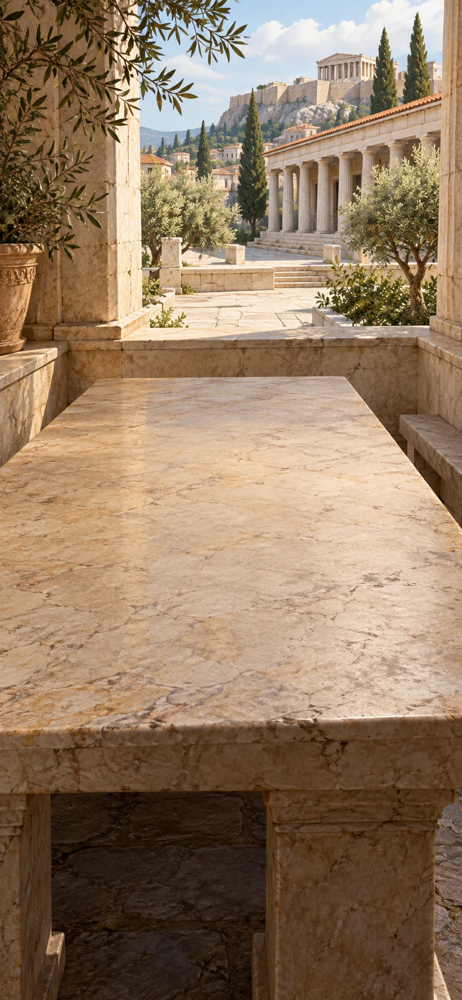

*Aristotle and Plato on civic life, Athens, fourth century BCE*

A city claims to pursue a common good. Test that claim against who governs, whose interests they serve, and who is allowed a voice.

**Goals**
- Whose interests should rule serve? -- "Judge rulers by whose interests they serve"
- Who is left out? -- "Who is included in the common good?"

**Items**
- "A city shares courts, offices and a way of life"

  For Aristotle, a city supports a shared way of life through courts and public offices. Its purpose is more than preventing people from injuring one another.

- "Athens excludes women, enslaved people and resident foreigners from its assembly"

  Aristotle defines citizenship through participation in judgment and office. In Athens, many people whose work supported the city had no assembly vote; residence and contribution did not confer political voice.

- "Judge rulers by whose interests they serve"

  What makes someone fit to govern?

  Practical judgment concerns living well; a city organizes a shared life through courts and offices. Aristotle therefore asks whether rulers serve the community or themselves.

  Plato’s quarrelling sailors sharpen a different question: winning command is not knowing how to navigate. Neither test yet decides who gets a political voice.

  *Judge rulers by whose interests they serve*

- "Who is included in the common good?"

  Whose good does the city count?

  Government may claim to serve the community. Yet Athens’s assembly excludes women, enslaved people and resident foreigners whose work supports it.

  A standard of common benefit leaves a further question: who belongs to the community that chooses and judges its rulers? Calling a policy “common” does not answer those excluded.

  *Who is included in the common good?*

**Combinations**
- "Acting well takes practice and judgment" [preserve] + "A city shares courts, offices and a way of life" [preserve] -> "Judge rulers by whose interests they serve"
- "Judge rulers by whose interests they serve" [preserve] + "Athens excludes women, enslaved people and resident foreigners from its assembly" [preserve] -> "Who is included in the common good?"

> NOTE: [Aristotle, Politics III](https://classics.mit.edu/Aristotle/politics.3.three.html); [Plato, Republic VI, ship analogy](https://classics.mit.edu/Plato/republic.7.vi.html). These are distinct positions, not modern universal citizenship.

## Freedom and a sufficient life

background: 

*Cynic, Stoic and Epicurean perspectives, Greek and Roman world, c. 330 BCE–180 CE*

Cynics, Stoics and Epicureans offer different accounts of living well. Would fewer needs, fellowship beyond one city or release from fear make a life freer—and what might each answer leave open?

**Goals**
- What can reduce dependence and fear?
  - both: "Freedom by needing less"
  - and: "Pleasure in friendship and having enough"
- Does concern stop at the city boundary? -- "Fellowship beyond one city"

**Items**
- "Diogenes practises needing very little"

  Later stories describe Diogenes as trying to need very little. His independence challenges the idea that wealth and powerful friends are necessary for a good life.

- "A ruler offers wealth and favour"

  A ruler offers wealth and support. Accepting can also make a person dependent on the ruler's wishes.

- "Other people also share in reason"

  Stoic thinkers ask people to examine their judgments and recognize that others can reason too. Events are not always under our control, but responses can be practised. Suffering and injustice still matter.

- "Epicurus: the soul disperses at death, ending sensation"

  Epicurus describes the soul as bodily: when its atoms scatter at death, sensation ends. This is his ancient account of body and soul, not modern atomic physics.

- "Suffering requires sensation"

  For Epicurus, suffering requires someone who can feel it. This premise does not yet say what death is like.

- "Friendship and a simple meal can suffice"

  Epicurus values friendship, security and simple pleasures. A good life need not depend on expensive possessions or constant indulgence.

- "Freedom by needing less"

  What can a ruler offer someone who wants very little?

  Stories about Diogenes place his few wants beside a ruler’s offer of wealth and favour. An offer has less hold when the recipient does not need its rewards.

  Chosen simplicity can protect independence from a patron. Forced poverty, with needs unmet, offers no such guarantee.

  *Freedom by needing less*

- "Fellowship beyond one city"

  Why care about a stranger beyond the city boundary?

  Cultivating judgment need not stop at one’s own advantage. Stoic thinkers treat other people as fellow participants in reason, even across political borders.

  On that account, citizenship cannot be the sole boundary of concern. The claim extends fellowship without pretending that everyone already enjoys equal standing or freedom.

  *Fellowship beyond one city*

- "Epicurus: an argument against fearing death"

  Could being dead itself be an experience of suffering?

  Epicurus holds that death disperses the bodily soul and ends sensation. Suffering requires someone who can feel it.

  From those premises, being dead cannot be felt as suffering. The argument targets fear of that state; painful dying and the grief of survivors remain different questions.

  *Epicurus: an argument against fearing death*

- "Pleasure in friendship and having enough"

  What would make a life pleasant enough?

  If death ends sensation, Epicurus argues, being dead cannot be felt as suffering. Alongside that challenge to fear, friendship, security and a simple meal offer pleasures that need not grow with wealth.

  A good life depends partly on which desires govern it. Relieving an endless demand for more can matter as much as obtaining another possession.

  *Pleasure in friendship and having enough*

**Combinations**
- "Diogenes practises needing very little" [preserve] + "A ruler offers wealth and favour" [preserve] -> "Freedom by needing less"
- "Acting well takes practice and judgment" [preserve] + "Other people also share in reason" [preserve] -> "Fellowship beyond one city"
- "Epicurus: the soul disperses at death, ending sensation" [preserve] + "Suffering requires sensation" [preserve] -> "Epicurus: an argument against fearing death"
- "Epicurus: an argument against fearing death" [preserve] + "Friendship and a simple meal can suffice" [preserve] -> "Pleasure in friendship and having enough"

> NOTE: [Cynics](https://iep.utm.edu/cynics/), [Stoicism](https://plato.stanford.edu/entries/stoicism/), [Epicurus, Letter to Menoeceus](https://classics.mit.edu/Epicurus/menoec.html), [Letter to Herodotus §§63–66](https://www.contrib.andrew.cmu.edu/~kk3n/80-300/epicurus-to-herodotus.htm). The three schools are compared, not combined into a single doctrine.

## Geometry and Earth

background: 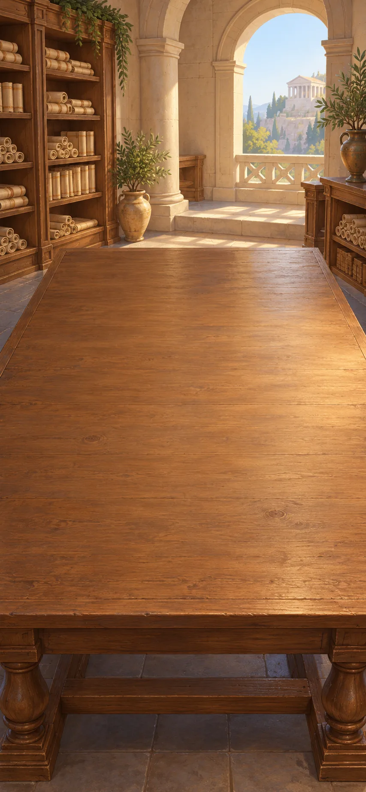

*Euclidean proof and Earth measurement, Alexandria, third century BCE*

A geometrical proof can establish what a construction must be like. An Earth measurement also needs observations: how could a local shadow tell us something about the whole planet?

**Goals**
- Why must the triangle’s sides be equal? -- "A connected geometric proof"
- next: How can a local measurement reach around Earth? -- "An Earth whose size can be investigated"

**Items**
- "Two intersecting circles have centres A and B and radius AB"

  Let C be an intersection of the circles. AC and AB are radii of the circle centred at A; BC and BA are radii of the circle centred at B. Join A, B and C.

- "A connected geometric proof"

  Why must the constructed triangle have three equal sides?

  Two circles have centres A and B and the same radius AB; C is an intersection. AC equals AB as radii of the first circle. BC equals AB as radii of the second.

  Therefore AC, BC and AB are equal. Each step follows from a stated premise rather than the drawing’s appearance.

  *A connected geometric proof*

- "A 7.2-degree shadow difference over 800 kilometres"

  Invented measurements: at noon on the same day, two sites 800 kilometres apart along one meridian (a north–south line) measure a 7.2° difference in the Sun’s angle from their local verticals. Assume a spherical Earth and parallel sunlight. The rounded modern units are not an ancient field record.

- "An Earth whose size can be investigated"

  How can a shadow comparison measure the whole Earth?

  At noon on the same day, two sites 800 kilometres apart along one meridian—a north–south line—differ by 7.2° in the Sun’s angle from their local verticals. With a spherical Earth and parallel sunlight, that equals their angle at Earth’s centre.

  It is one-fiftieth of a turn, so Earth’s circumference is about 800 × 50 = 40,000 kilometres. This invented estimate depends on its measurements and assumptions.

  *An Earth whose size can be investigated*

**Combinations**
- "A conclusion follows from premises" [preserve] + "Two intersecting circles have centres A and B and radius AB" [preserve] -> "A connected geometric proof"
- "A conclusion follows from premises" [preserve] + "A 7.2-degree shadow difference over 800 kilometres" [preserve] -> "An Earth whose size can be investigated"

> NOTE: [Euclid, Elements I.1](https://mathcs.clarku.edu/~djoyce/elements/bookI/propI1.html). The circles’ intersection is explicitly supplied, avoiding the unstated existence assumption noted in Joyce’s commentary. The shadow-angle geometry is described in [NOAA’s Eratosthenes teaching account](https://www.noaa.gov/jetstream/global/learning-lesson-shadow-knows-i). The Earth calculation is an authored reconstruction with modern rounded distances, not a claim about the exact ancient stade or observed distance. It uses reasoning from stated premises; the equilateral-triangle construction is a separate proof, not a necessary theorem in the circumference calculation.

## A predictive sky

background: 

*Astronomers and instrument makers, Mediterranean world, c. 200 BCE–200 CE*

Planet sightings give a model something to answer to. Circles and linked gears can represent patterns, but a successful prediction still leaves the physical cause to explain.

**Goals**
- What can an inherited model predict? -- "Ptolemy’s predictive heavens"
- Can a mechanism display a recurring sky? -- "A sky represented in gears"

**Items**
- "Dated sightings of planets against the stars"

  These newly supplied records give dates and positions of planets against the stars. They are a separate collection, not observations hidden inside the earlier eclipse archive.

- "Ptolemy combines circles around an Earth-centred frame"

  Ptolemy combines circular motions to predict positions seen from Earth. A planet travelling on a small circle whose centre moves around a larger circuit can appear to reverse direction against the stars. Dated sightings test the timing and position of that apparent backward motion.

- "Gears can turn at linked rates"

  In an invented pair, a 20-tooth gear meshes with a 40-tooth gear. Two turns of the smaller wheel produce one turn of the larger, in the opposite direction. Appropriate gear ratios can represent known cycles.

- "An archive of planetary motion"

  How can scattered sightings become comparable?

  New reports give dates and planetary positions against the stars. Apply the eclipse archive’s practice: preserve dates and mark missing watches.

  The result is a record against which predictions can be checked. What carries over is the recording method; planetary observations are new evidence.

  *An archive of planetary motion*

- "Ptolemy’s predictive heavens"

  How could circular motions account for a planet appearing to move backward?

  In Ptolemy’s Earth-centred model, a small circular motion rides around a larger circuit. Together they can produce an apparent reversal against the stars. Dated sightings test where and when it occurs.

  The arrangement makes the wandering path calculable. What physical motions could produce the modelled path remains a further question.

  *Ptolemy’s predictive heavens*

- "A sky represented in gears"

  How can turning wheels represent a recurring sky?

  The eclipse calendar supplies repeating intervals; linked gears supply controlled ratios of rotation. In an illustrative pair, a 20-tooth wheel turns twice while its 40-tooth partner turns once.

  Chosen ratios can make pointers display known cycles. The mechanism represents their timing; it does not explain what causes an eclipse.

  *A sky represented in gears*

**Combinations**
- "A sky archive with its gaps" [preserve] + "Dated sightings of planets against the stars" [preserve] -> "An archive of planetary motion"
- "An archive of planetary motion" [preserve] + "Ptolemy combines circles around an Earth-centred frame" [preserve] -> "Ptolemy’s predictive heavens"
- "Recurring eclipse seasons" [preserve] + "Gears can turn at linked rates" [preserve] -> "A sky represented in gears"

> NOTE: [National Archaeological Museum, Antikythera mechanism](https://antikythera-mechanism.namuseum.gr/en/what-is-the-mechanism-and-what-does-it-consist-of/). The planetary record and mechanical model are distinct objects, not extra observations concealed in the opening eclipse archive. The 20/40-tooth pair is an elementary authored gear-ratio example, not a reconstruction of the Antikythera gearing.

## Copies and legal authority

background: 

*Ancient Mediterranean editors; Justinian’s law, Constantinople, 529–534 CE*

An editor can display rival readings; an imperial lawbook must also say what has force. Examine a collection that calls slavery contrary to nature while providing legal routes to free individuals.

**Goals**
- What should readers know about a disputed text? -- "An edition that shows its doubts"
- next: Who gives an edited lawbook authority? -- "Older law edited under imperial authority"
- Does manumission abolish slavery? -- "An individual route to freedom is not abolition"

**Items**
- "One copy says “the ship returned”; another says “the ship burned”"

  This miniature poem is invented. The final word changes the event, and these two copies alone do not establish which reading came first.

- "An edition that shows its doubts"

  What should an editor print when two copies disagree?

  One invented copy says the ship “returned”; another says it “burned.” Neither supplied witness settles which came first.

  Print “returned / burned” with the uncertainty visible. Applying criticism to the text preserves the evidence for readers instead of concealing the dispute inside a polished sentence.

  *An edition that shows its doubts*

- "The Institutes call slavery contrary to nature"

  Justinian’s Institutes describe natural freedom, yet regulate slavery and distinguish freeborn, freed and enslaved status. Their own stated principle does not abolish the institution.

- "A legally recognised act frees an enslaved person"

  Manumission legally frees an individual enslaved person. It changes that person's status within a system that still permits slavery.

- "An individual route to freedom is not abolition"

  Does freeing one person end slavery?

  Justinian’s Institutes describe natural freedom while regulating slavery. Manumission changes an enslaved person’s legal status to freed.

  That change matters to the person freed, but the institution still permits others to be enslaved. The declaration of natural freedom remains in tension with the law.

  *An individual route to freedom is not abolition*

- `civ-imperial-compilation` Justinian orders older law edited into an authoritative collection

  Justinian orders older law selected and edited into an authoritative collection. The result decides what has legal force rather than preserving every disagreement neutrally.

- "Older law edited under imperial authority"

  What makes an edited text binding law?

  An edition can display rival readings without deciding between them. Justinian’s compilation instead selects and edits older law under imperial authority.

  Its authority determines which text has legal force. Evidence about what older writers said and a decision about which rules now bind people are different achievements.

  *Older law edited under imperial authority*

**Combinations**
- "Claims answerable to objections" [preserve] + "One copy says “the ship returned”; another says “the ship burned”" [preserve] -> "An edition that shows its doubts"
- "The Institutes call slavery contrary to nature" [preserve] + "A legally recognised act frees an enslaved person" [preserve] -> "An individual route to freedom is not abolition"
- "An edition that shows its doubts" [preserve] + `civ-imperial-compilation` [preserve] -> "Older law edited under imperial authority"

> NOTE: [Schironi, Textual Scholarship in Alexandria and Beyond](https://sites.lsa.umich.edu/schironi/wp-content/uploads/sites/259/2024/10/43_Textual-Scholarship-in-Alexandria-.pdf); [Justinian, Institutes I.2–5 and proem](https://droitromain.univ-grenoble-alpes.fr/Anglica/just1_Moyle.htm). The two-line poem and modern display of alternatives are authored teaching devices.

## Translation and new questions

background: 

*Translators and philosophers, Arabic-speaking scholarly centres, c. 800–1100 CE*

Greek and Syriac arguments enter Arabic-speaking scholarly communities, where translation becomes a source of new inquiry. Avicenna asks a further question: a description tells us what something would be, but why does it exist?

**Goals**
- What must translation preserve?
  - both: "Logic in a new scholarly language"
  - and: "Natural philosophy in Arabic"
- How does inherited inquiry change?
  - both: "Avicenna: a necessary source of existence"
  - and: "A commentary that changes the question"

**Items**
- "Greek and Syriac manuscripts meet Arabic readers"

  Greek and Syriac manuscripts reach Arabic-speaking scholars through several languages and communities. Translation is shared scholarly work.

- "New Arabic terms for form, substance and cause"

  Translating an argument requires distinctions as well as words. A particular animal is a substance; its organization is its form; asking why it exists or acts can call for several kinds of cause. These are introductory senses, not the whole history of the terms.

- "A definition gives no existence; a dependent being needs a cause"

  Defining a triangle tells us what one would be, not whether one exists. Avicenna argues that an existing being whose nature does not require existence needs a cause; a collection of such dependent beings still needs an explanation beyond that collection.

- "Healthy things are alive; a healthy diet is therefore alive"

  An invented translation exercise uses “healthy” for both possessing health and promoting health. Does the apparent argument preserve one meaning throughout?

- "Logic in a new scholarly language"

  What must survive when an argument changes language?

  Greek and Syriac manuscripts reach Arabic-speaking scholars. For the conclusion still to follow, the translated claims must keep the same relationships: “all,” “some” and “not” cannot be exchanged merely for smoother prose.

  Preserving those distinctions makes the argument available for new teaching, criticism and development. Translation is part of inquiry.

  *Logic in a new scholarly language*

- "Natural philosophy in Arabic"

  Would translating every kind of explanation as “cause” preserve the argument?

  The statue’s bronze, form, maker and purpose answer different questions. Arabic-speaking translators and philosophers need terms that preserve those distinctions.

  Here, “substance” means an individual thing, such as this animal; its colour and size are properties of that thing. Its form is how it is organized. Other questions ask what it is made of, what brought it about or what purpose it serves. Keeping these questions distinct lets scholars use and revise the arguments.

  *Natural philosophy in Arabic*

- "Avicenna: a necessary source of existence"

  Does knowing what a thing is explain why it exists?

  A triangle’s definition does not make a triangle exist. Avicenna argues that if a thing could either exist or not exist, something must explain why it exists. If every member of a collection is dependent, the collection still lacks an independent explanation of its existence.

  He therefore argues for a necessary source: something that does not depend on anything else to exist. The triangle illustrates the starting distinction; the argument about causes does the further work.

  *Avicenna: a necessary source of existence*

- "A commentary that changes the question"

  Must a healthy diet be alive?

  “Healthy things are alive; a healthy diet is therefore alive” repeats one word with two senses. A healthy animal possesses health; a healthy diet promotes it.

  A claim about possessing health cannot simply be applied to promoting health. The commentator exposes a change of meaning hidden by the repeated word.

  *A commentary that changes the question*

**Combinations**
- "A conclusion follows from premises" [preserve] + "Greek and Syriac manuscripts meet Arabic readers" [preserve] -> "Logic in a new scholarly language"
- "Material, form, maker and purpose" [preserve] + "New Arabic terms for form, substance and cause" [preserve] -> "Natural philosophy in Arabic"
- "Natural philosophy in Arabic" [preserve] + "A definition gives no existence; a dependent being needs a cause" [preserve] -> "Avicenna: a necessary source of existence"
- "Logic in a new scholarly language" [preserve] + "Healthy things are alive; a healthy diet is therefore alive" [preserve] -> "A commentary that changes the question"

> NOTE: [Greek Sources in Arabic and Islamic Philosophy](https://plato.stanford.edu/entries/arabic-islamic-greek/); [Ibn Sina’s Metaphysics](https://plato.stanford.edu/entries/ibn-sina-metaphysics/). The introductory animal/form/substance distinction follows [Aristotle, Categories 5](https://classics.mit.edu/Aristotle/categories.1.1.html) without implying identical terminology across Arabic philosophers. The triangle and English-language ambiguity exercise are explicitly illustrative and are not attributed to Avicenna or another historical commentator.

## Calculation and model criticism

background: 

*Arabic-language mathematics and astronomy, Baghdad and Cairo, c. 800–1050 CE*

Arabic-language mathematics develops methods for finding unknown quantities; Ibn al-Haytham also questions inherited astronomical models. Solve an invented shares problem, then ask whether a successful prediction describes the proposed physical motion.

**Goals**
- How large is each share? -- "Each share is three; substitution checks it"
- Can this model describe the proposed physical motion? -- "Ptolemy read critically"

**Items**
- "Subtract equal amounts from equal totals; divide by the same nonzero amount"

  Matching subtraction or division preserves equality. Apply these operations to isolate the unknown share, then check the proposed value in the original total.

- "Three equal shares plus two units total eleven"

  An invented merchant problem: after three equal shares have been set aside, two units remain, making eleven altogether. What amount belongs in each share?

- "Uniform turning is measured from a point away from the circle’s centre"

  In Ptolemy’s equant construction, equal angles in equal times are measured at an offset point. That is not uniform angular motion about the circle’s own centre, as the proposed physical account requires.

- "Each share is three; substitution checks it"

  What is each share if three shares plus two total eleven?

  Subtract two from both sides: three shares total nine. Divide both sides by three: each share is three. These matching operations preserve equality.

  Check the answer in the original relation: 3 × 3 + 2 = 11. The procedure both finds the unknown and gives a way to test it.

  *Each share is three; substitution checks it*

- "Ptolemy read critically"

  Can successful prediction conceal a physical difficulty?

  Ptolemy’s equant measures uniform turning from a point away from a circle’s centre. The proposed physical account calls for uniform turning about the centre itself.

  Ibn al-Haytham challenges that mismatch. A device may predict positions while failing to describe the proposed motion. This objection neither reports a failed observation nor establishes a moving Earth.

  *Ptolemy read critically*

**Combinations**
- "Subtract equal amounts from equal totals; divide by the same nonzero amount" [preserve] + "Three equal shares plus two units total eleven" [preserve] -> "Each share is three; substitution checks it"
- "Ptolemy’s predictive heavens" [preserve] + "Uniform turning is measured from a point away from the circle’s centre" [preserve] -> "Ptolemy read critically"

> NOTE: [Oxford History of Science Museum, Mathematics](https://www.mhs.ox.ac.uk/scienceislam/mathematics.html), practical mathematical traditions; [Y. Tzvi Langermann, Ibn al-Haytham, ISMI/Max Planck](https://ismi.mpiwg-berlin.mpg.de/biography/Ibn_al-Haytham_BEA.htm), the equant and physical critique. The shares and modern wording are authored; the problem is not quoted from al-Khwarizmi.

## Light enters the room

background: 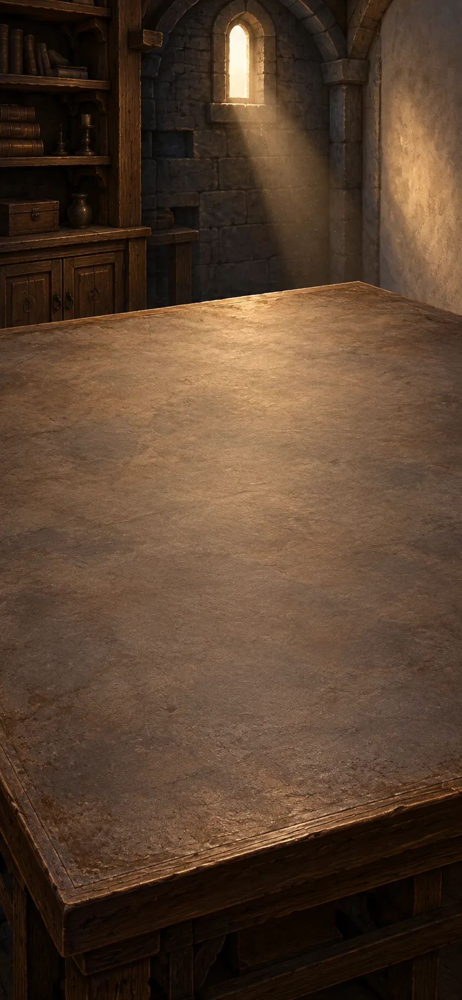

*Ibn al-Haytham’s optical inquiry, Cairo, early eleventh century*

Ibn al-Haytham investigates vision through light entering the eye. A lamp shines through a small opening: where should its light arrive, and what would blocking one source change?

**Goals**
- What travels toward the eye? -- "Sight depends on light entering the eye"
- next: How can the light’s path form an image? -- "A prepared dark-room image box"

**Items**
- "Bright light affects the eye"

  A bright lamp affects the eye; a dark object becomes visible when illuminated. Ibn al-Haytham’s account studies light entering the eye. Never use a direct view of the Sun as a test.

- "A high lamp sends light through a hole to a low patch"

  Draw a straight line from the lamp through the small hole: it reaches below the hole on the opposite screen. A low lamp’s line reaches a high patch. Blocking one lamp removes its corresponding patch.

- "A closed box, small opening and receiving screen"

  The box excludes stray light. Its small opening admits narrow paths from different parts of the scene onto a screen opposite it.

- "Sight depends on light entering the eye"

  Why does illumination change what can be seen?

  A bright lamp affects the eye; a dark object becomes visible when lit. Light reaching the eye from the scene offers an account of those effects.

  The question becomes how sources, surfaces and light paths produce vision. Illumination and viewing conditions now give the inquiry specific things to test.

  *Sight depends on light entering the eye*

- "Light paths as a geometric account"

  Why does a high lamp make a low patch beyond a small hole?

  Light reaching the room follows a straight line from the high lamp through the hole to the lower screen. A low lamp’s line reaches higher.

  Block one lamp and its patch disappears while the other remains. The paths can cross without losing their separate contributions.

  *Light paths as a geometric account*

- "A prepared dark-room image box"

  Could the crossing light paths form a picture?

  A box excludes stray light; a small opening admits narrow paths to an opposite screen. Light from the scene’s top crosses downward through the opening, while light from its bottom crosses upward.

  The enclosure makes the faint inverted projection easier to see. Geometry has become an image-making device.

  *A prepared dark-room image box*

**Combinations**
- "Natural philosophy in Arabic" [preserve] + "Bright light affects the eye" [preserve] -> "Sight depends on light entering the eye"
- "Sight depends on light entering the eye" [preserve] + "A high lamp sends light through a hole to a low patch" [preserve] -> "Light paths as a geometric account"
- "Light paths as a geometric account" [preserve] + "A closed box, small opening and receiving screen" [transform] -> "A prepared dark-room image box"

> NOTE: [Ibn al-Haytham, Optics I.6 §§85–87, Sabra translation](https://resources.warburg.sas.ac.uk/pdf/ffh360b2205460.pdf#page=50), lamp/aperture/selective-screening case. The high/low labels are a teaching reconstruction. The lamp case supports geometric paths, not a complete modern theory of eye sensing.

## Images and magnification

background: 

*Optical inquiry and lens craft, Mediterranean and European workshops, c. 1200–1300 CE*

The same room now holds the image box and a lens blank. Compare a projection on a screen with a close view through curved glass.

**Goals**
- Where does the upper part of the image land? -- "An inverted image on the screen"
- How does placement change the view? -- "A magnified close-up view"

**Hotspots**
- "Dark room"

**Items**
- "Dark room"

  A room shaded enough to distinguish the faint aperture image.

- "A clear glass blank"

  This clear piece of glass can be shaped into a lens.

- "Curved surfaces can bend light"

  Shaping a glass surface changes how it bends light. This craft makes lenses possible.

- "An inverted image on the screen"

  Where will the top of the window appear?

  The prepared box admits light through a small aperture. In the dark room, the faint projection becomes visible: the upper window appears low on the screen, and the lower window high.

  The crossing paths explain the inversion. Darkness makes the result visible; it does not cause the reversal.

  *An inverted image on the screen*

- "A convex magnifying lens"

  What can shaping the glass change?

  Curved glass surfaces bend light. Shaping the clear blank into a convex lens, thicker in the middle, creates a tool that can enlarge a nearby view.

  Placement now matters: the same lens can give different images at different object distances.

  *A convex magnifying lens*

- "A magnified close-up view"

  Why does a nearby mark look larger through the lens?

  A convex lens, thicker in the middle, brings parallel incoming rays together at its focus. Place a mark closer than that distance: light passing through the lens appears to come from a larger upright image.

  The eye sees this virtual image through the glass. Unlike the dark-room projection, it cannot be caught on a screen at the place where it appears.

  *A magnified close-up view*

**Combinations**
- "A prepared dark-room image box" @ "Dark room" -> "An inverted image on the screen"
- "A clear glass blank" [transform] + "Curved surfaces can bend light" [preserve] -> "A convex magnifying lens"
- "A convex magnifying lens" [preserve] + "Light paths as a geometric account" [preserve] -> "A magnified close-up view"

> NOTE: [Museo Galileo, Lens-making](https://catalogue.museogalileo.it/multimedia/LensmakingBis.html); [OpenStax, Image Formation by Lenses](https://openstax.org/books/college-physics-2e/pages/25-6-image-formation-by-lenses). The thin-lens description is modern explanatory language, not a medieval quotation.

## Objections, nature and law

background: 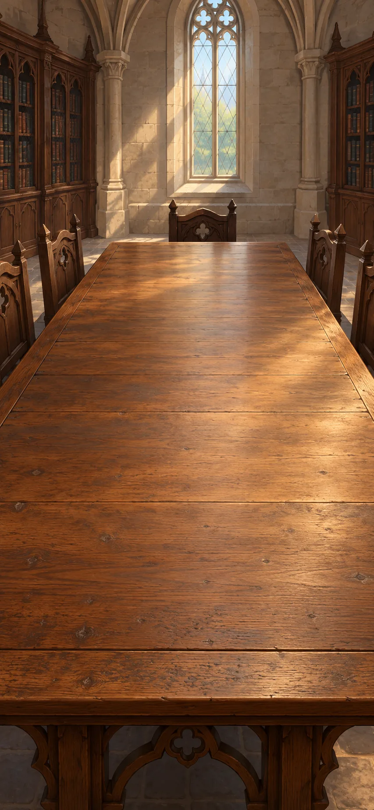

*Aquinas and university scholars, Paris and Bologna, c. 1150–1350 CE*

Translated arguments reach the universities. Aquinas tests general rules against difficult cases, while lawyers write new explanations around the words of old laws.

**Goals**
- What would answer a concrete objection? -- "A reply must answer the objection"
- Can inherited accounts acquire new uses?
  - both: "Aquinas: natural causes can explain a created world"
  - and: "Inherited Roman law gains a medieval commentary"

**Items**
- "Translators work from Arabic and Greek into Latin"

  Texts reach Latin readers through translations from both Arabic and Greek. There is more than one route of transmission.

- "Return deposited goods even when their owner will attack the community?"

  Aquinas considers the general requirement to return what has been entrusted to us, then cases where returning it would cause grave harm. This tests how practical conclusions depend on circumstances.

- "A world created by God can still have natural causes"

  For Aquinas, a world created by God can still have natural causes that people can study. Natural explanation and creation are not automatically rivals.

- "Bologna readers annotate Justinian’s law between the lines"

  Medieval readers at Bologna write explanations around and between the lines of Justinian's law. The inherited text becomes surrounded by new interpretation.

- "Aristotle in Latin"

  What reaches a new reader along with a translated argument?

  Arabic-language scholarship has preserved and developed logical arguments. Latin translators work from both Arabic and Greek sources, bringing Aristotle’s works and interpretations into new schools.

  A reader inherits questions and disagreements as well as conclusions. There is more than one route by which an argument travels.

  *Aristotle in Latin*

- "A reply must answer the objection"

  Must entrusted goods always be returned?

  A general rule requires returning what belongs to someone else. Aquinas tests it against an owner who would use the goods to attack the community.

  The reply distinguishes ordinary circumstances from this harmful use. A reasoned exception must identify the relevant difference; convenience alone cannot answer the objection.

  *A reply must answer the objection*

- "Aquinas: natural causes can explain a created world"

  Would a source of existence leave natural causes nothing to explain?

  Avicenna asks why dependent beings exist at all. Aquinas’s account of creation also allows things to have their own powers and natural causes.

  Explaining how a fire heats something need not compete with asking why a created world exists. These questions ask for different kinds of explanation.

  *Aquinas: natural causes can explain a created world*

- "Inherited Roman law gains a medieval commentary"

  How can an old lawbook acquire new uses?

  Justinian’s compilation selected authoritative Roman law. Centuries later, Bologna readers put explanations between its lines and around its margins.

  Readers now encounter the old text through distinctions and interpretations developed for new questions. The wording can persist while its use changes.

  *Inherited Roman law gains a medieval commentary*

**Combinations**
- "Logic in a new scholarly language" [preserve] + "Translators work from Arabic and Greek into Latin" [preserve] -> "Aristotle in Latin"
- "Aristotle in Latin" [preserve] + "Return deposited goods even when their owner will attack the community?" [preserve] -> "A reply must answer the objection"
- "Avicenna: a necessary source of existence" [preserve] + "A world created by God can still have natural causes" [preserve] -> "Aquinas: natural causes can explain a created world"
- "Older law edited under imperial authority" [preserve] + "Bologna readers annotate Justinian’s law between the lines" [preserve] -> "Inherited Roman law gains a medieval commentary"

> NOTE: [Aquinas, Summa theologiae I–II q.94 a.4](https://www.newadvent.org/summa/2094.htm#article4), deposited goods; [Aquinas](https://plato.stanford.edu/entries/aquinas/), natural causes; [Berkeley, Medieval Law School](https://www.law.berkeley.edu/research/the-robbins-collection/exhibitions/medieval-law-school/), glossed manuscripts. The pairing with Avicenna marks a comparison across traditions, not a deduction of Aquinas’s position.

## One word, many things

background: 

*Medieval debates over universals, Oxford and Paris, early fourteenth century*

Medieval philosophers disagree about why one word can apply to many things. Two separate horses answer to one name: what makes both of them horses?

**Goals**
- What does the shared name commit us to? -- "One shared name, rival accounts"

**Items**
- "This horse and that horse are distinct; both are called horses"

  Two individuals share a name. Naming them together supplies a problem about commonality; it does not yet establish which philosophical account is right.

- "A concept can apply to many individuals without being a shared external thing"

  For the nominalist, one concept in thought and one word in language can apply to many individual horses. This does not require a further thing—a shared “horseness”—existing outside the mind.

- "A realist grounds the shared name “horse” in a real common nature"

  The realist asks what makes calling several animals “horses” more than an arbitrary grouping. A real common nature grounds that shared description. Medieval accounts differ over what such a nature is.

- "Common concepts, not a shared thing outside the mind"

  Must two horses share another thing called “horse”?

  This horse and that horse are distinct individuals, yet one concept applies to both. For the nominalist, one concept in thought and one word in language can apply to many individual horses.

  This does not require a further thing—a shared “horseness”—existing outside the mind. Thinking about horses in general remains possible without it.

  *Common concepts, not a shared thing outside the mind*

- "One shared name, rival accounts"

  What makes both animals horses?

  For the nominalist, “horse” is a concept that applies to separate animals. The realist says it applies because the animals themselves share a common nature, whether or not anyone classifies them.

  Both accounts must explain the shared name. A nature belonging to the horses need not be a Platonic Form existing separately from them.

  *One shared name, rival accounts*

**Combinations**
- "This horse and that horse are distinct; both are called horses" [preserve] + "A concept can apply to many individuals without being a shared external thing" [preserve] -> "Common concepts, not a shared thing outside the mind"
- "Common concepts, not a shared thing outside the mind" [preserve] + "A realist grounds the shared name “horse” in a real common nature" [preserve] -> "One shared name, rival accounts"

> NOTE: [William of Ockham](https://plato.stanford.edu/entries/ockham/). The horse comparison is authored. Rejecting separate Platonic Forms does not by itself establish nominalism; Aristotle is no longer used as its sufficient ingredient.

## Print and permission

background: 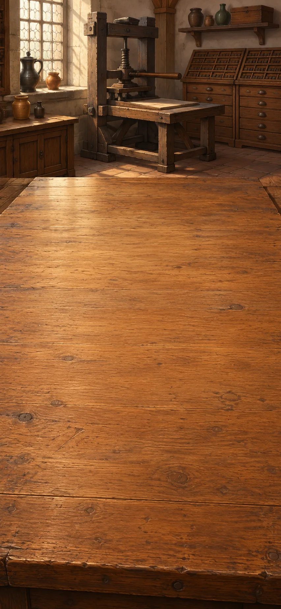

*Printers, editors and authorities, Europe, c. 1450–1600 CE*

The disputed reading can now reach many readers in matching copies. That opportunity also gives authorities a particular edition to license or seize.

**Goals**
- Can many readers inspect the same editorial choice? -- "Printed copies show the disputed words"
- Who can prevent those copies circulating? -- "Permission to print can hide a disputed reading"

**Items**
- "Paper sheets"

  Paper provides a surface for writing and printing. Its history began outside Europe.

- "Reusable metal type in a European press"

  Reusable metal letters can be arranged to print a page. This European printing system was important, but it was not the world's first printing.

- "An edition made with reusable type"

  What changes when the same arranged letters print many sheets?

  Reusable metal type transfers one arrangement of words onto successive paper sheets. Readers in different places can receive comparable copies of an edition.

  That repeatability enlarges an editor’s reach—including the reach of an error. This European workshop develops printing within a history that already includes Asian block and type technologies.

  *An edition made with reusable type*

- "Printed copies show the disputed words"

  Can readers share the evidence for an unresolved reading?

  The disputed ship poem says “returned” in one witness and “burned” in another. Reusable type can print both readings and the editor’s uncertainty in every copy.

  More readers can inspect the same problem. Printing one chosen word a thousand times would multiply copies, not independent evidence for it.

  *Printed copies show the disputed words*

- "The licensing order permits one reading and bars the disputed note"

  Illustrative order: the edition may circulate only with “returned”; the note preserving “burned” must be removed. The order changes which evidence readers can inspect, without resolving which word is earlier.

- "Permission to print can hide a disputed reading"

  What disappears when an authority licenses only one reading?

  The invented edition preserves “returned / burned.” The licensing order permits “returned” but bars the note containing “burned.”

  Readers can receive an approved text while losing access to contrary evidence. Permission changes what circulates; it does not establish which word the earlier text contained.

  *Permission to print can hide a disputed reading*

**Combinations**
- "Paper sheets" [preserve] + "Reusable metal type in a European press" [preserve] -> "An edition made with reusable type"
- "An edition that shows its doubts" [preserve] + "An edition made with reusable type" [preserve] -> "Printed copies show the disputed words"
- "Printed copies show the disputed words" [preserve] + "The licensing order permits one reading and bars the disputed note" [preserve] -> "Permission to print can hide a disputed reading"

> NOTE: [Library of Congress, Printing in Asia](https://blogs.loc.gov/international-collections/2021/06/the-history-of-printing-in-asia-according-to-library-of-congress-asian-collections-part-1/). The licensing order and poem are invented comparisons, not an attribution to a particular historical censor.

## Testing a text’s authority

background: 

*Renaissance textual scholars, European libraries, c. 1450–1614 CE*

A fresh Greek witness can expose a translator’s choice; a text’s language can also challenge its claimed age. These checks answer different questions about authority.

**Goals**
- What did the translator add? -- "A translation’s choices made visible"
- How ancient is this text? -- "Hermetic wisdom, later than claimed"

**Items**
- "A new Greek witness allows “capacity”; a Latin version specifies “political power”"

  Invented miniature comparison: the wider term can concern an ability, while the narrower translation makes it political authority. The surrounding argument is needed to decide whether that narrowing is justified.

- "A translation’s choices made visible"

  Did the original text specify political power?

  In this invented comparison, the Greek witness permits “capacity,” while the Latin translation says “political power.” The translation has narrowed the meaning.

  That choice may fit the surrounding argument, but it cannot prove that the restriction was explicit in the Greek. Comparing witnesses makes an interpretive decision visible.

  *A translation’s choices made visible*

- "Dialogues attributed to ancient Hermes"

  Renaissance readers often believed these dialogues preserved wisdom from a very ancient figure called Hermes. That claimed age gave the texts authority.

- "The supposedly ancient text uses later Greek"

  The language contains features from a later period than the text's claimed origin. Such evidence can help challenge its date.

- "Hermetic wisdom, later than claimed"

  What happens to a text’s authority when its claimed age fails?

  Renaissance readers valued the writings attributed to Hermes as extremely ancient wisdom. Features of their Greek point to a later origin.

  That evidence challenges the appeal to antiquity. The ideas still need examination on their merits: a mistaken date does not by itself make every proposition false.

  *Hermetic wisdom, later than claimed*

**Combinations**
- "Aristotle in Latin" [preserve] + "A new Greek witness allows “capacity”; a Latin version specifies “political power”" [preserve] -> "A translation’s choices made visible"
- "Dialogues attributed to ancient Hermes" [preserve] + "The supposedly ancient text uses later Greek" [preserve] -> "Hermetic wisdom, later than claimed"

> NOTE: [Influence of Arabic and Islamic Philosophy on the Latin West](https://plato.stanford.edu/entries/arabic-islamic-influence/) and [Marsilio Ficino](https://plato.stanford.edu/entries/ficino/). The capacity/power wording is an invented comparison, not a quotation or identified mistranslation of Aristotle. Dating evidence challenges antiquity, not every proposition in a text.

## Views and navigation

background: 

*Artists and navigators, European workshops and chart rooms, c. 1480–1600 CE*

A drawing and a chart each serve a particular viewer. Examine what their useful arrangements leave hidden or distort before putting a lens to the sky.

**Goals**
- What does a fixed view hide? -- "A fixed view leaves other surfaces hidden"
- What does this navigational chart distort? -- "Useful bearings, distorted areas"

**Items**
- "From the drawing point a pillar hides the doorway; one step sideways reveals it"

  An invented workshop comparison: the painting accurately hides the doorway behind the pillar from its fixed viewing point. A viewer who moves sideways sees an entrance that the painting cannot show.

- "A fixed view leaves other surfaces hidden"

  Does a missing doorway make the picture inaccurate?

  From the drawing point, a pillar blocks the light path from the doorway to the viewer. One step sideways reveals the doorway in the scene.

  The fixed picture can be accurate for its chosen viewpoint while omitting a real entrance. Accuracy from one position is different from completeness.

  *A fixed view leaves other surfaces hidden*

- "Two equatorial ports lie at 10° west and 30° west"

  An invented chart places two ports on the equator, one at 10° west and one at 30° west. Longitude gives angular position relative to a shared reference meridian; latitude is zero at the equator.

- "Coordinates connect positions to distances"

  How far apart are the two equatorial ports?

  In this invented chart, one port is at 10° west and the other at 30° west, both on the equator. Their separation is 20°, or one-eighteenth of a full turn.

  Using the earlier 40,000-kilometre circumference estimate gives about 2,220 kilometres along the equator. Coordinates connect a local position with Earth’s scale.

  *Coordinates connect positions to distances*

- "A navigator needs constant-bearing routes drawn as straight lines"

  The navigator wants a flat map on which a steady compass direction traces a straight line. This is a desired property, not a chart already made; it need not give the shortest route.

- "A chart made for compass bearings"

  What should a navigator’s flat chart preserve?

  Coordinates locate the ports. The navigator now wants a constant compass bearing to appear as a straight line on paper.

  A Mercator-style grid provides that useful relation by increasing the spacing toward the poles. The chart is designed for a task; its treatment of area still needs inspection.

  *A chart made for compass bearings*

- "Polar regions grow greatly on this chart"

  On this chart, areas near the poles appear much larger relative to other regions. The map's useful direction lines come with distortion.

- "Useful bearings, distorted areas"

  Can a chart serve navigation while misleading comparisons of size?

  Constant-bearing routes are straight on this Mercator-style chart. Its increasing stretch toward the poles also makes high-latitude regions look disproportionately large.

  A large shape on the chart need not mean a correspondingly large area on Earth. The useful bearing route need not be the shortest route either.

  *Useful bearings, distorted areas*

**Combinations**
- "Light paths as a geometric account" [preserve] + "From the drawing point a pillar hides the doorway; one step sideways reveals it" [preserve] -> "A fixed view leaves other surfaces hidden"
- "An Earth whose size can be investigated" [preserve] + "Two equatorial ports lie at 10° west and 30° west" [preserve] -> "Coordinates connect positions to distances"
- "Coordinates connect positions to distances" [preserve] + "A navigator needs constant-bearing routes drawn as straight lines" [preserve] -> "A chart made for compass bearings"
- "A chart made for compass bearings" [preserve] + "Polar regions grow greatly on this chart" [preserve] -> "Useful bearings, distorted areas"

> NOTE: [Alberti, On Painting I](https://www.noteaccess.com/Texts/Alberti/1.htm) and [II](https://www.noteaccess.com/Texts/Alberti/2.htm), fixed viewpoint; [USGS, Uses of map projections](https://www.usgs.gov/faqs/how-are-different-map-projections-used), Mercator bearings and distortion. The pillar/door case and equatorial ports are invented. The ports use the earlier rounded circumference to connect angular coordinates with distance along the equator. Painting and cartography are compared without claiming direct historical transmission.

## Telescope records

background: 

*Galileo’s telescopic inquiry, Padua and Florence, 1609–1610 CE*

A telescope brings the old sky models within reach of new tests: the Moon has shadows, Jupiter has companions, and Venus changes shape.

**Goals**
- (three goals are a lot but okay here because one telescope tests three different claims about the heavens)
- Is the Moon smooth? -- "An earthly-looking Moon"
- Must everything circle Earth? -- "A system of moons around Jupiter"
- Which phases does Venus show? -- "The full range of Venus’s phases"

**Items**
- "A tube with a second lens"

  A tube holds lenses in an arrangement that can make distant objects appear larger.

- "Moon shadows change like shadows on rough ground"

  The Moon's changing shadows resemble those cast by rough ground. They give a reason to question whether its surface is perfectly smooth.

- "Points beside Jupiter change places but stay near it"

  Small points near Jupiter change position over several observations but remain nearby. The sequence matters more than any single sighting.

- "Watch Venus over several months"

  Watch Venus repeatedly and compare the shape of its illuminated part. One evening’s view is not the whole record.

- "A telescope"

  Can lens craft make a distant object easier to inspect?

  Fit the convex lens with a suitable second lens and tube. The arrangement makes distant objects appear larger than a single close-up magnifier would.

  New details become available to observation. Their meaning still depends on repeated views, comparison and argument.

  *A telescope*

- "An earthly-looking Moon"

  What could the Moon’s changing shadows reveal?

  The telescope shows shadows changing like those on rough ground as illumination shifts. That resemblance supports mountains and depressions on the Moon.

  A rough lunar surface challenges a strict division between perfect heavens and an imperfect Earth. The visible pattern supplies the reason to question that division.

  *An earthly-looking Moon*

- "A system of moons around Jupiter"

  Are those points merely unrelated stars?

  Repeated telescope observations show the points changing sides and positions while staying close to Jupiter. An orbiting group accounts for the sequence.

  Moons circling Jupiter show that not everything circles Earth directly. They do not, by themselves, establish that Earth moves.

  *A system of moons around Jupiter*

- "The full range of Venus’s phases"

  What would one evening’s view of Venus miss?

  The telescope is used repeatedly over months. Venus appears as a crescent at some times and nearly full at others.

  A sky model must accommodate that range, not just one successful sighting. The sequence gives rival arrangements a specific observational test.

  *The full range of Venus’s phases*

**Combinations**
- "A convex magnifying lens" [consume] + "A tube with a second lens" [transform] -> "A telescope"
- "A telescope" [preserve] + "Moon shadows change like shadows on rough ground" [preserve] -> "An earthly-looking Moon"
- "A telescope" [preserve] + "Points beside Jupiter change places but stay near it" [preserve] -> "A system of moons around Jupiter"
- "A telescope" [preserve] + "Watch Venus over several months" [preserve] -> "The full range of Venus’s phases"

> NOTE: Source `copernicus`: [Stanford Encyclopedia of Philosophy: Nicolaus Copernicus](https://plato.stanford.edu/entries/copernicus/).

> NOTE: Source `galileo`: [Stanford Encyclopedia of Philosophy: Galileo Galilei](https://plato.stanford.edu/entries/galileo/).

> NOTE: Source `kepler`: [Museo Galileo: Kepler, Ad Vitellionem paralipomena](https://brunelleschi.imss.fi.it/genscheda.asp?appl=MAM&chiave=900026&lingua=ENG&xsl=sezione). Kepler revises inherited optics; telescope observation alone did not uniquely prove heliocentrism.

## Rival sky models

background: 

*Copernicus, Tycho and Kepler compared, European astronomy, c. 1543–1619 CE*

Venus can appear nearly full. Decide which arrangement fails that test; then examine a different failure in the attempt to fit Mars with circles.

**Goals**
- Do Venus’s phases require a moving Earth? -- "A stationary-Earth alternative remains live"
- Must planetary order be circular? -- "An elliptical path for Mars"

**Items**
- "Tycho keeps Earth still while planets circle the Sun"

  Tycho keeps Earth stationary, with the Sun circling Earth and the other planets circling the Sun. This offers an alternative to a moving Earth.

- "Earth as a moving planet"

  Copernicus proposes a moving Earth orbiting the Sun. Earth’s motion can make another planet seem to reverse against the stars, much as an overtaken traveller appears to move backward; this proposal still needs observational tests.

- "Tycho’s Mars observations resist a perfect-circle fit"

  Kepler’s circular hypothesis misses some of Tycho’s Mars positions by about eight minutes of arc, beyond the observational accuracy he accepts. He refuses to discard the mismatch.

- "Nearly full Venus challenges Ptolemy’s standard arrangement"

  Can Venus look nearly full in the standard Ptolemaic arrangement?

  The telescope records nearly full phases. Ptolemy’s standard arrangement keeps Venus on Earth’s side of the Sun, where that illumination cannot appear.

  The observation rejects this arrangement. It does not yet reject every possible model with a stationary Earth.

  *Nearly full Venus challenges Ptolemy’s standard arrangement*

- "A stationary-Earth alternative remains live"

  Do Venus’s phases require Earth to move?

  The standard Ptolemaic arrangement fails the nearly-full-phase test. Tycho instead lets Venus and the other planets circle the Sun while the Sun circles a stationary Earth.

  That arrangement permits the observed phases. The test distinguishes some models while leaving both Tycho’s and a moving-Earth alternative available.

  *A stationary-Earth alternative remains live*

- "An elliptical path for Mars"

  What if a small discrepancy belongs to the model rather than the observations?

  Copernicus’s moving-Earth proposal changes the frame of comparison. Kepler’s attempted circular fit still misses Tycho’s Mars positions by about eight arcminutes (8/60 of a degree), more than he accepts as observational error.

  An elliptical path, with the Sun at a focus rather than the centre, fits better. An ellipse has two foci: distances from them to any point on the path add to the same total. The discrepancy motivates revision; it does not uniquely derive the ellipse.

  *An elliptical path for Mars*

**Combinations**
- "The full range of Venus’s phases" [preserve] + "Ptolemy’s predictive heavens" [preserve] -> "Nearly full Venus challenges Ptolemy’s standard arrangement"
- "Nearly full Venus challenges Ptolemy’s standard arrangement" [preserve] + "Tycho keeps Earth still while planets circle the Sun" [preserve] -> "A stationary-Earth alternative remains live"
- "Earth as a moving planet" [preserve] + "Tycho’s Mars observations resist a perfect-circle fit" [preserve] -> "An elliptical path for Mars"

> NOTE: Kepler’s eight-minute discrepancy: [Astronomia Nova, chapter 19, primary excerpt at St Andrews](https://mathshistory.st-andrews.ac.uk/Biographies/Kepler/quotations/). [NASA’s account of Kepler’s laws](https://science.nasa.gov/solar-system/orbits-and-keplers-laws/) supports the ellipse and focus description. This is a bounded model comparison, not a reconstructed orbital calculation.

## Cases and observers

background: 

*Bacon and Burton, England, c. 1620–1621 CE*

Bacon looks for cases that resist a favoured explanation; Burton gathers medicine, poetry and experience around melancholy. What can an awkward furnace entry or a different kind of description reveal?

**Goals**
- Which evidence are we overlooking? -- "An inquiry that looks for unwelcome cases"
- Can one kind of account exhaust melancholy? -- "Melancholy across bodies, books and experience"

**Items**
- "Workshop ledger: successes and failed firings"

  An illustrative ledger records successful firings and failed ones with changes in fuel and draught. Crossing out the failures would leave a tidier but less informative account.

- "Sleeplessness and lost appetite; an empty chair recalls a dead friend"

  Invented descriptions of distress: sleeplessness and loss of appetite; a poem in which an empty chair recalls a dead friend. The bodily account and remembered loss offer different ways into the experience. Neither is a quotation from Burton.

- "Burton: Galen, poetry and lived melancholy"

  Burton brings older medical theories, poetry and personal experience into his account of melancholy. Those medical theories belong to his time and are no longer accepted explanations.

- "An inquiry that looks for unwelcome cases"

  Should the failed firings be crossed out?

  The invented furnace ledger records successes and failures under differing fuel and draught conditions. An explanation tied to conditions needs both sets.

  Compare what changed instead of selecting only successes. In Bacon’s approach, a case that resists a favoured explanation can teach more than another agreeable example.

  *An inquiry that looks for unwelcome cases*

- "Melancholy across bodies, books and experience"

  What can a bodily account and a poem each disclose?

  Burton brings medicine, poetry and experience together. In this invented comparison, sleeplessness and lost appetite describe bodily distress; an empty chair in a poem recalls a dead friend.

  The poem gives loss a presence the symptom list leaves out. Neither description exhausts the experience. Burton’s historical melancholy is not a single present-day diagnosis.

  *Melancholy across bodies, books and experience*

**Combinations**
- "An explanation tied to conditions" [preserve] + "Workshop ledger: successes and failed firings" [preserve] -> "An inquiry that looks for unwelcome cases"
- "Sleeplessness and lost appetite; an empty chair recalls a dead friend" [preserve] + "Burton: Galen, poetry and lived melancholy" [preserve] -> "Melancholy across bodies, books and experience"

> NOTE: Source `bacon`: [Stanford Encyclopedia of Philosophy: Francis Bacon](https://plato.stanford.edu/entries/francis-bacon/).

> NOTE: Source `burton`: [Wellcome Collection: The Anatomy of Melancholy](https://wellcomecollection.org/works/ztn635y7).

> NOTE: The furnace ledger and paired descriptions of distress are authored illustrations, not quoted historical experiments or passages from Burton. The comparison preserves melancholy as a valuable encounter in its own right rather than forcing a translation-ambiguity ingredient into it.

## Heat trials across workshops

background: 

*Imagined workshops in early seventeenth-century Europe, following Bacon’s heat inquiry of 1620*

Sun and flame suggest that heat belongs to luminous bodies. Test that proposal, then open the reply from a second workshop that followed the published wood trial.

**Goals**
- Must warmth come from something shining? -- "Heat must be sought beyond luminous bodies"
- Did the second workshop reproduce the comparison? -- "The heat comparison crosses workshops"

**Items**
- "Sun and flame give both light and warmth"

  Two familiar cases suggest a proposal: heat belongs to luminous bodies. Seek a case that separates what these examples join.

- "Bright moonlight, little warmth"

  Bright moonlight produces little noticeable warmth. This challenges a simple link between visible brightness and felt heat; it does not mean moonlight transfers no energy.

- `matched-wood` First workshop: dry wood, 60 s rubbing; rubbed warms, untouched stays cool

  First workshop: two similar dry pieces begin at room temperature; one is rubbed for sixty seconds, one remains untouched. The rubbed piece becomes noticeably warmer; the comparison piece does not.

- "Second workshop repeats dry-wood, 60-second trial: only rubbed piece warms"

  An illustrative reply reports the stated dry-wood setup, sixty seconds of rubbing and the same contrast: the rubbed piece warmed; the untouched piece did not. It does not report an exact temperature or prove every wood behaves identically.

- "Brightness need not bring comparable felt warmth"

  Does a bright body necessarily feel warm?

  Sun and flame give both light and warmth. Bright moonlight gives little noticeable warmth.

  Brightness alone cannot tell us how much warmth to expect. It does not show that moonlight carries no energy; it shows why another kind of case is needed.

  *Brightness need not bring comparable felt warmth*

- "Heat must be sought beyond luminous bodies"

  Can something warm without shining?

  Moonlight weakened the brightness–warmth link. Now compare two similar dry pieces of wood, initially at room temperature: rub one for sixty seconds and leave the other untouched.

  Only the rubbed piece warms, without glowing. Rubbing changes the outcome, so visible brightness cannot be the whole explanation of heat.

  *Heat must be sought beyond luminous bodies*

- "The heat comparison crosses workshops"

  Did another workshop reproduce the result?

  The first workshop reports that sixty seconds of rubbing warms dry wood while an untouched comparison stays cool. A second follows that procedure and reports the same contrast.

  Agreement supports this specified result. It gives a reason to extend the inquiry, not a guarantee for every wood and condition.

  *The heat comparison crosses workshops*

**Combinations**
- "Sun and flame give both light and warmth" [transform] + "Bright moonlight, little warmth" [transform] -> "Brightness need not bring comparable felt warmth"
- "Brightness need not bring comparable felt warmth" [preserve] + `matched-wood` [transform] -> "Heat must be sought beyond luminous bodies"
- "Heat must be sought beyond luminous bodies" [transform] + "Second workshop repeats dry-wood, 60-second trial: only rubbed piece warms" [transform] -> "The heat comparison crosses workshops"

> NOTE: Both workshop records are explicitly authored illustrations, not Bacon’s historical data. Bacon’s heat tables distinguish luminous and nonluminous cases and include rubbed bodies: [Novum Organum, book II](https://www.gutenberg.org/files/45988/45988-h/45988-h.htm). Moonlight transfers energy even when its warming is imperceptible here.

## Mechanisms and living bodies

background: 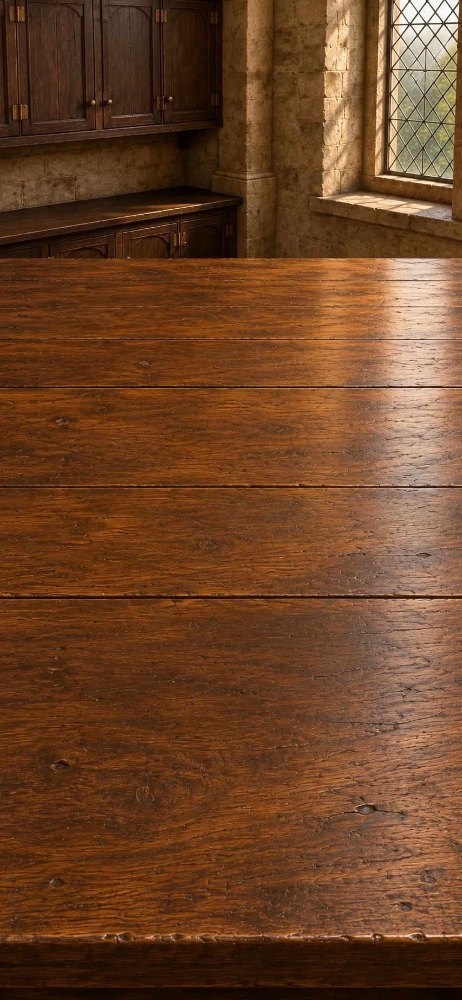

*Harvey and Descartes compared, European inquiry, c. 1628–1637 CE*

Gears can explain a moving figure’s arm. A living body raises a harder question: can the account explain its internal circulation, nourishment and repair too?

**Goals**
- What does a working mechanism explain? -- "Nature investigated through matter and motion"
- How does blood return to the heart? -- "Out through arteries, back through veins"
- next: Does the moving figure count as a living animal? -- "Imitated motion does not establish a living animal"

**Items**
- "Gear diagram: a turning wheel raises a jointed arm"

  An illustrative mechanism links a turning wheel to a rod, which raises and lowers the figure’s arm. Motion is passed through touching parts; no desire to lift the arm is needed.

- "Animals feed, grow and repair themselves"

  Living animals feed, grow and repair themselves. A moving mechanical figure must be compared with more than an animal's outward motion.

- "Heart and valve observations"

  Harvey compares blood driven outward through arteries with vein valves that permit return toward the heart. These are observations of direction, not a view of the complete microscopic circuit.

- "Nature investigated through matter and motion"

  Could a moving arm be explained as a mechanism?

  Linked gears already represent sky cycles. In this invented figure, a turning wheel moves a rod, and the rod raises an arm. Changing the linkage changes the motion.

  Descartes’s broader program asks how far explanations through matter and motion can reach. The figure gives that question a working example.

  *Nature investigated through matter and motion*

- "Out through arteries, back through veins"

  How do separate observations become an account of circulation?

  The earlier animal comparison asked how a part works within a whole. Harvey’s heart observations show blood driven outward through arteries; vein valves permit its return toward the heart.

  Together those directions support circulation. The tiny connections through the tissues remain unseen in this account.

  *Out through arteries, back through veins*

- "Imitated motion does not establish a living animal"

  Does making an arm move amount to making an animal?

  The wheel-and-rod figure copies a movement. A living animal also feeds, grows and repairs itself.

  The mechanism explains the copied motion without yet explaining those other activities or sensation. It offers a useful achievement and a sharper question about what a complete account of life would require.

  *Imitated motion does not establish a living animal*

**Combinations**
- "A sky represented in gears" [preserve] + "Gear diagram: a turning wheel raises a jointed arm" [preserve] -> "Nature investigated through matter and motion"
- "Animals compared by structures and activities" [preserve] + "Heart and valve observations" [preserve] -> "Out through arteries, back through veins"
- "Nature investigated through matter and motion" [preserve] + "Animals feed, grow and repair themselves" [preserve] -> "Imitated motion does not establish a living animal"

> NOTE: Source `descartes`: [Stanford Encyclopedia of Philosophy: Descartes’ Physics](https://plato.stanford.edu/entries/descartes-physics/).

> NOTE: Source `automata`: [Metropolitan Museum: Art in Motion](https://www.metmuseum.org/exhibitions/listings/2019/making-marvels-science-splendor/art-in-motion).

> NOTE: Source `harvey-primary`: [Harvey, chapters IX and XIV, translated primary excerpts](https://bertie.ccsu.edu/naturesci/evolution/unit10background/HarveyNine.html). The circulation account joins outward pumping with return flow; this scene does not reproduce Harvey’s quantitative estimate.

> NOTE: The gear linkage is an authored example, not an attribution to a particular historical automaton. The mechanical account and circulation remain distinct explanatory achievements.

## Motion and gravity

background: 

*Newton, England, 1687 CE*

Newton brings terrestrial and celestial motion into one mathematical inquiry. A stone falls; the Moon keeps curving around Earth. What if sideways motion carried a falling body past the ground?

**Goals**
- Can one account connect falling and orbits? -- `newton-attraction`
- next: What clock does this account assume? -- "One common time for stones and planets"

**Items**
- "A stone falls toward Earth"

  A dropped stone falls toward Earth. Give a body sideways motion: gravity still bends its path downward. With sufficient speed, outside the atmosphere, it can keep missing the ground.

- "Time passes alike everywhere, independently of particular clocks"

  For Newton, time passes alike everywhere, whatever the clocks are doing. A clock can fail to keep that time accurately.

- `newton-attraction` One attraction for Earth and sky
  - from chapter "Protection, consent and resistance": Newton: one attraction for Earth and sky

  Could an orbit be a continuing fall?

  Give a falling body enough sideways speed outside the atmosphere and it can keep missing the ground. An inverse-square attraction connects that curvature with planetary paths: at twice the separation, the same masses attract with one-quarter the force.

  One mathematical account reaches from terrestrial falling to the sky. Quantitative tests must decide how well it works.

  *One attraction for Earth and sky*

- "One common time for stones and planets"

  Does time itself change when a clock moves?

  The same laws of motion describe stones and planets using one common time. A faulty clock can misreport time, but time itself passes alike everywhere in this account.

  That assumption makes distant motions comparable. Whether moving observers must share it becomes a further question.

  *One common time for stones and planets*

**Combinations**
- "An elliptical path for Mars" [preserve] + "A stone falls toward Earth" [preserve] -> `newton-attraction`
- `newton-attraction` [preserve] + "Time passes alike everywhere, independently of particular clocks" [preserve] -> "One common time for stones and planets"

> NOTE: Source `newton-moon-test-primary`: [Isaac Newton, Principia, Book III, Proposition IV and scholium (primary text; printed pp. 391–393)](https://sites.pitt.edu/~jdnorton/teaching/2682_confirmation/2010/Principia_fragments/Principia_Bk3_to_Prop_15.pdf#page=9). The primary passage compares lunar motion with terrestrial falling; this scene gives the qualitative connection without reproducing its numerical test.

## Protection, consent and resistance

background: 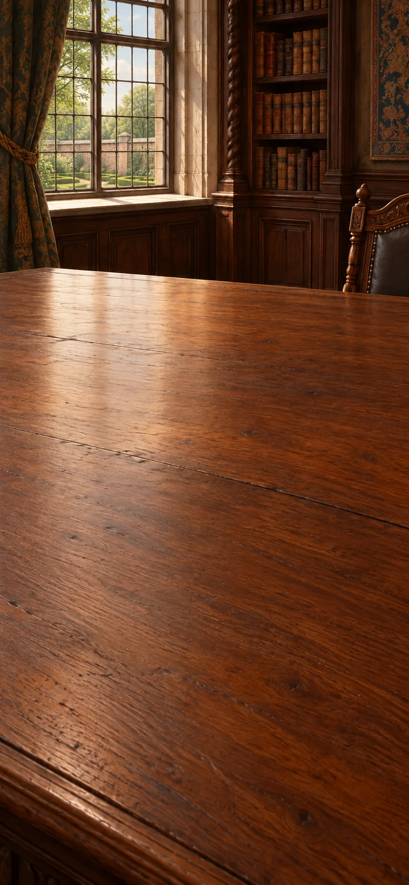

*Hobbes and Locke, England, 1651–1690 CE*

Who can claim obedience, and when may it end? Compare a subject left without protection with a community whose rulers seize property arbitrarily.

**Goals**
- Where does Hobbes place the limit of obedience? -- "Hobbes: lost protection can end obedience"
- How does Locke judge a breach of trust? -- "Locke: breach of trust can justify resistance"

**Items**
- "People authorize one ruler or assembly to act for them"

  In Hobbes’s account, rival private powers cannot reliably secure peace. People covenant with one another to authorize a ruler or assembly; the sovereign is not another party to that covenant.

- "The sovereign can no longer protect a subject"

  Hobbes considers a subject whose sovereign can no longer protect them. The case concerns lost protection, not merely an unpopular decision.

- "Locke: political society requires people’s consent"

  Locke argues that legitimate political society requires consent. That can authorize majority decisions, while the account's practical reach remains open to criticism.

- "A community authorizes majority decisions"

  In this invented case, people agree to form a political community and accept majority decisions. The example assumes that agreement so we can examine what it allows; it does not show that historical populations actually consented.

- "Rulers seize lives, liberties or possessions arbitrarily"

  An illustrative ruler takes a farmer’s harvest for private use, disregarding the community’s settled rules. The complaint concerns arbitrary seizure, not an agreed public tax. Locke treats such acts as violating the trust for which government was established.

- "Hobbes: authorized sovereign power secures peace"

  How could rivals establish a common power?

  The earlier test asked whose interests rulers serve. Hobbes begins from people unable to rely on competing private powers for peace. They covenant with one another to authorize a ruler or assembly.

  A common authority can then enforce peace. The sovereign is not another party signing their covenant; the argument still depends on effective protection.

  *Hobbes: authorized sovereign power secures peace*

- "Hobbes: lost protection can end obedience"

  What remains of obedience when protection disappears?

  For Hobbes, a subject owes obedience because the ruler can provide protection. The ruler can no longer protect the subject.

  If protection is lost, that duty can end. Merely disliking a decision is different: it does not remove the reason for obedience.

  *Hobbes: lost protection can end obedience*

- "Locke: legitimate government rests on consent"

  What does agreeing to form a political community authorize?

  In this invented case, people agree to form a political community and accept majority decisions. Locke’s account treats government as a trust for preserving lives, liberties and possessions.

  Agreeing to government need not give rulers permission to take possessions whenever they wish. The example assumes agreement so we can examine what it allows; it does not show that historical populations actually consented.

  *Locke: legitimate government rests on consent*

- "Locke: breach of trust can justify resistance"

  Has the ruler merely made an unpopular decision?

  The community authorized government to protect lives, liberties and possessions. Its ruler instead seizes a farmer’s harvest for private use, against the settled rules.

  Locke treats that breach of trust as a ground for resistance. The objection concerns arbitrary power, not an agreed public tax; it differs from Hobbes’s loss-of-protection test.

  *Locke: breach of trust can justify resistance*

**Combinations**
- "Judge rulers by whose interests they serve" [preserve] + "People authorize one ruler or assembly to act for them" [transform] -> "Hobbes: authorized sovereign power secures peace"
- "Hobbes: authorized sovereign power secures peace" [preserve] + "The sovereign can no longer protect a subject" [transform] -> "Hobbes: lost protection can end obedience"
- "Locke: political society requires people’s consent" [preserve] + "A community authorizes majority decisions" [transform] -> "Locke: legitimate government rests on consent"
- "Locke: legitimate government rests on consent" [preserve] + "Rulers seize lives, liberties or possessions arbitrarily" [transform] -> "Locke: breach of trust can justify resistance"

> NOTE: Source `civ-hobbes`: [Thomas Hobbes, Leviathan XVII–XVIII and XXI (1651)](https://www.gutenberg.org/files/3207/3207-h/3207-h.htm). Primary text. Authorization is a covenant among subjects, not a contract signed by the sovereign; the sovereign may be a person or assembly.

> NOTE: Source `civ-locke`: [John Locke, Second Treatise §§95–99, 119–122, 221–222 (1689/90)](https://www.gutenberg.org/files/7370/7370-h/7370-h.htm). Primary text. Consent, majority action, tacit consent and breach of trust are disputed arguments, not a history in which everybody actually consented.

## Time and lunar records

background: 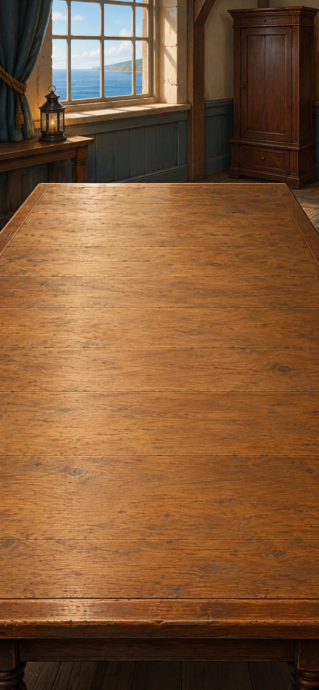

*Navigators, astronomers and Harrison, Atlantic navigation, c. 1714–1770 CE*

A ship needs the time at a known meridian as well as its own local time. Compare the Moon’s changing position with a clock whose performance has been tested at sea.

**Goals**
- Can the Moon supply reference time? -- "A lunar route to longitude"
- Can this clock preserve reference time at sea? -- "Sea-tested reference time"
- next: Use the two times to locate the ship. -- "Longitude from local solar time and reference time"

**Items**
- "New lunar readings and prepared reference-time tables"

  Prepared tables relate the Moon’s measured angular separation from a star to time at a reference meridian. The accompanying local-noon observation supplies the ship’s local time; both are required.

- "A calibrated portable clock set to a reference meridian"

  The clock carries the time at a known meridian. Comparing it with local solar time can locate an east–west difference, but workshop calibration does not establish accuracy through a voyage.

- "Local noon follows the Sun at this place"

  Illustrative worked case: it is noon by the local Sun, while a reliable reference clock reads 14:00. Earth turns through 360 degrees in 24 hours.

- "H4 Barbados trial: about 40 seconds’ error after seven weeks"

  In the 1764 Barbados trial, H4’s calculated error was about forty seconds after roughly seven weeks, after correcting for its known daily gain or loss. The result met the strictest longitude-accuracy requirement. Reproducing that performance with other instruments remained a separate issue.

- "A lunar route to longitude"

  Can the Moon tell a navigator the time elsewhere?

  Dated sky records support tables connecting the Moon’s angular distance from a star with time at a reference meridian. Compare a new measurement with those tables.

  That supplies reference time. Comparing it with the ship’s local solar time gives longitude, provided the observations and corrections are adequate. A clear sky is needed.

  *A lunar route to longitude*

- "Sea-tested reference time"

  Will a clock keep useful reference time during a voyage?

  Workshop calibration cannot establish accuracy at sea. In the 1764 Barbados trial, H4’s calculated error was about forty seconds after roughly seven weeks, after correcting for its known daily gain or loss—about one-sixth of a degree of longitude.

  The result met the strictest prize accuracy requirement. It supports this tested instrument; reproducing its performance and comparing reference time with local time remain necessary.

  *Sea-tested reference time*

- "Longitude from local solar time and reference time"

  Is the ship east or west when local noon arrives at reference time 14:00?

  A reliable sea clock reads 14:00 while the local Sun marks noon. Earth turns 360° in 24 hours, or 15° per hour.

  The two-hour difference is 30°. Local noon arrives later, so the ship lies west of the reference meridian. This invented calculation assumes the relevant solar-time corrections.

  *Longitude from local solar time and reference time*

**Combinations**
- "An archive of planetary motion" [preserve] + "New lunar readings and prepared reference-time tables" [preserve] -> "A lunar route to longitude"
- "A calibrated portable clock set to a reference meridian" [preserve] + "H4 Barbados trial: about 40 seconds’ error after seven weeks" [preserve] -> "Sea-tested reference time"
- "Sea-tested reference time" [preserve] + "Local noon follows the Sun at this place" [preserve] -> "Longitude from local solar time and reference time"

> NOTE: Source `longitude`: [Royal Museums Greenwich: Harrison and longitude](https://www.rmg.co.uk/stories/time/harrisons-clocks-longitude-problem). Chronometers and lunar distances coexisted. Sea trials, cost and reproducibility matter alongside invention.

> NOTE: Source `longitude-lunar-si`: [Smithsonian: Observing the skies — lunar distances](https://timeandnavigation.si.edu/navigating-at-sea/longitude-problem/observing-the-skies). Lunar angle establishes reference time; longitude also requires local time.

> NOTE: Source `almanac-history`: [US Naval Observatory: History of the Nautical Almanac](https://aa.usno.navy.mil/publications/na_history). First data for 1767; mean-time change in 1834.

> NOTE: Source `jaipur`: [UNESCO: The Jantar Mantar, Jaipur](https://whc.unesco.org/en/list/1338).

> NOTE: Source `longitude-harrison-trial-record`: [Royal Museums Greenwich: Harrison’s 1765 account, BGN/14](https://www.rmg.co.uk/collections/objects/rmgc-object-478825). Museum catalogue identifies a surviving contemporary pamphlet advocating Harrison’s reward after H4 trials. The game paraphrases a documented report; it does not invent a voyage performed at this desk.

> NOTE: The rounded H4 result and declared rate correction follow [Michael A. Lombardi, NIST, history of timekeeping, p. 50](https://tf.nist.gov/general/pdf/2533.pdf). The arithmetic converts about 40 seconds of time into about 1/6° of longitude.

> NOTE: Source `longitude-h4-trial-history`: [Royal Museums Greenwich: Harrison’s timekeepers and trials](https://www.rmg.co.uk/stories/time/harrisons-clocks-longitude-problem). Confirms the 1764 Barbados trial, the result considered in 1765, and continued dispute/testing. A successful trial is not a guarantee for every clock or final closure of the controversy.

> NOTE: The two-hour/30-degree case is authored arithmetic, not a historical H4 trial observation. It uses the same local/reference-time relation as the lunar method; it does not replace the observational corrections needed in navigation.

## The Jaipur observatory

background: 

*Jai Singh’s astronomical enterprise, Jaipur, early eighteenth century*

Jaipur brings Indian and Islamic astronomical traditions into work with large masonry instruments. The earlier demand to examine inherited astronomy now meets a measurement. Compare these invented records for the same star, site and marked time.

**Goals**
- Do the table and sightline readings agree? -- "A table and the sightline readings disagree"

**Items**
- "Illustrative table: star altitude 40.0°"

  The table predicts the star’s angle above the horizon at the marked time and site. This value is authored, not a historical Jaipur prediction.

- "Repeated fixed-sightline readings: 41.8°, 42.0°, 42.2°"

  These invented repeated trials match the table’s star, site and marked time. Their small spread measures repeatability; shared alignment or timing error could remain.

- "A table and the sightline readings disagree"

  Is the difference just the scatter among repeated readings?

  For the same star, place and marked time, the invented table predicts 40°. Readings of 41.8°, 42.0° and 42.2° cluster near 42°, with only 0.2° spread either side.

  The 2° mismatch calls for checking the table, alignment and timing. Repeatability alone cannot exclude an error shared by every reading.

  *A table and the sightline readings disagree*

**Combinations**
- "Illustrative table: star altitude 40.0°" [transform] + "Repeated fixed-sightline readings: 41.8°, 42.0°, 42.2°" [transform] -> "A table and the sightline readings disagree"

> NOTE: Institutional setting and instruments: [UNESCO, Jantar Mantar](https://whc.unesco.org/en/list/1338). All numerical records are authored illustrations, not historical measurements or claims of actual instrument accuracy. This compares practices across traditions, not direct descent from the game’s earlier paper.

## Public knowledge table

background: 

*Enlightenment editors, artisans and readers, Europe, c. 1750–1792 CE*

A loom engraving explains a craft; its references lead into mechanics. A published argument also acquires readers who can object to it.

**Goals**
- Can a reader follow the connection between craft and explanation? -- "Knowledge joined by cross-reference"
- Who can challenge a public argument? -- "A weaver’s objection exposes what the diagram omits"

**Items**
- "Loom engraving with references to motion and weaving"

  An illustrative reference page shows how the loom’s parts move and points to articles explaining weaving and motion. The links offer routes between practical making and theoretical accounts.

- "A weaver objects: the diagram omits the broken thread"

  In this invented exchange, the published loom diagram suggests an uninterrupted weave. A weaver points out that a broken thread would leave a gap. Practical experience supplies a specific objection that the author must answer.

- "Knowledge joined by cross-reference"

  Where can a loom illustration lead a curious reader?

  The invented reference page shows moving parts and links them to accounts of weaving and motion. A printed edition lets readers follow those connections between craft and explanation.

  Knowledge need not arrive in one prescribed order. Cross-references offer routes through it, though licensing and access still shape who can follow them.

  *Knowledge joined by cross-reference*

- "A weaver’s objection exposes what the diagram omits"

  What can a working weaver notice that a published diagram omits?

  The invented diagram suggests an uninterrupted weave. A weaver points to a broken thread that would leave a gap. This is a concrete objection requiring a reply.

  Publication lets practical experience challenge an account beyond its original scholarly audience. A wider public adds possible critics; it does not give everyone equal power to be heard.

  *A weaver’s objection exposes what the diagram omits*

**Combinations**
- "Permission to print can hide a disputed reading" [preserve] + "Loom engraving with references to motion and weaving" [preserve] -> "Knowledge joined by cross-reference"
- "A reply must answer the objection" [preserve] + "A weaver objects: the diagram omits the broken thread" [preserve] -> "A weaver’s objection exposes what the diagram omits"

> NOTE: Source `encyclopedie`: [University of Chicago ARTFL Encyclopédie](https://encyclopedie.uchicago.edu/).

> NOTE: Source `hume`: [Stanford Encyclopedia of Philosophy: David Hume](https://plato.stanford.edu/entries/hume/).

> NOTE: Source `kant`: [Stanford Encyclopedia of Philosophy: Immanuel Kant](https://plato.stanford.edu/entries/kant/).

> NOTE: Source `wollstonecraft`: [Mary Wollstonecraft, A Vindication of the Rights of Woman](https://www.gutenberg.org/ebooks/3420).

> NOTE: The loom page, its exact links and the weaver’s broken-thread objection are authored illustrations of craft knowledge and public criticism, not a transcription of an identified Encyclopédie article.

## Experience and expectation

background: 

*Hume and Kant compared, Scotland and Prussia, c. 1748–1783 CE*

Hume asks why the future should resemble the past; Kant asks how experience can tell us about events beyond our own perceptions. Does agreement between workshops guarantee tomorrow’s result?

**Goals**
- Does repetition guarantee the next case? -- "Past success does not guarantee the next case"
- next: What is added when we judge one event to cause another? -- "Kant: the mind helps structure experience"

**Items**
- "Repeated sequence does not show necessity"

  Hume asks why repeatedly seeing one event follow another should prove that the connection is necessary. The repeated sequence is visible; necessity is not.

- "Sun on a stone; then a warmer stone"

  Kant distinguishes noticing sunshine followed by warmth from judging that the Sun warms the stone. The second claim says that one event brings about another, whatever order someone notices them in.

- "Past success does not guarantee the next case"

  Does agreement between workshops guarantee tomorrow’s result?

  Both workshops found that rubbing warmed the wood while the untouched comparison stayed cool. Those reports establish what happened in the trials.

  Hume asks why those past results should hold for cases nobody has yet observed. Repetition supports an expectation without logically proving the next result.

  *Past success does not guarantee the next case*

- "Kant: the mind helps structure experience"

  What changes between “sunshine, then warmth” and “sunshine warms the stone”?

  Repeated observations alone do not show why one event must follow another: that is Hume’s problem. Kant asks what lets us distinguish the order in which we notice things from the order of cause and effect. We might notice the stone’s warmth first, but that would not make the warmth cause the sunshine.

  For Kant, understanding events requires the mind to use rules of cause and effect, beyond simply recording what someone sees or feels. Which cause explains this event still needs investigation.

  *Kant: the mind helps structure experience*

**Combinations**
- "The heat comparison crosses workshops" [preserve] + "Repeated sequence does not show necessity" [preserve] -> "Past success does not guarantee the next case"
- "Past success does not guarantee the next case" [preserve] + "Sun on a stone; then a warmer stone" [preserve] -> "Kant: the mind helps structure experience"

> NOTE: Kant’s worked example: [Prolegomena, §§19–20 and note](https://www.gutenberg.org/cache/epub/52821/pg52821-images.html). The illustration paraphrases his distinction; the stone is not a modern experimental proof of transcendental idealism.

## Rights declarations

background: 

*Rights advocates and those excluded, Atlantic world, late eighteenth century*

A claim of universal rights reaches women denied education and enslaved people denied freedom. Their demands test whether the word “universal” does any work.

**Goals**
- Do universal rights include women? -- "Universal reason must include women"
- Can universal liberty coexist with slavery? -- "Universal liberty confronts enslavement"

**Items**
- "Rights proclaimed universal"

  The declaration claims rights for everyone. Its claim must be compared with who actually receives those rights.

- "Women denied the education invoked for equality"

  Women are denied education while reason is used to justify equality. Wollstonecraft challenges that exclusion from the principle.

- "Enslaved people describe their denied freedom"

  Enslaved people describe the freedom denied to them and act against their enslavement. What they suffer and what they do challenge the claim that everyone is already free.

- "A claim to rights beyond inherited rank"

  Could a person have rights without inherited status?

  Concern for strangers reaches beyond citizenship; government by consent requires people’s agreement rather than inherited power alone. A universal-rights declaration makes a further claim: rights belong to people beyond inherited rank.

  That claim must answer for everyone it excludes. The earlier arguments offer routes into the question; neither alone establishes the whole declaration.

  *A claim to rights beyond inherited rank*

- "Universal reason must include women"

  Can education be withheld and its absence then used to justify inequality?

  The declaration invokes universal reason. Women are denied the education through which reasoning abilities develop.

  Wollstonecraft turns the stated principle against that exclusion: unequal opportunity cannot simply serve as evidence of natural incapacity. A universal claim has consequences for how people are educated and treated.

  *Universal reason must include women*

- "Universal liberty confronts enslavement"

  Whose testimony tests a declaration of universal liberty?

  The declaration claims liberty beyond inherited privilege. Enslaved people describe their denied freedom and act against the institution denying it.

  Their testimony and action expose a contradiction between the universal claim and actual arrangements. They also make freedom a demand that those arrangements must answer.

  *Universal liberty confronts enslavement*

**Combinations**
- "Fellowship beyond one city" [preserve] + "Rights proclaimed universal" [preserve] -> "A claim to rights beyond inherited rank"
- "Locke: legitimate government rests on consent" [preserve] + "Rights proclaimed universal" [preserve] -> "A claim to rights beyond inherited rank"
- "A claim to rights beyond inherited rank" [preserve] + "Women denied the education invoked for equality" [preserve] -> "Universal reason must include women"
- "A claim to rights beyond inherited rank" [preserve] + "Enslaved people describe their denied freedom" [preserve] -> "Universal liberty confronts enslavement"

## Prosperity and the maker

background: 

*Mandeville and Smith, Britain, c. 1714–1776 CE*

Mandeville provokes readers by connecting condemned motives with prosperous trades; Smith examines how divided labour raises output. A busy workshop’s accounts leave another question open: what sort of day does its maker have?

**Goals**
- Does prosperity supply a good life? -- "Prosperity and a good life can diverge"
- What changes when production is divided? -- "Production divided into specialized tasks"
- next: What does this arrangement do to the worker? -- "The maker is more than the output"

**Items**
- "Status-seeking buyers support luxury trades; workers lose their evenings"

  In this invented workshop, buyers seeking status order elaborate clothes, supporting artisans’ incomes but taking away their evenings together. Mandeville asks how motives condemned as vanity can support prosperous trades; the case also asks what that prosperity costs.

- "Pin-making account: repeated tasks"

  Smith divides pin-making among drawing wire, cutting it, sharpening it and other repeated tasks. The account explains increased output through organization as well as equipment.

- "Specialists trade what they make"

  Specialists exchange what they make for things made by others. Trade connects their separate tasks.

- "Repeating one task can narrow a worker’s powers"

  A worker who only points pins does not practise planning the whole job or deciding how to change it. Smith worries about the narrowing effects of extreme specialization and discusses education as a response.

- "Prosperity and a good life can diverge"

  Could vanity support prosperity without securing a good life?

  Status-seeking buyers order elaborate clothes in this invented workshop. Their vanity supports artisans’ incomes: a concrete version of Mandeville’s provocative connection between condemned motives and prosperous trades.

  But the workers lose evenings with friends. Epicurus’s emphasis on friendship and having enough makes that loss matter. More trade and income need not supply the life people value.

  *Prosperity and a good life can diverge*

- "Production divided into specialized tasks"

  How can organizing work increase output?

  In Smith’s pin-making account, different workers draw wire, cut it and sharpen it instead of each making whole pins. Specialization reduces changes between tasks and develops practiced skills.

  Exchange connects specialized work with other needs. Output can rise through organization as well as better machinery, while dependence on others also grows.

  *Production divided into specialized tasks*

- "The maker is more than the output"

  What does the pin count leave out?

  Dividing production raises output, but someone who only points pins has little practice planning the whole job or changing it. Smith identifies a cost to the worker’s developed abilities.

  Education and opportunities for broader judgment address something production totals cannot measure. More goods and fuller human powers are distinct achievements.

  *The maker is more than the output*

**Combinations**
- "Status-seeking buyers support luxury trades; workers lose their evenings" [preserve] + "Pleasure in friendship and having enough" [preserve] -> "Prosperity and a good life can diverge"
- "Pin-making account: repeated tasks" [preserve] + "Specialists trade what they make" [preserve] -> "Production divided into specialized tasks"
- "Production divided into specialized tasks" [preserve] + "Repeating one task can narrow a worker’s powers" [preserve] -> "The maker is more than the output"

> NOTE: Source `mandeville`: [Stanford Encyclopedia of Philosophy: Bernard Mandeville](https://plato.stanford.edu/entries/mandeville/); [The Grumbling Hive, primary text](https://englishphilosophy.org/mandeville/fb/gh). The status-seeking clothing buyers are an authored illustration of vanity supporting trade, not a reported workshop.

> NOTE: Source `smith`: [Adam Smith, The Wealth of Nations](https://www.gutenberg.org/ebooks/3300).

> NOTE: Source `malthus`: [Thomas Malthus: Essay on the Principle of Population, 1798](https://www.econlib.org/library/Malthus/malPop.html). The ratios are Malthus’s argumentative model, not a universal empirical law or moral instruction.

> NOTE: Source `morris`: [William Morris Archive: Useful Work versus Useless Toil](https://morrisarchive.lib.uiowa.edu/items/show/1872).

> NOTE: The luxury workshop is authored, not Mandeville’s reported evidence. Pin-making and the narrowing/education argument follow Smith, [Wealth of Nations, I.i and V.i](https://www.gutenberg.org/files/3300/3300-h/3300-h.htm).

## Trade and scarcity

background: 

*Atlantic commerce and Malthus’s population argument, eighteenth and nineteenth centuries*

Improved navigation carries goods across oceans, but a route chart cannot tell whether their producers were free. A population argument raises a different limit on prosperity.

**Goals**
- Whose labour lies behind the cargo? -- "Exchange entangled with coercion"
- What follows when potential increase exceeds food? -- "More offspring than the food supply can support"

**Items**
- "Sugar cargo record: plantation labour was coerced"

  This illustrative cargo record specifies that the sugar was produced through coerced plantation labour. Knowing where a vessel travels does not reveal how its cargo was made.

- "Population may grow faster than its food supply"

  Malthus argues that population can grow faster than its food supply. This proposed pressure is not an identical, unavoidable fate for every society.

- "Food and access can become limiting"

  People can lack food because too little is produced or because they cannot obtain it. These are different problems.

- "More offspring than the food supply can support"

  What could limit a population’s increase?

  Malthus argues that a population can increase faster than its food supply. People may go hungry because too little food is grown or because they cannot obtain the food that exists.

  That pressure raises questions about survival and reproduction, later taken up by Darwin and Wallace. It is neither a universal numerical law nor a rule deciding who deserves food.

  *More offspring than the food supply can support*

- "Exchange entangled with coercion"

  Does a useful trade route tell us how its cargo was produced?

  The navigational chart helps a vessel follow its route. This invented cargo record adds that its sugar came from coerced plantation labour.

  Consumers and producers are connected, but on unequal terms. Navigation explains how goods travel; the labour record reveals the lack of freedom supporting this exchange.

  *Exchange entangled with coercion*

**Combinations**
- "A chart made for compass bearings" [preserve] + "Sugar cargo record: plantation labour was coerced" [preserve] -> "Exchange entangled with coercion"
- "Population may grow faster than its food supply" [preserve] + "Food and access can become limiting" [preserve] -> "More offspring than the food supply can support"

> NOTE: The cargo record is an authored case, not a claimed archival shipment. The historical link between plantation commodities and coerced labour is retained from the earlier manuscript.

## Emancipation and work

background: 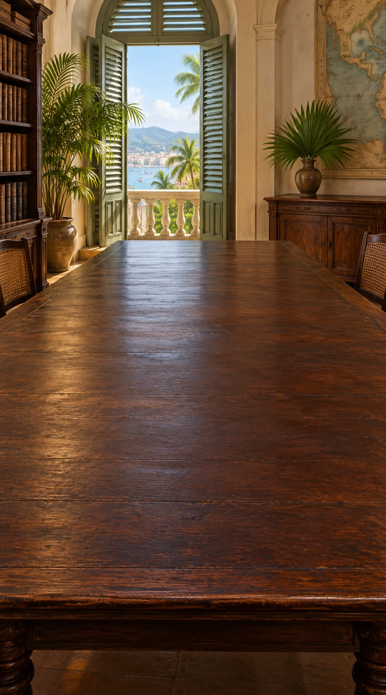

*Insurgents, legislators and workers, Saint-Domingue and Haiti, 1791–1804 CE*

Enslaved people’s uprising makes freedom a political demand. Follow abolition into law, then ask what the law permits a plantation worker to choose.

**Goals**
- How does emancipation become law? -- "Emancipation becomes law amid revolution"
- next: Does abolition also free the worker’s choice? -- "Abolition coexists with coercive labour"
- Is emancipation the same as independence? -- "An independent state defends emancipation"

**Items**
- "1791: enslaved people rise against plantation slavery"

  In 1791, enslaved people rise against plantation slavery in Saint-Domingue. Their action changes the political situation; emancipation is not merely an idea sent from Europe.

- "1793–1794: colonial and French decrees abolish slavery"

  Decrees in 1793–1794 abolish slavery amid uprising, war and political pressure. A legal change does not mean immediate, uniform enforcement.

- "1801 constitution: slavery ends, but farm workers cannot freely move away"

  Article 3 prohibits slavery. Articles 14–16 require plantation work to continue under an owner’s direction and allow police rules to stop farm workers moving away. Being legally free does not give them an unrestricted choice to leave.

- "1804: after defeating reconquest, Haiti declares independence"

  After defeating French reconquest, Haiti declares independence in 1804. Independence was fought for and did not immediately create equal power for everyone.

- "Insurgents make freedom a political demand"

  Who turns the contradiction of slavery and liberty into political action?

  Universal liberty conflicts with enslavement. In Saint-Domingue in 1791, enslaved people rise against plantation slavery.

  Their action changes what authorities must confront. Emancipation is pursued by people demanding their own freedom, not merely delivered as a European idea.

  *Insurgents make freedom a political demand*

- "Emancipation becomes law amid revolution"

  How does a demand for freedom change legal status?

  Uprising, war and political pressure transform Saint-Domingue. Colonial abolition decrees in 1793 and the French decree in 1794 make emancipation law.

  That legal change is substantial. How it is enforced, and what daily freedom permits, remain questions for the revolutionary society.

  *Emancipation becomes law amid revolution*

- "Abolition coexists with coercive labour"

  Can slavery be abolished while workers remain bound to plantations?

  The 1801 constitution prohibits slavery, but also allows police rules to stop farm workers moving away. Plantation production must continue under the owner’s direction.

  Legal freedom from slavery has not become freedom to leave the plantation. The restriction limits emancipation without erasing the change in legal status.

  *Abolition coexists with coercive labour*

- "An independent state defends emancipation"

  Is freedom from slavery the same as independence from France?

  Abolition changed people’s status within a contested colonial order. After defeating reconquest, Haiti declares independence in 1804.

  The new state breaks France’s claim to rule and defends emancipation. Independence does not automatically end every coercive labour arrangement or secure recognition by other states.

  *An independent state defends emancipation*

**Combinations**
- "Universal liberty confronts enslavement" [preserve] + "1791: enslaved people rise against plantation slavery" [preserve] -> "Insurgents make freedom a political demand"
- "Insurgents make freedom a political demand" [preserve] + "1793–1794: colonial and French decrees abolish slavery" [preserve] -> "Emancipation becomes law amid revolution"
- "Emancipation becomes law amid revolution" [preserve] + "1801 constitution: slavery ends, but farm workers cannot freely move away" [preserve] -> "Abolition coexists with coercive labour"
- "Emancipation becomes law amid revolution" [preserve] + "1804: after defeating reconquest, Haiti declares independence" [preserve] -> "An independent state defends emancipation"

> NOTE: Source `civ-abolition-chronology`: [Mémorial de l’abolition de l’esclavage, chronology of abolition](https://memorial.nantes.fr/chronologie-des-abolitions/). Institutional chronology: 1791 uprising, local abolition in 1793, national extension in February 1794. Precise local sequences were not collapsed to one decree.

> NOTE: Source `civ-haiti-archive`: [Library of Congress / Bibliothèque Haïtienne des Pères du Saint-Esprit: Laws of Saint-Domingue (1801)](https://www.loc.gov/resource/gdcwdl.wdl_14719/?st=gallery). Primary printed law collection and archival catalogue; agency and institutions are not reduced to European pamphlets.

> NOTE: Source `civ-haiti-context`: [BnF, Haiti’s independence debt: archival context, 1794–1922](https://heritage.bnf.fr/france-ameriques/en/haitis-independence-debt-slave-unit-account-1794-1922). Institutional historical account. Independence in 1804; recognition and coercive indemnity came later, not automatic equal standing.

> NOTE: Source `civ-haiti-1801`: [Constitution of Saint-Domingue, 1801, arts.1–5, 14–16, 28](https://www.marxists.org/history/haiti/1801/constitution.htm). Primary document in translation. Abolition, French sovereignty, compulsory agricultural continuity and life governorship coexist.

> NOTE: Source `civ-haiti-declaration`: [Haitian Declaration of Independence (1804), Dubois/Garrigus translation](https://declarationproject.org/?p=210). Primary declaration; permanent separation from France is not a promise of equal power or an end to coercive labour.

## Rock histories

background: 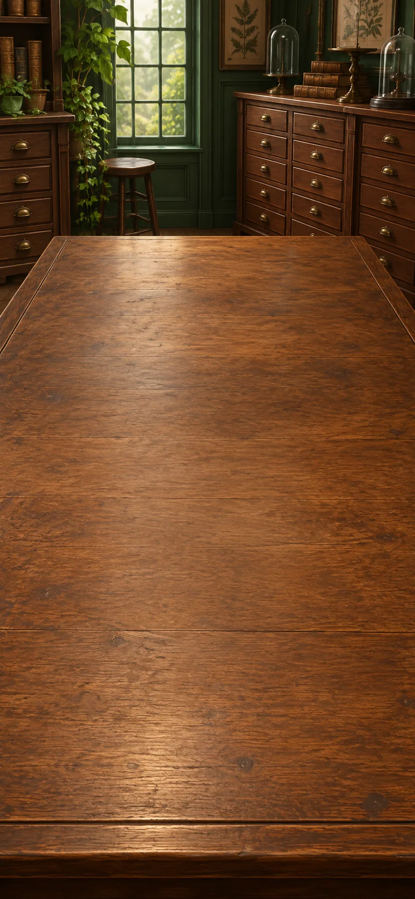

*Hutton and stratigraphers, Britain, late eighteenth and early nineteenth centuries*

Two outcrops repeat a fossil sequence. At another site, steep old beds end beneath much flatter younger beds: the rocks preserve events, but where is their clock?

**Goals**
- Can separated beds be compared? -- "Matching fossils connect separate rock beds"
- next: Reconstruct the episodes before the younger beds. -- "Sequence is not duration"

**Items**
- "Two outcrops: shell A below shell B"

  An authored simplified record shows the same distinct fossil succession at two undisturbed outcrops: shell A below shell B. Fossils are remains of former life; matching successions can correlate beds, while missing layers need attention.

- "Streams deposit sediment; older beds are tilted and truncated"

  Present streams carry and deposit sediment. At the outcrop, older sedimentary beds stand steeply and end at an erosion surface below younger, gently inclined beds.

- "Matching fossils connect separate rock beds"

  Can fossils connect rock beds at different places?

  Comparing structures distinguishes fossil shell A from shell B. At both invented undisturbed outcrops, A occurs below B.

  Finding A below B at both places supports matching the layers in the same order. Similar-looking rock alone would be weaker evidence. The match still supplies no age in years, and missing layers require attention.

  *Matching fossils connect separate rock beds*

- "Sequence is not duration"

  What happened before the younger beds were laid down?

  Streams show how sediment accumulates. At this outcrop, steep older beds end at an erosion surface beneath younger, gently inclined beds.

  Older sediment formed and hardened, then tilted, became exposed and eroded; younger sediment followed. Hutton argues that Earth’s history allows time for all these changes, but their order alone cannot tell us how many years passed.

  *Sequence is not duration*

**Combinations**
- "Animals compared by structures and activities" [preserve] + "Two outcrops: shell A below shell B" [preserve] -> "Matching fossils connect separate rock beds"
- "Matching fossils connect separate rock beds" [preserve] + "Streams deposit sediment; older beds are tilted and truncated" [preserve] -> "Sequence is not duration"

> NOTE: Source `hutton`: [Siccar Point: geological evidence and Hutton](https://iugs-geoheritage.org/geoheritage_sites/siccar-point/). Hutton used an unconformity to support an existing account of repeated geological processes; one scene does not establish every feature of his theory.

> NOTE: Source `deep-time`: [US Geological Survey: Geologic Time](https://pubs.usgs.gov/gip/geotime/).

> NOTE: Source `lyell-darwin`: [Darwin Correspondence Project: Charles Lyell](https://darwin-editorial.darwinproject.ac.uk/charles-lyell). Documented geological influence with continuing disagreement, not blanket acceptance.

> NOTE: Source `geologic-age-modern`: [USGS: Geologic Time, Then and Now](https://www.usgs.gov/news/powell-expedition-geologic-time-then-and-now).

> NOTE: The A/B outcrops are authored illustrations of [USGS fossil succession](https://pubs.usgs.gov/gip/fossils/succession.html). The multi-episode unconformity follows [IUGS, Siccar Point](https://iugs-geoheritage.org/geoheritage_sites/siccar-point/). One comparison does not establish every aspect of Hutton’s theory.

## Naturalists’ notebooks

background: 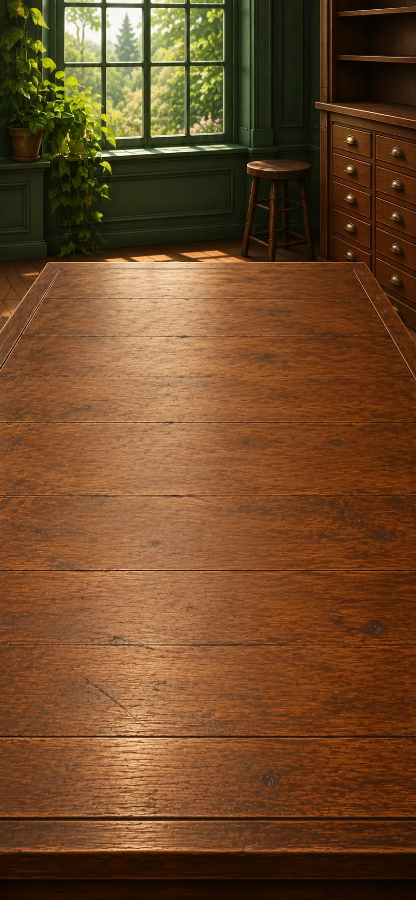

*Linnaeus, Humboldt and Lamarck; Sweden, the Andes and France; c. 1735–1809 CE*

Linnaeus makes names comparable; Humboldt connects plants with their surroundings; Lamarck proposes changing histories for living kinds. What can matched records on two mountain slopes reveal—and what would explain the pattern?

**Goals**
- Compare life across places. -- "Life patterned by place and conditions"
- What could make a living kind change? -- `species-history`

**Items**
- "Linnaeus gives each species a two-part name"

  Linnaeus's two-part species names make comparisons easier. Useful naming does not make every part of his classification, including his racial hierarchy, true or acceptable.

- "On both slopes: plant A at 500 m, plant B at 2,000 m"

  Invented records use the same species names on two slopes. On each, plant A occurs near 500 metres and plant B near 2,000 metres. Height, temperature and other conditions vary together; these are not Humboldt’s measurements.

- "Lamarck: altered habits and changed organs"

  For animals, Lamarck proposes that changed circumstances alter habits, use and disuse change organs, and acquired changes pass to offspring. He describes environmental effects on plants differently, without attributing habits to them. These are historical mechanisms to assess.

- "Comparable names for living kinds"

  How can two naturalists tell whether their records concern the same kind?

  Comparing structures helps distinguish organisms. Linnaeus’s shared two-part species names let naturalists connect records under a common designation.

  Names make investigation easier without settling every classification. The categories remain open to revision; a useful naming system does not validate Linnaeus’s racial hierarchy.

  *Comparable names for living kinds*

- "Life patterned by place and conditions"

  Do the plant records follow a pattern across slopes?

  Shared names make the invented records comparable: plant A occurs near 500 metres and plant B near 2,000 metres on each of two slopes.

  The repeated pattern connects kinds of plants with their surroundings, as in Humboldt’s geographical inquiry. Height, temperature and other conditions vary together; these records alone do not isolate a cause.

  *Life patterned by place and conditions*

- `species-history` Acquired changes might pass to descendants
  - from chapter `descent-inheritance`: Lamarck: acquired changes can pass to descendants

  Could changed surroundings alter living kinds across generations?

  Plant geography raises a question about organisms and their conditions. Lamarck proposes inherited changes, but distinguishes plants from animals: for animals, changed circumstances alter habits, use and disuse change organs, and acquired changes pass to offspring.

  On this proposal, what an animal does during its life can change the bodies of its descendants. Its inheritance claim needs testing; the plant pattern does not establish it.

  *Acquired changes might pass to descendants*

**Combinations**
- "Animals compared by structures and activities" [preserve] + "Linnaeus gives each species a two-part name" [preserve] -> "Comparable names for living kinds"
- "Comparable names for living kinds" [preserve] + "On both slopes: plant A at 500 m, plant B at 2,000 m" [preserve] -> "Life patterned by place and conditions"
- "Life patterned by place and conditions" [preserve] + "Lamarck: altered habits and changed organs" [preserve] -> `species-history`

> NOTE: Source `linnaeus`: [The Linnean Society: Linnaeus and race](https://www.linnean.org/learning/who-was-linnaeus/linnaeus-and-race).

> NOTE: Source `humboldt`: [Nature Ecology & Evolution: Humboldt’s legacy](https://www.nature.com/articles/s41559-019-0980-5); [Smithsonian, Humboldt and Bonpland’s plant-geography chart](https://americanart.si.edu/exhibitions/humboldt/online/alexander-von-humboldt-bonpland). The two-slope A/B records and elevations are invented teaching data, not measurements by either naturalist.

> NOTE: [Lamarck, Zoological Philosophy, I.1 ch.7](https://web.viu.ca/johnstoi/lamarck/lamarck7.htm) distinguishes plants’ environmental responses from animals’ habits and use/disuse. Plant geography motivates comparison; it does not demonstrate his animal mechanism.

> NOTE: Source `darwin-selection`: [Darwin Correspondence Project: Natural selection](https://darwin-editorial.darwinproject.ac.uk/commentary/evolution/natural-selection).

> NOTE: Source `darwin-malthus`: [A. R. Wallace to Darwin, 9 July 1881, Darwin Correspondence Project](https://www.darwinproject.ac.uk/view/letters/DCP-LETT-13238).

> NOTE: Source `darwin-origin-wolves-primary`: [Darwin, On the Origin of Species (1859), IV, pp.90–91 and 95–96: imaginary wolf/prey example and accumulation over time](https://darwin-online.org.uk/converted/published/1859_Origin_F373/1859_Origin_F373.html). Primary text. Darwin explicitly labels the wolf/prey illustration imaginary and requires retention of other needed abilities. The later twenty-family example is an authored simplification, not Darwin’s wolf illustration or recorded data.

> NOTE: Source `wallace-varieties-primary`: [Wallace, On the Tendency of Varieties to depart indefinitely from the Original Type (1858), pp.53–62, in the joint Darwin–Wallace publication](https://darwin-online.org.uk/converted/published/1858_species_F350.html). Primary text: opening challenge to inferred permanent natural bounds (pp.53–54), domestic/wild contrast and conclusion (pp.60–62); introductory letter records independent work. The authored population counts are not taken from this source; its caricature of Lamarck is not adopted.

## `descent-inheritance` Selection and inheritance

background: 

*Darwin and Wallace, Britain and the Malay Archipelago, 1858–1859 CE*

Resource pressure is not enough: inherited differences must affect descendants. Follow a small illustrative population, then carry forward the problem its arithmetic cannot answer—how inheritance works.

**Goals**
- Which inherited difference becomes more common? -- "Unequal reproduction changes a population"
- next: Compare histories and mechanisms of change. -- "Changing species, different accounts of how"
- What remains unexplained about heredity? -- "Cumulative evolution with heredity still unresolved"

**Items**
- "Inherited variants: ten families leave thirty young, ten leave ten"

  An authored simplified population has twenty families: ten carry variant A, ten variant B. Under the stated conditions, the A families leave thirty surviving young and the B families ten; each young inherits its family’s variant. Other needed abilities are held equal.

- "Island species resemble nearby mainland species"

  Island species often resemble species on nearby mainlands. Their geographical relationships need an explanation as well as names.

- "How are differences transmitted without blending away?"

  How do inherited differences persist rather than blend away each generation? This remained a serious problem for nineteenth-century evolutionary accounts.

- "Unequal reproduction changes a population"

  Which variant becomes more common?

  Limited resources make reproduction consequential, but scarcity alone does not select a variant. In the invented population, ten A families leave thirty surviving young; ten B families leave ten. Each young inherits its family’s variant.

  A rises from half the families to three-quarters of the young. Inherited differences and unequal reproduction together explain the change.

  *Unequal reproduction changes a population*

- "Selection can reshape life across deep time"

  What could repeated changes amount to over a long history?

  The toy population changes in one generation. Rock sequences reveal a history containing many episodes before the present.

  A deep past allows heritable changes to accumulate across many generations. Geological time opens that possibility; it does not by itself prove selection or identify any organism’s ancestors.

  *Selection can reshape life across deep time*

- "Resemblance can record shared descent"

  Why might an island’s species resemble those of a nearby mainland?

  Heritable changes can accumulate over a long history. The geographical resemblance fits a further proposal: populations reached the island from nearby land and diverged over generations.

  Descent with modification can explain relationship as well as difference. The distribution supplies historical evidence beyond the toy population’s arithmetic.

  *Resemblance can record shared descent*

- "Changing species, different accounts of how"

  Do accounts of changing species propose the same mechanism?

  Descent with modification makes resemblance part of a branching history. For animals, Lamarck links changed habits and organs with inheritance of acquired changes; natural selection concerns inherited differences affecting reproduction.

  Those mechanisms differ. Historical theories need not be wholly exclusive: Darwin also accepted inherited effects of use and disuse.

  *Changing species, different accounts of how*

- "Cumulative evolution with heredity still unresolved"

  What did the population calculation assume rather than explain?

  An inherited variant became more common because its carriers left more surviving young. The calculation assumed that offspring received the variant without changing it.

  If inheritance simply blended differences away, how could selection preserve and accumulate them? A mechanism of inheritance remains missing from the nineteenth-century account.

  *Cumulative evolution with heredity still unresolved*

**Combinations**
- "More offspring than the food supply can support" [preserve] + "Inherited variants: ten families leave thirty young, ten leave ten" [transform] -> "Unequal reproduction changes a population"
- "Unequal reproduction changes a population" [preserve] + "Sequence is not duration" [preserve] -> "Selection can reshape life across deep time"
- "Selection can reshape life across deep time" [preserve] + "Island species resemble nearby mainland species" [transform] -> "Resemblance can record shared descent"
- "Resemblance can record shared descent" [preserve] + `species-history` [preserve] -> "Changing species, different accounts of how"
- "Unequal reproduction changes a population" [preserve] + "How are differences transmitted without blending away?" [transform] -> "Cumulative evolution with heredity still unresolved"

> NOTE: The twenty-family arithmetic, exact inheritance and held-equal conditions are authored simplifications, not historical observations. Darwin and Wallace supply the distinction between heritable variation, resource pressure and differential reproduction; no Mendelian mechanism is smuggled into their account.

## Industry, cooperation and control

background: 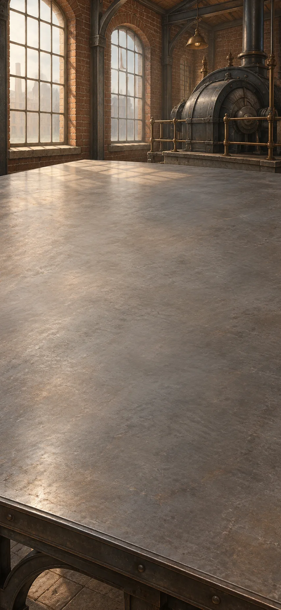

*Marx, Morris and Kropotkin compared, Europe, c. 1844–1902 CE*

Marx examines power over work, Kropotkin investigates cooperation, and Morris asks what makes work worth doing. A powered workshop can produce more while consuming fuel and taking decisions away from its workers.

**Goals**
- What keeps the machinery running? -- "Powered factories depend on continuing fuel supplies"
- next: Does survival exclude mutual aid? -- "Mutual aid belongs inside the question of survival"
- Whose decisions does the machine replace? -- "Mechanized effort can deepen lost control"
- next: What would make useful work worth doing? -- "Useful work need not erase the maker"

**Items**
- "Factory account: power stops when coal deliveries stop"

  An illustrative account records powered production while coal arrives and halted machinery after a missed delivery. The engine’s output depends on extraction and transport beyond the workshop.

- "Kropotkin: birds warn their feeding companions"

  Kropotkin collects accounts of animals warning or defending one another. Cooperation can contribute to survival alongside competition; a descriptive example does not dictate a political constitution.

- `wage-owner` Workers sell labour; owners control the product

  Workers sell their labour while owners control what is produced. The question concerns power over work, not merely personal satisfaction.

- "A labour-saving machine dictates the worker’s pace"

  A machine can save effort while setting the worker's pace. Less physical work does not necessarily mean more control.

- "Morris: pleasure in making matters"

  Morris argues that useful work should also offer pleasure in making. His criticism does not simply reject every machine.

- "Powered factories depend on continuing fuel supplies"

  What keeps the productive workshop running?

  Specialized tasks organize production. In this invented factory, machinery increases output while coal arrives, then stops when a delivery fails.

  Productivity depends on extraction and transport beyond the workshop. Fuel is a continuing requirement, and combustion belongs in the account of the system’s costs.

  *Powered factories depend on continuing fuel supplies*

- "Mutual aid belongs inside the question of survival"

  Must survival depend only on individuals competing?

  Selection makes survival and reproduction consequential. Kropotkin points to birds warning feeding companions of danger: cooperation can help animals survive too.

  Mutual aid belongs among the relationships an evolutionary account investigates. An animal example does not, by itself, prescribe how humans ought to govern one another.

  *Mutual aid belongs inside the question of survival*

- "The maker can lose control of the work"

  Who decides what the specialized worker makes?

  Divided tasks organize production. When workers sell their labour and owners control the product, the workers may also lack control over their activity and its purpose.

  Marx’s critique concerns this relationship of ownership and power. Simply enjoying or disliking a task does not settle it.

  *The maker can lose control of the work*

- "Mechanized effort can deepen lost control"

  Does saving effort give the worker more freedom?

  The owner already controls the product. A new machine reduces physical effort while dictating the worker’s pace.

  The work is easier in one respect, yet the worker has gained no say over its organization. Labour saved and control gained are separate changes.

  *Mechanized effort can deepen lost control*

- "Useful work need not erase the maker"

  What would make necessary work worth doing?

  Lost control can separate workers from the purpose of what they make. Morris asks for useful work that also offers pleasure in the activity itself.

  That proposal invites judgment about products, skills and workers’ part in decisions. A machine may help or hinder those aims; rejecting every machine would not answer the question.

  *Useful work need not erase the maker*

**Combinations**
- "Production divided into specialized tasks" [preserve] + "Factory account: power stops when coal deliveries stop" [transform] -> "Powered factories depend on continuing fuel supplies"
- "Unequal reproduction changes a population" [preserve] + "Kropotkin: birds warn their feeding companions" [transform] -> "Mutual aid belongs inside the question of survival"
- "Production divided into specialized tasks" [preserve] + `wage-owner` [transform] -> "The maker can lose control of the work"
- "The maker can lose control of the work" [preserve] + "A labour-saving machine dictates the worker’s pace" [transform] -> "Mechanized effort can deepen lost control"
- "The maker can lose control of the work" [preserve] + "Morris: pleasure in making matters" [transform] -> "Useful work need not erase the maker"

> NOTE: Source `marx`: [Stanford Encyclopedia of Philosophy: Karl Marx](https://plato.stanford.edu/entries/marx/).

> NOTE: Source `kropotkin`: [Peter Kropotkin, Mutual Aid: A Factor of Evolution](https://www.gutenberg.org/cache/epub/4341/pg4341.html).

> NOTE: The factory interruption is an authored case. Bird-warning examples are paraphrased from [Kropotkin, Mutual Aid, chapters I–II](https://www.gutenberg.org/cache/epub/4341/pg4341.html); they represent his historical argument, not an endorsement of every reported observation.

## Water and disease records

background: 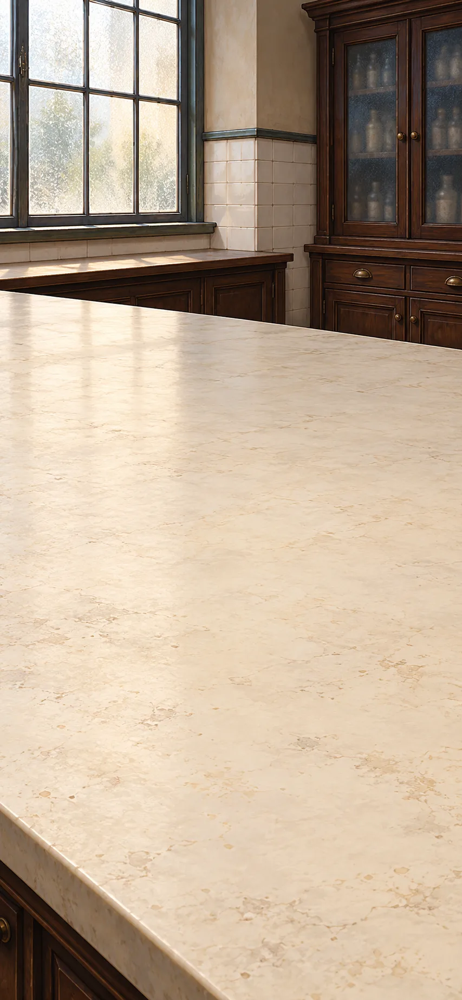

*John Snow, London, 1854–1855 CE*

Snow investigates cholera through a comparison of water suppliers. Neighbouring homes breathe much the same air but drink different water: which difference tracks the deaths?

**Goals**
- Which explanation fits the neighbouring households? -- "Foul air or a waterborne cause?"
- What can be done before the cause is fully understood? -- "A useful intervention before full agreement"

**Items**
- "Polluted vs cleaner water: 315 vs 37 cholera deaths per 10,000 houses"

  Snow reports these first-seven-week cholera death rates for Southwark and Vauxhall versus Lambeth. The more polluted supplier has the higher rate. The denominator is houses, and allocation was not random.

- "Miasma predicts risk from the shared foul air"

  Intermixed households share neighbourhood air. If deaths instead divide by water supplier, that challenges this explanation; other household differences still need checking.

- "Foul air or a waterborne cause?"

  Which difference tracks the deaths among neighbouring homes?

  Intermixed households share neighbourhood air but receive different water. The more polluted supplier’s households record 315 cholera deaths per 10,000 houses in the first seven weeks; the cleaner supplier’s record 37.

  The roughly eightfold difference follows the more polluted supply, challenging the shared-air explanation. Supplier records and house counts make the comparison checkable; other household differences still matter.

  *Foul air or a waterborne cause?*

- "Replace the polluted drinking supply with cleaner water"

  Replace the water suspected of carrying the disease. This is a proposed preventive action, not a claim that removing one pump handle ended the outbreak.

- "A useful intervention before full agreement"

  Must prevention wait for a complete explanation?

  Snow’s comparison links the more polluted water supply with much higher death rates among neighbouring homes. Replacing that supply would stop people drinking the water suspected of carrying cholera.

  The evidence supports preventive action before the microscopic explanation wins general agreement. There can be a good reason to act before every step in the explanation is understood.

  *A useful intervention before full agreement*

**Combinations**
- "Polluted vs cleaner water: 315 vs 37 cholera deaths per 10,000 houses" [transform] + "Miasma predicts risk from the shared foul air" [transform] -> "Foul air or a waterborne cause?"
- "Foul air or a waterborne cause?" [transform] + "Replace the polluted drinking supply with cleaner water" [transform] -> "A useful intervention before full agreement"

> NOTE: [Snow, On the Mode of Communication of Cholera (1855), Table IX](https://www.gutenberg.org/files/72894/72894-h/72894-h.htm). The first seven weeks are the interval used for these house-denominator rates. [UCLA outbreak context](https://epi-snow.ph.ucla.edu/Stream2_BSPoutbreak_f.html) distinguishes the supplier comparison from the pump-handle legend.

## Microscope and culture bench

background: 

*Pasteur, Buchner and laboratory comparisons, France and Germany, c. 1860–1897 CE*

Magnification reveals organisms; controlled comparisons ask what they do. Three records, from different periods, separate the arrival of life, fermentation by cultures, and chemistry outside an intact cell.

**Goals**
- Does air alone account for broth growth? -- "Broth growth tracks incoming microorganisms"
- Does fermentation require an intact living cell? -- "Fermentation continues without intact yeast cells"

**Items**
- "Air reaches both broths; dust reaches only the broth that grows"

  Protected broth stays clear; dust-exposed broth grows organisms visible under magnification.

- "Broth growth tracks incoming microorganisms"

  Does exposure to air alone explain the growth?

  Air reaches both broths, but dust reaches only the one that develops organisms visible under magnification. The protected broth stays clear.

  The broth that receives dust grows organisms; the protected broth does not. The comparison supports incoming microorganisms rather than air alone producing life; what the organisms do requires another investigation.

  *Broth growth tracks incoming microorganisms*

- "With yeast, sugar becomes alcohol and gas; without yeast, it does not"

  Invented matched comparison: yeast is added to one sugar solution; a protected counterpart receives none. The yeast-treated solution converts sugar into alcohol and releases carbon dioxide; the comparison does not.

- "Organisms participate in chemical change"

  Do the arriving organisms affect the solution?

  The broth comparison concerned where organisms came from. In this invented trial, matched sugar solutions differ in whether yeast is added. Only the yeast-treated solution converts sugar into alcohol and releases carbon dioxide: fermentation.

  The result connects the culture with chemical activity. Whether the reaction requires intact cells remains open.

  *Organisms participate in chemical change*

- "Buchner’s yeast extract ferments without intact cells"

  In 1897, Buchner reports fermentation by pressed yeast juice without intact yeast cells.

- "Fermentation continues without intact yeast cells"

  Must a yeast cell stay intact for fermentation to occur?

  Yeast cultures convert sugar into alcohol and carbon dioxide. Buchner’s 1897 report describes pressed yeast juice doing so without intact yeast cells.

  Organisms produce the chemical machinery, but an intact cell is unnecessary for this reaction. Its chemistry can be studied separately from the whole organism.

  *Fermentation continues without intact yeast cells*

**Combinations**
- "A magnified close-up view" [preserve] + "Air reaches both broths; dust reaches only the broth that grows" [transform] -> "Broth growth tracks incoming microorganisms"
- "Broth growth tracks incoming microorganisms" [transform] + "With yeast, sugar becomes alcohol and gas; without yeast, it does not" [transform] -> "Organisms participate in chemical change"
- "Organisms participate in chemical change" [transform] + "Buchner’s yeast extract ferments without intact cells" [transform] -> "Fermentation continues without intact yeast cells"

> NOTE: Culture comparison is authored teaching material, not a transcript of a named trial. Historical basis: [NLM, From DNA to Beer](https://www.nlm.nih.gov/exhibition/from-dna-to-beer/index.html); [Buchner, Alcoholic Fermentation Without Yeast Cells](https://web.lemoyne.edu/~giunta/buchner.html).

## Electromagnetic bench

background: 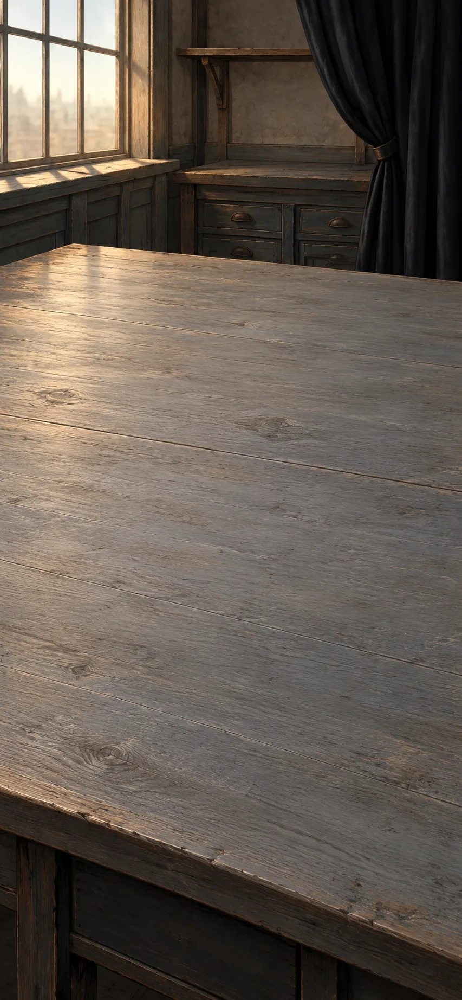

*Ørsted, Faraday and Maxwell, European laboratories, 1820–1865 CE*

Ørsted’s compass and Faraday’s induction experiments connect electricity with magnetism; Maxwell seeks a mathematical account. What must change to produce a current, and what could those effects have to do with light?

**Goals**
- What must change to induce a current? -- "A magnetic field describes influence throughout space"
- Why identify light with an electromagnetic wave? -- "Light belongs to the electromagnetic field"

**Items**
- "A current turns a compass; a moving magnet induces current"

  Ørsted connects current with compass deflection. Faraday later connects changing magnetic flux with induced voltage and, in a closed circuit, current.

- "Current affects magnets; magnetic change can induce current"

  Can motion and influence be explained only through touching parts?

  In the mechanical figure, touching parts pass motion from wheel to rod to arm. Ørsted’s current deflects a nearby compass; Faraday’s changing magnetic conditions induce current in a closed circuit.

  Electricity and magnetism are connected across the surrounding space. The effects differ: a steady current can deflect the compass, while induction requires change.

  *Current affects magnets; magnetic change can induce current*

- "Faraday maps magnetic influence at different positions"

  The field describes physical quantities throughout the surroundings. Position and orientation matter even where no wire connects the objects.

- "A magnetic field describes influence throughout space"

  Why does moving the magnet matter?

  A magnetic field describes the strength and direction of magnetic influence at each position. Moving the magnet changes how much of that field passes through the wire loop; a steady arrangement does not.

  That change induces voltage, an electrical push. When the conducting path is closed, it drives current. The surrounding field now belongs in the explanation.

  *A magnetic field describes influence throughout space*

- "Maxwell’s equations predict waves at approximately light’s measured speed"

  Linked electrical and magnetic equations permit travelling disturbances. Their speed, calculated from electrical and magnetic measurements, agrees closely with an independent optical measurement.

- "Light belongs to the electromagnetic field"

  What could connect an electrical experiment with light?

  The field account links electricity and magnetism. Maxwell’s equations allow a travelling disturbance whose speed is calculated from electrical and magnetic measurements.

  That speed closely matches light’s independently measured speed. The agreement supports identifying light as an electromagnetic wave, joining inquiries that began with different phenomena.

  *Light belongs to the electromagnetic field*

**Combinations**
- "Nature investigated through matter and motion" [preserve] + "A current turns a compass; a moving magnet induces current" [transform] -> "Current affects magnets; magnetic change can induce current"
- "Current affects magnets; magnetic change can induce current" [transform] + "Faraday maps magnetic influence at different positions" [transform] -> "A magnetic field describes influence throughout space"
- "A magnetic field describes influence throughout space" [transform] + "Maxwell’s equations predict waves at approximately light’s measured speed" [transform] -> "Light belongs to the electromagnetic field"

> NOTE: [Institute of Physics, electromagnetic induction](https://spark.iop.org/episode-414-electromagnetic-induction); [Royal Institution, Faraday’s ring-coil apparatus](https://www.rigb.org/explore-science/explore/collection/michael-faradays-ring-coil-apparatus); [Maxwell, A Dynamical Theory of the Electromagnetic Field (1865)](https://royalsocietypublishing.org/doi/10.1098/rstl.1865.0008). Modern field language is explanatory paraphrase.

## Clocks and lived time

background: 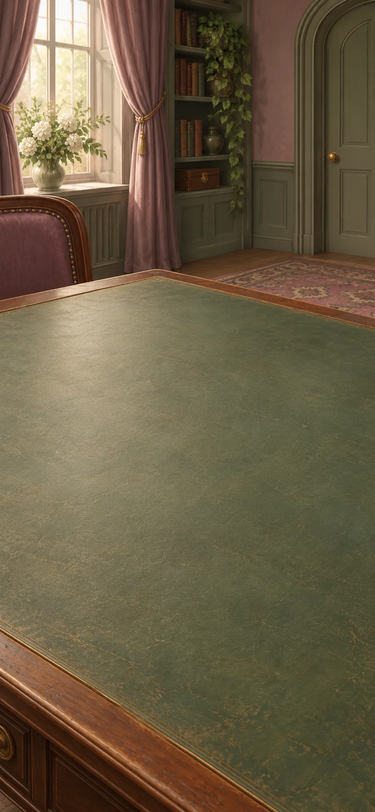

*Railway coordination, Bergson and James; Europe and the United States; c. 1840–1890 CE*

The reference clock once carried on a voyage can now send a signal to railway stations. Shared time lets stations use one timetable; hearing a melody raises a different question about experience.

**Goals**
- How can the stations share a timetable? -- "A shared railway time"
- next: What does the clock leave out of a melody? -- "Clock time and experienced time"

**Items**
- "Reference sends noon; two station clocks read 11:58 and 12:03"

  Illustrative synchronization: both stations receive noon with negligible delay for this task. Precise timing must also account for transmission delay.

- "A shared railway time"

  How should the station clocks change when the reference signal says noon?

  The reference clock supplies a common standard. One station reads 11:58 and another 12:03: advance the first by two minutes and move the second back three.

  Their timetable can now use the same reference. This invented comparison neglects signal delay; more precise synchronization must account for it.

  *A shared railway time*

- "The final note changes how the earlier notes are heard"

  Imagine a tune pausing before its last note. Remembering the earlier phrase makes the ending a resolution rather than an isolated noise.

- "Clock time and experienced time"

  What makes the last note a resolution rather than an isolated sound?

  Shared clocks measure the pause and the final note. Remembering the preceding phrase makes the ending of the melody meaningful.

  Bergson and James investigate how each moment of experience carries something of what came before. A clock can measure how long the tune takes without describing what hearing it is like.

  *Clock time and experienced time*

**Combinations**
- "A calibrated portable clock set to a reference meridian" [preserve] + "Reference sends noon; two station clocks read 11:58 and 12:03" [transform] -> "A shared railway time"
- "A shared railway time" [preserve] + "The final note changes how the earlier notes are heard" [transform] -> "Clock time and experienced time"

> NOTE: Clock values and tune are authored illustrations. [James, The Principles of Psychology](https://www.gutenberg.org/ebooks/57628); [Bergson, Time and Free Will, chapter II](https://www.gutenberg.org/ebooks/56852). This comparison does not equate phenomenological duration with relativistic time.

## Photographs and associations

background: 

*Photography and Surrealist experiment, Britain and France, nineteenth and early twentieth centuries*

The image box gains a surface that retains what light projects. Once the resulting image can travel and be rearranged, a record of appearances can also become material for art.

**Goals**
- What does the photograph record, and omit? -- "A photograph records from a selected viewpoint"
- next: What can copies change? -- "The image can circulate in many copies"
- next: Can an altered ordinary scene invite a different reading? -- "An altered scene disrupts ordinary expectations"

**Items**
- "A light-sensitive plate records the open doorway, not the room beyond"

  This illustrative exposure preserves the projected doorway. The wall hides the adjoining room: recording light cannot reveal everything at the location.

- "A photograph records from a selected viewpoint"

  Can a lasting image show more than its viewpoint allows?

  The image box projects a doorway onto a light-sensitive plate. The plate preserves that view, but the wall still hides the adjoining room.

  The photograph records light from the scene, but only what the camera’s position and frame allow it to see. A lasting record is still a selected view.

  *A photograph records from a selected viewpoint*

- "One negative can yield many prints"

  One negative allows many positive prints. Other early photographic processes instead produced unique images.

- "The image can circulate in many copies"

  What changes when the photographed view can travel?

  One negative can produce many prints of the same doorway. People who never stood at the camera’s position can inspect its recorded view.

  More people can see the view, but they receive the same omissions. No extra print reveals the adjoining room hidden from the camera.

  *The image can circulate in many copies*

- "Illustrative collage: the doorway opens onto a sea instead of a room"

  An invented artistic exercise combines the doorway photograph with a sea image, displacing the expected domestic space. It is neither a historical artwork nor a diagnosis.

- "An altered scene disrupts ordinary expectations"

  What happens when the familiar doorway opens onto a sea?

  The photograph records an ordinary entrance. The invented collage replaces the expected room with a sea, interrupting the scene’s familiar relations.

  The alteration can invite readings of escape, danger or desire. Surrealist experiments explore such disruptions and associations; no single interpretation is forced by the image.

  *An altered scene disrupts ordinary expectations*

**Combinations**
- "A prepared dark-room image box" [preserve] + "A light-sensitive plate records the open doorway, not the room beyond" [transform] -> "A photograph records from a selected viewpoint"
- "A photograph records from a selected viewpoint" [preserve] + "One negative can yield many prints" [transform] -> "The image can circulate in many copies"
- "A photograph records from a selected viewpoint" [preserve] + "Illustrative collage: the doorway opens onto a sea instead of a room" [transform] -> "An altered scene disrupts ordinary expectations"

> NOTE: [Metropolitan Museum, Talbot and photography](https://www.metmuseum.org/essays/william-henry-fox-talbot-1800-1877-and-the-invention-of-photography); [Metropolitan Museum, Surrealism](https://www.metmuseum.org/essays/surrealism). Doorway and collage are authored illustrations. No chemical procedure or clinical claim is taught.

## Moving clocks and falling rooms

background: 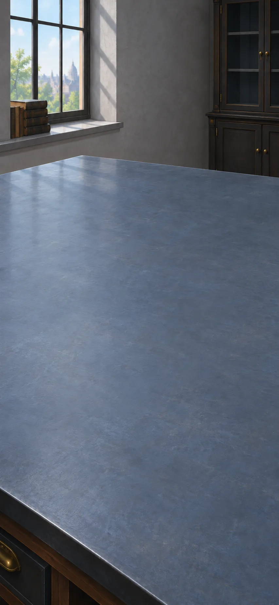

*Einstein and astronomical testers, Europe and the eclipse expeditions, 1905–1919 CE*

Einstein re-examines the time and gravity assumed by Newton’s successful mechanics. Compare a train with its platform, then a falling room with the sky: which conclusions follow from the thought experiments, and which need measurements?

**Goals**
- Must moving observers agree on distant simultaneity? -- "Moving observers can disagree about whether distant events happen together"
- Does the new gravity account survive a measurement? -- "A new geometry meets a light observation"

**Items**
- "Platform midpoint receives both train-end flashes together"

  Flashes occur at the train’s ends simultaneously by platform clocks. At emission, the train midpoint passes the platform observer midway between the emission sites. The stationary observer receives both flashes together; the moving train midpoint receives them at different times.

- "Train midpoint: equal end-distances and equal light speed"

  In the train frame the paths are equally long and light speeds equal. Unequal arrival times therefore require unequal emission times.

- "Moving observers can disagree about whether distant events happen together"

  Must the platform and train agree when the flashes were emitted?

  Flashes at the train’s ends are simultaneous by platform clocks. At emission, the train midpoint passes the platform observer midway between the flash locations. That observer receives both together; the moving passenger travels toward one flash and receives it first.

  In the train frame, the end-distances and light speeds are equal. Unequal arrivals therefore imply unequal emission times there. The frames disagree about simultaneity, not about whether the clocks work.

  *Moving observers can disagree about whether distant events happen together*

- "A released ball floats beside an observer in a freely falling room"

  Observer, ball and room fall together. Local weightlessness does not remove gravity; tidal differences limit the size and duration of the equivalence.

- "Free fall connects gravity and acceleration"

  Why does a released ball float beside someone in a falling room?

  Newton’s gravity makes the ball fall. The observer and room fall too, so the ball does not drop toward the floor as it would in a supported room.

  Einstein uses this local weightlessness to rethink gravity through spacetime geometry. Differences in gravity across a larger region limit the comparison; the room itself does not derive the theory.

  *Free fall connects gravity and acceleration*

- "Geometry predicts bent starlight; eclipse photographs test its displacement"

  General relativity predicts displaced apparent stellar positions near the Sun. Eclipse and reference plates can test the displacement, with uncertainties assessed for each measurement.

- "A new geometry meets a light observation"

  How can an idea about a falling room face an independent test?

  Free fall motivates a different account of gravity. General relativity predicts a displacement of apparent star positions near the Sun; eclipse photographs can be compared with reference plates.

  The 1919 results supported the prediction with imperfect measurements. The theory gains a test beyond the thought experiment that helped motivate it.

  *A new geometry meets a light observation*

**Combinations**
- "Platform midpoint receives both train-end flashes together" [transform] + "Train midpoint: equal end-distances and equal light speed" [transform] -> "Moving observers can disagree about whether distant events happen together"
- `newton-attraction` [preserve] + "A released ball floats beside an observer in a freely falling room" [transform] -> "Free fall connects gravity and acceleration"
- "Free fall connects gravity and acceleration" [transform] + "Geometry predicts bent starlight; eclipse photographs test its displacement" [transform] -> "A new geometry meets a light observation"

> NOTE: [Einstein, Relativity, §§8–9](https://www.gutenberg.org/files/5001/5001-h/5001-h.htm); [Max Planck Institute, equivalence principle](https://www.einstein-online.info/en/spotlight/equivalence_principle/). The train premises remain explicit. Free fall is local; it is not itself a derivation of curvature or the numerical deflection.

## Continental comparisons

background: 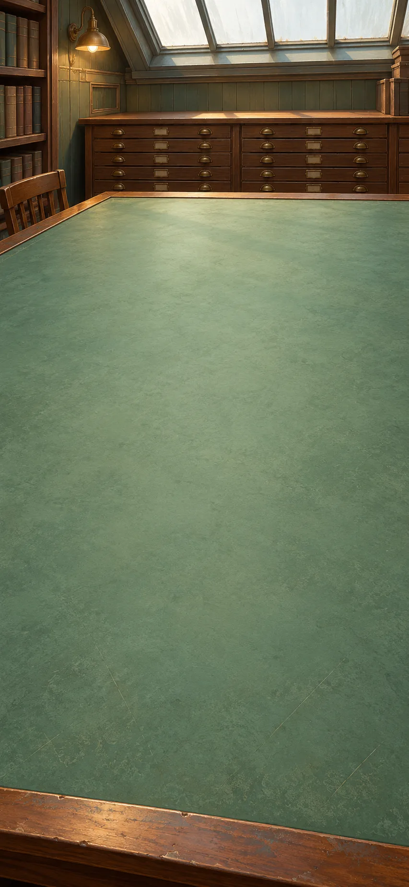

*Wegener and geologists, Europe, c. 1912–1930 CE*

The map that served navigation becomes a record to rearrange. In the early twentieth century, coastlines, fossils and rock belts suggest a shared past, while Wegener's proposed forces remain inadequate.

**Goals**
- What supports a former connection across the Atlantic? -- "Matching continents need a better explanation of their motion"

**Items**
- "Atlantic margins fit; matching fossils and rock belts cross the join"

  Coastlines suggest a reconstruction. Matching fossils and geological formations independently test it; outline resemblance alone is insufficient.

- "Separated lands share a geological past"

  What would make a continental reconstruction more than a resemblance of outlines?

  A common map locates the Atlantic margins. Bringing them together also aligns matching fossil distributions and rock belts.

  Matching rocks and fossils give reasons to accept the arrangement beyond how well the coastlines seem to fit. The reconstruction explains several patterns at once, while how the continents could move remains a separate problem.

  *Separated lands share a geological past*

- "Wegener’s proposed driving forces are inadequate"

  Wegener’s centrifugal and tidal forces could not move continents as proposed. The matching evidence does not rescue this mechanism.

- "Matching continents need a better explanation of their motion"

  Does rejecting the proposed force erase the matching rocks and fossils?

  The continental reconstruction joins geological and fossil patterns. Wegener’s proposed centrifugal and tidal forces are inadequate to produce the movement.

  That failure defeats his driving account without making the correspondences disappear. The historical pattern remains a problem for a better account of motion.

  *Matching continents need a better explanation of their motion*

**Combinations**
- "Coordinates connect positions to distances" [preserve] + "Atlantic margins fit; matching fossils and rock belts cross the join" [transform] -> "Separated lands share a geological past"
- "Separated lands share a geological past" [transform] + "Wegener’s proposed driving forces are inadequate" [transform] -> "Matching continents need a better explanation of their motion"

> NOTE: [USGS, This Dynamic Earth](https://pubs.usgs.gov/gip/dynamic/dynamic.html). Distinguish evidence for continental movement from Wegener's rejected driving mechanisms.

## Isotopes and contamination

background: 

*Patterson and isotope researchers, United States, c. 1950–1970 CE*

Layer order cannot tell us the elapsed years. Radioactive clocks can—but measuring tiny amounts also exposes material added by the laboratory and, eventually, by industry.

**Goals**
- How can a sequence acquire years? -- "Earth is about 4.54 billion years old"
- next: What does lead in an empty test reveal? -- "The search for stray lead reveals industrial pollution"

**Items**
- "Closed mineral example: one-quarter of the original parent isotope remains"

  An ideal authored clock: initial parent quantity and decay rate are known; nothing enters or leaves. One half-life leaves half, two leave one-quarter. Actual dating must check these assumptions.

- "Two half-lives have elapsed"

  What does one-quarter of the original radioactive parent tell us?

  Rock layers give an order of events. A half-life is the time for half the radioactive parent atoms to decay. In this ideal closed mineral, one half-life leaves half the original parent, and two leave one-quarter.

  Two half-lives have elapsed. Multiplying by the known half-life gives years, provided material has neither entered nor escaped.

  *Two half-lives have elapsed*

- "Lead isotopes in meteorites help date the early solar system"

  Meteorite isotope evidence and lead-evolution models estimate Earth’s formation age. Its oldest surviving rock need not date the planet’s formation.

- "Earth is about 4.54 billion years old"

  Would Earth’s oldest surviving rock necessarily date the planet’s formation?

  A radioactive clock measures elapsed time under stated assumptions. Meteorites preserve evidence from the early solar system, helping estimate formation rather than merely the age of a surviving terrestrial rock.

  Lead-isotope evidence and models support about 4.54 billion years for Earth. Patterson’s calculation is more complex than the quarter-parent exercise.

  *Earth is about 4.54 billion years old*

- "The test contains lead even when no meteorite is added"

  A blank is a test that follows the same chemical procedure without adding a meteorite. Any lead in it must come from the procedure or surroundings.

- "The laboratory can contaminate an ancient clock"

  Where did the lead in a test with no meteorite come from?

  Dating early solar-system material requires interpreting small quantities of lead. A blank follows the same chemical procedure without a meteorite—and still contains lead.

  The procedure or surroundings introduced contamination. The lab must prevent or measure this extra lead before it can reliably date the meteorite.

  *The laboratory can contaminate an ancient clock*

- "Clean measurements find more lead in modern than preindustrial environments"

  Patterson’s environmental comparisons identify widespread modern contamination beyond dirty equipment. The analytical obstacle becomes a separate pollution question.

- "The search for stray lead reveals industrial pollution"

  Could the contamination problem extend beyond the laboratory?

  The blank exposed lead introduced during measurement. Cleaner comparisons then find more lead in modern than preindustrial environments.

  Patterson’s inquiry becomes an investigation of widespread industrial pollution. The new environmental evidence earns that conclusion; the laboratory blank alone could not establish it.

  *The search for stray lead reveals industrial pollution*

**Combinations**
- "Sequence is not duration" [preserve] + "Closed mineral example: one-quarter of the original parent isotope remains" [transform] -> "Two half-lives have elapsed"
- "Two half-lives have elapsed" [transform] + "Lead isotopes in meteorites help date the early solar system" [transform] -> "Earth is about 4.54 billion years old"
- "Earth is about 4.54 billion years old" [transform] + "The test contains lead even when no meteorite is added" [transform] -> "The laboratory can contaminate an ancient clock"
- "The laboratory can contaminate an ancient clock" [transform] + "Clean measurements find more lead in modern than preindustrial environments" [transform] -> "The search for stray lead reveals industrial pollution"

> NOTE: The quarter-parent example is authored, not a historical experiment. [NIST, radiometric clocks](https://www.nist.gov/how-do-you-measure-it/how-do-you-know-age-fossils-and-other-old-things); [USGS, Age of the Earth](https://pubs.usgs.gov/gip/geotime/age.html); [Caltech, Getting the Lead Out](https://www.caltech.edu/about/news/getting-lead-out-47935).

## Ocean-floor records

background: 

*Marine geophysicists, worldwide, c. 1960–1970 CE*

Magnetic stripes supply the missing record of motion beneath the oceans. If new floor forms, something must also account for where old floor goes.

**Goals**
- Can the ocean floor explain continental movement? -- "Plates form, move and descend"
- next: What happens to life's map when land moves? -- "Life’s changing map includes moving land"

**Items**
- "Paired magnetic bands: younger at the ridge, older farther away"

  This invented schematic shows matching magnetic bands and increasing age away from a ridge. As lava cools into rock, it records the magnetic field’s direction. “Normal” matches the present field; “reversed” records its opposite. New floor carries older bands outward.

- "Continents move with plates of rigid outer Earth"

  What record would spreading from an ocean ridge leave?

  Wegener’s matching continents lacked an adequate motion account. Cooling lava records Earth’s magnetic-field direction. Across a ridge, bands recording successive reversals match on both sides and grow older outward.

  New floor moving outward explains this pattern. Continents travel with plates of crust and uppermost mantle, rather than through stationary ocean floor. The driving forces need further explanation.

  *Continents move with plates of rigid outer Earth*

- "Trenches border inclined zones of increasingly deep earthquakes"

  The pattern traces slabs descending into the mantle, complementing evidence of new floor at ridges.

- "Plates form, move and descend"

  If new ocean floor forms, where does old floor go?

  Ridge records support floor spreading outward. Near trenches, earthquakes trace inclined zones that grow deeper toward the interior, marking descending slabs.

  Formation at ridges and descent at subduction zones account for recycling. New floor need not require an ever-expanding Earth.

  *Plates form, move and descend*

- "Life’s changing map includes moving land"

  Could separated habitats once have been neighbours?

  Plant geography connects living kinds with places and conditions. Plate motion adds a changing history of the places themselves: land can join, split and move.

  Related organisms on separated lands may record an earlier connection as well as adaptation to present conditions. Current climate alone need not explain their distribution.

  *Life’s changing map includes moving land*

**Combinations**
- "Matching continents need a better explanation of their motion" [transform] + "Paired magnetic bands: younger at the ridge, older farther away" [transform] -> "Continents move with plates of rigid outer Earth"
- "Continents move with plates of rigid outer Earth" [transform] + "Trenches border inclined zones of increasingly deep earthquakes" [transform] -> "Plates form, move and descend"
- "Plates form, move and descend" [transform] + "Life patterned by place and conditions" [preserve] -> "Life’s changing map includes moving land"

> NOTE: [Geological Society, plate movement and driving forces](https://www.geolsoc.org.uk/Plate-Tectonics/Chap2-What-is-a-Plate/Plate-Movement.html); [USGS, magnetic stripes and isotopic clocks](https://pubs.usgs.gov/gip/dynamic/stripes.html); [USGS plate-tectonic map explanation](https://pubs.usgs.gov/cp/41/report.pdf). The short polarity strip is an authored schematic, not a measured traverse or a complete reversal chronology.

## Logic, programs and limits

background: 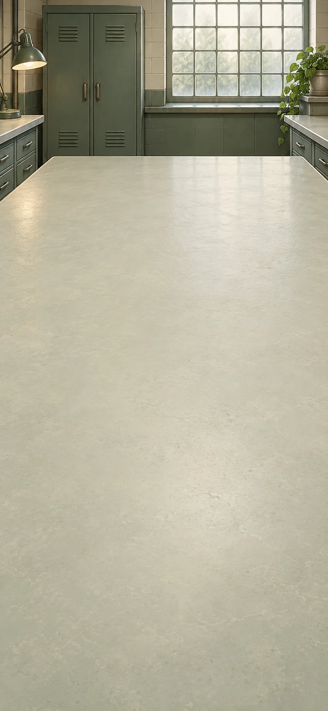

*Boole, Turing and Shannon compared, Britain and the United States, c. 1854–1938 CE*

Switches and rules for handling symbols can perform logical operations. A machine that follows those rules gains extraordinary reach without gaining a method that decides every possible stopping question.

**Goals**
- How does a logical condition become an action? -- "Two switches in series perform AND"
- next: Can one procedure decide whether every program stops? -- "No procedure decides for every program and input whether it stops"

**Items**
- "AND rule: output 1 only when both inputs are 1"

  Let 1 mean true and 0 mean false. AND joins two claims: the pair 10 means the first is true and the second false. AND gives 1 only for 11, when both claims are true; all other pairs give 0.

- "Logical relations expressed as 0s and 1s"

  Can a logical relation be studied without choosing what its claims describe?

  An argument is valid if its conclusion cannot be false when its starting claims are true. Logic can also describe how claims combine. Let 1 mean true and 0 mean false. AND joins two claims: the pair 10 means the first is true and the second false. AND gives 1 only for 11, when both claims are true; all other pairs give 0.

  All four possibilities can be checked without knowing what the claims describe. This modern table shows how logical relationships can be written as symbols and worked with, as in Boole’s algebra.

  *Logical relations expressed as 0s and 1s*

- "Two series switches close the circuit only when both are closed"

  The switches are in series: current must pass through both in turn. Closed means 1, open means 0. Either open switch breaks the path; both closed complete it.

- "Two switches in series perform AND"

  How can a circuit perform AND?

  Let a closed switch mean 1 and an open switch 0. Put two switches in series, so current must pass through both in turn. They complete the path only when both are closed: 11. Either open switch breaks it.

  The circuit gives exactly the outcomes in the AND table. Shannon connects such arrangements with algebra, while the truth of any input report remains a separate question.

  *Two switches in series perform AND*

- "Instructions tell a machine which symbols to read or write and where to move"

  Instructions written as symbols tell a machine what to read or write and where to move next. Turing’s universal machine can read these instructions and simulate the computation they describe. Changing the instructions changes the computation without rebuilding the machine.

- "One machine can follow different programs"

  Must every new calculation require a newly arranged machine?

  The two-switch circuit performs one fixed rule. Turing’s universal machine instead reads instructions written as symbols. They specify which symbols to read or write and where to move next.

  Changing those instructions lets the same machine simulate different computations. The fixed two-switch AND circuit alone cannot do that.

  *One machine can follow different programs*

- "Suppose H predicts whether programs stop; program D does the opposite"

  Suppose H always finishes and correctly predicts whether any program will stop on a given input. Build D to ask H about a program given its own instructions as input, then do the opposite: run forever if H predicts stopping, and stop otherwise. What happens when D receives its own instructions?

- "No procedure decides for every program and input whether it stops"

  Could a test that always finishes correctly predict whether any program will stop?

  A program can receive another program’s instructions as input. Suppose H always finishes and correctly predicts whether a given program will stop on a given input.

  Build a second program, D. It asks H whether its input program would stop when given that program’s own instructions. If H predicts stopping, D runs forever; otherwise D stops. Now give D its own instructions. If H predicts that D stops, D runs forever; if H predicts that D runs forever, D stops. Either answer is wrong.

  Such a test cannot work for every program and input. Many particular stopping questions can still be answered.

  *No procedure decides for every program and input whether it stops*

**Combinations**
- "A conclusion follows from premises" [preserve] + "AND rule: output 1 only when both inputs are 1" [transform] -> "Logical relations expressed as 0s and 1s"
- "Logical relations expressed as 0s and 1s" [transform] + "Two series switches close the circuit only when both are closed" [transform] -> "Two switches in series perform AND"
- "Two switches in series perform AND" [transform] + "Instructions tell a machine which symbols to read or write and where to move" [transform] -> "One machine can follow different programs"
- "One machine can follow different programs" [transform] + "Suppose H predicts whether programs stop; program D does the opposite" [transform] -> "No procedure decides for every program and input whether it stops"

> NOTE: [Boole, Laws of Thought](https://www.gutenberg.org/ebooks/15114); [Shannon, relay and switching circuits](https://tubes.mit.edu/6S917/_static/2025/resources/shannon38.pdf); [Turing, On Computable Numbers](https://www.cs.virginia.edu/~robins/Turing_Paper_1936.pdf). AND notation and the modern halting diagonalization are teaching reconstructions, not claims about original wording or a direct deduction of universality from a two-switch circuit.

## Communication records

background: 

*Communication and coding theory, United States and beyond, 1948 onward*

A distant clock can receive a signal perfectly and still be told the wrong time. First isolate the simpler problem: recovering a bit damaged on its journey.

**Goals**
- Recover the damaged bit under a stated error limit -- "A message designed to recover from specified errors"

**Items**
- "Codebook: encode 0 as 000 and 1 as 111"

  The sender uses only these two codewords. The repeated bits provide redundancy.

- "Received 101; the channel flips at most one bit per block"

  The received block is 101. Use the stated error limit and codebook to recover the original bit.

- "A message designed to recover from specified errors"

  Which bit was sent when 101 arrived?

  The codebook sends 0 as 000 and 1 as 111. The channel flips at most one bit per block. Received 101 is one change from 111 but two from 000.

  The original bit must be 1 under that limit. Two flips can defeat the code; successful recovery cannot establish whether the message’s claim is true.

  *A message designed to recover from specified errors*

**Combinations**
- "Codebook: encode 0 as 000 and 1 as 111" [transform] + "Received 101; the channel flips at most one bit per block" [transform] -> "A message designed to recover from specified errors"

> NOTE: Repetition-code example is authored elementary coding theory, not an attribution of this code to Shannon. [Shannon, A Mathematical Theory of Communication](https://people.math.harvard.edu/~ctm/home/text/others/shannon/entropy/entropy.pdf) distinguishes transmission from semantic significance.

## Words, copies and authority

background: 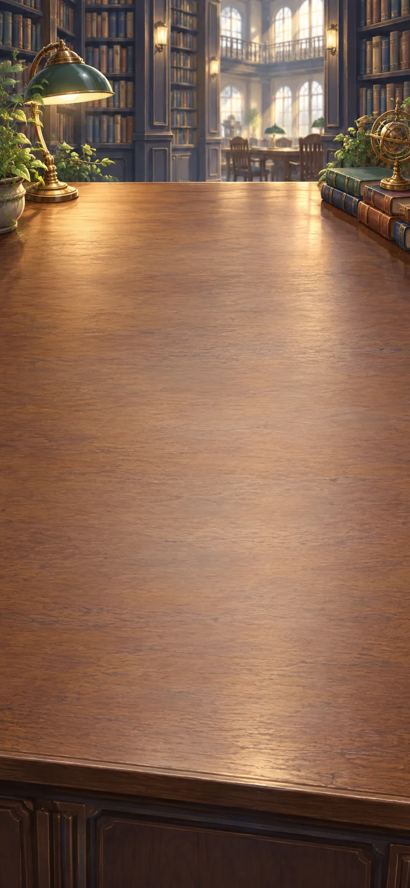

*Borges and Benjamin compared, Argentina and Europe, 1930s–1940s*

Borges’s fiction plays with authorship and invented scholarship; Benjamin examines art’s reproduction and public uses. What changes when identical words or images acquire a different setting?

**Goals**
- What changes when identical words acquire a later author? -- "The same words can become another work"
- Can a copy's authority be checked?
  - both: "A scholarly-looking citation fails its source check"
  - and: "Reproduction changes art’s political reach"

**Items**
- "Menard’s imagined page matches Cervantes; its writer lives centuries later"

  Borges’s imagined later writer produces identical wording through a different life and purpose. Collation settles wording while attribution changes the interpretive question.

- "The same words can become another work"

  Does identical wording settle a text’s interpretation?

  Collation can establish that two texts have the same words. Borges’s fictional Menard writes wording identical to Cervantes’s centuries later, from a different life and setting.

  That attribution changes how the words can be read even though comparison finds no textual variant. Interpretation asks something the wording check alone cannot answer.

  *The same words can become another work*

- "Illustrative citation: The Glass Atlas, 1910, page 240"

  An invented exercise cites page 240 of this edition. Check the supplied catalogue and physical description.

- "The cited edition has only 96 pages"

  Catalogue and physical edition agree: 96 pages, no separately numbered supplement. The reference must be wrong, identify another edition, or be fabricated.

- "A scholarly-looking citation fails its source check"

  Can the citation belong to the edition it names?

  The invented reference cites page 240 of The Glass Atlas. The specified edition has 96 pages and no separately numbered supplement.

  The citation fails this check: it is mistaken, refers to another edition, or is fabricated. Borges makes invented scholarship part of fiction; outside that agreement, scholarly appearance remains a claim requiring evidence.

  *A scholarly-looking citation fails its source check*

- "Two copies of one crowd photo: captions claim support or forced attendance"

  Invented rival captions interpret the same gathering. Neither provides evidence of why people attended; the circumstances beyond the frame need checking.

- "Reproduction changes art’s political reach"

  Does a crowd photograph show why the crowd attended?

  Copies of the same image receive opposed captions: willing support or forced attendance. The visible gathering establishes neither explanation.

  Reproduction carries the image into different political uses, as Benjamin’s inquiry asks us to consider. The captions need evidence about circumstances beyond the frame; copying the photograph cannot supply it.

  *Reproduction changes art’s political reach*

**Combinations**
- "An edition that shows its doubts" [preserve] + "Menard’s imagined page matches Cervantes; its writer lives centuries later" [transform] -> "The same words can become another work"
- "Illustrative citation: The Glass Atlas, 1910, page 240" [transform] + "The cited edition has only 96 pages" [transform] -> "A scholarly-looking citation fails its source check"
- "The image can circulate in many copies" [transform] + "Two copies of one crowd photo: captions claim support or forced attendance" [transform] -> "Reproduction changes art’s political reach"

> NOTE: Glass Atlas, its edition record and crowd captions are authored examples. [Benjamin, Work of Art, sections II and IV–VI](https://www.marxists.org/reference/subject/philosophy/works/ge/benjamin.htm); [Borges background, Poetry Foundation](https://www.poetryfoundation.org/poets/jorge-luis-borges). The Borges branching/Darwin shape analogy is omitted: it supplied no mechanism or needed later connection.

## Categories and a clinic door

background: 

*An imagined clinic, present day; questions from twentieth-century social thought*

Who counts as a responsible carer? This imagined clinic promises to serve every child, but its rules may prevent Mara from accompanying Eli. Does being an aunt tell the clinic enough about the care she provides?

**Goals**
- What does the relationship establish? -- "Being an aunt depends on how people are related"
- Who does the clinic's rule exclude, and can that decision be checked? -- "Mara’s records show why the clinic should admit her"

**Items**
- "Mara is Eli’s aunt: Mara and Eli’s parent are siblings"

  Mara’s relation to Eli depends on this family pattern. Aunt is not a visible physical property of Mara alone.

- "Being an aunt depends on how people are related"

  What makes Mara Eli’s aunt?

  A common concept can group people by relationships rather than shared appearance. In the invented family diagram, Mara and Eli’s parent are siblings: this makes Mara an aunt to Eli.

  Calling Mara an aunt depends on how these people are related, not on what Mara looks like. Lévi-Strauss studies such relationships in kinship systems; this little example is not a rule for every culture.

  *Being an aunt depends on how people are related*

- "Clinic: parents only unless reviewer approves an exception; Mara is refused"

  The invented clinic promises access for every child. Mara provides care and has parental authorization. The clerk has not referred the case to the designated exception reviewer.

- "The “parents only” rule blocks an authorized carer"

  What does “parents only” do at the clinic door?

  Mara is Eli’s aunt and authorized carer, but the invented clinic normally admits parents. Its clerk refuses her without consulting the designated exception reviewer.

  Calling Mara a non-parent blocks Eli’s appointment despite the clinic’s promise of care. The label leaves out what she does for Eli.

  *The “parents only” rule blocks an authorized carer*

- "Parent’s authorization and care record confirm Mara’s role"

  Mara submits the omitted authorization and appointment history to the exception reviewer. Both are checkable records, not an appeal to personal perspective alone.

- "Mara’s records show why the clinic should admit her"

  Can the excluded carer’s account be checked?

  The clerk refused Mara as a non-parent. The exception reviewer now checks the parent’s authorization and records showing Mara’s care, then approves her attendance for this visit.

  Mara’s account brings forward records the clerk overlooked. Checking them changes this decision; the clinic can still reconsider the rule itself.

  *Mara’s records show why the clinic should admit her*

**Combinations**
- "Common concepts, not a shared thing outside the mind" [preserve] + "Mara is Eli’s aunt: Mara and Eli’s parent are siblings" [transform] -> "Being an aunt depends on how people are related"
- "Being an aunt depends on how people are related" [transform] + "Clinic: parents only unless reviewer approves an exception; Mara is refused" [transform] -> "The “parents only” rule blocks an authorized carer"
- "The “parents only” rule blocks an authorized carer" [transform] + "Parent’s authorization and care record confirm Mara’s role" [transform] -> "Mara’s records show why the clinic should admit her"

> NOTE: Entire clinic case is authored and makes no claim about an actual jurisdiction's medical rules. The relational reading is inspired by [Lévi-Strauss's research program](https://www.college-de-france.fr/en/chair/claude-levi-strauss-social-anthropology-statutory-chair); the institutional question has background in [Foucault](https://plato.stanford.edu/entries/foucault/). It is not an incident or argument attributed to either thinker. Historical racial taxonomies and moral genealogy require their own cases and are not equated with this clinic rule.

## Inheritance bench

background: 

*Mendel’s peas, Brno, 1865; molecular genetics and PKU research, twentieth century*

Mendel’s pea experiments offer an answer to the blending problem left by the selection story. Later molecular genetics explains copying; a medical case then asks why inherited information is still not a complete life prediction.

**Goals**
- How can a difference disappear and then return? -- "Inheritance need not blend differences away"
- next: Do genes determine a whole life? -- "Genes and conditions together shape development"

**Items**
- "Violet hybrids self-fertilize without outside pollen; white flowers return"

  Cross true-breeding violet and white peas: the hybrids flower violet. When those hybrids self-fertilize without outside pollen, white returns among their offspring.

- "Inheritance need not blend differences away"

  How can white flowers return after a generation of violet?

  Pea lines that reliably produce their own violet or white flower colour are crossed, producing violet hybrids. When those hybrids self-fertilize without outside pollen, white flowers reappear.

  The white-flower factor survived even in plants with violet flowers. Inherited differences therefore need not blend away. These Mendelian patterns apply to particular traits, not every feature of every organism.

  *Inheritance need not blend differences away*

- "DNA pairs A–T and C–G; each strand can template a new partner"

  DNA has paired strands. Its four bases pair A with T and C with G; each separated strand can guide the building of a new partner. Copying preserves sequence information through cell divisions, with occasional errors. Offspring receive DNA from their parents.

- "DNA can copy and pass on inherited information"

  How can inherited information be copied without averaging it away?

  The peas suggest persistent inherited factors. DNA supplies a copying mechanism: its paired strands separate, and each guides a new partner. Across an illustrative three-base stretch, the pairs are A–T, C–G and G–C.

  Copying both strands produces two DNA molecules with the same sequence. That explains how information can be passed on; its effects still depend on what happens as the organism develops.

  *DNA can copy and pass on inherited information*

- "PKU: specialist dietary care can prevent harm from an inherited condition"

  In phenylketonuria (PKU), the body has difficulty breaking down phenylalanine, a building block of food proteins. Early detection and sustained specialist dietary care can prevent severe developmental harm. This example gives no treatment instructions.

- "Genes and conditions together shape development"

  Does inheriting a difference fix its consequences?

  DNA transmits information that acts through a developing organism. In the inherited condition phenylketonuria (PKU), the body has difficulty breaking down phenylalanine, a building block of food proteins. It can then build up to harmful levels. Early specialist dietary care limits that buildup and can prevent severe developmental harm.

  The inherited difference remains while its effects change. Nutrition and access to care belong in the explanation alongside genes; not every genetic condition is similarly preventable.

  *Genes and conditions together shape development*

**Combinations**
- "Cumulative evolution with heredity still unresolved" [preserve] + "Violet hybrids self-fertilize without outside pollen; white flowers return" [transform] -> "Inheritance need not blend differences away"
- "Inheritance need not blend differences away" [transform] + "DNA pairs A–T and C–G; each strand can template a new partner" [transform] -> "DNA can copy and pass on inherited information"
- "DNA can copy and pass on inherited information" [transform] + "PKU: specialist dietary care can prevent harm from an inherited condition" [transform] -> "Genes and conditions together shape development"

> NOTE: [Mendel, Experiments in Plant Hybridization, §§2, 4–5](https://cs.brown.edu/people/rblumber/MendelWeb/Mendel.html); [NHGRI, Mendelian inheritance](https://www.genome.gov/genetics-glossary/Mendelian-Inheritance); [NHGRI, Phenylketonuria](https://www.genome.gov/Genetic-Disorders/Phenylketonuria). The case concerns gene–environment interaction; no quantities, individual diagnosis or treatment plan are supplied. DNA copying: [NHGRI, DNA replication](https://www.genome.gov/genetics-glossary/DNA-Replication) and [base pairing](https://www.genome.gov/genetics-glossary/Base-Pair). The three base pairs are an authored illustration, not a pea-gene sequence or a claim that replication alone explains segregation. Copying is not a full account of segregation, gene expression or development.

## Climate and old air

background: 

*Climate researchers, worldwide, nineteenth–twenty-first centuries*

Industry changes the air through which Earth's heat escapes. Distinguish a warming mechanism, records of change, and the comparison needed to attribute recent warming.

**Goals**
- How can industrial energy use change heat loss? -- "Burning fossil fuels adds CO2 that slows heat loss"
- next: Does the observed warming fit natural influences alone? -- "Human activity drives the recent warming"

**Items**
- "Fossil carbon enters the air; added CO2 absorbs and emits infrared"

  Burning fossil fuels transfers stored carbon into the atmosphere. Added CO2 changes how Earth’s infrared radiation escapes to space.

- "Burning fossil fuels adds CO2 that slows heat loss"

  How can the workshop’s fuel change Earth’s heat loss?

  Burning fossil carbon adds CO2 to the atmosphere. Earth loses energy as infrared radiation; CO2 absorbs some of it and emits radiation in all directions, including downward.

  Added CO2 initially reduces energy escaping to space. Warming moves the system toward a new balance: a physical reason to expect a warming influence before consulting temperature records.

  *Burning fossil fuels adds CO2 that slows heat loss*

- "Dated ice bubbles record earlier air; instruments record the recent rise"

  Dated bubbles preserve former atmosphere. The trapped air may be younger than the ice around it, so dating the ice alone is not enough.

- "The air has a readable history"

  What turns trapped air into a record of change?

  Ice bubbles preserve samples of former atmosphere; instruments measure the recent air. As with rock layers, a sequence needs a clock before it can reveal rates of change.

  Dating the gas connects its composition with time. Gas and enclosing ice can differ in age, and an undated bubble cannot establish when the atmosphere changed.

  *The air has a readable history*

- "Natural-only simulations miss recent warming; adding human influences matches its pattern"

  Compare surface and ocean warming and changes through the atmosphere. Solar and volcanic drivers alone miss the observed pattern; including human influences explains it.

- "Human activity drives the recent warming"

  Do natural influences alone explain the observed warming?

  Atmospheric records establish change. Greenhouse physics explains a warming influence, while surface, ocean and atmospheric observations supply patterns to test.

  Solar and volcanic influences alone do not reproduce recent warming; including human influences does. Together these comparisons attribute the recent global trend, while natural variation and individual weather events remain distinct questions.

  *Human activity drives the recent warming*

**Combinations**
- "Powered factories depend on continuing fuel supplies" [preserve] + "Fossil carbon enters the air; added CO2 absorbs and emits infrared" [transform] -> "Burning fossil fuels adds CO2 that slows heat loss"
- "Sequence is not duration" [preserve] + "Dated ice bubbles record earlier air; instruments record the recent rise" [transform] -> "The air has a readable history"
- "The air has a readable history" [transform] + "Natural-only simulations miss recent warming; adding human influences matches its pattern" [transform] -> "Human activity drives the recent warming"

> NOTE: [NASA, Evidence](https://science.nasa.gov/climate-change/evidence/); [NASA, Global Warming](https://science.nasa.gov/earth/climate-change/global-warming/); [Royal Society, attribution evidence](https://www.royalsociety.org/news-resources/projects/climate-change-evidence-causes/question-2/). The air-history comparison distinguishes dating an archive from attributing a trend. Infrared is electromagnetic radiation, connecting this account to the field inquiry without requiring a thematic token as an extra step.

## Model and trial desk

background: 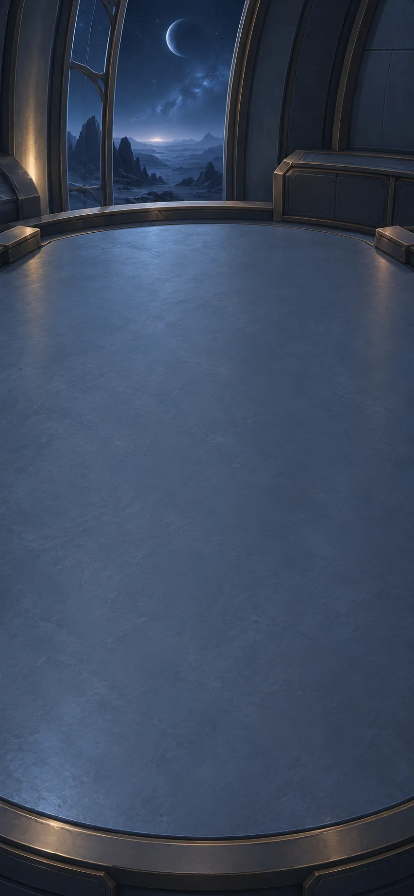

*An imagined observatory team, a distant site, a possible future*

Imagine a distant observatory: its archive-trained model predicts that a candidate signal will be steady. The first unfamiliar observation and a proposed pointing trial are available to inspect.

**Goals**
- What happens when a prediction meets an unfamiliar case? -- "New observations contradict the steady prediction"
- What does the away-and-back trial establish? -- "The varying signal survives checks with both instruments"

**Items**
- "Archive-trained model predicts a steady trace"

  The fictional model trained on steady reference sources. Keep its steady prediction beside the actual observation so that a cleaned estimate cannot conceal disagreement.

- "New target trace repeats bright–dim–bright, absent from the training examples"

  This measured variation is absent from the training archive. Its cause remains unknown.

- "New observations contradict the steady prediction"

  What happens when the new trace contradicts the model?

  The fictional model learned from steady reference sources and predicts a steady signal. The new target instead repeats bright–dim–bright, a pattern absent from its training examples.

  Keep that discrepancy visible. It gives a specific reason to investigate the model’s limits while leaving the variation’s cause open.

  *New observations contradict the steady prediction*

- "Proposed trial: point away from the target, then return"

  The model proposes pointing away and back, with a written procedure others can check. Record both instruments while pointed at the target and away from it. The test need not assume that the model has correctly explained the signal.

- "A model proposes an experiment that people can inspect"

  What would an away-and-back pointing trial test?

  The wood trials specified a change and a comparison. This fictional proposal does likewise: record both instruments on target, point away, then return.

  The trial asks whether the signal follows pointing direction. People can judge the proposed test without accepting the model’s explanation for the signal.

  *A model proposes an experiment that people can inspect*

- "Two instruments lose the varying signal away and recover it on return"

  Fictional outcome: differently designed instruments pass local checks and show the same pointing dependence. Shared pointing errors or disturbances remain possible.

- "The varying signal survives checks with both instruments"

  What does recovering the signal with two instruments establish?

  The away-and-back trial changes pointing while recording both instruments. Both lose the varying signal away from the target and recover it on return.

  Agreement weakens an isolated-instrument explanation. Shared pointing errors or disturbances remain possible, and the variation still contradicts the steady-source prediction.

  *The varying signal survives checks with both instruments*

**Combinations**
- "Archive-trained model predicts a steady trace" [transform] + "New target trace repeats bright–dim–bright, absent from the training examples" [transform] -> "New observations contradict the steady prediction"
- "The heat comparison crosses workshops" [preserve] + "Proposed trial: point away from the target, then return" [transform] -> "A model proposes an experiment that people can inspect"
- "A model proposes an experiment that people can inspect" [transform] + "Two instruments lose the varying signal away and recover it on return" [transform] -> "The varying signal survives checks with both instruments"

> NOTE: All observatory operations and observations are authored speculation. [NASA/JPL AEGIS](https://ai.jpl.nasa.gov/public/projects/aegis/) is background for bounded autonomous targeting, not evidence that this laboratory exists. [NIST AI RMF](https://airc.nist.gov/airmf-resources/airmf/5-sec-core/) informs model evaluation without guaranteeing reliability.

## Remote-observation desk

background: 

*The imagined observatory team, the same distant site, a possible future*

Earth cannot always reply in time. The imagined observatory must decide what it can do now, what needs permission, and which records distant readers will need to check its findings.

**Goals**
- Can others inspect what happened after the message arrives? -- "Distant readers can check the report against the observations"
- Which action must wait for review? -- "Repoint now; preserve the sole raw record"

**Items**
- "Both instruments’ on/off-target traces, pointing logs, raw values and revisions"

  Keep both instruments’ readings while pointed at the target and away from it, along with their pointing records and any later corrections. These let readers compare the report with what was measured.

- "Raw traces and logs make the observation checkable"

  What would let a distant reader check how the observation was made?

  A citation to a nonexistent page gave no support for its claim. This observatory record instead supplies both instruments’ readings, where they were pointed, and any changes made to the results.

  Readers can compare the report with the records behind it. They have ways to find mistakes, rather than only a label asking them to trust the source.

  *Raw traces and logs make the observation checkable*

- "Distant readers can check the report against the observations"

  Would receiving every word correctly make the report true?

  Error correction can recover a damaged message within a stated limit. The instruments’ readings and logs let people examine how the reported finding was made.

  These solve different problems. A false report can arrive word for word; a sound observation can be damaged on its journey.

  *Distant readers can check the report against the observations*

- "Pointing controller: measured error left, correction right; zero error, hold"

  The fictional controller adjusts toward a target using feedback. Correcting pointing does not authorize choosing which observations to destroy.

- "Two requests: adjust pointing, or erase observations not yet sent to Earth"

  The observatory may adjust pointing within its agreed limits. Erasing the only copy of observations that have not yet been sent to Earth needs separate permission. Earth cannot currently reply.

- "Repoint now; preserve the sole raw record"

  Which request can the observatory act on while Earth cannot reply?

  The controller may correct the telescope’s pointing within agreed limits. It has also been asked to erase observations whose only copy is still at the observatory. That would destroy evidence and needs separate permission.

  Correct the pointing now. Keep the observations until the people responsible can review the request to erase them.

  *Repoint now; preserve the sole raw record*

**Combinations**
- "A scholarly-looking citation fails its source check" [transform] + "Both instruments’ on/off-target traces, pointing logs, raw values and revisions" [transform] -> "Raw traces and logs make the observation checkable"
- "Raw traces and logs make the observation checkable" [transform] + "A message designed to recover from specified errors" [transform] -> "Distant readers can check the report against the observations"
- "Pointing controller: measured error left, correction right; zero error, hold" [transform] + "Two requests: adjust pointing, or erase observations not yet sent to Earth" [transform] -> "Repoint now; preserve the sole raw record"

> NOTE: Controller, mission permission and erasure request are authored speculation. Safe pointing means within the fictional mission's existing engineering limits; this is a governance case, not a controller design or deployment claim.

## Workshop proposals

background: 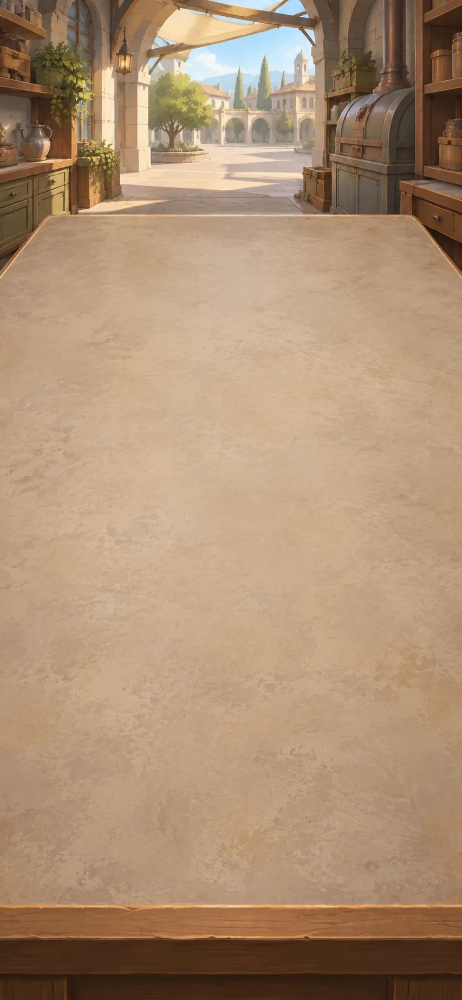

*Makers and carers, an imagined community workshop, a possible future*

An imagined workshop wants enjoyable making and reliable care. Its draft charter gives makers power over machines, but the care team has found an obligation that the draft assigns to nobody.

**Goals**
- Who controls the work and can refuse an unsafe task? -- "Workshop rules let makers choose tasks and stop unsafe machines"
- next: Who undertakes the care, and on what terms? -- "Paid care shifts and substitutes let volunteers say no"

**Items**
- "Draft charter: makers choose tasks and may pause unsafe machines"

  This fictional workshop protects task choice and safety decisions, valuing skill as well as output. Its draft leaves the daily care shift unassigned.

- "Workshop rules let makers choose tasks and stop unsafe machines"

  What would give workers a say over the machine?

  The earlier machine saved effort while its owner set the pace. This imagined workshop gives makers the right to choose tasks and pause unsafe machines.

  Those rules give workers choices the machine alone could not. But the workshop must make the rights usable, and its draft rules still leave the evening care work to nobody in particular.

  *Workshop rules let makers choose tasks and stop unsafe machines*

- "Care-team objection: the same two volunteers cover every evening"

  Essential care falls to two people whose freedom to refuse is becoming nominal. Recipients also need a voice in changing their care.

- "Enjoyable making still leaves someone to provide care"

  Who covers the work the workshop leaves unassigned?

  Makers can choose their tasks, but the same two volunteers provide every evening’s essential care. Refusing would leave people without help they need.

  Enjoyable work for some can depend on others having little choice. Calling the care voluntary does not solve who will do it when a volunteer says no.

  *Enjoyable making still leaves someone to provide care*

- "Paid care rota: Jo Mon/Tue, Amal Wed/Thu, Lin Fri, Sam weekend; recipients approve"

  These four trained carers agree to the paid evening shifts, and the people receiving care approve the plan. The elected care group must find and pay substitutes when needed. It cannot force the original volunteers to cover gaps.

- "Paid care shifts and substitutes let volunteers say no"

  What changes when people agree who will provide the care?

  Two volunteers had been covering every evening. Now Jo takes Monday and Tuesday, Amal Wednesday and Thursday, Lin Friday, and Sam the weekend. The people receiving care approve the plan.

  The work is paid. The elected care group must arrange and pay substitutes when needed, without forcing the old volunteers back. Carers and those receiving care can ask for changes.

  *Paid care shifts and substitutes let volunteers say no*

**Combinations**
- "Mechanized effort can deepen lost control" [preserve] + "Draft charter: makers choose tasks and may pause unsafe machines" [transform] -> "Workshop rules let makers choose tasks and stop unsafe machines"
- "Workshop rules let makers choose tasks and stop unsafe machines" [transform] + "Care-team objection: the same two volunteers cover every evening" [transform] -> "Enjoyable making still leaves someone to provide care"
- "Enjoyable making still leaves someone to provide care" [transform] + "Paid care rota: Jo Mon/Tue, Amal Wed/Thu, Lin Fri, Sam weekend; recipients approve" [transform] -> "Paid care shifts and substitutes let volunteers say no"

> NOTE: The workshop, charter, staffing and objection are authored speculation, not findings attributed to Morris, Kropotkin or Ostrom. Earlier useful-work and prosperity questions inform its aims; the operations here revise one actual proposal rather than repeat those conclusions.

## City and common-rule proposals

background: 

*Residents, carers and bridge stewards, the imagined community, a possible future*

A flood warning now tests the workshop charter: closing the low bridge protects travellers but cuts the care team's route. The community needs to act now and give those affected a way to challenge the decision afterwards.

**Goals**
- Can urgent action preserve the care obligation and a right to challenge? -- "Residents can appeal the closure to bridge stewards and care delegates"
- next: Amend the rule without turning shared work into forced labour -- "At dawn, continued closure needs fresh reasons"

**Items**
- "Flood warning: close the low bridge; the staffed care shift is across it"

  Rising water reaches the agreed threshold for closing the bridge. Tonight’s carers need paid transport by the longer safe route. Making an off-duty volunteer replace them would pass the burden to someone who has not agreed.

- "Close the bridge and arrange a safe route for the carers"

  How can closing the dangerous bridge preserve tonight’s care?

  The flood warning requires the bridge to close, but tonight’s carers are on the other side. Pay for transport by the longer safe route or arrange a substitute who agrees to take the shift.

  Closing the bridge does not cancel the duty to provide care. Record why it closed and how care was arranged, so residents can check both decisions.

  *Close the bridge and arrange a safe route for the carers*

- "Residents appeal to bridge stewards and care delegates: evidence, closure and transport cost"

  Bridge stewards and elected care delegates must hear objections from residents and people receiving care. They can act before a hearing to protect people from the flood, but must still answer questions about how long the bridge stays closed and who pays.

- "Residents can appeal the closure to bridge stewards and care delegates"

  Who can challenge the urgent decision?

  The bridge closes, and money is provided to get the carers there safely. Residents and people receiving care can question the evidence, costs and length of closure. Bridge stewards and elected care delegates must hear their objections.

  Safety action need not wait for a hearing. But those affected must still be able to challenge what happens next.

  *Residents can appeal the closure to bridge stewards and care delegates*

- "Residents’ appeal: the closure has no deadline for reconsideration"

  Residents accept the immediate danger but object that the closure could continue without a new assessment. The appeal asks when, and by whom, continued closure must be justified.

- "At dawn, continued closure needs fresh reasons"

  What stops the bridge staying closed without anyone checking again?

  Residents accept the immediate danger but object that nobody has said when the closure will be reconsidered. At dawn, bridge stewards and care delegates must publish a fresh water assessment and say whether the bridge must stay closed.

  Continued closure needs new reasons and money for safe care access. Carers can still refuse a shift, and residents can still appeal.

  *At dawn, continued closure needs fresh reasons*

**Combinations**
- "Paid care shifts and substitutes let volunteers say no" [transform] + "Flood warning: close the low bridge; the staffed care shift is across it" [transform] -> "Close the bridge and arrange a safe route for the carers"
- "Close the bridge and arrange a safe route for the carers" [transform] + "Residents appeal to bridge stewards and care delegates: evidence, closure and transport cost" [transform] -> "Residents can appeal the closure to bridge stewards and care delegates"
- "Residents can appeal the closure to bridge stewards and care delegates" [transform] + "Residents’ appeal: the closure has no deadline for reconsideration" [transform] -> "At dawn, continued closure needs fresh reasons"

> NOTE: All flood operations and institutional arrangements are speculative. [Ostrom, Beyond Markets and States, Nobel lecture](https://www.nobelprize.org/uploads/2018/06/ostrom_lecture.pdf) informs context-dependent, revisable rules and accountable monitoring, not guaranteed success. The Saint-Domingue comparison is a limited warning about formal freedom and coercive labour, not an equivalence between historical enslavement and this fictional workshop.

## The End

*The reader, here and now*

The bridge is closed; at dawn its continued closure must be justified. The carers have a safe way to reach the people who need them, and residents can challenge the decision. None of that settles every claim about a good life.

The journey has joined eclipse records to models, light paths to images, and deep time to changing life. It has also paused over friendship, melancholy, a melody and pleasure in making—questions worth pursuing without waiting for a later invention.

An idea can change what someone explains, notices, values or does. The next encounter may change those possibilities again.
