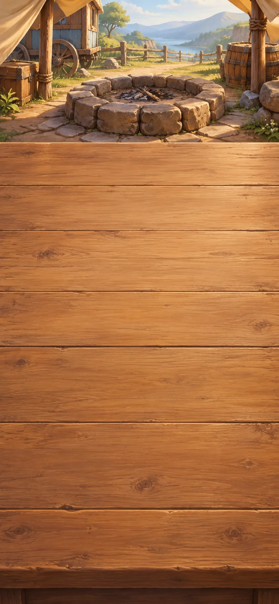
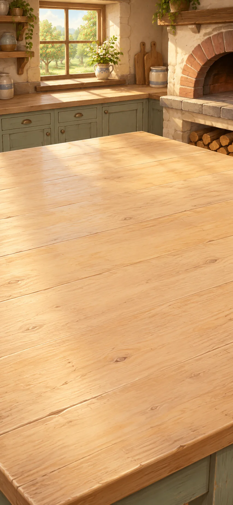
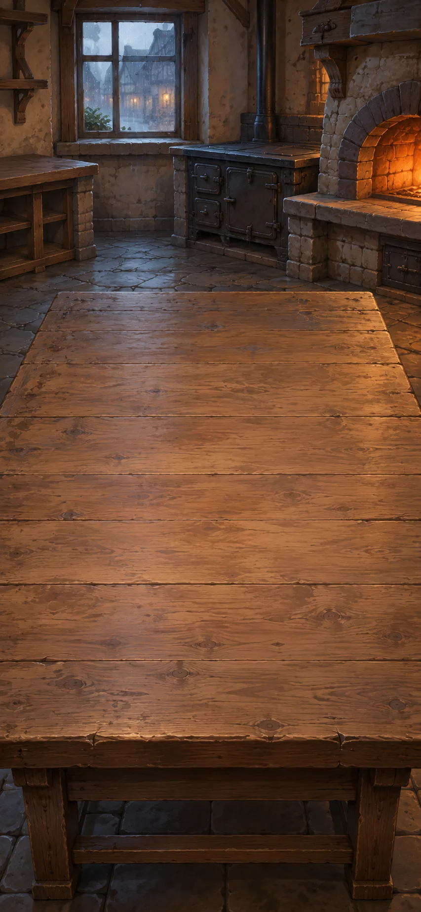
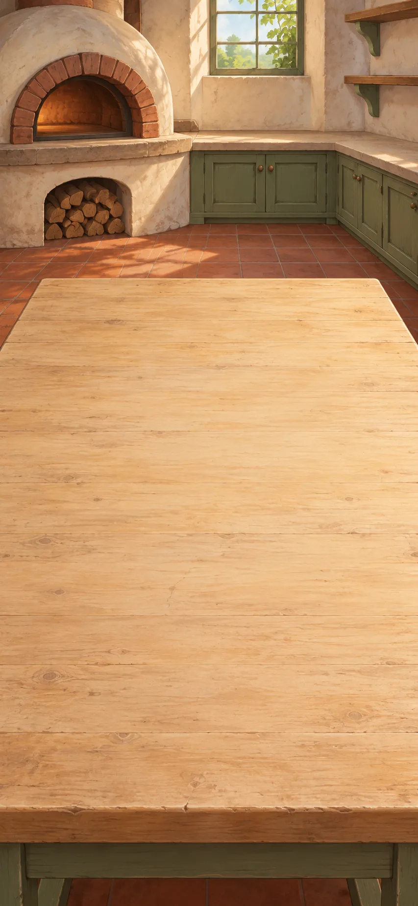
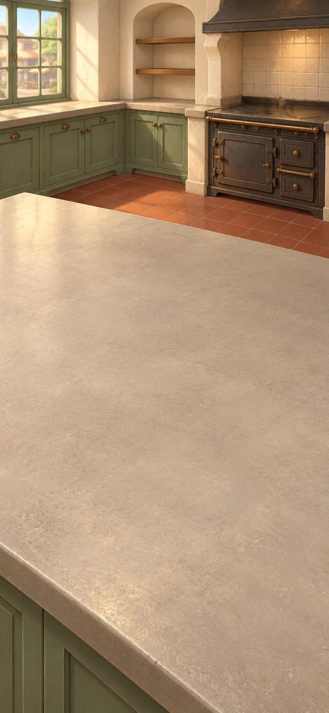
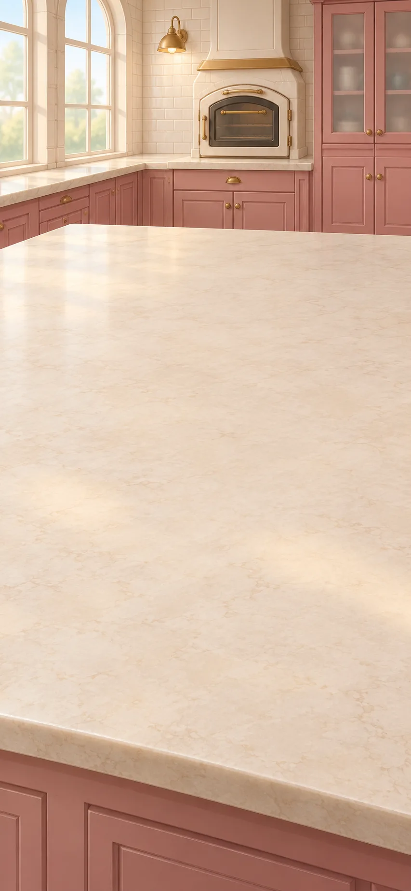
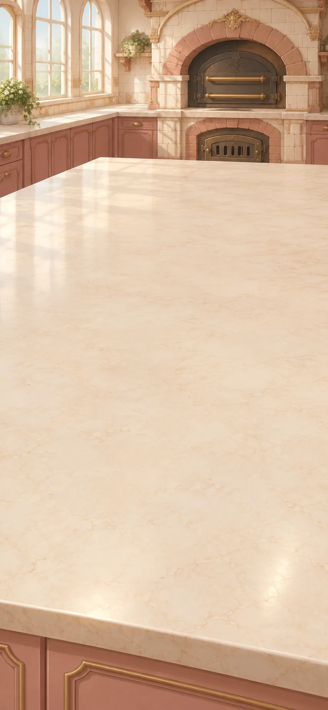
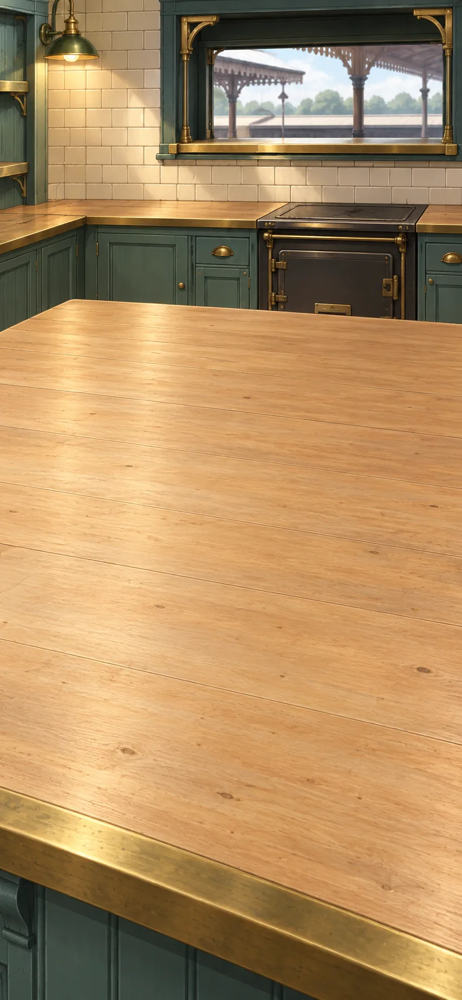
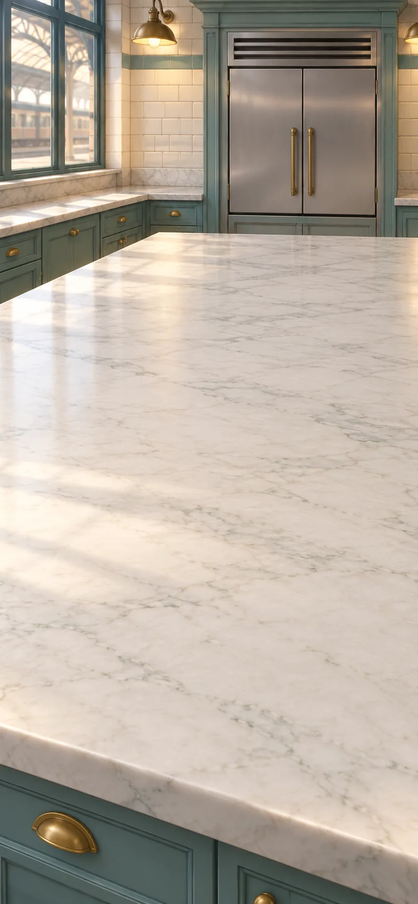

# The Kitchen Caravan

Travel with a kitchen caravan from a roadside breakfast through an orchard, a rainy market and the railway kitchens. Keep cooking in each kitchen while its people need you, then take your useful preparations onward. The journey ends by sending a real supper aboard the departing train. A staffed pantry cart and managed cold storage keep saved ingredients and preparations under the cooks’ care between stops; some of the breakfast juice is reserved for the journey.

> NOTE: Adapted from `kitchen-caravan-small-sessions-v8`, composed through `ui/current-scenarios.ts` at source commit `1c95988a4e3771abcf2be28183ce009d38645d2c`. The 35 cooking sessions and their recipe alternatives were retained in the Markdown conversion. This manuscript now runs in the shared Markdown engine; subsequent wording revisions are recorded in the repository history.

> NOTE: This is a continuous culinary journey, not a universal chronology or an invention ladder. Ingredients and shared preparation batches represent usable portions. Recipes compress proportions, preparation, waiting, heating and cooling under the cooks’ care. They are not complete formulas, home-preservation procedures or shelf-life guarantees. Referenced techniques support named processes, not invention dates.

## Roadside hearth

We have stopped beside the road. The children want porridge, flatbread and apple juice before we leave.

**Goals**
- Make flatbread. -- Flatbread
- Make apple juice. -- Apple juice
- Make fruit porridge. -- Fruit porridge

**Hotspots**
- Hearth fire

**Items**
- Grain
- Millstone
- Water
- Apples
- Fruit press

**Combinations**
- Grain + Millstone [preserve] -> Flour
- Flour + Water -> Dough
- Dough @ Hearth fire -> Flatbread
- Apples + Fruit press [preserve] -> Apple juice
- Grain + Water -> Soaked grain
- Soaked grain [transform] @ Hearth fire -> Porridge
- Porridge [transform] + Apples -> Fruit porridge

## Orchard dairy table

The dairy keeper has offered us a bed for the night. At the dairy table, help make butter and fruit yogurt for breakfast.

The yogurt starter is a milk culture, different from the yeast used for bread. Churning cream separates butter; straining yogurt later makes a thicker spread.

**Goals**
- Make butter. -- Butter
- Make fruit yogurt. -- Fruit yogurt

**Hotspots**
- Warm shelf

**Items**
- Milk
- Yogurt starter
- Cream
- Churn
- Apples

**Combinations**
- Milk + Yogurt starter [preserve] @ Warm shelf -> Yogurt
- Cream + Churn [preserve] -> Butter
- Yogurt + Apples -> Fruit yogurt

> NOTE: [OpenStax: What Our Ancestors Knew](https://openstax.org/books/microbiology/pages/1-1-what-our-ancestors-knew). Fermentation history; not exact recipe ratios or a universal chronology.

## Orchard bakehouse

The baker is starting breakfast next door. Bring the dough from the roadside hearth and the butter we have just made.

**Goals**
- Make bread and butter. -- Bread and butter

**Hotspots**
- Proofing shelf
- `bakehouse-oven-bread` Oven

**Items**
- Baker’s yeast
- Dough
- Butter

**Combinations**
- Dough + Baker’s yeast [preserve] @ Proofing shelf -> Leavened dough
- Leavened dough [transform] @ `bakehouse-oven-bread` -> Bread
- Bread + Butter -> Bread and butter

## Orchard straining table

The dairy keeper is draining yogurt at the side table. There is flatbread for a herb spread, and cucumber for another bowl of yogurt.

**Goals**
- Make flatbread with herbed yogurt. -- Flatbread with herbed yogurt
- Make cucumber yogurt. -- Cucumber yogurt

**Items**
- Straining cloth
- Herbs
- Cucumber
- Yogurt
- Flatbread

**Combinations**
- Yogurt + Straining cloth [preserve] -> Strained yogurt
- Strained yogurt [transform] + Herbs -> Herbed strained yogurt
- Flatbread + Herbed strained yogurt [transform] -> Flatbread with herbed yogurt
- Yogurt + Cucumber [preserve] -> Cucumber yogurt

## Orchard cider workbench

We have brought apple juice to the farm's cider maker. The harvest crew also needs salad for lunch.

The cider maker manages the fermentation and supplies air when making vinegar. The dressing is for this meal; the culture alone does not establish a safe acidity for preserving food.

**Goals**
- Make dressed salad. -- Dressed salad

**Hotspots**
- Air fed vat

**Items**
- Cider yeast
- Vinegar culture
- Olive oil
- Salad leaves
- Apple juice

**Combinations**
- Apple juice + Cider yeast [preserve] -> Hard cider
- Hard cider [transform] + Vinegar culture [preserve] @ Air fed vat -> Cider vinegar
- Cider vinegar [transform] + Olive oil [preserve] -> Vinaigrette
- Salad leaves [preserve] + Vinaigrette -> Dressed salad

> NOTE: [Aspall: Vinegar Production](https://www.aspall.co.uk/blogs/our-story/vinegar-production). Producer account of alcohol-to-acid conversion and oxygen supply; no home-preservation guarantee.

## Orchard lunch stove

By lunchtime, the farm stove is free. The crew would like warm herb toast and yogurt with cooked apples.

**Goals**
- Make herb toast. -- Herb toast
- Make compote yogurt. -- Compote yogurt

**Hotspots**
- Grill
- `orchard-stove-orchard-lunch` Stove

**Items**
- Butter
- Herbs
- Bread
- Apples
- Apple juice
- Yogurt

**Combinations**
- Butter + Herbs -> Herb butter
- Bread + Herb butter -> Herb-buttered bread
- Herb-buttered bread [transform] @ Grill -> Herb toast
- Apples + Apple juice @ `orchard-stove-orchard-lunch` -> Apple compote
- Yogurt + Apple compote -> Compote yogurt

## Inn soup stove

Rain has stopped the caravan at an inn. The guests want bread soup and onion soup with our herb toast.

**Goals**
- Make bread soup. -- Bread soup
- Make onion soup with herb toast. -- Onion soup with herb toast

**Hotspots**
- `soup-stove-soup` Stove

**Items**
- Root vegetables
- Onions
- Water
- Bread
- Butter
- Herb toast

**Combinations**
- Root vegetables + Water -> Vegetable stock pot
- Vegetable stock pot [transform] @ `soup-stove-soup` -> Vegetable broth
- Bread + Vegetable broth -> Bread soup
- Onions [preserve] + Butter @ `soup-stove-soup` -> Softened onions
- Softened onions [transform] + Vegetable broth -> Onion soup
- Onion soup [transform] + Herb toast [preserve] -> Onion soup with herb toast

## Inn roasting oven

The drivers are still outside unloading. At the roasting oven, make them a bean-and-root filling for our flatbread. Keep some roast roots and crisp bread cubes for tomorrow’s salads.

**Goals**
- Make roasted roots. -- Roasted roots
- next: Make root-and-bean flatbread. -- Root-and-bean flatbread
- Make croutons. -- Croutons

**Hotspots**
- `roasting-oven-roast` Oven

**Items**
- Cooked beans
- Vegetable broth
- Root vegetables
- Herb butter
- Flatbread
- Bread

**Combinations**
- Cooked beans [preserve] + Vegetable broth -> Bean stew
- Root vegetables + Herb butter @ `roasting-oven-roast` -> Roasted roots
- Bean stew + Roasted roots -> Bean stew with roasted roots
- Flatbread + Bean stew with roasted roots [consume] -> Root-and-bean flatbread
- Bread @ `roasting-oven-roast` -> Croutons

## Inn salad counter

The next morning, the gardener brings mustard to the salad counter. Our roast roots, dressed leaves and croutons are ready. An old account of lettuce lies beside the ingredients.

**Goals**
- Make roasted-root salad. -- Roasted-root salad
- Make green salad with croutons. -- Green salad with croutons

**Items**
- Ground mustard seed
- Evelyn calls lettuce cold and moist

  “It is indeed of Nature more cold and moist than any of the rest”

  Evelyn describes lettuce using an old medical theory that classified foods as hot, cold, wet or dry. That theory is no longer an accepted explanation of how food affects health.

  > NOTE: John Evelyn, Acetaria (1699), catalogue entry 34: Lettuce. Excerpt spelling modernised; contextual note by the game author.

- Cider vinegar
- Vinaigrette
- Roasted roots
- Dressed salad
- Croutons

**Combinations**
- Ground mustard seed + Cider vinegar -> Mustard paste
- Mustard paste [transform] + Vinaigrette -> Mustard dressing
- Roasted roots + Mustard dressing [preserve] -> Roasted-root salad
- Dressed salad [transform] + Croutons [preserve] -> Green salad with croutons
- Roasted roots + Vinaigrette -> Roasted-root salad
- Ground mustard seed + Vinaigrette -> Mustard dressing

> NOTE: [John Evelyn: Acetaria (1699)](https://www.gutenberg.org/files/15517/15517-h/15517-h.htm). Primary historical salad text; period health beliefs are not accepted science.

> NOTE: [NLM: Shakespeare and the Four Humors](https://www.nlm.nih.gov/exhibition/shakespeare-and-the-four-humors/index.html). Discarded historical theory; no medical efficacy mechanic.

> NOTE: [Giada De Laurentiis: Roasted Root Vegetable Salad](https://www.foodnetwork.com/recipes/giada-de-laurentiis/roasted-root-vegetable-salad-recipe-2095657). Pairing support only, not an exact reproduction.

> NOTE: [Colman’s Mustard: Foodservice](https://colmansusa.com/foodservice). Producer guidance lists mustard powder for vinaigrettes. It does not specify this game’s exact quantity or mixing order.

## Cookshop pasta bench

The market cookshop needs pasta for lunch. At the pasta bench, prepare noodles and filled pasta, and make crumbs from our bread.

**Goals**
- Make fresh noodles. -- Fresh noodles
- Make filled ravioli. -- Filled ravioli
- Make breadcrumbs. -- Breadcrumbs

**Items**
- Bread knife
- Eggs
- Rolling pin
- Cutting wheel
- Bread
- Flour
- Roasted roots
- Strained yogurt

**Combinations**
- Bread + Bread knife [preserve] -> Breadcrumbs
- Flour + Eggs -> Egg pasta dough
- Egg pasta dough [transform] + Rolling pin [preserve] -> Pasta sheets
- Pasta sheets + Cutting wheel [preserve] -> Fresh noodles
- Roasted roots + Strained yogurt [transform] -> Root and yogurt filling
- Pasta sheets + Root and yogurt filling [transform] -> Filled ravioli

> NOTE: [A. Escoffier: A Guide to Modern Cookery](https://www.gutenberg.org/cache/epub/71395/pg71395-images.html). Primary culinary source for sauces, pastry, puddings and desserts; not invention dates. Common game preparations are simplified, not exact reproductions.

## Cookshop pasta range

The lunch queue has arrived. Take the pasta and crumbs across to the cooking pots. Our herb butter will go with both dishes.

**Goals**
- Make noodles with toasted crumbs. -- Noodles with toasted crumbs
- Make ravioli with herb butter. -- Ravioli with herb butter

**Hotspots**
- Cooking pot
- Frying pan

**Items**
- Fresh noodles
- Herb butter
- Breadcrumbs
- Filled ravioli

**Combinations**
- Fresh noodles [transform] @ Cooking pot -> Cooked noodles
- Cooked noodles + Herb butter -> Herb-buttered noodles
- Breadcrumbs @ Frying pan -> Toasted crumbs
- Herb-buttered noodles [transform] + Toasted crumbs [preserve] -> Noodles with toasted crumbs
- Filled ravioli [transform] @ Cooking pot -> Cooked ravioli
- Cooked ravioli [transform] + Herb butter -> Ravioli with herb butter

## Cookshop pastry bench

The pastry cook is preparing for tomorrow’s market. This bench has room to make shortcrust and fold butter into dough for puff pastry.

Butter rubbed through flour makes crumbs that need water to bind them. For puff pastry, cold butter is folded between layers of dough instead of being stirred through it.

**Goals**
- Make shortcrust. -- Shortcrust
- Make laminated dough. -- Laminated dough

**Hotspots**
- Pastry bench

**Items**
- Flour
- Butter
- Water
- Dough

**Combinations**
- Flour + Butter @ Pastry bench -> Buttery pastry crumbs
- Buttery pastry crumbs [transform] + Water -> Shortcrust
- Dough + Butter @ Pastry bench -> Laminated dough

> NOTE: [King Arthur: Pie Crust guide](https://www.kingarthurbaking.com/learn/guides/pie-crust). Fat-in-flour crumbs need water to become dough.

> NOTE: [King Arthur: Classic Puff Pastry](https://www.kingarthurbaking.com/recipes/classic-puff-pastry-pate-feuilletee-recipe). Distinct folded butter layers; preparation is compressed.

## Cookshop pastry ovens

At the ovens, the cook is filling the pastry cases. Our bean stew can become a pie; apples can fill a tart. The confectioner needs plain puff pastry for later almond pastries, while the market workers want cheese straws with their meal.

**Goals**
- Make bean pie. -- Bean pie
- next: Make fruit tart. -- Fruit tart
- Make puff pastry. -- Puff pastry
- next: Bake cheese straws for the meal. -- Cheese straws

**Hotspots**
- `pastry-oven-pastry` Oven

**Items**
- Grated cheese
- Shortcrust
- Apples
- Laminated dough
- Bean stew

**Combinations**
- Shortcrust + Apples -> Unbaked fruit tart
- Unbaked fruit tart [transform] @ `pastry-oven-pastry` -> Fruit tart
- Laminated dough [transform] @ `pastry-oven-pastry` -> Puff pastry
- Shortcrust + Bean stew -> Unbaked bean pie
- Unbaked bean pie [transform] @ `pastry-oven-pastry` -> Bean pie
- Laminated dough [transform] + Grated cheese -> Cheese-straw twists
- Cheese-straw twists [transform] @ `pastry-oven-pastry` -> Cheese straws

## Cookshop sauce range

The market workers have stayed for supper. At the sauce range, make a cheese sauce for the supper cook's noodles and vegetables.

Here the flour and butter cook together into a pale roux, unlike the cold crumbs at the pastry bench. Milk makes a smooth white sauce, ready to enrich with cheese.

**Goals**
- Make cheese sauce. -- Cheese sauce

**Hotspots**
- `saucepan-sauce` Saucepan

**Items**
- Flour
- Butter
- Milk
- Grated cheese

**Combinations**
- Flour + Butter @ `saucepan-sauce` -> White roux
- White roux [transform] + Milk -> Béchamel
- Béchamel [transform] + Grated cheese -> Cheese sauce

## Cookshop supper ovens

The supper cook has a cauliflower and our remaining noodles ready. The workers want a cauliflower dish and baked cheese noodles; either a gratin or a simple buttered vegetable will suit the meal.

**Goals**
- Cook a cauliflower dish.
  - either: Cauliflower gratin
  - or: Buttered cauliflower
- Make baked cheese noodles. -- Baked cheese noodles

**Hotspots**
- Steamer
- `supper-oven-gratin` Oven

**Items**
- Cauliflower
- Cheese sauce
- Cooked noodles
- Butter

**Combinations**
- Cauliflower [preserve] @ Steamer -> Cooked cauliflower
- Cooked cauliflower [transform] + Cheese sauce -> Cauliflower in cheese sauce
- Cauliflower in cheese sauce [transform] @ `supper-oven-gratin` -> Cauliflower gratin
- Cooked noodles [transform] + Cheese sauce -> Noodles in cheese sauce
- Noodles in cheese sauce [transform] @ `supper-oven-gratin` -> Baked cheese noodles
- Cooked cauliflower [transform] + Butter -> Buttered cauliflower

## Cookshop preserving stove

The fruit cook needs jam and marmalade for tomorrow, and syrup for the railway kitchen. The sugar also has a difficult history of plantation slavery.

These are preparations for the cooks to use, not a claim of shelf-stable preservation. The actual preserving line comes later.

**Goals**
- Make soft-set fruit jam. -- Soft-set fruit jam
- Prepare fruit syrup for later desserts and preserves. -- Fruit syrup
- Make marmalade. -- Marmalade

**Hotspots**
- `saucepan-preserves` Saucepan

**Items**
- Sugar

  A sweet ingredient used in preserves, cakes and confectionery. In a 1657 account of Barbados, Richard Ligon describes plantation sugar production that treated enslaved people as property. His account records the colonists' pursuit of profit, not the voices of the people they enslaved; it does not describe every place or period that made sugar.

  > NOTE: Game-author paraphrase and contextual note, not a quotation. Richard Ligon, A True & Exact History of the Island of Barbados (1657), pp. 22–23 and 113–116. A colonial participant’s account; not testimony from enslaved workers.

- Citrus
- Apples
- Apple juice
- Water

**Combinations**
- Apples + Sugar -> Macerated fruit
- Macerated fruit [transform] @ `saucepan-preserves` -> Soft-set fruit jam
- Apple juice + Sugar @ `saucepan-preserves` -> Fruit syrup
- Citrus [preserve] + Water @ `saucepan-preserves` -> Softened citrus
- Softened citrus [transform] + Sugar @ `saucepan-preserves` -> Marmalade

> NOTE: [UK Parliament: Trade Routes and the Slave Trade](https://www.parliament.uk/about/living-heritage/transformingsociety/tradeindustry/slavetrade/overview/trade-routes-and-the-slave-trade/). Context for sugar trade and enslaved labour; not recipe evidence.

> NOTE: [Richard Ligon: A True & Exact History of the Island of Barbados (1657), pp. 22–23, 113–116](https://www.gutenberg.org/cache/epub/70489/pg70489-images.html). Primary colonial account, consulted directly. Supports this optional, geographically and temporally bounded game-author paraphrase; not a modern recipe method or enslaved people’s own testimony.

## Cookshop ovens — evening

After supper service, the oven bench is clear for dessert. Bring the jam, pastry and apple compote. The earlier food stays on its own worktops.

**Goals**
- Make jam tart. -- Jam tart
- Make fruit crumble. -- Fruit crumble

**Hotspots**
- `supper-oven-fruit-baking` Oven

**Items**
- Breadcrumbs
- Butter
- Shortcrust
- Soft-set fruit jam
- Apple compote
- Fruit tart
- Fruit syrup
- Glazed fruit tart

**Combinations**
- Breadcrumbs + Butter -> Buttery crumble topping
- Shortcrust + Soft-set fruit jam -> Unbaked jam tart
- Unbaked jam tart [transform] @ `supper-oven-fruit-baking` -> Jam tart
- Apple compote + Buttery crumble topping [consume] -> Unbaked fruit crumble
- Unbaked fruit crumble [transform] @ `supper-oven-fruit-baking` -> Fruit crumble
- Fruit tart [transform] + Fruit syrup -> Glazed fruit tart

## Fair almond counter

The fair’s confectioner is making almond pastries at the nut counter. The sugar mill and mortar are ready, with dates for anyone who wants filled sweets.

**Goals**
- Make almond-filled puff pastry. -- Almond-filled puff pastry

**Items**
- Sugar mill
- Almonds
- Mortar
- Pitted dates
- Sugar
- Water
- Puff pastry
- Marzipan-stuffed dates

**Combinations**
- Sugar + Sugar mill [preserve] -> Confectioner’s sugar
- Almonds + Mortar -> Ground almonds
- Ground almonds [transform] + Confectioner’s sugar -> Almond and sugar mixture
- Almond and sugar mixture + Water -> Marzipan
- Puff pastry [transform] + Marzipan -> Almond-filled puff pastry
- Marzipan + Pitted dates [preserve] -> Marzipan-stuffed dates

> NOTE: [Goethe-Institut: Marzipan](https://www.goethe.de/resources/files/pdf341/marzipan_englisch.pdf). First-party cultural recipe explicitly blends icing sugar with finely ground almonds before adding water; proportions and kneading are compressed in the game.

## Fair sugar stove

At the sugar stove, the confectioner needs brittle for the stall and caramel sauce for the bakery. Either wet or dry caramel preparation will work.

**Goals**
- Make almond brittle. -- Almond brittle
- Make caramel sauce. -- Caramel sauce

**Hotspots**
- `sugar-pan-caramel` Saucepan

**Items**
- Sugar
- Water
- Almonds
- Cream

**Combinations**
- Sugar + Water @ `sugar-pan-caramel` -> Sugar syrup
- Sugar syrup [transform] @ `sugar-pan-caramel` -> Caramel
- Caramel + Almonds -> Almond brittle
- Caramel + Cream -> Caramel sauce
- Sugar @ `sugar-pan-caramel` -> Caramel

## Fair custard stove

The baker needs pouring custard and a thicker pastry filling. The custard cook has yolks, milk, sugar, vanilla and starch ready. Keep some uncooked custard mixture for a bread pudding.

Pouring custard and pastry cream are different preparations. Starch thickens the cream into a filling; the pouring custard remains a sauce.

**Goals**
- Make custard mixture. -- Custard mixture
- next: Make custard for the ice room. -- Vanilla custard
- Make pastry cream. -- Pastry cream

**Hotspots**
- `sugar-pan-custard` Saucepan

**Items**
- Egg yolks
- Vanilla
- Corn starch
- Sugar
- Milk

**Combinations**
- Egg yolks [preserve] + Sugar -> Sweetened yolks
- Sweetened yolks [transform] + Milk -> Custard mixture
- Custard mixture [transform] @ `sugar-pan-custard` -> Pouring custard
- Pouring custard [transform] + Vanilla -> Vanilla custard
- Sweetened yolks [transform] + Corn starch [preserve] -> Starch-thickened yolk base
- Starch-thickened yolk base [transform] + Milk -> Pastry cream mixture
- Pastry cream mixture [transform] @ `sugar-pan-custard` -> Pastry cream

> NOTE: [King Arthur: Pastry Cream](https://www.kingarthurbaking.com/recipes/pastry-cream-creme-patissiere-recipe). Egg yolks, milk, sugar and starch cooked into pastry filling; game separates pouring custard from starch-thickened cream.

## Fair pudding oven

At the pudding oven, use our dry bread for a caramel pudding and fill a pastry case with cream and fruit.

**Goals**
- Make fruit cream tart. -- Fruit cream tart
- Make caramel bread pudding. -- Caramel bread pudding

**Hotspots**
- `custard-oven-custard-baking` Oven

**Items**
- Shortcrust
- Pastry cream
- Apples
- Bread
- Custard mixture
- Caramel sauce

**Combinations**
- Shortcrust [transform] @ `custard-oven-custard-baking` -> Baked tart case
- Baked tart case [transform] + Pastry cream -> Cream-filled tart
- Cream-filled tart [transform] + Apples -> Fruit cream tart
- Bread + Custard mixture -> Custard-soaked bread
- Custard-soaked bread [transform] @ `custard-oven-custard-baking` -> Bread pudding
- Bread pudding [transform] + Caramel sauce -> Caramel bread pudding

## Fair choux ovens

The pastry stall is running low. The choux cook will make hollow buns for filling and a cheese batch for the staff.

The cooked flour paste is enriched with eggs after appropriate cooling. Steam expands the shaped paste into hollow buns; the cook manages the preparation and baking.

**Goals**
- Make hollow choux buns. -- Hollow choux buns
- Make cheese puffs. -- Cheese puffs

**Hotspots**
- `choux-pan-choux` Saucepan
- `choux-oven-choux` Oven

**Items**
- Butter
- Water
- Flour
- Eggs
- Grated cheese

**Combinations**
- Butter + Water @ `choux-pan-choux` -> Choux cooking liquid
- Choux cooking liquid [transform] + Flour @ `choux-pan-choux` -> Cooked flour paste
- Cooked flour paste [transform] + Eggs -> Choux paste
- Choux paste [transform] @ `choux-oven-choux` -> Hollow choux buns
- Choux paste [transform] + Grated cheese -> Cheese choux paste
- Cheese choux paste [transform] @ `choux-oven-choux` -> Cheese puffs

> NOTE: [King Arthur: Pâte à Choux](https://www.kingarthurbaking.com/recipes/pate-a-choux-recipe). Cooked flour paste and egg enrichment; shaping and baking compressed.

## Fair pastry filling table

The buns have cooled at the filling table. Our pastry cream and caramel sauce are ready, and there is cream to whip.

**Goals**
- Make caramel choux. -- Caramel choux
- Make whipped cream. -- Whipped cream
- next: Make cream puffs. -- Cream puffs

**Items**
- Whisk
- Cream
- Hollow choux buns
- Pastry cream
- Caramel sauce

**Combinations**
- Cream + Whisk -> Whipped cream
- Hollow choux buns [transform] + Pastry cream -> Custard-filled choux
- Hollow choux buns [transform] + Whipped cream -> Cream puffs
- Custard-filled choux [transform] + Caramel sauce -> Caramel choux

## Fair cake ovens — morning

The next morning, the bakery has cleared a cake bench for a family’s birthday. Make a plain sponge and a chocolate one; yesterday’s pastries stay at their counter.

**Goals**
- Make sponge cake. -- Sponge cake
- Make chocolate sponge. -- Chocolate sponge

**Hotspots**
- `choux-oven-sponge` Oven

**Items**
- Cocoa powder
- Eggs
- Whisk
- Sugar
- Flour

**Combinations**
- Eggs + Whisk -> Egg foam
- Egg foam [transform] + Sugar -> Sweet egg foam
- Sweet egg foam [transform] + Flour -> Sponge batter
- Sponge batter [transform] @ `choux-oven-sponge` -> Sponge cake
- Sponge batter [transform] + Cocoa powder -> Chocolate sponge batter
- Chocolate sponge batter [transform] @ `choux-oven-sponge` -> Chocolate sponge

## Fair cake finishing table

The cakes have cooled. At the finishing table, use one for a jam roll and some cake pieces for a fruit trifle.

**Goals**
- Make jam-and-cream roll. -- Jam-and-cream roll
- Make cream-topped trifle. -- Cream-topped trifle

**Items**
- Sponge cake
- Soft-set fruit jam
- Whipped cream
- Vanilla custard
- Apple compote

**Combinations**
- Sponge cake + Soft-set fruit jam -> Jam roll
- Jam roll [transform] + Whipped cream -> Jam-and-cream roll
- Sponge cake + Vanilla custard -> Trifle base
- Trifle base [transform] + Apple compote -> Fruit trifle
- Fruit trifle [transform] + Whipped cream -> Cream-topped trifle

## Station chocolate workbench

The family will leave on the evening train. At the station’s chocolate workbench, prepare chocolate, ganache and glaze for their cake and sweets.

The roasted cacao nibs have already been fermented and processed. The chocolate maker manages refining, conching, tempering and setting; combining the ingredients stands for that skilled work.

**Goals**
- Make dark chocolate. -- Dark chocolate
- next: Make chocolate ganache and chocolate glaze.
  - both: Chocolate ganache
  - and: Chocolate glaze

**Items**
- Roasted cacao nibs
- Cocoa butter
- Mortar
- Sugar
- Cream
- Butter

**Combinations**
- Roasted cacao nibs [preserve] + Mortar -> Ground cacao paste
- Ground cacao paste [transform] + Sugar -> Sweetened cacao paste
- Sweetened cacao paste [transform] + Cocoa butter [preserve] -> Dark chocolate
- Dark chocolate + Cream -> Chocolate ganache
- Dark chocolate + Butter -> Chocolate glaze

> NOTE: [European Cocoa Association: Processing](https://www.eurococoa.com/cocoa-story/cocoa-story-the-production-process-from-cocoa-beans-to-semi-finished-products/). Industry association process account for nibs, paste, cocoa butter, refining and conching; not a homemade chocolate recipe.

## Station chocolate counter

The chocolate counter has space to finish our sponge, almond sweets and cream puffs. The birthday guests are waiting.

**Goals**
- Make ganache-filled chocolate cake. -- Ganache-filled chocolate cake
- Make chocolate-coated marzipan. -- Chocolate-coated marzipan
- Make chocolate profiteroles. -- Chocolate profiteroles

**Items**
- Chocolate sponge
- Chocolate ganache
- Marzipan
- Dark chocolate
- Cream puffs
- Chocolate glaze

**Combinations**
- Chocolate sponge [transform] + Chocolate ganache -> Ganache-filled chocolate cake
- Marzipan [transform] + Dark chocolate -> Chocolate-coated marzipan
- Cream puffs [transform] + Chocolate glaze -> Chocolate profiteroles
- Cream puffs [transform] + Chocolate ganache -> Chocolate profiteroles

## Station tea ovens

The tea room needs scones for waiting passengers. Jam and whipped cream are ready from the fair, and the counter can prepare hot chocolate.

**Goals**
- Make cream tea plate. -- Cream tea plate

**Hotspots**
- `tea-oven-tea` Oven
- `chocolate-pan-tea` Saucepan

**Items**
- Baking powder
- Flour
- Butter
- Milk
- Soft-set fruit jam
- Whipped cream
- Cocoa powder
- Hot chocolate

**Combinations**
- Flour + Baking powder [preserve] -> Self-raising flour
- Self-raising flour [transform] + Butter -> Rubbed-in scone mix
- Rubbed-in scone mix [transform] + Milk -> Scone dough
- Scone dough [transform] @ `tea-oven-tea` -> Scones
- Scones [transform] + Soft-set fruit jam -> Jam-filled scones
- Jam-filled scones [transform] + Whipped cream -> Cream tea plate
- Cocoa powder + Milk @ `chocolate-pan-tea` -> Hot chocolate

> NOTE: Rubbed-in scone mix: This is the unbaked flour-and-fat mixture, not crumbs from baked scones. [British Dietetic Association: Basic Scones](https://www.bda.uk.com/resource/basic-scones.html) distinguishes rubbing fat into flour from adding milk to form dough and then baking. Proportions and shaping remain compressed.

## Station tea ovens — later shift

Later, another shift takes over the cleared baking bench. The crew needs fruit muffins, and we need a soda loaf for the journey. The previous tea service remains at its counter.

**Goals**
- Make fruit muffins. -- Fruit muffins
- Make soda bread. -- Soda bread

**Hotspots**
- `tea-oven-crew-baking` Oven

**Items**
- Baking soda
- Eggs
- Milk
- Butter
- Self-raising flour
- Apples
- Yogurt
- Flour

**Combinations**
- Eggs + Milk -> Beaten egg-and-milk mixture
- Beaten egg-and-milk mixture [transform] + Butter -> Buttery muffin mixture
- Buttery muffin mixture [transform] + Self-raising flour -> Muffin batter
- Muffin batter [transform] + Apples -> Fruit muffin batter
- Fruit muffin batter [transform] @ `tea-oven-crew-baking` -> Fruit muffins
- Yogurt + Baking soda [preserve] -> Yogurt and soda mixture
- Yogurt and soda mixture [transform] + Flour -> Soda bread dough
- Soda bread dough [transform] @ `tea-oven-crew-baking` -> Soda bread

## Station freezing bench

The afternoon is hot. At the freezing bench, make a custard ice, fruit sorbet and a plain milk ice cream for the dessert cook.

**Goals**
- Make frozen custard. -- Frozen custard
- Make fruit sorbet. -- Fruit sorbet
- Make milk ice cream. -- Milk ice cream

**Items**
- Freezing churn
- Vanilla custard
- Apple compote
- Fruit syrup
- Cream
- Milk
- Sugar

**Combinations**
- Vanilla custard [transform] + Freezing churn -> Frozen custard
- Apple compote + Fruit syrup -> Fruit sorbet base
- Fruit sorbet base [transform] + Freezing churn -> Fruit sorbet
- Cream + Milk -> Milk-and-cream base
- Milk-and-cream base [transform] + Sugar -> Sweetened cream base
- Sweetened cream base [transform] + Freezing churn -> Milk ice cream

## Station meringue ovens

The pastry cook saved the egg whites from the custards. At the meringue ovens, use them for fruit nests and almond sandwiches.

**Goals**
- Make fruit meringue nests. -- Fruit meringue nests
- Make chocolate macarons. -- Chocolate macarons

**Hotspots**
- `meringue-oven-meringue` Oven

**Items**
- Egg whites
- Whisk
- Sugar
- Whipped cream
- Apples
- Almond and sugar mixture
- Chocolate ganache

**Combinations**
- Egg whites [preserve] + Whisk -> Egg-white foam
- Egg-white foam [transform] + Sugar -> Meringue
- Meringue [transform] @ `meringue-oven-meringue` -> Meringue nests
- Meringue nests [transform] + Whipped cream -> Cream-filled meringue nests
- Cream-filled meringue nests [transform] + Apples -> Fruit meringue nests
- Meringue [transform] + Almond and sugar mixture -> Macaron batter
- Macaron batter [transform] @ `meringue-oven-meringue` -> Macaron shells
- Macaron shells [transform] + Chocolate ganache -> Chocolate macarons

> NOTE: [King Arthur Baking School: French Macaron](https://shop.kingarthurbaking.com/content/class-pdfs/FrenchMacaron_August2025.pdf). First-party teaching recipe for almond-sugar mixture folded into meringue; exact formula is not reproduced.

## Station dessert counter

The ices and meringues are ready at the dessert counter. Serve a sundae with caramel or chocolate, and finish the frozen cake under its meringue coat.

**Goals**
- Make a sundae.
  - either: Caramel sundae
  - or: Chocolate sundae
- Make baked alaska. -- Baked Alaska

**Hotspots**
- `meringue-oven-dessert-service` Oven

**Items**
- Frozen custard
- Caramel sauce
- Sponge cake
- Milk ice cream
- Meringue
- Chocolate glaze

**Combinations**
- Frozen custard [transform] + Caramel sauce -> Caramel sundae
- Sponge cake [transform] + Milk ice cream -> Ice-cream cake
- Ice-cream cake [transform] + Meringue @ `meringue-oven-dessert-service` -> Baked Alaska
- Milk ice cream [transform] + Chocolate glaze -> Chocolate sundae
- Milk ice cream [transform] + Caramel sauce -> Caramel sundae

## Station preserving lines

The train's food cart is delayed. A specialist will process and seal bean stew using the preserving equipment. Open the prepared fruit sample here to serve with custard.

Closing a jar or tin is not enough to preserve its contents. The specialist manages the established commercial processes, including sealing and heat treatment. Open the fruit for serving, while the separately processed stew tin stays sealed for the journey.

**Goals**
- Make bottled fruit with custard. -- Bottled fruit with custard
- Make processed bean-stew tin. -- Processed bean-stew tin

**Hotspots**
- Controlled fruit line
- Controlled stew line

**Items**
- Preserving jar
- Opener
- Empty food tin
- Apples
- Fruit syrup
- Vanilla custard
- Bean stew

**Combinations**
- Apples + Fruit syrup -> Apples in syrup
- Apples in syrup [transform] + Preserving jar [consume] -> Fruit-filled jar
- Fruit-filled jar [transform] @ Controlled fruit line -> Processed fruit jar
- Processed fruit jar [transform] + Opener [preserve] -> Opened bottled fruit
- Opened bottled fruit [transform] + Vanilla custard -> Bottled fruit with custard
- Bean stew + Empty food tin [consume] -> Stew-filled tin
- Stew-filled tin [transform] @ Controlled stew line -> Processed bean-stew tin

> NOTE: [USDA NAL: How Did We Can?](https://www.nal.usda.gov/exhibits/ipd/canning/). History of heat processing and sealed containers, not a safe procedure.

> NOTE: [NCHFP: Ensuring Safe Canned Foods](https://nchfp.uga.edu/how/can/general-information/ensuring-safe-canned-foods/). Specific validated processes matter; game does not teach canning or certify safety.

## Station supper bench

The passengers need supper before departure. At the supper bench, put our stew with the soda bread and finish a cake. Either vanilla sandwich cake or iced chocolate cake can go aboard.

**Goals**
- Serve bean stew with soda bread. -- Bean stew and soda bread
- Finish a cake for the dining car.
  - either: Vanilla sandwich cake
  - or: Iced chocolate cake

**Items**
- Bean stew
- Soda bread
- Butter
- Confectioner’s sugar
- Vanilla
- Sponge cake
- Water
- Ganache-filled chocolate cake

**Combinations**
- Bean stew + Soda bread [consume] -> Bean stew and soda bread
- Butter + Confectioner’s sugar -> Buttercream
- Buttercream [transform] + Vanilla -> Vanilla buttercream
- Sponge cake + Vanilla buttercream [consume] -> Vanilla sandwich cake
- Confectioner’s sugar + Water -> Water icing
- Ganache-filled chocolate cake [transform] + Water icing [consume] -> Iced chocolate cake

## Dining-car service hatch

The train is boarding. Load supper, a cake, the reserved apple juice and the sealed stew tin onto the trolley. Bring it to the service hatch so the dishes can be passed aboard.

**Goals**
- Bring supper to the service hatch.
  - either: Supper trolley[Bean stew and soda bread, Apple juice, Processed bean-stew tin, Vanilla sandwich cake] @ Service hatch
  - or: Supper trolley[Bean stew and soda bread, Apple juice, Processed bean-stew tin, Iced chocolate cake] @ Service hatch

**Hotspots**
- Service hatch

**Items**
- Supper trolley (compound)
  - unnamed slot: accepts Bean stew and soda bread
  - unnamed slot: accepts Apple juice
  - unnamed slot: accepts Processed bean-stew tin
  - unnamed slot: accepts Vanilla sandwich cake
  - unnamed slot: accepts Iced chocolate cake
- Bean stew and soda bread
- Apple juice
- Processed bean-stew tin

## The End

The crew passes supper, cake, apple juice and sealed provisions through the service hatch. The trolley stays on the platform, and the train leaves with food aboard.
