# Mission to Mars

Your lander crashes badly onto the surface. Can you patch things up and complete your science mission?

> NOTE: Promoted from the accepted Mars v12 reference on 4 November 2026. Fixed identities and recipes implement the 24-chapter story in design-brief.md. The unchanged v12 manuscript, production sources and review records are preserved under projects/mars-study/. Future revisions belong to this live copy. Chapter identifiers remain stable when chapters move.

> NOTE: Visual austerity applies throughout: every component must be original compact mission equipment, finite repurposed packing/service hardware or the minimum locally made part needed for the work. Add no decorative hardware, furniture, trim or new resources. Plain useful forms, hand markings and visible repairs carry the character.

## Crash landing

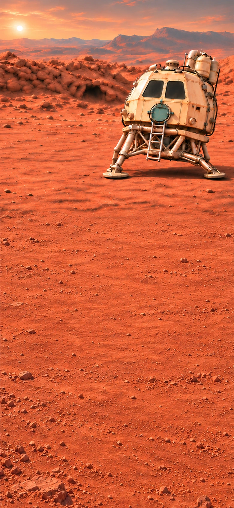

*Emergency*

The stabilizer fin broke. I can't steer. We're coming in hot.

*Crash*

> NOTE: The thin reinforced-fabric starter habitat begins partly deflated. A patch closes its puncture; stored breathing gas then expands it without switching on any lamp. Electric lights remain off until the power chapter. A selected subrounded 25–30 cm stone fits below a sound low cross-member; the original legs continue carrying the lander. The astronaut rolls this stone a short distance, rather than carrying a boulder. The stone fits the existing gap below the sound lower cross-member just right of the ladder. It is an unloaded catch against further settling: the astronaut does not lift, jack or change the lander height. It remains until the permanent support is fitted. The astronaut stays suited outside through the next chapter.

**Goals**
- Stabilize the habitat -- `breathable-habitat`
- Stabilize the lander -- `rock-supported-lander`

**Hotspots**
- `deflated-habitat` (at 22.75641%, 20.7346%)
  - icon: 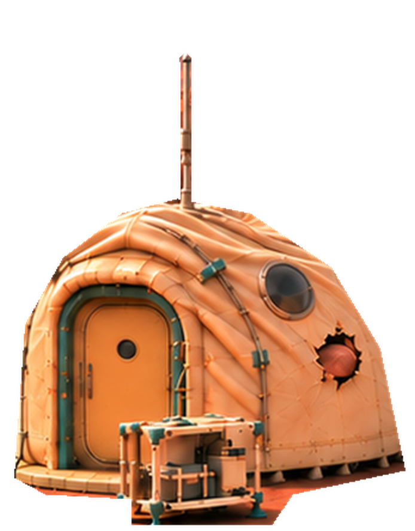
- `patched-habitat` (at 22.75641%, 20.76422%)
  - icon: 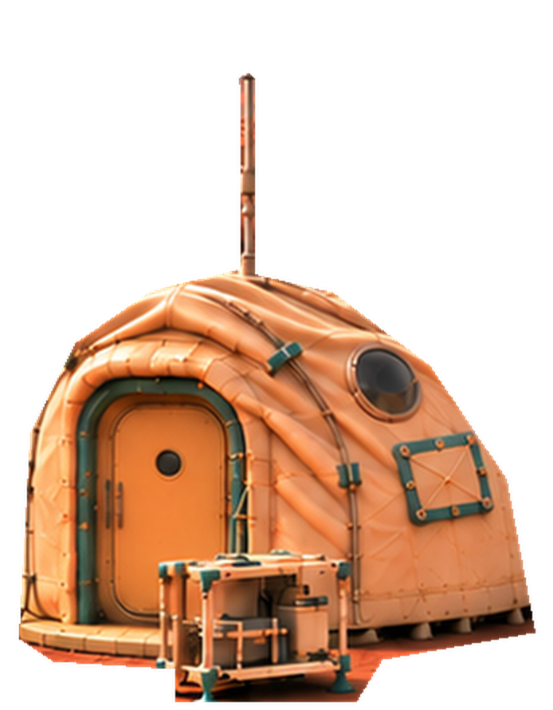
- `breathable-habitat` (at 22.75641%, 20.76422%)
  - icon: 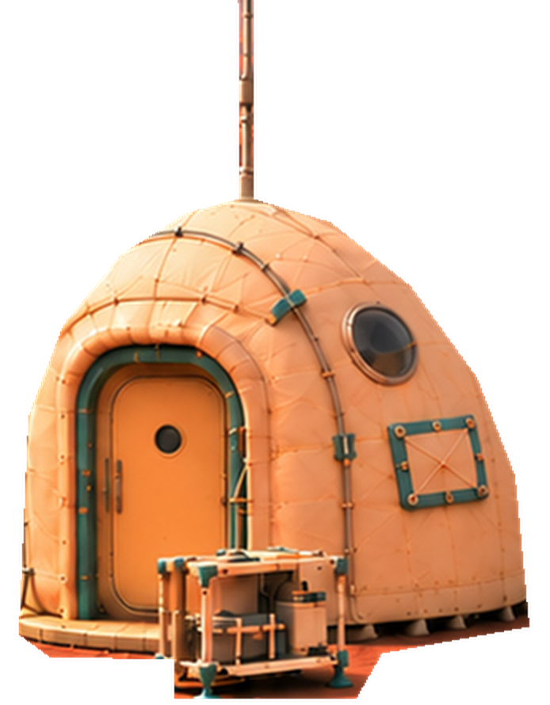
- `damaged-lander` (at 71.47436%, 22.63033%)
  - icon: 
- `rock-supported-lander` (at 71.47436%, 22.65995%)
  - icon: 

**Items**
- `deflated-habitat` Deflated habitat
  - icon: 

- `patched-habitat` Patched habitat
  - icon: 

  The blast blew rocks into the hab, but I’ve sealed the holes. Now it needs air.

- `breathable-habitat` Inflated habitat
  - icon: 

  The fabric lifts and pulls taut. The lamps are still dark.

- `damaged-lander` Damaged landing support
  - icon: 

- `rock-supported-lander` Lander with safety catch
  - icon: 

  I roll the stone into the gap beneath the lower cross-member. Nothing rises. If the damaged support settles farther, the stone will catch it.

- `pressure-patch` Pressure patch
  - icon: 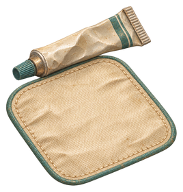

- `air-tanks` Air tanks
  - icon: 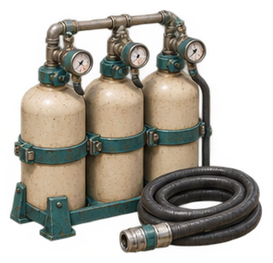

- `rock` Rock
  - icon: 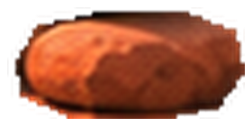

  A rounded stone with one broad bearing face. Too heavy to carry, but I can roll it a short distance.

**Combinations**
- `pressure-patch` [consume] @ `deflated-habitat` [transform] -> `patched-habitat` (tutorial)
- `air-tanks` [consume] @ `patched-habitat` [transform] -> `breathable-habitat`
- `rock` [consume] @ `damaged-lander` [transform] -> `rock-supported-lander`

## Air

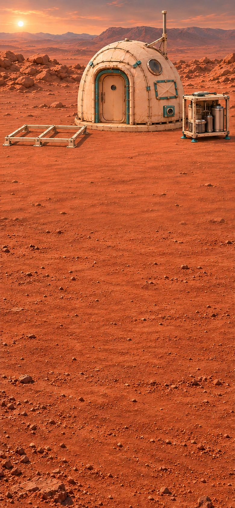

I need to power the hab’s air scrubber before the air runs out.

> NOTE: The astronaut stays suited outside. The array and its charging lead are successive receiving states of the same installed equipment: fitting the cable retires the earlier panel target, not the physical panels. The scrubber is a separate small target and the antenna mounting is above the dome. Three fixed identities are present at most. The two service fittings may be completed in either order; the power goal also requires charging the reserve. Cables are compatible dedicated lengths. The original array stays left of the starter dome and the scrubber right. Small reclaimed components mentioned later come from spares, not from disabling this life-support equipment.

**Goals**
- Restore power to the air scrubber
  - both: `charged-reserve-battery`
  - and: `habitat-scrubber`[`power-cable`]
- Restore comms -- `antenna-mount`[`unseated-antenna`]

**Hotspots**
- (three hotspots are a lot but okay here because the array connection, air scrubber and antenna mounting have three distinct physical jobs)
- `solar-array-base` (at 38.01282%, 21.71209%)
  - icon: 
- `deployed-solar-array` (at 38.01282%, 21.71209%)
  - icon: 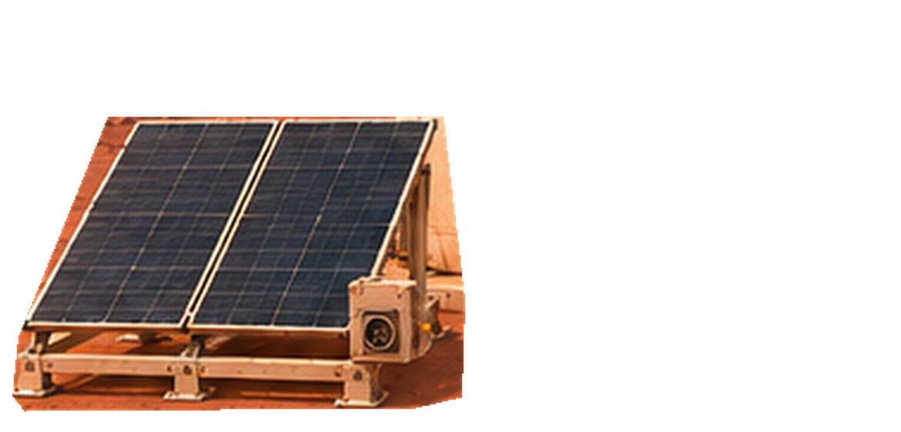
- `station-power` (at 38.01282%, 21.71209%)
  - icon: 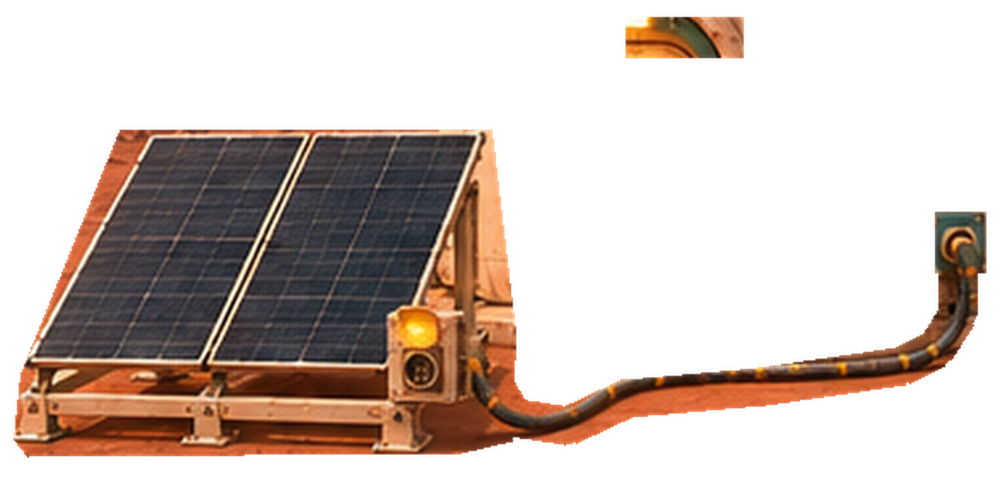
- `habitat-scrubber` (at 87.62821%, 23.31161%)
  - icon: 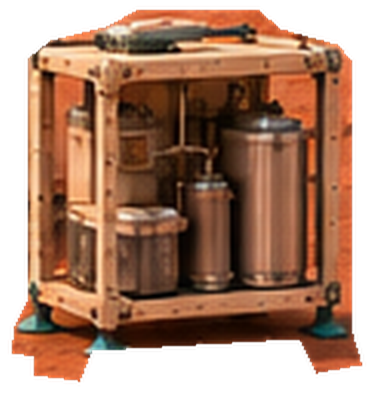
- `antenna-mount` (at 73.78205%, 5.89455%)
  - icon: 

**Items**
- `solar-array-base` Solar-panel base
  - icon: 

- `solar-panels` Solar panels
  - icon: 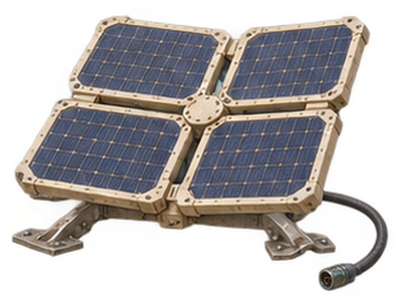

- `deployed-solar-array` Deployed solar panels
  - icon: 

- `station-power` Connected charging lead
  - icon: 

- `power-cable` Power cable
  - icon: 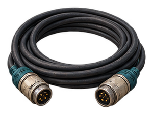

  Compatible lengths from the service supplies; each connection keeps its own cable.

- `habitat-scrubber` Air scrubber (compound)
  - icon: 
  - unnamed slot: accepts `power-cable`, icon: 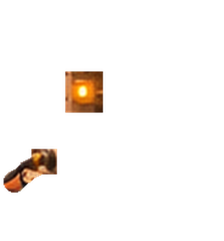

- `antenna-mount` Antenna mounting (compound)
  - icon: 
  - unnamed slot: accepts `unseated-antenna`, icon: 

  [`unseated-antenna`] *Comms established*

  “Mara here, mission control. That looked bad. What’s the damage?”

- `unseated-antenna` Unseated antenna
  - icon: 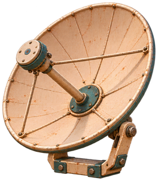

- `reserve-battery` Reserve battery
  - icon: 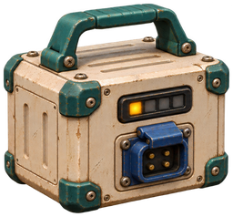

  A removable module from the station’s essential reserve.

- `charged-reserve-battery` Charged reserve battery
  - icon: 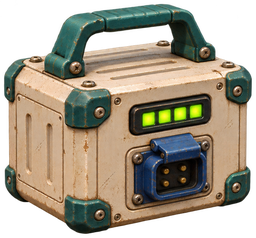

  This battery will power the air scrubber overnight.

**Combinations**
- `solar-panels` [consume] @ `solar-array-base` [transform] -> `deployed-solar-array`
- `power-cable` [consume] @ `deployed-solar-array` [transform] -> `station-power`
- `reserve-battery` [transform] @ `station-power` -> `charged-reserve-battery`

## Water

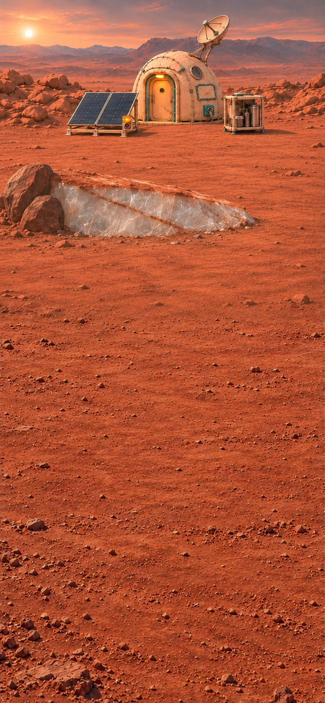

After air, water. Pale ice shows beneath a dusty bank a short walk from the hab.

> NOTE: The same low, stable, non-overhanging ice bank is about fifteen metres from the starter habitat and returns in the source-core scene; retain its band, cap and neighbouring rock. This selected local geometry is a fictional site premise, not a universal safe setback. There is no well, bore, extraction head, buried melt cavity, exterior water pipe or industrial processor.

> NOTE: The heater includes an existing small galley pot, a suitable latched lid/seal and controlled heating. Collection, closed-vessel melting, carrying inside and opening are complete operations. Fabric only strains particles. A small qualified drinking-water cartridge handles this favourable source's dissolved contamination; its suitability and finite performance are the user's accepted fiction. It is not an air-scrubber cartridge. Tokens represent the repeated manual practice and fresh quantities, not one pot permanently supplying the farm. The same heater/pot later cooks supper after cleaning.

**Goals**
- Make a filter -- `water-filter`
- next: Carry clean water back to the hab -- `stored-water`

**Hotspots**
- `visible-ice` (at 47.75641%, 30.03555%)
  - icon: 

**Items**
- `visible-ice` Visible ice
  - icon: 

  A low bank with a rusty band beneath its dusty cap. I can take loose ice from the edge and leave the deeper layers untouched.

- `heater` Heater
  - icon: 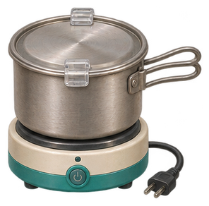

  The small galley heater fits its latched pot. I collect ice, close the pressure-capable lid and warm it without opening a puddle to the Martian air.

- `meltwater` Meltwater
  - icon: 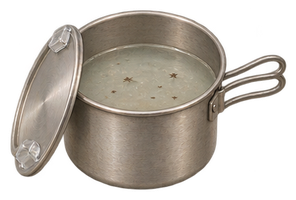

  The ice melts inside the closed pot. I carry it into the hab before opening the lid.

- `fabric` Fabric
  - icon: 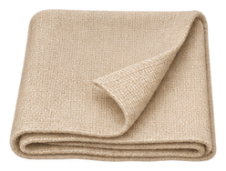

  Washable, low-lint cloth from the general supplies. I select fresh or properly cleaned pieces for food and water; used industrial cloth stays separate.

- `reclaimed-water-cartridge` Reclaimed water cartridge
  - icon: 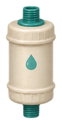

  A small cartridge recovered from the lander’s drinking-water service.

- `water-filter` Water filter
  - icon: 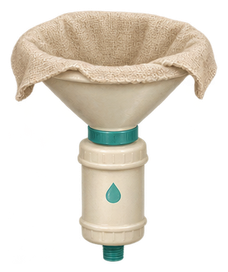

  The cloth catches grit before water enters the cartridge. The cartridge removes the dissolved contaminants in this source.

- `clean-water` Clean water
  - icon: 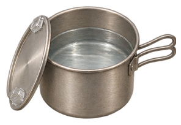

  Clear water passes into the clean vessel.

- `tap-water-bag` Collapsible tank with tap
  - icon: 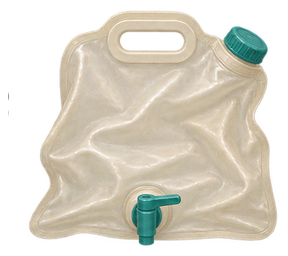

  An empty water bag from the lander, with a broad base and a small tap.

- `stored-water` Stored water
  - icon: 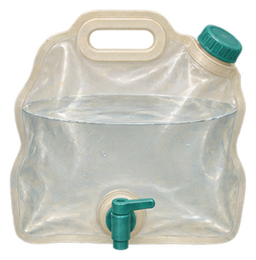

  I carry the filled tank inside and set it by the service wall. From now on, regular trips with the pot keep the tap and the growing room supplied.

- `steel-pin` Steel pin
  - icon: 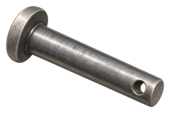

  A small steel pin from a broken cargo restraint. I keep it with the salvage.

**Combinations**
- `fabric` [consume] + `reclaimed-water-cartridge` [consume] -> `water-filter`
- `heater` [preserve] @ `visible-ice` -> `meltwater`
- `water-filter` [preserve] + `meltwater` [transform] -> `clean-water`
- `clean-water` [consume] + `tap-water-bag` [transform] -> `stored-water`

## Fire

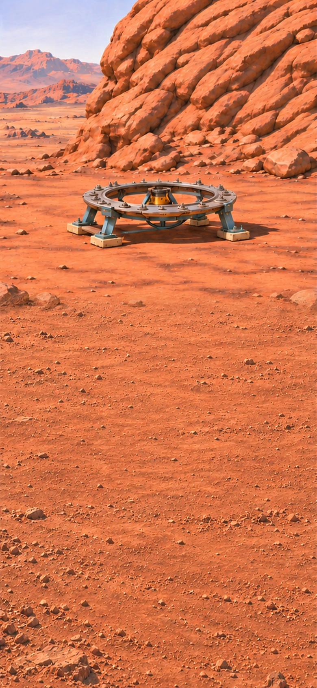

I’ve got air and water. A quick break, then back to work.

> NOTE: The same outdoor solar furnace keeps its feet, reflector rim and receiver axis registered through assembly. Supported molds form bricks; a separate tray fires preformed loose granules for the garden. The selected local feed can make stable porous ceramic. No finished bricks are crushed for substrate. Later metal extraction adapts this furnace with high-temperature electrodes and controlled current; sunlight supplies heat, not chemical reduction.

**Goals**
- Build a solar furnace -- `solar-furnace`
- next: Fire bricks and growing granules
  - both: `ceramic-blocks`
  - and: `fired-granules`

**Hotspots**
- `reflector-base` (at 55.25641%, 28.08057%)
  - icon: 
- `open-reflector` (at 55.25641%, 28.08057%)
  - icon: 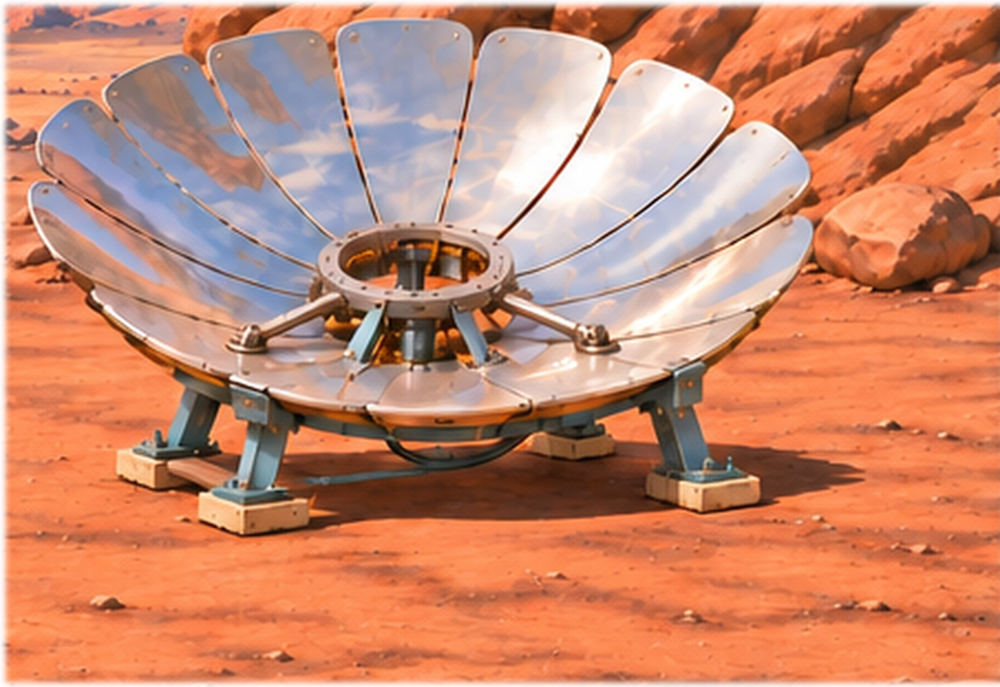
- `solar-furnace` (at 55.25641%, 28.08057%)
  - icon: 

**Items**
- `reflector-base` Reflector base
  - icon: 

- `open-reflector` Open reflector petals
  - icon: 

- `solar-furnace` Assembled solar furnace
  - icon: 

- `reflector-petals` Reflector petals
  - icon: 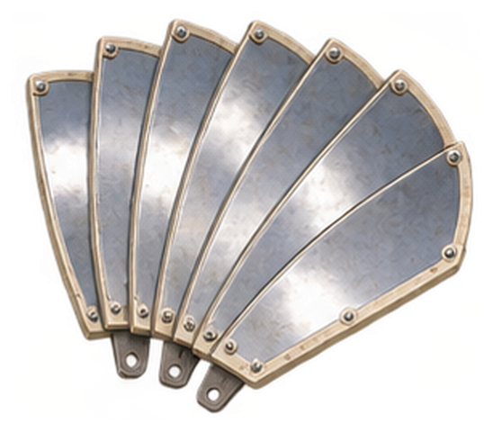

- `furnace-receiver` Furnace receiver
  - icon: 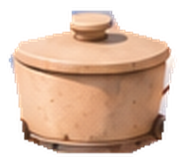

  The furnace's plain refractory receiver holds the batch where the reflector concentrates sunlight.

- `regolith` Regolith
  - icon: 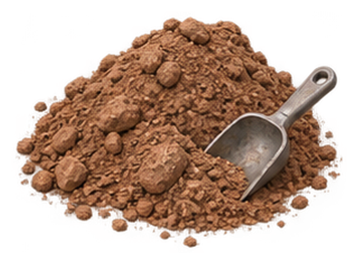

  Loose material from the surveyed surface deposit.

- `regolith-sieve` Fine mesh sieve
  - icon: 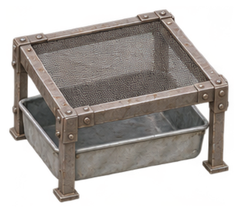

- `screened-regolith` Screened regolith
  - icon: 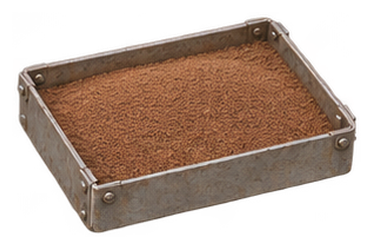

- `ceramic-blocks` Ceramic blocks
  - icon: 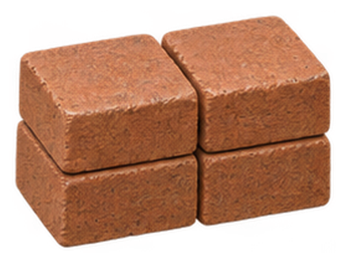

  A checked fired batch for floors and broad supports. These blocks do not contain pressure.

- `granule-charge` Granules ready to fire
  - icon: 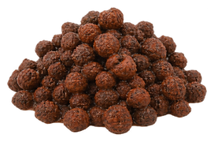

  I dampen the screened material, form small granules and dry the batch.

- `fired-granules` Fired granules
  - icon: 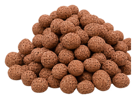

  Porous ceramic granules, fired in their own shallow tray alongside the brick batches.

- `clean-water`

**Combinations**
- `reflector-petals` [consume] @ `reflector-base` [transform] -> `open-reflector`
- `furnace-receiver` [consume] @ `open-reflector` [transform] -> `solar-furnace`
- `regolith` [consume] + `regolith-sieve` [preserve] -> `screened-regolith`
- `screened-regolith` [consume] @ `solar-furnace` [preserve] -> `ceramic-blocks`
- `clean-water` [consume] + `screened-regolith` [consume] -> `granule-charge`
- `granule-charge` [transform] @ `solar-furnace` -> `fired-granules`

## `cave-shelter` Earth

The rock offers shelter, but no air. I can build a small room inside it.

> NOTE: The entrance is smaller and less regular than the deeper chamber. Natural rock partly masks the tent front; the tent fits snugly rather than occupying a huge empty stage. The initial floor is rough with hand-clearable stones, never major structural boulders. The brick pad covers only the tent footprint, with visible laid courses and smooth joints. There is no exterior apron, entrance baffle, perimeter wall or separate padded-underlay item. The pressure envelope includes its own rated thin base protection. The folded state is compact but has enough visible fabric to plausibly fill the final footprint.

> NOTE: The cave provides shielding; the rated tent contains breathable air. Inflation does not turn on lamps. Existing integrated air handling and regulated heat make the room usable. Lights fit directly to the inflated room, and only then does its window glow.

**Goals**
- Give the tent a smooth brick floor -- `protected-cavern-floor`
- next: Inflate the room -- `pressurized-growing-room`
- next: Bring in light -- `lit-growing-room`

**Hotspots**
- `surveyed-cavern-floor` (at 49.29487%, 35.87085%)
  - icon: 
- `cleared-cavern-bay` (at 49.29487%, 35.87085%)
  - icon: 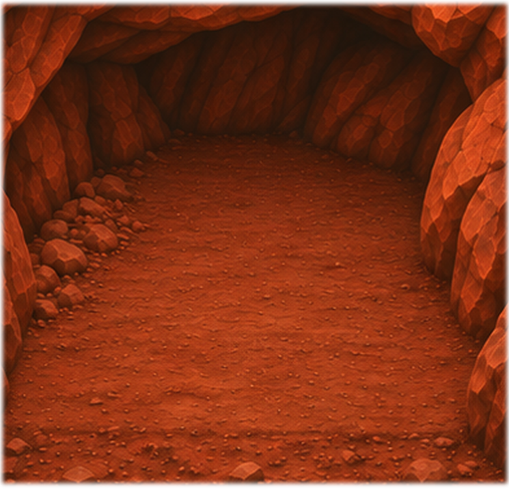
- `protected-cavern-floor` (at 49.29487%, 35.87085%)
  - icon: 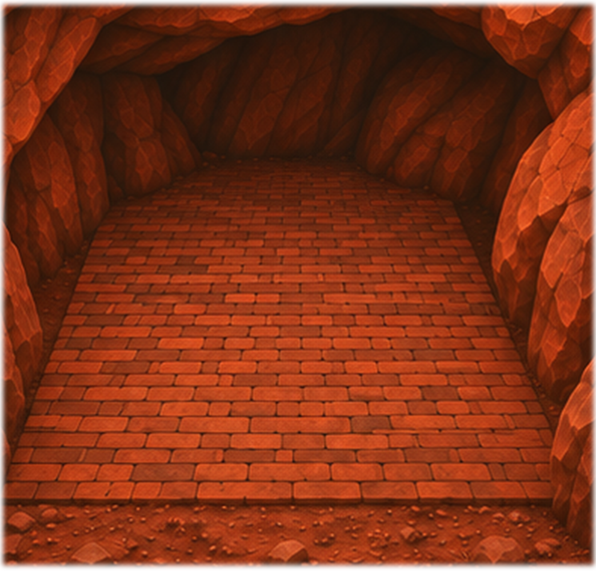
- `sealed-growing-room` (at 49.29487%, 35.87085%)
  - icon: 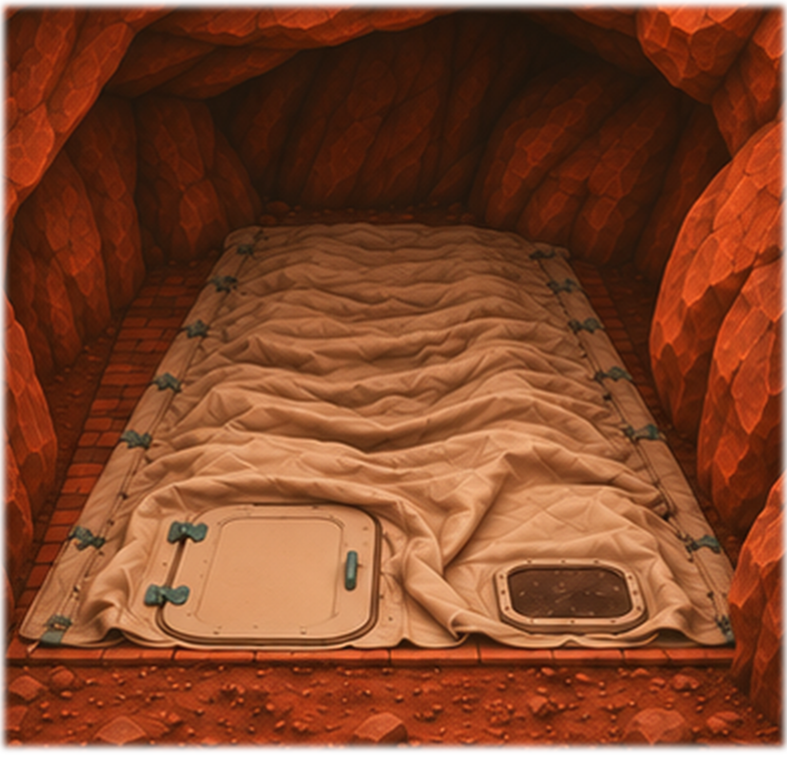
- `pressurized-growing-room` (at 49.29487%, 35.87085%)
  - icon: 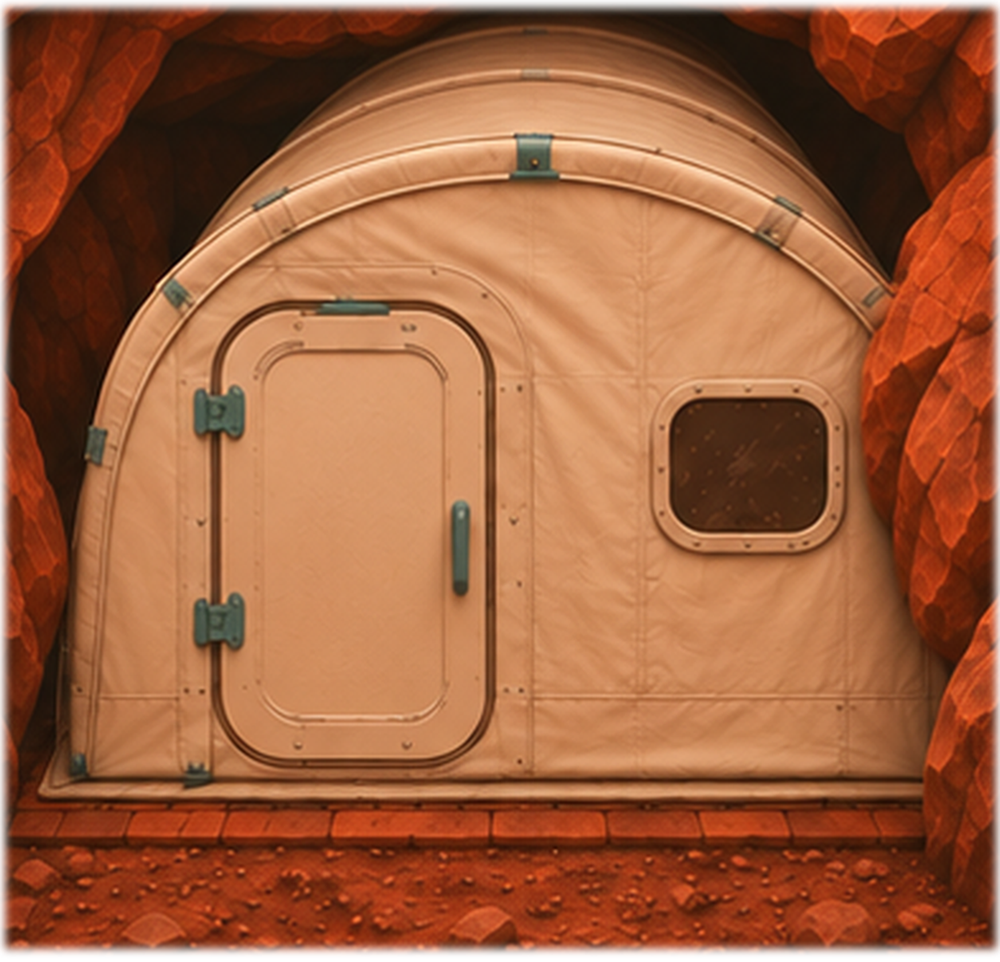
- `lit-growing-room` (at 49.29487%, 35.87085%)
  - icon: 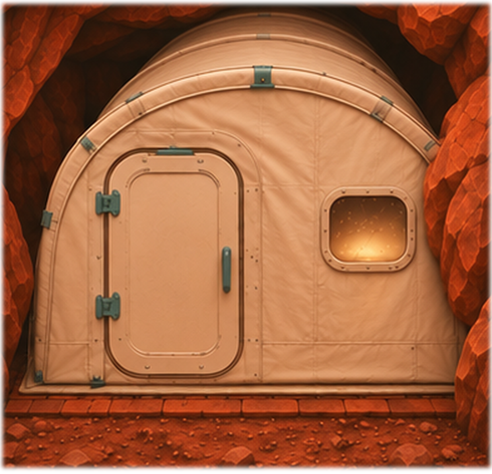

**Items**
- `surveyed-cavern-floor` Rough cavern floor
  - icon: 

- `shovel` Shovel
  - icon: 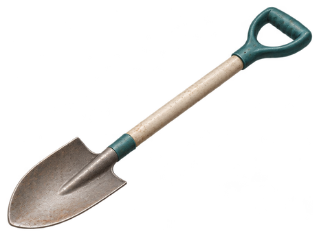

- `cleared-cavern-bay` Cleared cavern bay
  - icon: 

  Loose stones and grit lie in a small spoil pile. The uneven rock is ready for a level pad.

- `protected-cavern-floor` Smooth brick floor
  - icon: 

  Close-set ceramic bricks make a smooth base. I check the joints so nothing sharp presses against the tent floor.

- `folded-pressure-envelope` Folded pressure envelope
  - icon: 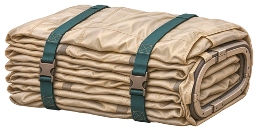

  A compact, substantial folded tent with a reinforced floor, integrated thin base protection, airlock and service fittings.

- `sealed-growing-room` Unfolded pressure room
  - icon: 

- `pressurized-growing-room` Inflated pressure room
  - icon: 

  The fabric rises into the shelter of the cavern. Its doorway sits just behind the narrow mouth.

- `grow-light-rails` Grow-light rails
  - icon: 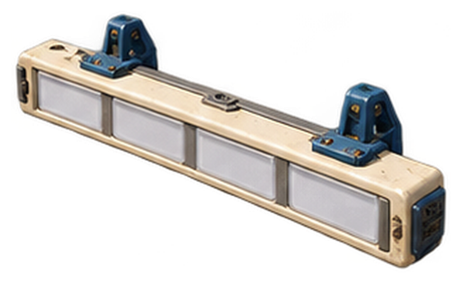

- `lit-growing-room` Lit growing room
  - icon: 

  The warm light catches the brick floor. Outside the small doorway, the cave is still dark.

- `ceramic-blocks`

- `air-tanks`

**Combinations**
- `shovel` [preserve] @ `surveyed-cavern-floor` [transform] -> `cleared-cavern-bay`
- `ceramic-blocks` [consume] @ `cleared-cavern-bay` [transform] -> `protected-cavern-floor`
- `folded-pressure-envelope` [consume] @ `protected-cavern-floor` [transform] -> `sealed-growing-room`
- `air-tanks` [consume] @ `sealed-growing-room` [transform] -> `pressurized-growing-room`
- `grow-light-rails` [consume] @ `pressurized-growing-room` [transform] -> `lit-growing-room`

## A bed under the hill

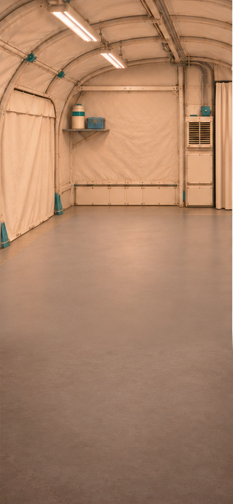

I can sleep beneath the rock. The laboratory can stay in the repaired starter habitat.

> NOTE: This is the rear-left sleeping alcove of the cave pressure hab, viewed toward its soft opaque partition from the growing area. The opposite rear-right service bay is offscreen. This view has no second exterior door, window or sink. Those belong to the single entrance/service end shown from inside in the garden scenes. Build the ceramic deck at its actual alcove before adding insulation and the thin camping mattress in either order. Its close-set blocks rest continuously on the floor; there are no ceramic rails spanning a gap. The existing heater warms the room. Ordinary smoothing and edge protection belong to the block operation.

**Goals**
- Make a sheltered berth -- `cave-berth`

**Hotspots**
- `berth-alcove` (at 51.98718%, 38.47749%)
  - icon: 
- `ceramic-berth` (at 51.98718%, 38.47749%)
  - icon: 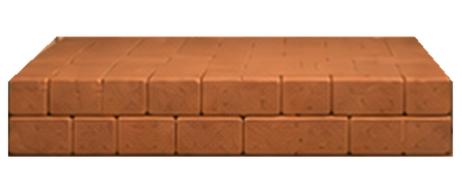
- `insulated-ceramic-berth` (at 51.98718%, 38.47749%)
  - icon: 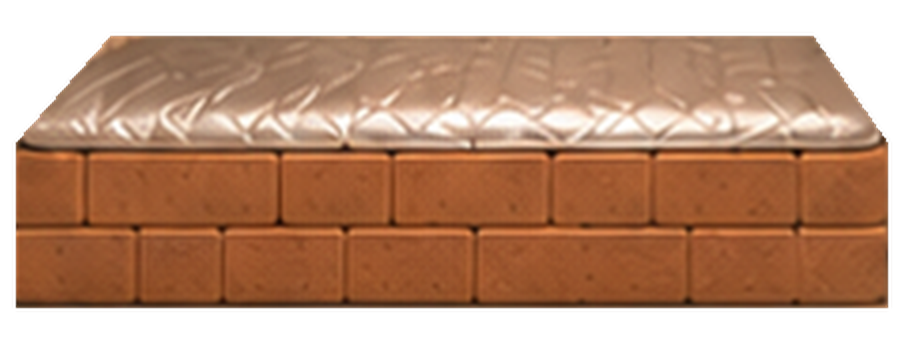
- `uninsulated-berth` (at 51.98718%, 38.47749%)
  - icon: 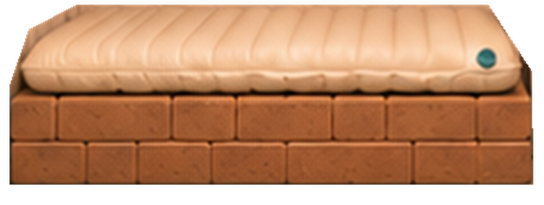
- `cave-berth` (at 51.98718%, 38.47749%)
  - icon: 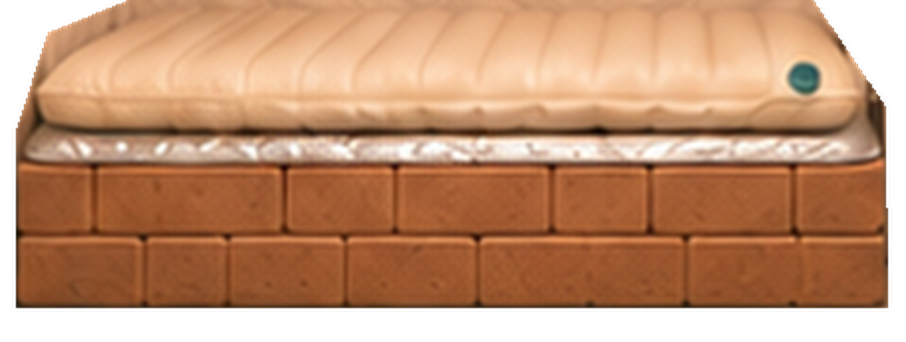

**Items**
- `berth-alcove` Bed alcove
  - icon: 

- `ceramic-berth` Ceramic berth base
  - icon: 

- `insulated-ceramic-berth` Insulated berth base (exclusive with `uninsulated-berth`)
  - icon: 

- `uninsulated-berth` Uninsulated berth (exclusive with `insulated-ceramic-berth`)
  - icon: 

- `cabin-mattress` Cabin mattress
  - icon: 

- `cave-berth` Cave berth
  - icon: 

  I put my boots beside the low berth and stretch out; beyond the partition, the lamps shine on an empty floor.

- `packing-foil` Packing foil
  - icon: 

  Reflective cargo laminate redirects heat or light; it cannot create either.

- `insulation-felt` Insulation felt
  - icon: 

  Light loose insulation from the general supplies. Keep its fibres outside food, roots and sample containment.

- `reflective-insulation` Reflective insulation
  - icon: 

**Combinations**
- `ceramic-blocks` [consume] @ `berth-alcove` [transform] -> `ceramic-berth`
- `reflective-insulation` [consume] @ `ceramic-berth` [transform] -> `insulated-ceramic-berth`
- `cabin-mattress` [consume] @ `ceramic-berth` [transform] -> `uninsulated-berth`
- `cabin-mattress` [consume] @ `insulated-ceramic-berth` [transform] -> `cave-berth`
- `reflective-insulation` [consume] @ `uninsulated-berth` [transform] -> `cave-berth`
- `packing-foil` [consume] + `insulation-felt` [consume] -> `reflective-insulation`

## One room for roots

Under the rock, I have room for three crops. Their roots need clean support, water and air.

> NOTE: The prepared whole-bed assembly has four independent slots: three crops and a loose opaque cover over the open potato medium. Soybeans and lettuce may be sown before or after the cover. Potato planting also fits its loose flaps. Installing the cover never replaces the owner or erases a planted crop. The cover is a broad horizontal surface over the medium, not another sleeve around an already opaque brick wall; leaves remain in light.

> NOTE: Leave headroom below the potato bed's original rim for later hilling. The original wall retains that additional medium; neither a new collar nor a higher wall is built later.

> NOTE: Fire makes selected stable porous granules and decomposes measured oxychlorine contamination; rinsing removes soluble residues/fines, and a batch check determines suitability. This is a fictional qualified feedstock, not a claim that firing makes all Mars dirt safe. The sink is cleaned after preparation. Wastewater stays separate from clean water and crop feed. There is no crop recirculation; controlled nutrients, salinity checks and finite-cycle maintenance remain part of cultivation.

**Goals**
- Build and prepare the growing beds -- `irrigated-growing-beds`
- next: Plant the crops and cover the potato medium -- `irrigated-growing-beds`[`seed-potatoes`,`soybean-seeds`,`lettuce-seeds`,`foil-backed-cloth`]

**Hotspots**
- `clean-preparation-sink` (at 42.94872%, 20.08294%)
  - icon: 
- `growing-room-floor` (at 50.12821%, 30.98341%)
  - icon: 
- `ceramic-bed-walls` (at 50.12821%, 30.98341%)
  - icon: 
- `lined-growing-beds` (at 50.12821%, 30.98341%)
  - icon: 
- `prepared-growing-beds` (at 50.12821%, 30.98341%)
  - icon: 
- `irrigated-growing-beds` (at 50.12821%, 30.98341%)
  - icon: 

**Items**
- `growing-room-floor` Growing-room floor
  - icon: 

- `ceramic-bed-walls` Ceramic bed walls
  - icon: 

- `sheet` Sheet
  - icon: 

  Flexible waterproof sheet from the general supplies. The smooth ceramic supports it.

- `lined-growing-beds` Lined growing beds
  - icon: 

- `clean-preparation-sink` Preparation sink
  - icon: 

  The broad basin and faucet on the entrance-end wall, supplied from the clean tank.

- `growing-medium` Growing medium
  - icon: 

  I grade and rinse the fired granules. This batch passes the leach and salinity checks. Air remains between the porous grains; the drippers will supply the nutrients.

- `prepared-growing-beds` Prepared growing beds
  - icon: 

- `drip-line` Drip line
  - icon: 

  Small emitters and their supplied controller deliver water and crop-specific nutrients, including soybean nitrogen.

- `irrigated-growing-beds` Irrigated growing beds (compound)
  - icon: 
  - unnamed slot: accepts `foil-backed-cloth`, icon: 
  - unnamed slot: accepts `seed-potatoes`, icon: 
  - unnamed slot: accepts `soybean-seeds`, icon: 
  - unnamed slot: accepts `lettuce-seeds`, icon: 

  [`seed-potatoes`,`soybean-seeds`,`lettuce-seeds`,`foil-backed-cloth`] The potato shoots come through loose flaps in the cover. Their leaves receive light while the medium stays shaded. Soybeans and lettuce have their own watered rows.

- `seed-potatoes` Seed potatoes
  - icon: 

  Certified sprouting tubers with room for new potatoes beneath the foliage.

- `soybean-seeds` Soybean seeds
  - icon: 

  A compact cultivar suited to this room.

- `lettuce-seeds` Lettuce seeds
  - icon: 

- `foil-backed-cloth` Foil-backed fabric
  - icon: 

  Fabric protects the opaque laminate at its folds. Overlapping flaps leave room for shoots and planting.

- `ceramic-blocks`

- `fired-granules`

- `packing-foil`

- `fabric`

**Combinations**
- `ceramic-blocks` [consume] @ `growing-room-floor` [transform] -> `ceramic-bed-walls`
- `sheet` [consume] @ `ceramic-bed-walls` [transform] -> `lined-growing-beds`
- `fired-granules` [consume] @ `clean-preparation-sink` -> `growing-medium`
- `growing-medium` [consume] @ `lined-growing-beds` [transform] -> `prepared-growing-beds`
- `drip-line` [consume] @ `prepared-growing-beds` [transform] -> `irrigated-growing-beds`
- `packing-foil` [consume] + `fabric` [consume] -> `foil-backed-cloth`

## `first-harvest` Under the leaves

The stems have grown. More medium will keep new potatoes out of the light; the filling soybean pods need support. The lettuce is ready for its first picking.

> NOTE: These are the same planted crop zones, retaining their drip feeds. The original potato bed has enough unfilled depth for hilling; no collar or added wall is needed. Adding washed medium from the earlier batch includes lifting and replacing the existing loose cover around the stems. The chosen soybean cultivar benefits from support; a section of the salvaged synthetic cargo net hangs from the pressure hab's existing attachment tabs. No rods, rails, rings or wooden frame are fabricated. The two tending branches can be completed in either order.

> NOTE: The growing-potato-bed and growing-soybean-row identities first become available here, when these same plants are tall enough for hilling and net support. They are later growth states, not replacement beds or additional plantings. Keeping the tending receivers separate from the original planting states prevents global recipes from creating movable installed structures on an earlier board.

> NOTE: The lettuce is the later picking state of the same planted zone. A second section of the finite salvaged cargo net folds and ties into a sling basket, lined with fresh food-safe cloth. The same basket remains useful for every later harvest. Tending precedes the basket goal; next controls display, while the physically valid basket may be made earlier.

**Goals**
- Tend the growing crops
  - both: `hilled-potato-bed`
  - and: `supported-soybean-row`
- next: Make a lined basket for the harvest -- `lined-harvest-basket`
- next: Pick the first leaves -- `first-lettuce-harvest`

**Hotspots**
- (three hotspots are a lot but okay here because the two tended crops and the first lettuce occupy the three established beds)
- `growing-potato-bed` (at 17.94872%, 33.91588%)
  - icon: 
- `hilled-potato-bed` (at 17.94872%, 33.91588%)
  - icon: 
- `growing-soybean-row` (at 52.11538%, 28.88033%)
  - icon: 
- `supported-soybean-row` (at 52.11538%, 28.88033%)
  - icon: 
- `lettuce-tray` (at 85.64103%, 35.27844%)
  - icon: 

**Items**
- `growing-potato-bed` Growing potato bed
  - icon: 

  The same planted bed, with room below its rim for more medium around the growing stems.

- `growing-soybean-row` Growing soybean row
  - icon: 

  The same soybean plants, now carrying pods that need support.

- `hilled-potato-bed` Hilled potato bed
  - icon: 

  I lift the loose cover, mound more medium around the stems and replace it. The new tubers stay out of the light.

- `supported-soybean-row` Supported soybean row
  - icon: 

  The cargo net hangs from the room's existing attachment tabs and supports the filling pods.

- `lined-harvest-basket` Lined harvest basket
  - icon: 

  Folded and tied cargo net makes a light sling basket. Clean cloth lines it; I can empty and reuse it for each crop.

- `cargo-mesh` Cargo net
  - icon: 

  Strong, light synthetic restraint net salvaged from the cargo packing. I set aside panels for the soybean support, one sling basket and a light cover above the crops.

- `first-lettuce-harvest` Lettuce harvest
  - icon: 

  Their edges break with a crisp snap. I leave the small centre growing. Beyond the airlock, the landscape has supplied no green at all.

- `fabric`

- `lettuce-tray` Lettuce ready to pick
  - icon: 

**Combinations**
- `growing-medium` [consume] @ `growing-potato-bed` [transform] -> `hilled-potato-bed`
- `cargo-mesh` [consume] @ `growing-soybean-row` [transform] -> `supported-soybean-row`
- `cargo-mesh` [consume] + `fabric` [consume] -> `lined-harvest-basket`
- `lined-harvest-basket` @ `lettuce-tray` -> `first-lettuce-harvest`

## `water-problem` What the water carries

After the first harvest, I bring in another pot of meltwater. It sits in the filling funnel instead of passing through.

> NOTE: The fixed filter is the same portable cloth/cartridge filter constructed in Water, now on the raw filling funnel. The blockage interrupts refilling, not the tap from a full clean tank. Replacing the cloth and retaining its residue is one complete action. This visit must follow the established farm and first harvest. Damaged ambiguous fragments motivate fresh unmelted ice; morphology does not establish life, age or native origin.

**Goals**
- Clear the filter and restore filling -- `collected-intake-residue`
- next: Find out what blocked it -- `first-body-on-membrane`

**Hotspots**
- `water-filter` (at 28.84615%, 15.01777%)
  - icon: 
- `laboratory-microscope` (at 73.52564%, 14.78081%)
  - icon: 

**Items**
- `water-filter`

- `fabric`

- `collected-intake-residue` Collected filter residue
  - icon: 

  Brown flakes have matted across the cloth prefilter. I fit a clean piece and rinse the old one into a sample vessel. Water flows through the funnel again.

- `laboratory-microscope` Laboratory microscope
  - icon: 

- `laboratory-membrane` Laboratory membrane
  - icon: 

  Separates suspended particles; it does not remove dissolved salts.

- `particle-bearing-membrane` Particle-bearing membrane
  - icon: 

- `first-body-on-membrane` Patterned fragments on membrane
  - icon: 

  

  A curve repeats in two of the broken flakes. Melted, poured, caught in a filter—nothing has come through whole. I seal the holder and send the images to Earth.

**Combinations**
- `fabric` [consume] @ `water-filter` -> `collected-intake-residue`
- `laboratory-membrane` [consume] + `collected-intake-residue` [transform] -> `particle-bearing-membrane`
- `particle-bearing-membrane` [transform] @ `laboratory-microscope` -> `first-body-on-membrane`

## The ground we know

*Mara, NASA surface support — recorded message:*

“I've watched that record six times. Science wants ice that has never passed through the melter. First, a reference core from the untouched part of your water bank. Then the exposed layers beyond the wash—we can choose protected ice there, away from the station.”

“The receiving laboratories can examine internal structure and chemistry that your microscope cannot resolve. Flight is looking at an earlier rendezvous.”

> NOTE: This is the same visible ice bank, rusty band and neighbouring rock from Water. The source core penetrates untouched interior ice beside the harvested edge, away from surface weathering and heater contact. There is no underground heated cavity. The separate remote deposit permits sampling away from station disturbance. These are distinct physical specimens.

**Goals**
- Take an unmelted reference from the water source -- `sealed-source-core`
- next: Store it before the farther expedition -- `stored-source-core`

**Hotspots**
- `visible-ice` (at 23.26923%, 22.45261%)
- `laboratory-core-freezer` (at 75%, 22.48223%)

**Items**
- `sealed-source-core` Sealed source core
  - icon: 

  Beyond the hand-harvested edge, the brown flakes remain where the ice held them.

- `stored-source-core` Stored source core
  - icon: 
  - from chapter `specimen-stow`: Water-source core
  - from chapter `specimen-stow` icon: 

  This core and the membrane stay in the laboratory while I go farther from the bank.

- `visible-ice`

- `laboratory-core-freezer` Laboratory core freezer
  - icon: 

- `core-drill` Core drill
  - icon: 

  The clean chilled barrel takes interior ice without melting it. The liner seals before leaving the barrel.

**Combinations**
- `core-drill` [preserve] @ `visible-ice` [preserve] -> `sealed-source-core`
- `sealed-source-core` [transform] @ `laboratory-core-freezer` [preserve] -> `stored-source-core`

## Across the gully

Loose rubble slides beneath the wheels on the far bank. I can scramble over the rocks to rig the winch at the solid outcrop above. The rover will follow the straight pull up the loose ramp.

> NOTE: The steep, rutted ground route needs traction assistance, not a bridge or airborne lift. A difficult surveyed foot scramble over rocks reaches sound bedrock for rigging; do not paint an easy pedestrian highway. The anchor, straight pull, rover recovery point and finished rover share one axis. The rover ends directly below the winch, never off to its side. Site stability, suited foot access and recovery rating are qualified premises.

> NOTE: The derived reached-ice-bank receiver appears only after the rover crossing and targets a broad, low, non-overhanging ice face in the near middle distance. Its crop must make the ice itself the obvious receiver. The winch remains at its anchor for return; the drill action includes contained sampling, sealed-liner transfer into the rover cold cradle, controlled return and winch recovery. No primitive far-face receiver permits early sampling.

**Goals**
- Anchor the winch above the loose ramp -- `anchored-winch`
- next: Bring the rover to the ice band -- `reached-ice-bank`
- next: Bring back ice from within the band -- `remote-ice-core`

**Hotspots**
- `bedrock-anchor` (at 86.85897%, 15.49171%)
  - icon: 
- `anchored-winch` (at 86.85897%, 15.49171%)
  - icon: 
- `reached-ice-bank` (at 68.39744%, 13.29976%)
  - icon: 

**Items**
- `bedrock-anchor` Bedrock anchor
  - icon: 

- `anchored-winch` Anchored winch
  - icon: 

- `rover-winch` Winch
  - icon: 

  A portable powered winch with its line, anchor sling and remote control.

- `expedition-rover` Expedition rover
  - icon:  (at 45%, 54%)

  The survey rover's cold cradle will keep the core frozen on the journey home.

- `reached-ice-bank` Reached ice bank
  - icon: 

  The wheels reach firm rock directly beneath the winch. The exposed ice band is now within reach. I leave the winch anchored for the way back. Here I can take a core and put it straight into the rover’s cold cradle.

- `remote-ice-core` Ice core
  - icon: 

  The brown band runs through the ice inside its thin sealed liner. I secure it on the rover’s cold cradle and retrace the gully. This sample has never passed through the water machinery.

- `core-drill`

**Combinations**
- `rover-winch` [consume] @ `bedrock-anchor` [transform] -> `anchored-winch`
- `expedition-rover` [transform] @ `anchored-winch` [preserve] -> `reached-ice-bank`
- `core-drill` [preserve] @ `reached-ice-bank` -> `remote-ice-core`

## Something whole

The new core is back in the laboratory, still frozen. A thin slab will let light through the ice around the dark fleck.

> NOTE: The cold fixture produces only the thin viewing slab in its sealed optical holder; show that slab alone at a readable enlarged scale. The parent remainder stays refrigerated in the laboratory and is not bundled into the output token. The cut slab is thicker than the inclusion, not a histological slice through the body. Clean tools, a preparation blank, optical-face smoothing, containment and cold transfer are complete operations. The microscope has a cooled stage. Flight later takes the source core, examined remote slab and original membrane as three distinct specimens. Morphology alone establishes neither age, chemistry nor origin.

**Goals**
- Prepare a thin ice section -- `sectioned-ice-core`
- next: Look through the ice -- `examined-ice-core`

**Hotspots**
- `cold-sectioning-stage` (at 33.01282%, 20.08294%)
  - icon: 
- `cold-stage-microscope` (at 73.52564%, 14.89929%)
  - icon: 

**Items**
- `cold-stage-microscope` Cold-stage microscope
  - icon: 

  A small microscope above a refrigerated stage. The sealed thin-section holder supplies the specimen boundary; the optics stand in room air.

- `examined-ice-core` Examined ice slab
  - icon: 
  - from chapter `specimen-stow`: Remote ice slab

  

  Overlapping plates. Paired, jointed limbs. Where the intake sample held scattered fragments, this outline stays together within the thin section of ice.

  I leave the focus there for a long time.

  I cannot tell how old it is, or where it came from. But I can send Earth the body and the layer around it together, instead of a handful of broken flakes.

  I record the view. Then the slab joins the source core on laboratory cooling; the first fragments remain sealed in their membrane holder. Those three specimens are coming with me. The rest of the remote core stays protected in the laboratory.

- `remote-ice-core`

- `cold-sectioning-stage` Cold sectioning fixture
  - icon: 

- `sectioned-ice-core` Thin ice slab
  - icon: 

  A thin slab is sealed alone in its clear optical holder. I retain the rest of the core on laboratory cooling. The ice stays frozen throughout.

**Combinations**
- `remote-ice-core` [transform] @ `cold-sectioning-stage` -> `sectioned-ice-core`
- `sectioned-ice-core` [transform] @ `cold-stage-microscope` -> `examined-ice-core`

## Metal from the red ground

*Mara, Earth — recorded message:*

“Flight has approved an earlier return with the samples. The next fuel delivery cannot arrive in time.”

I need vessels for making fuel, and a new support for the lander. The red ground contains iron; getting it out will take heat and electric current.

> NOTE: This is direct molten-oxide electrolysis before the water-electrolysis chapter. Solar heat melts the selected local oxide/silicate bath; controlled current releases iron-rich metal and oxygen. The first process oxygen is not a collected inventory supply. There is no prior hydrogen, imported carbon packet, refining-flux token, meteoritic iron or salvaged bulk-iron substitute.

> NOTE: The two principal fictional advances are a compact adapted furnace able to sustain molten-oxide electrolysis, and a selected feed/process yielding workable iron. The user explicitly accepts iron canisters and support strong enough for this game. No alloying or carbon adjustment is implied, and precious biological carbon is conserved. Existing general repair tools provide the modest forming and joining operations; do not add qualification chores to play.

> NOTE: The furnace's mixed fate is deliberate: ceramic batches preserve it, then fitting electrodes transforms that same installation into its adapted state. Fire requires both useful ceramic products before this transformation can occur.

> NOTE: The high-temperature insert and insulated feedthroughs come from the furnace's mineral-analysis experiment. One shared electrical-repair controller and service readout, with temperature and pressure sensing, moves between scheduled metal, water-cell and fuel batches. Essential station services retain their own supply. Show a plain refractory receiver with necessary insulation and electrode contacts; no appliance casing, decorative dials or duplicated control cabinets. General repair tools provide forming and joining. These are finite allocated tools, not a limitless cache of laboratory machinery.

**Goals**
- Adapt the solar furnace -- `powered-reduction-furnace`
- next: Make usable iron from local minerals -- `iron-stock`

**Hotspots**
- `solar-furnace` (at 55.25641%, 28.08057%)
  - icon: 
- `electrochemical-furnace` (at 55.25641%, 28.08057%)
  - icon: 
- `powered-reduction-furnace` (at 55.25641%, 28.08057%)
  - icon: 

**Items**
- `solar-furnace`

- `power-cable`

- `steel-pin`

- `laboratory-electrodes` High-temperature laboratory electrodes
  - icon: 

  The mineral-analysis experiment's small high-temperature electrode insert, suitable for the furnace receiver.

- `electrochemical-furnace` Furnace with electrodes
  - icon: 

  I fit the laboratory electrodes inside the receiver.

- `powered-reduction-furnace` Powered reduction furnace
  - icon: 

  Sunlight heats the mineral bath. I connect the shared repair controller to drive the separation.

- `iron-bearing-regolith` Iron-bearing regolith
  - icon: 

  Screened local material with magnetic iron-bearing minerals from the red ground.

- `separator-electromagnet` Separator electromagnet
  - icon: 

  I wind an insulated conductor around the saved pin. Current on: magnetic grains cling. Current off: they drop into the tray.

- `iron-rich-concentrate` Iron-oxide concentrate
  - icon: 

  The darker mineral fraction is richer in iron. It is still mineral, not metal.

- `iron-stock` Iron
  - icon: 

  Electric current separates iron from its oxygen in the hot mineral bath. I cast and finish the iron into sheets and bars. Most of this useful metal came from the ground beneath my feet.

**Combinations**
- `laboratory-electrodes` [consume] @ `solar-furnace` [transform] -> `electrochemical-furnace`
- `power-cable` [consume] @ `electrochemical-furnace` [transform] -> `powered-reduction-furnace`
- `power-cable` [consume] + `steel-pin` [consume] -> `separator-electromagnet`
- `separator-electromagnet` [preserve] + `iron-bearing-regolith` [consume] -> `iron-rich-concentrate`
- `iron-rich-concentrate` [consume] @ `powered-reduction-furnace` -> `iron-stock`

## Two gases from water

The iron gives me something to build with. First I need hydrogen for methane, and oxygen to keep separate for the engine.

> NOTE: The prominent divided body and both cylinders are fabricated locally. The water-cell insert is the unused electrolyzer service spare from a small regenerative-power experiment; its membrane, electrodes and gas-separating internals are distinct from the furnace's high-temperature electrodes. Allocated gas-service repair spares supply one short grey valve/connector for each cylinder, with oxygen-contact parts kept separately clean. No active breathing hardware or emergency oxygen is cannibalized. The shared repair controller operates this batch after the metal work. Compatibility, useful delivery pressure and local canister workmanship are accepted game premises; no testing or qualification puzzle is required.

> NOTE: The cell stands on firm cleared ground or its packed laboratory tray, with a simple water-fill closure, separate gas outlets and electrical contacts. No manufactured table, frame or permanent feed-bag stand is required. All four gas canisters are plain matte Iron with rounded ends, simple formed seams, one reused grey valve each and a hand-marked gas identity. No handles, brass, individual gauges, riveted label plates or foot rings. Found stones or shallow hollows steady them; the existing rover carries longer trips. Retain those exact bodies and markings through filling and transfer.

> NOTE: Both gas-fill recipes require the actual cell's water and power slots. The filled hydrogen and oxygen cylinders are distinct portable items with persistent visual identity. Neither is installed in a fixed rack. Oxygen survives for ascent and never joins the methane reactor. Dedicated gas paths, repeated filling, compression and ordinary checks are bundled; the cylinders hold ambient-temperature gases, not cryogenic liquids.

**Goals**
- Build and feed a water-splitting cell -- `water-electrolysis-cell`[`power-cable`,`clean-water`]
- next: Collect the gases in separate cylinders
  - both: `hydrogen-cylinder`
  - and: `oxygen-cylinder`

**Hotspots**
- `salvaged-cell-internals` (at 55.25641%, 30.50948%)
  - icon: 
- `water-electrolysis-cell` (at 55.25641%, 30.50948%)
  - icon: 

**Items**
- `salvaged-cell-internals` Reclaimed electrolyzer insert
  - icon: 

  An unused service insert from the regenerative-power experiment supplies the membrane and electrodes. I can build a new body around it.

- `water-electrolysis-cell` Water-splitting cell (compound)
  - icon: 
  - unnamed slot: accepts `power-cable`, icon: 
  - unnamed slot: accepts `clean-water`, icon: 

  [`power-cable`,`clean-water`] The divided cell is ready. Water and electricity will produce hydrogen at one outlet and oxygen at the other.

- `hydrogen-valve` Hydrogen-service fitting
  - icon: 

  One compact grey hydrogen valve and connector from the allocated gas-service spares.

- `oxygen-valve` Oxygen-clean fitting
  - icon: 

  One compact grey oxygen-clean valve and connector from the allocated gas-service spares.

- `empty-hydrogen-cylinder` Empty hydrogen cylinder
  - icon: 

  A plain round-ended iron canister with one reused valve. I mark it H₂.

- `empty-oxygen-cylinder` Empty oxygen cylinder
  - icon: 

  A plain round-ended iron canister with its own clean reused valve. I mark it O₂.

- `hydrogen-cylinder` Hydrogen cylinder
  - icon: 

  The cell separates water. Hydrogen fills this dedicated cylinder; the oxygen follows its own path.

- `oxygen-cylinder` Oxygen cylinder
  - icon: 

  Oxygen fills its own clean cylinder. I keep it apart from the hydrogen and methane for the engine’s oxidizer tank.

- `iron-stock`

- `power-cable`

- `clean-water`

**Combinations**
- `iron-stock` [consume] @ `salvaged-cell-internals` [transform] -> `water-electrolysis-cell`
- `iron-stock` [consume] + `hydrogen-valve` [consume] -> `empty-hydrogen-cylinder`
- `iron-stock` [consume] + `oxygen-valve` [consume] -> `empty-oxygen-cylinder`
- `empty-hydrogen-cylinder` [transform] @ `water-electrolysis-cell`[`power-cable`,`clean-water`] -> `hydrogen-cylinder`
- `empty-oxygen-cylinder` [transform] @ `water-electrolysis-cell`[`power-cable`,`clean-water`] -> `oxygen-cylinder`

## Fuel from air and water

*Mara, Earth — recorded message:*

“Hydrogen and carbon dioxide can make methane. Keep the oxygen separate. Use the station’s power, and leave its essential loads running.”

The iron chamber goes between the two feed cylinders. I can fit those three parts in any order.

> NOTE: Iron fitted at the central site means fabricating the actual plain reaction chamber. The gas analyzer's nonessential carbon-analysis channel supplies its nickel methanizer catalyst, small heater/sensor and sample-drying fittings; those original measurements stop. The microscope and cold specimen storage remain intact. A simple local water trap and the shared repair controller complete the batch equipment. Small ceramic pieces or found rocks hold the hot body off firm cleared ground. There is no supplied processor-core primitive, catalyst-fetch step, manufactured table, elaborate mounting legs, extra solar field or masonry platform. The central chamber, hydrogen and atmospheric CO2 can be fitted in any order; collection requires all three and the power cord.

> NOTE: The existing isolated atmospheric-service branch captures, separates and releases CO2 at useful pressure without interrupting breathing. The water-cell insert also supplies its gases at useful delivery pressure; the reaction circuit keeps a pressure difference to its receiver, and the lander performs final tank conditioning. These are bounded mission capabilities, not properties of an empty bottle or power cord. Dedicated gas-contact fittings remain separate while the shared instrument reads each service. Oxygen is absent from this scene. The original array has an explicit load/time margin for scheduled batches while essentials remain powered. Water recovery reduces demand; fuel accumulation and the storm interruption take story time. The same portable methane cylinder later feeds the lander.

**Goals**
- Build and connect the methane plant -- `fuel-assembly`[`iron-stock`,`hydrogen-cylinder`,`carbon-dioxide-cylinder`,`power-cable`]
- next: Collect methane for the return -- `methane-cylinder`

**Hotspots**
- `fuel-assembly` (at 50.51282%, 32.22749%)
  - icon: 
- `habitat-scrubber` (at 87.62821%, 23.31161%)
  - icon: 

**Items**
- `fuel-assembly` Methane-making installation (compound)
  - icon: 
  - unnamed slot: accepts `iron-stock`, icon: 
  - unnamed slot: accepts `hydrogen-cylinder`, icon: 
  - unnamed slot: accepts `carbon-dioxide-cylinder`, icon: 
  - unnamed slot: accepts `power-cable`, icon: 

  [`iron-stock`,`hydrogen-cylinder`,`carbon-dioxide-cylinder`,`power-cable`] The iron chamber receives hydrogen and carbon dioxide through separate feeds. Its catalyst makes methane and water; the small water trap and dryer keep the fuel outlet clean.

- `habitat-scrubber`

- `carbon-dioxide-fitting` Carbon-dioxide fitting
  - icon: 

  One compact grey valve and connector allocated to carbon dioxide from the gas-service spares.

- `empty-carbon-dioxide-cylinder` Empty carbon-dioxide cylinder
  - icon: 

  A plain round-ended iron canister with one reused valve, marked CO₂.

- `carbon-dioxide-cylinder` Carbon-dioxide cylinder
  - icon: 

  The atmospheric service collects carbon dioxide from the Martian air into the cylinder. The breathing circuit keeps working.

- `methane-fitting` Methane-service fitting
  - icon: 

  One compact grey valve and connector allocated to methane from the gas-service spares.

- `empty-methane-cylinder` Empty methane cylinder
  - icon: 

  A plain round-ended iron canister with one reused valve, marked CH₄.

- `methane-cylinder` Methane cylinder
  - icon: 

  The plant runs through repeated batches. I collect the dry methane in its own cylinder and return the recovered water to the process.

- `iron-stock`

- `hydrogen-cylinder`

- `power-cable`

**Combinations**
- `iron-stock` [consume] + `carbon-dioxide-fitting` [consume] -> `empty-carbon-dioxide-cylinder`
- `empty-carbon-dioxide-cylinder` [transform] @ `habitat-scrubber`[`power-cable`] -> `carbon-dioxide-cylinder`
- `iron-stock` [consume] + `methane-fitting` [consume] -> `empty-methane-cylinder`
- `empty-methane-cylinder` [transform] @ `fuel-assembly`[`iron-stock`,`hydrogen-cylinder`,`carbon-dioxide-cylinder`,`power-cable`] -> `methane-cylinder`

## Amber noon

Back in the starter hab, the sky has turned amber.

*Mara, Earth — recorded message:*

“Storm alert. Science advises a major regional dust storm over your site. You may lose most of your solar power. The essential reserve covers the forecast interruption. Stop the industrial loads and protect the growing room.”

> NOTE: This control visit takes place in the original surface starter habitat, which still houses the laboratory. Its round window looks onto the storm. A small mounting strip carries three compact selectors with clear symbols: battery/lightning for power, a tap and droplet for water service, and a reactor with cylinder for fuel. The reusable key lies on the floor below. Selecting water reserve stops outdoor melting trips and switches the clean tank to essential use; there is no well to drain. Water reserve and fuel shutdown may finish in either order. The essential battery reserve carries air handling, reduced heat and laboratory cooling through the forecast. Hot processing stops; stored breathing gas and the scrubber remain available. All three selector states are required before proceeding.

> NOTE: The fuel-circuit selector is a general spare service switch repurposed when the plant was connected, with a new hand-marked fuel label. It was not delivered as a ready-made fuel-plant control. It switches the branch; it does not duplicate the shared process instrument.

**Goals**
- Put the station on reserve -- `reserve-power-selected`
- next: Leave the exterior circuits safe
  - both: `water-service-secured`
  - and: `fuel-plant-shut-down`

**Hotspots**
- (three hotspots are a lot but okay here because one key operates three separate installed service selectors)
- `reserve-power-selector` (at 31.98718%, 19.78673%)
  - icon: 
- `reserve-power-selected` (at 31.98718%, 19.78673%)
  - icon: 
- `water-service-control` (at 50.83333%, 19.78673%)
  - icon: 
- `water-service-secured` (at 50.83333%, 19.78673%)
  - icon: 
- `fuel-plant-shutdown-control` (at 69.10256%, 19.78673%)
  - icon: 
- `fuel-plant-shut-down` (at 69.10256%, 19.78673%)
  - icon: 

**Items**
- `restored-power` Station solar array
  - icon: 

  The lamps brighten. The original array is supplying power again; I can resume the fuel batches and the regular water trips.

- `service-key` Service key
  - icon:  (at 52%, 32%)

  The removable operating key for the station’s service selectors. Turn the selector, then withdraw it for the next control.

- `reserve-power-selector` Reserve power selector
  - icon: 

- `reserve-power-selected` Reserve power selected
  - icon: 
  - from chapter `lander-repair`: Station power selector

  I leave power connected until the shutdown cycles finish. Air handling, reduced heat and laboratory cooling stay on the station reserve.

- `water-service-control` Water-service control
  - icon: 

- `water-service-secured` Water service secured
  - icon: 
  - from chapter `lander-repair`: Water service control

  I finish the fill and secure the clean tank. During the storm it will supply essential needs; outdoor melting trips can wait.

- `fuel-plant-shutdown-control` Fuel-plant shutdown control
  - icon: 

  I put a hand-drawn fuel symbol beside the spare service switch when I connected the plant.

- `fuel-plant-shut-down` Fuel plant shut down
  - icon: 
  - from chapter `lander-repair`: Fuel-plant service control

  The plant cools and isolates before power disconnects. Its separate gas cylinders stay shut until production resumes.

**Combinations**
- `service-key` [preserve] @ `reserve-power-selector` [transform] -> `reserve-power-selected`
- `service-key` [preserve] @ `water-service-control` [transform] -> `water-service-secured`
- `service-key` [preserve] @ `fuel-plant-shutdown-control` [transform] -> `fuel-plant-shut-down`

## Keep the roots alive

Enough warmth, light and water to keep the roots alive. Productive growth can resume when the solar supply recovers.

> NOTE: The entrance-end thermal screen attaches to the pressure hab's existing tabs, draping around the usable sink and leaving its door overlap and ventilation path clear. Fitting the separate Fabric canopy includes tensioning the reserved cargo-net panel between existing tabs to keep the soft cloth above the foliage. The edges descend toward the beds with circulation gaps. Both screens use the hab's original attachments; no rods, rails, rings or wooden supports are added. The canopy is lowered during dark periods and rolled back for shortened lamp hours, bundled in the complete operation. Cloth reduces heat loss; existing heaters and the finite reserve supply energy. There is no quilted wall padding or process-heat tank. The same beds and drip feeds remain, with reduced watering as demand falls.

**Goals**
- Reduce heat and light losses -- `screened-growing-area`
- Cover the plants against cooling -- `covered-crops`

**Hotspots**
- `growing-room-service-rail` (at 51.15385%, 20.1718%)
  - icon: 
- `screened-growing-area` (at 51.15385%, 20.1718%)
  - icon: 
- `crop-canopy-supports` (at 50%, 18.1872%)
  - icon: 
- `covered-crops` (at 50%, 18.12796%)
  - icon: 

**Items**
- `growing-room-service-rail` Entrance attachment tabs
  - icon: 

  Original attachment tabs along the room's entrance end can hold the thermal screen.

- `screened-growing-area` Screened growing area
  - icon: 

  The dimmed lamps serve the crop area. The ventilation route stays open.

- `crop-canopy-supports` Crop-cover attachment tabs
  - icon: 

  The pressure envelope already has attachment tabs above the crop area.

- `covered-crops` Covered crops
  - icon: 

  The canopy holds a pocket of warmer air above the plants; the reserve heaters carry the continuing load. Mara's forecast update has a sentence at the end: “It's raining outside my window.”

- `farm-thermal-screen` Farm thermal screen
  - icon: 

- `fabric`

**Combinations**
- `reflective-insulation` [consume] + `fabric` [consume] -> `farm-thermal-screen`
- `farm-thermal-screen` [consume] @ `growing-room-service-rail` [transform] -> `screened-growing-area`
- `fabric` [consume] @ `crop-canopy-supports` [transform] -> `covered-crops`

## Sun on the floor

A pale edge of sunlight returns. Under the dust, the panels are still connected.

> NOTE: Show only the original array left of the starter habitat door, with the scrubber right, matching Air. Its cables stay attached. Wiping this array restores the station supply so scheduled fuel batches can resume with the shared controller. There is no later industrial array or underground well.

> NOTE: Dust-covered solar panels is the storm-covered state of these same installed fields, introduced only here. It is a distinct receiving identity so the global cloth-cleaning rule cannot satisfy storm recovery before the storm. The ordinary Station solar array remains the earlier power installation; no second field is supplied by this state change.

**Goals**
- Wipe the panels and restore power -- `restored-power`

**Hotspots**
- `dust-covered-solar-panels` (at 20.76923%, 23.66706%)
  - icon: 
- `restored-power` (at 20.76923%, 23.66706%)
  - icon: 

**Items**

- `dust-covered-solar-panels` Dust-covered solar panels
  - icon: 

**Combinations**
- `fabric` [consume] @ `dust-covered-solar-panels` [transform] -> `restored-power`

## `lander-repair` The leg that stays

The plant is working again. Now I can finish the repair that will let this cabin leave.

> NOTE: The original stone remains an unloaded catch. Two qualified low broad ceramic stacks secure either side of the sound cross-member while the original legs remain stable; a central footer shares their firm bearing surface. These blocks do not act as lifting jacks. The shovel operation includes rolling the loose stone away, never lifting the vehicle with the shovel. Only the resulting clear gap accepts iron.

> NOTE: The final member is a short substantial tubular strut with saddle and broad foot, visually comparable to the existing legs. Keep camera, ground texture/colour, ceramic registration, original feet and vehicle height unchanged. No ground bolts, giant framework or lift. Any redundant side-block removal is bundled after the permanent member is fitted. Material, buckling, bearing and procedural qualification are explicit future repair premises. This chapter-only receiver prevents premature repair construction on the crash board.

**Goals**
- Block the frame and lay its footing -- `ceramic-landing-footing`
- next: Roll the temporary stone clear -- `clear-support-gap`
- next: Fit the permanent iron support -- `level-launch-platform`

**Hotspots**
- `landing-footing-site` (at 61.47436%, 37.08531%)
  - icon: 
- `ceramic-landing-footing` (at 61.47436%, 37.08531%)
  - icon: 
- `clear-support-gap` (at 61.47436%, 37.08531%)
  - icon: 
- `level-launch-platform` (at 61.47436%, 37.08531%)
  - icon: 

**Items**
- `landing-footing-site` Lower-frame support site
  - icon: 

  The rock still waits beneath the cross-member. The original legs carry the lander.

- `ceramic-landing-footing` Ceramic blocking and footing
  - icon: 

  Two broad stacks stand on either side of the stone beneath the sound frame. Between them, a low footer waits for the permanent support.

- `clear-support-gap` Clear support gap
  - icon: 

  With the side blocks protecting the frame, I roll the loose stone out. The middle of the footing is clear.

- `level-launch-platform` Supported launch frame
  - icon: 

  The short iron strut fits between its broad foot and saddle beneath the cross-member. It is as substantial as the original legs. This support will stay here when I leave.

- `ceramic-blocks`

- `shovel`

- `iron-stock`

**Combinations**
- `ceramic-blocks` [consume] @ `landing-footing-site` [transform] -> `ceramic-landing-footing`
- `shovel` [preserve] @ `ceramic-landing-footing` [transform] -> `clear-support-gap`
- `iron-stock` [consume] @ `clear-support-gap` [transform] -> `level-launch-platform`

## Fuel for the return

I bring over oxygen and methane in their separate cylinders. The lander’s cooling system collects each in its own flight tank.

> NOTE: These are the same locally made oxygen cylinders from water electrolysis and methane cylinders from the reaction plant, with unchanged labels, necks and service fittings. They contain ambient-temperature gases. The lander's already-equipped active tank conditioning accepts the gases and liquefies them inside its actual flight tanks; that integration is a declared future mission premise. Repeated production, deliveries and elapsed time fill the tanks using these same cylinders: two small bottles do not contain an entire ascent load.

> NOTE: Both transfer circuits work in either order and retain dedicated compatible fittings. No methane reactor, factory pads or extra array appears at the lander. The repaired lower support remains visible. Departure preparation isolates, disconnects and stows the hoses before launch.

**Goals**
- Fill both separate ascent tanks
  - both: `methane-transferred`
  - and: `oxygen-transferred`

**Hotspots**
- `lander-methane-port` (at 78.46154%, 30.83531%)
  - icon: 
- `methane-transferred` (at 78.46154%, 30.83531%)
  - icon: 
- `lander-oxygen-port` (at 21.98718%, 30.83531%)
  - icon: 
- `oxygen-transferred` (at 21.98718%, 30.83531%)
  - icon: 

**Items**
- `lander-methane-port` Lander methane port
  - icon: 

- `methane-transferred` Methane transferred
  - icon: 

  The lander receives methane through its dedicated line and cools it into the fuel tank.

- `lander-oxygen-port` Lander oxygen port
  - icon: 

- `oxygen-transferred` Oxygen transferred
  - icon: 

  Oxygen follows its own clean line into the separate oxidizer system.

- `hose` Hose
  - icon: 

  Compatible dedicated lengths from the service supplies. The oxygen-clean line never carries methane.

- `methane-transfer-cylinder` Methane cylinder with transfer hose
  - icon: 

- `oxygen-transfer-cylinder` Oxygen cylinder with transfer hose
  - icon: 

- `methane-cylinder`

- `oxygen-cylinder`

**Combinations**
- `hose` [consume] + `methane-cylinder` [transform] -> `methane-transfer-cylinder`
- `hose` [consume] + `oxygen-cylinder` [transform] -> `oxygen-transfer-cylinder`
- `methane-transfer-cylinder` [consume] @ `lander-methane-port` [transform] -> `methane-transferred`
- `oxygen-transfer-cylinder` [consume] @ `lander-oxygen-port` [transform] -> `oxygen-transferred`

## Supper from the garden

Mara confirms a hold for rendezvous alignment. The spacecraft is ready, the specimens are safe, and the farm has survived. I can gather supper.

> NOTE: Keep this one merged garden-and-supper chapter with two fixed receivers, the mature beds and the actual sink. The same lined basket makes three successive loads: potatoes, lettuce, then soybeans. Each continued harvest sets the preceding crop on the clean counter and reuses the basket; the retained harvest tokens represent those set-aside loads, not cloned baskets. Draw the same recognizable basket in every harvest result. This deliberate sequential abstraction permits the requested single basket and merged scene without four fixed crop/sink targets.

> NOTE: Soybeans come last and their only downstream recipe is washing/soaking/draining at the sink, so that operation actually retires the raw harvested-bean token. The potatoes combine only with prepared beans. The clean galley pot/heater introduced for water thoroughly cook them; fresh lettuce joins last. Ordinary shelling, hand harvesting, cleaning and elapsed cooking time belong to complete operations. The source core, remote slab and membrane stay on laboratory cooling throughout.

> NOTE: The reviewed mixed fates express these physical roles: the basket is reusable at first picking and becomes the final potato load here. Potato and lettuce loads remain while the same basket gathers the next crop, then are consumed in cooking and serving. Uniformly consuming these loads while harvesting would break their later meal use.

**Goals**
- Gather the three crops
  - both: `harvested-potatoes`
  - and: `soybeans-on-fabric`
  - and: `supper-lettuce`
- next: Wash and prepare the soybeans -- `prepared-soybeans`
- next: Cook the soybeans with the potatoes -- `potatoes-and-soybeans`
- next: Add fresh lettuce -- `stew-and-lettuce-supper`

**Hotspots**
- `harvest-ready-beds` (at 50%, 29.88744%)
  - icon: 
  - place: `harvested-potatoes` (at 22%, 34%)
  - place: `soybeans-on-fabric` (at 50%, 34%)
  - place: `supper-lettuce` (at 78%, 34%)
- `clean-preparation-sink` (at 42.5%, 17.95024%)
  - icon: 

**Items**
- `harvest-ready-beds` Beds ready to harvest
  - icon: 

- `harvested-potatoes` Potato harvest in basket
  - icon: 

  I lift the potatoes into the lined basket. The lettuce will be the next load.

- `soybeans-on-fabric` Soybean harvest in basket
  - icon: 

  I set the lettuce aside on the clean counter and use the same basket for the soybean pods. The dry pods release their seeds into its clean lining.

- `supper-lettuce` Lettuce harvest in basket
  - icon: 

  I set the potatoes on the clean counter and use the same basket to gather crisp lettuce.

- `prepared-soybeans` Washed and soaked soybeans
  - icon: 

  I carry the soybean basket to the sink, wash its beans, leave them to soak in the clean basin and drain them. They still need a full cook.

- `potatoes-and-soybeans` Cooked potato and soybean stew
  - icon: 

  The cleaned galley pot and small heater bring the soaked beans and potatoes to a full cook. Soft potato and tender beans fill the small metal vessel.

- `stew-and-lettuce-supper` Stew and lettuce supper
  - icon: 

  At the berth, the hot stew makes me pause. Crisp leaves snap against the soft potato. These are the crops I kept alive beneath the rock. For once, the message I record for Earth is about supper.

- `lined-harvest-basket`

**Combinations**
- `lined-harvest-basket` [consume] @ `harvest-ready-beds` -> `harvested-potatoes`
- `harvested-potatoes` [preserve] @ `harvest-ready-beds` -> `supper-lettuce`
- `supper-lettuce` [preserve] @ `harvest-ready-beds` -> `soybeans-on-fabric`
- `soybeans-on-fabric` [transform] @ `clean-preparation-sink` -> `prepared-soybeans`
- `harvested-potatoes` [consume] + `prepared-soybeans` [consume] -> `potatoes-and-soybeans`
- `potatoes-and-soybeans` [transform] + `supper-lettuce` [consume] -> `stew-and-lettuce-supper`

## `specimen-stow` The things we take

Rendezvous clearance. Inside the cabin, three empty places wait for the things we found.

> NOTE: Three actual specimens board separately: the source core, the examined remote ice slab in its sealed optical holder, and the original membrane. The remote parent-core remainder stays on laboratory cooling. Qualified cold transfer, fastening and the flight refrigeration connection are bundled in each drag; no open ice warms in cabin air. All three may be secured in any order. There is no new core-plus-slice package or carrier-building step. The rover and laboratory apparatus stay behind.

**Goals**
- Secure the core and slab on flight cooling
  - both: `flight-stowed-source-core`
  - and: `flight-stowed-remote-core`
- next: Secure the original membrane -- `flight-stowed-membrane`

**Hotspots**
- (three hotspots are a lot but okay here because each of the three actual specimens has its own assigned place inside the cabin)
- `water-source-core-cradle` (at 37.75641%, 14.09953%)
  - icon: 
- `flight-stowed-source-core` (at 37.75641%, 14.09953%)
  - icon: 
- `remote-band-core-cradle` (at 37.75641%, 27.25118%)
  - icon: 
- `flight-stowed-remote-core` (at 37.75641%, 27.25118%)
  - icon: 
- `flight-specimen-locker` (at 76.02564%, 19.87559%)
  - icon: 
- `flight-stowed-membrane` (at 76.02564%, 19.87559%)
  - icon: 

**Items**
- `flight-stowed-membrane` Flight-stowed membrane
  - icon: 

  The original membrane holder has its own place aboard, separate from the ice specimens.

- `flight-specimen-locker` Flight specimen locker
  - icon: 

- `water-source-core-cradle` Water-source core cradle
  - icon: 

- `remote-band-core-cradle` Remote-slab cradle
  - icon: 

- `flight-stowed-source-core` Flight-stowed source core
  - icon: 

- `flight-stowed-remote-core` Flight-stowed remote slab
  - icon: 

- `stored-source-core`
- `examined-ice-core`
- `first-body-on-membrane`

**Combinations**
- `stored-source-core` [transform] @ `water-source-core-cradle` [transform] -> `flight-stowed-source-core`
- `examined-ice-core` [transform] @ `remote-band-core-cradle` [transform] -> `flight-stowed-remote-core`
- `first-body-on-membrane` [transform] @ `flight-specimen-locker` [transform] -> `flight-stowed-membrane`

## My hand on the switch

I take the pilot’s seat and close the hatch. The last command is mine.

> NOTE: The removable arming plug is real physical flight hardware, kept separate during surface operations. Spacecraft arming plugs have actual precedent; this crew-accessible Mars-ascent enable socket is an explicit fictional adaptation, not a claim about an Apollo ignition key. The single combination is the complete deliberate launch operation: insert the plug, confirm arming, then press the existing START control. Insertion alone does not ignite the engine or power the entire cabin. Normal interlocks and ascent checks are bundled. Earlier goals establish repair, separate propellants and all three specimens aboard. Only the dashboard is the receiving area; the windows are outside it. The completed appearance retains the physical plug protruding from its socket.

**Goals**
- Fit the arming plug and launch -- `ascent-underway`

**Hotspots**
- `flight-console` (at 40.51282%, 37.58886%)
  - icon: 
- `ascent-underway` (at 40.51282%, 37.58886%)
  - icon: 

**Items**
- `flight-console` Flight console
  - icon: 

- `arming-plug` Arming plug
  - icon: 

  Enables the launch command circuit. Fit it, confirm ARMED, then press START.

- `ascent-underway` Ascent underway
  - icon: 

  I lock the plug's collar. ARMED. I lift the guard and press START. The engine pushes me into the seat; the lower stage and its new leg stay behind.

**Combinations**
- `arming-plug` [consume] @ `flight-console` [transform] -> `ascent-underway`

## The End

The cabin climbs above the base. The lower stage, its new leg and the small cave mouth draw together below me. Light still glows where the garden is.

In the cold locker, the core, the thin slab and the first broken fragments travel separately. The layer around the whole outline is coming with us.

Earth will have more than a picture to examine.

> NOTE: Show the ascent cabin roughly 30–60 metres above the surface, viewed from just above it toward the completed base or in a wide scene that includes both. Preserve the recognizable cabin, lower stage and new support, original array, cave and nearby ice. This is ascent above the base, not an orbital rendezvous or Earth arrival. The player has already made the launch command.
