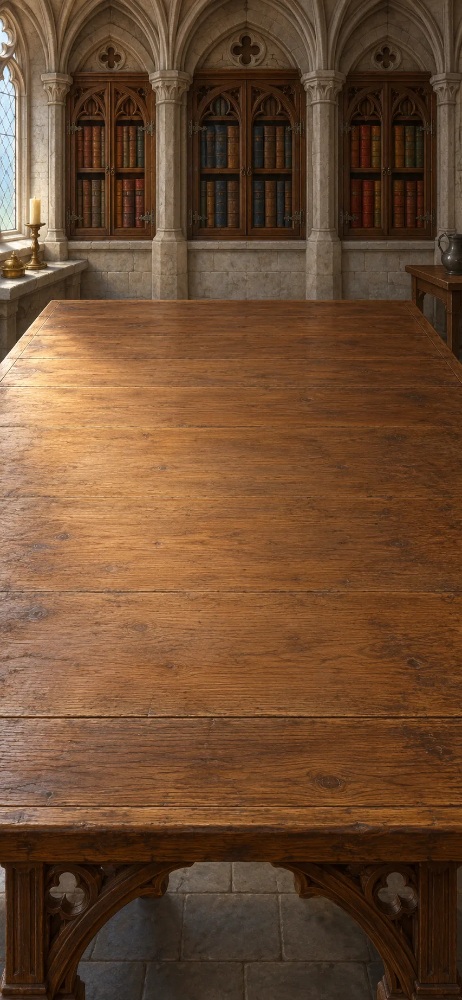
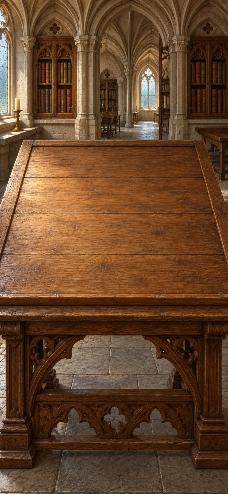

# Theology: Disputed Questions

A manuscript desk, not a test of faith. Follow a wound, a failed promise, bread, a hungry household and a request for prayer through changing arguments. Build what each writer is claiming, test it against a case, and leave real disagreements open. New chapters reuse distinctions you have made. Each item has a short explanation you can revisit.

> NOTE: Converted from `divinity-final-reading-scenes-v7`, the composed current scenario at source commit `1c95988a4e3771abcf2be28183ce009d38645d2c`. The conversion predates the current Markdown runtime. The active manuscript now runs through the shared parser and engine; subsequent authenticity revisions are recorded in the repository review history. All combinations are global. Completed goals remain satisfied.

> NOTE: Reconstructing an attributed religious argument is not endorsement, demonstration of a miracle, or authentication of an object. These desks compare texts; they do not claim that the writers met. The Book of Two Principles and the Lyon ritual are distinct witnesses, not a single creed for everyone called Cathar. Invented cases remain labelled as cases.

## A wound and a stolen meal

*St Augustine, Hippo, 421 AD*

Augustine explains evil as damage to, or loss of, something good. Compare a wound with stealing a meal: suffering harm is not the same as choosing to harm someone.

> NOTE: Source context: Augustine’s handbook · North Africa, c. 421.

**Goals**
- Is being hurt the same as doing wrong? -- Being hurt is not the same as doing wrong
- What is the nature of evil? -- `augustine-loss`

**Items**
- Case: a cut body has lost its health

  Imagine an injured person. The body remains, but it is not as sound as it should be. Nothing here says that the injured person deserves the injury.

- `healed-body` Case: the wound heals; no evil thing escapes

  The injury disappears as the body heals. This is Augustine’s kind of example: the loss is repaired, rather than a second material being removed.

- Case: I take the meal my neighbour needs

  Imagine taking another person’s share for your own comfort, knowing whose share it is. This is a deliberate action, unlike merely suffering a wound.

- `fair-share` Comfort is good; my neighbour is still owed food

  Enjoying food is good, but the neighbour is still owed their share. The wrong is taking that food, not enjoying a meal.

- Genesis: creation was “very good”

  Augustine accepts the goodness of creation as a religious starting point. The wound example does not establish that starting point.

- `health-lost` A wound is missing health, not an extra substance

  The body is still there, but its health has been damaged. Calling the wound a loss does not make its pain unreal.

- The wrong is taking what another is owed

  Eating and enjoying comfort can be good. Taking the meal a neighbour needs is wrong because it puts personal comfort above what the neighbour is owed. The fault is in the choice, not in food itself.

- Being hurt is not the same as doing wrong

  A wound is harm suffered; stealing the meal is a wrong deliberately chosen. Comparing them as losses must not turn suffering into evidence of guilt.

- `augustine-loss` evil is good damaged or missing, not separate stuff
  - from chapter `world-that-harms`: Augustine: evil is good damaged or missing, not separate stuff

  With creation's goodness as his starting point, Augustine treats evil as good damaged or missing. The healing wound illustrates what he means by a loss; it does not establish the scriptural starting point.

**Combinations**
- Case: a cut body has lost its health [transform] + `healed-body` [preserve] -> `health-lost` (tutorial)
- Case: I take the meal my neighbour needs [transform] + `fair-share` [preserve] -> The wrong is taking what another is owed
- `health-lost` + The wrong is taking what another is owed [preserve] -> Being hurt is not the same as doing wrong
- `health-lost` + Genesis: creation was “very good” [preserve] -> `augustine-loss`

> NOTE: Source `aug-evil`: [Augustine, Enchiridion §§9–15, 23–27, 42–52](https://www.newadvent.org/fathers/1302.htm). Created goodness, evil as privation, and the fallen will.

> NOTE: Source `genesis`: [Genesis 1:31, King James Version](https://www.biblegateway.com/passage/?search=Genesis%201%3A31&version=KJV). Brief excerpt from the creation account; not an independent demonstration of the theological claim.

## Why can’t I simply do better?

The meal has not been returned: the person who took it promised fairness, then chose comfort again. Use Augustine's account of grace to examine that failure; then ask why his church baptizes infants who have made no such choice.

> NOTE: Source context: Augustine’s grace controversy · early fifth century texts.

**Goals**
- Why do we fail to do what we know is right? -- `aided-choice`
- Why would an infant need forgiveness? -- `condition-not-act`

**Items**
- Case: I know I should return the stolen meal

  The person understands the duty. More information about who owns the meal would not address every part of the problem.

- `failed-promise` Case: I promise fairness, then choose comfort again

  The person knows they should return the food and promises to do so, then chooses comfort again. Understanding and promising have not yet produced the right action.

- Paul: “The good that I would I do not”

  Here “would” means “want to”. The passage frames the willing-and-doing problem that we are comparing with Augustine's account of grace.

- `love-help` God can stir love, not merely teach
  - from chapter `world-that-harms`: Augustine: God can stir love, not merely teach

  Augustine distinguishes knowing what is right from wanting and choosing it. He calls God's inward help with that choice grace.

- Augustine’s church baptizes infants for forgiveness

  Augustine appeals to his church's practice of baptizing infants for forgiveness. What the practice presupposes still needs an explanation.

- `adam-condition` we inherit a sinful condition from the first human, Adam
  - from chapter `world-that-harms`: Augustine: we inherit a sinful condition from the first human, Adam

  Adam is the first human in the biblical story. Augustine says Adam's disobedience leaves later humans needing forgiveness even before choosing a wrong act.

- `knowing-doing-gap` I know what is right, but still choose otherwise

  Knowing what is right has not been enough to make the person do it. Augustine argues that God's help must address willing and acting as well as ignorance.

- `aided-choice` God helps the person want and act
  - from chapter `world-that-harms`: Augustine: God helps the person want and act

  Augustine says God can help a person want and do what is right. The person still chooses and acts; help does not make the human actor disappear.

- Why forgive an infant who has not chosen wrong?

  Augustine's church baptizes both infants, although neither has chosen a wrong act. What could forgiveness address in both cases? The practice poses that question; it does not prove the account Augustine gives of inherited sin.

- `condition-not-act` both infants inherit sin; illness does not decide it
  - from chapter `world-that-harms`: Augustine: both infants inherit sin; illness does not decide it

  Apply Augustine's inherited-condition claim to both children: he says both need forgiveness through Adam, although neither chose a wrongful act. The healthy infant is not exempt, and the ill infant's suffering is not evidence of personal wrongdoing. Christians have disputed this teaching and its implications.

- `two-infants` Case: one infant ill, one well; neither chose wrong

  One infant is ill and the other is well. Neither has chosen a wrongful act. Does either child's health determine a need for forgiveness?

**Combinations**
- Case: I know I should return the stolen meal [transform] + `failed-promise` -> `knowing-doing-gap`
- Paul: “The good that I would I do not” [preserve] + `failed-promise` -> `knowing-doing-gap`
- `knowing-doing-gap` [preserve] + `love-help` [preserve] -> `aided-choice`
- `two-infants` [preserve] + Augustine’s church baptizes infants for forgiveness [preserve] -> Why forgive an infant who has not chosen wrong?
- Why forgive an infant who has not chosen wrong? [preserve] + `adam-condition` [preserve] -> `condition-not-act`

> NOTE: Source `aug-grace`: [Augustine, On the Grace of Christ I](https://www.newadvent.org/fathers/15061.htm). Grace as inward help for willing and acting, beyond nature and instruction alone.

> NOTE: Source `romans`: [Romans 7:19, King James Version](https://www.biblegateway.com/passage/?search=Romans%207%3A19&version=KJV). Short excerpt about willing and doing. Pairing this verse with Augustine's grace argument is an editorial comparison; the linked On the Grace of Christ I supports inward help beyond teaching without supplying a specific reading of this verse.

## `world-that-harms` Who made a world that harms?

*Northern Italy, thirteenth century*

The Book of Two Principles argues that good and evil have opposed sources. Reconstruct its reasoning and compare it with Augustine's account. Its central claim conflicts with Augustine’s explanation of evil.

[If skipped] Augustine describes evil as damage within a good creation. The Book of Two Principles gives evil an opposed source. The creator's responsibility remains in question.

> NOTE: Source context: Book of Two Principles · northern Italy, thirteenth century.

**Goals**
- Does foreseeing harm make you responsible? -- A knowing maker is not merely a knowing spectator
- Does evil have a source of its own? -- `origins-dispute`

**Items**
- Matthew: “A good tree cannot bring forth evil fruit”

  The verse concerns trees and fruit in a warning about false prophets. The medieval writer extends it into an argument about the sources of good and evil.

- Two Principles: no evil can come from a wholly good cause

  The Book of Two Principles claims that a wholly good source cannot produce evil. That rule is an extra premise in its argument, not something proved merely by noticing suffering.

- Case: the same world feeds people and destroys them

  Imagine fertile land and a destructive storm. The case asks what a good creator could be responsible for. It is not offered as evidence that any one disaster punishes its victims.

- Two Principles: a maker knowingly chose this harmful world

  The text presses a responsibility question: if the maker knew the result and made its conditions, why treat that maker as only an observer?

- An observer can foresee harm without making its cause

  Foreknowledge alone need not cause an event. This is the kind of reply examined in the text. A creator’s additional role still needs attention.

- The writer turns the tree saying into a rule about causes

  The writer reads the tree-and-fruit saying as a rule about the sources of good and evil. Accepting the verse does not require accepting that particular interpretation.

- Two Principles: good and evil must have opposed sources

  Start with the writer's wholly good source. The world contains harm as well as benefit, but assigning that harm to the same source would violate his rule that no evil can come from a wholly good cause. To retain both that source and that rule, he assigns evil an opposed source. The extra source is the writer's solution to the conflict between his premise and the mixed world; noticing suffering alone has not established it. Augustine contests this account by treating evil as damaged goodness.

- A knowing maker is not merely a knowing spectator

  Knowing that harm will happen is different from making the conditions that cause it. A reply about a passive observer does not fully answer the question about a knowing creator.

- `origins-dispute` Is evil damaged goodness, or does it have its own source?

  For Augustine, the question is how goodness becomes damaged within a good creation. The Book of Two Principles instead assigns evil to an opposed source, refusing to make a wholly good cause responsible for it. Moving evil to another source changes the account of creation itself; it does not merely give the same harm another name. The knowing maker's responsibility is what makes this disagreement matter.

**Combinations**
- Matthew: “A good tree cannot bring forth evil fruit” [preserve] + Two Principles: no evil can come from a wholly good cause -> The writer turns the tree saying into a rule about causes
- The writer turns the tree saying into a rule about causes [preserve] + Case: the same world feeds people and destroys them -> Two Principles: good and evil must have opposed sources
- Two Principles: a maker knowingly chose this harmful world [preserve] + An observer can foresee harm without making its cause [preserve] -> A knowing maker is not merely a knowing spectator
- Two Principles: good and evil must have opposed sources + `augustine-loss` [preserve] -> `origins-dispute`
- Two Principles: no evil can come from a wholly good cause + Case: the same world feeds people and destroys them -> Two Principles: good and evil must have opposed sources

> NOTE: Source `two-principles`: [Book of Two Principles, translated selections](https://www.cuhk.edu.hk/crs/tobias/primary_docs_ch11.html). A surviving radical-dualist argument from thirteenth-century Italy; use the translated primary text, not the page’s unqualified proposed Manichaean genealogy.

> NOTE: Source `matthew-tree`: [Matthew 7:18, King James Version](https://www.biblegateway.com/passage/?search=Matthew%207%3A18&version=KJV). Public-domain translation supplies the visible biblical quotation; the medieval treatise’s interpretation is separately attributed.

> NOTE: Source `two-principles-full`: [Book of Two Principles I.8–10, III.1–2 and V.1–6, translated primary text](https://gnosis.org/library/cathar-two-principles.htm). Online transcription based on Wakefield and Evans, with editor changes; primary text located through the search index because direct fetch failed. Use the actual argument, not the archive’s triumphalist introduction. I.9 gives the watcher analogy and I.10 its reply; V exposes disagreement among dualist groups.

## What has the fire example answered?

Could the same fire work as fire and destroy something else? Apply Aquinas's example to the opposed-sources argument, then return to the knowing maker's responsibility.

> NOTE: Source context: Aquinas · thirteenth century; an editorial comparison of texts.

**Goals**
- Does this answer the knowing maker’s responsibility? -- `limited-answer`

**Items**
- Aquinas: fire does what fire does—it heats and burns

  For Aquinas, fire functions well as fire when it heats and burns. That does not make it morally good or mean that every effect is good for everything nearby.

- `water-lost` Aquinas’s example: water is destroyed by the fire

  Consider the effect on the water: in Aquinas's example it loses what makes it water. This is his medieval account of one thing's destruction, not a modern chemistry explanation. What does that loss tell us about the fire causing it?

- Fire can work well as fire while harming something else

  Fire can function well as fire while harming something else. This challenges a rule that treats good functioning and harmless effects as the same thing.

- Aquinas: harmful effects do not require a separate evil source

  Aquinas's example offers a way for harmful effects to come from something functioning well. It challenges the need for a separate evil source without answering every question about suffering.

- `limited-answer` The fire example challenges two sources, but leaves the maker’s responsibility open

  Aquinas argues that fire can work well as fire by heating and burning while harming something else. This challenges the claim that every harmful effect needs a wholly evil source. It still leaves the question of why a knowing creator would make such a world.

**Combinations**
- Aquinas: fire does what fire does—it heats and burns [preserve] + `water-lost` [preserve] -> Fire can work well as fire while harming something else
- Fire can work well as fire while harming something else [preserve] + Two Principles: good and evil must have opposed sources -> Aquinas: harmful effects do not require a separate evil source
- Aquinas: harmful effects do not require a separate evil source [preserve] + A knowing maker is not merely a knowing spectator [preserve] -> `limited-answer`

> NOTE: Source `summa-evil`: [Aquinas, Summa I q.49 aa.1–3](https://www.newadvent.org/summa/1049.htm). Actual objections, Augustine citations, two principles, good nature and defective agency. No evidence here that Aquinas was answering this surviving Italian treatise.

> NOTE: Source `aquinas-reason-limit`: [Aquinas, Summa I q.32 a.1](https://www.newadvent.org/summa/1032.htm). Natural reason does not demonstrate the Trinity; an explanation of a received belief is not its proof.

## Three—and not three gods?

The rites ahead claim to give God's Spirit: who do Christians mean by Father, Son and Spirit? Aquinas says reasoning from the world cannot prove the Trinity, so turn to Augustine for a different task: explaining the claim of one God without treating human examples as its proof.

[If skipped] Augustine distinguishes Father, Son and Holy Spirit while affirming one God. Aquinas says observation of created things cannot prove this belief.

> NOTE: Source context: Aquinas reopens Augustine · a medieval reading of an earlier text.

**Goals**
- Does being Son mean being less divine? -- Augustine: the name Son does not mean a lesser God
- Which explanations of the Trinity does Augustine rule out? -- `trinity-bounded`

**Items**
- `teacher-pupil` Case: a teacher instructs a pupil; both are human

  One gives the lesson and the other receives it. Test what this difference of role establishes about the kind of being each is.

- Does being Son mean being a lesser kind of God?

  This is a question about an inference from the titles. Being related differently does not, just by itself, decide whether two are unequal in nature.

- `three-humans` Case: three humans share a kind, but remain three beings

  Calling three people “human” does not turn them into a single human being. This comparison exposes a tempting but misleading way to explain divine unity.

- `one-divine-being` Augustine: Father, Son and Spirit are one divine being

  Augustine says Father, Son and Holy Spirit are one divine being. He also distinguishes them: the names do not all refer to the same relationship.

- Jesus: “Father … glorify thy Son”

  The Son addresses the Father. Augustine must explain how this real relationship belongs within his belief in one God.

- Augustine: the name Son does not mean a lesser God

  Being the pupil does not make someone less human than the teacher. The example defeats an automatic inference from different roles to different kinds of being. Augustine makes his own claim about Father and Son: the names express their relationship, not greater and lesser kinds of God. The classroom comparison does not establish divine unity.

- Augustine: one God—not three gods sharing a kind

  Three humans share a kind but remain three separate beings. Augustine's claim is different: Father, Son and Spirit are one divine being with real distinctions, not three similar gods.

- `trinity-bounded` Trinity: one God as Father, Son and Holy Spirit

  Augustine's three-person claim already includes Father, Son and Holy Spirit. The Son's address to the Father tests one relationship within that claim: their distinction must be real, not one person taking turns in different roles. The verse is not being used to derive the Holy Spirit. Together with the three-humans comparison, it clarifies what Augustine excludes: neither three separate gods nor one actor changing roles. These tests explain his doctrine without proving it.

**Combinations**
- `teacher-pupil` [preserve] + Does being Son mean being a lesser kind of God? [transform] -> Augustine: the name Son does not mean a lesser God
- `three-humans` [preserve] + `one-divine-being` [preserve] -> Augustine: one God—not three gods sharing a kind
- Jesus: “Father … glorify thy Son” [preserve] + Augustine: one God—not three gods sharing a kind [preserve] -> `trinity-bounded`

> NOTE: Source `aug-trinity`: [Augustine, On the Trinity V.1,5–9](https://www.newadvent.org/fathers/130105.htm). Primary text, public-domain translation. Relative names, one divine being, and limits of creaturely comparison.

> NOTE: Source `aquinas-trinity`: [Aquinas, Summa I q.28 aa.1–3](https://www.newadvent.org/summa/1028.htm). Relations and divine unity. Explicitly reopens Augustine; not three members of a species.

> NOTE: Source `john17-kjv`: [John 17:1, King James Version](https://www.biblegateway.com/passage/?search=John%2017%3A1&version=KJV). Brief public-domain quotation. Its Trinitarian interpretation is separately attributed.

## Can a spiritual rite be bodily?

The Lyon ritual records a ceremony with hands and a Gospel book, promising forgiveness and God's Spirit. Compare this separate medieval witness with the accounts of creation: what can a bodily ceremony tell us about who made bodies?

> NOTE: Source context: The Lyon ritual · a separate medieval manuscript witness.

**Goals**
- What does this bodily rite tell us about creation? -- Using bodies in a rite does not prove belief in one good creator

**Items**
- The rite claims a spiritual gift through hands and a book

  The Lyon ritual places ministers' hands and a Gospel book—an account of Jesus's life and teaching—on the candidate. It calls this spiritual baptism, promising forgiveness and the Holy Spirit dwelling within the believer.

  It appeals to Acts, where Peter and John lay hands on believers who receive the Spirit. The candidate also promises to renounce worldly desires, love enemies, and pray for persecutors. These are the documented actions and claims to compare with an account of creation.

- Using bodies in a rite does not prove belief in one good creator

  Hands and a book take part in a claimed spiritual gift. The rite appeals to the apostolic laying on of hands in Acts for authority; that appeal is not independent verification of its promise. Its pledge joins renouncing worldly desires with prayer for persecutors, so it does not mean abandoning other people.

  Neither bodily action nor that pledge supplies an account of who created matter. The Book of Two Principles argues for opposed sources; this separate ritual witness does not state that account. Using a body in worship cannot by itself establish belief in one good creator.

**Combinations**
- The rite claims a spiritual gift through hands and a book + `origins-dispute` [preserve] -> Using bodies in a rite does not prove belief in one good creator

> NOTE: Source `ritual`: [Occitan ritual, Lyon PA 36, Marvyn Roy Harris critical edition (Rialto)](https://www.rialto.unina.it/archivio/prorel/CatharRitual/CathRit.txt.htm). Critical text IV.15–18 cites Acts 8:14–17 (not Acts 19). III.22–31 and IV.49–53 support indwelling Spirit, forgiveness and bodily enactment. Distinct witness from Two Principles.

> NOTE: Source `matthew-enemies-kjv`: [Matthew 5:44, King James Version](https://www.biblegateway.com/passage/?search=Matthew%205%3A44&version=KJV). Biblical enemy-love command, provided here for comparison. The ritual includes enemy-love and prayer/blessing for persecutors in IV.32; the pledge does not imply the manuscript used KJV.

## Can water do more than wash?

The Lyon rite has shown that a bodily action can claim a spiritual gift. Aquinas offers a different account of baptism with water: try his craftsperson-and-axe comparison, then ask what would authorize this particular use of water.

> NOTE: Source context: Back to Aquinas · Summa III q.62.

**Goals**
- How could water give an inward gift? -- `instrumental-baptism`
- next: Are these two rites saying the same thing? -- `rites-different`

**Items**
- Aquinas’s example: the axe cuts the wood

  The edge explains the tool’s ordinary cutting. It does not explain by itself why a particular piece of furniture takes shape.

- The craftsperson uses the axe to make a bed

  The craftsperson and the tool act in different, connected ways. Calling the axe effective does not install a second independent designer.

- `instituted-baptism` Aquinas: God appointed baptism with water to give grace—new life within the soul

  Aquinas says God chose baptism as a way to give grace: a new life within the soul. That is why its water has a role beyond ordinary washing.

  A sacrament is such a God-appointed bodily sign or rite. The axe comparison cannot prove that God appointed any particular rite.

- `dependent-tool` The axe cuts; the craftsperson works through it

  The axe's edge explains cutting; the craftsperson's work explains why those cuts become a bed. The tool contributes a real action without becoming an independent designer. This is the pattern Aquinas brings to the question about a rite.

- `instrumental-baptism` Aquinas: in baptism, God works through water to give inward grace

  In Aquinas's account, baptism's water washes the body while God works through it to give grace, a new life within the soul. As with the axe, instrumental action need not rival the principal actor. But cutting wood never establishes that God appointed baptism: that further claim supplies the water's sacramental role. Ordinary washing does not automatically acquire it.

- `rites-different` Both rites use bodies; that does not settle their authority claims

  Lyon appeals to apostolic laying on of hands; Aquinas says God appointed baptism with water. Bodily action alone cannot decide which claim to accept. Comparing these texts does not establish a direct debate between them.

**Combinations**
- Aquinas’s example: the axe cuts the wood [preserve] + The craftsperson uses the axe to make a bed [preserve] -> `dependent-tool`
- `dependent-tool` [preserve] + `instituted-baptism` [preserve] -> `instrumental-baptism`
- `instrumental-baptism` + The rite claims a spiritual gift through hands and a book -> `rites-different`

> NOTE: Source `summa-doctrine`: [Aquinas, Summa I q.1 aa.1,8](https://www.newadvent.org/summa/1001.htm). Reason and revelation; grace perfects nature. Augustine is an explicit authority in this question.

> NOTE: Source `summa-sign`: [Aquinas, Summa III q.60 aa.3,6](https://www.newadvent.org/summa/4060.htm). Sensible signs and words; explicitly cites Augustine on the word and element.

> NOTE: Source `summa-grace`: [Aquinas, Summa III q.62 a.1](https://www.newadvent.org/summa/4062.htm). God as principal cause and the sacrament as instrument; no independent magic in matter.

## What changed if it still tastes like bread?

Does Communion give bread the same role that baptism gives water? Aquinas claims a change in what the bread is, even when a guest notices no change in its taste.

[If skipped] Aquinas distinguishes what the bread is from how it appears. He says the first changes while the second remains.

> NOTE: Source context: Aquinas · the Eucharistic argument.

**Goals**
- What can tasting the bread establish? -- `eucharist-account`
- Do water and bread have the same religious role? -- `two-material-roles`

**Items**
- `bread-taste` Case: after the church’s blessing, it still looks and tastes like bread

  After the blessing, the bread looks and tastes the same. Aquinas's account must explain why he still says that what it is has changed.

- Jesus: “This is my body”

  Christians dispute what these supper words mean. Aquinas reads them as affirming the real presence of Christ’s body, not only a reminder.

- Aquinas: what was bread becomes Christ’s body

  Aquinas says the bread becomes Christ’s body, although its taste, colour and shape remain. He is not saying that it starts to look or taste like flesh.

  This claim is called transubstantiation: a change in what the thing is, while its appearances remain. Other Christians dispute the claim.

- Aquinas reads Christ’s words as changing bread into his body

  Aquinas reads Christ's supper words as saying that bread becomes Christ's body. This is a particular interpretation, not the only possible reading established by the words alone.

- `eucharist-account` Aquinas: it becomes Christ’s body but keeps bread’s look and taste

  The guest tastes bread, while Aquinas reads Christ's words as establishing a change in substance—what the thing is. He distinguishes that from the remaining qualities, such as taste, colour and shape, which he calls accidents. The substance becomes Christ's body while those qualities remain: transubstantiation. Unchanged taste fits this account but does not verify that the change occurred; Aquinas relies on divine authority for that claim.

- `two-material-roles` Aquinas: baptism’s water is God’s tool; Communion’s bread becomes Christ’s body

  For Aquinas, baptism's water is a tool through which God acts. In Communion, what was bread becomes Christ's body while appearances remain. These give physical things different roles.

**Combinations**
- Jesus: “This is my body” [preserve] + Aquinas: what was bread becomes Christ’s body [preserve] -> Aquinas reads Christ’s words as changing bread into his body
- `bread-taste` [preserve] + Aquinas reads Christ’s words as changing bread into his body [preserve] -> `eucharist-account`
- `eucharist-account` + `instrumental-baptism` -> `two-material-roles`

> NOTE: Source `summa-eucharist`: [Aquinas, Summa III q.75 aa.2,4,5](https://www.newadvent.org/summa/4075.htm). Change of substance with sensible appearances remaining.

> NOTE: Source `luke22-kjv`: [Luke 22:19, King James Version](https://www.biblegateway.com/passage/?search=Luke%2022%3A19&version=KJV). Brief public-domain quotation; rival readings do not become the words of the verse.

## One coin: a letter or supper?

*Wittenberg, 1517*

A household has one coin and no supper. Compare Luther's priority for helping people with the seller's promise that payment can release a dead soul from punishment. The seller's claim is not the same as official teaching.

> NOTE: Source context: Luther · Wittenberg, 1517.

**Goals**
- (three goals are a lot but okay here because the household payment case compares care, control of gifts, and repentance; the review found these distinctions concrete and did not establish a benefit from hiding one question)
- What should the household's coin pay for? -- `feed-before-letter`
- Does serving God mean controlling God's gifts? -- Working for God does not mean controlling God’s gifts
- Can a payment replace repentance? -- Luther: a paid guarantee cannot replace a changed life

**Items**
- Case: the household has one coin and no supper

  The household has one coin and no supper. Spending it on an indulgence would leave the family's immediate need for food unmet.

- Seller’s claim reported by Luther: a coin frees a dead soul

  Luther reports sellers promising that payment releases a dead person from punishment. He attacks the claim that a coin can guarantee that result.

  The punishment in question is purgatory: purification after death for people ultimately saved, not hell. A reported sales pitch is not the same as official doctrine.

- Luther: household necessities and poor neighbours come first

  Luther gives care a positive priority, rather than treating the purchase as the only religious use for money.

- `declare-forgiveness` Luther: the pope announces forgiveness; God is the one who forgives

  In 1517 Luther still allows a ministerial role. Declaring God’s forgiveness is not an independent power to make God forgive on receipt of money.

- Luther: repentance means a lifetime of turning away from wrong

  Repentance is turning from wrong, not a transaction completed once and forgotten. This claim helps explain why a guarantee based on payment troubles Luther.

- `coin-not-control` For Luther, a seller cannot guarantee God’s mercy for a coin

  An indulgence concerns penalties remaining after forgiveness. Luther's proposed limit is narrower still: the pope can remove penalties imposed by church authority, but cannot by his own power command the release of a dead soul. The seller's guaranteed result goes beyond that limited role. A reported sales pitch is not the definition of official teaching.

- `feed-before-letter` Luther: buy the hungry household supper before an indulgence letter

  Luther says a household with one coin and no supper should buy food before an indulgence letter—a grant of relief from penalties for sins already forgiven. Feeding the family and helping poor neighbours come first.

- Working for God does not mean controlling God’s gifts

  Luther says church ministers can announce God’s forgiveness but cannot make God forgive for money. Aquinas says baptism’s water acts through God’s power, not its own. Both distinguish serving God from independently controlling God’s gifts, although they address different practices.

- Luther: a paid guarantee cannot replace a changed life

  Luther separates two matters: the dead person's release and the living buyer's repentance. He denies that a coin guarantees the first; buying such a promise cannot replace the buyer's lifetime of turning away from wrong. The reported sales promise is not official teaching, and his criticism does not reject every rite or payment.

- `papal-penalty-limit` Luther: the pope can release penalties imposed by church authority

  Indulgences concern penalties remaining after sins have been forgiven, rather than buying forgiveness itself. In 1517 Luther challenges the extent of the pope's power over those penalties. His proposed limit is part of the dispute.

**Combinations**
- Case: the household has one coin and no supper [transform] + Luther: household necessities and poor neighbours come first [preserve] -> `feed-before-letter`
- `declare-forgiveness` [preserve] + `instrumental-baptism` -> Working for God does not mean controlling God’s gifts
- `coin-not-control` [preserve] + Luther: repentance means a lifetime of turning away from wrong [preserve] -> Luther: a paid guarantee cannot replace a changed life
- Seller’s claim reported by Luther: a coin frees a dead soul [preserve] + `papal-penalty-limit` [preserve] -> `coin-not-control`

> NOTE: Source `theses`: [Luther, Ninety-Five Theses (1517), Taylor edition](https://editions.mml.ox.ac.uk/editions/luther-95-theses/luther-95-theses-eng.shtml). Especially theses 1, 27–28, 35–36, 43 and 62; indulgences concern penalties, not a legitimate purchase of guilt’s forgiveness.

## If it is a gift, why do anything?

*Wittenberg, 1520*

The household still needs the supper you put before the indulgence letter. Luther now says that good deeds do not earn God's acceptance: apply his account to supplying the meal, then test an alternative case in which someone keeps a fast but leaves supper unprepared.

[If skipped] For Luther, caring for a neighbour serves a real need without earning God's acceptance. The later role of good deeds remains disputed.

> NOTE: Source context: Luther · Christian Liberty, 1520.

**Goals**
- Why help if help does not earn salvation? -- `care-not-purchase`
- next: Has fasting done the neighbour’s work? -- `practice-not-price`
- Are these writers asking the same question about grace? -- `two-grace-questions`

**Items**
- `gift-acceptance` Luther: faith (trust in Christ), not good deeds, makes us right with God

  Luther says faith, or trust in Christ and his promise, makes a person right with God. This is called justification. Helping a neighbour meets a real need, but does not earn God's acceptance.

- `christ-serves` Luther: Christ served me freely; I can freely serve my neighbour

  Luther says Christians should serve their neighbours freely, as Christ served them. They help because the neighbour needs it, not to earn God's acceptance.

- `body-practice` Alternative case: I fast but leave the household’s supper unprepared

  In this imagined variation, the person disciplines their own appetite but leaves the household's meal unprepared. What has the fast accomplished, and whose need remains?

- `care-not-purchase` Supper reaches the household; service does not buy God’s acceptance

  In the household case, the coin buys food and the meal reaches those who need it. Luther gives the deed its purpose in their hunger and in Christ's freely given service. Feeding them matters without becoming a price paid for God's acceptance.

- `two-grace-questions` Augustine: what helps me act? Luther: what makes me right with God?

  Consider someone who knows the household needs food but is tempted to keep it. Augustine's account asks what helps them move from knowing the duty to wanting and doing it: grace can help willing and acting, while the person really acts. Luther's account asks whether delivering the meal earns acceptance by God: he answers that faith in Christ, not the deed, makes the person right with God.

  The same meal can therefore raise both questions. Explaining how someone comes to serve does not establish what makes them right with God; denying that service earns acceptance does not make its performance unimportant. This comparison separates the questions without making the writers' full accounts identical.

- `practice-not-price` Luther: fasting can discipline me; the household still needs its meal

  Luther gives fasting and other bodily disciplines a purpose in governing one's own conduct. Serving the neighbour addresses another person's need. In this case, keeping a fast has not prepared the family's supper: discipline must support a life of service, not excuse leaving that work undone. Neither kind of work buys God's acceptance.

**Combinations**
- `feed-before-letter` [preserve] + `christ-serves` [preserve] -> `care-not-purchase`
- `gift-acceptance` [preserve] + `aided-choice` [preserve] -> `two-grace-questions`
- `body-practice` [transform] + `care-not-purchase` [preserve] -> `practice-not-price`

> NOTE: Source `liberty-public-domain`: [Luther, Concerning Christian Liberty (1520), Project Gutenberg primary text](https://www.gutenberg.org/cache/epub/1911/pg1911-images.html). Public-domain English text checked for gift, faith, service and bodily discipline. The discipline discussion excludes works as righteousness before God; the bishop comparison denies their making the Christian more holy. Original paraphrases, not quotations from the separate modern Hanover translation.

## What can these opponents sign together?

*Marburg, 1529*

Compare texts from the years before Marburg with its signed articles. The writers agree on some beliefs while disagreeing about Christ's bodily presence in Communion.

> NOTE: Source context: Marburg · 1526–1529 texts beside the signed articles.

**Goals**
- (three goals are a lot but okay here because the Communion positions, the unbelieving guest, and shared agreement are distinct comparisons; the review found the three simultaneous questions intelligible)
- What is received in Communion? -- `three-supper-accounts`
- Does receiving the gift guarantee its benefit? -- `received-not-benefited`
- What can these opponents agree on? -- Shared belief in the Trinity leaves their Communion dispute open

**Items**
- Zwingli: a ring recalls a beloved without containing their body

  A ring can bring a loved person to mind without containing their body. Zwingli uses this example to explain how Communion's bread can point to Christ without containing his body.

- Zwingli: Christ’s human body is in heaven

  Zwingli argues that Christ's human body is in heaven after the Ascension. He therefore reads the Communion bread as a sign of that body, not a place where the body is located.

- Luther: Christ’s words give his body with the bread

  In the 1529 catechism, the sacrament depends on Christ’s words, not the participant’s ability to create it by believing. This is not Aquinas’s account of changed bread.

- `unbelieving-guest` Case: a Communion guest eats the bread without trusting Christ’s promise

  The guest tests two questions: what is received, and whether receiving it brings the promised benefit. The two need not have the same answer in Luther’s account.

- `faith-benefit` Luther: Communion’s promised forgiveness is received only through faith—trust in Christ’s promise

  For Luther, the promised forgiveness in Communion is received through faith: trusting Christ's promise that the gift is for you. Merely eating does not supply that trust. He distinguishes receiving Christ's body from receiving the forgiveness that also strengthens faith.

- Marburg’s signers affirm one God in three persons

  The jointly signed first article affirms the Trinity. Agreement on this matter does not remove their dispute about the supper.

- `signed-supper` Marburg: Christ is received through faith; his bodily presence stays disputed

  The signers affirm receiving Christ through faith and the supper's strengthening of faith. They still disagree about Christ's bodily presence in bread and wine; they do not share one account of how that presence works.

- `zwingli-reading` Zwingli: bread points to Christ’s body; it does not contain it

  Zwingli's ring recalls someone without containing their body. Together with his belief that Christ's human body is in heaven, this supports his reading of Communion bread as a sign. Aquinas and Luther give different accounts of the same supper words.

- `two-presence-accounts` Aquinas: bread becomes Christ’s body. Luther: Christ’s body comes with bread

  Both affirm bodily presence, but the material accounts differ. Aquinas describes a change in what was bread; Luther’s catechism calls it bread with Christ’s body.

- `three-supper-accounts` Aquinas: bread becomes the body. Luther: body with bread. Zwingli: bread signifies body

  The third account separates two questions: is Christ's body present, and does the bread remain? Aquinas and Luther affirm bodily presence but differ about what happens to the bread. Zwingli leaves bread as a sign of the body in heaven. Agreement on bodily presence would therefore still leave a question about transformation; rejecting transformation need not imply Zwingli's answer.

- `guest-not-maker` Luther: even an unbelieving Communion guest receives Christ’s body with the bread

  In Luther’s account of Communion, even the guest who does not believe receives Christ’s body with the bread. Christ’s words establish what is given; the guest’s disbelief does not undo it.

  This answers what is received. Whether receiving it brings the promised forgiveness is a separate question.

- `received-not-benefited` Luther: the unbelieving Communion guest receives Christ’s body, not the promised forgiveness

  Luther says an unbelieving Communion guest still receives Christ's body with the bread, because Christ's words establish the gift. Without trusting the promise, the guest does not receive its promised forgiveness. What is given and its benefit to the receiver are separate questions.

- `shared-trinity` They agree about one God in three persons—not every claim about Communion

  The writers can share belief in one God as Father, Son and Spirit while disagreeing about Communion. Real agreement does not require agreement on every question.

- Shared belief in the Trinity leaves their Communion dispute open

  At Marburg, the signers affirm one God as Father, Son and Spirit and receiving Christ through faith. They still disagree about his bodily presence in bread and wine. A shared signature records real agreement without erasing its limit.

- `luther-zwingli-contrast` Luther: Christ’s body comes with bread. Zwingli: bread points to the body

  These two accounts differ about bodily presence. That does not yet locate Aquinas: his earlier changed-bread account is a third position to compare.

**Combinations**
- Zwingli: a ring recalls a beloved without containing their body [preserve] + Zwingli: Christ’s human body is in heaven [preserve] -> `zwingli-reading`
- `eucharist-account` + Luther: Christ’s words give his body with the bread -> `two-presence-accounts`
- `two-presence-accounts` [preserve] + `zwingli-reading` -> `three-supper-accounts`
- `unbelieving-guest` [transform] + Luther: Christ’s words give his body with the bread -> `guest-not-maker`
- `guest-not-maker` [preserve] + `faith-benefit` [preserve] -> `received-not-benefited`
- Marburg’s signers affirm one God in three persons + `trinity-bounded` [preserve] -> `shared-trinity`
- `shared-trinity` [preserve] + `signed-supper` -> Shared belief in the Trinity leaves their Communion dispute open
- `zwingli-reading` + Luther: Christ’s words give his body with the bread -> `luther-zwingli-contrast`
- `luther-zwingli-contrast` [preserve] + `eucharist-account` -> `three-supper-accounts`
- Marburg’s signers affirm one God in three persons + `signed-supper` -> Shared belief in the Trinity leaves their Communion dispute open

> NOTE: Source `later-zwingli-1526`: [Zwingli, On the Lord’s Supper (1526), Second and Third Articles](https://www.uecf.net/books/zwingli-and-bullinger/chapter5.html). Primary text after THE TEXT; G. W. Bromiley, Zwingli and Bullinger (1953), pp.185–238. Original paraphrases only; the editorial introduction is not Zwingli. Ring at Third Article; ascension at Second Article. The brief supper quotation is separately attributed to KJV Luke 22:19.

> NOTE: Source `later-luther-1529`: [Luther, Large Catechism V, The Sacrament of the Altar (1529)](https://bookofconcord.org/large-catechism/sacrament-of-the-altar/). Large Catechism V §§8–18 identity; §§20–29 forgiveness and nourishment of faith; §§33–37 benefit through faith. No later Formula of Concord labels substituted.

> NOTE: Source `later-marburg-1529`: [The Marburg Articles, 3 October 1529, Articles 1, 5–8 and 15](https://germanhistorydocs.org/en/from-the-reformations-to-the-thirty-years-war-1500-1648/ghdi:document-4311). Primary joint statement, translated by Ellen Yutzy Glebe; original paraphrases only. Article 15 affirms spiritual reception, records corporal-presence disagreement, and qualifies mutual love by conscience. A signature is not doctrinal convergence.

## Does accepting a gift make it wages?

*Trent, 1547*

The household meal now poses a question across a lifetime: does feeding someone earn the first gift of being made right with God, and what can the same deed change afterward? Trent's decree distinguishes those moments; compare them with Luther's account of free service.

> NOTE: Source context: Council of Trent · Catholic bishops, 1547; earlier texts reopened.

**Goals**
- Does accepting a gift mean earning it? -- `response-not-price`
- next: Where do Luther and Trent agree? -- `gift-common-ground`
- What do later good deeds change? -- `works-dispute`

**Items**
- `trent-first-help` Council of Trent: an adult can accept or refuse God’s prior help

  Trent gives the adult a real response to God's help: consenting or resisting. God initiates that help; the person does not begin the process unaided.

- `trent-no-price` Council of Trent: being made right with God for the first time is not earned by faith or deeds

  The Council of Trent says that nothing before our first being made right with God—neither faith nor deeds—earns that gift. It begins with God’s help.

  This is initial justification. Keeping that limit visible prevents the false contrast “Luther teaches a gift; Trent teaches buying it”.

- `trent-growth` Trent council: later deeds, helped by God, deepen received righteousness—our renewed inner life with God

  For Trent, righteousness includes God renewing the person within, not merely a change in reputation. After the initial gift, good deeds made possible by God’s help increase this received righteousness.

  This is the council’s account of growth in justification. It is not just the observation that repeated practice can improve someone’s outward behaviour, and it does not say people begin by earning salvation.

- `luther-fruit` Luther: deeds can train us, but do not make a Christian more holy before God

  In Christian Liberty, Luther gives deeds a role in training the body and serving others, but denies that those deeds make an already-Christian person more holy before God.

  His bishop comparison makes the distinction: doing the bishop’s work does not make the bishop more consecrated. The text allows growth of faith and love, so this is not a denial of all growth or better conduct.

- `response-not-price` Trent council: an adult’s response does not earn being made right with God for the first time

  Accepting and earning are different claims. Trent says an adult can really consent to God's prior help, while denying that anything preceding initial justification—faith or deeds—merits that gift. A real response does not make the gift wages. This does not yet answer what deeds can change after the gift is received.

- `gift-common-ground` Luther and Trent: feeding someone does not earn our first acceptance by God

  Luther and the Council of Trent both deny, in this household comparison, that feeding someone buys the initial gift of being made right with God. This limited agreement does not make their accounts of faith, inward renewal or later good deeds the same.

- `works-dispute` Trent and Luther dispute how deeds affect holiness before God—not whether conduct can improve

  Consider the already-Christian person continuing to feed the household. Trent says deeds made possible by God's help increase righteousness already received, including inward renewal. Luther's text values the service and training but denies that such deeds make the Christian more holy before God. Both can value the meal while disagreeing about this further effect; better outward conduct is not the whole issue.

**Combinations**
- `trent-first-help` [preserve] + `trent-no-price` [preserve] -> `response-not-price`
- `trent-growth` [preserve] + `luther-fruit` [preserve] -> `works-dispute`
- `response-not-price` [preserve] + `care-not-purchase` [preserve] -> `gift-common-ground`

> NOTE: Source `later-trent-1547`: [Council of Trent, Session VI, Decree on Justification, 13 January 1547](https://history.hanover.edu/texts/trent/ct06.html). Session VI V–VIII: prior help, consent, unearned initial gift and inward renewal; X and canon24: growth in received justice. Compare Luther’s explicit more-sacred-person exclusion, not only temporal order.

## May I ask a saint as I ask a friend?

The parent keeps the words “pray for my child” but changes the listener from a living friend to the departed Stephen. Compare Calvin's response with the earlier account of God's instruments; the proposed painting and the bone labelled “Stephen” pose different questions about honour and identity.

> NOTE: Source context: Calvin · Institutes, 1559; his 1543 relic treatise reopened.

**Goals**
- Does changing the listener change the request? -- `saint-warrant-question`
- next: Can the water analogy answer Calvin’s objection? -- `agency-not-permission`
- Why does Calvin reject this use of the painting? -- `calvin-panel-answer`
- What history does the fragment still need? -- `fragment-gap`
- (three goals are a lot but okay here because the changed prayer recipient and instrument comparison form one sequence, while the painting and fragment pose separate questions)

**Items**
- `friend-request` Calvin permits asking a living friend to pray for the child

  In the case, the parent tells a living friend about the child's need. Calvin allows this mutual prayer among living believers, dependent on Christ's unique role between people and God.

- `saint-request` Case: to a dead saint, “Stephen, pray for my child”

  The parent now addresses the same request to Stephen, who has died. The words still ask someone to pray to God for the child, rather than to supply salvation independently. Does permission for the first request carry over to this one?

- `stephen-panel` Case: a painting of Stephen, proposed for prayerful honour in a chapel

  The proposed chapel painting shows Stephen remaining faithful. The question is whether people should direct religious honour through it, not whether all paintings should be forbidden.

- `calvin-pictures` Calvin allows some pictures, but not honouring them in worship

  Calvin is not simply against all art. His distinction concerns the use made of pictures in worship, including whether honour can safely be directed through them.

- `stephen-fragment` Case: a bone labelled “Stephen” in casket C17

  The unsigned label claims the bone belongs to Stephen. No history has arrived with the casket, so the label begins an inquiry rather than settling it.

- `fragment-inspection` Inspection: the inner packet is marked P4; the label has no date

  Inside the casket, the bone has its own wrapping marked P4. The packet and casket carry different identifying marks. The undated label does not say when they came together.

  > NOTE: The fragment, casket C17 and packet P4 are an invented case. Their marks are clues for a custody inquiry, not real archaeological findings.

- `calvin-even-genuine` Calvin: even a real saint’s bone should not receive religious honour

  Calvin objects both to doubtful relic claims and to giving relics religious honour. Establishing a bone's identity would not answer his objection to the practice.

- `saint-warrant-question` Calvin asks what permits the request to Stephen—and how he knows it

  The friend can be told the child's need, and Calvin finds biblical authorization for prayer among the living. Changing the listener to Stephen adds claims that the familiar wording does not establish: that people may address departed saints, and that Stephen can know this particular request. Calvin challenges both. He also argues that invoking saints obscures Christ's unique mediation—his role between people and God. Asking only for prayer does not make the two cases equivalent in Calvin's account.

- `agency-not-permission` Baptism’s water is an instrument; Stephen would be a person asked to pray

  Aquinas's water need not know anyone's request in order to be an instrument through which God acts. Stephen, in the parent's proposal, is a person being addressed and asked to pray. Instrumental action therefore does not supply the missing permission to address him or establish how he knows the child's need. Calvin's objections remain, including his concern that this request obscures Christ's unique role.

- `calvin-panel-answer` Calvin rejects honouring this painting in worship, not all paintings

  Showing Stephen's faithfulness makes the picture a depiction of a human life; it does not settle the proposed use in prayerful honour. Calvin allows painting and sculpture within limits, but rejects this devotional use. The subject and the use are separate questions.

- `fragment-gap` No record yet connects packet P4 to casket C17

  The wrapping and casket cannot yet be given one documented history. We need a record connecting P4 to C17 and an account of where the bone came from before that transfer. The label supplies neither. An archivist can now look for those specific links.

- `authenticity-not-permission` Even if it is Stephen’s bone, Calvin still rejects honouring it

  The bone's identity remains unresolved, but Calvin's objection to honouring it does not depend on that uncertainty. A genuine object can still be disputed as a religious practice.

**Combinations**
- `friend-request` [preserve] + `saint-request` [preserve] -> `saint-warrant-question`
- `saint-warrant-question` [preserve] + `instrumental-baptism` -> `agency-not-permission`
- `stephen-panel` [preserve] + `calvin-pictures` [preserve] -> `calvin-panel-answer`
- `stephen-fragment` [preserve] + `fragment-inspection` [preserve] -> `fragment-gap`
- `fragment-gap` + `calvin-even-genuine` -> `authenticity-not-permission`

> NOTE: Source `images-calvin-1559`: [Calvin, Institutes I.11 §§9–13 (1559), Beveridge translation](https://www.ccel.org/ccel/calvin/institutes.iii.xii.html). Painting and sculpture, devotional honour, and instituted signs. Calvin’s polemical historical allegations are not independent findings. Especially §§12–13.

> NOTE: Source `images-calvin-relics-1543`: [Calvin, Treatise on Relics (1543), Krasinski translation, second edition 1870](https://www.gutenberg.org/cache/epub/32136/pg32136-images.html). Calvin begins at printed p.217; the preceding dissertation and numbered translator notes are not his text. Catalogue pp.254–256; admission concerning commissioners pp.276–277; genuine-or-false distinction p.278. Reports are attributed, not authenticated.

> NOTE: Source `calvin-prayer`: [Calvin, Institutes III.20 §§19–27](https://www.ccel.org/ccel/calvin/institutes.v.xxi.html). Primary text, Beveridge translation. Distinguishes mutual prayer among the living from invoking departed saints; challenges scriptural warrant and knowledge of particular prayers.

## What would new evidence actually change?

*Trent, 1563*

Trent's decree offers a different account of the parent's request and the proposed painting. Apply it to a prayer through Christ and a bow intended to honour Stephen, then examine the archivist's new record: what does each addition actually answer?

*Fictional archivist; newly recovered record in the invented fragment case.*

The record names the fragment's packet and casket. For the first time, there is a transfer to check.

[If skipped] The record improves our knowledge of the bone's history. It does not settle whose bone it is, obtain a bishop's recognition or resolve the disagreement about honouring relics.

> NOTE: Source context: Council of Trent · Catholic bishops, 1563; Calvin’s objections retained.

**Goals**
- (three goals are a lot but okay here because the same prayer, painting and fragment each receive a different kind of new evidence or argument)
- What does “through Christ” answer about this request? -- `prayer-disagreement`
- Does the bow cease to be devotional if the paint has no power? -- `panel-still-disputed`
- Would proving the bone's identity settle the dispute? -- A better history for the bone would not remove Calvin’s objection

**Items**
- `saints-not-saviours` Trent: ask saints to pray for particular needs through Christ, the sole saviour

  Trent recommends asking saints with Christ for their prayers and help, including prayers for particular people. It places that aid through Christ, the sole redeemer and saviour. Applied to the imagined request for the child, this explains why the parent does not intend to give Stephen Christ's place.

- `trent-image-honour` Case reply: bow before the painting, with honour intended for Stephen

  The proposer adds a gesture to the same painting case: bowing before it while denying that any divinity or power lives in the paint. This applies Trent's account of honour referred to the person shown. The council includes bodily gestures before images, as well as their roles in remembrance and instruction.

  > NOTE: The bow is a proposed application in the existing invented painting case, not a recorded historical event or a ruling approving this particular image. Trent XXV discusses kissing images, uncovering the head and prostration; Calvin I.11.9–11 rejects devotional honour before images and the defence that honour passes beyond the material object.

- Case update: a 1532 transfer names packet P4 and casket C17

  The invented record has two entries: in 1532, sexton Martin received packet P4 from Agnes's chest and sealed it in casket C17; in 1551, keeper Anne received C17 with its seal intact. The first entry calls the contents “Stephen's bone” but gives no account of how Agnes acquired it. No bishop's decision accompanies the record.

  > NOTE: These people, marks, dates and custody entries are fictional evidence for this case, not an actual relic history. The record supports only the stated transfers, not identification with the biblical Stephen.

- `prayer-disagreement` Prayer through Christ still leaves Calvin’s questions about Stephen’s hearing and authority

  The parent's reply explains that Stephen is not intended as another saviour. It does not by itself establish what authorizes addressing him or how he knows this child's need. Trent affirms particular requests, appealing to received church teaching; this decree does not explain how saints learn those requests. Calvin disputes their biblical warrant and thinks invocation obscures Christ's mediation even when Christ is named. The disagreement now concerns authority and knowledge as well as the intended place of Christ.

- `panel-still-disputed` Denying power in the paint leaves the devotional bow in place

  The proposed bow remains an act of religious honour before the image, even though the proposer denies power in the paint. Trent understands the honour as directed to Stephen, the person represented. Calvin objects to devotional honour before an image even when its defenders say they look beyond the material object. Removing a claim about the paint's power therefore leaves the disputed gesture intact. The same painting can teach about Stephen's life while its proposed use still divides these accounts.

- `record-not-ruling` P4 entered C17 in 1532; the bone’s earlier identity remains unproved

  The marks now connect: packet P4 was placed in casket C17, and the sealed casket passed to another named keeper. That supports a stretch of custody from 1532 to 1551. It does not tell us how the bone reached Agnes's chest or establish that it belonged to Stephen.

  Trent requires examination and a bishop's approval before recognizing a newly claimed relic. This custody record supplies evidence for examination, not that recognition. The investigation has gained a link without gaining an identity or a ruling.

- A better history for the bone would not remove Calvin’s objection

  We can now trace a transfer of the fragment, although its claimed identity remains unproved. Suppose the missing history were found and the identity established: Calvin would still reject giving it religious honour. Trent permits honour to saints' bodies because they belong to Christ and await resurrection. The disagreement about honour survives even the stronger evidence we have imagined.

**Combinations**
- `saints-not-saviours` [preserve] + `agency-not-permission` [preserve] -> `prayer-disagreement`
- `calvin-panel-answer` [preserve] + `trent-image-honour` [preserve] -> `panel-still-disputed`
- `fragment-gap` + Case update: a 1532 transfer names packet P4 and casket C17 [preserve] -> `record-not-ruling`
- `record-not-ruling` + `calvin-even-genuine` -> A better history for the bone would not remove Calvin’s objection
- `record-not-ruling` + `authenticity-not-permission` [preserve] -> A better history for the bone would not remove Calvin’s objection

> NOTE: Source `images-trent-1563`: [Council of Trent, Session XXV (3–4 December 1563), Waterworth 1848, pp.233–236](https://history.hanover.edu/texts/trent/ct25.html). Decree on invocation, relics and images. Distinguish image-honour, holy bodies, new-relic recognition and episcopal approval of unusual images. The fictional case receives no invented real ruling.

## The End

The packet and casket now have a shared history. Whose bone they held remains unresolved; whether a genuine relic should receive religious honour remains disputed. Across these desks, better evidence has sometimes changed an answer and sometimes shown more precisely why the writers disagree.
